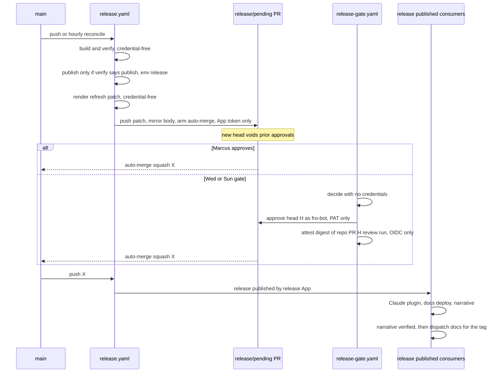

# feat: Gate releases behind an approved release PR

## Overview

A merge to main no longer publishes. Each push to main instead rebuilds a single bot-owned release PR. That PR's only change is the pending `CHANGELOG.md` entry. It publishes only after it auto-merges with an approval on its exact head commit. The approval comes from Marcus at any time, or from a deterministic Wednesday/Sunday gate that approves as `fro-bot` and attests the approval.

The publish job re-verifies the approval, then publishes with npm trusted publishing (OIDC) from a credential-scoped environment. Fro Bot's narrative still lands on the GitHub release after publish. Its silent-failure gap is closed (#1089), and the docs site gains a changelog page and a narrative release-notes page.

## Problem Frame

Every releasing merge publishes immediately: 60 releases in 60 days, with a median of 3 commits. Release credentials (`NPM_TOKEN` and the App key) reach same-repo PR runs. The Renovate job shares the release App key, and a failed narrative rewrite is invisible (#1089). The workflow-level `cancel-in-progress` setting has cancelled publishes mid-flight. Scorecard can't read classic protection, and Code-Review sits at 1/10 (see origin: `docs/brainstorms/2026-10-11-gated-release-pr-requirements.md`).

## Requirements Trace

Requirements are numbered as in the origin doc.

- **Release PR lifecycle:** R1–R5.
- **Publishing:** R6–R12, plus R25 (narrative), R26 (changelog page), and R27 (release-notes page).
- **Approval and schedule:** R13–R16.
- **Credential isolation:** R17–R20.
- **Hardening:** R21–R24.
- **Acceptance examples:** AE1–AE14.
- **Success criteria:**
  - releases batch to about twice weekly;
  - every published version carries an exact-head approval;
  - no narrative failure is silent;
  - Scorecard Branch-Protection is real, Code-Review rises above 1, and Security-Policy reaches 10.

## Scope Boundaries

- Migrating to release-please or changesets.
- Environment reviewers.
- Manual editing of release notes.
- Narrative in the release PR.
- Backfilling `CHANGELOG.md` with past releases.
- Changing the release rules (which types and scopes publish).
- A long-lived release branch.
- Scorecard Vulnerabilities, Fuzzing, and CII.
- The CodeQL alerts in `skills/ce-review/scripts/validate-review.mjs`.

### Deferred to Separate Tasks

- **Dedicated settings App:** a Marcus-org-level change, because the existing App serves Renovate and settings across his repos. Recorded below as an accepted risk.
- **Workflow linting (`actionlint`/`zizmor`):** adding a CI gate is ask-first. Propose it separately.

## Context & Research

### Relevant Code and Patterns

- `.github/workflows/main.yaml`:
  - the `release` job (`needs` build/typecheck/lint/test/host-contract; App token; `NPM_TOKEN`; `bun run build`, then `npx semantic-release`);
  - `publish-claude-code-plugin`, gated on `semantic-release-export-data` outputs;
  - workflow-level `concurrency` with `cancel-in-progress: true`.
- `.releaserc.yaml`: `branches: [main]`, `releaseRules`, `presetConfig.types` (which includes `chore`), `@semantic-release/exec` `successCmd` → `scripts/dispatch-release-notes.sh`, `tagFormat: v${version}`.
- `scripts/dispatch-release-notes.sh`: prompt at `:46-75`, poll and watch, and the `BODY_LEN >= 200` post-check (`:157-161,189`). Every narrative failure exits 0 (`:171-206`).
- `.agents/skills/release-notes-narrative/SKILL.md`: writes to `.context/pr-evidence/…` and `/tmp`, which CI denies.
- `.github/workflows/docs.yaml`: deploys on `release: published`. One job builds and holds `FRO_BOT_APPLICATION_*` for the `gh-pages` force-push. `concurrency: docs-deploy`, cancel true.
- `docs/scripts/transform-content.ts` and `docs:generate` (`package.json:51`): generated pages are gitignored. `astro.config.mjs` builds its sidebar with `autogenerate`.
- `.github/settings.yml`, applied by the bfra-me `update-repo-settings` reusable workflow. It has `branches`, `environments`, and `rulesets` plugins. Support for tag rulesets and environment removal is unverified.
- `.github/workflows/renovate.yaml`: runs on every non-main push with `APPLICATION_ID/KEY`.
- **Test patterns to mirror:**
  - parsed-YAML workflow invariants: `tests/unit/host-contract-workflow.test.ts` and `tests/unit/fro-bot-workflow.test.ts`;
  - shell scripts under a PATH-first mock: `tests/integration/release-notes-ci.test.ts` with `tests/fixtures/mock-gh.sh`;
  - generated docs: `tests/unit/transform-content.test.ts`.
- **Versions:**
  - semantic-release 25.0.9;
  - `@semantic-release/npm` 13.1.5, transitive, with built-in OIDC;
  - commit-analyzer 13.0.1 and release-notes-generator 14.1.1;
  - Node 24 runner npm 11.6+, which meets npm's ≥11.5.1 trusted-publishing floor.

### Institutional Learnings

- **PR title sets the release type.** Under squash merge the PR title is the release-type input (`docs/solutions/workflow-issues/pr-title-selects-release-type-under-squash-merge-2026-08-16.md`). The release PR title must be non-releasing.
- **A green job is not a publish.** Verify publication with `npm view` and the existence of the tag and release (`docs/solutions/integration-issues/green-job-is-not-proof-of-publication-2026-08-18.md`).
- **Narrative architecture.** Keep its commit range and its fail-soft vs. security fail-hard boundaries (`docs/solutions/best-practices/release-notes-narrative-ci-automation-architecture-2026-05-23.md`).
- **Claude plugin publish.** It must be gated on a real release (`docs/solutions/best-practices/claude-code-plugin-build-and-publish-architecture-2026-07-18.md`).
- **Public text.** Commit subjects and PR titles in a release range feed the public release notes, so they must be public prose.

### External References

- **semantic-release v25** (configuration, plugins, and JS API):
  - dry run still runs `verifyConditions` and core `verifyAuth` (`git push --dry-run`);
  - `plugins` replaces the plugin list;
  - concatenated `generateNotes` output becomes `nextRelease.notes`;
  - publish refuses unless local HEAD equals the remote branch tip.
- **npm trusted publishers:**
  - binds repository, workflow filename, and optionally an environment;
  - provenance is automatic;
  - `@semantic-release/npm` ≥13.1.0 skips token checks when the OIDC exchange succeeds;
  - OIDC dist-tag operations need npm ≥11.21, but this repo doesn't use them.
- **GitHub:**
  - `dismiss_stale_reviews_on_push` fires only on diff-changing pushes;
  - a required check from a job skipped by `if` counts as success;
  - bypass actors apply per ruleset;
  - `GET /commits/{sha}/pulls`, plus `head.sha` and review `commit_id`;
  - `enablePullRequestAutoMerge` takes `expectedHeadOid`;
  - immutable releases lock the tag and assets, but not the body;
  - artifact attestations carry signer-workflow identity.

## Prior-Art Survey

```json
{
  "schema_version": 2,
  "verdict": "build-new-within-scope",
  "scope": "systematic repo at 24935a8: .github/, .releaserc.yaml, scripts/, src/lib/, skills/, .agents/skills/, tests/, docs/solutions/",
  "freshness": {
    "vcs_reference": "24935a8904c80860ba4a124278754400ebe4564e"
  },
  "budget": {
    "max_search_passes": 4,
    "max_candidate_inspections": 16,
    "exhausted": false
  },
  "candidates": [
    {
      "path_or_symbol": ".github/workflows/main.yaml publish-claude-code-plugin if (new-release-published)",
      "description": "Gates a downstream publish on semantic-release-export-data after a release is already cut.",
      "disposition": "insufficient",
      "insufficiency_reason": "Runs after publish, records no approval, cannot hold a release."
    },
    {
      "path_or_symbol": ".github/workflows/main.yaml DRY_RUN and workflow_dispatch dry-run input",
      "description": "Boolean set by whoever dispatches; the only manual publish control.",
      "disposition": "insufficient",
      "insufficiency_reason": "No approval record and no binding to a reviewed head."
    },
    {
      "path_or_symbol": ".github/workflows/fro-bot.yaml PR_REVIEW_PROMPT",
      "description": "Advisory agent verdict; the autoheal prompt forbids approvals.",
      "disposition": "insufficient",
      "insufficiency_reason": "Agent judgment, not deterministic, and not a recorded approval bound to content."
    },
    {
      "path_or_symbol": "src/lib/workflow-guard.ts receipt guard",
      "description": "In-process receipt ledger with a reviewDecision field inside the OpenCode host.",
      "disposition": "insufficient",
      "insufficiency_reason": "Lives in the agent host process; a CI publish job cannot consult it."
    },
    {
      "path_or_symbol": ".github/settings.yml with bfra-me update-repo-settings",
      "description": "Declarative settings applier with rulesets and environments plugins.",
      "disposition": "insufficient",
      "insufficiency_reason": "Applies declared settings; it does not gate publishing or record approvals. Used as the delivery vehicle for environments and rulesets."
    },
    {
      "path_or_symbol": "tests/unit/host-contract-workflow.test.ts and tests/integration/release-notes-ci.test.ts",
      "description": "Parsed-YAML workflow invariant tests and mock-gh shell script tests.",
      "disposition": "insufficient",
      "insufficiency_reason": "Test patterns only; they enforce nothing at publish. Their structure is mirrored by the new tests."
    }
  ],
  "excluded_scopes": [
    {
      "scope": "fro-bot/agent repository",
      "reason": "Outside this repository; cited as design input only."
    },
    {
      "scope": "docs/plans/",
      "reason": "Planning artifacts are not evidence of an existing mechanism."
    },
    {
      "scope": "npm registry trusted-publisher configuration",
      "reason": "External service configuration, not visible from the repository."
    },
    {
      "scope": "node_modules semantic-release internals",
      "reason": "Third-party code read for behavior only, not surveyed as candidates."
    }
  ]
}
```

## Key Technical Decisions

- **Credentialed jobs run no repo code.** Every credentialed workflow is split into two jobs. A credential-free *decide/render* job runs the repo's scripts and writes a small, data-only decision artifact. A credentialed *act* job runs only pinned tooling from the lockfile, plus `gh` and `git`. That tooling is installed with `--frozen-lockfile --ignore-scripts`, and the act job installs nothing else. This holds for publish, refresh, the gate, the Claude plugin push, and the docs deploy.
- **The published body is the committed `CHANGELOG.md` entry.**
  - The credential-free `verify` job extracts the top entry and writes a gated semantic-release config. The config is pure data: the shared rules from `.releaserc.yaml`, plus a gated plugin list.
  - In that list, `@semantic-release/exec`'s `generateNotesCmd` emits the entry, and `verifyReleaseCmd` fails when `${nextRelease.version}` differs from the entry's version.
  - The publish job overwrites its checkout's `.releaserc.yaml` with this generated config before it runs semantic-release.
  - The reason for this design is that regenerating the notes at publish would differ from what was approved: the date changes, and the range includes the release commit's own `chore(release)` subject.
- **Preview reproduces core's inputs explicitly.** Core's dry run needs push credentials (`verifyAuth`), so preview cannot use it. Preview instead loads `.releaserc.yaml` and calls the configured commit-analyzer and release-notes-generator with a context built the way core builds it:
  - last-release discovery from tags matching `tagFormat` (`v${version}`) on the main lineage;
  - the commit range `lastRelease.gitHead..HEAD`;
  - `lastRelease` / `nextRelease` objects;
  - `options` merged from the config.

  A parity test runs real core in dry-run against a local bare remote and compares the version and notes byte-for-byte. The publish-time `verifyReleaseCmd` is the backstop.
- **Strict currency.** The release PR is rebuilt from current main on every main advance (R7). Rebuilds are keyed on the main SHA, so a rerun is a no-op. Any merge to main voids a pending approval, and the gate re-approves on its next pass.
- **Publish invariants.** The credential-free `verify` job checks all of these for the merged commit X:
  - X is the main tip.
  - X maps to a merged PR that meets every one of these:
    - its head ref is `release/pending`;
    - its head repo is this repo;
    - its author login is the release App's bot;
    - `merge_commit_sha == X`.
  - The PR's final head is one commit over `parent(X)`.
  - The head's diff touches only `CHANGELOG.md`. It must be a prepend plus removal of untagged entries.
  - The head carries a valid approval submitted before the merge. The approval is valid in either of two cases:
    - It is Marcus's.
    - It is `fro-bot`'s, and a gate attestation exists that meets both of these:
      - it comes from `release-gate.yaml@refs/heads/main`;
      - its subject digest equals the digest of `{repo, PR, head, review id, run}`, recomputed from the live review read through the API.
  - While `RELEASE_HOLD` is set, only Marcus's approval counts.

  How a failed check is reported:
  - If main moved, the run reports **superseded**. The job goes red with a comment on the merged PR, and the commits are re-proposed in the next release PR.
  - Any other failed invariant is **refused**, and the job goes red.
  - Both outcomes happen before anything publishes.
- **The hold is an admin-only repository variable (`RELEASE_HOLD`).** `fro-bot`'s PAT has write access, not admin. Labels are writable by anyone with triage, so they aren't used.
- **The gate is attributed by attestation, not by environment.** `FRO_BOT_PAT` is already a repo secret. Only `release-gate.yaml` on main mints attestations that publish accepts. A copy of the workflow on a branch, or a leaked PAT, can still approve and merge. Publish refuses the result, and the run is visible. That is the accepted risk from the origin doc.
- **Merge gate before cutover.** Main's ruleset is in place before `RELEASE_MODE` flips: one approval, stale approvals dismissed, no bypass. The Fro Bot approval rule (R23) lands with it. Without these, an armed auto-merge would merge unapproved release PRs, and each refused publish would loop `CHANGELOG.md` commits onto main.
- **Post-publish work moves to `release: published`.** The narrative (`release-notes.yaml`), the Claude plugin (`publish-claude-code-plugin.yaml`), and docs all trigger on that event. Each one acts only when both are true:
  - the release's author is the release App;
  - `npm view @fro.bot/systematic@<version>` exists.

  They work in both legacy and gated mode, and none of them can turn publish red (R11, R25). Publish creates the GitHub release with the release App token, because a release created with `GITHUB_TOKEN` doesn't fire `release: published`.
- **Publish concurrency.** One non-cancelling group, `release-state`, covers three jobs: `legacy-release`, gated `publish`, and `refresh`. This serializes the release state across modes and runs. GitHub replaces an older pending run in a group with a newer one. That's safe because publish discovers its target by state: the latest merged, untagged release PR. An hourly scheduled reconcile covers a merge whose push never triggered a run. Workflow-level `cancel-in-progress` applies only to `pull_request`.
- **The cutover lever fails closed.** `RELEASE_MODE` is an admin-only repository variable.
  - `legacy-release` runs only when it is exactly `legacy`.
  - Gated publish and refresh run only when it is exactly `gated`.
  - Any other value, including unset, fails red and publishes nothing.
- **OIDC is proven at the first real release.**
  - `NPM_TOKEN` stays in the `release` environment as a fallback, exposed only in the publish step's env.
  - Cutover verification checks the npm publisher identity (`_npmUser`) to confirm a trusted-publishing publish. A token fallback therefore can't pass as OIDC.
  - `NPM_TOKEN` is deleted only after a clean OIDC publish.
- **Docs.** Docs builds are credential-free and treat release bodies as untrusted. Deploy runs in a `docs` environment limited to main and `v*` tags. A tag dispatch must name an existing published `v*` release. The registry version comes from that tag.

## Open Questions

### Resolved During Planning

- **Notes file vs. PR body:** the PR's only change is `CHANGELOG.md`. The body mirrors it and is never read.
- **Changelog history:** starts at cutover, and the header links to GitHub Releases.
- **Release-notes page:** full history. A release with no narrative shows its body, marked "narrative unavailable."
- **Docs refresh trigger:** an explicit dispatch from the narrative job.
- **PR phasing:**
  - Phase 0 sandbox.
  - PR 1: narrative and docs.
  - PR 2: gated pipeline, landed dark, plus the merge gate.
  - Cutover.
  - PR 3: tags, immutability, policy, and removing the legacy path.
- **Settings App split:** accepted risk, outside this change.
- **OIDC proof:** at the first gated release, using the publisher-identity check.
- **Narrative rewrite token:** the narrative job dispatches `fro-bot.yaml`, which edits the release with `FRO_BOT_PAT` as it does today. The narrative job itself needs only `contents: read` and `actions: write`.

### Deferred to Implementation

Phase 0 sandbox evidence is needed first for these:

- **Auto-merge.** Can a GitHub App installation token enable auto-merge on its own PR? Does the resulting merge fire `on: push`? The hourly reconcile covers it if not.
- **Squash message.** Do `commitHeadline`/`commitBody` on `enablePullRequestAutoMerge` override the squash message? The publish version check is the backstop.
- **Settings applier.** Does the bfra-me applier support `target: tag` rulesets, environments with branch-and-tag policies, and removal of resources missing from config? If not, document `gh api` calls instead.
- **Review dismissal.** Can the `fro-bot` user dismiss its own review after the head changes mid-gate? If not, the gate re-checks before approving with `commit_id`, and publish's exact-head check is the backstop.
- **Repository variables.** Confirm that only admins can set them. This is the assumption behind `RELEASE_MODE` and `RELEASE_HOLD`.

Observed at the first gated release:

- Does OIDC work with no `registry-url` and no `NODE_AUTH_TOKEN`?
- Does `@semantic-release/npm` exchange OIDC in `verifyConditions`, before the tag? If not, an OIDC failure leaves an orphaned tag. The break-glass runbook covers that, and tag rulesets land only after a clean publish.

Decided during implementation:

- How Fro Bot's review (R23) withholds approval: a deterministic pre-step in `fro-bot.yaml`, or an agent action input. Read the pinned `fro-bot/agent` inputs.
- The exact attestation statement format and the matching `gh attestation verify` flags.

## High-Level Technical Design

> *This illustrates the intended approach and is directional guidance for review, not implementation specification. The implementing agent should treat it as context, not code to reproduce.*



| State on push to main or reconcile | Publish | Refresh |
|---|---|---|
| Tip is an untagged release merge X with a valid approval | publish | waits in `release-state`, then previews the new range |
| Tip is an untagged release merge X, approval invalid | refused (red) | rebuild a new release PR |
| An untagged release merge exists but is not the tip | superseded (red, comment) | rebuild; commits re-proposed |
| Ordinary merge | skip | rebuild, or close the PR if nothing is releasable |
| `RELEASE_MODE` is not exactly `gated` | skip (legacy runs only on exactly `legacy`) | preview to the job summary only |

## Phased Delivery

- **Phase 0, sandbox (Marcus, with agent help).**
  - In a throwaway GitHub repo, settle the auto-merge, squash-message, settings-applier, review-dismissal, and repository-variable questions.
  - Create the release App and the `release` environment (deployment branch `main`).
  - Create the `docs` environment (`main` plus `v*` tags) and move `FRO_BOT_APPLICATION_*` into it.
  - Create the npm trusted publisher bound to `release.yaml` and `release`. The workflow filename is final from here on.
- **PR 1:**
  - narrative hardening;
  - the narrative job;
  - the docs split and environment;
  - the release-notes page.

  All of these work on today's pipeline.
- **PR 2:** the gated pipeline, landed dark (`RELEASE_MODE=legacy`). It also adds the changelog page, the Fro Bot approval rule, and the main ruleset.
- **Cutover.** Preconditions:
  - the main ruleset is active;
  - Fro Bot is approving Marcus's PRs.

  Then flip `RELEASE_MODE=gated`.
- **PR 3** (after one clean OIDC gated release):
  - tag rulesets;
  - immutable releases;
  - `SECURITY.md`;
  - SHA pinning;
  - removal of the legacy path and `NPM_TOKEN`.

## Implementation Units

### PR 1: Narrative and docs

- [ ] **Unit 1: Narrative hardening (#1089)**

**Goal:** When a narrative run doesn't rewrite the release, it reports `narrative-not-applied` instead of success. The agent gets a writable scratch directory.

**Requirements:** R25, AE12

**Dependencies:** None

**Files:**
- Modify: `scripts/dispatch-release-notes.sh`, `.agents/skills/release-notes-narrative/SKILL.md`, `tests/fixtures/mock-gh.sh`
- Test: `tests/integration/release-notes-ci.test.ts`

**Approach:**
- The prompt and the skill both name `$RUNNER_TEMP/release-notes` as the only scratch directory.
- Replace `BODY_LEN >= 200` with a before/after body comparison plus the `## What's new` marker.
- `narrative-not-applied` becomes its own outcome with a non-zero exit. The script runs in its own job (Unit 2), so a red result never marks publish as failed.
- Keep the existing security-class outcomes.

**Execution note:** Test-first. Extend the mock-gh scenarios before changing the script.

**Patterns to follow:** the scenario env vars in `tests/integration/release-notes-ci.test.ts`.

**Test scenarios:**
- Happy path: the body changed and starts with `## What's new` → success.
- Error path: the body is unchanged and longer than 200 characters (the v3.21.7 case) → `narrative-not-applied`, non-zero exit.
- Error path: the body changed but has no marker → `narrative-not-applied`.
- Edge: the release is already narrated → success, no dispatch.
- Integration: the prompt contains the scratch-directory instruction, and the skill's paths match it.

**Verification:** Every scenario passes, and the v3.21.7 reproduction no longer exits 0.

- [ ] **Unit 2: Narrative as its own job**

**Goal:** The narrative runs on `release: published` in its own workflow, then dispatches the docs refresh after it verifies the rewrite.

**Requirements:** R10, R11, R25, R27, AE12, AE14

**Dependencies:** Units 1 and 4

**Files:**
- Create: `.github/workflows/release-notes.yaml`
- Modify: `.releaserc.yaml` (drop the `successCmd` entry)
- Test: `tests/unit/release-notes-workflow.test.ts`

**Approach:**
- Triggers: `release: published` (skip prereleases) and `workflow_dispatch` with a `tag` input, for re-narration.
- The job acts only when the release author is the App that creates releases and npm has that version. In PR 1 that is the existing App; in PR 2 it is the release App.
- It dispatches `fro-bot.yaml` through `scripts/dispatch-release-notes.sh`. `fro-bot.yaml` applies the edit with `FRO_BOT_PAT`, as it does today. The job's own permissions are `contents: read` and `actions: write`, with `GITHUB_TOKEN`.
- Concurrency: one group per tag, no cancel.
- On a verified success, it dispatches `docs.yaml` with the tag.

**Patterns to follow:** `tests/unit/host-contract-workflow.test.ts` (`readWorkflow`, `findStep`).

**Test scenarios:**
- Triggers are only `release: published` and dispatch, and the workflow holds no release secrets.
- A release authored by another identity → no action.
- The docs dispatch runs only after the narrative step succeeds.
- `.releaserc.yaml` has no `successCmd`.

**Verification:** The tests pass, and a post-merge dispatch against an existing tag narrates the release and redeploys docs.

- [ ] **Unit 3: Docs release-notes page**

**Goal:** A generated page lists every release, newest first, with its narrative. A release without the marker is shown with the label "narrative unavailable."

**Requirements:** R27, AE14

**Dependencies:** None

**Files:**
- Create: `docs/scripts/generate-release-notes.ts`
- Modify: `package.json` (`docs:generate`), `.gitignore`, `docs/astro.config.mjs` (sidebar, if needed)
- Test: `tests/unit/generate-release-notes.test.ts`

**Approach:**
- Fetch releases with `GH_TOKEN` when it is present. Without it, write a stub page that links to GitHub Releases.
- Treat bodies as untrusted: strip raw HTML, allowlist `https:` links, escape MDX braces, and cap the length per release.
- Record `updated_at`.

**Patterns to follow:** `docs/scripts/transform-content.ts` and `tests/unit/transform-content.test.ts`.

**Test scenarios:**
- Happy path: releases are ordered newest first and have headings.
- Edge: a release with no marker gets the label.
- Edge: no token produces the stub, and the build succeeds.
- Error path: hostile bodies (`<script>`, `{}`, backticks, `javascript:` links) are neutralized.
- Integration: the output passes `markdownlint` with the repo config.

**Verification:** `bun run docs:build` succeeds both with and without `GH_TOKEN`, and the tests pass.

- [ ] **Unit 4: Docs build/deploy split, `docs` environment, tag dispatch**

**Goal:** Docs build with no credentials. The deploy key lives only in a `docs` environment. A tag dispatch builds a validated release tag.

**Requirements:** R10, R20, R27

**Dependencies:** Unit 3; the Phase 0 `docs` environment

**Files:**
- Modify: `.github/workflows/docs.yaml`
- Test: `tests/unit/docs-workflow.test.ts`

**Approach:**
- `build` job: `contents: read`, with `GITHUB_TOKEN` for reading releases. It uploads the site artifact.
- `deploy` job: environment `docs`, holding `FRO_BOT_APPLICATION_*`. It downloads the artifact and pushes, with no install and no repo scripts.
- The `workflow_dispatch` tag input must match `v<semver>` and name an existing published, non-prerelease release. The job checks out that tag and takes the registry version from it.
- On `release: published`, the workflow acts only when the release author is the releasing App.
- Keep `docs-deploy` with cancel-in-progress.

**Test scenarios:**
- Only `deploy` references the environment and the App secrets. `build` has read-only permissions.
- A dispatch input that is not a tag, or names an unknown tag, fails before checkout.
- A dispatch with a valid tag checks out that tag and passes its version to the registry build.
- Prereleases are skipped.

**Verification:** The tests pass, and after merge a dispatch for the latest tag deploys the page.

### PR 2: Gated pipeline, landed dark, plus the merge gate

- [ ] **Unit 5: Preview and changelog writer**

**Goal:** One deterministic preview of the pending version and entry, plus the `CHANGELOG.md` writer.

**Requirements:** R2, R3, R4, R9, R26, AE1, AE4

**Dependencies:** None

**Files:**
- Create: `scripts/release/preview.ts`, `scripts/release/changelog.ts`, `scripts/release/changelog-header.md`
- Test: `tests/unit/release-preview.test.ts`, `tests/unit/release-changelog.test.ts`

**Approach:**
- `preview` builds core's plugin context from tags matching `tagFormat` and the commit range (see Key Technical Decisions). It returns `{version, entry}`, or "nothing releasable."
- `changelog` behavior:
  - If the file is absent, create it from the header template plus a sentinel.
  - If the file exists without the sentinel, fail.
  - Before stripping anything, require a successful, non-empty tag listing. Fail closed otherwise.
  - Strip entries whose `v<version>` tag doesn't exist, then prepend the new entry after the sentinel.
- The output must be clean under markdownlint.

**Execution note:** Test-first, using temporary git repos as fixtures.

**Test scenarios:**
- Happy path: two `fix` commits → next patch, with both in the entry (AE1).
- Happy path: one `feat` among `chore` commits → minor.
- Edge: only `chore`/`test` commits → nothing releasable (AE4).
- Edge: `docs(readme)` → patch.
- Edge: no file → created with the header and the Releases link.
- Error path: the file has no sentinel → error.
- Edge: a phantom untagged entry is stripped.
- Error path: tag listing fails or returns empty → no entries are removed, and the job fails.
- Integration: the version and notes match real core dry-run byte-for-byte, against a local bare remote.

**Verification:** The tests pass, including the core parity test.

- [ ] **Unit 6: Publish verifier and gated config**

**Goal:** A credential-free verifier that emits the decision artifact, and a generator for the data-only gated semantic-release config.

**Requirements:** R6, R7, R8, R9, R15, AE5, AE6, AE9

**Dependencies:** Unit 5

**Files:**
- Create: `scripts/release/verify-merge.ts`, `scripts/release/gated-config.ts`
- Test: `tests/unit/release-verify-merge.test.ts`, `tests/unit/release-gated-config.test.ts`

**Approach:**
- The verifier takes X and GitHub API reads (injected in tests). It returns `publish`, `superseded`, or `refused` with a reason, plus the entry and version when the result is `publish`.
- It enforces every publish invariant in Key Technical Decisions: identity, attestation digest, and hold.
- `gated-config` copies the rules from `.releaserc.yaml` and writes a JSON config. Its plugin list is commit-analyzer, then exec (`generateNotesCmd` emits the entry file; `verifyReleaseCmd` compares versions), then npm, then github.

**Execution note:** Test-first, with one verifier rule per slice.

**Test scenarios:**
- Happy path: Marcus's approval on the final head, submitted before the merge → `publish`.
- Happy path: a `fro-bot` approval with an attestation whose digest matches {repo, PR, head, review, run} → `publish`.
- Error path: the approval is on an earlier head (AE5), was submitted after the merge, or was dismissed → `refused`.
- Error path: the attestation is reused from a different PR, head, or review, or comes from a branch source ref → `refused`.
- Error path: hold is set and only `fro-bot` approved → `refused`. Hold is set and Marcus approved → `publish`.
- Error path: the head repo is a fork, or the PR author isn't the release App, even with the right branch name → `refused`.
- Error path: the diff touches another file, removes a tagged entry, or the head's parent ≠ X's parent → `refused`.
- Edge: X is not the tip → `superseded`.
- Edge: no merged release PR for X → no publish (AE6).
- Config: the rules are identical to `.releaserc.yaml`. There is no release-notes-generator, and the exec commands read only the decision artifact.
- Config: the version check fails on a mismatch (for example, `BREAKING CHANGE:` in the squash body), and the notes equal the entry bytes (AE9).

**Verification:** The tests pass.

- [ ] **Unit 7: `release.yaml`**

**Goal:** The gated workflow, built from credential-free decide/render jobs and credentialed act jobs.

**Requirements:** R1–R3, R5–R8, R11–R13, R16–R18, R20, AE2, AE7, AE8

**Dependencies:** Units 5 and 6; Phase 0 (App, environment, npm binding)

**Files:**
- Create: `.github/workflows/release.yaml`
- Test: `tests/unit/release-workflow.test.ts`

**Approach:**
- **Triggers:** push to `main`, an hourly `schedule` reconcile, and `workflow_dispatch` reconcile.
- **Credential-free jobs:**
  - `build`: frozen install, build, upload `dist/` with its digest.
  - `verify`: verifier plus gated config. Uploads the decision artifact.
  - `render`: preview plus changelog writer. Uploads the patch and body.
- **`publish` job:**
  - Runs only when `vars.RELEASE_MODE == 'gated'` and `verify` says `publish`.
  - Environment `release`, `id-token: write`, concurrency group `release-state` with no cancel.
  - Does a `--frozen-lockfile --ignore-scripts` install, checks the artifact digest, replaces `.releaserc.yaml` with the gated config, and runs semantic-release with `npm_config_ignore_scripts=true`.
  - Uses the release App token for the tag and the GitHub release.
  - `NPM_TOKEN` appears only in the semantic-release step's env.
- **`confirm` job:** runs after `publish` and reports on its own. It asserts that the tag, the release, `npm view`, and `_npmUser` all match a trusted-publishing publish.
- **`refresh` job:**
  - Environment `release`, group `release-state`.
  - Uses only `git` and `gh`: applies the rendered patch on top of the main tip and pushes `release/pending` with `--force-with-lease` against the observed head.
  - Mirrors the body, opens or edits the PR titled `chore(release): v<version>`, and arms auto-merge with `expectedHeadOid`.
  - Closes the PR when nothing is releasable and the tip hasn't changed.
  - When the mode is not `gated`, it writes the preview to the job summary only.
- **Any other `RELEASE_MODE` value** fails a guard job red.

**Patterns to follow:** the current `release` job's App-token and git-identity steps.

**Test scenarios:**
- Publish and refresh are skipped unless the mode is exactly `gated`. Unset, empty, or `Gated` → the guard fails red.
- Only `publish` and `refresh` declare environment `release`, and neither runs a `scripts/` path or `bun run`.
- `NPM_TOKEN` appears only in the semantic-release step's env.
- `publish` has no build step. It uses frozen, ignore-scripts installs, and `setup-node` has no `registry-url`.
- `publish` and `refresh` share `release-state` with no cancel.
- The release PR title is non-releasing under the `.releaserc.yaml` rules.

**Verification:** The tests pass, and a dark-mode run on main writes a preview summary that matches Unit 5.

- [ ] **Unit 8: `main.yaml`, the `Release` check, legacy publish, Claude plugin**

**Goal:**
- The required `Release` context becomes a credential-free check.
- Legacy publish moves into the `release` environment, fails closed, and serializes.
- The Claude plugin publish moves to `release: published`.

**Requirements:** R10, R11, R19, AE8

**Dependencies:** Unit 5; the Phase 0 `release` environment

**Files:**
- Modify: `.github/workflows/main.yaml`, `.github/workflows/renovate.yaml` (ignore `release/**` on `push`)
- Create: `.github/workflows/publish-claude-code-plugin.yaml`
- Test: `tests/unit/host-contract-workflow.test.ts`, `tests/unit/main-release-workflow.test.ts`

**Approach:**
- **`Release` job.** Keeps its name and its required-context role, and now means "release config and preview are valid." It runs the preview with `contents: read` and no secrets. On a `release/pending` PR, it also checks the entry against the preview.
- **`legacy-release` job.**
  - Push only. Runs only when `vars.RELEASE_MODE == 'legacy'`.
  - Environment `release`, group `release-state` with no cancel.
  - Runs today's steps. `NPM_TOKEN` is moved to the environment.
- **Removals.** The `workflow_dispatch` dry-run input goes away. Workflow-level cancel applies only to `pull_request`.
- **Claude plugin workflow.**
  - Runs on non-prerelease `release: published`, and only for releases authored by the releasing App with the version present on npm.
  - A credential-free build job checks out the tag.
  - A push-only job holds `contents: write`.

**Test scenarios:**
- No job on `pull_request` references a release secret or `id-token: write`.
- `legacy-release` runs only for the exact value `legacy`, declares environment `release`, and shares `release-state`.
- The `Release` context exists for every PR event.
- `cancel-in-progress` is false on push.
- The plugin workflow ignores releases from other authors, and only its push job holds a write token.
- Renovate ignores `release/**`.

**Verification:** The tests pass, and the next legacy release publishes the plugin through the new workflow. Confirm with `npm view` and the plugin branch's commit.

- [ ] **Unit 9: Release approval gate**

**Goal:** A deterministic gate that approves on Wednesday and Sunday, or when Marcus dispatches it. It is split into decide, approve, and attest jobs.

**Requirements:** R14, R15, AE2, AE3, AE10

**Dependencies:** Units 5 and 6

**Files:**
- Create: `.github/workflows/release-gate.yaml`, `scripts/release/gate.ts`
- Test: `tests/unit/release-gate.test.ts`, `tests/unit/release-gate-workflow.test.ts`

**Approach:**
- **Triggers:** a cron for Wednesday and Sunday, and `workflow_dispatch`, which proceeds only when both `actor` and `triggering_actor` are Marcus.
- **`decide` job (no credentials).** Runs `gate.ts`, which selects the single open PR that meets these conditions:
  - head `release/pending`;
  - head repo is this repo;
  - author is the release App.

  It approves the head only when all of these hold:
  - `RELEASE_HOLD` is unset;
  - required checks on the head are green;
  - the PR is 0 behind and 1 ahead;
  - the diff has the expected `CHANGELOG.md` shape.

  It writes `{PR, head}`.
- **`approve` job (`FRO_BOT_PAT`, `gh` only).** Approves with `commit_id=head`, then re-reads the head and the hold. If either changed, it dismisses or reports, and writes the review id.
- **`attest` job (`id-token: write`, `attestations: write`, attest action only).** Attests the digest of `{repo, PR, head, review id, run}`.

**Test scenarios:**
- Happy path: all conditions hold → approve, then attest.
- Edge: the hold is set (AE3), checks are pending or failing, the PR is behind, or the diff is outside `CHANGELOG.md` → no approval, with a reason given.
- Edge: a fork PR or a PR by another author named `release/pending` → not selected.
- Error path: the head changes between decide and approve → dismissed or reported, with no attestation.
- Error path: dispatched by anyone else → refused (AE10).
- Only `approve` references `FRO_BOT_PAT`. Only `attest` has `id-token` and `attestations`. Neither runs repo scripts.

**Verification:** The tests pass, and a Phase 0 sandbox run produces an approval and attestation that `verify-merge` accepts.

- [ ] **Unit 10: Docs changelog page**

**Goal:** A changelog page generated from `CHANGELOG.md` at the release tag.

**Requirements:** R26, AE13

**Dependencies:** Units 4 and 5

**Files:**
- Create: `docs/scripts/generate-changelog-page.ts`
- Modify: `package.json` (`docs:generate`), `.gitignore`, `docs/astro.config.mjs` (if needed)
- Test: `tests/unit/generate-changelog-page.test.ts`

**Approach:**
- Strip the sentinel and the duplicate h1, then sanitize the commit subjects.
- Builds at deploy time drop entries that have no tag, and assert that the top entry equals the tag being deployed.
- The PR-time docs build uses an include-pending mode, so a release PR can prove its entry parses.
- When the file is absent, render a placeholder page that links to Releases.

**Test scenarios:**
- Happy path: tagged entries render, newest first.
- Edge: at deploy time, untagged entries are dropped. In include-pending mode they are kept.
- Error path: the top entry doesn't match the deployed tag → build fails.
- Error path: hostile commit subjects are neutralized.
- Edge: the file is absent → placeholder.

**Verification:** The tests pass, and `docs:build` succeeds with and without the file.

- [ ] **Unit 11: Settings for the dark launch**

**Goal:** Protect the release branch and enable auto-merge settings.

**Requirements:** R16, R17

**Dependencies:** Phase 0 settings-applier findings

**Files:**
- Modify: `.github/settings.yml`, or a documented `gh api` runbook if the applier lacks support

**Approach:**
- A `release/**` ruleset that restricts creation, update, and deletion. Its only bypass is the release App.
- `allow_auto_merge` stays true.
- Declare the `release` and `docs` environments if the applier supports them.

**Test expectation:** none. This is configuration and is verified live.

**Verification:** `gh api` shows the environments, their branch policies, and the ruleset. A push to `release/pending` from any other identity is rejected.

- [ ] **Unit 12: Fro Bot approval rule (R23)**

**Goal:** Fro Bot approves only PRs that Marcus authored, and never a head containing its own commit.

**Requirements:** R23, AE11

**Dependencies:** None

**Files:**
- Modify: `.github/workflows/fro-bot.yaml`
- Test: `tests/unit/fro-bot-workflow.test.ts`

**Approach:** A deterministic pre-step checks two things: whether Marcus authored the PR, and whether any commit in it was authored by `fro-bot`. If either check fails, the review runs comment-only. The mechanism is listed under Deferred to Implementation.

**Test scenarios:**
- A Marcus PR → approval allowed.
- A Marcus PR after an autoheal push → comment only.
- A PR from another author → comment only.

**Verification:** The tests pass, and an observed autoheal PR is not approved by Fro Bot.

- [ ] **Unit 13: Main ruleset (merge gate)**

**Goal:** A Scorecard-readable main ruleset with required review, active before cutover.

**Requirements:** R7, R13, R21

**Dependencies:** Unit 12 merged, and Fro Bot observed approving a Marcus PR

**Files:**
- Modify: `.github/settings.yml`

**Approach:**
- No bypass actors.
- Block force pushes and deletion.
- Require linear history.
- Require the existing checks, pinned to the GitHub Actions integration.
- Require one approval and dismiss stale approvals.
- Require branches to be up to date.
- Activate the ruleset, then remove classic protection.
- Document the admin UI escape hatch.

**Test expectation:** none. This is configuration and is verified live.

**Verification:**
- `gh api` shows the ruleset.
- A direct push to main is rejected.
- A release PR with checks green and no approval stays unmerged while auto-merge is armed.

### Cutover (manual, Marcus)

**Preconditions:** the Unit 13 ruleset is active, and Phase 0 has passed.

**Steps:**
1. Set `RELEASE_MODE=gated`.
2. The release PR opens.
3. You or the gate approve it, and it auto-merges.

**Verify all of these:**
- `publish` passes.
- `confirm` shows the npm version with a trusted-publishing `_npmUser` and provenance.
- The plugin branch updated, the docs updated, and the narrative landed.

If `_npmUser` shows the token, OIDC failed. Investigate before you continue.

**Rollback:** set `RELEASE_MODE=legacy`.

### PR 3: Hardening after a clean OIDC release

- [ ] **Unit 14: Tag rulesets, immutable releases, policy**

**Goal:** The tag and release end state, plus a security policy.

**Requirements:** R22, R24

**Dependencies:** One clean OIDC gated release

**Files:**
- Modify: `.github/settings.yml`
- Create: `SECURITY.md`

**Approach:**
- Tag ruleset for `v*` creation, with the release App as bypass.
- Tag ruleset for `v*` updates and deletes, with no bypass.
- Turn on immutable releases.
- Turn on `sha_pinning_required`.

**Test expectation:** none. This is configuration, verified live and through Scorecard.

**Verification:**
- `gh api` shows the rulesets and settings.
- Another identity cannot create a `v*` tag.
- On the next Scorecard run, Branch-Protection is scored and Security-Policy is 10.

- [ ] **Unit 15: Remove the legacy path and `NPM_TOKEN`**

**Goal:** One publish path, with no long-lived npm token.

**Requirements:** R1, R12

**Dependencies:** Unit 14

**Files:**
- Modify: `.github/workflows/main.yaml` (delete `legacy-release`), `.github/workflows/release.yaml` (drop the mode guard), `.releaserc.yaml` (adopt the gated plugin list, so the checkout config matches what publishes)
- Test: `tests/unit/main-release-workflow.test.ts`, `tests/unit/release-workflow.test.ts`

**Approach:** After the merge, delete `NPM_TOKEN` from the environment and the repo, and delete the `RELEASE_MODE` variable. Move the runbook into the contributor docs.

**Test scenarios:**
- No workflow references `NPM_TOKEN` or `RELEASE_MODE`.
- No job publishes outside `release.yaml`.
- `.releaserc.yaml` matches the gated plugin list.

**Verification:** The tests pass, the next release publishes through OIDC alone, and `gh secret list` shows no `NPM_TOKEN`.

## System-Wide Impact

- **Interaction graph:**
  - A push to main runs `main.yaml` (CI and the `Release` check) and `release.yaml` (build, verify, and render; then publish, confirm, and refresh). It also fires Renovate's `workflow_run`.
  - `release: published` from the releasing App triggers the narrative, the Claude plugin, and docs.
  - The narrative run dispatches docs.
  - The cron runs the gate. The hourly schedule runs reconcile.
- **Error propagation:**
  - Refused and superseded runs go red before anything publishes.
  - `confirm` fails on its own and doesn't turn publish red.
  - Narrative failures go red in their own workflow.
  - A failed docs refresh goes red in `docs.yaml` and can be retried by tag dispatch.
- **State lifecycle risks:**
  - Phantom `CHANGELOG.md` entries are stripped, failing closed when no tags are listed.
  - An orphaned tag after an OIDC failure is handled by reconcile and the runbook. Tag rulesets wait for a clean publish.
  - A stale release PR is prevented by the compare-and-swap push plus `release-state` serialization.
- **API surface parity:** `.releaserc.yaml` stays the only rule source. The gated config copies its rules and is checked for equality.
- **Integration coverage:**
  - Core parity test (Unit 5).
  - Phase 0 sandbox: auto-merge, attestation, and settings.
  - The first gated release is the end-to-end OIDC proof.
- **Unchanged invariants:**
  - The release rules and `tagFormat`.
  - The Claude plugin bundle guard and orphan branch.
  - The docs and registry contents.
  - Feature PR titles still select the release type.

## Risks & Dependencies

| Risk | Mitigation |
|------|------------|
| App-enabled auto-merge doesn't fire `on: push` | Phase 0 test. The hourly reconcile finds merged, untagged release PRs. |
| OIDC fails at the first publish | Step-scoped `NPM_TOKEN` fallback. `confirm` checks `_npmUser`. Roll back with `RELEASE_MODE=legacy`. |
| An OIDC failure after the tag is created | Observed at the first release. Reconcile plus the break-glass runbook. Tag rulesets wait for a clean publish. |
| The ruleset bricks main | It lands in PR 2 after R23 is observed working. Activate it before removing classic protection. Document the admin escape hatch. |
| An unapproved release PR merges | Required review before cutover (Unit 13). Publish refuses anything that slips through. |
| Approvals churn when main moves often | Accepted. Marcus approves when he's ready, and the gate re-approves on each pass. |
| A leaked `FRO_BOT_PAT` or a branch-copied gate approves and merges | Accepted risk (origin). Publish requires an attestation from the main gate. The hold restricts publishing to Marcus's approval. |
| The shared Renovate/settings App key holds `administration` | Accepted risk, outside this change. A dedicated settings App is planned at Marcus's org level. |
| A compromised build dependency alters `dist/` | Accepted residual. The build job holds no credentials, the lockfile is frozen, and the risk is the same as today. |
| A rogue `release: published` triggers the plugin or docs | Consumers act only on releases authored by the releasing App, with the npm version present. |
| Hostile commit subjects or release bodies | Sanitization plus hostile-input tests (Units 3 and 10). Builds hold no credentials. |
| Preview diverges from core | Byte-for-byte parity test (Unit 5) plus the publish-time `verifyReleaseCmd`. |

## Documentation / Operational Notes

- **Runbook:** contributor docs, plus a `docs/solutions/` entry after cutover. It covers:
  - hold and unhold (`RELEASE_HOLD`);
  - on-demand gate dispatch;
  - reconcile dispatch;
  - rollback (`RELEASE_MODE`);
  - re-narration dispatch;
  - break-glass for an orphaned tag;
  - the ruleset escape hatch;
  - the fact that only admins can set the two variables.
- Update `docs/solutions/best-practices/release-notes-narrative-ci-automation-architecture-2026-05-23.md`.
- Record the Phase 0 results in this plan's Deferred to Implementation answers before PR 2 is finalized.

## Sources & References

- **Origin document:** [docs/brainstorms/2026-10-11-gated-release-pr-requirements.md](../brainstorms/2026-10-11-gated-release-pr-requirements.md). The path is gitignored, so it is local only and not in the repository.
- Related issues: #1089 (narrative silent failure).
- Reference implementation (design input): fro-bot/agent at `60d5a075142bbaa2d533de96a6daa7f3887d1038`.
- External docs:
  - https://docs.npmjs.com/trusted-publishers/
  - https://github.com/semantic-release/semantic-release/blob/v25.0.0/docs/usage/plugins.md
  - https://docs.github.com/en/rest/repos/rules
  - https://docs.github.com/en/actions/security-for-github-actions/using-artifact-attestations
