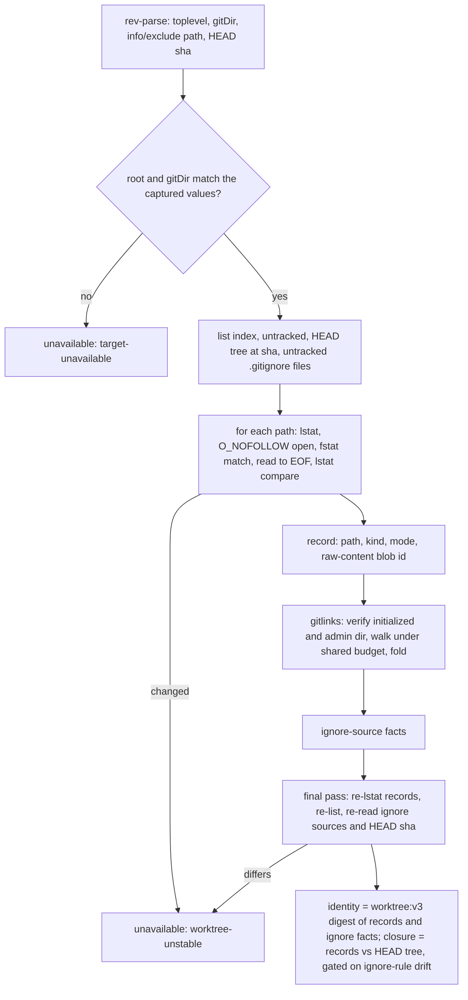

# fix: Stop the operation observer from reporting a changed worktree as unchanged

## Overview

The guard uses the operation observer's local snapshot to decide two things: whether a receipt is stale, and whether a commit captured the worktree. An agent with a shell can write several inputs that make the snapshot report an unchanged worktree, or a commit-closed one, when the tree has actually changed. This plan closes every known false-clean and false-closed case on `main`. Each case is either seen as a change or fails closed. Raw-byte hashing remains the source of file identity. The Open Questions section lists the cases that permanently read not-closed and accepts them.

## Problem Frame

`snapshot()` in `src/lib/opencode-operation-observer.ts` produces `worktreeRevisionDigest` and `commitClosure`. Staleness and the commit receipt check consume both. Issue #1099 lists five false-clean cases, plus read races and an unbounded gitlink spawn cost. Planning and review found more. Each of these was reproduced with git 2.56:

- A replace ref redirects `HEAD`'s tree, which fools the current `git diff --quiet HEAD` closure.
- A repo `core.fsmonitor` hook runs inside the observer's git calls.
- `core.worktree` pointed at a decoy directory makes an edited tree read clean and closed.
- An untracked `.gitignore` containing `*` hides itself and the uncommitted work beside it. Closure then reads true.
- `git rm --cached` plus an ignore rule drops a `HEAD` path from every listing.
- An uninitialized submodule directory reports the parent's `HEAD`. Files written into it appear in no listing.
- A write that lands after a file was read, but before the snapshot returns, goes unseen.
- A non-UTF-8 path or symlink target decodes lossily. The path is then skipped, or two targets compare equal.

Issue #1095 rejected a design that trusts git's index and clean filters for file identity, because a forged index or a clean filter fools it.

## Requirements Trace

- R1. Repository config cannot change what the local snapshot sees. Every local observer git call ignores `core.ignorecase`, `core.fsmonitor` and replace objects. A `core.worktree` or gitfile redirect away from the captured root is refused.
- R2. A file, path set, ignore source or `HEAD` that changes during the snapshot fails closed with the `worktree-unstable` reason.
- R3. Ignore rules can't silently hide changes. Editing an ignore source changes the identity. Closure is false while untracked ignore rules exist or the session's ignore sources differ from the ones captured when the observer was created. Already-ignored content stays out of the identity.
- R4. A path tracked by `HEAD` is always observed, whatever the index or the ignore rules say.
- R5. Changes inside an initialized submodule change the identity. An uninitialized or redirected submodule can't pass as clean. The gitlink count is bounded.
- R6. Commit closure compares the observer's own raw records with `HEAD`'s tree and never runs git's clean filters.
- R7. Non-UTF-8 path bytes fail closed, and symlink targets compare as bytes.
- R8. Identity is deterministic. An unchanged tree yields an identical digest across snapshots and across clones.
- R9. An unborn `HEAD` is available, with `closed=false`.
- R10. SHA-256 repositories work. Object ids of 40 or 64 hex digits are accepted.

## Scope Boundaries

- Local snapshot only. Remote git and `gh` reads are unchanged.
- No change to the guard state machine. A failed snapshot still makes the guard `unavailable` through the existing operation-hook path.
- Ignored content such as `node_modules`, build output and an ignored `.env` is not hashed.
- No dedupe of case-only renames on case-insensitive volumes.

### Deferred to Separate Tasks

- Limit and race failures becoming a blocking state instead of `unavailable`: #1124. `worktree-unstable` joins the limit codes there.
- Restored receipts checked against the live worktree at restore time: #1125.

## Context & Research

### Relevant Code and Patterns

- `src/lib/opencode-operation-observer.ts`:
  - `defaultCommandRunner` decodes stdout as UTF-8. `sanitizedEnvironment` strips `GIT_*`. No `-c` is passed anywhere.
  - `snapshot()` is synchronous throughout. It runs `--show-toplevel` but never compares the result with the captured root.
  - `readWorktreeRevisionV2` returns only a digest. `appendFileFactV2`, `appendRegularFact` and `appendSubmoduleFact` hash straight into it, and `totalBytes` restarts on each call.
  - `appendSubmoduleFact` spawns `rev-parse --verify HEAD` once per gitlink and accepts only 40-hex ids.
  - `readCommitClosure` runs `diff --quiet HEAD` plus a second untracked listing.
  - `captureParentIdentity`, `validateRegisteredWorktree` and `validateDotGitLinkage` compare `commonDir` and root membership, not `gitDir` per root.
  - `OperationObserverReasonCode` is the reason union. The guard's `GuardUnavailableCause.reasonCode` already reuses it.
- `src/lib/opencode-workflow-guard.ts`: `commitClosure` flows to `validateCommit` in `src/lib/receipt-classifier.ts`. `validateCommit` requires `true` and an advanced repository identity.
- `src/lib/workflow-guard.ts`: `staleForChange` and `markStaleReceipts` turn identity changes into stale receipts. `compareReceiptScope` runs at completion.
- Tests in `tests/unit/opencode-operation-observer.test.ts`:
  - fixture helpers `createGitFixture`, `createRegisteredWorktreeFixture` and `createSeparatedGitFixture`;
  - an inline submodule setup;
  - injected `fileReader`, `statReader`, `symlinkReader` and runner seams. Local stubs either forward args to real git or return fixed output.
- Tests in `tests/unit/opencode-workflow-guard.test.ts`: the `createTargetDerivationFixture` helper.

### Institutional Learnings

- `docs/solutions/integration-issues/worktree-targeted-receipt-observation-2026-08-02.md`:
  - A workspace or target mismatch is fatal. Revision staleness is skippable.
  - Linkage is validated structurally, and spoofing fails closed.
- `docs/solutions/integration-issues/delegated-receipt-rollup-live-state-recovery-2026-07-31.md`:
  - A revision mismatch makes a receipt stale.
  - Restored receipts must never read falsely fresh.
- `docs/solutions/logic-errors/workflow-guard-digest-collapse-long-identities-2026-10-14.md`: never collapse distinct values on a comparison path.

### Probed Behavior (git 2.56, Bun 1.4.3, APFS)

- **Config overrides:**
  - `-c` before the subcommand beats repo-local, `config.worktree` and `include.path` values. It reaches child git processes through `GIT_CONFIG_PARAMETERS`.
  - After the subcommand, `-c` is not a config override. For `ls-files` it means `--cached`.
- **Replacements:** `--no-replace-objects` neutralizes commit and tree replacement. Grafts affect only parents.
- **Object forgery:** forging a loose object or a pack that changes a tree fails with `hash mismatch`, which already fails closed.
- **Sparse checkout:** outside-cone untracked files and skip-worktree paths still appear in the listings.
- **Hardened reads:**
  - `O_NOFOLLOW` gives `ELOOP` on a symlink.
  - `fstatSync(fd, {bigint: true})` gives dev, ino, size, `mtimeNs` and `ctimeNs`.
  - Git reads and the hardened read leave mtime and ctime unchanged.
  - Hardened reads cost about +6.5 ms over 745 files and 17 MB.
- **Raw blob ids:** for all 745 `HEAD` entries in this repository, raw-content blob ids match `ls-tree`.

## Prior-Art Survey

```json
{
  "schema_version": 2,
  "verdict": "extend",
  "scope": "src/lib/opencode-operation-observer.ts local snapshot path, tests/unit/opencode-operation-observer.test.ts, and the observer docs under docs/plans and docs/solutions",
  "freshness": {
    "vcs_reference": "1709656d64fbba2a45a0b04d69f3c5f44c1d10dd"
  },
  "budget": {
    "max_search_passes": 12,
    "max_candidate_inspections": 13,
    "exhausted": false
  },
  "candidates": [
    {
      "path_or_symbol": "src/lib/opencode-operation-observer.ts:defaultCommandRunner",
      "description": "Single spawnSync('git') entry point for local reads; one forced argument prefix wrapped around the runner covers every local observer call.",
      "disposition": "extend"
    },
    {
      "path_or_symbol": "src/lib/opencode-operation-observer.ts:sanitizedEnvironment",
      "description": "Strips GIT_* from the environment; repo-local config still applies.",
      "disposition": "extend"
    },
    {
      "path_or_symbol": "src/lib/opencode-operation-observer.ts:runCommand",
      "description": "Maps runner results to bounded reason codes; reused for every new read.",
      "disposition": "reuse"
    },
    {
      "path_or_symbol": "src/lib/opencode-operation-observer.ts:readWorktreeRevisionV2",
      "description": "Owns the worktree digest built from index and untracked listings.",
      "disposition": "extend"
    },
    {
      "path_or_symbol": "src/lib/opencode-operation-observer.ts:appendRegularFact",
      "description": "Budget-checked path-based read with no stability check; hashes straight into the digest.",
      "disposition": "insufficient",
      "insufficiency_reason": "Has no consistency check and returns no record; needs a descriptor-based read and a record the closure can use."
    },
    {
      "path_or_symbol": "src/lib/opencode-operation-observer.ts:appendSubmoduleFact",
      "description": "One rev-parse spawn per gitlink; hashes only the checked-out commit.",
      "disposition": "insufficient",
      "insufficiency_reason": "Cannot see submodule content changes, accepts the parent HEAD for an uninitialized submodule, and has no count bound."
    },
    {
      "path_or_symbol": "src/lib/opencode-operation-observer.ts:readCommitClosure",
      "description": "diff --quiet HEAD plus an untracked listing; runs clean filters and follows replace refs.",
      "disposition": "insufficient",
      "insufficiency_reason": "Trusts git normalization, object replacement and ignore rules; closure must be computed from the observer's own records."
    },
    {
      "path_or_symbol": "src/lib/opencode-operation-observer.ts:validateDotGitLinkage",
      "description": "Checks gitfile target, admin directory location and backlink; no per-root gitDir comparison.",
      "disposition": "extend"
    },
    {
      "path_or_symbol": "src/lib/opencode-operation-observer.ts:parseStageEntries",
      "description": "Parses ls-files --stage records into mode and path.",
      "disposition": "reuse"
    },
    {
      "path_or_symbol": "tests/unit/opencode-operation-observer.test.ts",
      "description": "Real git fixtures and injected reader and runner seams.",
      "disposition": "reuse"
    }
  ],
  "excluded_scopes": [
    {
      "scope": "src/lib/receipt-classifier.ts",
      "reason": "Consumes commitClosure and identities; owns neither."
    },
    {
      "scope": "remote readback in src/lib/opencode-operation-observer.ts",
      "reason": "Remote PR and check reads are outside the local snapshot concern."
    }
  ]
}
```

## Key Technical Decisions

- **Forced git prefix.** One forced prefix goes on every local git call: `--no-replace-objects -c core.ignorecase=false -c core.fsmonitor=false`, placed before the subcommand.
  - The runner is wrapped exactly once, at observer construction. The exported `validateRegisteredWorktree` wraps its default runner only when it is called standalone, so no call carries the prefix twice.
  - Remote runners are untouched.
- **Root pinning.** `snapshot()` reads its toplevel and `--absolute-git-dir` and compares them with the root captured at construction. A mismatch returns `target-unavailable`.
  - Linked roots compare against a root-to-admin-directory map captured with `registeredWorktreeRoots`.
  - `gitDir` never enters a digest, because it is a machine path.
  - Stale would let an agent re-verify against the redirected tree.
- **`HEAD` read once.** `HEAD` is read once per snapshot. `ls-tree` and the end-of-snapshot recheck use that sha, never symbolic `HEAD`.
- **Raw git output.** The default local runner returns raw stdout bytes and decodes them with a fatal UTF-8 decoder. Invalid bytes fail closed with `file-read-failed`.
  - Injected runners that return strings are treated as valid.
  - A legitimate `�` in a file name stays legal.
  - The symlink seam returns bytes.
- **Path records.** Each observed path yields one record: path, kind, mode, and raw-content git blob id. Records are built from the bytes already read, and both the identity and the closure derive from them.
  - Blob ids use the object format inferred from `ls-tree` id length.
  - One budget object (files, bytes, gitlinks, depth) is shared by the parent walk and every submodule walk.
- **Path set.** The path set is index ∪ `HEAD` tree ∪ untracked. With an unborn `HEAD` it is index ∪ untracked.
- **Ignore sources.** Ignore sources become identity facts:
  - `info/exclude`, located via `rev-parse --git-path`;
  - `core.excludesFile`, with the XDG default when it is unset;
  - every untracked `.gitignore`: the untracked listing filtered to basename `.gitignore`, plus the self-ignored ones from `ls-files -o -i --exclude-standard --directory`, with directory entries dropped.

  Each source has a fixed label and a present or absent marker. Reading:
  - `info/exclude` and `core.excludesFile` resolve symlinks first, because global ignore files are often dotfile links. The target must be a regular file under a size cap of 1 MiB, and anything else fails closed.
  - Untracked `.gitignore` files are ordinary path records.

  No absolute path enters the identity.
- **Closure against ignore rules.** Closure is false when any untracked `.gitignore` exists, or when the digest of `info/exclude` and `core.excludesFile` differs from the value captured at construction. This keeps closure from reading true after a mid-session ignore rule hides uncommitted work. It still lets the stable ignore files most users have close normally.
- **Submodules fold into the identity.** A submodule is initialized only when `<path>/.git` exists, its canonical toplevel equals the canonical submodule path, and its `--absolute-git-dir` sits under the parent's `<commonDir>/modules/`. A redirected submodule returns `target-unavailable`.
  - An initialized submodule is walked with the same walker and budget, including its own ignore sources. Its digest and `HEAD` fold into the gitlink fact, so a dirty submodule marks receipts stale and never makes the guard unavailable.
  - An empty uninitialized directory folds as uninitialized. A non-empty one fails closed with `file-read-failed`.
  - `maxGitlinks` defaults to 32, including nested gitlinks. Gitlinks are counted from the stage listing before any spawn, and the limit fails closed with `file-limit`. Submodule depth is capped at 4.
- **Race checks.** Races fail closed in one pass with `worktree-unstable`, with no retry.
  - The internal default reader opens with `O_RDONLY | O_NOFOLLOW | O_NONBLOCK` and requires `fstat` to show a regular file with the same dev and ino as the prior `lstat`. It reads to EOF under the budget, then compares the `lstat` taken after the read. Windows has no `O_NOFOLLOW`, so it compares `lstat` only.
  - Injected `fileReader`s keep the current contract.
  - After all records are built, a final pass re-runs `lstat` on every recorded path, re-lists the index and untracked paths, re-reads the ignore sources and re-reads the `HEAD` sha. Any difference fails closed.
  - Stat values never enter the identity.
- **`worktree-unstable` reason.** `worktree-unstable` is added to `OperationObserverReasonCode` only. The guard already reports it through `observer-readback-failed`.
- **Closure from records.** Closure is derived from the records. Every `HEAD` entry must be present with an equal kind, id and mode, and no other path may exist. Each submodule must be closed, with its `HEAD` equal to the tree's gitlink id. `diff --quiet` and the closure's second untracked listing are removed.
  - The executable comparison uses git's owner-bit rule.
  - `core.filemode` is not honored.
  - The index is not required to match `HEAD`.
- **Domain tag.** The domain tag moves from `worktree:v2` to `worktree:v3`. The value changes but the field shape does not, so no receipt, marker or protocol bump is needed. Receipts minted before the upgrade read as a mismatch or stale, never fatal.

## Open Questions

### Resolved During Planning

- Dirty submodule handling: fold into the identity.
- Read races: one pass, no retry.
- Unborn `HEAD`: available, with `closed=false`.
- A non-empty uninitialized submodule directory fails closed.
- Ignored paths: hash the ignore sources, gate closure on ignore-rule drift, and leave ignored content unhashed.
- Closure source: raw records against `HEAD`'s tree.
- Accepted permanent not-closed cases: CRLF worktree files that git normalizes, `core.filemode=false` mounts, case-only renames on case-insensitive volumes, and a session that edited `info/exclude` or `core.excludesFile` after the observer started. Each one fails closed, so no commit receipt is minted.

### Deferred to Implementation

- Whether one `rev-parse` call can return toplevel, `--absolute-git-dir`, `--git-path info/exclude` and the `HEAD` sha in a stable order. If it can't, use two calls.

## High-Level Technical Design

> *This illustrates the intended approach and is directional guidance for review, not implementation specification. The implementing agent should treat it as context, not code to reproduce.*



Every local git call carries the forced prefix.

## Implementation Units

- [ ] **Unit 1: Harden local git invocation and pin the root**

**Goal:** Repository config can't hide changes, run commands or redirect `HEAD`'s tree. A `core.worktree` or gitfile redirect is refused, and non-UTF-8 output fails closed.

**Requirements:** R1, R7

**Dependencies:** None

**Files:**
- Modify: `src/lib/opencode-operation-observer.ts`
- Test: `tests/unit/opencode-operation-observer.test.ts`

**Approach:**
- Wrap the local runner once at construction. Read toplevel, `--absolute-git-dir` and the `HEAD` sha in `snapshot()`, and compare them with the captured root and the root-to-admin map.
- Default local runner: raw stdout plus fatal UTF-8 decode. The symlink seam returns bytes.

**Execution note:** Start each case as a red reproduction in a disposable fixture.

**Patterns to follow:** existing `runCommand` reason mapping; the poisoned `GIT_*` test.

**Test scenarios:**
- Happy path: an injected recording runner sees the prefix exactly once, before the subcommand, on every local call. This includes `validateRegisteredWorktree` called standalone.
- Error path:
  - With `core.ignorecase=true`, a new untracked file whose name differs from a tracked file only by case changes the identity. Skip when the fixture volume is case-insensitive.
  - A `core.fsmonitor` hook that writes a marker file never runs during a snapshot.
  - With `git replace HEAD <commit-with-dirty-tree>`, an edited tree does not read closed.
  - `core.worktree` pointing at a decoy directory with the committed content returns `target-unavailable`.
  - A linked worktree whose `.git` points at another admin directory with a rewritten backlink returns `target-unavailable`. Check this through `validateRegisteredWorktree` and through an observer constructed on that linked root.
  - A runner whose output contains invalid UTF-8 bytes gives `file-read-failed`.
- Edge case:
  - A real file named with `�` is observed normally.
  - Two symlinks whose non-UTF-8 targets differ produce different identities.
  - A separated-gitdir checkout (`core.worktree` set legitimately at creation) still snapshots.

**Verification:** Each reproduction is red before the change and green after. The existing observer tests pass.

- [ ] **Unit 2: Path records, shared budget, and race-checked reads**

**Goal:** Every observed path yields a record that both the identity and the closure use. Changes during the snapshot fail closed.

**Requirements:** R2, R8

**Dependencies:** Unit 1

**Files:**
- Modify: `src/lib/opencode-operation-observer.ts`
- Test: `tests/unit/opencode-operation-observer.test.ts`

**Approach:**
- Introduce the record type and the shared budget object. `readWorktreeRevisionV2` returns records plus the digest. The append functions build records instead of only hashing.
- Implement the internal hardened default reader and the stat-seam extension (optional dev, ino, `mtimeNs`, `ctimeNs`). The seam is called again after each read.
- Add a final pass that re-runs `lstat` on every record, re-lists the index and untracked paths, and re-reads the `HEAD` sha.
- Add `worktree-unstable` to `OperationObserverReasonCode`.

**Patterns to follow:** existing injected `fileReader` and `statReader` tests.

**Test scenarios:**
- Error path:
  - A stat seam that reports a different size or `mtimeNs` after the read gives `worktree-unstable`.
  - A file whose content and mtime change after its read but before the final pass gives `worktree-unstable`.
  - A regular file replaced by a symlink with identical bytes between `lstat` and open gives `worktree-unstable`.
  - An untracked re-list that returns an extra path gives `worktree-unstable`.
  - A `HEAD` that moves before the final pass gives `worktree-unstable`.
  - A FIFO at a listed path never blocks the snapshot and fails closed.
- Happy path:
  - Two snapshots of an unchanged tree produce identical identities.
  - Touching ctime alone (`chmod` to the same mode) between snapshots does not change the identity.
  - Existing number-literal stat stubs still typecheck and pass.

**Verification:** Race scenarios run through the seams with no sleeps.

- [ ] **Unit 3: Complete path set and ignore sources**

**Goal:** `HEAD` paths are always observed, and ignore-rule changes are visible.

**Requirements:** R3, R4, R8

**Dependencies:** Unit 2

**Files:**
- Modify: `src/lib/opencode-operation-observer.ts`
- Test: `tests/unit/opencode-operation-observer.test.ts`

**Approach:**
- Read `ls-tree -r -z --full-tree <sha>` once, and keep it for Unit 5. Union its paths with the index and untracked listings.
- Capture the `info/exclude` and `core.excludesFile` digest at construction. Add ignore-source facts and untracked `.gitignore` discovery as described in the Key Technical Decisions. The final pass re-reads ignore sources.
- Change the domain tag to `worktree:v3`.

**Test scenarios:**
- Error path:
  - Run `git rm --cached f`, add `f` to `info/exclude`, then edit `f`. The identity changes at each step.
  - Adding a line to `.git/info/exclude` changes the identity.
  - A new untracked `.gitignore` containing `*` changes the identity. A later edit to a sibling it hides does not, because that content is now ignored.
  - `core.excludesFile` pointing at a FIFO or `/dev/zero` fails closed without hanging.
- Edge case:
  - A missing `core.excludesFile` and an empty one produce different identities, and neither fails.
  - An `info/exclude` edit between the listing and the final pass gives `worktree-unstable`.
- Happy path:
  - Editing an already-ignored file such as `node_modules/x` does not change the identity.
  - Two clones of the same commit, with relative symlinks only, produce the same digest.

**Verification:** The reproductions are red first.

- [ ] **Unit 4: Submodule contents, initialization, redirect, and the gitlink bound**

**Goal:** Submodule changes are observed. Uninitialized or redirected submodules can't pass as clean, and gitlink cost is bounded.

**Requirements:** R5, R8, R10

**Dependencies:** Unit 3

**Files:**
- Modify: `src/lib/opencode-operation-observer.ts`
- Test: `tests/unit/opencode-operation-observer.test.ts`

**Approach:**
- Count gitlinks from the stage listing before any spawn.
- For each gitlink:
  - Canonicalize the submodule path and verify initialization and the admin directory.
  - If initialized, walk it under the shared budget and fold the result.
- Accept 40- or 64-character ids.

**Test scenarios:**
- Error path:
  - Editing a tracked file inside an initialized submodule changes the parent identity. `assume-unchanged` or `submodule.<name>.ignore=all` inside the submodule does not hide the change.
  - An uninitialized submodule directory no longer hashes the parent's `HEAD`. Writing a file into it gives `file-read-failed`.
  - A submodule whose `.git` gitfile points outside `<commonDir>/modules/` returns `target-unavailable`.
- Edge case:
  - An edit inside a nested submodule changes the identity.
  - 33 gitlinks give `file-limit`, and no submodule spawn runs.
  - A submodule fixture under a symlinked temp directory (macOS `/tmp`) is detected as initialized.
- Happy path: an unchanged initialized submodule produces a stable identity across snapshots.

**Verification:** Submodule fixtures use `-c protocol.file.allow=always`. The reproductions are red first.

- [ ] **Unit 5: Commit closure from the observer's records**

**Goal:** Clean filters, git normalization and mid-session ignore rules can't make an edited tree read as committed.

**Requirements:** R3, R6, R9, R10

**Dependencies:** Units 3 and 4

**Files:**
- Modify: `src/lib/opencode-operation-observer.ts`
- Test: `tests/unit/opencode-operation-observer.test.ts`

**Approach:**
- Compare the records with the `HEAD` tree map, and apply the ignore-rule gate.
- Remove `diff --quiet` and the closure's second untracked listing.
- An unborn `HEAD` gives `closed=false` and stays available.

**Test scenarios:**
- Error path:
  - A `filter.<name>.clean` driver from `.git/info/attributes` that normalizes an edit back to the committed bytes reads not closed.
  - An uncommitted file plus a new untracked `.gitignore` containing `*` reads not closed.
  - Adding the uncommitted file to `info/exclude` after the observer started reads not closed.
  - A staged intent-to-add file reads not closed.
  - A dirty submodule, or a submodule `HEAD` that differs from the parent tree, reads not closed.
  - A regular file whose content equals a symlink's target text, replacing that symlink, reads not closed.
- Edge case:
  - An owner executable-bit change reads not closed. A group or other bit change alone still reads closed.
  - A CRLF worktree file that git reports clean reads not closed. This is the documented limit.
  - An unborn repository is available and not closed.
  - A SHA-256 repository reads closed after a commit. Skip when git lacks `--object-format=sha256`.
- Happy path:
  - An unchanged `info/exclude` and global ignore file still allow closure.
  - The existing closure tests keep their results: commit, partial stage, same-path rewrite, separated gitdir and deletion.

**Verification:** No snapshot calls `diff --quiet`. Snapshot time on this repository, measured after this unit, stays within about +40 ms of the 91.8 ms baseline.

- [ ] **Unit 6: Guard-level proof and documentation**

**Goal:** Prove through the guard that a false-clean vector no longer lets pre-edit evidence complete a unit, and document the observer's limits.

**Requirements:** R1-R10

**Dependencies:** Unit 5

**Files:**
- Test: `tests/unit/opencode-workflow-guard.test.ts`
- Modify: `ARCHITECTURE.md`

**Approach:**
- Use a real observer over a disposable repository. Mint verification evidence, apply the clean-filter vector and then the self-hiding `.gitignore` vector, and drive completion.
- Add to the ARCHITECTURE.md observer notes:
  - what the snapshot sees and does not see (ignored content, a lying filesystem, a write that lands after the final pass);
  - the accepted not-closed cases;
  - `worktree-unstable`, with a link to #1124.

**Test scenarios:**
- Integration: a pre-edit verification receipt plus a filter-normalized edit, driven to completion, rejects or stales the receipt.
- Integration: a commit unit where uncommitted work is hidden by a new `.gitignore` mints no commit receipt.
- Integration: a receipt carrying a digest from before the upgrade reaches completion as a mismatch, and the guard stays available.

**Verification:**
- The guard suites pass.
- markdownlint and `bun scripts/content-integrity.ts` are clean.
- The unit, review and test names carry no plan labels or history.

## System-Wide Impact

- **Interaction graph:** `snapshot()` feeds every operation before-hook and after-hook, status refresh, completion readback and child rollup.
- **Error propagation:** these failures take the existing operation-hook unavailable path with an enum-only cause:
  - `target-unavailable` for a root, gitDir or submodule redirect;
  - `worktree-unstable`;
  - `file-limit` for gitlinks;
  - `file-read-failed` for invalid bytes or an uninitialized non-empty submodule.
- **State lifecycle risks:**
  - The identity value changes on upgrade, so receipts that already exist go stale or mismatch once, and none of them are fatal.
  - An ignore-source edit by another process during a completion readback counts as drift within the snapshot.
- **Unchanged invariants:** raw-byte identity, stale-versus-fatal semantics, receipt and marker versions, and remote readback.

## Risks & Dependencies

| Risk | Mitigation |
|------|------------|
| Extra spawns, hardened reads and blob hashing slow every guarded operation. | Measure against the 91.8 ms baseline after Unit 5. |
| Accepted not-closed cases block commit receipts. | They fail closed. Document them; the fix is in the user's tree or a session restart. |
| A background writer makes the guard unavailable through `worktree-unstable`. | This is the same class as limit failures, and #1124 owns it. Before this plan, the same race produced a false clean. |
| A write after the final pass is still unseen. | Documented residual. The final pass narrows it to the time between that pass and the guard's comparison. |
| The case-sensitivity test cannot run on macOS developer machines. | A capability probe with a skip, plus an always-on prefix assertion. Linux CI runs the test. |

## Sources & References

- Related issues: #1099, #1095, #1124, #1125
- Related code: `src/lib/opencode-operation-observer.ts`, `src/lib/workflow-guard.ts`, `src/lib/receipt-classifier.ts`
