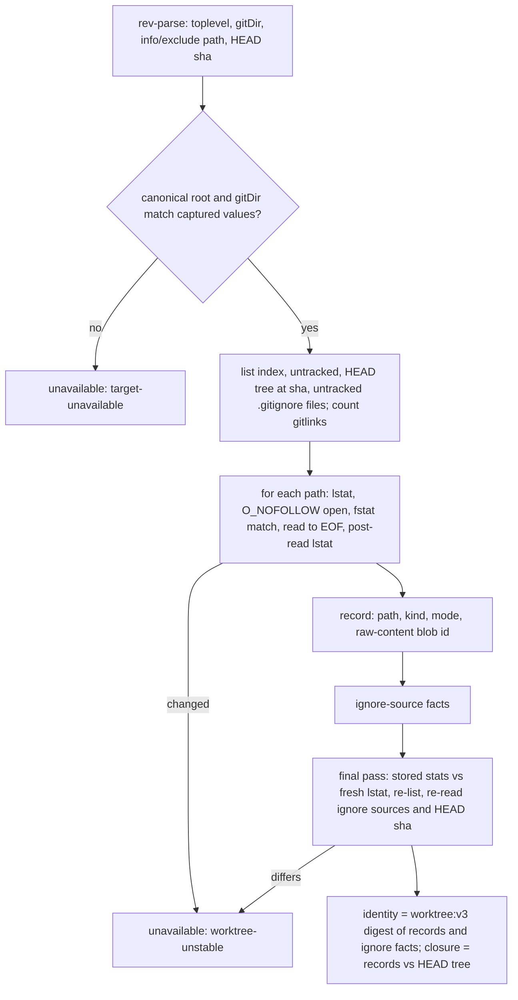

# fix: Stop the operation observer from reporting a changed worktree as unchanged

## Overview

The guard uses the operation observer's local snapshot to decide whether receipts are stale and whether a commit captured the worktree. Several inputs that an agent with a shell can write make the snapshot report an unchanged tree, or a closed commit, after a real change. This plan closes the cases that can be fixed deterministically, without a baseline captured from state the agent controls. Each one becomes either a visible change or a fail-closed result. Raw-byte hashing stays the source of file identity.

The rest of the cases need anchors that survive a restart and that agent-written state can't poison. Those are tracked as a design question in #1126: ignore rules hiding work from closure, root and admin-directory redirects made before the observer starts, and dirty submodule contents.

## Problem Frame

`snapshot()` in `src/lib/opencode-operation-observer.ts` produces `worktreeRevisionDigest` and `commitClosure`. Each case below was reproduced with git 2.56, and each is fixed here:

- `core.ignorecase=true` hides new untracked files.
- A replace ref redirects `HEAD`'s tree, which fools today's `git diff --quiet HEAD` closure.
- A repository `core.fsmonitor` hook runs inside the observer's git calls.
- A repository clean filter makes an edited file match `HEAD` in the closure check.
- `git rm --cached` plus an ignore rule drops a `HEAD` path from every listing.
- Editing an ignore rule doesn't change the identity.
- An uninitialized submodule directory reports the parent's `HEAD`.
- A file rewritten while the snapshot is running goes unseen.
- A non-UTF-8 path or symlink target decodes lossily.
- Each gitlink costs one unbounded git spawn.
- A redirect of `core.worktree` or the gitfile made during the session goes unseen.

Issue #1095 rejected a design that trusts git's index and clean filters for file identity.

## Requirements Trace

- R1. Every local observer git call ignores `core.ignorecase`, `core.fsmonitor` and replace objects.
- R2. A root or `gitDir` change after the observer starts fails closed.
- R3. A file, path set or `HEAD` that changes during the snapshot fails closed with `worktree-unstable`.
- R4. Editing any ignore source changes the identity. Already-ignored content stays out.
- R5. A path tracked by `HEAD` is always observed, whatever the index or ignore rules say.
- R6. Commit closure compares the observer's own raw records with `HEAD`'s tree and never runs git's clean filters.
- R7. An uninitialized submodule can't pass as the parent's `HEAD`, and the gitlink count is bounded.
- R8. Non-UTF-8 output fails closed, and symlink targets compare as bytes.
- R9. Identity is deterministic: an unchanged tree gives an identical digest across snapshots and across clones.
- R10. An unborn `HEAD` is available with `closed=false`. SHA-256 repositories work.

## Scope Boundaries

- Local snapshot only. Remote git and `gh` reads are unchanged.
- No change to the guard state machine. A failed snapshot still makes the guard `unavailable` through the existing operation-hook path.
- Ignored content is not hashed. Closure, like `git status`, does not see ignored paths.
- No dedupe of case-only renames on case-insensitive volumes.

### Deferred to Separate Tasks

- Ignore rules hiding uncommitted work from closure, root and admin-directory anchoring that survives a restart, and dirty submodule contents: #1126.
- Limit and race failures as a blocking state instead of `unavailable`: #1124.
- Restored receipts checked against the live worktree at restore: #1125.

## Context & Research

### Relevant Code and Patterns

- `src/lib/opencode-operation-observer.ts`:
  - `defaultCommandRunner` decodes stdout as UTF-8 and guards it with `typeof stdout === 'string'`. `sanitizedEnvironment` strips `GIT_*`. No `-c` is passed anywhere.
  - `snapshot()` is synchronous. It runs `--show-toplevel` and compares the raw string with the captured root.
  - `readWorktreeRevisionV2` returns only a digest. `appendFileFactV2`, `appendRegularFact` and `appendSubmoduleFact` hash straight into it, and `totalBytes` restarts on each call.
  - `appendFileFactV2` dispatches gitlinks on index mode.
  - `appendSubmoduleFact` spawns `rev-parse --verify HEAD` once per gitlink and accepts only 40-hex ids.
  - `readCommitClosure` runs `diff --quiet HEAD` plus a second untracked listing.
  - `captureParentIdentity` stores realpath'd `targetRoot`, `gitDir`, `commonDir` and registered roots.
  - `OperationObserverReasonCode` is the reason union. The guard's `GuardUnavailableCause.reasonCode` already reuses it.
- `src/lib/receipt-classifier.ts` `validateCommit` requires `commitClosure === true` and an advanced repository identity.
- `src/lib/workflow-guard.ts` `staleForChange` and `markStaleReceipts` turn identity changes into stale receipts.
- Tests: `tests/unit/opencode-operation-observer.test.ts` has `createGitFixture`, `createRegisteredWorktreeFixture` and `createSeparatedGitFixture`, which sets `core.worktree` before construction. It also has an inline submodule setup and the injected runner, `fileReader`, `statReader` and `symlinkReader` seams. The symlink seam test is near line 1194.

### Institutional Learnings

- `docs/solutions/integration-issues/worktree-targeted-receipt-observation-2026-08-02.md`: a target mismatch is fatal, revision staleness is skippable, and spoofed linkage fails closed.
- `docs/solutions/integration-issues/delegated-receipt-rollup-live-state-recovery-2026-07-31.md`: a revision mismatch makes a receipt stale, and restored receipts never read falsely fresh.
- `docs/solutions/logic-errors/workflow-guard-digest-collapse-long-identities-2026-10-14.md`: never collapse distinct values on a comparison path.

### Probed Behavior (git 2.56, Bun 1.4.3)

- `-c` before the subcommand overrides repository-local, `config.worktree` and `include.path` values. After the subcommand it is not a config override. On `ls-files`, `-c` means `--cached`.
- `--no-replace-objects` neutralizes commit and tree replacement. Forging an object fails with `hash mismatch`, which fails closed.
- On APFS, `O_NOFOLLOW` gives `ELOOP` on a symlink, and `fstatSync(fd, {bigint: true})` gives dev, ino, size, `mtimeNs` and `ctimeNs`. Git reads and the hardened read leave mtime and ctime unchanged.
- An APFS same-size rewrite with mtime restored still changes ctime. On HFS+, 1-second timestamps let a same-second rewrite keep ctime, mtime and size unchanged.
- One git spawn takes about 6.7 ms. SHA-1 over 17 MB takes about 9 ms. All 745 `HEAD` entries' raw blob ids match `ls-tree`.
- A submodule added with `--name bee` at path `a/b` has its admin dir at `modules/ay/modules/bee`. A gitlink removed with `git rm --cached` appears only in the `HEAD` tree.

## Prior-Art Survey

```json
{
  "schema_version": 2,
  "verdict": "extend",
  "scope": "src/lib/opencode-operation-observer.ts local snapshot path, tests/unit/opencode-operation-observer.test.ts, and the observer docs under docs/plans and docs/solutions",
  "freshness": {
    "vcs_reference": "1709656d64fbba2a45a0b04d69f3c5f44c1d10dd"
  },
  "budget": {
    "max_search_passes": 12,
    "max_candidate_inspections": 13,
    "exhausted": false
  },
  "candidates": [
    {
      "path_or_symbol": "src/lib/opencode-operation-observer.ts:defaultCommandRunner",
      "description": "Single spawnSync('git') entry point for local reads; one forced argument prefix wrapped around the runner covers every local observer call.",
      "disposition": "extend"
    },
    {
      "path_or_symbol": "src/lib/opencode-operation-observer.ts:sanitizedEnvironment",
      "description": "Strips GIT_* from the environment; repo-local config still applies.",
      "disposition": "extend"
    },
    {
      "path_or_symbol": "src/lib/opencode-operation-observer.ts:runCommand",
      "description": "Maps runner results to bounded reason codes; reused for every new read.",
      "disposition": "reuse"
    },
    {
      "path_or_symbol": "src/lib/opencode-operation-observer.ts:readWorktreeRevisionV2",
      "description": "Owns the worktree digest built from index and untracked listings.",
      "disposition": "extend"
    },
    {
      "path_or_symbol": "src/lib/opencode-operation-observer.ts:appendRegularFact",
      "description": "Budget-checked path-based read with no stability check; hashes straight into the digest.",
      "disposition": "insufficient",
      "insufficiency_reason": "Has no consistency check and returns no record; needs a descriptor-based read and a record the closure can use."
    },
    {
      "path_or_symbol": "src/lib/opencode-operation-observer.ts:appendSubmoduleFact",
      "description": "One rev-parse spawn per gitlink; hashes only the checked-out commit.",
      "disposition": "insufficient",
      "insufficiency_reason": "Accepts the parent HEAD for an uninitialized submodule, rejects SHA-256 ids, and has no count bound."
    },
    {
      "path_or_symbol": "src/lib/opencode-operation-observer.ts:readCommitClosure",
      "description": "diff --quiet HEAD plus an untracked listing; runs clean filters and follows replace refs.",
      "disposition": "insufficient",
      "insufficiency_reason": "Trusts git normalization and object replacement; closure must be computed from the observer's own records."
    },
    {
      "path_or_symbol": "src/lib/opencode-operation-observer.ts:parseStageEntries",
      "description": "Parses ls-files --stage records into mode and path.",
      "disposition": "reuse"
    },
    {
      "path_or_symbol": "tests/unit/opencode-operation-observer.test.ts",
      "description": "Real git fixtures and injected reader and runner seams.",
      "disposition": "reuse"
    }
  ],
  "excluded_scopes": [
    {
      "scope": "src/lib/receipt-classifier.ts",
      "reason": "Consumes commitClosure and identities; owns neither."
    },
    {
      "scope": "remote readback in src/lib/opencode-operation-observer.ts",
      "reason": "Remote PR and check reads are outside the local snapshot concern."
    }
  ]
}
```

## Key Technical Decisions

- **One forced prefix on every local git call.** The prefix is `--no-replace-objects -c core.ignorecase=false -c core.fsmonitor=false`, placed before the subcommand. The runner is wrapped exactly once at observer construction. The exported `validateRegisteredWorktree` wraps its default runner only when it is called standalone. Remote runners are untouched.
- **Raw output with an explicit invalid flag.** `OperationObserverCommandResult` gains an optional `invalidOutput` flag. `defaultCommandRunner` reads stdout as bytes through one decode function that uses a fatal UTF-8 decoder, and sets the flag when decoding fails. `runCommand` maps the flag to `file-read-failed`. Injected string runners are unaffected. A legitimate `�` in a name stays legal. The symlink seam returns bytes.
- **In-session root pin.** `snapshot()` canonicalizes its toplevel and `--absolute-git-dir`, then compares them with the values captured at construction. A mismatch returns `target-unavailable`. A redirect that already existed before construction is #1126.
- **`HEAD` read once per snapshot.** `ls-tree` and the final recheck use that sha. Where possible, one `rev-parse` call returns toplevel, `--absolute-git-dir`, `--git-path info/exclude` and the sha together.
- **Path records.** Each observed path yields one record: path, kind, mode and raw-content git blob id. The record is built from the bytes already read, and both the identity and the closure derive from it. Blob ids use the object format inferred from the `ls-tree` id length. One budget object (files, bytes, gitlinks) spans the snapshot.
- **Path set.** The path set is index ∪ `HEAD` tree ∪ untracked. An unborn `HEAD` uses index ∪ untracked. Gitlink dispatch uses mode `160000` from either the index or the `HEAD` tree.
- **Ignore-source contents enter the identity, with no captured baseline.** The sources are:
  - `info/exclude`;
  - `core.excludesFile`, falling back to the XDG default when unset;
  - every untracked `.gitignore`: the untracked listing filtered to the basename `.gitignore`, plus the self-ignored ones from `ls-files -o -i --exclude-standard --directory`, with directory entries dropped.

  Each source gets a fixed label and a present or absent marker. Tracked `.gitignore` files are already regular records. `info/exclude` and `core.excludesFile` resolve symlinks, then require a regular file of at most 1 MiB. Anything else fails closed with `file-read-failed`. No absolute path enters the identity.
- **Submodules.** A gitlink counts as initialized only when `<path>/.git` exists and its canonical toplevel equals the canonical submodule path. An initialized gitlink keeps today's fact: the submodule `HEAD`, now accepting 40- or 64-hex ids. An empty uninitialized directory folds as uninitialized. A non-empty one fails closed with `file-read-failed`. `maxGitlinks` defaults to 32. Gitlinks are counted from the index and `HEAD` tree before any spawn, and exceeding the limit returns `file-limit`. Dirty submodule contents are #1126.
- **Race checks.** A race fails closed in one pass with `worktree-unstable`, with no retry.
  - The internal default reader opens with `O_RDONLY | O_NOFOLLOW | O_NONBLOCK`. It requires `fstat` to report a regular file with the same dev and ino as the prior `lstat`. It reads to EOF under the budget, then compares a post-read `lstat`. Windows has no `O_NOFOLLOW` and compares `lstat` only. Injected `fileReader`s keep their contract.
  - A final pass then compares each record's stored post-read stat values against a fresh `lstat`, re-lists the index and untracked paths, re-reads the ignore sources, and re-reads the `HEAD` sha.
  - Stat values never enter the identity.
  - `worktree-unstable` is added to `OperationObserverReasonCode` only.
- **Closure is derived from the records.** Every `HEAD` entry must be present with an equal kind, id and mode, and no other path may exist. A gitlink must be initialized with `HEAD` equal to the tree's id. The executable comparison uses git's owner-bit rule, and `core.filemode` is not honored. The index is not required to match `HEAD`. `diff --quiet` and the closure's second untracked listing are removed. An unborn `HEAD` gives `closed=false` and stays available.
- **Domain tag `worktree:v2` becomes `worktree:v3`.** This changes the value, not the field shape, so no receipt, marker or protocol bump is needed. A receipt minted before the upgrade no longer matches. A status refresh reports it as stale with a fresh-readback repair. A completion against it is rejected as `stale-receipt`, and under the guard's existing completion rule that leaves the session `unavailable`, just as any post-evidence drift does today.

## Open Questions

### Resolved During Planning

- Read races fail in one pass, with no retry.
- An unborn `HEAD` is available with `closed=false`.
- A non-empty uninitialized submodule directory fails closed.
- Ignore sources are hashed into the identity, ignored content is not hashed, and closure ignores ignored paths. The cases where work hides behind ignore rules are #1126.
- Closure is computed from raw records against `HEAD`'s tree.
- Accepted permanent not-closed cases: CRLF worktree files that git normalizes, `core.filemode=false` mounts, and case-only renames on case-insensitive volumes. All of them fail closed.
- Accepted residuals, documented:
  - a write that lands after the final pass;
  - a same-second rewrite on a 1-second-timestamp volume such as HFS+;
  - a root redirect made before the observer starts (#1126);
  - dirty initialized submodule contents (#1126).

### Deferred to Implementation

- Whether the combined `rev-parse` returns its outputs in a stable order. If it doesn't, use two calls.

## High-Level Technical Design

> *This illustrates the intended approach and is directional guidance for review, not implementation specification. The implementing agent should treat it as context, not code to reproduce.*



Every local git call carries the forced prefix.

## Implementation Units

- [x] **Unit 1: Forced prefix and raw-byte output**

**Goal:** Repository config can't hide changes, run commands or redirect `HEAD`'s tree. Non-UTF-8 output fails closed.

**Requirements:** R1, R8

**Dependencies:** None

**Files:**
- Modify: `src/lib/opencode-operation-observer.ts`
- Test: `tests/unit/opencode-operation-observer.test.ts`

**Approach:** Wrap the local runner once at construction. Add the `invalidOutput` flag, the single decode function in `defaultCommandRunner` and its mapping in `runCommand`. Change the symlink seam to return bytes and update its test.

**Execution note:** Start each case as a red reproduction in a disposable fixture.

**Test scenarios:**
- Happy path: an injected recording runner sees the prefix exactly once, before the subcommand, on every local call. This includes a standalone `validateRegisteredWorktree`.
- Happy path: with the real default runner on a real repository, a new untracked file changes the digest. This guards against a decode change that empties every listing.
- Error path: with `core.ignorecase=true`, a new untracked file that differs from a tracked file only by case changes the identity. Skip when the volume is case-insensitive.
- Error path: a `core.fsmonitor` hook that writes a marker file never runs during a snapshot.
- Error path: after `git replace HEAD <commit-with-dirty-tree>`, an edited tree does not read closed.
- Error path: a runner result with `invalidOutput` gives `file-read-failed`.
- Edge case: a real file whose name contains `�` is observed normally. Two symlinks with different non-UTF-8 targets produce different identities.

**Verification:** Each reproduction is red before the change. The existing observer tests pass.

- [x] **Unit 2: In-session root and gitDir pin**

**Goal:** A `core.worktree` or gitfile redirect made after the observer starts fails closed.

**Requirements:** R2

**Dependencies:** Unit 1

**Files:**
- Modify: `src/lib/opencode-operation-observer.ts`
- Test: `tests/unit/opencode-operation-observer.test.ts`

**Approach:** Read toplevel, `--absolute-git-dir` and the `HEAD` sha in `snapshot()`. Canonicalize them and compare with the values captured at construction.

**Test scenarios:**
- Error path: after construction, setting `core.worktree` to a decoy directory that holds the committed content returns `target-unavailable`.
- Error path: after construction, pointing a linked worktree's `.git` at another admin directory with a rewritten backlink returns `target-unavailable` from an observer constructed on that linked root.
- Happy path: the separated-gitdir fixture still snapshots. A fixture under a symlinked temp directory (macOS `/tmp`) passes the canonical comparison.

**Verification:** Reproductions are red first.

- [x] **Unit 3: Path records and the shared budget (no behavior change)**

**Goal:** Every observed path yields a record that both the identity and the closure can use, and one budget spans the snapshot.

**Requirements:** R9

**Dependencies:** Unit 1

**Files:**
- Modify: `src/lib/opencode-operation-observer.ts`
- Test: `tests/unit/opencode-operation-observer.test.ts`

**Approach:** Introduce the record type and the budget object. `readWorktreeRevisionV2` returns the records and the digest. The append functions build records. The digest value is unchanged in this unit.

**Test scenarios:**
- Happy path: every existing identity and limit test passes with an unchanged digest value.
- Happy path: records from a fixture list the expected kind, mode and blob id for a regular file, an executable file, a symlink and a gitlink.

**Verification:** No existing test changes.

- [x] **Unit 4: Race-checked reads and the final pass**

**Goal:** A file, path set or `HEAD` that changes during the snapshot fails closed.

**Requirements:** R3, R9

**Dependencies:** Unit 3

**Files:**
- Modify: `src/lib/opencode-operation-observer.ts`
- Test: `tests/unit/opencode-operation-observer.test.ts`

**Approach:** Implement the internal hardened default reader and the stat-seam extension (optional dev, ino, `mtimeNs` and `ctimeNs`). Call the seam again after each read and add the final pass. Add `worktree-unstable`.

**Test scenarios:**
- Error path: a stat seam that reports a different size or `mtimeNs` after the read gives `worktree-unstable`.
- Error path: a record whose stat changes between its read and the final pass gives `worktree-unstable`.
- Error path: a regular file replaced by a symlink to identical bytes between `lstat` and open gives `worktree-unstable`.
- Error path: an extra untracked path at the final re-list gives `worktree-unstable`. So does a `HEAD` that moves before the final pass.
- Edge case: a FIFO at a listed path never blocks and fails closed.
- Happy path: two snapshots of an unchanged tree are identical. A ctime-only touch (`chmod` to the same mode) between snapshots does not change the identity. Existing number-literal stat stubs still typecheck.

**Verification:** Race scenarios use the seams, with no sleeps. Measure snapshot time on this repository, warm and cold.

- [x] **Unit 5: Complete path set, ignore sources and gitlink hardening**

**Goal:** `HEAD` paths are always observed, ignore-rule edits change the identity, and gitlinks are bounded and can't impersonate the parent.

**Requirements:** R4, R5, R7, R9, R10

**Dependencies:** Unit 4

**Files:**
- Modify: `src/lib/opencode-operation-observer.ts`
- Test: `tests/unit/opencode-operation-observer.test.ts`

**Approach:**
- Read `ls-tree -r -z --full-tree <sha>` once and keep it for Unit 6. Union the paths.
- Add ignore-source facts and untracked `.gitignore` discovery. The final pass re-reads the ignore sources.
- Count gitlinks from the index and the `HEAD` tree before any spawn. Check initialization and accept 64-hex ids.
- Change the domain tag to `worktree:v3`.

**Test scenarios:**
- Error path: `git rm --cached f`, add `f` to `info/exclude`, then edit `f`. The exclude rule and the edit each change the identity. `git rm --cached` alone does not, because the index stays out of the identity.
- Error path: a line added to `.git/info/exclude` changes the identity. So does a new untracked `.gitignore` containing `*`. A later edit to a sibling hidden by that `.gitignore` does not, because that content is now ignored.
- Error path: `core.excludesFile` pointing at a FIFO or `/dev/zero` fails closed without hanging.
- Error path: an uninitialized submodule directory no longer hashes the parent's `HEAD`. Writing a file into it gives `file-read-failed`.
- Edge case: a missing `core.excludesFile` and an empty one produce different identities, and neither fails.
- Edge case: 33 gitlinks give `file-limit` with no submodule spawn. A gitlink present only in the `HEAD` tree is dispatched as a gitlink.
- Happy path: editing an already-ignored file does not change the identity. Two clones of one commit, using relative symlinks only, give the same digest.

**Verification:** Reproductions are red first. Measure snapshot time.

- [x] **Unit 6: Commit closure from the observer's records**

**Goal:** Clean filters, replace refs and git normalization can't make an edited tree read as committed.

**Requirements:** R6, R10

**Dependencies:** Unit 5

**Files:**
- Modify: `src/lib/opencode-operation-observer.ts`
- Test: `tests/unit/opencode-operation-observer.test.ts`

**Approach:** Compare the records with the `HEAD` tree map. Remove `diff --quiet` and the closure's second untracked listing. An unborn `HEAD` returns not closed.

**Test scenarios:**
- Error path: a `filter.<name>.clean` driver from `.git/info/attributes` that normalizes an edit back to the committed bytes reads not closed.
- Error path: a staged intent-to-add file reads not closed.
- Error path: a submodule whose `HEAD` differs from the parent tree reads not closed. So does an uninitialized submodule.
- Error path: a regular file whose content equals a symlink's target text, replacing that symlink, reads not closed.
- Edge case: an owner executable-bit change reads not closed. A group-only or other-only bit change still reads closed.
- Edge case: a CRLF worktree file that git reports clean reads not closed, which is the documented limit.
- Edge case: an unborn repository is available and not closed.
- Edge case: a SHA-256 repository reads closed after a commit. Skip when git lacks `--object-format=sha256`.
- Happy path: the existing closure tests keep their results (commit, partial stage, same-path rewrite, separated gitdir, deletion).

**Verification:** No snapshot calls `diff --quiet`. Warm snapshot time on this repository stays within about +60 ms of the 91.8 ms baseline. If it doesn't, consolidate spawns before shipping.

- [x] **Unit 7: Guard-level proof and documentation**

**Goal:** Prove through the guard that a false-clean vector no longer lets pre-edit evidence complete a unit, and document the observer's limits.

**Requirements:** R1-R10

**Dependencies:** Unit 6

**Files:**
- Test: `tests/unit/opencode-workflow-guard.test.ts`
- Modify: `ARCHITECTURE.md`

**Approach:**
- Use a real observer over a disposable repository. Mint verification evidence, apply the clean-filter vector, then drive completion.
- Update the ARCHITECTURE.md observer notes with:
  - what the snapshot sees and what it doesn't (ignored content, a lying filesystem);
  - the accepted not-closed cases and residuals;
  - `worktree-unstable`;
  - links to #1124 and #1126.

**Test scenarios:**
- Integration: a pre-edit verification receipt, followed by a filter-normalized edit, is rejected or marked stale when driven to completion.
- Integration: a receipt carrying a digest from before the upgrade reaches completion as a mismatch, and the guard stays available.

**Verification:** The guard suites pass. markdownlint and `bun scripts/content-integrity.ts` are clean. Test names and docs carry no plan labels or history.

## System-Wide Impact

- **Interaction graph:** `snapshot()` feeds every operation before- and after-hook, status refresh, completion readback and child rollup.
- **Error propagation:** New failures take the existing operation-hook unavailable path with an enum-only cause:
  - `target-unavailable` for a root or gitDir change;
  - `worktree-unstable`;
  - `file-limit` for gitlinks;
  - `file-read-failed` for invalid output, an invalid ignore source, or an uninitialized non-empty submodule.
- **State lifecycle risks:** The identity value changes on upgrade, so receipts that exist at upgrade time go stale once. A completion attempted against one is rejected and leaves the session `unavailable`, which is the existing rule for any drift between evidence and completion. An ignore-source edit by another process during a completion readback counts as drift within the snapshot.
- **Unchanged invariants:** Raw-byte identity, stale-versus-fatal semantics, receipt and marker versions, and remote readback.

## Risks & Dependencies

| Risk | Mitigation |
|------|------------|
| Extra spawns, hardened reads and blob hashing slow every guarded operation (estimated +50-55 ms per snapshot). | Measure after Units 4, 5 and 6, and consolidate `rev-parse` calls. Ship within about +60 ms. |
| Accepted not-closed cases block commit receipts. | They fail closed and are documented. The fix is in the user's tree. |
| A background writer makes the guard unavailable through `worktree-unstable`. | Same class as limit failures, owned by #1124. Before this plan, the same race produced a false clean. |
| Agent-written ignore rules, a pre-start redirect, or dirty submodule contents can still hide work. | Documented and tracked in #1126. These need anchors that survive a restart. |
| The case-sensitivity test can't run on macOS developer machines. | Capability probe with skip, plus an always-on prefix assertion. Linux CI runs it. |

## Sources & References

- Related issues: #1099, #1095, #1124, #1125, #1126
- Related code: `src/lib/opencode-operation-observer.ts`, `src/lib/workflow-guard.ts`, `src/lib/receipt-classifier.ts`
