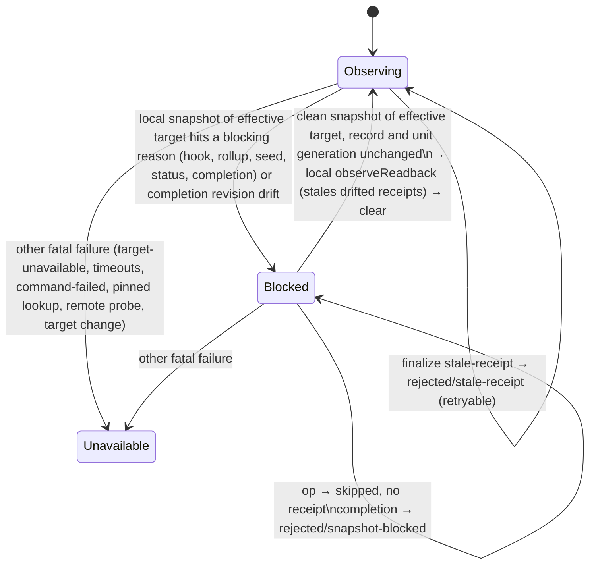

# fix: Block the unit instead of disabling the guard when the worktree breaks a snapshot

## Overview

Some local snapshot failures are caused by the worktree, and an agent with a shell can trigger them on purpose. Today those failures make the workflow guard `unavailable` for the whole session. `unavailable` is terminal and can lead to the unguarded fallback.

This plan turns them into a recoverable, per-unit **snapshot block**:

- Operations still run, but they are not observed. No operation is refused.
- Completion is refused with a retryable reason.
- The next clean snapshot of the same target clears the block.

The plan also makes two related completion paths retryable. Without them the block would not be recoverable in practice:

- a stale receipt that the completion's own readback is the first to see;
- drift between the completion's snapshots.

### Terms

- **Snapshot block**: the per-unit adapter record.
- **`snapshotBlock`**: the field in status output that reports the record.
- **`snapshot-blocked`**: the reason code in a refused completion.
- **Effective target**: the unit's pinned worktree if one is set, otherwise the parent checkout. This is what `resolveEffectiveObserver` returns.
- **Blocking reasons**: `file-limit`, `file-output-limit`, `command-output-limit` and `worktree-unstable`, when they come from a local `snapshot()` of the effective target.
- **Probe**: a remote readback only. A local read is called a snapshot.
- **Protected mode**: the guard refuses a blocked transition. **Observe mode**: it records the transition and lets it run.
- **Revision drift**: a change in the repository or worktree revision digest. A change of target identity or worktree registration is not drift; it stays fatal.

## Problem Frame

The observer (`src/lib/opencode-operation-observer.ts`) returns `unavailable` for four reasons that depend on the worktree:

- `file-limit`: more than 20,000 files, or more than 32 gitlinks.
- `file-output-limit`: more than 128 MiB of content, or an oversized path.
- `command-output-limit`: a local listing over 8 MiB.
- `worktree-unstable`: the tree changed during the snapshot.

The guard adapter (`src/lib/opencode-workflow-guard.ts`) passes each of these to `markUnavailable` from every site that takes a local snapshot:

- the operation before-hook and after-hook;
- child rollup;
- remote seeding when a unit starts;
- status refresh;
- completion readback.

`skills/using-systematic/SKILL.md` tells the agent that `unavailable` is terminal. A sparse file, or a burst of gitlinks, is therefore enough to turn enforcement off. #1124 asks for a blocking state instead.

There is a second path to the same outcome. A finalize-time `stale-receipt` goes through `markUnavailable(transition-finalize-rejected)`. Every natural way out of a block ends at that path: the agent shrinks the tree with an unobserved operation and then calls `complete`.

## Requirements Trace

- R1. Only a blocking reason sets a snapshot block. It must come from a local snapshot of the unit's effective target, taken at the before-hook, after-hook, child rollup, remote seeding, status refresh or completion. The guard mode, the core state, markers and receipts are unchanged.
- R2. While blocked, every operation runs unobserved. The before-hook records the call as skipped, the after-hook stays silent, and no receipt is minted. No operation is refused.
- R3. While blocked, completion returns a retryable `rejected / snapshot-blocked`. It consumes nothing, replays identically for the same call ID, and never calls `markUnavailable`. Revision drift between the parent, pinned and final completion snapshots sets the block with reason `worktree-unstable` and returns the same result.
- R4. A clean local snapshot of the effective target clears the block. This applies at the before-hook, after-hook, child rollup, status refresh or completion. The clear applies that readback to the core, local-only and with no remote probes, so drift made while blocked marks receipts stale before completion.
- R5. A finalize-time `stale-receipt` for a receipt that core has marked stale is turned into a retryable `rejected / stale-receipt` instead of `unavailable`, whatever status core returns with it. If the guard is already `unavailable`, or the receipt is not in core's stale set, the fatal path stays. Every other finalize rejection stays fatal.
- R6. Status reports the active block as `snapshotBlock: {reasonCode}` in every guard state. It never enters markers or `globalIssue`.
- R7. These stay fatal:
  - `target-unavailable`, invalid output, unreadable inputs, command failures, and timeouts;
  - failures from the pinned-worktree lookup and from remote probes;
  - a target-identity or registration change between completion snapshots.
- R8. Remote seeding, at unit start and at skill activation, takes its local snapshot of the effective target. On a blocking reason it defers the remote baseline for every scope without one through the existing seed-deferral record, and sets the block.
- R9. The using-systematic guidance and its bootstrap pin, ARCHITECTURE.md, and the observer solution doc describe the new behavior. They name the user-authorized way out of a block that cannot clear: disabling the guard through `systematic_workflow_control`.

## Scope Boundaries

- No change to the observer limits or to snapshot correctness.
- No operation is refused. A remote side effect that runs while blocked is unreceipted, exactly as an unclassified remote command is today. The guidance tells the agent to check remote state before redoing it.
- Inactive sessions never enter a block, and neither do sessions with a pending skill but no unit. Their blocked operations are skipped.
- The block lives in memory and is dropped on restart. If the worktree is still broken, the next snapshot sets it again.

### Deferred to Separate Tasks

- Hook and rollup timeouts: #1084.
- Restore-time receipt recheck: #1125.
- Restart-proof anchors, ignore rules hiding work, dirty submodules: #1126.
- Verification receipts that overlap a reverted parallel write: #1131.

## Context & Research

### Relevant Code and Patterns

- `src/lib/opencode-workflow-guard.ts`:
  - `finishReadbackTimeout`, `finishRetryableReadback`, `abandonComplete(remember)`, `terminalCompletes` and `replayTerminalComplete` form the retryable completion pattern that R3 and R5 copy.
  - `seedDeferralRecord` is cleared in `startFreshUnit` and surfaced through `statusForTool`. It is the per-unit runtime record pattern for R6. It is also the deferral that R8 reuses through `recordSeedDeferral`. `SeedDeferralReason` is `'command-timeout' | 'missing-resource'` today, `recordSeedDeferral` skips scopes that already have a baseline, and the record is cleared on every `started`, including a same-unit redeclaration.
  - `unitStartGeneration` and `isCurrentInitiator` are the existing monotonic generation, used for stale-clear protection.
  - `skippedOperations` and `takeOperationToFinish` keep the after-hook silent for skipped calls.
  - `readSnapshot` returns `ok`, `timeout` or `fatal` with the observer reason code. The local snapshot call sites classify blocking reasons directly. The pinned lookup goes through `validateRegisteredWorktree` and stays fatal.
  - `resolveEffectiveObserver` defines the effective target. `prepareOperation` snapshots the call's own target, which can be a child worktree. The clear helper takes its own snapshot of the effective target.
  - `applyReadbackAndProbeRemote` applies the readback and then runs remote probes. The clear helper uses only the local `observeReadback` part.
  - `finalizeComplete` sends any non-success finalize to `markUnavailable`. Core reports a finalize-time stale receipt as `waiting / stale-receipt`, because `blockedByCurrentStatus` projects a stale receipt that has a repair as `waiting`.
  - `completionParentDrifted` compares `targetDigest` and the revision digests, and the pinned revalidation is fatal on an observer or target change. Both are fatal today.
  - `seedRemoteScopes` takes the seed-time snapshot from the parent observer and returns before its per-scope loop on a fatal snapshot. It has two callers: unit start and skill activation.
  - The child rollup compares `registration.targetRoot` and `targetIdentity`.
- `src/lib/workflow-guard.ts`: `WorkflowReasonCode`, `observeRevision` → `markStaleReceipts` → `staleForChange`, `decideUnitTransition`, and `terminalizeTransition`. After a finalize, the lifecycle is already terminal, so `abandonTransition` is a no-op.
- `tests/unit/opencode-workflow-guard.test.ts`:
  - `sequenceObserver` only returns `available` snapshots and resolves immediately, and one step counter serves every caller (seed, before-hook, completion). It needs a step-indexed result union and an optional deferred promise so that blocking reasons and races can be expressed. Real observers with small `limits` also work for limit tests.
  - Existing tests that pin the old behavior. Confirm the exact names at implementation:
    - "a before snapshot that is unavailable records its observer reasonCode"
    - "an unavailable guard takes no snapshot and keeps its first cause"
    - "the first before-hook cause wins over a later failing operation"
    - "an after snapshot that is unavailable records its observer reasonCode"
    - "a before-hook cause keeps winning over a later after-hook failure"
    - the stale-completion tests over a real observer, which assert `rejected` without asserting `state`

### Institutional Learnings

- `docs/solutions/logic-errors/operation-observer-false-clean-worktree-2026-10-15.md`: never mint evidence from a failed snapshot. Its "Not covered" line about limit failures and its upgrade-effect paragraph become stale.
- `docs/solutions/integration-issues/worktree-targeted-receipt-observation-2026-08-02.md` and `delegated-receipt-rollup-live-state-recovery-2026-07-31.md`: target and workspace failures stay fatal. Only mutable revision staleness may be recoverable.
- `docs/solutions/logic-errors/pi-chained-bootstrap-composition-2026-07-14.md`: change the guidance and the bootstrap pin together.
- `docs/solutions/workflow-issues/risks-table-rows-must-enforce-as-spec-checks-2026-05-18.md`: every mitigation needs a test scenario in its unit, or the plan must say it is doc-only.

## Prior-Art Survey

```json
{
  "schema_version": 2,
  "verdict": "extend",
  "scope": "repo root (single package): src/lib guard + observer, tests/unit/opencode-workflow-guard.test.ts, skills/using-systematic, ARCHITECTURE.md",
  "freshness": {
    "vcs_reference": "f81284966831da6f20e1fa26fd1123e18a6347e0"
  },
  "budget": {
    "max_search_passes": 20,
    "max_candidate_inspections": 24,
    "exhausted": false
  },
  "candidates": [
    {
      "path_or_symbol": "src/lib/opencode-workflow-guard.ts:finishReadbackTimeout",
      "description": "Completion probe timeout path: abandons the transition, records a rejected readback-timeout terminal that replays by callID, never calls setMode, consumes nothing, and keeps the unit active.",
      "disposition": "reuse"
    },
    {
      "path_or_symbol": "src/lib/opencode-workflow-guard.ts:seedDeferralRecord",
      "description": "Per-unit runtime record of deferred activation seeds, keyed to unitId, cleared in startFreshUnit, surfaced only through statusForTool as seedDeferrals; never reaches markers.",
      "disposition": "extend"
    },
    {
      "path_or_symbol": "src/lib/opencode-workflow-guard.ts:skippedOperations",
      "description": "Digests of calls whose before-hook declined observation; takeOperationToFinish returns silent for them before the pending lookup, so after-hooks stay quiet.",
      "disposition": "extend"
    },
    {
      "path_or_symbol": "src/lib/opencode-workflow-guard.ts:operationObservationApplies",
      "description": "Gate that skips observation when state is disabled or unavailable, or when there is no active epoch and no pending skill.",
      "disposition": "insufficient",
      "insufficiency_reason": "Returning false while blocked would prevent the before-hook probe that must clear the block; the blocked branch has to run after the probe."
    },
    {
      "path_or_symbol": "src/lib/opencode-workflow-guard.ts:markUnavailable",
      "description": "First-cause-wins commit that flips core mode to unavailable through recordUnavailable and stores the bounded firstUnavailableCause.",
      "disposition": "insufficient",
      "insufficiency_reason": "A blocked snapshot must not flip core mode or create a first-unavailable cause; that would make it terminal."
    },
    {
      "path_or_symbol": "src/lib/opencode-workflow-guard.ts:readSnapshot",
      "description": "Typed ok/timeout/fatal split for probe reads that carries the observer reasonCode through ProbeFailure; isProbeTimeout classifies command-timeout.",
      "disposition": "extend"
    },
    {
      "path_or_symbol": "src/lib/opencode-workflow-guard.ts:skippedWithRemoteTail",
      "description": "Status-only enum list of probes skipped on timeout (unconfirmedReadbacks), never persisted; shown in any guard state.",
      "disposition": "extend"
    },
    {
      "path_or_symbol": "src/lib/workflow-guard.ts:observeRevision",
      "description": "Core revision comparison: applies identity changes, calls markStaleReceipts via applyRevisionChanges when workspace, repository, or worktree identity changes, and clears only digest-matching recovered receipts.",
      "disposition": "reuse"
    },
    {
      "path_or_symbol": "src/lib/workflow-guard.ts:globalIssue",
      "description": "Core global issue projected into WorkflowStatus state and reasonCode, which currentMarkerSource digests into marker statusDigest and aggregate state.",
      "disposition": "insufficient",
      "insufficiency_reason": "Any entry enters markers and metadata through state, reasonCode, and statusDigest, which violates the never-a-marker requirement."
    },
    {
      "path_or_symbol": "src/lib/opencode-workflow-guard.ts:finalizeComplete",
      "description": "Adapter commit for any non-success finalizeTransition result (transition-finalize-rejected) via markUnavailable, which turns a completion-time stale-receipt rejection into unavailable.",
      "disposition": "insufficient",
      "insufficiency_reason": "Completion-time staleness found by the completion's own readback reaches this path and ends unavailable; the blocked design must not hit it. Needs a probe and a path change."
    },
    {
      "path_or_symbol": "src/lib/opencode-operation-observer.ts:createOpencodeOperationObserver",
      "description": "Local snapshot() returns unavailable with file-limit, file-output-limit, command-output-limit, or worktree-unstable; the four reasons originate in readWorktreeSnapshot, readOpenedRegularFile, and the final pass.",
      "disposition": "reuse"
    }
  ]
}
```

## Key Technical Decisions

- **Adapter-only state.** The block is an adapter runtime record. It is never a core mode, a global issue or a marker field, because core status and global issues feed into the marker digest.
- **Record shape: `{unitId, unitGeneration, targetIdentity, reasonCode}`.**
  - The record is replaced on every set and deleted on clear.
  - The reason is last-write-wins, so status names what the agent has to fix now.
  - It is reset only when `startFreshUnit` changes `unitId`. A redeclaration of the same unit keeps it.
  - The seed-deferral record gets the same rule, so a redeclaration no longer drops a pending deferral.
- **Stale-clear protection.**
  - A clear captures the current record object and `unitStartGeneration` in the same synchronous segment as its snapshot call.
  - The clear commits only if both are unchanged, and the identity check and `observeReadback` sit in one synchronous segment.
  - Any set replaces the record object, so a slow clean snapshot cannot wipe a newer block or move identities back.
  - No new counter is added.
- **Classification at the local call sites.** One predicate decides whether a reason is a blocking reason. It is called only where the code takes a local snapshot of the effective target:
  - before-hook
  - after-hook
  - child rollup
  - seed
  - status refresh
  - completion

  Remote probe failures and pinned-lookup failures never reach it.
- **Effective target only.**
  - A blocking reason sets the block only when the snapshot's target equals the effective target.
  - A blocked snapshot of any other target skips the operation without setting a block.
  - A clear requires the snapshot target, the record target and the effective target to be equal.
- **One snapshot per hook.**
  - When the call's target is the effective target, the before-hook uses its own snapshot both to decide and to clear.
  - While blocked, a call that targets another target first takes a snapshot of the effective target through the clear helper.
- **Local clear helper.**
  - The helper applies `observeReadback` with no remote probe, then deletes the record.
  - A `workspace-mismatch` from that readback stays fatal, as in `applyReadbackAndProbeRemote`, and the record is not deleted.
  - Every clean-snapshot site calls the helper while blocked. A clean status refresh still runs its normal remote probes after the clear.
- **Before-hook while blocked.**
  - Still blocked: the call is added to `skippedOperations` and returns without binding or a pending entry.
  - Clean: the before-hook clears the block and observes the call normally.
  - `operationObservationApplies` is unchanged, and no call is refused.
- **After-hook blocked with a pending call.** The call is sealed as abandoned and the block is set. No receipt is minted.
- **Child rollup.**
  - Effective target: a blocking reason sets the block and drops that child's evidence, and the key is not added to `rolledUpChildren`.
  - Another target: only the evidence is dropped.
  - A clean child snapshot of the effective target clears the block.
- **Seeding.**
  - Both seed callers take the local snapshot through `resolveEffectiveObserver`.
  - On a blocking reason, `SeedDeferralReason` widens to include the block, and every remote scope without a baseline is deferred through `recordSeedDeferral`.
  - Each deferred baseline binds later from that operation's own clean before-read, as #1005 already does. While blocked that read never happens, because the call is skipped.
- **Completion.**
  - All blocked outcomes are decided in the after-hook, where hooks don't throw:
    - a blocked readback;
    - revision drift;
    - a block set by a concurrent hook during the readback awaits;
    - a finalize-time stale receipt.
  - `finishComplete` re-checks the block synchronously after `await completionReadbacks()` and before `finalizeComplete`.
  - A blocked readback or drift abandons with `remember`, writes a `terminalCompletes` entry, and replays by call ID.
  - A target or registration change between completion snapshots stays fatal.
  - **Finalize-time stale receipt:**
    - The adapter first checks guard state, and an `unavailable` guard takes the fatal path.
    - Otherwise the adapter keys on the completion's receipt being in core's stale set, whatever status core returns.
    - The core transition is already terminal, so the adapter deletes `pendingCompletes` and writes the terminal `rejected / stale-receipt` without calling `abandonComplete`.
    - A retry is rejected at prepare until the stale operations are rerun.
  - If the session is already `unavailable`, every path takes the fatal route, as `finishReadbackTimeout` does.
  - `prepareComplete` does not check the block.
- **Reason code.** `snapshot-blocked` is added to both core `WorkflowReasonCode` and the adapter `REASON_CODES`. It never appears in `globalIssue` or in markers.
- **Guidance.** The adapter keeps no retry counter.
  - The two-retry bound applies to timeouts.
  - On `snapshot-blocked`:
    1. Read `snapshotBlock.reasonCode` from status.
    2. Fix the cause.
    3. Confirm with status.
    4. Rerun stale or missing operations.
    5. Complete.
  - Operations that ran while blocked left no receipts. Before redoing a push or PR operation, check the remote state.
  - In protected mode, a retry rejected at prepare throws `workflow-guard-blocked`.
  - If the same reason persists after one fix, report it to the user.
  - Never delete or hide user files to get under a limit without asking.
  - The user can leave a block that cannot clear by disabling the guard through `systematic_workflow_control`.
- **Labels.** Requirement numbers, unit numbers, issue numbers and "approved" stay out of code, test titles, ARCHITECTURE.md and the solution doc. Describe behavior instead.

## Open Questions

### Resolved During Planning

- **Which reasons block:** the four blocking reasons, from local snapshots of the effective target only.
- **How the agent recovers:** operations run unobserved, and a clean snapshot clears the block.
- **Finalize-time `stale-receipt`:** retryable when the receipt is in core's stale set.
- **Completion drift:** revision drift is retryable and sets the block. A target or registration change stays fatal.
- **Seed-time blocking reasons:** they defer the remote baseline and set the block.
- **Remote operations while blocked:** not refused. The guidance covers redoing them.
- **A block that cannot clear:** the user disables the guard through `systematic_workflow_control`.
- **Restart:** the block is dropped. Every receipt path still requires a clean snapshot.

### Deferred to Implementation

- Whether a refused completion echoes the specific blocking reason, or status alone carries it.
- The restart scenario's fixture. Use the existing recovery fixture in the guard tests. If none fits, keep only the "no marker carries the reason" half.

## High-Level Technical Design

> *This illustrates the intended approach and is directional guidance for review, not implementation specification. The implementing agent should treat it as context, not code to reproduce.*



## Implementation Units

- [ ] **Unit 1a: Step-indexed observer fixture**

**Goal:** Fixtures can express blocking reasons and races. No behavior change.

**Requirements:** test support for R1–R8

**Dependencies:** None

**Files:**
- Test: `tests/unit/opencode-workflow-guard.test.ts`

**Approach:** Extend `sequenceObserver` to a step-indexed union. Each step is `available`, or `unavailable` with a reason, and can carry an optional deferred promise. Existing call shapes keep working.

**Test scenarios:**
- Test expectation: none. The existing suite stays green unchanged.

**Verification:** The guard suites pass with no assertion changes.

- [ ] **Unit 1b: Snapshot-block record, predicate, clear helper and status**

**Goal:** Add the state, the predicate, the clear helper and the status field. No hook changes.

**Requirements:** R1, R4, R6

**Dependencies:** Unit 1a

**Files:**
- Modify: `src/lib/opencode-workflow-guard.ts`, `src/lib/workflow-guard.ts`
- Test: `tests/unit/opencode-workflow-guard.test.ts`

**Approach:**
- Add the record and add `snapshot-blocked` to both reason lists.
- Add the predicate.
- Add `clearSnapshotBlock`, with record-identity and generation protection, a local-only `observeReadback`, and a fatal `workspace-mismatch`.
- `statusForTool` reports `snapshotBlock`.
- Reset the record, and the seed-deferral record, only when `unitId` changes.

**Execution note:** Test-first.

**Patterns to follow:** `seedDeferralRecord`, `currentSeedDeferrals`, `isCurrentInitiator`, and the `seedDeferrals` field in `statusForTool`.

**Test scenarios:**
- Happy path: with no block, status has no `snapshotBlock`, and markers are byte-identical to today's.
- Happy path: the predicate accepts each blocking reason and rejects `target-unavailable`, `command-failed`, `command-timeout` and `file-read-failed`.
- Happy path: status reports `snapshotBlock` in the `protected`, `waiting`, `unavailable` and `disabled` states.
- Edge case: a redeclaration of the same unit keeps both records. A new `unitId` resets them.
- Edge case: a clear whose captured record was replaced by a newer set leaves the newer record, and core identities are unchanged.
- Edge case: a clear applies no remote probe. A counting remote observer verifies this.
- Error path: a clear whose readback is a workspace mismatch makes the guard `unavailable` and keeps the record.

**Verification:** The new tests pass and the existing suites are unchanged.

- [ ] **Unit 2a: Before-hook**

**Goal:** The before-hook sets, honors and clears the block.

**Requirements:** R1, R2, R4, R7

**Dependencies:** Unit 1b

**Files:**
- Modify: `src/lib/opencode-workflow-guard.ts`
- Test: `tests/unit/opencode-workflow-guard.test.ts`

**Approach:**
- `prepareOperation` on a blocking reason for the effective target: set the block, add the call to `skippedOperations`, and return.
- While blocked: decide with the call's own snapshot when its target is the effective target, and otherwise use the clear helper's snapshot. If still blocked, skip the call. If clean, clear and observe normally.
- A blocked snapshot of another target only skips.
- A pending skill with no unit only skips.

**Execution note:** Test-first. Rewrite the before-hook first-cause tests so they use a reason that stays fatal, then add the block versions.

**Patterns to follow:** the `skippedOperations` gate.

**Test scenarios:**
- Happy path: for each blocking reason, the guard is not `unavailable`, the epoch and unit are unchanged, `snapshotBlock.reasonCode` matches, the after-hook is silent, and no receipt is minted.
- Happy path: while blocked, the large file is removed and the next before-hook snapshot is clean. The block clears, the call is observed and receipted, and an earlier implementation receipt is stale.
- Happy path: while blocked, `git push` runs, is skipped, and mints no receipt.
- Edge case: while blocked, a call targets a clean linked worktree that is not the effective target. The block stays and the call is skipped.
- Edge case: a pending skill with no unit and a blocked snapshot. The call is skipped and nothing is recorded.
- Edge case: a slow clean snapshot (deferred) finishes after a later set. The block remains.
- Edge case: when the reason changes during a streak, status shows the latest one.
- Error path, stays fatal: `target-unavailable`, `command-failed` and `command-timeout` at the before-hook still make the guard `unavailable`, and the first cause wins.

**Verification:** The before-hook never calls `markUnavailable` for a blocking reason, and the rewritten first-cause tests pass.

- [ ] **Unit 2b: After-hook and child rollup**

**Goal:** After-hooks and rollup set and clear the block instead of making the guard unavailable.

**Requirements:** R1, R2, R4

**Dependencies:** Unit 2a

**Files:**
- Modify: `src/lib/opencode-workflow-guard.ts`
- Test: `tests/unit/opencode-workflow-guard.test.ts`

**Approach:**
- `captureAfterOperation` and `finishOperation` on a blocking reason for the effective target: seal the call as abandoned and set the block.
- A clean after-snapshot while blocked clears the block.
- Rollup follows the target rule.

**Execution note:** Test-first. Rewrite the after-hook first-cause tests the same way.

**Test scenarios:**
- Error path: a pending call whose after-snapshot hits a blocking reason mints no receipt and is sealed. A duplicate after-hook stays silent.
- Happy path: a clean after-snapshot of a pending call while blocked clears the block and mints its receipt.
- Integration, rollup child with a blocking reason:
  - On the effective target, it sets the block and drops the child receipts.
  - On another target, it drops the receipts with no block.
  - A clean child on the effective target clears the block.
- Error path, stays fatal: a before-hook cause still wins over a later fatal after-hook failure.

**Verification:** No after-hook or rollup path calls `markUnavailable` for a blocking reason.

- [ ] **Unit 3a: Seeding**

**Goal:** A blocking reason at seed time defers remote baselines and sets the block.

**Requirements:** R8

**Dependencies:** Unit 2b

**Files:**
- Modify: `src/lib/opencode-workflow-guard.ts`
- Test: `tests/unit/opencode-workflow-guard.test.ts`

**Approach:**
- Both `seedRemoteScopes` callers (unit start and skill activation) take the seed snapshot through `resolveEffectiveObserver`.
- Widen `SeedDeferralReason`.
- On a blocking reason, defer every scope without a baseline and set the block.

**Execution note:** Test-first.

**Patterns to follow:** `recordSeedDeferral`, `deferredSeedFor`, `bindDeferredBaseline`.

**Test scenarios:**
- Happy path, unit start: a unit with a push starts while the tree exceeds a limit. Seeding defers, the block is set, and the guard is not `unavailable`. After the fix, the push's own clean before-read binds the baseline, and the push mints a receipt.
- Happy path, skill activation: the same sequence when the seed runs on skill activation.
- Edge case: a scope that already has a baseline is not deferred.
- Edge case: a redeclaration of the same unit keeps the deferral and the block.
- Error path, stays fatal: `target-unavailable` and `command-timeout` at seed time still make the guard `unavailable`.

**Verification:** Seeding never calls `markUnavailable` for a blocking reason.

- [ ] **Unit 3b: Status refresh and completion**

**Goal:** Status refresh sets and clears the block. Completion is refused, retryably, while blocked and on revision drift.

**Requirements:** R3, R4, R6, R7

**Dependencies:** Unit 3a

**Files:**
- Modify: `src/lib/opencode-workflow-guard.ts`
- Test: `tests/unit/opencode-workflow-guard.test.ts`

**Approach:**
- `refreshReadback`: a blocking reason on the effective snapshot sets the block and skips remote probes. A clean snapshot clears the block, then probes.
- `completionReadbacks`: return a `blocked` outcome for a blocking reason and for revision drift, setting the block. Drift uses `worktree-unstable`. A target or registration change stays fatal.
- `finishComplete`: route `blocked` to a retryable `snapshot-blocked` terminal, and re-check the block synchronously before `finalizeComplete`.

**Patterns to follow:** `finishReadbackTimeout`, `finishRetryableReadback`, `replayTerminalComplete`.

**Test scenarios:**
- Happy path: a status refresh that hits each blocking reason shows `snapshotBlock`, and the state is not `unavailable`. After the fix, the next status clears the block and marks receipts stale.
- Happy path, protected mode: completion while blocked returns `rejected / snapshot-blocked`. The unit stays active, nothing is consumed, and the guard is not `unavailable`. A duplicate after-hook replays identically.
- Happy path, observe mode: the same sequence is recorded.
- Integration, end to end: block, then an unobserved shrink, then status (block cleared, receipts stale), then rerun verification, then complete. The completion succeeds.
- Error path: the worktree revision changes between the completion's parent and final snapshots. The result is `rejected / snapshot-blocked`, and status shows `worktree-unstable`.
- Error path, stays fatal: the target or registration changes between completion snapshots, a pinned lookup is fatal, or completion hits `target-unavailable`.
- Error path: a concurrent hook sets the block during the completion readback awaits. Completion returns `snapshot-blocked` and does not finalize.
- Edge case: the session is already `unavailable`. A blocked completion takes the fatal path.
- Edge case: no marker ever carries `snapshot-blocked`. After a restart, status sets the block again from a fresh snapshot (see the open question on the fixture).

**Verification:** Status refresh and completion never call `markUnavailable` for a blocking reason or for revision drift.

- [ ] **Unit 3c: Finalize-time stale receipt**

**Goal:** A stale receipt first seen at finalize is retryable.

**Requirements:** R5

**Dependencies:** Unit 3b

**Files:**
- Modify: `src/lib/opencode-workflow-guard.ts`
- Test: `tests/unit/opencode-workflow-guard.test.ts`

**Approach:** In `finalizeComplete`:
- If the guard is `unavailable`, take the fatal path.
- Otherwise, if the reason is `stale-receipt` and the completion's receipt is in core's stale set, delete `pendingCompletes`, write the terminal `rejected / stale-receipt`, and do not call `abandonComplete`.
- Every other non-success stays fatal.

**Execution note:** Test-first.

**Test scenarios:**
- Error path: drift is first seen at finalize.
  - Core returns `waiting / stale-receipt`, and the adapter output is `rejected / stale-receipt`.
  - The guard is not `unavailable`, and the receipt is stale in core.
  - A duplicate after-hook replays.
  - A retry with a new call ID is rejected at prepare until verification is rerun, and then succeeds.
- Edge case: an age-based `stale-receipt` whose receipt is not in the stale set stays fatal.
- Integration: the existing stale-completion tests over a real observer now also assert that `state` is not `unavailable`.
- Error path, stays fatal: other finalize rejections, such as a consumed receipt, still make the guard `unavailable`.

**Verification:** The full guard suites pass.

- [ ] **Unit 4: Guidance, bootstrap pin and docs**

**Goal:** Agents and readers learn the new state and its way out.

**Requirements:** R9

**Dependencies:** Unit 3c

**Files:**
- Modify: `skills/using-systematic/SKILL.md`, `tests/unit/bootstrap.test.ts`, `tests/unit/__snapshots__/bootstrap.test.ts.snap`, `ARCHITECTURE.md`, `docs/solutions/logic-errors/operation-observer-false-clean-worktree-2026-10-15.md`

**Approach:**
- Add a short clause to the guard sentence in using-systematic. It covers:
  - `snapshot-blocked` and a finalize `stale-receipt` are not `unavailable`.
  - The fix → status → rerun → complete order.
  - Operations that ran while blocked left no receipts. Check remote state before redoing a push or PR.
  - Never delete user files without asking.
  - Escalate after one failed fix.
  - The control-disable way out.
- Regenerate the bootstrap snapshots and raise the byte pin.
- ARCHITECTURE.md: replace the statements that limit failures make the guard unavailable, and document the snapshot block and the way out.
- Observer solution doc: update the limit-failure line and the upgrade-effect paragraph.

**Test scenarios:**
- Happy path: the bootstrap byte pin and the snapshot test pass after regeneration.
- Doc-only: the remote check, the delete-files warning and the way out are guidance with no runtime enforcement.

**Verification:** markdownlint, content-integrity and the bootstrap tests pass. No doc still says that limit failures or a finalize stale receipt make the guard unavailable.

## System-Wide Impact

- **Interaction graph:** every local snapshot site in the adapter (before-hook, after-hook, rollup, both seed callers, status refresh, completion readback, finalize). Markers are unchanged.
- **Error propagation:** blocking reasons, revision drift at completion, and finalize staleness for a stale-set receipt become retryable rejections or skips. Everything else keeps the current `unavailable` path and its first cause.
- **State lifecycle risks:**
  - Operations that run while blocked leave no receipts, and that includes remote side effects.
  - Every snapshot site re-reads the full tree while blocked. A snapshot timeout there is still fatal (#1084).
- **Unchanged invariants:**
  - No receipt from a failed snapshot.
  - Stale versus fatal semantics for target and workspace.
  - Marker and receipt protocol versions.
  - `inactive` behavior.
  - No operation is refused.

## Risks & Dependencies

| Risk | Mitigation |
|------|------------|
| A slow clean snapshot clears a newer block | Record identity plus the unit generation (Unit 1b and Unit 2a race tests) |
| Drift made while blocked reaches finalize unseen | Local clear readback, plus a retryable finalize stale receipt (Unit 3b end-to-end test and Unit 3c tests) |
| A remote side effect runs while blocked with no receipt | Guidance to check remote state before a redo (doc only; same exposure as an unclassified remote command today) |
| A blocked agent loops on completion | Guidance: fix, status, rerun, complete; escalate after one failed fix (doc only) |
| A block that cannot clear | Guidance and ARCHITECTURE.md name the control-disable way out (doc only) |
| Recovery tempts deleting user files | Ask-first line in guidance (doc only) |

## Sources & References

- Issues: #1124 (this one), #1080 (retryable completion), #1005 (seed deferral), #1105 (skipped operations), #1099 (observer reasons), #1084, #1125, #1126, #1131.
- Related code: `src/lib/opencode-workflow-guard.ts`, `src/lib/workflow-guard.ts`, `src/lib/opencode-operation-observer.ts`.
