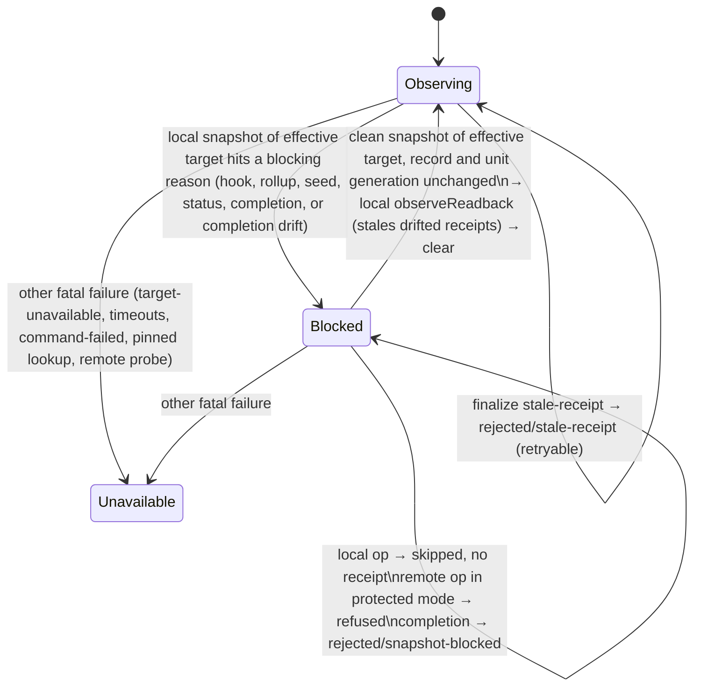

# fix: Block the unit instead of disabling the guard when the worktree breaks a snapshot

## Overview

Some local snapshot failures are caused by the worktree, and an agent with a shell can trigger them on purpose. Today those failures make the workflow guard `unavailable` for the whole session. `unavailable` is terminal and can lead to the unguarded fallback.

This plan turns them into a recoverable, per-unit **snapshot block**:

- Local operations still run, but they are not observed.
- In protected mode, remote operations (push, PR create, PR merge) are refused while the block is active.
- Completion is refused with a retryable reason.
- The next clean snapshot of the same target clears the block.

The plan also makes two related completion paths retryable. Without them the block would not be recoverable in practice:

- a stale receipt that the completion's own readback is the first to see;
- drift between the completion's snapshots.

### Terms

- **Snapshot block**: the per-unit adapter record.
- **`snapshotBlock`**: the field in status output that reports the record.
- **`snapshot-blocked`**: the reason code in a refused completion or operation.
- **Effective target**: the unit's pinned worktree if one is set, otherwise the parent checkout. This is what `resolveEffectiveObserver` returns.
- **Blocking reasons**: `file-limit`, `file-output-limit`, `command-output-limit` and `worktree-unstable`, when they come from a local `snapshot()` of the effective target.
- **Probe**: a remote readback only. A local read is called a snapshot.
- **Protected mode**: the guard refuses a blocked transition. **Observe mode**: it records the transition and lets it run.

## Problem Frame

The observer (`src/lib/opencode-operation-observer.ts`) returns `unavailable` for four reasons that depend on the worktree:

- `file-limit`: more than 20,000 files, or more than 32 gitlinks.
- `file-output-limit`: more than 128 MiB of content, or an oversized path.
- `command-output-limit`: a local listing over 8 MiB.
- `worktree-unstable`: the tree changed during the snapshot.

The guard adapter (`src/lib/opencode-workflow-guard.ts`) passes each of these to `markUnavailable` from every site that takes a local snapshot:

- the operation before-hook and after-hook;
- child rollup;
- remote seeding when a unit starts;
- status refresh;
- completion readback.

`skills/using-systematic/SKILL.md` tells the agent that `unavailable` is terminal. A sparse file, or a burst of gitlinks, is therefore enough to turn enforcement off. #1124 asks for a blocking state instead.

There is a second path to the same outcome. A finalize-time `stale-receipt` goes through `markUnavailable(transition-finalize-rejected)`. Every natural way out of a block ends at that path: the agent shrinks the tree with an unobserved operation and then calls `complete`.

## Requirements Trace

- R1. Only a blocking reason sets a snapshot block. It must come from a local snapshot of the unit's effective target, taken at the before-hook, after-hook, child rollup, remote seeding, status refresh or completion. The guard mode, the core state, markers and receipts are unchanged.
- R2. While blocked:
  - Local operations run unobserved. The before-hook records the call as skipped, the after-hook stays silent, and no receipt is minted.
  - In protected mode, remote-intent operations are refused in the before-hook with `snapshot-blocked`.
  - In observe mode, remote-intent operations are recorded as blocked and are not refused.
- R3. While blocked, completion returns a retryable `rejected / snapshot-blocked`. It consumes nothing, replays identically for the same call ID, and never calls `markUnavailable`. Completion drift between the parent, pinned and final snapshots sets the block with reason `worktree-unstable` and returns the same result.
- R4. A clean local snapshot of the effective target clears the block. This applies at the before-hook, after-hook, child rollup, status refresh or completion. The clear applies that readback to the core, local-only and with no remote probes, so drift made while blocked marks receipts stale before completion.
- R5. A finalize-time `stale-receipt` is turned into a retryable `rejected / stale-receipt` instead of `unavailable`, whatever status core returns with it. Every other finalize rejection stays fatal.
- R6. Status reports the active block as `snapshotBlock: {reasonCode}` in every guard state. It never enters markers or `globalIssue`.
- R7. These stay fatal:
  - `target-unavailable`, invalid output, unreadable inputs, command failures, and timeouts;
  - failures from the pinned-worktree lookup and from remote probes.
- R8. Remote seeding at unit start defers the remote baseline through the existing seed-deferral record and sets the block for a blocking reason.
- R9. The using-systematic guidance and its bootstrap pin, ARCHITECTURE.md, and the observer solution doc describe the new behavior. They name the user-authorized way out of a block that cannot clear: disabling the guard through `systematic_workflow_control`.

## Scope Boundaries

- No change to the observer limits or to snapshot correctness.
- Local operations are never refused. In protected mode, remote-intent operations are refused only while a block is active.
- Inactive sessions never enter a block, and neither do sessions with a pending skill but no unit. Their blocked operations are skipped.
- The block lives in memory and is dropped on restart. If the worktree is still broken, the next snapshot sets it again.

### Deferred to Separate Tasks

- Hook and rollup timeouts: #1084.
- Restore-time receipt recheck: #1125.
- Restart-proof anchors, ignore rules hiding work, dirty submodules: #1126.
- Verification receipts that overlap a reverted parallel write: #1131.

## Context & Research

### Relevant Code and Patterns

- `src/lib/opencode-workflow-guard.ts`:
  - `finishReadbackTimeout`, `finishRetryableReadback`, `abandonComplete(remember)`, `terminalCompletes` and `replayTerminalComplete` form the retryable completion pattern that R3 and R5 copy.
  - `seedDeferralRecord` is cleared in `startFreshUnit` and surfaced through `statusForTool`. It is the per-unit runtime record pattern for R6. It is also the deferral that R8 reuses through `recordSeedDeferral`.
  - `unitStartGeneration` and `isCurrentInitiator` are the existing monotonic generation, used for stale-clear protection.
  - `skippedOperations` and `takeOperationToFinish` keep the after-hook silent for skipped calls.
  - `readSnapshot` returns `ok`, `timeout` or `fatal` with the observer reason code. The local snapshot call sites classify blocking reasons directly. The pinned lookup goes through `validateRegisteredWorktree` and stays fatal.
  - `resolveEffectiveObserver` defines the effective target. `prepareOperation` snapshots the call's own target, which can be a child worktree. The clear helper takes its own snapshot of the effective target.
  - `applyReadbackAndProbeRemote` applies the readback and then runs remote probes. The clear helper uses only the local `observeReadback` part.
  - `finalizeComplete` sends any non-success finalize to `markUnavailable`. Core reports a finalize-time stale receipt as `waiting / stale-receipt`, because `blockedByCurrentStatus` projects a stale receipt that has a repair as `waiting`.
  - `completionParentDrifted` and the pinned revalidation are fatal drift today.
  - `seedRemoteScopes` takes the seed-time snapshot.
  - The child rollup compares `registration.targetRoot` and `targetIdentity`.
- `src/lib/workflow-guard.ts`: `WorkflowReasonCode`, `observeRevision` → `markStaleReceipts` → `staleForChange`, `decideUnitTransition`, and `terminalizeTransition`. After a finalize, the lifecycle is already terminal, so `abandonTransition` is a no-op.
- `tests/unit/opencode-workflow-guard.test.ts`:
  - `sequenceObserver` only returns `available` snapshots and resolves immediately. It needs a result union and an optional deferred promise so that blocking reasons and races can be expressed.
  - Existing tests that pin the old behavior. Confirm the exact names at implementation:
    - "a before snapshot that is unavailable records its observer reasonCode"
    - "an unavailable guard takes no snapshot and keeps its first cause"
    - "the first before-hook cause wins over a later failing operation"
    - "an after snapshot that is unavailable records its observer reasonCode"
    - "a before-hook cause keeps winning over a later after-hook failure"
    - the stale-completion tests over a real observer, which assert `rejected` without asserting `state`

### Institutional Learnings

- `docs/solutions/logic-errors/operation-observer-false-clean-worktree-2026-10-15.md`: never mint evidence from a failed snapshot. Its "Not covered" line about limit failures and its upgrade-effect paragraph become stale.
- `docs/solutions/integration-issues/worktree-targeted-receipt-observation-2026-08-02.md` and `delegated-receipt-rollup-live-state-recovery-2026-07-31.md`: target and workspace failures stay fatal. Only mutable revision staleness may be recoverable.
- `docs/solutions/logic-errors/pi-chained-bootstrap-composition-2026-07-14.md`: change the guidance and the bootstrap pin together.
- `docs/solutions/workflow-issues/risks-table-rows-must-enforce-as-spec-checks-2026-05-18.md`: every mitigation needs a test scenario in its unit, or the plan must say it is doc-only.

## Prior-Art Survey

```json
{
  "schema_version": 2,
  "verdict": "extend",
  "scope": "repo root (single package): src/lib guard + observer, tests/unit/opencode-workflow-guard.test.ts, skills/using-systematic, ARCHITECTURE.md",
  "freshness": {
    "vcs_reference": "f81284966831da6f20e1fa26fd1123e18a6347e0"
  },
  "budget": {
    "max_search_passes": 20,
    "max_candidate_inspections": 24,
    "exhausted": false
  },
  "candidates": [
    {
      "path_or_symbol": "src/lib/opencode-workflow-guard.ts:finishReadbackTimeout",
      "description": "Completion probe timeout path: abandons the transition, records a rejected readback-timeout terminal that replays by callID, never calls setMode, consumes nothing, and keeps the unit active.",
      "disposition": "reuse"
    },
    {
      "path_or_symbol": "src/lib/opencode-workflow-guard.ts:seedDeferralRecord",
      "description": "Per-unit runtime record of deferred activation seeds, keyed to unitId, cleared in startFreshUnit, surfaced only through statusForTool as seedDeferrals; never reaches markers.",
      "disposition": "extend"
    },
    {
      "path_or_symbol": "src/lib/opencode-workflow-guard.ts:skippedOperations",
      "description": "Digests of calls whose before-hook declined observation; takeOperationToFinish returns silent for them before the pending lookup, so after-hooks stay quiet.",
      "disposition": "extend"
    },
    {
      "path_or_symbol": "src/lib/opencode-workflow-guard.ts:operationObservationApplies",
      "description": "Gate that skips observation when state is disabled or unavailable, or when there is no active epoch and no pending skill.",
      "disposition": "insufficient",
      "insufficiency_reason": "Returning false while blocked would prevent the before-hook probe that must clear the block; the blocked branch has to run after the probe."
    },
    {
      "path_or_symbol": "src/lib/opencode-workflow-guard.ts:markUnavailable",
      "description": "First-cause-wins commit that flips core mode to unavailable through recordUnavailable and stores the bounded firstUnavailableCause.",
      "disposition": "insufficient",
      "insufficiency_reason": "A blocked snapshot must not flip core mode or create a first-unavailable cause; that would make it terminal."
    },
    {
      "path_or_symbol": "src/lib/opencode-workflow-guard.ts:readSnapshot",
      "description": "Typed ok/timeout/fatal split for probe reads that carries the observer reasonCode through ProbeFailure; isProbeTimeout classifies command-timeout.",
      "disposition": "extend"
    },
    {
      "path_or_symbol": "src/lib/opencode-workflow-guard.ts:skippedWithRemoteTail",
      "description": "Status-only enum list of probes skipped on timeout (unconfirmedReadbacks), never persisted; shown in any guard state.",
      "disposition": "extend"
    },
    {
      "path_or_symbol": "src/lib/workflow-guard.ts:observeRevision",
      "description": "Core revision comparison: applies identity changes, calls markStaleReceipts via applyRevisionChanges when workspace, repository, or worktree identity changes, and clears only digest-matching recovered receipts.",
      "disposition": "reuse"
    },
    {
      "path_or_symbol": "src/lib/workflow-guard.ts:globalIssue",
      "description": "Core global issue projected into WorkflowStatus state and reasonCode, which currentMarkerSource digests into marker statusDigest and aggregate state.",
      "disposition": "insufficient",
      "insufficiency_reason": "Any entry enters markers and metadata through state, reasonCode, and statusDigest, which violates the never-a-marker requirement."
    },
    {
      "path_or_symbol": "src/lib/opencode-workflow-guard.ts:finalizeComplete",
      "description": "Adapter commit for any non-success finalizeTransition result (transition-finalize-rejected) via markUnavailable, which turns a completion-time stale-receipt rejection into unavailable.",
      "disposition": "insufficient",
      "insufficiency_reason": "Completion-time staleness found by the completion's own readback reaches this path and ends unavailable; the blocked design must not hit it. Needs a probe and a path change."
    },
    {
      "path_or_symbol": "src/lib/opencode-operation-observer.ts:createOpencodeOperationObserver",
      "description": "Local snapshot() returns unavailable with file-limit, file-output-limit, command-output-limit, or worktree-unstable; the four reasons originate in readWorktreeSnapshot, readOpenedRegularFile, and the final pass.",
      "disposition": "reuse"
    }
  ]
}
```

## Key Technical Decisions

- **Adapter-only state.** The block is an adapter runtime record. It is never a core mode, a global issue or a marker field, because core status and global issues feed into the marker digest.
- **Record shape: `{unitId, unitGeneration, targetIdentity, reasonCode}`.**
  - The record is replaced on every set and deleted on clear.
  - The reason is last-write-wins, so status names what the agent has to fix now.
  - It is reset only when `startFreshUnit` changes `unitId`. A redeclaration of the same unit keeps it.
- **Stale-clear protection.**
  - Before the snapshot await, a clear captures the current record object and `unitStartGeneration`.
  - It commits only if both are unchanged when the snapshot returns, and only then applies `observeReadback`.
  - Any set replaces the record object, so a slow clean snapshot cannot wipe a newer block or move identities back.
  - No new counter is added.
- **Classification at the local call sites.** One predicate decides whether a reason is a blocking reason. It is called only where the code takes a local snapshot of the effective target:
  - before-hook
  - after-hook
  - child rollup
  - seed
  - status refresh
  - completion

  Remote probe failures and pinned-lookup failures never reach the predicate.
- **Effective target only.**
  - A blocking reason sets the block only when the snapshot's target equals the effective target.
  - A blocked snapshot of any other target skips the operation without setting a block.
  - A clear requires the snapshot target, the record target and the effective target to be equal.
  - While blocked, the before-hook always snapshots the effective target, whatever target the call has.
- **One local clear helper.**
  - It takes the effective observer, snapshots it, checks stale-clear protection, applies `observeReadback` with no remote probe, and deletes the record.
  - Every clean-snapshot site calls it while blocked. A clean status refresh still runs its normal remote probes after the clear.
- **Before-hook while blocked.**
  - The before-hook snapshots the effective target.
  - Still blocked:
    - In protected mode, a remote-intent call is refused with `WorkflowGuardBlockedError` (`snapshot-blocked`).
    - Every other call is added to `skippedOperations` and returns without binding or a pending entry.
  - Clean: the before-hook clears the block and observes the call normally.
  - `operationObservationApplies` is unchanged.
- **After-hook blocked with a pending call.** The call is sealed as abandoned and the block is set. No receipt is minted.
- **Child rollup.**
  - When the child snapshot is of the effective target, a blocking reason sets the block and drops that child's evidence. The key is not added to `rolledUpChildren`.
  - When the child snapshot is of another target, only the evidence is dropped.
  - A clean child snapshot of the effective target clears the block.
- **Seeding.**
  - A blocking reason at unit start records a seed deferral for every remote scope, through `recordSeedDeferral`, and sets the block.
  - Each deferred baseline binds later from that operation's own clean before-read, as #1005 already does.
- **Completion.**
  - All blocked outcomes are decided in the after-hook, where hooks don't throw:
    - a blocked readback
    - completion drift
    - a block set by a concurrent hook during the readback awaits
    - a finalize-time stale receipt
  - `finishComplete` re-checks the block synchronously after `await completionReadbacks()` and before `finalizeComplete`. Nothing awaits between the two, so the check is race-free.
  - A blocked readback or drift abandons with `remember`, writes a `terminalCompletes` entry, and replays by call ID.
  - A finalize-time stale receipt is keyed on `reasonCode === 'stale-receipt'`, whatever status core returns. The core transition is already terminal, so the adapter deletes `pendingCompletes` and writes the terminal `rejected / stale-receipt` without calling `abandonComplete`. Core has already applied the staleness, so a retry is rejected at prepare until the stale operations are rerun.
  - If the session is already `unavailable`, every path takes the fatal route, as `finishReadbackTimeout` does.
  - `prepareComplete` does not check the block.
- **Reason code.** `snapshot-blocked` is added to the adapter `REASON_CODES`. It is added to core `WorkflowReasonCode` only if a shared result type requires it. It never appears in `globalIssue` or in markers.
- **Guidance.** The guidance is advisory; the adapter keeps no retry counter.
  - The two-retry bound applies to timeouts.
  - On `snapshot-blocked`:
    1. Read `snapshotBlock.reasonCode` from status.
    2. Fix the cause.
    3. Confirm with status.
    4. Rerun stale or missing operations. Before redoing a refused or unreceipted remote operation, check the remote state.
    5. Complete.
  - In protected mode, a retry rejected at prepare throws `workflow-guard-blocked`.
  - If the same reason persists after one fix, report it to the user.
  - The agent must never delete or hide user files to get under a limit without asking.
  - The user can leave a block that cannot clear by disabling the guard through `systematic_workflow_control`.
- **Labels.** Requirement numbers, unit numbers, issue numbers and "approved" stay out of code, test titles, ARCHITECTURE.md and the solution doc. Describe behavior instead.

## Open Questions

### Resolved During Planning

- **Which reasons block:** the four blocking reasons, from local snapshots of the effective target only.
- **How the agent recovers:** local operations run unobserved, and a clean snapshot clears the block.
- **Finalize-time `stale-receipt`:** retryable.
- **Completion drift:** retryable, and it sets the block.
- **Seed-time blocking reasons:** they defer the remote baseline and set the block.
- **Remote operations while blocked:** refused in protected mode, recorded in observe mode.
- **A block that cannot clear:** the user disables the guard through `systematic_workflow_control`.
- **Restart:** the block is dropped. Every receipt path still requires a clean snapshot.

### Deferred to Implementation

- Whether a refused completion echoes the specific blocking reason in its output, or status alone carries it.
- Whether to add a `remote-intent` helper or reuse the existing classification. The before-hook already knows the operation kind before it snapshots, so confirm that ordering.

## High-Level Technical Design

> *This illustrates the intended approach and is directional guidance for review, not implementation specification. The implementing agent should treat it as context, not code to reproduce.*



## Implementation Units

- [ ] **Unit 1: Snapshot-block record, predicate, clear helper, status and fixtures**

**Goal:** Add the state, the blocking-reason predicate, the clear helper and the status field. Extend the fixtures. No hook changes.

**Requirements:** R1, R4, R6

**Dependencies:** None

**Files:**
- Modify: `src/lib/opencode-workflow-guard.ts`, and `src/lib/workflow-guard.ts` only if a shared type needs the reason code.
- Test: `tests/unit/opencode-workflow-guard.test.ts`

**Approach:**
- Add the record and `snapshot-blocked`.
- Add a predicate over the four reason codes.
- Add `clearSnapshotBlock(effective)`, which takes its own local snapshot, checks record identity and `unitStartGeneration`, applies a local-only `observeReadback`, and deletes the record.
- `statusForTool` reports `snapshotBlock`.
- Extend `sequenceObserver` to a result union, so a step can be `available` or `unavailable` with a reason, with an optional deferred promise.

**Execution note:** Test-first.

**Patterns to follow:** `seedDeferralRecord`, `currentSeedDeferrals`, `isCurrentInitiator`, and the `seedDeferrals` field in `statusForTool`.

**Test scenarios:**
- Happy path: with no block, status has no `snapshotBlock`, and markers are byte-identical to today's.
- Happy path: the predicate accepts each blocking reason and rejects `target-unavailable`, `command-failed`, `command-timeout` and `file-read-failed`.
- Happy path: with a record present, status reports `snapshotBlock` in the `protected`, `waiting`, `unavailable` and `disabled` states.
- Edge case: a redeclaration of the same unit keeps the record. A new `unitId` resets it.
- Edge case: a clear whose captured record has been replaced by a newer set leaves the newer record in place, and core identities stay unchanged.
- Edge case: the clear applies no remote probe, which a counting remote observer confirms.

**Verification:** The new tests pass, and the existing guard suites are unchanged.

- [ ] **Unit 2a: Before-hook**

**Goal:** The before-hook sets, honors and clears the block. Protected mode refuses remote-intent calls while blocked.

**Requirements:** R1, R2, R4, R7

**Dependencies:** Unit 1

**Files:**
- Modify: `src/lib/opencode-workflow-guard.ts`
- Test: `tests/unit/opencode-workflow-guard.test.ts`

**Approach:**
- `prepareOperation`, for a blocking reason on a snapshot of the effective target: set the block, add the call to `skippedOperations`, and return. In protected mode, a remote-intent call throws instead.
- While blocked, snapshot the effective target first. If it is still blocked, skip the call, or refuse it if it is remote. If it is clean, call the clear helper and then observe the call normally.
- A blocked snapshot of a different target only skips the call.
- A pending skill with no unit only skips the call.

**Execution note:** Test-first. Rewrite the before-hook first-cause tests so they use a reason that stays fatal, then add the block versions.

**Patterns to follow:** the `skippedOperations` gate, and the protected-mode throw in `prepareComplete`.

**Test scenarios:**
- Happy path: for each blocking reason, the guard is not `unavailable`, the epoch and unit are unchanged, `snapshotBlock.reasonCode` matches, the after-hook is silent, and no receipt is minted.
- Happy path: blocked, the large file is removed, and the next before-hook snapshot is clean. The block clears, the call is observed and receipted, and an earlier implementation receipt is stale.
- Error path: in protected mode while blocked, `git push` and `gh pr create` throw `snapshot-blocked` and run nothing. In observe mode they are recorded and run.
- Edge case: blocked, with a call targeting a clean linked worktree that is not the effective target. The block stays and the call is skipped.
- Edge case: a pending skill with no unit and a blocked snapshot. The call is skipped and nothing is recorded.
- Edge case: a slow clean snapshot (deferred) finishes after a later set. The block remains.
- Edge case: when the reason changes during a streak, status shows the latest reason.
- Error path, stays fatal: `target-unavailable`, `command-failed` and `command-timeout` at the before-hook still make the guard `unavailable`, and the first cause wins.

**Verification:** The before-hook never calls `markUnavailable` for a blocking reason. The rewritten first-cause tests pass.

- [ ] **Unit 2b: After-hook and child rollup**

**Goal:** After-hooks and rollup set and clear the block instead of making the guard unavailable.

**Requirements:** R1, R2, R4

**Dependencies:** Unit 2a

**Files:**
- Modify: `src/lib/opencode-workflow-guard.ts`
- Test: `tests/unit/opencode-workflow-guard.test.ts`

**Approach:**
- `captureAfterOperation` and `finishOperation`, for a blocking reason on the effective target: seal the call as abandoned and set the block.
- A clean after-snapshot while blocked calls the clear helper.
- Child rollup follows the target rule under Key Technical Decisions.

**Execution note:** Test-first. Rewrite the after-hook first-cause tests the same way as in Unit 2a.

**Test scenarios:**
- Error path: a pending call whose after-snapshot hits a blocking reason mints no receipt and is sealed. A duplicate after-hook stays silent.
- Happy path: a clean after-snapshot of a pending call while blocked clears the block and mints its receipt.
- Integration: a rollup child on the effective target with a blocking reason sets the block and drops the child receipts. On another target, it drops the receipts and sets no block. A clean child on the effective target clears the block.
- Error path, stays fatal: a before-hook cause still wins over a later after-hook failure that is fatal.

**Verification:** No after-hook or rollup path calls `markUnavailable` for a blocking reason.

- [ ] **Unit 3a: Status refresh, seeding and completion**

**Goal:** Status refresh and seeding set and clear the block. Completion refuses retryably while blocked and on drift.

**Requirements:** R3, R4, R6, R7, R8

**Dependencies:** Unit 2b

**Files:**
- Modify: `src/lib/opencode-workflow-guard.ts`
- Test: `tests/unit/opencode-workflow-guard.test.ts`

**Approach:**
- `refreshReadback`: a blocking reason on the effective snapshot sets the block and skips the remote probes, as a local timeout does. A clean snapshot calls the clear helper, then probes remotes as usual.
- `seedRemoteScopes`: a blocking reason records a seed deferral for each remote scope and sets the block.
- `completionReadbacks`: return a `blocked` outcome for a blocking reason and for parent or pinned drift, setting the block (drift uses `worktree-unstable`).
- `finishComplete`: route `blocked` to a retryable `snapshot-blocked` terminal, and re-check the block synchronously before `finalizeComplete`.

**Patterns to follow:** `finishReadbackTimeout`, `finishRetryableReadback`, `replayTerminalComplete`, `recordSeedDeferral`.

**Test scenarios:**
- Happy path: a status refresh that hits each blocking reason shows `snapshotBlock`, and the state is not `unavailable`. After the fix, the next status clears the block and marks receipts stale.
- Happy path: a unit with remote operations starts while the tree exceeds a limit. Seeding defers, the block is set, and the guard is not `unavailable`. After the fix, a push's own clean before-read binds the baseline and mints a receipt.
- Happy path, protected mode: completion while blocked returns `rejected / snapshot-blocked`. The unit stays active, nothing is consumed, and the guard is not `unavailable`. A duplicate after-hook replays identically.
- Happy path, observe mode: the same sequence is recorded.
- Integration, end to end: block → unobserved shrink → status (block cleared, receipts stale) → rerun verification → complete succeeds.
- Error path: the tree changes between the completion's parent and final snapshots. The result is `rejected / snapshot-blocked`, and status shows `worktree-unstable`.
- Error path: a concurrent hook sets the block while completion readbacks are awaiting. Completion returns `snapshot-blocked` and does not finalize.
- Error path, stays fatal: a fatal pinned lookup, `target-unavailable` at completion, and a remote probe failure at seeding still make the guard `unavailable`.
- Edge case: if the session is already `unavailable` when completion is blocked, completion takes the fatal path.
- Edge case: no marker ever carries `snapshot-blocked`. After a simulated restart, status sets the block again from a fresh snapshot.

**Verification:** Status refresh, seeding and completion never call `markUnavailable` for a blocking reason or for completion drift.

- [ ] **Unit 3b: Finalize-time stale receipt**

**Goal:** A stale receipt first seen at finalize is retryable.

**Requirements:** R5

**Dependencies:** Unit 3a

**Files:**
- Modify: `src/lib/opencode-workflow-guard.ts`
- Test: `tests/unit/opencode-workflow-guard.test.ts`

**Approach:** In `finalizeComplete`, key on `reasonCode === 'stale-receipt'`. Delete `pendingCompletes`, write the terminal `rejected / stale-receipt`, and do not call `abandonComplete`. Every other non-success stays fatal.

**Execution note:** Test-first.

**Test scenarios:**
- Error path: drift is first seen at finalize. Core returns `waiting / stale-receipt`, and the adapter output is `rejected / stale-receipt`. The guard is not `unavailable`, and the receipt is stale in core. A duplicate after-hook replays. A retry with a new call ID is rejected at prepare until verification is rerun, then succeeds.
- Integration: the stale-completion tests over a real observer now also assert that `state` is not `unavailable`.
- Error path, stays fatal: other finalize rejections, for example a consumed receipt, still make the guard `unavailable`.

**Verification:** The full guard suites pass.

- [ ] **Unit 4: Guidance, bootstrap pin and docs**

**Goal:** Agents and readers learn the new state and its way out.

**Requirements:** R9

**Dependencies:** Unit 3b

**Files:**
- Modify: `skills/using-systematic/SKILL.md`, `tests/unit/bootstrap.test.ts`, `tests/unit/__snapshots__/bootstrap.test.ts.snap`, `ARCHITECTURE.md`, `docs/solutions/logic-errors/operation-observer-false-clean-worktree-2026-10-15.md`

**Approach:**
- Add a short clause to the guard sentence in using-systematic. It says that `snapshot-blocked` and a finalize `stale-receipt` are not `unavailable`, gives the fix → status → rerun → complete order, says to check remote state before redoing a remote operation, warns never to delete user files without asking, says to escalate after one failed fix, and names the control-disable way out.
- Regenerate the bootstrap snapshots and raise the byte pin.
- ARCHITECTURE.md: replace the statements that limit failures make the guard unavailable, and document the snapshot block, the remote refusal and the way out.
- Observer solution doc: update the limit-failure line and the upgrade-effect paragraph.

**Test scenarios:**
- Happy path: the bootstrap byte pin and the snapshot test pass after regeneration.
- Doc-only: the delete-files warning and the way out are guidance with no runtime enforcement.

**Verification:** markdownlint, content-integrity and the bootstrap tests pass. No doc still says that limit failures or a finalize stale receipt make the guard unavailable.

## System-Wide Impact

- **Interaction graph:** every local snapshot site in the adapter (before-hook, after-hook, rollup, seed, status refresh, completion readback, finalize). Markers are unchanged.
- **Error propagation:** blocking reasons, completion drift and finalize staleness become retryable rejections or skips. Everything else keeps the current `unavailable` path and its first cause.
- **State lifecycle risks:**
  - Local operations that run while blocked leave no receipts.
  - Every snapshot site re-reads the full tree while blocked, and a snapshot timeout there is still fatal (#1084).
- **Unchanged invariants:**
  - No receipt from a failed snapshot.
  - Stale-versus-fatal semantics for target and workspace.
  - Marker and receipt protocol versions.
  - `inactive` behavior.

## Risks & Dependencies

| Risk | Mitigation |
|------|------------|
| A slow clean snapshot clears a newer block | Record identity plus the unit generation (Unit 1 and Unit 2a race tests) |
| Drift made while blocked reaches finalize unseen | Local clear readback, and a retryable finalize stale receipt (Unit 3a end-to-end test, Unit 3b test) |
| A remote side effect runs with no receipt | Refused in protected mode while blocked (Unit 2a test); guidance says to check remote state before a redo (doc only) |
| A blocked agent loops on completion | Guidance: fix, status, rerun, complete; escalate after one failed fix (doc only) |
| A block that cannot clear | Guidance and ARCHITECTURE.md name the control-disable way out (doc only) |
| Recovery tempts deleting user files | Ask-first line in guidance (doc only) |

## Sources & References

- Issues: #1124 (this one), #1080 (retryable completion), #1005 (seed deferral), #1105 (skipped operations), #1099 (observer reasons), #1084, #1125, #1126, #1131.
- Related code: `src/lib/opencode-workflow-guard.ts`, `src/lib/workflow-guard.ts`, `src/lib/opencode-operation-observer.ts`.
