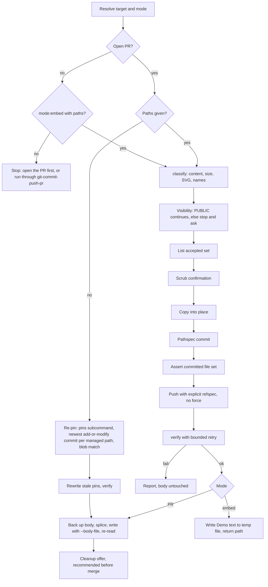

# feat: Attach local screenshots to a pull request

## Overview

This plan adds a bundled `pr-attachments` skill. It publishes local screenshots as commit-pinned image embeds in a managed `## Demo` section of a PR description, then confirms each embed serves an image.

The skill has three modes:
- **PR mode** edits an open PR.
- **Embed mode** returns the section text for `git-commit-push-pr` to insert.
- **Re-pin mode** re-points the embeds after a rebase.

A small built-in-only helper script handles the work that must be exact, including the git-local gates. The `gh` steps and the push stay as prose in the skill. `git-commit-push-pr` gains a publish option in its evidence step.

## Problem Frame

`git-commit-push-pr` asks whether to capture evidence, but it can only splice in an existing URL or embed (`skills/git-commit-push-pr/SKILL.md`, evidence decision). Screenshots from `test-browser`, `agent-browser` or a manual capture have no path into a PR. `gh` cannot upload attachments.

Committing images and linking them works, but three past attempts each worked out the rules by hand:
- A branch-ref link broke when its branch was deleted (panthea#104).
- Images left on main grow the repo (panthea#134).
- A commit-pinned raw link survived cleanup, squash merge and branch deletion (fro-bot/dashboard#599).

(see origin: `docs/brainstorms/2026-10-22-pr-attachments-requirements.md`)

## Requirements Trace

The origin requirements R1–R18 carry forward, with the four owner decisions made during planning (see Key Technical Decisions):

- **Inputs and targets (R1–R4).**
  - Image paths are needed only in PR and embed modes.
  - Resolve the head repo and branch, and refuse one the user cannot push to.
  - Accept explicit paths only, listed back to the user before commit.
  - Accept PNG, JPEG, GIF and WebP by content. Reject SVG, files over 100 MB, and the whole batch on any failure.
- **Safety (R5, R6).**
  - Check visibility. Private or unknown visibility stops and asks.
  - The scrub confirmation covers visible content only.
- **Publishing (R7–R9).**
  - Images go under `docs/evidence/<topic>/`.
  - The evidence-only commit is pushed to the head branch.
  - Embeds use the raw link shape. On a private repo, "proceed" uses the blob form (decision O4).
- **Failure handling (R10).** A rejected push stops the run. Never force-push. A re-run reuses the pushed evidence commit.
- **PR description (R11–R14).**
  - One `## Demo` section, appended if absent.
  - The rest of the body stays byte-for-byte unchanged.
  - A `## Screenshots` section is left alone, with a warning.
  - Embed mode returns text and `git-commit-push-pr` inserts it.
- **Re-pin (R15).** Find the evidence commit on the PR head, rewrite the embeds, and tell the user to re-run after a rebase.
- **Verification (R16).** Runs in all modes before the body is written or text is returned (decision O1).
- **Cleanup and integration (R17, R18).**
  - Cleanup is offered once a PR exists, through a zero-path re-run (decision O2).
  - Cleanup does not revoke access.
  - The evidence step offers the skill for new PRs and the Step 7 rewrite (decision O3).

## Scope Boundaries

- Capturing screenshots stays with `test-browser` and `agent-browser`.
- No browser upload to GitHub's `user-attachments` host.
- No automatic secret, personal-data or metadata stripping.
- No fork PRs without push access.
- No GitHub Enterprise or other non-`github.com` hosts.
- No SVG or other non-raster formats.
- No post-merge recheck. Re-running the skill re-verifies.
- No publish offer in the description-only update path (DU-1..3) of `git-commit-push-pr`.

### Deferred to Separate Tasks

- A render check through the PR's `body_html` Camo URLs. It is stronger than the raw-URL check and would amend R16, so it is a follow-up if live checks show raw-200-but-no-render cases.
- PR mode in a temporary worktree when the PR head is not checked out. v1 stops and says how to fix it.
- Switching `git-commit-push-pr`'s three body apply sites to `--body-file` to stop trailing-newline loss: separate `fix(skills)` PR with its own round-trip test.

## Context & Research

### Relevant Code and Patterns

- `skills/git-commit-push-pr/SKILL.md`:
  - The evidence decision at :199-204 and the splice point at :216.
  - The description-only update at :54-96.
  - Bodies are applied with `--body "$(cat …)"` at :93, :227 and :239. That strips trailing newlines and replaces the whole body.
- `skills/ce-review-cleanup/scripts/cleanup.mjs` is the precedent for a built-in-only helper with a JSON CLI. Its tests are `tests/unit/ce-review-cleanup-{contract,delete,packaging,preview}.test.ts`.
- `skills/document-review/SKILL.md:21-31` (`mode:headless`) is the precedent for a mode token passed between skills that returns structured text.
- `tests/unit/skill-script-invocation.test.ts:63-117` enforces the `SKILL_DIR="<skill directory stated when this skill loads>";` anchor.
- `.github/workflows/release.yaml:425,467` is the `--body-file` precedent.
- `skills/test-browser/SKILL.md:176-177` writes screenshots to the cwd under relative names.

### Registration surfaces for a new skill

| Surface | Change | Check |
|---|---|---|
| `src/lib/bundled-names.ts` | Generated `BUNDLED_SKILL_NAMES` entry | `bun run schema:generate`, `schema:drift` |
| `docs/public/schemas/v3/systematic-config.schema.json` | Generated `disabled_skills` enum | `schema:drift` |
| `registry/registry.jsonc` | Component (files include `scripts/`) plus skills-bundle dependency | `bun scripts/generate-registry.ts`, `registry:drift` |
| `evals/cases/opencode/host-skill-coverage.json` | Hand edit after `orchestrating-subagents` | `tests/unit/eval-contract.test.ts` |
| Claude Code bundle | Copies the skill directory; `systematic:pr-attachments` must resolve | `bun run claude-code:build` |

Docs reference pages, bootstrap, Pi and npm pick up the skill automatically.

### Institutional Learnings

- `docs/solutions/workflow-issues/registry-drift-on-skill-description-change-2026-05-20.md`: a new skill or reference file changes the registry. Regenerate it and run the drift check, because `build` alone misses it.
- `docs/solutions/best-practices/claude-code-plugin-build-and-publish-architecture-2026-07-18.md`: `claude-code/` is staging. Build it and inspect it; never commit it.
- `docs/solutions/developer-experience/gh-api-heredoc-backtick-escape-2026-05-17.md`: write bodies through a file, never inline in the shell. Project memory #7534 says the same.
- `docs/solutions/best-practices/anchor-bundled-script-paths-in-skill-prose-2026-08-24.md`: anchor helper paths on `SKILL_DIR` in every fenced block.

### External References

- GitHub docs:
  - [About anonymized URLs](https://docs.github.com/en/authentication/keeping-your-account-and-data-secure/about-anonymized-urls): Camo fetches images anonymously.
  - [About large files](https://docs.github.com/en/repositories/working-with-files/managing-large-files/about-large-files-on-github): warning at 50 MiB, block at 100 MiB.
- `gh` manuals: [`gh pr view`](https://cli.github.com/manual/gh_pr_view) and [`gh repo view`](https://cli.github.com/manual/gh_repo_view).
  - PR fields: `headRepository`, `headRepositoryOwner`, `headRefName`, `headRefOid`, `isCrossRepository`.
  - Repo fields: `visibility`, `isPrivate`, `viewerPermission`, `url`.
- Format signatures from the [PNG](https://www.w3.org/TR/png-3/#5PNG-file-signature), [GIF89a](https://www.w3.org/Graphics/GIF/spec-gif89a.txt) and [WebP RIFF](https://developers.google.com/speed/webp/docs/riff_container) specs.
- Probes observed 2026-10-22:
  - The #599 pinned PNG returns `200 image/png` with no redirect and `cache-control: max-age=300`.
  - A raw SVG returns `image/svg+xml`.

## Prior-Art Survey

```json
{
  "schema_version": 2,
  "verdict": "build-new-within-scope",
  "scope": "Whole worktree at 0d5b1697: skills/, agents/, scripts/, src/, docs/, .github/, tests/, plus git history for the removed feature-video skill",
  "freshness": {
    "vcs_reference": "0d5b1697"
  },
  "budget": {
    "max_search_passes": 5,
    "max_candidate_inspections": 10,
    "exhausted": false
  },
  "candidates": [
    {
      "path_or_symbol": "skills/git-commit-push-pr/SKILL.md",
      "description": "Evidence decision offers 'use existing evidence' or 'skip' and splices a supplied URL or embed into the body as a ## Demo section.",
      "disposition": "insufficient",
      "insufficiency_reason": "Only splices already-hosted evidence; it cannot commit, push, pin or verify local images. It is the integration seam, not the capability."
    },
    {
      "path_or_symbol": "skills/test-browser/SKILL.md",
      "description": "Captures screenshots with agent-browser into relative filenames in the cwd.",
      "disposition": "insufficient",
      "insufficiency_reason": "Capture only; nothing publishes the images to a PR."
    },
    {
      "path_or_symbol": "skills/agent-browser/SKILL.md",
      "description": "Discovery stub for browser automation and screenshots.",
      "disposition": "insufficient",
      "insufficiency_reason": "No publishing, PR-body or git behaviour."
    },
    {
      "path_or_symbol": "skills/resolve-pr-feedback/scripts/",
      "description": "gh and GraphQL helpers for review threads.",
      "disposition": "insufficient",
      "insufficiency_reason": "Review threads only; no PR-body edits, media or commits."
    },
    {
      "path_or_symbol": "skills/ce-review/references/resolve-base.sh",
      "description": "Resolves the review base branch and merge-base, fork-safe.",
      "disposition": "insufficient",
      "insufficiency_reason": "Resolves the base side; the skill needs head-repo visibility and push permission."
    },
    {
      "path_or_symbol": ".github/workflows/release.yaml",
      "description": "Rewrites the bot-owned release PR body with gh pr edit --body-file.",
      "disposition": "insufficient",
      "insufficiency_reason": "Fixed-template CI rewrite; no section splice or image handling."
    },
    {
      "path_or_symbol": "git history: skills/feature-video/SKILL.md (removed in v3)",
      "description": "Recorded video and uploaded it through a signed-in browser to the user-attachments host.",
      "disposition": "insufficient",
      "insufficiency_reason": "Removed, and browser upload is out of scope; it needs a browser login."
    }
  ],
  "excluded_scopes": [
    {
      "scope": ".slim/clonedeps/repos/",
      "reason": "Read-only third-party dependency clones."
    },
    {
      "scope": "node_modules/ and dist/",
      "reason": "Dependencies and build output, not the repo's own code."
    },
    {
      "scope": "User-level skills outside the repo",
      "reason": "Not shipped by this package."
    },
    {
      "scope": "marcusrbrown/panthea and fro-bot/dashboard",
      "reason": "The hand-built attempts live there; they are cited as evidence, not reusable code."
    }
  ]
}
```

## Key Technical Decisions

- **The order is commit, push, verify, then write the body (O1).** A failed check leaves the body untouched. Reviewers never see broken images, and a re-run reuses the pushed commit. In embed mode a failure returns status `failed` with no Demo text. The caller then says: "evidence files are pushed and unreferenced; cleanup is offered after the PR opens via the zero-path re-run".
- **Cleanup comes from a zero-path re-run (O2).** Running the skill on an open PR without image paths runs the re-pin check, which is a no-op on a fresh PR, and ends with the cleanup offer. `git-commit-push-pr` prints that exact command after it creates the PR, marked "recommended before merge". There is no fourth mode.
- **Embed mode covers new PRs and the Step 7 rewrite (O3).** The description-only update path makes no offer. If the user asks there to attach images, it routes to PR mode. Its existing preserve-Demo rule then carries the section through.
- **Private "proceed" uses the blob link form, gated on a probe (O4).**
  - On a private or unknown-visibility repo, proceeding emits `https://github.com/<owner>/<repo>/blob/<sha>/<path>?raw=true`.
  - Verification switches to an authenticated `gh api` contents check: the file exists at the SHA and its bytes are an image.
  - Until a live probe passes, private and unknown-visibility repos are skip-only, and the blob branch is unreachable.
  - The probe runs before the PR opens. If it fails, v1 ships skip-only.
  - The proceed prompt adds one sentence: the images stay in history, and if the repo is later made public or forked they become public. Cleanup will not remove them.
- **SVG stays excluded, with a corrected reason.** Raw SVG is served as `image/svg+xml` and renders through Camo. The exclusion stands because SVG is markup that can carry invisible content (metadata, comments, editor paths, hidden layers, embedded data, scripts), and a visual scrub cannot cover it. The message reads "SVG is not supported by this skill".
- **Git-local gates in the helper; gh and network in prose.**
  - Byte-exact splicing, content classification, bounded retry, re-pin pin selection and the cleanup set are gates that an LLM re-emitting text cannot hold.
  - The helper keeps no state, takes JSON in and gives JSON out, and exits 0 (success), 1 (domain failure) or 2 (usage).
  - Two subcommands run git themselves: `pins` and `cleanup-set`. They use `spawnSync` with an argv array, a timeout and a sanitized env, following `skills/ce-review/scripts/ensure-ignore.mjs`.
  - They never take git output as input, because that would bring back transcription.
  - The `gh` calls and the push stay as skill prose. `verify` is the one network call in the helper, because retry timing must be exact.
- **No markers; managed URLs are recognised by pattern.**
  - The section boundary is the heading rule only, so no invisible text goes into the PR body.
  - A URL is managed only when all of these hold:
    - the host is raw or blob;
    - owner/repo equals the head repo;
    - the path matches `^docs/evidence/<slug>/<name>$`, where both slug and name are whitelisted.
  - Re-pin and cleanup ignore every other URL and report how many they ignored.
- **PR mode requires the PR head to be checked out and level.** After a fetch, the current branch must be the PR head branch, `HEAD` must equal `headRefOid`, and a remote must map to the head repo. Otherwise the skill stops with the exact fix. This prevents committing to the wrong branch or publishing unpushed commits. A temporary worktree is deferred.
- **Evidence is committed by pathspec only.** The skill copies the images into place and never moves them. It runs `git add -- <dest>` without `-f`, and stops if the destination is gitignored. It then runs `git commit -- <dest>`. Afterwards it asserts that the commit's file list equals the expected set exactly. It stops on an LFS `filter` attribute. The commit subject reads `chore(evidence): add screenshots for <topic>` so it reads as housekeeping in a squash message.
- **Pushes use an explicit refspec.** `HEAD:refs/heads/<head branch>` goes to the remote that maps to the head repo, with no force. A non-fast-forward rejection stops the run.
- **Reuse is keyed on content.** The idempotency key is `(dest path, blob SHA)`, compared with `git rev-parse <headRefOid>:<path>` and with unpushed commits. A re-run after any partial failure reuses what already exists.
- **Topic naming.**
  - The slug comes from the branch name, or from a topic the user supplies. Both go through the same slug function, and the result is shown for confirmation.
  - The slug function: NFKC, lowercase, each run of non-`[a-z0-9]` becomes `-`, trimmed, at most 60 characters. Its output never contains `/`, `..`, `%` or `#`, and never starts with `-`. An empty slug means ask.
  - Destination basenames are slugged the same way to `[a-z0-9._-]`. The extension comes from the detected type, and the source-to-destination mapping is shown to the user.
  - Alt text is the destination slug.
  - A destination with identical bytes is reused.
  - Any conflict stops and asks for a topic or a rename: different bytes at the destination, or two inputs that map to the same name in one batch.
- **Retry.**
  - Wait about 2 s after the push.
  - Retry 404, 429 (honouring `Retry-After`), 5xx and network errors, with backoff of about 2/4/8/15/30 s and ±20% jitter.
  - Fail at once on a 200 that is not an image, on 401/403, on a redirect off `raw.githubusercontent.com` or `media.githubusercontent.com`, or after more than 5 redirects.
  - The 30 s step repeats until about 300 s in total, split across bounded `verify` calls.
  - `verify --max-wait-s` defaults to about 90 and bounds a single call, so no call outlasts a host tool timeout.
- **The handoff is a file.**
  - Embed mode writes the Demo text to a `mktemp` file (mode 0600) and reports its path plus a status line.
  - `git-commit-push-pr` splices from that file and deletes it once it is consumed.
  - The model never re-types 40-hex SHAs.
- **The cleanup set comes from git, not from the PR body.**
  - The helper's `cleanup-set` computes it: every file under `docs/evidence/` that the PR added, found with `--no-renames`, minus any path present at the base tip.
  - It subtracts the base tip, not the merge-base, because the base may have gained a file since the branch point. This needs `baseRefName` from `gh pr view`.
  - `--no-renames` makes a rename into `docs/evidence/` count as an add.
  - Cleanup therefore works with no Demo block, and it can never touch files outside `docs/evidence/` or files the PR did not add.
  - The helper emits a digest of the set. The skill lists the set and waits for an explicit yes. The removal step recomputes the digest and refuses on a mismatch, as `cleanup.mjs` does with its preview token. Only then does it run `git rm`.
  - The digest is right here although the scrub digest was declined. Scrub has a post-commit file-set assertion, and cleanup has no equivalent check.
- **Re-pin pins to the newest add-or-modify commit.**
  - The helper's `pins` finds, for each managed path, the newest commit reachable from `headRefOid` that added or modified it, with `--no-renames`.
  - A pin is valid when the blob at the pinned SHA equals the blob at that commit, not merely when it is reachable.
  - This keeps a replaced image from coming back.
- **The handoff works across hosts.**
  - Pi's `systematic_skill` takes no arguments (`src/pi.ts:215-222`).
  - The `git-commit-push-pr` handoff therefore states `mode:embed` and the paths in the load instruction itself, as well as in skill arguments where the host supports them.
  - The skill parses tokens from "the skill arguments, or the invoking instruction when none are shown", following `skills/document-review/SKILL.md:13`.
  - It uses no positional `$N` placeholders, and it gives an explicit quoting rule for paths with spaces.
  - A load that succeeds but sees no mode token stops at the dispatch rule and never guesses.
- **The helper needs `node` 18+ on PATH.**
  - The installation docs allow Bun alone for OpenCode (`docs/src/content/docs/getting-started/installation.mdx:14`), so `node` is not guaranteed.
  - A missing `node`, a launch failure or exit 2 is a stop-with-state in every mode.
  - Embed mode returns `failed` with nothing published.
  - Cleanup never falls back to running `git rm` by hand.
  - The skill carries a never-bypass paragraph, following `skills/ce-review/references/pipeline-invocation.md:17-31`.
- **Every helper call is anchored on `SKILL_DIR`.**
  - The wording `SKILL_DIR="<skill directory stated when this skill loads>";` is reused verbatim in every fenced block.
  - Pi and Claude Code resolution is evidenced from the package tree only. No live transcript on those hosts covers it. The limitation is stated, not hidden.
- **Declined: a confirmation digest for the scrub gate.** It proves set equality, not that the user answered. The post-commit file-set assertion already guarantees that what was listed is what was committed.
- **Declined: rejecting trailing data after the image end marker.** It stays a warning, consistent with not stripping metadata.

## Open Questions

### Resolved During Planning

- Does a private repo render raw links for members? Camo fetches anonymously, so no (inferred). The blob form is the candidate, gated on the probe (O4).
- How is the topic derived and how are collisions handled? See Topic naming above.
- How does `git-commit-push-pr` hand off? Through a `mode:embed` token stated in the load instruction, and a temp file, at the evidence decision.
- What is the retry policy right after a push? See Retry above.
- Which `gh` queries apply? `gh pr view --json headRepository,headRepositoryOwner,headRefName,headRefOid,baseRefName,isCrossRepository` and `gh repo view <head> --json visibility,isPrivate,viewerPermission,url`. Only `PUBLIC` proceeds without a stop. A null `headRepository` is refused. `viewerPermission` is a preflight signal; the push is authoritative.

### Deferred to Implementation

- The exact `gh` JSON shapes for `headRepository`, `viewerPermission` and `INTERNAL` visibility, checked live before coding the parsing.
- How long a raw 404 is cached, and whether the CDN keys on the query string. This sets whether a cache-busting pre-check is worth keeping.
- Whether GitHub normalises trailing whitespace in stored PR bodies. This sets what the post-write comparison may assert.
- Helper function names and the exact JSON field names.

## Output Structure

    skills/pr-attachments/
    ├── SKILL.md
    └── scripts/
        └── pr-attachments.mjs
    tests/unit/
    ├── pr-attachments-classify.test.ts
    ├── pr-attachments-splice.test.ts
    ├── pr-attachments-git.test.ts
    ├── pr-attachments-verify.test.ts
    ├── pr-attachments-contract.test.ts
    ├── pr-attachments-dry-run.test.ts
    ├── pr-attachments-packaging.test.ts
    └── git-commit-push-pr-evidence-contract.test.ts

## High-Level Technical Design

> *This illustrates the intended approach and is directional guidance for review, not implementation specification. The implementing agent should treat it as context, not code to reproduce.*

| Mode | Trigger | Image paths | Commits | Writes body | Ends with |
|---|---|---|---|---|---|
| PR | Open PR, paths given | Required | Evidence commit, reused if present | Yes, via `splice` and `--body-file` | Cleanup offer |
| Embed | `mode:embed` from `git-commit-push-pr` | Required | Evidence commit | No; returns a temp file path | Status line |
| Re-pin | Open PR, no paths | None | None | Only if a SHA changed | Cleanup offer |

Dispatch: with no open PR and no `mode:embed`, or with no paths and no PR, the skill stops with "open the PR first, or run through git-commit-push-pr".



## Implementation Units

**Unit order:** 1 → 2 → 3 → 4 → 5a → {5b, 6} → 5c (after the probe) → 7.

- [ ] **Unit 1: Helper classification and naming**

**Goal:** Build the helper's `classify` subcommand. It sorts explicit input paths into accepted entries with destination names, or rejects the whole batch.

**Requirements:** R1, R3, R4, R7.

**Dependencies:** None.

**Files:**
- Create: `skills/pr-attachments/scripts/pr-attachments.mjs`
- Test: `tests/unit/pr-attachments-classify.test.ts`

**Approach:**
- Detect the type from magic bytes:
  - PNG: 8-byte signature.
  - JPEG: `FF D8 FF`.
  - GIF: `GIF87a` or `GIF89a`.
  - WebP: `RIFF` at offset 0 and `WEBP` at offset 8.
- Reject SVG by content, with the message "SVG is not supported by this skill". Reject anything else unrecognised, any file over 100 MB, and missing or unreadable paths. One failure rejects the batch, and the result lists a reason for every file.
- An empty path list is a usage error (exit 2).
- Soft warnings, not fatal: trailing bytes after the format end marker (PNG `IEND`, JPEG `FFD9`, GIF trailer), and a size above about 10 MB.
- Apply the topic and destination naming from Key Technical Decisions. The input includes the blob SHAs already present at the destination paths, so the result can mark a destination as reused or as a conflict.
- Each accepted entry reports source, destination, type, byte count and blob SHA (`sha1("blob <len>\0" + bytes)`).
- Only built-in modules, no relative imports, and pure functions behind a thin CLI.

**Execution note:** Test-first. Each named mutation below must fail its fixture before the implementation lands.

**Patterns to follow:** `skills/ce-review-cleanup/scripts/cleanup.mjs` for the CLI shape and JSON output. The exit codes are 0 success, 1 domain failure and 2 usage.

**Test scenarios:**
- Happy path: one file each of PNG, JPEG, GIF87a, GIF89a and WebP is accepted. The destination extension follows the detected type, even when the source extension differs.
- Error path: a `.env` file renamed `x.png` rejects the whole batch, and nothing is accepted (AE6).
- Error path: an SVG file named `.png` is rejected with the "not supported" message.
- Edge case: a file one byte over the injected limit is rejected, and a file exactly at the limit is accepted.
- Edge case: a missing path and an unreadable path both reject the batch, each with its own reason.
- Edge case: a PNG with appended data after `IEND` is accepted with a warning.
- Naming:
  - `feat/x` and `fix/x` yield different slugs.
  - Slug output never contains `/`, `..`, `%` or `#`, and never starts with `-`.
  - A branch made only of separators yields an empty slug, and the result asks for a topic.
  - A user-supplied topic goes through the same slug function, and the result is returned for confirmation.
  - Source names containing `](`, `-->`, `<`, a backtick or a newline yield destination names within `[a-z0-9._-]`.
  - A destination with identical bytes is reused.
  - A destination with different bytes stops and asks.
  - Two inputs that map to one name in one batch stop and ask.
  - An empty path list exits 2.
- Mutation killers: extension-based detection fails the renamed `.env` fixture, and dropping the batch-wide rejection fails the mixed-batch fixture.

**Verification:**
- `classify` returns deterministic JSON for the same input.
- Every scenario passes.
- The helper imports only `node:` modules.

- [ ] **Unit 2: Helper splice, URL extraction and re-pin rewrite**

**Goal:** Byte-exact `## Demo` splicing, plus Demo extraction, managed-URL extraction and SHA rewriting.

**Requirements:** R11, R12, R13, R15.

**Dependencies:** Unit 1, because they share the helper file.

**Files:**
- Modify: `skills/pr-attachments/scripts/pr-attachments.mjs`
- Test: `tests/unit/pr-attachments-splice.test.ts`

**Approach:**
- `splice` takes a body as JSON plus a Demo text file. It returns the new body file and a report with the action (`appended`, `replaced` or `unchanged`), whether `## Screenshots` is present, and the Demo count.
- **Section boundaries.**
  - The heading matches `^ {0,3}##[ \t]+Demo[ \t]*#*[ \t]*$`.
  - Fenced code is excluded, including an unclosed fence that runs to EOF. So are multi-line HTML comments, indented code and blockquotes.
  - The section ends at the next H1 or H2 outside those regions.
- **Line endings.** Lines split on CRLF, LF or CR, and each keeps its terminator. Inserted lines use the adjacent or dominant EOL.
- **Edge cases.**
  - An empty body becomes exactly the section.
  - A whitespace-only body keeps its bytes, and the section is appended after them.
  - When appending, add exactly enough to leave one blank line.
  - Two existing `## Demo` sections stop the run and ask.
  - The heading line's bytes are kept.
- `extract` takes a body as JSON and returns the existing `## Demo` section bytes verbatim, from the heading through the end of the section. With no Demo section it reports `absent`. `splice` then inserts the extracted bytes into a regenerated body.
- `urls` takes a body and the head repo. It extracts the managed embed URLs as owner, repo, SHA, path and form (`raw` or `blob`).
  - A URL is managed only when the host is raw or blob, owner/repo equals the head repo, and the path matches `^docs/evidence/<slug>/<name>$`.
  - It reports how many other URLs it ignored.
- `repin-rewrite` takes a path-to-SHA map and rewrites only the 40-hex segment. Captions and hand edits are left unchanged.

**Execution note:** Test-first, using a prefix and suffix oracle.

**Test scenarios:**
- Happy path: the section is appended to a body with no Demo, and the prefix bytes are unchanged.
- Happy path: replacing an existing Demo leaves `## Testing` after it unchanged, and there is still exactly one Demo (AE2).
- Fixed point: splicing the same Demo twice yields identical bytes.
- Edge cases:
  - A `## Demo` inside a fence earlier in the body is ignored.
  - A commented-out `## Demo` in an HTML template block is ignored.
  - A CRLF body round-trips with CRLF.
  - Demo as the last section, with and without a trailing newline.
  - An empty body, and a whitespace-only body.
- Edge case: `## Screenshots` with no Demo leaves Screenshots unchanged, appends Demo, and reports Screenshots present (AE8).
- Error path: a body with two `## Demo` sections reports a conflict and returns no output body.
- Re-pin: rewriting one SHA changes only that 40-hex segment. A caption edited by hand inside the section survives.
- `extract`: it returns the Demo section bytes verbatim, and `absent` for a body with none.
- Step 7 round-trip: `extract` from an old body, then `splice` into a regenerated body, leaves the Demo section byte-identical.
- `urls`: URLs with another host, another owner/repo or a path outside `docs/evidence/<slug>/<name>` are ignored and counted.
- Mutation killers:
  - A naive `indexOf('## Demo')` fails the fence fixture.
  - Normalising EOLs fails the CRLF fixture.
  - Replacing through EOF fails the `## Testing` fixture.

**Verification:** For every fixture, the bytes outside the replaced region are identical between input and output.

- [ ] **Unit 3: Helper git gates: pins and cleanup set**

**Goal:** `pins` and `cleanup-set` subcommands that run git themselves, so pin selection and the cleanup set are computed and not transcribed.

**Requirements:** R15, R17.

**Dependencies:** Unit 2, because they share the helper file and `pins` takes the managed paths from `urls`.

**Files:**
- Modify: `skills/pr-attachments/scripts/pr-attachments.mjs`
- Test: `tests/unit/pr-attachments-git.test.ts`

**Approach:**
- Both subcommands run git through `spawnSync` with an argv array, a timeout and a sanitized env.
- Neither takes git output as input. Inputs come from the body and from `gh pr view`: `headRefOid`, `baseRefName`, the managed paths and the SHA each embed pins today.
- `pins` reports, per path:
  - the newest commit reachable from `headRefOid` that added or modified the path, found with `--no-renames`;
  - whether the current pin is valid, meaning the blob at the current SHA equals the blob at that commit;
  - an unresolved state when no such commit exists.
- `cleanup-set` takes `headRefOid` and `baseRefName`. The skill fetches the base first.
  - The set is the files under `docs/evidence/` that the PR added, found with `--no-renames`.
  - Any path present at the base tip, not the merge-base, is subtracted.
  - It emits the set and a digest of the set.
- Removal is a second step of `cleanup-set`. It takes the digest, recomputes the set, and refuses on a mismatch. On a match it runs `git rm` for the set. Commit and push stay in the skill.
- A git timeout or failure exits 1 and reports the state it reached.

**Execution note:** Test-first. Each named mutation below must fail its fixture before the implementation lands.

**Patterns to follow:**
- `skills/ce-review/scripts/ensure-ignore.mjs` for the git calls.
- `skills/ce-review-cleanup/scripts/cleanup.mjs` (`:1039-1041`) for the digest check.
- `tests/unit/ce-review-ensure-ignore.test.ts` for real temp repos.

**Test scenarios:**
- Fixtures use real temp repos with a local bare remote.
- Re-pin: add A, overwrite with B, re-pin. The newest commit is B's, and the pin to A is invalid.
- Rename: a file renamed into `docs/evidence/` is in the set.
- Base gained a path: a path the base gained after the merge-base is excluded.
- A file the PR did not add is excluded.
- A file outside `docs/evidence/` is never listed.
- The digest is stable for the same set and changes when the set changes.
- Removal refuses on a digest mismatch and removes nothing.
- A git timeout or failure exits 1 with the reached state reported.
- Mutation killers:
  - Dropping `--no-renames` fails the rename fixture.
  - Using the merge-base instead of the base tip fails the base-gained fixture.
  - Dropping the blob-equality check fails the add-A-overwrite-B fixture.

**Verification:** Every fixture runs against real temp repos. No test needs the network or `gh`. The helper still imports only `node:` modules.

- [ ] **Unit 4: Helper verification with bounded retry**

**Goal:** A `verify` subcommand that confirms each embed serves an image, with bounded retry. It never echoes content.

**Requirements:** R16, plus the private-repo path from decision O4.

**Dependencies:** Unit 3, because they share the helper file.

**Files:**
- Modify: `skills/pr-attachments/scripts/pr-attachments.mjs`
- Test: `tests/unit/pr-attachments-verify.test.ts`

**Approach:**
- Accept only `https://raw.githubusercontent.com/…` URLs.
- Follow redirects only to `raw.githubusercontent.com` or `media.githubusercontent.com`, up to 5.
- Send no credentials.
- Success means a final 200 with an `image/*` content type.
- Apply the retry schedule and failure classes from Key Technical Decisions, with an injectable clock, sleep and fetch.
- Check URLs concurrently.
- `--max-wait-s` bounds a single call. The result is per URL: status, last HTTP code, attempts, and whether the failure is retryable.
- Blob-form URLs for private repos are not fetched. A blob URL given to `verify` exits 2 with a usage error, and the skill routes blob URLs to the `gh api` check.
- Exit codes: 0 when every URL passes, 1 when any fails, 2 for usage errors.

**Execution note:** Test-first, against a local `node:http` stub server.

**Test scenarios:**
- Happy path: a 200 with `image/png` passes on the first attempt.
- Retry: 404 then 200 passes after the scheduled delays. The injected clock records the exact backoff sequence.
- Error path: a 200 with `text/html` fails at once and is not retried (AE3).
- Error path: a redirect to another host fails, and more than 5 redirects fail.
- Edge case: a 429 with `Retry-After` waits that long before retrying.
- Edge case: a persistent 404 stops at `--max-wait-s` with a retryable failure.
- Multiple URLs: the result lists each failing URL by name, and the total time is the maximum, not the sum.
- Usage error: a blob URL exits 2.
- Mutation killers:
  - Accepting any 200 fails the HTML fixture.
  - Not following redirects fails the redirect fixture.
  - Not retrying 404 fails the 404-then-200 fixture.

**Verification:** No test waits on real time. `verify` never prints response bodies.

- [ ] **Unit 5a: The skill text and its contract**

**Goal:** Write `SKILL.md` for the three modes and pin its text and ordering with contract tests. Freeze the frontmatter description here.

**Requirements:** R1–R17. The private path is written as skip-only text.

**Dependencies:** Units 1–4.

**Files:**
- Create: `skills/pr-attachments/SKILL.md`
- Test: `tests/unit/pr-attachments-contract.test.ts`, `tests/unit/pr-attachments-dry-run.test.ts`

**Approach:**
- **Frontmatter.** Set `name: pr-attachments`, a description that triggers on attaching screenshots to a PR, and `argument-hint` covering `mode:embed`, paths and the PR number or branch.
  - Freeze the description here, so the registry is regenerated once in 5b.
  - Do not opt in to the portability marker unless the text passes its scan.
  - Avoid banned literals.
  - Avoid `!` lines.
- **Precondition.** State that the helper needs `node` 18+ on PATH. Include the never-bypass paragraph.
- **Target resolution.**
  - Read tokens from the skill arguments, or from the invoking instruction when none are shown. Use no positional `$N` placeholders, and state the quoting rule for paths with spaces.
  - Parse the `mode:*` tokens. Conflicting tokens stop with an error, and the remaining tokens are paths.
  - Dispatch:
    - With no open PR and no `mode:embed`, stop.
    - With no paths and no PR, stop.
    - A load that sees no mode token stops here and never guesses.
    - Every stop says "open the PR first, or run through git-commit-push-pr".
  - PR and re-pin modes: resolve the PR and its head with `gh pr view --json …`, including `baseRefName`.
  - Embed mode: resolve the head from the upstream of the current branch.
    - Run `git rev-parse --abbrev-ref @{u}`.
    - Match that remote's URL against `git remote -v` to get owner/repo, then run `gh repo view`.
    - With no upstream, stop.
  - Refuse a null `headRepository`, a non-`github.com` host, or a fork the user cannot push to.
  - PR mode checks that the PR head is checked out and level.
- **Ordering.** classify, visibility, list the accepted set, scrub confirmation, copy into place, pathspec commit, file-set assertion, push with an explicit refspec, verify, write the body or return the file, then the cleanup offer.
  - `classify` runs first. It is local and cheap, and it catches a bad batch before any network work.
- **Private repos.** On a private or unknown-visibility repo, the skill stops and offers skip only. The blob branch is added in 5c, after the probe.
- **Body write.**
  - Read the body with `gh pr view --json body`.
  - Back it up to a `mktemp` file (mode 0600) and tell the user the path.
  - Re-read it immediately before writing.
  - Write with `--body-file`.
  - Re-read afterwards and compare the regions outside Demo.
  - On a mismatch, warn and print the backup path. Never auto-restore, because that could overwrite a concurrent edit.
  - Keep the backup until the re-read passes.
- **Re-pin.**
  - Use `headRefOid` from `gh`. If local `HEAD` differs, say "push first".
  - Take managed paths from the body with the helper's `urls`. Ignore every other URL and report how many were ignored.
  - Run the helper's `pins` for the managed paths.
  - If every pin is valid, report "already valid" and write nothing.
  - When only some paths resolve, report "partial" and name the unresolved paths.
  - If no path ever existed on the head, stop and point to PR mode.
- **Cleanup.**
  - Run the helper's `cleanup-set` to get the set and its digest.
  - Offer cleanup only once a PR exists, only if the set is not empty, and recommend it before merge. Otherwise report "cleanup already done".
  - List the set and wait for an explicit yes. Then run the helper's removal step with the digest, commit, and push without force.
  - Never run `git rm` by hand, including when the helper cannot run.
  - Read `gh repo view --json squashMergeAllowed,mergeCommitAllowed,rebaseMergeAllowed`. If non-squash merges are allowed, add one line: the images stay in default-branch history unless the PR is squash-merged.
  - Include the verbatim disclosure: cleanup does not revoke access, so any published secret must be rotated.
- **Disclosures.**
  - Evidence binaries appear in the Files tab until cleanup.
  - A rebase or force-push needs a zero-path re-run.

**Patterns to follow:**
- `skills/ce-review-cleanup/SKILL.md` and its contract test for ordering assertions and the `SKILL_DIR` anchor.
- `skills/document-review/SKILL.md` for mode-token parsing.
- `skills/ce-review/references/pipeline-invocation.md:17-31` for the never-bypass paragraph.
- `commit 449934b3` as the end-to-end precedent for adding a skill.

**Test scenarios:**
- Contract: the frontmatter name, `argument-hint`, and the three mode names are present.
- Contract ordering, using `indexOf`: classify < visibility < scrub confirmation < copy < commit < file-set assertion < push < verify < body write < cleanup offer.
- Contract bans:
  - push commands with `--force`, `-f` or a `+` refspec
  - `git add -A` and `git add .`
  - `--body "$(`
  - `git add -f`
  - a hand-run `git rm` fallback in cleanup
- Contract: every helper invocation is anchored on `SKILL_DIR`, and `node "$SKILL_DIR/scripts/pr-attachments.mjs"` is pinned.
- Contract: the dispatch rule fires when no mode token is seen.
- Contract text:
  - the `## Screenshots` warning;
  - the cleanup-does-not-revoke disclosure;
  - the "SVG is not supported by this skill" message;
  - "push first" for a local and remote mismatch;
  - "open the PR first, or run through git-commit-push-pr";
  - "cleanup already done";
  - the explicit yes before removal;
  - the mismatch warning that prints the backup path and never auto-restores;
  - the never-bypass paragraph and the "needs node 18+ on PATH" precondition;
  - the skip-only text for private and unknown-visibility repos.
- Offline prose dry run, with no `gh`:
  - A temp repo with a local bare remote runs the pathspec commit, then the file-set assertion, then the refspec push.
  - A forced non-fast-forward rejection stops the run and leaves the remote unchanged.

**Verification:**
- `bun scripts/content-integrity.ts` is clean.
- The contract and dry-run tests pass.

- [ ] **Unit 5b: Registration surfaces and packaging**

**Goal:** Register the skill on every surface and pin the packaged helper.

**Requirements:** Delivery of R1–R17.

**Dependencies:** Unit 5a, because the description is frozen there.

**Files:**
- Modify:
  - `src/lib/bundled-names.ts` (generated)
  - `docs/public/schemas/v3/systematic-config.schema.json` (generated)
  - `registry/registry.jsonc` (generated)
  - `evals/cases/opencode/host-skill-coverage.json`
- Test: `tests/unit/pr-attachments-packaging.test.ts`

**Approach:** Regenerate the generated surfaces and hand-edit the eval case after `orchestrating-subagents`, as the registration table says.

**Test scenarios:**
- Packaging:
  - The OCX registry component lists `scripts/pr-attachments.mjs`.
  - `npm pack` includes it.
  - The Claude Code bundle copies it byte-identical and executes it.
  - The helper has no relative imports.
  - Negative control: a missing helper fails the packaging assertion.
- Integration: `eval-contract.test.ts`, `generate-registry.test.ts` and `generate-config-schema.test.ts` pass with the new skill.

**Verification:**
- `bun run schema:generate`, `bun scripts/generate-registry.ts`, `bun run registry:drift`, `bun run schema:drift`, `bun scripts/content-integrity.ts` and `bun run claude-code:build` are clean.
- The generated `claude-code/` bundle contains the skill and resolves `systematic:pr-attachments`.

- [ ] **Unit 5c: The private blob branch**

**Goal:** Let a private or unknown-visibility repo proceed with the blob form. This unit lands only after the live probe passes. If the probe fails, 5c is dropped and v1 ships skip-only.

**Requirements:** R5, decision O4.

**Dependencies:** Units 5a and 5b, and a passing live probe (Live verification, step 7).

**Files:**
- Modify: `skills/pr-attachments/SKILL.md`
- Test: `tests/unit/pr-attachments-contract.test.ts`

**Approach:**
- Replace the skip-only text with the blob branch.
- Proceeding emits the blob form after an explicit answer.
- The proceed prompt says the images stay in history, and if the repo is later made public or forked they become public. Cleanup will not remove them.
- Verify through `gh api repos/<o>/<r>/contents/<path>?ref=<sha>`, checking that the file exists and its decoded bytes are an image.
- State that rendering for members was confirmed by the probe.

**Test scenarios:**
- Contract: the blob form, the explicit-answer gate and the history disclosure are present, and the skip-only text is gone.
- Contract: private-repo verification goes through `gh api`, not the helper's `verify`.

**Verification:**
- The contract test and `bun scripts/content-integrity.ts` pass.
- The probe result is recorded in the PR.

- [ ] **Unit 6: git-commit-push-pr integration**

**Goal:** Add the publish option to the evidence step. Keep the screenshots out of the feature commit and the PR narrative. Carry the Demo section through body rewrites.

**Requirements:** R14, R17, R18 (decisions O2, O3).

**Dependencies:** Unit 5a. It can run in parallel with 5b.

**Files:**
- Modify: `skills/git-commit-push-pr/SKILL.md`
- Test: `tests/unit/git-commit-push-pr-evidence-contract.test.ts`

**Approach:**
- **Step 4.** Never stage untracked image files without asking. When untracked images exist, ask the evidence-source question first.
- **Step 6 evidence decision.**
  - Add a third option, "Publish local images". It loads `systematic:pr-attachments` with `mode:embed` and explicit paths. That covers both new PRs and the Step 7 rewrite.
  - The load instruction states `mode:embed` and the paths in its own text, as well as in skill arguments where the host supports them.
  - The skill's status line reports the evidence commit SHA. The body generator uses `<base>..<evidence-sha>^` and excludes `docs/evidence/**`. No shell variable carries a value across calls.
  - Splice the returned file at the existing splice point, then delete it.
  - On status `failed`, report that the evidence files are pushed but unreferenced, then continue without evidence.
- **Fallback.** If loading `systematic:pr-attachments` fails, or it loads but sees no mode token, offer only the existing two options.
- **Rewrites (Step 7 and DU-3).**
  - When a Demo section exists, run the helper's `extract` on the old body and `splice` the result into the regenerated body. Prose-only preservation stays as the fallback.
  - DU-3 makes no publish offer. A request to attach images routes to PR mode.
- **After PR creation.** Print the zero-path re-run command, marked "recommended before merge".

**Test scenarios:**
- Contract: the evidence decision lists "Publish local images" with `systematic:pr-attachments` and `mode:embed`.
- Contract: Step 4 forbids staging untracked images without asking.
- Contract: the narrative instruction uses `<base>..<evidence-sha>^`, excludes `docs/evidence/**`, and has no `PRE` variable.
- Contract: the post-create instruction prints the zero-path re-run command.
- Contract: DU-3 has no publish offer and routes to PR mode.
- Contract: the Step 7 rewrite uses `extract` and `splice`.
- Contract: the load instruction states `mode:embed` and the paths in its text.
- Contract: the fallback text covers a skill that fails to load and a skill that loads but sees no mode token, and it offers only the two existing options.

**Verification:**
- `bun run claude-code:build` resolves `systematic:pr-attachments` from `git-commit-push-pr`.
- If the frontmatter `description` changed, the registry is regenerated and `registry:drift` is clean.

- [ ] **Unit 7: Docs and README count**

**Goal:** Record the skill in the architecture and harness docs, state the Node requirement, and fix the README count.

**Requirements:** Documentation for all of the above.

**Dependencies:** Units 5a, 5b and 6, and 5c if it ships.

**Files:**
- Modify:
  - `ARCHITECTURE.md`: a paragraph next to the review-artifact cleanup one.
  - `README.md`: the bundled skill count, computed at implementation time.
  - `HARNESSES.md`: a sibling section for the attachments helper, after the review-validator packaged-paths section (roughly `:65-91`).
    - Add registry-style entries for the packaging and contract tests.
    - Copy the "not cross-harness runtime parity" honesty paragraph.
    - Record the Pi no-arguments boundary next to the other honesty boundaries (roughly `:46`).
  - `docs/src/content/docs/getting-started/installation.mdx`: the `node` requirement for this skill.

**Test expectation:** none. These are docs. `content-integrity` and markdownlint cover them.

**Verification:** `bun scripts/content-integrity.ts` and markdownlint are clean. The README count matches the number of `skills/` directories at implementation time.

## System-Wide Impact

- **Interaction graph:**
  - `git-commit-push-pr` gains a call into the new skill.
  - `ce-work`'s shipping workflow reaches it only through `git-commit-push-pr`, so it is unchanged.
  - `lfg` and `slfg` call `test-browser` directly and do not reach the evidence step.
- **Error propagation:** every failure is a stop with a stated state, such as "commit is pushed, body not written, re-run to retry". The skill keeps no state of its own; it reads state from git and the PR body.
- **State lifecycle risks:**
  - An evidence commit pushed without a body write leaves unreferenced files. These are reported, and cleanup applies.
  - The body is backed up before every write.
- **API surface parity:**
  - `git-commit-push-pr` changes for all three hosts.
  - Skill-argument delivery differs: OpenCode has an `arguments` param, Claude Code substitutes `$ARGUMENTS` or appends, and Pi has none.
  - `node` availability differs by install.
  - `SKILL_DIR` resolution is evidenced from the package tree only on Pi and Claude Code.
- **Unchanged invariants:**
  - The existing "use existing evidence" and "skip" options behave as before.
  - DU-1..3 makes no commit or push unless the user asks to attach images, which routes to PR mode.
  - No new package dependency. The helper needs `node` 18+ on PATH, which the runtime precondition states.

## Risks & Dependencies

| Risk | Mitigation |
|---|---|
| GitHub stops serving commits that are reachable only through a PR ref | The requirements state durability as observed on one PR, not guaranteed. A re-run re-verifies. |
| Blob-form links do not render for members on private repos | The live probe decides. If it fails, private repos are skip-only. |
| A first-fetch 404 is cached for up to 300 s | Retry for up to about 300 s, split across bounded calls. |
| Camo refuses large images even when the raw URL returns 200 | A soft warning above about 10 MB, plus a live size check. The `body_html` render check is deferred. |
| The agent skips a prose gate such as the scrub confirmation | Contract tests pin the ordering. Live transcripts on each host are the behavioural evidence. |
| No `node` on PATH | The skill stops with state, and the precondition is documented. Embed mode returns `failed`, and cleanup never falls back to `git rm` by hand. |
| Pi passes no arguments to the skill | The tokens are stated in the instruction text, and the dispatch stop prevents guessing. |
| Cleanup deletes a file the base gained | The base-tip subtraction, plus a temp-repo test. |

## Documentation / Operational Notes

- **Live verification.** It touches real repositories, so each step needs Marcus's approval before running.
  1. Check the `gh` JSON shapes for `headRepository`, `viewerPermission` and `visibility`, including `INTERNAL` if available.
  2. On a public scratch PR, run the full flow: embed, PR, verify, cleanup, squash merge, branch delete. The URL should still return 200.
  3. Round-trip a body through `--body-file` and confirm CRLF, the trailing newline and trailing spaces survive.
  4. Re-pin after a force-push on the scratch PR.
  5. Measure the 404 cache TTL with `curl -sI` on a nonexistent raw path.
  6. Check Camo rendering at 6, 12 and 25 MB.
  7. Run the private-repo blob-form probe (O4). It must pass before the PR opens. If it fails, v1 ships skip-only.
  8. Capture one transcript per host showing the scrub confirmation before the commit.
- The local requirements doc (`docs/brainstorms/...`, gitignored, primary checkout only) is updated to match the planning decisions.
- The PR title is `feat(skills): add a skill for attaching screenshots to pull requests`, which is a minor release, and the PR closes #1073.

## Sources & References

- **Origin document:** [docs/brainstorms/2026-10-22-pr-attachments-requirements.md](../brainstorms/2026-10-22-pr-attachments-requirements.md). The path is gitignored and exists only in the author's checkout, so it is not available from a clone.
- Related issue: #1073.
- Related PRs: fro-bot/dashboard#599, marcusrbrown/panthea#104 and #134.
- Related code: `skills/git-commit-push-pr/SKILL.md`, `skills/ce-review-cleanup/scripts/cleanup.mjs`, `skills/document-review/SKILL.md`.
