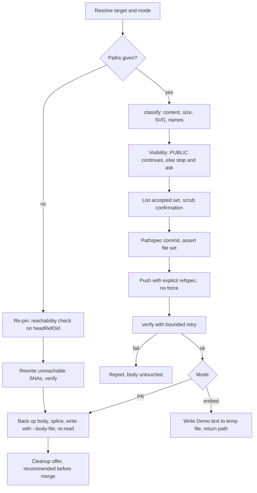

# feat: Attach local screenshots to a pull request

## Overview

This plan adds a bundled `pr-attachments` skill. It publishes local screenshots as commit-pinned image embeds in a managed `## Demo` section of a PR description, then confirms each embed serves an image.

The skill has three modes:
- **PR mode** edits an open PR.
- **Embed mode** returns the section text for `git-commit-push-pr` to insert.
- **Re-pin mode** re-points the embeds after a rebase.

A small built-in-only helper script handles the work that must be exact. The `git` and `gh` steps stay as prose in the skill. `git-commit-push-pr` gains a publish option in its evidence step.

## Problem Frame

`git-commit-push-pr` asks whether to capture evidence, but it can only splice in an existing URL or embed (`skills/git-commit-push-pr/SKILL.md`, evidence decision). Screenshots from `test-browser`, `agent-browser` or a manual capture have no path into a PR. `gh` cannot upload attachments.

Committing images and linking them works, but three past attempts each worked out the rules by hand:
- A branch-ref link broke when its branch was deleted (panthea#104).
- Images left on main grow the repo (panthea#134).
- A commit-pinned raw link survived cleanup, squash merge and branch deletion (fro-bot/dashboard#599).

(see origin: `docs/brainstorms/2026-10-22-pr-attachments-requirements.md`)

## Requirements Trace

The origin requirements R1–R18 carry forward, with the four owner decisions made during planning (see Key Technical Decisions):

- **Inputs and targets (R1–R4).**
  - Image paths are needed only in PR and embed modes.
  - Resolve the head repo and branch, and refuse one the user cannot push to.
  - Accept explicit paths only, listed back to the user before commit.
  - Accept PNG, JPEG, GIF and WebP by content. Reject SVG, files over 100 MB, and the whole batch on any failure.
- **Safety (R5, R6).**
  - Check visibility. Private or unknown visibility stops and asks.
  - The scrub confirmation covers visible content only.
- **Publishing (R7–R9).**
  - Images go under `docs/evidence/<topic>/`.
  - The evidence-only commit is pushed to the head branch.
  - Embeds use the raw link shape. On a private repo, "proceed" uses the blob form (decision O4).
- **Failure handling (R10).** A rejected push stops the run. Never force-push. A re-run reuses the pushed evidence commit.
- **PR description (R11–R14).**
  - One `## Demo` section, appended if absent.
  - The rest of the body stays byte-for-byte unchanged.
  - A `## Screenshots` section is left alone, with a warning.
  - Embed mode returns text and `git-commit-push-pr` inserts it.
- **Re-pin (R15).** Find the evidence commit on the PR head, rewrite the embeds, and tell the user to re-run after a rebase.
- **Verification (R16).** Runs in all modes before the body is written or text is returned (decision O1).
- **Cleanup and integration (R17, R18).**
  - Cleanup is offered once a PR exists, through a zero-path re-run (decision O2).
  - Cleanup does not revoke access.
  - The evidence step offers the skill for new PRs and the Step 7 rewrite (decision O3).

## Scope Boundaries

- Capturing screenshots stays with `test-browser` and `agent-browser`.
- No browser upload to GitHub's `user-attachments` host.
- No automatic secret, personal-data or metadata stripping.
- No fork PRs without push access.
- No GitHub Enterprise or other non-`github.com` hosts.
- No SVG or other non-raster formats.
- No post-merge recheck. Re-running the skill re-verifies.
- No publish offer in the description-only update path (DU-1..3) of `git-commit-push-pr`.

### Deferred to Separate Tasks

- A render check through the PR's `body_html` Camo URLs. It is stronger than the raw-URL check and would amend R16, so it is a follow-up if live checks show raw-200-but-no-render cases.
- PR mode in a temporary worktree when the PR head is not checked out. v1 stops and says how to fix it.

## Context & Research

### Relevant Code and Patterns

- `skills/git-commit-push-pr/SKILL.md`:
  - The evidence decision at :199-204 and the splice point at :216.
  - The description-only update at :54-96.
  - Bodies are applied with `--body "$(cat …)"` at :93, :227 and :239. That strips trailing newlines and replaces the whole body.
- `skills/ce-review-cleanup/scripts/cleanup.mjs` is the precedent for a built-in-only helper with a JSON CLI. Its tests are `tests/unit/ce-review-cleanup-{contract,delete,packaging,preview}.test.ts`.
- `skills/document-review/SKILL.md:21-31` (`mode:headless`) is the precedent for a mode token passed between skills that returns structured text.
- `tests/unit/skill-script-invocation.test.ts:63-117` enforces the `SKILL_DIR="<skill directory stated when this skill loads>";` anchor.
- `.github/workflows/release.yaml:425,467` is the `--body-file` precedent.
- `skills/test-browser/SKILL.md:176-177` writes screenshots to the cwd under relative names.

### Registration surfaces for a new skill

| Surface | Change | Check |
|---|---|---|
| `src/lib/bundled-names.ts` | Generated `BUNDLED_SKILL_NAMES` entry | `bun run schema:generate`, `schema:drift` |
| `docs/public/schemas/v3/systematic-config.schema.json` | Generated `disabled_skills` enum | `schema:drift` |
| `registry/registry.jsonc` | Component (files include `scripts/`) plus skills-bundle dependency | `bun scripts/generate-registry.ts`, `registry:drift` |
| `evals/cases/opencode/host-skill-coverage.json` | Hand edit after `orchestrating-subagents` | `tests/unit/eval-contract.test.ts` |
| Claude Code bundle | Copies the skill directory; `systematic:pr-attachments` must resolve | `bun run claude-code:build` |

Docs reference pages, bootstrap, Pi and npm pick up the skill automatically.

### Institutional Learnings

- `docs/solutions/workflow-issues/registry-drift-on-skill-description-change-2026-05-20.md`: a new skill or reference file changes the registry. Regenerate it and run the drift check, because `build` alone misses it.
- `docs/solutions/best-practices/claude-code-plugin-build-and-publish-architecture-2026-07-18.md`: `claude-code/` is staging. Build it and inspect it; never commit it.
- `docs/solutions/developer-experience/gh-api-heredoc-backtick-escape-2026-05-17.md`: write bodies through a file, never inline in the shell. Project memory #7534 says the same.
- `docs/solutions/best-practices/anchor-bundled-script-paths-in-skill-prose-2026-08-24.md`: anchor helper paths on `SKILL_DIR` in every fenced block.

### External References

- GitHub docs:
  - [About anonymized URLs](https://docs.github.com/en/authentication/keeping-your-account-and-data-secure/about-anonymized-urls): Camo fetches images anonymously.
  - [About large files](https://docs.github.com/en/repositories/working-with-files/managing-large-files/about-large-files-on-github): warning at 50 MiB, block at 100 MiB.
- `gh` manuals: [`gh pr view`](https://cli.github.com/manual/gh_pr_view) and [`gh repo view`](https://cli.github.com/manual/gh_repo_view).
  - PR fields: `headRepository`, `headRepositoryOwner`, `headRefName`, `headRefOid`, `isCrossRepository`.
  - Repo fields: `visibility`, `isPrivate`, `viewerPermission`, `url`.
- Format signatures from the [PNG](https://www.w3.org/TR/png-3/#5PNG-file-signature), [GIF89a](https://www.w3.org/Graphics/GIF/spec-gif89a.txt) and [WebP RIFF](https://developers.google.com/speed/webp/docs/riff_container) specs.
- Probes observed 2026-10-22:
  - The #599 pinned PNG returns `200 image/png` with no redirect and `cache-control: max-age=300`.
  - A raw SVG returns `image/svg+xml`.

## Prior-Art Survey

```json
{
  "schema_version": 2,
  "verdict": "build-new-within-scope",
  "scope": "Whole worktree at 0d5b1697: skills/, agents/, scripts/, src/, docs/, .github/, tests/, plus git history for the removed feature-video skill",
  "freshness": {
    "vcs_reference": "0d5b1697"
  },
  "budget": {
    "max_search_passes": 5,
    "max_candidate_inspections": 10,
    "exhausted": false
  },
  "candidates": [
    {
      "path_or_symbol": "skills/git-commit-push-pr/SKILL.md",
      "description": "Evidence decision offers 'use existing evidence' or 'skip' and splices a supplied URL or embed into the body as a ## Demo section.",
      "disposition": "insufficient",
      "insufficiency_reason": "Only splices already-hosted evidence; it cannot commit, push, pin or verify local images. It is the integration seam, not the capability."
    },
    {
      "path_or_symbol": "skills/test-browser/SKILL.md",
      "description": "Captures screenshots with agent-browser into relative filenames in the cwd.",
      "disposition": "insufficient",
      "insufficiency_reason": "Capture only; nothing publishes the images to a PR."
    },
    {
      "path_or_symbol": "skills/agent-browser/SKILL.md",
      "description": "Discovery stub for browser automation and screenshots.",
      "disposition": "insufficient",
      "insufficiency_reason": "No publishing, PR-body or git behaviour."
    },
    {
      "path_or_symbol": "skills/resolve-pr-feedback/scripts/",
      "description": "gh and GraphQL helpers for review threads.",
      "disposition": "insufficient",
      "insufficiency_reason": "Review threads only; no PR-body edits, media or commits."
    },
    {
      "path_or_symbol": "skills/ce-review/references/resolve-base.sh",
      "description": "Resolves the review base branch and merge-base, fork-safe.",
      "disposition": "insufficient",
      "insufficiency_reason": "Resolves the base side; the skill needs head-repo visibility and push permission."
    },
    {
      "path_or_symbol": ".github/workflows/release.yaml",
      "description": "Rewrites the bot-owned release PR body with gh pr edit --body-file.",
      "disposition": "insufficient",
      "insufficiency_reason": "Fixed-template CI rewrite; no section splice or image handling."
    },
    {
      "path_or_symbol": "git history: skills/feature-video/SKILL.md (removed in v3)",
      "description": "Recorded video and uploaded it through a signed-in browser to the user-attachments host.",
      "disposition": "insufficient",
      "insufficiency_reason": "Removed, and browser upload is out of scope; it needs a browser login."
    }
  ],
  "excluded_scopes": [
    {
      "scope": ".slim/clonedeps/repos/",
      "reason": "Read-only third-party dependency clones."
    },
    {
      "scope": "node_modules/ and dist/",
      "reason": "Dependencies and build output, not the repo's own code."
    },
    {
      "scope": "User-level skills outside the repo",
      "reason": "Not shipped by this package."
    },
    {
      "scope": "marcusrbrown/panthea and fro-bot/dashboard",
      "reason": "The hand-built attempts live there; they are cited as evidence, not reusable code."
    }
  ]
}
```

## Key Technical Decisions

- **The order is commit, push, verify, then write the body (O1).** A failed check leaves the body untouched. Reviewers never see broken images, and a re-run reuses the pushed commit. In embed mode a failure returns status `failed` with no Demo text. The caller then says the evidence files are pushed and unreferenced, and that cleanup applies.
- **Cleanup comes from a zero-path re-run (O2).** Running the skill on an open PR without image paths runs the re-pin check, which is a no-op on a fresh PR, and ends with the cleanup offer. `git-commit-push-pr` prints that exact command after it creates the PR, marked "recommended before merge". There is no fourth mode.
- **Embed mode covers new PRs and the Step 7 rewrite (O3).** The description-only update path makes no offer. If the user asks there to attach images, it routes to PR mode. Its existing preserve-Demo rule then carries the section through.
- **Private "proceed" uses the blob link form, gated on a probe (O4).** On a private or unknown-visibility repo, proceeding emits `https://github.com/<owner>/<repo>/blob/<sha>/<path>?raw=true`. Verification switches to an authenticated `gh api` contents check: the file exists at the SHA and its bytes are an image. A live probe decides whether this ships. If repository members cannot see the images, private repos become skip-only.
- **SVG stays excluded, with a corrected reason.** Raw SVG is served as `image/svg+xml` and renders through Camo. The exclusion stands because SVG is markup that can carry invisible content (metadata, comments, editor paths, hidden layers, embedded data, scripts), and a visual scrub cannot cover it. The message reads "SVG is not supported by this skill".
- **One built-in-only helper, with git and gh in prose.** Byte-exact splicing, content classification and bounded retry are gates that an LLM re-emitting text cannot hold. The helper keeps no state, takes JSON in and gives JSON out, and exits 0, 1 (domain failure) or 2 (usage), like `cleanup.mjs`. Target under about 400 lines.
- **Managed markers inside `## Demo`.** The generated content sits between `<!-- pr-attachments:v1 -->` and `<!-- /pr-attachments -->`. Markers fix the section boundary, and they let a whole-body rewrite in `git-commit-push-pr` copy the block verbatim through the helper's `splice`. The cost is invisible text in the body.
- **PR mode requires the PR head to be checked out and level.** After a fetch, the current branch must be the PR head branch, `HEAD` must equal `headRefOid`, and a remote must map to the head repo. Otherwise the skill stops with the exact fix. This prevents committing to the wrong branch or publishing unpushed commits. A temporary worktree is deferred.
- **Evidence is committed by pathspec only.** The skill copies the images into place and never moves them. It runs `git add -- <dest>` without `-f`, and stops if the destination is gitignored. It then runs `git commit -- <dest>`. Afterwards it asserts that the commit's file list equals the expected set exactly. It stops on an LFS `filter` attribute. The commit subject reads `chore(evidence): add screenshots for <topic>` so it reads as housekeeping in a squash message.
- **Pushes use an explicit refspec.** `HEAD:refs/heads/<head branch>` goes to the remote that maps to the head repo, with no force. A non-fast-forward rejection stops the run.
- **Reuse is keyed on content.** The idempotency key is `(dest path, blob SHA)`, compared with `git rev-parse <headRefOid>:<path>` and with unpushed commits. A re-run after any partial failure reuses what already exists.
- **Topic naming.**
  - The slug comes from the full branch name: NFKC, lowercase, each run of non-`[a-z0-9]` becomes `-`, trimmed, at most 60 characters.
  - A 6-hex hash is added when the name is truncated or lossy.
  - An empty slug means ask.
  - Directory collisions get `-2`, `-3`, chosen deterministically.
  - In a batch, a repeated filename gets `-2`.
  - Across runs, identical bytes are reused. Different bytes overwrite only a file the skill added; otherwise the new file gets `-2`.
  - Extensions follow the detected type, and alt text is the sanitized basename.
- **Retry.**
  - Wait about 2 s after the push.
  - Retry 404, 429 (honouring `Retry-After`), 5xx and network errors, with backoff of about 2/4/8/15/30 s, ±20% jitter and a cap of about 300 s.
  - Fail at once on a 200 that is not an image, on 401/403, on a redirect off `raw.githubusercontent.com` or `media.githubusercontent.com`, or after more than 5 redirects.
  - `verify --max-wait-s` defaults to about 90. The skill calls it up to about four times so that no single call outlasts a host tool timeout.
- **The handoff is a file.** Embed mode writes the Demo text to a temp file and reports its path plus a status line. `git-commit-push-pr` splices from that file. The model never re-types 40-hex SHAs.

## Open Questions

### Resolved During Planning

- Does a private repo render raw links for members? Camo fetches anonymously, so no (inferred). The blob form is the candidate, gated on the probe (O4).
- How is the topic derived and how are collisions handled? See Topic naming above.
- How does `git-commit-push-pr` hand off? Through a `mode:embed` token and a temp file, at the evidence decision.
- What is the retry policy right after a push? See Retry above.
- Which `gh` queries apply? `gh pr view --json headRepository,headRepositoryOwner,headRefName,headRefOid,isCrossRepository` and `gh repo view <head> --json visibility,isPrivate,viewerPermission,url`. Only `PUBLIC` proceeds without a stop. A null `headRepository` is refused. `viewerPermission` is a preflight signal; the push is authoritative.

### Deferred to Implementation

- The exact `gh` JSON shapes for `headRepository`, `viewerPermission` and `INTERNAL` visibility, checked live before coding the parsing.
- How long a raw 404 is cached, and whether the CDN keys on the query string. This sets whether a cache-busting pre-check is worth keeping.
- Whether GitHub normalises trailing whitespace in stored PR bodies. This sets what the post-write comparison may assert.
- Helper function names and the exact JSON field names.

## Output Structure

    skills/pr-attachments/
    ├── SKILL.md
    └── scripts/
        └── pr-attachments.mjs
    tests/unit/
    ├── pr-attachments-classify.test.ts
    ├── pr-attachments-splice.test.ts
    ├── pr-attachments-verify.test.ts
    ├── pr-attachments-contract.test.ts
    └── pr-attachments-packaging.test.ts

## High-Level Technical Design

> *This illustrates the intended approach and is directional guidance for review, not implementation specification. The implementing agent should treat it as context, not code to reproduce.*

| Mode | Trigger | Image paths | Commits | Writes body | Ends with |
|---|---|---|---|---|---|
| PR | Open PR, paths given | Required | Evidence commit, reused if present | Yes, via `splice` and `--body-file` | Cleanup offer |
| Embed | `mode:embed` from `git-commit-push-pr` | Required | Evidence commit | No; returns a temp file path | Status line |
| Re-pin | Open PR, no paths | None | None | Only if a SHA changed | Cleanup offer |



## Implementation Units

- [ ] **Unit 1: Helper classification and naming**

**Goal:** Build the helper's `classify` subcommand. It sorts explicit input paths into accepted entries with destination names, or rejects the whole batch.

**Requirements:** R1, R3, R4, R7.

**Dependencies:** None.

**Files:**
- Create: `skills/pr-attachments/scripts/pr-attachments.mjs`
- Test: `tests/unit/pr-attachments-classify.test.ts`

**Approach:**
- Detect the type from magic bytes:
  - PNG: 8-byte signature.
  - JPEG: `FF D8 FF`.
  - GIF: `GIF87a` or `GIF89a`.
  - WebP: `RIFF` at offset 0 and `WEBP` at offset 8.
- Reject SVG by content, with the message "SVG is not supported by this skill". Reject anything else unrecognised, any file over 100 MB, and missing or unreadable paths. One failure rejects the batch, and the result lists a reason for every file.
- Soft warnings, not fatal: trailing bytes after the format end marker (PNG `IEND`, JPEG `FFD9`, GIF trailer), and a size above about 10 MB.
- Apply the topic and destination naming from Key Technical Decisions. Each accepted entry reports source, destination, type, byte count and blob SHA (`sha1("blob <len>\0" + bytes)`).
- Only built-in modules, no relative imports, and pure functions behind a thin CLI.

**Execution note:** Test-first. Each named mutation below must fail its fixture before the implementation lands.

**Patterns to follow:** `skills/ce-review-cleanup/scripts/cleanup.mjs` for the CLI shape, JSON output and exit codes.

**Test scenarios:**
- Happy path: one file each of PNG, JPEG, GIF87a, GIF89a and WebP is accepted. The destination extension follows the detected type, even when the source extension differs.
- Error path: a `.env` file renamed `x.png` rejects the whole batch, and nothing is accepted (AE6).
- Error path: an SVG file named `.png` is rejected with the "not supported" message.
- Edge case: a file one byte over the injected limit is rejected, and a file exactly at the limit is accepted.
- Edge case: a missing path and an unreadable path both reject the batch, each with its own reason.
- Edge case: a PNG with appended data after `IEND` is accepted with a warning.
- Naming:
  - `feat/x` and `fix/x` yield different slugs.
  - A branch made only of separators yields an empty slug, and the result asks for a topic.
  - A long branch name is truncated, with the hash added.
  - Two `shot.png` files in one batch become `shot.png` and `shot-2.png`.
  - Path traversal in a topic (`..`, `/`, `%`, `#`, space, backslash) is rejected.
- Mutation killers: extension-based detection fails the renamed `.env` fixture, and dropping the batch-wide rejection fails the mixed-batch fixture.

**Verification:**
- `classify` returns deterministic JSON for the same input.
- Every scenario passes.
- The helper imports only `node:` modules.

- [ ] **Unit 2: Helper splice, URL extraction and re-pin rewrite**

**Goal:** Byte-exact `## Demo` splicing with managed markers, plus extraction and SHA rewriting of managed URLs.

**Requirements:** R11, R12, R13, R15.

**Dependencies:** Unit 1, because they share the helper file.

**Files:**
- Modify: `skills/pr-attachments/scripts/pr-attachments.mjs`
- Test: `tests/unit/pr-attachments-splice.test.ts`

**Approach:**
- `splice` takes a body as JSON plus a Demo text file. It returns the new body file and a report with the action (`appended`, `replaced` or `unchanged`), whether `## Screenshots` is present, and the Demo count.
- **Section boundaries.**
  - The heading matches `^ {0,3}##[ \t]+Demo[ \t]*#*[ \t]*$`.
  - Fenced code is excluded, including an unclosed fence that runs to EOF. So are multi-line HTML comments, indented code and blockquotes.
  - The section ends at the next H1 or H2 outside those regions, or at the managed markers.
- **Line endings.** Lines split on CRLF, LF or CR, and each keeps its terminator. Inserted lines use the adjacent or dominant EOL.
- **Edge cases.**
  - An empty body becomes exactly the section.
  - A whitespace-only body keeps its bytes, and the section is appended after them.
  - When appending, add exactly enough to leave one blank line.
  - Two existing `## Demo` sections stop the run and ask.
  - The heading line's bytes are kept.
- `urls` extracts the managed embed URLs as owner, repo, SHA, path and form (`raw` or `blob`).
- `repin-rewrite` takes a path-to-SHA map and rewrites only the 40-hex segment. Captions and hand edits are left unchanged.

**Execution note:** Test-first, using a prefix and suffix oracle.

**Test scenarios:**
- Happy path: the section is appended to a body with no Demo, and the prefix bytes are unchanged.
- Happy path: replacing an existing Demo leaves `## Testing` after it unchanged, and there is still exactly one Demo (AE2).
- Fixed point: splicing the same Demo twice yields identical bytes.
- Edge cases:
  - A `## Demo` inside a fence earlier in the body is ignored.
  - A commented-out `## Demo` in an HTML template block is ignored.
  - A CRLF body round-trips with CRLF.
  - Demo as the last section, with and without a trailing newline.
  - An empty body, and a whitespace-only body.
- Edge case: `## Screenshots` with no Demo leaves Screenshots unchanged, appends Demo, and reports Screenshots present (AE8).
- Error path: a body with two `## Demo` sections reports a conflict and returns no output body.
- Re-pin: rewriting one SHA changes only that 40-hex segment. A caption edited by hand inside the markers survives.
- Mutation killers:
  - A naive `indexOf('## Demo')` fails the fence fixture.
  - Normalising EOLs fails the CRLF fixture.
  - Replacing through EOF fails the `## Testing` fixture.

**Verification:** For every fixture, the bytes outside the replaced region are identical between input and output.

- [ ] **Unit 3: Helper verification with bounded retry**

**Goal:** A `verify` subcommand that confirms each embed serves an image, with bounded retry. It never echoes content.

**Requirements:** R16, plus the private-repo path from decision O4.

**Dependencies:** Unit 2.

**Files:**
- Modify: `skills/pr-attachments/scripts/pr-attachments.mjs`
- Test: `tests/unit/pr-attachments-verify.test.ts`

**Approach:**
- Accept only `https://raw.githubusercontent.com/…` URLs.
- Follow redirects only to `raw.githubusercontent.com` or `media.githubusercontent.com`, up to 5.
- Send no credentials.
- Success means a final 200 with an `image/*` content type.
- Apply the retry schedule and failure classes from Key Technical Decisions, with an injectable clock, sleep and fetch.
- Check URLs concurrently.
- `--max-wait-s` bounds a single call. The result is per URL: status, last HTTP code, attempts, and whether the failure is retryable.
- Blob-form URLs for private repos are not fetched. The skill verifies them through `gh api`, and the helper only reports which form each URL takes.

**Execution note:** Test-first, against a local `node:http` stub server.

**Test scenarios:**
- Happy path: a 200 with `image/png` passes on the first attempt.
- Retry: 404 then 200 passes after the scheduled delays. The injected clock records the exact backoff sequence.
- Error path: a 200 with `text/html` fails at once and is not retried (AE3).
- Error path: a redirect to another host fails, and more than 5 redirects fail.
- Edge case: a 429 with `Retry-After` waits that long before retrying.
- Edge case: a persistent 404 stops at `--max-wait-s` with a retryable failure.
- Multiple URLs: the result lists each failing URL by name, and the total time is the maximum, not the sum.
- Mutation killers:
  - Accepting any 200 fails the HTML fixture.
  - Not following redirects fails the redirect fixture.
  - Not retrying 404 fails the 404-then-200 fixture.

**Verification:** No test waits on real time. `verify` never prints response bodies.

- [ ] **Unit 4: The skill, its registration and its contract**

**Goal:** Write `SKILL.md` for the three modes, register the skill on every surface, and pin its behaviour with contract and packaging tests.

**Requirements:** R1–R17.

**Dependencies:** Units 1–3.

**Files:**
- Create: `skills/pr-attachments/SKILL.md`
- Modify:
  - `src/lib/bundled-names.ts` (generated)
  - `docs/public/schemas/v3/systematic-config.schema.json` (generated)
  - `registry/registry.jsonc` (generated)
  - `evals/cases/opencode/host-skill-coverage.json`
- Test: `tests/unit/pr-attachments-contract.test.ts`, `tests/unit/pr-attachments-packaging.test.ts`

**Approach:**
- **Frontmatter.** Set `name: pr-attachments`, a description that triggers on attaching screenshots to a PR, and `argument-hint` covering `mode:embed`, paths and the PR number or branch.
  - Do not opt in to the portability marker unless the text passes its scan.
  - Avoid banned literals.
  - Avoid `!` lines.
- **Target resolution.**
  - Parse the `mode:*` tokens. Conflicting tokens stop with an error, and the remaining tokens are paths.
  - Resolve the PR and its head with `gh pr view --json …`.
  - Refuse a null `headRepository`, a non-`github.com` host, or a fork the user cannot push to.
  - PR mode checks that the PR head is checked out and level.
- **Ordering.** The prose runs: visibility check, `classify`, list the accepted set, scrub confirmation, copy into place, pathspec commit, file-set assertion, push with an explicit refspec, verify, then write the body or return the file, then the cleanup offer.
- **Body write.**
  - Read the body with `gh pr view --json body`.
  - Back it up to a temp file and tell the user the path.
  - Re-read it immediately before writing.
  - Write with `--body-file`.
  - Re-read afterwards and compare the regions outside Demo.
- **Re-pin.**
  - Use `headRefOid` from `gh`.
  - If local `HEAD` differs, say "push first".
  - Reachability check: `git merge-base --is-ancestor <sha> <headRefOid>`. If every SHA is reachable, report "already valid" and write nothing.
  - Otherwise find each path's add commit with `git log --diff-filter=A -1 <headRefOid> -- <path>`.
  - When only some resolve, report "partial" and name the unresolved paths.
  - If no path ever existed on the head, stop and point to PR mode.
- **Cleanup.**
  - Offered only once a PR exists, and recommended before merge.
  - `git rm` only the managed paths, then commit and push without force.
  - Includes the verbatim disclosure: cleanup does not revoke access, so any published secret must be rotated.
- **Private proceed.**
  - Emits the blob form after an explicit answer.
  - Verifies through `gh api repos/<o>/<r>/contents/<path>?ref=<sha>`, checking that the file exists and its decoded bytes are an image.
  - States that rendering for members is pending the live probe.
- **Disclosures.**
  - Evidence binaries appear in the Files tab until cleanup.
  - A rebase or force-push needs a zero-path re-run.

**Patterns to follow:**
- `skills/ce-review-cleanup/SKILL.md` and its contract test for ordering assertions and the `SKILL_DIR` anchor.
- `skills/document-review/SKILL.md` for mode-token parsing.
- `commit 449934b3` as the end-to-end precedent for adding a skill.

**Test scenarios:**
- Contract: the frontmatter name, `argument-hint`, and the three mode names are present.
- Contract ordering, using `indexOf`: visibility < scrub confirmation < commit < push < verify < body write < cleanup offer.
- Contract bans:
  - push commands with `--force`, `-f` or a `+` refspec
  - `git add -A` and `git add .`
  - `--body "$(`
  - `git add -f`
- Contract: every helper invocation is anchored on `SKILL_DIR`.
- Contract text: the `## Screenshots` warning, the cleanup-does-not-revoke disclosure, the "SVG is not supported by this skill" message, and "push first" for a local and remote mismatch.
- Packaging:
  - The OCX registry component lists `scripts/pr-attachments.mjs`.
  - `npm pack` includes it.
  - The Claude Code bundle copies it byte-identical and executes it.
  - The helper has no relative imports.
  - Negative control: a missing helper fails the packaging assertion.
- Integration: `eval-contract.test.ts`, `generate-registry.test.ts` and `generate-config-schema.test.ts` pass with the new skill.

**Verification:**
- `bun run schema:generate`, `bun scripts/generate-registry.ts`, `bun run registry:drift`, `bun run schema:drift`, `bun scripts/content-integrity.ts` and `bun run claude-code:build` are clean.
- The generated `claude-code/` bundle contains the skill and resolves `systematic:pr-attachments`.

- [ ] **Unit 5: git-commit-push-pr integration**

**Goal:** Add the publish option to the evidence step. Keep the screenshots out of the feature commit and the PR narrative. Carry the managed Demo through body rewrites.

**Requirements:** R14, R17, R18 (decisions O2, O3).

**Dependencies:** Unit 4.

**Files:**
- Modify: `skills/git-commit-push-pr/SKILL.md`
- Test: `tests/unit/pr-attachments-contract.test.ts` (assertions on `git-commit-push-pr`)

**Approach:**
- **Step 4.** Never stage untracked image files without asking. When untracked images exist, ask the evidence-source question first.
- **Step 6 evidence decision.**
  - Add a third option, "Publish local images". It loads `systematic:pr-attachments` with `mode:embed` and explicit paths. That covers both new PRs and the Step 7 rewrite.
  - Capture `PRE=$(git rev-parse HEAD)` before the call. The body generator uses `<base>..$PRE` and excludes `docs/evidence/**` and the evidence commit.
  - Splice the returned file at the existing splice point.
  - On status `failed`, report that the evidence files are pushed but unreferenced, then continue without evidence.
- **Fallback.** If the skill is not available (a standalone install), offer only the existing two options.
- **Rewrites (Step 7 and DU-3).**
  - When a managed Demo block exists, copy it verbatim into the regenerated body through the helper's `splice`. Prose-only preservation stays as the fallback.
  - DU-3 makes no publish offer. A request to attach images routes to PR mode.
- **After PR creation.** Print the zero-path re-run command, marked "recommended before merge".
- Apply bodies with `--body-file` instead of `--body "$(cat …)"` at the three apply sites. This also fixes the trailing-newline strip for every body.

**Test scenarios:**
- Contract: the evidence decision lists "Publish local images" with `systematic:pr-attachments` and `mode:embed`.
- Contract: Step 4 forbids staging untracked images without asking.
- Contract: the narrative instruction excludes `docs/evidence/**` and the evidence commit.
- Contract: the post-create instruction prints the zero-path re-run command.
- Contract: DU-3 has no publish offer and routes to PR mode.
- Contract: no `--body "$(cat` remains, and `--body-file` appears at every apply site.
- Contract: the fallback text for an absent skill is present.

**Verification:**
- `bun run claude-code:build` resolves `systematic:pr-attachments` from `git-commit-push-pr`.
- If the frontmatter `description` changed, the registry is regenerated and `registry:drift` is clean.

- [ ] **Unit 6: Docs and requirements alignment**

**Goal:** Record the skill in architecture docs and fix the README count. Align the local requirements doc with the planning decisions.

**Requirements:** Documentation for all of the above.

**Dependencies:** Units 4–5.

**Files:**
- Modify: `ARCHITECTURE.md` (a paragraph next to the review-artifact cleanup one), `README.md` (bundled skill count)
- Modify (local, untracked): `docs/brainstorms/2026-10-22-pr-attachments-requirements.md`
  - SVG reason.
  - Private proceed uses the blob form.
  - Verify before write.
  - Embed mode covers the Step 7 rewrite.
  - Cleanup through a zero-path re-run.

**Test expectation:** none. These are docs. `content-integrity` and markdownlint cover them.

**Verification:** `bun scripts/content-integrity.ts` and markdownlint are clean. The README count matches the number of `skills/` directories.

## System-Wide Impact

- **Interaction graph:**
  - `git-commit-push-pr` gains a call into the new skill.
  - `ce-work`'s shipping workflow reaches it only through `git-commit-push-pr`, so it is unchanged.
  - `lfg` and `slfg` call `test-browser` directly and do not reach the evidence step.
- **Error propagation:** every failure is a stop with a stated state, such as "commit is pushed, body not written, re-run to retry". The skill keeps no state of its own; it reads state from git and the PR body.
- **State lifecycle risks:**
  - An evidence commit pushed without a body write leaves unreferenced files. These are reported, and cleanup applies.
  - The body is backed up before every write.
- **API surface parity:** `git-commit-push-pr` changes for all three hosts. The `--body-file` change fixes the trailing-newline loss for every PR body, not only bodies with evidence.
- **Unchanged invariants:**
  - The existing "use existing evidence" and "skip" options behave as before.
  - DU-1..3 still makes no commit or push.
  - No new runtime dependency.

## Risks & Dependencies

| Risk | Mitigation |
|---|---|
| GitHub stops serving commits that are reachable only through a PR ref | The requirements state durability as observed on one PR, not guaranteed. A re-run re-verifies. |
| Blob-form links do not render for members on private repos | The live probe decides. If it fails, private repos are skip-only. |
| A first-fetch 404 is cached for up to 300 s | Retry for up to about 300 s, split across bounded calls. |
| Camo refuses large images even when the raw URL returns 200 | A soft warning above about 10 MB, plus a live size check. The `body_html` render check is deferred. |
| The agent skips a prose gate such as the scrub confirmation | Contract tests pin the ordering. Live transcripts on each host are the behavioural evidence. |
| The `--body-file` change alters an existing skill's apply path | Contract test, plus one live body round-trip on a scratch PR. |

## Documentation / Operational Notes

- **Live verification.** It touches real repositories, so each step needs Marcus's approval before running.
  1. Check the `gh` JSON shapes for `headRepository`, `viewerPermission` and `visibility`, including `INTERNAL` if available.
  2. On a public scratch PR, run the full flow: embed, PR, verify, cleanup, squash merge, branch delete. The URL should still return 200.
  3. Round-trip a body through `--body-file` and confirm CRLF, the trailing newline and trailing spaces survive.
  4. Re-pin after a force-push on the scratch PR.
  5. Measure the 404 cache TTL with `curl -sI` on a nonexistent raw path.
  6. Check Camo rendering at 6, 12 and 25 MB.
  7. Run the private-repo blob-form probe (O4).
  8. Capture one transcript per host showing the scrub confirmation before the commit.
- The PR title is `feat(skills): add a skill for attaching screenshots to pull requests`, which is a minor release, and the PR closes #1073.

## Sources & References

- **Origin document:** [docs/brainstorms/2026-10-22-pr-attachments-requirements.md](../brainstorms/2026-10-22-pr-attachments-requirements.md). The path is gitignored and exists only in the author's checkout, so it is not available from a clone.
- Related issue: #1073.
- Related PRs: fro-bot/dashboard#599, marcusrbrown/panthea#104 and #134.
- Related code: `skills/git-commit-push-pr/SKILL.md`, `skills/ce-review-cleanup/scripts/cleanup.mjs`, `skills/document-review/SKILL.md`.
