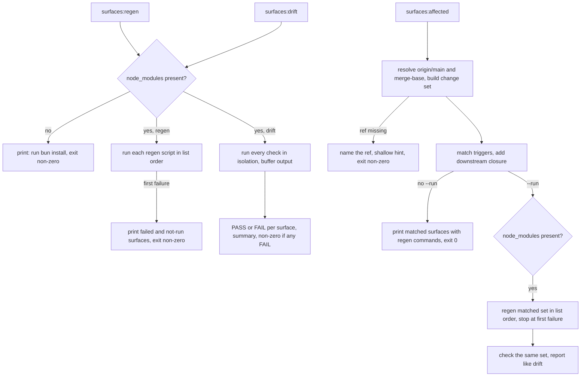

# feat: Declare generated surfaces once and drive regen, drift and affected from them

## Overview

Systematic commits seven generated surfaces. Four hand-kept places say which edit needs which regeneration, and they disagree. This plan adds one ordered list of surfaces and three commands that read it: `surfaces:regen`, `surfaces:drift` and `surfaces:affected` (with `--run`). CI, `postupgrade`, the Fro Bot workflow and AGENTS.md all call those commands instead of keeping their own lists.

It ships as one `ci(surfaces)` PR. Under the squash-only release rules a `ci` title cuts no release, which fits: every change is dev tooling, workflow wiring or docs. The content of every generated file stays as it is today.

---

## Problem Frame

Six surfaces have their own generator and check, and a seventh, the generated field reference in `configuration.mdx`, has no check at all. AGENTS.md names two of them, `postupgrade` regenerates five, CI runs five drift steps and checks the Pi personas only indirectly, and the Fro Bot prompt carries a fourth list. A missed regeneration costs a red CI run and another paid review cycle. The origin document has the full frame (see origin: `docs/brainstorms/2026-10-26-generated-surface-manifest-requirements.md`).

Two facts from research shape the design. The Pi generator rewrites its manifest JSON with a fresh timestamp on every run, so `regen` could never leave a clean tree until that is fixed. And regeneration order is real: an upstream surface's output is a trigger for a downstream one.

---

## Requirements Trace

Requirements and acceptance examples are those of the origin document.

**Surface list**
- R1. One list holds every surface with a name, a regeneration script, a check script, output paths and trigger paths. (U3)
- R2. It covers the six existing surfaces and the `configuration.mdx` field reference. (U2, U3)
- R3. Triggers cover the generator, the source modules it reads, its input directories, and `package.json` with the lockfile where a version or dependency is read. (U3)
- R4. Every command is a named package script, so the registry and Pi generators gain scripts. The field-reference generator needs two as well. (U1, U2, U3)

**`configuration.mdx` surface**
- R5. Its check compares only the region between the field-reference markers. (U2)
- R6. Its generator gains a check mode that writes nothing. (U2)

**Commands**
- R7. `regen` regenerates every surface and leaves a clean tree when already current. (U1, U4, U5)
- R8. `drift` runs every check in isolation, reports each by name and exits non-zero on any failure. (U4)
- R9. `affected` builds its change set from staged, unstaged and untracked files against the merge-base with `origin/main`, lists matching surfaces with their regeneration commands and changes nothing. (U3, U4)
- R10. A missing `origin/main` or merge-base fails loudly and names the ref. (U3, U4)
- R11. `affected --run` regenerates only the matched surfaces, then checks them. (U4)

**Consumers**
- R12. CI replaces five drift steps with one. (U5)
- R13. `postupgrade` keeps its build step and calls `regen`. (U5)
- R14. The Fro Bot prompt points at `drift`, its never-hand-edit list names every surface, and a test enforces that. (U5)
- R15. AGENTS.md carries the rule: `affected`, regenerate, `drift`. (U5)

**Coverage guard**
- R16. A test fails when a trigger path matches no file in the repo. The plan extends it to outputs: each output must expand to at least one file. (U3)
- R17. A test fails when a generator with a check mode has no entry. (U3)

| Example | Covers | Verified in |
|---------|--------|-------------|
| AE1 | R8 | U4: two failing checks, others pass, non-zero exit |
| AE2 | R9 | U3, U4: an agent description edit matches the registry and Pi surfaces, and may add schema and downstream surfaces; nothing is written |
| AE3 | R9 | U3: an untracked skill directory matches the surfaces that read `skills/` |
| AE4 | R11 | U4: `--run` regenerates the matched set plus its downstream closure, in list order |
| AE5 | R9 | U4: no match prints "nothing to regenerate" and exits 0 |
| AE6 | R10 | U3, U4: no `origin/main` exits non-zero and names it |
| AE7 | R5, R12 | U2 for the marker rule, U5 for the CI step |
| AE8 | R7 | U1 for idempotence, U5 for the manual clean-tree check |

AE2 and AE4 are read as "includes": a description edit also matches the schema surface through the agent files it reads, and through it the field reference. Over-reporting is accepted.

---

## Scope Boundaries

- Build-only outputs are not surfaces: `dist/`, the Claude Code bundle, the OCX registry build, and the gitignored docs-site pages.
- The config-corpus fixtures stay hand-regenerated.
- The ce:review validator's check stays provenance-only. A fresh-build comparison is out.
- The shipped `git-commit-push-pr` skill does not change.
- No git hook, and `affected` does not run in CI. CI runs the full `drift`.
- The `drift` step stays inside the CI `build` job. The `typecheck`, `lint` and `test` jobs use shallow clones without tags. The docs and release jobs also fetch full history, so depth is not the reason: `build` already runs the install and the build that the generators need first.

### Deferred to Separate Tasks

- Comparing the Pi manifest JSON in its check: today the check compares the `.md` fixtures only. Known gap, left as it is.
- A fresh-build check for the validator bundle: separate task.

---

## Context & Research

### Relevant Code and Patterns

Line numbers are as of HEAD `db26033d`.

- `scripts/lib/` holds `opencode-pin.ts`, `process-group.ts` and `zod-internals.ts`: the home for data and pure helpers. It is not `src/lib/`, so the codemap and module-table gates do not apply and nothing ships in `dist`.
- `scripts/content-integrity.ts`, `checkCodemapCompleteness`: the precedent for a bidirectional completeness gate.
- `scripts/generate-review-artifact-schema.ts` exports `REVIEW_SCHEMA_TARGETS` and three `*_RELATIVE_PATH` constants. `scripts/generate-ce-review-validator.ts` exports `CE_REVIEW_VALIDATOR_RELATIVE_PATH`. `scripts/generate-config-schema.ts` exports `BUNDLED_NAMES_RELATIVE_PATH`.
- Checks exit differently: schema, agent-browser, registry and Pi call `process.exit`; the review-schema and validator generators set `exitCode`. Only some check functions are exported, so a subprocess per check is the uniform mechanism.
- `scripts/generate-pi-subagents-personas.ts`: the unexported fixture writer skips unchanged `.md` files but always rewrites the manifest JSON with `new Date().toISOString()`. Nothing else reads `generatedAt`.
- `docs/scripts/generate-config-reference.ts`: `injectFieldReference` is pure, throws on missing or reversed markers and preserves text outside them byte for byte. `execMain` is the testable seam. `main` exits through `process.exit(1)` and has no check mode. The header comment names a stale `systematic-config.mdx`.
- `tests/unit/git-worktree-fixtures.ts`: `createRepo`, `commitFiles` and `git` build temp repos and strip `GIT_*` from the environment.
- `.github/workflows/main.yaml`: job `build` has `fetch-depth: 0` and holds the five drift steps. `typecheck`, `lint` and `test` are shallow.
- `.github/workflows/fro-bot.yaml`, inside the `AUTOHEAL_PROMPT` block: drift bullets under code quality, items `f` to `j` under quality gates with `docs:verify` as `k`, two report-table rows each in two tables, and the never-hand-edit list.
- `tsconfig.scripts.json` covers `scripts/**` and `docs/scripts/**`, so new scripts are type-checked in CI.
- No glob library is installed. `Bun.Glob` works and is typed through `@types/bun`.

### Institutional Learnings

- `registry-drift-on-skill-description-change-2026-05-20`: registry and Pi fixtures are separate surfaces. Its hand-kept command sequence and its claim that Pi has no npm alias go stale, so U5 updates it.
- `vendor-npm-packaged-skill-as-generated-artifact-2026-07-28`: `postupgrade` and the CI drift gate are complementary. Its per-surface CI-steps example goes stale, so U5 updates it.
- `unit-suite-rewrites-repo-file-trap-2026-07-17` and `unguarded-generator-main-repairs-drift-when-imported-by-tests-2026-07-28`: tests never write committed files, and every generator `main` is guarded by `import.meta.main`.
- `typed-config-validation-build-time-codegen-2026-05-16`: write and check share one producer so their output is byte-identical, and the version input must be well defined.
- `zsh-for-loop-word-splitting-silent-failure-20260417`: a check that matches zero files passes vacuously. Coverage tests assert counts in code.
- `ocx-registry-review-fixes`: git tags must be fetched in CI and a missing ref must fail clearly.
- `typecheck-does-not-cover-ci-gate-scripts-2026-08-17`: new scripts must sit inside `typecheck:scripts`.

---

## Prior-Art Survey

```json
{
  "schema_version": 2,
  "verdict": "build-new-within-scope",
  "scope": "scripts/, docs/scripts/, generator-imported src/lib, package.json, .github/workflows/{main,fro-bot}.yaml, AGENTS/ARCHITECTURE/STRUCTURE.md, tests/unit",
  "freshness": {
    "vcs_reference": "db26033d4f1e47c4b7ddd4e1988abf6a102e500e"
  },
  "budget": {
    "max_search_passes": 16,
    "max_candidate_inspections": 30,
    "exhausted": false
  },
  "candidates": [
    {
      "path_or_symbol": "scripts/generate-review-artifact-schema.ts#REVIEW_SCHEMA_TARGETS",
      "description": "Exported list of {relativePath, generate} for the three review schemas; drives writeSchema and checkSchema.",
      "disposition": "insufficient",
      "insufficiency_reason": "Covers one generator's outputs only. It has no regen/check commands, no trigger paths and no other surfaces. Its exported *_RELATIVE_PATH constants serve as the test oracle for the new list's literal paths."
    },
    {
      "path_or_symbol": "scripts/generate-config-schema.ts#CheckArtifact",
      "description": "Private interface {produce, pathOnDisk, displayName} inside checkSchemaFiles.",
      "disposition": "insufficient",
      "insufficiency_reason": "Not exported, in-process, one check function. Models expected-vs-disk, not commands or triggers."
    },
    {
      "path_or_symbol": "package.json#scripts (schema:*, review-schema:*, ce-review-validator:*, agent-browser:*, registry:drift)",
      "description": "De-facto named regen/check commands.",
      "disposition": "insufficient",
      "insufficiency_reason": "Reused as the command vocabulary, but there is no registry regen script, no Pi scripts and no trigger paths."
    },
    {
      "path_or_symbol": "package.json#postupgrade",
      "description": "Hand-kept regen chain; omits Pi and configuration.mdx.",
      "disposition": "insufficient",
      "insufficiency_reason": "Consumer list, not a declaration; its ordering is preserved by the new list."
    },
    {
      "path_or_symbol": "skills/ce-review/references/resolve-base.sh",
      "description": "Bash base-branch/merge-base resolver.",
      "disposition": "insufficient",
      "insufficiency_reason": "Not importable from scripts/. It fetches, calls gh and resolves a PR base. It has no untracked-file handling, and the requirements need a read-only, fail-loud origin/main resolver."
    },
    {
      "path_or_symbol": "scripts/content-integrity.ts#checkCodemapCompleteness",
      "description": "Bidirectional src/lib vs codemap completeness gate.",
      "disposition": "insufficient",
      "insufficiency_reason": "Precedent for the coverage tests only; it covers the src/lib codemap, not generated artifacts."
    }
  ],
  "excluded_scopes": [
    {
      "scope": "scripts/release/",
      "reason": "Release tooling. It generates no committed surface and has no check mode."
    },
    {
      "scope": "skills/git-commit-push-pr/",
      "reason": "Ships to user repos without a surface list. The origin document keeps it out of scope."
    }
  ]
}
```

---

## Key Technical Decisions

- **Location and names.** Data, closure, git logic and pure helpers go in `scripts/lib/generated-surfaces.ts`. The CLI goes in `scripts/generated-surfaces.ts` behind `import.meta.main`. Tests go in `tests/unit/generated-surfaces.test.ts`. "Manifest" stays out of the filenames: the Pi manifest JSON, a pi-subagents export and the OCX packument already use the word.
- **Entry shape.** Each entry holds a name, a regeneration script name, a check script name, `outputs` and `triggers`. Commands are package-script names, and the runner executes each as `bun run <script>`. Outputs let one declaration feed the closure, the dead-output test and the Fro Bot superset test. Entries store brace-free literals, one per file, so the review-schemas entry lists three output paths; the brace shorthand in the table below is for reading only. Only two outputs keep a glob: the schema file `docs/public/schemas/v*/systematic-config.schema.json` and the Pi fixtures `tests/fixtures/pi-subagents-personas/**`. Triggers may be globs. The expanded outputs of a surface are its output entries with each glob matched against tracked plus untracked files.
- **Literal paths, no generator imports.** The list declares paths as literals. Importing the generators would load Zod and the schemas on every command. The test that every output expands to at least one file catches renames, and a test compares the review-schema, validator and bundled-names literals with the generators' exported constants.
- **Static closure, list order.** Surface B is downstream of A when any expanded output path of A matches a trigger glob of B, ignoring self-edges. The match is path against pattern, never pattern against pattern. `affected` reports the matched set plus everything downstream. `--run` regenerates that set in list order. The list order is: agent-browser, schema, config-reference, review-schemas, validator, registry, Pi. A test asserts every derived edge points forward in that order, so a future entry in the wrong place fails loudly. A surface whose outputs are also its triggers (agent-browser's `ATTRIBUTIONS.md`, the registry's own file) re-matches itself after a commit. That over-reports harmlessly, and a comment says so.
- **Checks are subprocesses.** `drift` runs `bun run <check script>` per surface, sequentially, with output buffered per child. A failing check never stops the rest. The mdx check is a new exported function in the field-reference generator. It compares the text a pure builder returns with the file on disk, writes nothing, and returns distinct failures: markers missing or reversed, version unresolved, examples missing, and plain drift. `execMain` stays the only writer, so regeneration behavior does not change, and `main` parses the check flag and calls the new function.
- **Failure semantics.** `regen` and `affected --run` stop at the first failing regeneration. They print the failed surface and the surfaces not run, and say that earlier surfaces were already rewritten, so the tree is partly regenerated. After a `--run` regeneration succeeds, the checks over the same set report like `drift` does. The runner never passes `--allow-shrink` through. The child's output is printed unaltered, so the schema generator's own shrink-guard message, with its `--allow-shrink` instruction, reaches the user.
- **Report format.** Per surface, `[PASS] <name>` or `[FAIL] <name>`. A failure is followed by the indented child output and `fix: bun run <regen script>`. A final summary line reads `drift: N of M failed: <names>`.
- **Environment preflight.** `regen`, `drift` and `affected --run` need `node_modules`, since generators read it and Biome runs from it. If `node_modules/.bin/biome` or `node_modules/zod` is missing, they print "run bun install" and exit non-zero. Plain `affected` runs no generator and skips the check.
- **Git mechanics.** Every git call runs with the repo root as cwd, because `ls-files --others` is cwd-relative. Resolve `origin/main` and the merge-base first. The change set is the diff against the merge-base with `--no-renames` and `-z`, plus untracked files not excluded by ignore rules. Paths are never filtered by existence, so deletions count. An empty set exits 0. A missing ref exits non-zero and names it, with an unshallow or deepen hint when the clone is shallow. The runner never fetches.
- **Tag-less clones.** The schema and field-reference generators read the version from git tags. In a clone without tags they fail with their own message, and the runner shows it unaltered. AE8 needs a tagged clone, and `drift` stays in the `build` job, which fetches full history with tags.
- **Pi triggers over-report.** The Pi surface triggers on `agents/**/*.md` plus its two source modules, not on the 29 curated paths. Over-reporting is the safe direction, and the curated list can drift out from under a narrow trigger.
- **Coverage rule for generators.** A non-test file under `scripts/` or `docs/scripts/` that contains the quoted `'--check'` literal, in the repo's single-quote style (Biome-enforced), must be the target of some entry's check script, resolved through `package.json`, and every entry's check script must resolve to such a file. The rule is bidirectional. Neither the runner nor the lib may contain the quoted literal, so they are never mistaken for generators.
- **One wiring test.** Four tests pin CI and prompt text. The assertion at `tests/unit/plugin.test.ts:148` goes, and `:162`, which checks the `registry:drift` script, stays. The two workflow-text checks in `tests/unit/generate-review-artifact-schema.test.ts` and `tests/unit/ce-review-validator-packaging.test.ts` go. The test in `tests/unit/fro-bot-workflow.test.ts` becomes one wiring test that parses the YAML of both workflows.
- **Pi `generatedAt` fix comes first.** The manifest JSON is written only when it is missing or its entries differ. Without this, AE8 cannot hold.
- **No per-script existence test.** CI `drift` and `postupgrade` call every script by name, so a missing one fails on first use.
- **Workflow edits are approved.** Marcus approved changing `main.yaml` and `fro-bot.yaml`.

---

## Open Questions

### Resolved During Planning

- Where the list lives and its shape: a TypeScript module in `scripts/lib/`, entries as described above.
- How `drift` prints: `[PASS|FAIL]` per surface, the failing child's output, a `fix:` line and a summary.
- What counts as a generator for the coverage test: the quoted `'--check'` literal in the source, not `*:drift` script names.
- Whether Pi narrows to the curated personas: no, it over-reports on any agent file.

### Deferred to Implementation

- The exact trigger lists. The table below is derived from transitive imports at HEAD. Re-derive from imports when writing the entries. R16 catches dead globs but not missing ones, and the full CI `drift` is the backstop.
- Exact message wording, within the formats above.
- Whether `Bun.Glob` needs dotfile options for any trigger such as `.github/**`. Check when the first test fails or passes vacuously.

---

## High-Level Technical Design

> *This illustrates the intended approach and is directional guidance for review, not implementation specification. The implementing agent should treat it as context, not code to reproduce.*



The surface list, in regeneration order. Package-script names are listed; new ones are marked. Brace groups in the trigger cells are shorthand; entries store one literal per file.

| # | Surface | Regen / check script | Outputs | Triggers |
|---|---------|----------------------|---------|----------|
| 1 | agent-browser | `agent-browser:build` / `agent-browser:drift` | `skills/agent-browser/SKILL.md`, `ATTRIBUTIONS.md` | generator, `package.json`, `bun.lock`, `ATTRIBUTIONS.md` |
| 2 | schema | `schema:generate` / `schema:drift` | `docs/public/schemas/v*/systematic-config.schema.json` (glob), `src/lib/bundled-names.ts` | generator, `scripts/lib/zod-internals.ts`, `src/lib/{agent-colors,agents,bundled-names,config-schema,frontmatter,removed-names,skills,validation,walk-dir}.ts`, `agents/**/*.md`, `skills/*/SKILL.md`, `biome.json`, `package.json`, `bun.lock` |
| 3 | config-reference | `config-reference:generate` / `config-reference:drift` (both new) | `docs/src/content/docs/reference/configuration.mdx` | generator, `scripts/generate-config-schema.ts` (it exports the version helpers and schema ID template the generator imports), the schema surface's source modules, `package.json`, `bun.lock` |
| 4 | review-schemas | `review-schema:generate` / `review-schema:drift` | `skills/ce-review/references/review-summary-schema.json`, `skills/ce-review/references/findings-schema.json`, `skills/ce-review/references/review-pipeline-schema.json` | generator, `src/lib/{review-artifact-schema,review-pipeline-contract}.ts`, `biome.json`, `package.json`, `bun.lock` |
| 5 | validator | `ce-review-validator:build` / `ce-review-validator:drift` | `skills/ce-review/scripts/validate-review.mjs` | generator, `src/ce-review-validator.ts`, `src/claude-code-validator.ts`, `src/lib/{review-artifact-path,review-artifact-schema,review-pipeline-contract,review-pipeline,review-return-validator}.ts`, `biome.json`, `package.json`, `bun.lock` |
| 6 | registry | `registry:generate` (new) / `registry:drift` | `registry/registry.jsonc` | generator, `src/lib/{agents,frontmatter,skills,validation,walk-dir}.ts`, `agents/**`, `skills/**`, the registry file itself, `biome.json` |
| 7 | Pi personas | `pi-personas:generate` / `pi-personas:drift` (both new) | `tests/fixtures/pi-subagents-personas/**` (glob) | generator, `src/lib/{pi-subagents-personas,frontmatter}.ts`, `agents/**/*.md` |

Closure edges the rule is expected to derive, all forward: agent-browser to schema and to registry (it writes a skill file), schema to config-reference (it writes `bundled-names.ts`), review-schemas to registry and validator to registry (they write files under `skills/`). The test derives the edges rather than pinning this list.

---

## Implementation Units

- [x] U1. Pi fixture writes are idempotent

**Goal:** Running the Pi generator on an up-to-date tree writes nothing, including the manifest JSON, and the generator gets its two package scripts.

**Requirements:** R4, R7

**Dependencies:** None

**Files:**
- Modify: `scripts/generate-pi-subagents-personas.ts`
- Modify: `package.json`
- Test: `tests/unit/generate-pi-subagents-personas.test.ts`

**Approach:**
- Export the fixture writer and give it the entries and the fixture directory as parameters, defaulting to the committed directory, so tests can point it at a temp directory.
- Write the manifest JSON only when the file is missing, unparseable, or its `entries` differ from the new ones. A rewrite keeps a fresh `generatedAt`. The `.md` skip logic is untouched.
- The check path is unchanged. It does not compare the manifest JSON; that gap is deferred.
- Add `pi-personas:generate` and `pi-personas:drift`, mirroring the existing script style.

**Execution note:** test-first.

**Patterns to follow:**
- The repo-file trap and unguarded-generator learnings: temp directories only, and the generator's `main` stays behind `import.meta.main`.

**Test scenarios:**
- Happy path: write into an empty temp directory, write again, and every file including the manifest JSON is byte-identical with zero files reported written.
- Edge case: the manifest JSON is missing while the `.md` files exist, so it is written.
- Edge case: one entry's hash changes, so the manifest is rewritten with the new entries and the unchanged `.md` files are not rewritten.
- Error path: the existing manifest JSON is malformed, so it is rewritten without throwing.
- Integration: after the test file runs, the committed fixture directory is byte-unchanged.

**Verification:**
- Two consecutive writes into a temp directory change no bytes on the second.
- The committed `tests/fixtures/pi-subagents-personas/` is untouched by the test run.

- [x] U2. Check mode for the field-reference generator

**Goal:** `configuration.mdx` gets a write-free check that compares only the marker region, with distinct failures, and two package scripts.

**Requirements:** R2, R4, R5, R6

**Dependencies:** None

**Files:**
- Modify: `docs/scripts/generate-config-reference.ts`
- Modify: `package.json`
- Test: `tests/unit/generate-config-reference.test.ts`

**Approach:**
- Split building from writing. A pure builder returns the full file text: the fresh field reference injected into the file's current text. `execMain` stays the only writer and calls the builder, so regeneration behavior is unchanged.
- Add an exported check function. It compares the builder's text with the file on disk, never writes, and returns an exit code so tests need no process exit. Because injection preserves everything outside the markers byte for byte, whole-file equality is region equality, and a prose edit outside the markers is not drift.
- `main` parses a check flag next to the existing version flag and calls the check function instead of `execMain`.
- The check function reports distinct failures: markers missing or reversed, version unresolved, examples missing, and content drift. Drift names the file and points at `config-reference:generate`.
- Correct the stale header comment that names `systematic-config.mdx`.
- Add `config-reference:generate` and `config-reference:drift`. The generate script keeps the generator's current behavior.

**Execution note:** test-first.

**Patterns to follow:**
- The generator's existing `execMain` tests.
- The review-schema and agent-browser generators for check-mode messaging.

**Test scenarios:**
- Happy path: generate into a temp copy of the mdx, then check it, and the exit code is 0 with the file unchanged.
- Edge case (AE7): a prose edit outside the markers still passes.
- Error path (AE7): a hand edit between the markers fails and names drift, and the drifted file is byte-identical afterwards.
- Error path: missing markers and reversed markers each fail with their own message.
- Error path: unresolved version and missing examples each fail with their own message.
- Edge case: the check function never writes on any failure path, asserted by content and modification time on the temp file.
- Integration: `execMain` still writes the regenerated text as before, so regeneration behavior is unchanged.
- Integration: the real committed mdx is never passed to a writer by any test.

**Verification:**
- A temp mdx with a tampered marker region fails the check and one with tampered prose passes.
- On a tagged clone, the check passes against the committed file.

- [x] U3. Surface list, closure and change-set logic

**Goal:** The ordered surface list exists with its closure, glob matching and git change-set logic, guarded by coverage tests against the real repo.

**Requirements:** R1, R2, R3, R9, R10, R16, R17, and AE2, AE3, AE6

**Dependencies:** U1, U2. Their scripts must exist before the list names them.

**Files:**
- Create: `scripts/lib/generated-surfaces.ts`
- Modify: `package.json` (add `registry:generate`)
- Test: `tests/unit/generated-surfaces.test.ts`

**Approach:**
- Declare the seven entries in the order and with the triggers in the table above. Declare brace-free literal paths, one per file, and keep the quoted `'--check'` literal out of this file.
- Provide pure helpers: glob matching through `Bun.Glob`, the expansion of outputs against tracked plus untracked files, the literal prefix of a glob (the text before the first `*`), the downstream closure (expanded output path against trigger glob), a forward-order check over the derived edges, and the report line formatters.
- Provide the preflight check for `node_modules/.bin/biome` and `node_modules/zod`.
- Provide the change-set function: resolve `origin/main`, resolve the merge-base, then take the `--no-renames` diff union untracked files, all with the repo root as cwd and without existence filtering. On failure it throws an error that names the ref and adds the shallow-clone hint when applicable.
- Add `registry:generate` as a plain wrapper over the registry generator. `registry:build` is taken by the OCX builder.

**Execution note:** test-first.

**Patterns to follow:**
- `checkCodemapCompleteness` for the bidirectional coverage tests.
- `tests/unit/git-worktree-fixtures.ts` (`createRepo`, `commitFiles`, `git`) for temp repos with an `origin/main`.

**Test scenarios:**
- Happy path (AE2): in a temp repo, an uncommitted edit to `agents/review/x.md` yields a change set that matches the registry, Pi and schema surfaces, and the closure adds the field reference. Nothing in the repo is written.
- Happy path (AE3): an untracked `skills/new-skill/SKILL.md` matches the registry and schema surfaces.
- Happy path: staged, unstaged and untracked changes are all in the change set.
- Edge case (AE5): a change to `README.md` only matches nothing.
- Edge case: a deleted tracked file is in the change set, and a rename shows both its old and new path.
- Edge case: a path with spaces or non-ASCII characters survives the NUL-separated parsing.
- Edge case: calling the function with the working directory set to a subdirectory still returns repo-root-relative untracked paths.
- Edge case: `GIT_*` variables in the test environment do not redirect the temp repo's git calls.
- Error path (AE6): a repo with no `origin/main` throws an error naming `origin/main`, never an empty set.
- Error path: `origin/main` exists but no merge-base resolves, as in a depth-1 clone, and the error names the merge-base and carries the unshallow hint.
- Error path: preflight reports "run bun install" when `node_modules/.bin/biome` is absent and passes when both entries exist, using temp directories.
- Integration: closure edges derived from the real list all point forward. A fake list with a downstream surface placed before its upstream is reported as a violation, so the check is not vacuous.
- Integration (R16): every trigger glob, individually, matches at least one file in `git ls-files` plus untracked files, and every output entry expands to at least one file. A fake dead trigger and a fake dead output each fail.
- Edge case: the closure matches an expanded output path against a trigger glob. A fake surface whose output glob and another surface's trigger glob are patterns that never share a real path is not linked.
- Integration (R17): the set of non-test files under `scripts/` and `docs/scripts/` containing the quoted `'--check'` literal equals the set of files that the entries' check scripts resolve to through `package.json`. A temp extra file with the literal fails the first direction, and an entry with no literal in its target fails the second.
- Integration: the review-schema, validator and bundled-names literals equal the generators' exported path constants.

**Verification:**
- The real-repo coverage tests pass with the seven entries and fail for each seeded defect above.
- Editing a trigger file in a temp repo selects exactly the surfaces and downstream surfaces the rule predicts.

- [x] U4. Runner CLI and the three commands

**Goal:** `surfaces:regen`, `surfaces:drift` and `surfaces:affected` work end to end, with injectable process spawning for tests.

**Requirements:** R7, R8, R9, R10, R11, and AE1, AE2, AE4, AE5, AE6

**Dependencies:** U3

**Files:**
- Create: `scripts/generated-surfaces.ts`
- Modify: `package.json` (add `surfaces:regen`, `surfaces:drift`, `surfaces:affected`)
- Test: `tests/unit/generated-surfaces.test.ts`

**Approach:**
- Export the three command functions taking a root directory, a surface list and a spawn function. The real spawn runs `bun run <script>` in the root and buffers the child's output. The CLI file parses the command, wires the real arguments and runs behind `import.meta.main`.
- The package scripts are thin wrappers over the CLI.
- `drift`: preflight, then every check in isolation in list order, then the summary. Exit non-zero if any failed. `regen`: preflight, then regeneration in list order, stopping at the first failure with the partial-generation message and the not-run list.
- `affected`: no preflight. It builds the change set, prints the matched and downstream surfaces, each with `fix: bun run <regen>`, and exits 0. Downstream-only surfaces are marked as such. With nothing matched it says so and exits 0. With `--run` it preflights, regenerates the set in list order, stops at the first failure, then reports checks over the same set.
- Unknown commands print usage and exit non-zero.
- The file does not contain the quoted `'--check'` literal.

**Execution note:** test-first.

**Patterns to follow:**
- `scripts/release/*.ts` for the exported-function-plus-guarded-`main` shape.
- `scripts/lib/process-group.ts` if child cleanup helpers apply.

**Test scenarios:**
- Happy path (AE1): a fake list with seven surfaces and a fake spawn where two checks fail. Every check is spawned, the output has `[FAIL]` for exactly those two, `[PASS]` for the rest, each failure shows its child output and its `fix:` line, the summary reads `drift: 2 of 7 failed: <names>`, and the exit is non-zero.
- Happy path: all checks pass, the summary says so and the exit is 0.
- Happy path: `regen` spawns each regeneration once, in list order, and exits 0.
- Error path: when the third regeneration fails, the fourth and later are never spawned, the output names the failed surface and each not-run surface and says earlier surfaces were already rewritten, and the exit is non-zero.
- Error path: a child that prints the shrink-guard message on stderr has it shown unaltered, and no spawned command contains `--allow-shrink`.
- Happy path (AE2): `affected` in a temp repo with an uncommitted agent edit prints the matched surfaces with regeneration commands, spawns nothing, and the repo is unchanged.
- Happy path (AE4): `affected --run` spawns the regeneration for the matched set plus closure in list order and no other surface, then spawns their checks.
- Edge case (AE5): nothing matched prints the "nothing to regenerate" message, exits 0, and with `--run` spawns nothing.
- Edge case: after `--run` regenerates successfully, a failing check is reported like `drift` and the exit is non-zero.
- Error path (AE6): no `origin/main` makes `affected` and `affected --run` exit non-zero naming `origin/main`, with nothing spawned.
- Error path: with preflight failing, `regen`, `drift` and `affected --run` print "run bun install" and spawn nothing, while plain `affected` still works.
- Error path: an unknown command prints usage and exits non-zero.
- Integration: importing the CLI module has no side effects, the tracked tree stays clean, and the real `regen` is never invoked from a unit test.

**Verification:**
- `drift`, `regen` and `affected` behave as above against fake lists in temp repos.
- `bun run surfaces:affected` on this branch lists the surfaces its own edits touch, and `bun run surfaces:drift` on a tagged clone reports all seven as passing once U1 and U2 are in.

- [x] U5. Consumers, docs and the consolidated wiring test

**Goal:** CI, `postupgrade`, the Fro Bot workflow, AGENTS.md and the architecture docs all point at the three commands, and one test pins that wiring. Lands as one commit.

**Requirements:** R12, R13, R14, R15, and AE7, AE8

**Dependencies:** U1, U2, U3, U4

**Files:**
- Modify: `.github/workflows/main.yaml`
- Modify: `.github/workflows/fro-bot.yaml`
- Modify: `package.json` (`postupgrade`)
- Modify: `.github/renovate.json5` (comment only)
- Modify: `AGENTS.md`
- Modify: `ARCHITECTURE.md`
- Modify: `STRUCTURE.md`
- Modify: `docs/AGENTS.md`
- Modify: `HARNESSES.md`
- Modify: `docs/solutions/workflow-issues/registry-drift-on-skill-description-change-2026-05-20.md`
- Modify: `docs/solutions/best-practices/vendor-npm-packaged-skill-as-generated-artifact-2026-07-28.md`
- Test: `tests/unit/fro-bot-workflow.test.ts`
- Test: `tests/unit/plugin.test.ts`
- Test: `tests/unit/generate-review-artifact-schema.test.ts`
- Test: `tests/unit/ce-review-validator-packaging.test.ts`

**Approach:**
- `main.yaml`: replace the five drift steps in the `build` job with one step running `bun run surfaces:drift`. Keep `fetch-depth: 0` and keep the step in `build`.
- `package.json`: `postupgrade` keeps the build step, then calls `surfaces:regen` instead of listing generators.
- `renovate.json5`: update the comment above the commands to say `postupgrade` regenerates every surface through `surfaces:regen`. The command strings stay byte-identical.
- `fro-bot.yaml`, inside the prompt:
  - Replace the per-surface drift bullets under code quality with one `bun run surfaces:drift` bullet.
  - Collapse quality-gate items `f` to `j` into one item and re-letter what follows. Put it before `docs:verify`, because `docs:verify` regenerates the mdx and schema and would otherwise hide drift.
  - Collapse the two registry and schema rows in each of the two report tables into one "Generated-surface drift" row.
  - Extend the never-hand-edit list to every surface output, with wording that `ATTRIBUTIONS.md` and `configuration.mdx` are only partly generated: say "generated region of", "version references in".
  - Rewrite the "regenerate via the canonical script" sentence to name `surfaces:regen`.
- `AGENTS.md`: add the three commands, `registry:generate` and the new generator scripts to the Commands block. Remove the nested "Generated surfaces" prose under the bundled-agents bullet and keep its prior-art link. Add a separate Conventions bullet carrying the rule: before committing or opening a PR, run `bun run surfaces:affected --run`, then `bun run surfaces:drift`. If `affected` cannot resolve `origin/main`, run `bun run surfaces:regen`, then `drift`. After deleting an agent or skill, run `bun scripts/generate-config-schema.ts --allow-shrink` once, then `bun run surfaces:regen`.
- Docs: `ARCHITECTURE.md` (the registry-drift paragraph and the validator drift sentence), `STRUCTURE.md` (the `scripts/` file list and the Build / CI table), `docs/AGENTS.md` (the field-reference section: add the check mode and idempotence), `HARNESSES.md` (the validator gate mention). Both solution docs lose their stale sequences and per-surface step examples and point at the new commands.
- Tests: delete the `registry:drift` assertion in `plugin.test.ts` and keep the script-exists test. Delete the workflow-text test in `generate-review-artifact-schema.test.ts` and the drift-wiring block in `ce-review-validator-packaging.test.ts`. Rewrite the four-commands test in `fro-bot-workflow.test.ts` as the wiring test below.

**Execution note:** test-first for the wiring test; the doc and workflow edits follow it.

**Patterns to follow:**
- The existing `readWorkflow` helper and YAML parsing in `tests/unit/fro-bot-workflow.test.ts`.
- `docs/solutions/` frontmatter conventions when editing the two solution docs.

**Test scenarios:**
- Happy path: parsed `main.yaml` has exactly one step whose run is `bun run surfaces:drift`, in the job whose checkout uses `fetch-depth: 0`.
- Happy path: the Fro Bot prompt names `bun run surfaces:drift` and no longer lists per-surface drift commands.
- Edge case (R14): every surface output's literal prefix (the text before its first `*`) starts with some backticked token in the never-hand-edit list, so the token `docs/public/schemas/` covers the prefix `docs/public/schemas/v`. Tokens are parsed across line wraps. The list may keep naming build outputs.
- Error path: a copy of the prompt with one surface's token removed fails the superset check and names that surface.
- Error path: a `main.yaml` copy that re-adds a per-surface drift step fails the one-step assertion.
- Integration: the removed text-pinning assertions leave no test that fails when only the wording of a step name changes.

**Verification:**
- Targeted tests pass, and `bun run lint`, `bun run typecheck`, `bun run typecheck:scripts`, `bun run typecheck:all` and `bun scripts/content-integrity.ts` pass.
- One-time manual check on a tagged clone with a standard install: `bun run surfaces:regen && git status --porcelain` prints nothing, then `bun run surfaces:drift` reports every surface as passing.
- No remaining per-surface drift step in `main.yaml`, and the Fro Bot prompt letters run without gaps.
- The registry and Pi fixtures need no regeneration for this change, since no agent or skill content moves.

---

## System-Wide Impact

- **Interaction graph:** CI `build`, Renovate `postUpgradeTasks`, the Fro Bot autoheal prompt, AGENTS.md guidance and the docs build all read or call the new commands. The `docs:generate` chain keeps its own calls.
- **Error propagation:** a failing child's output reaches the user unaltered. Environment problems (no `node_modules`, no ref) are distinct messages from drift failures.
- **State lifecycle risks:** `regen` and `--run` can stop partway and leave earlier surfaces rewritten. The output says so. Clones without tags fail the schema and field-reference surfaces with the generators' own message.
- **API surface parity:** the existing `*:generate`, `*:build` and `*:drift` scripts stay and remain individually callable. `registry:build` and `registry:validate` are untouched.
- **Integration coverage:** unit tests use fake lists and fake spawn. The real `regen` clean-tree property is shown only by the manual check, and the real list is shown consistent by the R16, R17 and forward-edge tests.
- **Unchanged invariants:** what each check compares is unchanged, except the new field-reference check. The validator check stays provenance-only. The bytes of every generated file stay as they are.

---

## Risks & Dependencies

| Risk | Mitigation |
|------|------------|
| A missing trigger path skips a local regeneration | CI runs the full `drift`, which catches it. R16 guards dead globs, not missing ones. |
| `drift` fails in clones without tags | It stays in the `build` job with `fetch-depth: 0`. The generators' own message is shown. |
| The clean-tree property depends on the Pi fix, a standard `node_modules` layout (the validator bundle embeds path comments) and the schema shrink guard | U1 lands first, the preflight names a missing install, the AGENTS.md rule carries the `--allow-shrink` note, and the manual check runs on a tagged, standard clone. |
| The primary checkout is shallow, so the merge-base can fail | `affected` fails loudly with the unshallow hint and never fetches. AGENTS.md gives a `regen` then `drift` fallback. |
| Over-reporting after a `package.json` or lockfile change, or from self-triggering outputs | Accepted. The safe direction costs a redundant regeneration. |
| The Fro Bot prompt lettering shifts | The wiring test pins the content, and the lettering is checked by eye in review. |
| The new CI step hides which surface failed | The report names each surface, with `fix:` lines, in the CI log. |

---

## Documentation / Operational Notes

- The PR title is `ci(surfaces): ...`. Under the squash-only release rules a `ci` title cuts no release.
- `scripts/` has no registration gates. By convention the new files still go in `STRUCTURE.md`, `ARCHITECTURE.md` and the AGENTS.md Commands block, which U5 covers.
- The first CI run on the PR is the real check of the single drift step.

---

## Sources & References

- **Origin document:** `docs/brainstorms/2026-10-26-generated-surface-manifest-requirements.md`. This path is untracked and gitignored, so a reader cloning the repository will not find it.
- Ideation: `docs/ideation/2026-10-25-open-ideation.md` (idea 2 and priority 3).
- Code: `scripts/lib/`, `scripts/generate-pi-subagents-personas.ts`, `docs/scripts/generate-config-reference.ts`, `tests/unit/git-worktree-fixtures.ts`.
- Workflows: `.github/workflows/main.yaml`, `.github/workflows/fro-bot.yaml`, `.github/renovate.json5`.
- Solutions: `docs/solutions/workflow-issues/registry-drift-on-skill-description-change-2026-05-20.md`, `docs/solutions/best-practices/vendor-npm-packaged-skill-as-generated-artifact-2026-07-28.md`, `docs/solutions/test-failures/unit-suite-rewrites-repo-file-trap-2026-07-17.md`, `docs/solutions/test-failures/unguarded-generator-main-repairs-drift-when-imported-by-tests-2026-07-28.md`.
