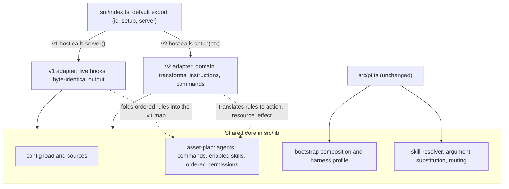

# feat: Support OpenCode v2 alongside v1 from one package

## Overview

Systematic is a v1-only OpenCode plugin. OpenCode v2 does not run v1 plugins, so a user who upgrades OpenCode loses Systematic entirely. This plan ships one package that runs on v1 (1.18.29 and later) and on v2 (2.2.0 and later).

The package keeps its single default export, now a plain object with `id`, `setup` and `server`. A shared core holds config loading, asset discovery, bootstrap composition and permission shaping. A v1 adapter keeps today's hooks byte-identical under `server()`. A v2 adapter implements `setup(ctx)` with v2's native mechanisms, each chosen by a probe with a decision rule.

CI gains a full real-host contract on a pinned v2 CLI and a v1 smoke test at the 1.18.29 floor and at the current v1 pin. Everything ships in one PR as a `feat` minor.

---

## Problem Frame

OpenCode v2 is GA (2.0.0 on 2026-09-11, 2.2.0 on 2026-10-27) under the `@opencode/*` npm scope. Its migration guide says v1 plugin implementations do not run on v2. Systematic's peer is `@opencode-ai/plugin` `^1.1.30`, and its CI host is the v1 CLI. v1 stays current on npm and GitHub, so the user base is probably split for some time. That split is inferred and has not been measured.

The v1 plugin writes into one mutable config object, registers string-keyed hooks (two experimental), builds its tool with the zod-based helper, and depends on host-internal text such as the truncation marker and the prune placeholder. v2 removes or reshapes all of these. The origin document carries the full frame (see origin: `docs/brainstorms/2026-10-27-opencode-v2-support-requirements.md`).

Marcus settled these points before planning:
- The v1 floor stays at 1.18.29. No callable-hybrid export is attempted.
- The default export is a plain object. `Plugin.define` is the identity function, so the package imports nothing from either OpenCode package at runtime. Type-only imports are fine.
- Probes are throwaway work. Their outcomes become evidence in `HARNESSES.md`, not merged code.
- Everything ships in one PR.

---

## Requirements Trace

Requirements and acceptance examples are those of the origin document.

**Host coverage and packaging**
- R1. One package loads on v2 (2.2.0 and later) and v1 (1.18.29 and later). (U1, U2, U6, U8, U14)
- R2. The v1 path keeps today's user-visible behavior. (U4, U5, U14)
- R3. Two adapters hold all host-specific code over a shared core. (U5, U6, U8)
- R4. Both OpenCode peers are optional and cover both hosts. Pi and Claude Code installs need no OpenCode package. (U6, U7)
- R5. The built plugin has zero runtime OpenCode imports. The default export is a plain object. (U6)
- R6. The checks that assume today's export shape move with it. (U6)

**v2 behavior**
- R7. Every v2 session receives the bootstrap, with the same content rules as v1. (U3, U12)
- R8. Agents and skills register through v2 domain transforms with v1-equal names, prompts, markers and permissions. (U3, U9, U10)
- R9. Commands keep v1 names and descriptions, expand `$ARGUMENTS` and positionals, route to agent, model and subagent, and never run `!`-backtick blocks. (U3, U11, U13)
- R10. An agent loads any enabled skill by name with equal permission enforcement. `systematic_skill` is dropped on v2 only if the native tool has parity. (U3, U10)
- R11. Output restoration exists on v2 only if a probe shows truncation or pruning. (U3, U10)
- R12. The v2 adapter never throws out of registration. (U3, U8)

**Content and docs**
- R13. Prose naming `systematic_skill` stays correct on both hosts. (U10, U12)
- R14. Install docs show both config keys and both floors. `HARNESSES.md` gains v2 evidence. (U15)

**Evidence and CI**
- R15. A required job runs the full contract on a pinned v2 CLI and fails before any test if the version differs. (U2, U7, U14)
- R16. A required job runs a v1 smoke test at the floor and at the current pin. (U4, U7, U14)
- R17. Pins come from one source, and Renovate bumps each host as its own group. (U7)

**Release**
- R18. The change ships as a `feat` minor with floor and v2 release notes. (U15)

| Example | Covers | Verified in |
|---------|--------|-------------|
| AE1 | R1, R7, R8, R10 | U12 and U14: clean 2.2.0 install shows bootstrap, agents, commands, and an enabled skill loads |
| AE2 | R1, R2, R16 | U14: v1 smoke at 1.18.29 and at the current pin |
| AE3 | R7 | U12: `git-worktree` disabled omits the worktree rule on v2 |
| AE4 | R10 | U10: a disabled skill is refused on v2 |
| AE5 | R4, R5 | U6: install and load with no OpenCode package present |
| AE6 | R1 | U15: v1 below 1.18.29 and v2 below 2.2.0 documented as unsupported, no shim |
| AE7 | R9 | U11: expanded arguments reach the configured agent (or the session's current agent, with one diagnostic, when that agent is not registered), and `!`-backtick is not run |

---

## Scope Boundaries

- New v2-only capabilities (storage, RPC, GUI and TUI plugins) are out.
- The OCX installer and registry keep writing v1's `plugin` key.
- Running `!`-backtick shell blocks on v2 is out.
- Dropping v1, and supporting v1 below 1.18.29, are out.
- Pi and Claude Code behavior does not change, except the git-commit wording in U13.
- The shared core must not change what Pi and Claude Code import. U5 verifies this.

### Deferred to Separate Tasks

- v1's native `skill` tool does not filter disabled skills, because `registerSkillsPaths` registers the whole directory. This is pre-existing. On v2 the plugin simply does not add disabled skills. Track it as a separate issue.
- OCX installer and registry support for v2 config: a separate issue.
- Dropping v1: a later major, at a time Marcus chooses.
- The roughly 2,000 lines of guard-era test and fixture remnants that still pin versions: a separate cleanup.
- Solution-doc refreshes: a `ce:compound-refresh` run after merge over the named-exports, truncation, subprocess-fixtures, silent-defect-swallow, host-contract-evidence and subagent-permission docs, and the config-key doc that says the key is singular `plugin`. Mark each as v1 behavior and link the v2 behavior.
- A new `docs/solutions/` entry for the dual-export pitfalls: write it with `ce:compound` after the PR merges.

---

## Context & Research

### Relevant Code and Patterns

- `src/index.ts`: five hooks (`config`, `tool`, `tool.execute.after`, `experimental.chat.messages.transform`, `experimental.chat.system.transform`) and a function default export. It reads only `client` (for `app.log`) and `directory` from the host input.
- `src/pi.ts`: the precedent for a second adapter over shared `src/lib` modules.
- Already host-neutral: `src/lib/skill-resolver.ts` (including `substituteSkillArguments`), `src/lib/bootstrap.ts`, `src/lib/routing-resolver.ts`.
- `src/lib/config-handler.ts`: pure collectors plus one closure that reads and writes the v1 config object. `tests/unit/config-handler.test.ts` is the byte-identity corpus.
- `src/lib/skill-tool.ts`: zod-based tool, `ask`, `metadata` and `callID` use, restore functions over v1 payloads, and a pure `SkillOutputStore`.
- Permissions: only `agent.<name>.permission` is emitted. Scalars become `'*'`, set-then-move gives last-match-wins, and a managed skills list is deny `*` followed by one allow per skill. JS objects hoist integer-like keys, so the shared core needs an ordered list.
- Commands: `wrapSkillTemplate` in `src/lib/skill-loader.ts` builds `<skill-instruction>` plus `<user-request>$ARGUMENTS`.
- `!`-backtick users: `skills/git-commit/SKILL.md` (5 blocks) and `skills/git-commit-push-pr/SKILL.md` (6 blocks). v1's command path runs them unpermissioned, and `tests/integration/skill-command-probe.test.ts` pins that. The tool path and Pi and Claude Code leave them inert.
- Harness: `tests/integration/fixtures/receipt-workflow-host.ts` is the live real-host harness despite its name. It runs the CLI through `bunx`, serves a scripted OpenAI-compatible provider, isolates with env vars, and reads the pin at import time.
- Pins: `scripts/lib/opencode-pin.ts` and `tests/unit/opencode-pin.test.ts` (R1 no literal pin, R2 sentinel range).
- CI: `.github/workflows/main.yaml` runs a gate, four shards and a required `Host Contract` aggregator through `scripts/host-contract-guard.ts`. `.github/renovate.json5` has one `@opencode-ai/**` group and ignores `tests/**`.
- Gates tied to today's export shape: `tests/unit/package-exports.test.ts` (function default, `@opencode-ai/plugin`-only import grep, isolated install check), `scripts/content-integrity.ts` (`REGISTERED_PLUGIN_HOOKS` regex parser and `HOOK_PARITY_DOCUMENTS`), `tests/unit/plugin.test.ts` (19 `default()` calls and a `main.yaml` text assertion), the `main.yaml` Node smoke script, and ARCHITECTURE invariant 1.

### Institutional Learnings

Each constraint is re-verified on v2 by a probe or a contract test.

- `docs/solutions/integration-issues/plugin-tool-output-truncated-before-after-hook-2026-09-26.md`: v1 truncates before the after-hook, and the native skill tool is exempt. U3 and U10 re-verify; an exempt native tool is an argument for using it.
- `docs/solutions/integration-issues/opencode-plugin-factory-duplicate-registration-2026-05-04.md`: registration is per load, and bootstrap idempotency comes from a marker block. Keyed instruction entries may give this natively (U3, U12).
- `docs/solutions/integration-issues/isolated-opencode-subprocess-fixtures-2026-05-14.md`: isolate HOME, XDG and config dirs, assert positive registration, tell title generation apart from chat, use fresh processes (U2, U7).
- `docs/solutions/integration-issues/opencode-plugin-hook-silent-defect-swallow-2026-05-19.md`: never throw at the host boundary, and emit observable diagnostics (U3, U8).
- `docs/solutions/integration-issues/opencode-plugin-named-exports-break-loader-2026-05-11.md`: test the built artifact's export shape against the real loader. The "default-only" rule stays, but the shape is now an object, and both loaders are gated (U1, U6, U14).
- `docs/solutions/best-practices/subagent-skill-permission-scoping-2026-05-20.md`: subagents do not inherit permissions, so grant per agent (U3, U9).
- `docs/solutions/workflow-issues/host-contract-evidence-is-ci-owned-2026-09-04.md`: evidence comes from required CI at the exact pin, and a bump and its evidence land together (U14, U15).
- `docs/solutions/workflow-issues/registry-drift-on-skill-description-change-2026-05-20.md`: run the surfaces commands and update the hook parser (U6, U12, U13).
- `docs/solutions/integration-issues/verify-a-no-change-claim-against-the-consumer-2026-09-08.md`: mutate output arrays in place. Re-verify on v2 (U3).
- No solution doc covers `!`-backtick semantics, the dual export gate, or Renovate grouping for a second scope. The stale docs listed there are refreshed after merge (see Deferred to Separate Tasks).

### External References

- Migration guide: https://opencode.ai/v2/docs/build/plugins/migrate-v1/
- Server plugin API: https://opencode.ai/v2/docs/build/plugins/server
- Config, skills and commands: https://opencode.ai/v2/docs/config/, /v2/docs/skills/, /v2/docs/commands/
- v2.2.0 release notes: https://github.com/anomalyco/opencode/releases/tag/v2.2.0 (adds `ctx.session.instructions.entry.put/list/remove`)
- Upstream agent creation: anomalyco/opencode#45841 (`update` creates a missing agent; duplicate #50404)
- Facts still open at plan time: instruction-entry reach, `update`-creates, native skill tool parity, truncation, command routing, CLI isolation. The probe matrix below owns each.

---

## Prior-Art Survey

```json
{
  "schema_version": 2,
  "verdict": "extend",
  "scope": "src/, scripts/, tests/, .github/, skills/using-systematic/references, HARNESSES.md, docs/",
  "freshness": {
    "vcs_reference": "21b5f295784ee308ef54f77666a39dab1fed458f"
  },
  "budget": {
    "max_search_passes": 8,
    "max_candidate_inspections": 24,
    "exhausted": false
  },
  "candidates": [
    {
      "path_or_symbol": "src/lib/skill-resolver.ts#substituteSkillArguments",
      "description": "Host-neutral skill lookup, skill output wrapping and $ARGUMENTS/positional substitution.",
      "disposition": "reuse"
    },
    {
      "path_or_symbol": "src/lib/skill-loader.ts#wrapSkillTemplate",
      "description": "Builds the skill-instruction plus user-request command template that v2 command execution expands.",
      "disposition": "reuse"
    },
    {
      "path_or_symbol": "src/lib/routing-resolver.ts",
      "description": "Host-neutral agent, category and model routing resolution.",
      "disposition": "reuse"
    },
    {
      "path_or_symbol": "src/lib/bootstrap.ts#getBootstrapContent",
      "description": "Host-neutral bootstrap composition, harness profile reader, worktree rule and internal-agent signatures.",
      "disposition": "extend"
    },
    {
      "path_or_symbol": "src/lib/config-handler.ts",
      "description": "Pure asset collectors plus a v1 closure that mutates the config object and accumulates permission maps.",
      "disposition": "extend"
    },
    {
      "path_or_symbol": "src/lib/skill-tool.ts",
      "description": "v1 skill tool, output store and restore functions over v1 payloads.",
      "disposition": "extend"
    },
    {
      "path_or_symbol": "src/index.ts",
      "description": "Plugin entry: five v1 hooks, REGISTERED_PLUGIN_HOOKS and a function default export.",
      "disposition": "extend"
    },
    {
      "path_or_symbol": "src/pi.ts",
      "description": "Second host adapter over shared src/lib modules.",
      "disposition": "insufficient",
      "insufficiency_reason": "Pi's extension API shares no hook or tool shapes with v2, so only the shared-core-plus-thin-adapter pattern carries over."
    },
    {
      "path_or_symbol": "tests/unit/config-handler.test.ts",
      "description": "Byte-identity corpus for the v1 config hook output.",
      "disposition": "reuse"
    },
    {
      "path_or_symbol": "tests/integration/fixtures/receipt-workflow-host.ts",
      "description": "Live real-host harness: CLI launch, scripted provider, env isolation, probe plugin, packaged-plugin linking.",
      "disposition": "extend"
    },
    {
      "path_or_symbol": "scripts/lib/opencode-pin.ts",
      "description": "Single reader for the pinned host version, with the equality backstop between sdk and plugin.",
      "disposition": "extend"
    },
    {
      "path_or_symbol": "scripts/host-contract-guard.ts",
      "description": "Skip and pass-floor guard over the host contract JUnit reports, with one global expected-file list.",
      "disposition": "extend"
    },
    {
      "path_or_symbol": ".github/workflows/main.yaml#host-contract",
      "description": "Gate, four shards and the required Host Contract aggregator.",
      "disposition": "extend"
    },
    {
      "path_or_symbol": ".github/renovate.json5",
      "description": "Single OpenCode package group for the @opencode-ai scope.",
      "disposition": "extend"
    },
    {
      "path_or_symbol": "scripts/content-integrity.ts#extractRegisteredPluginHooks",
      "description": "Regex parser of the registered hook const in src/index.ts, plus the hook-parity document list.",
      "disposition": "extend"
    },
    {
      "path_or_symbol": "tests/unit/package-exports.test.ts",
      "description": "Export-shape, runtime-import and isolated-install gates for the built artifact.",
      "disposition": "extend"
    },
    {
      "path_or_symbol": "skills/using-systematic/references/opencode-profile.md",
      "description": "The v1 OpenCode harness profile injected into the bootstrap.",
      "disposition": "insufficient",
      "insufficiency_reason": "It names v1 mechanisms and systematic_skill, so v2 needs its own profile file."
    },
    {
      "path_or_symbol": "scripts/lib/generated-surfaces.ts",
      "description": "The one list of committed generated surfaces with regen, check and trigger paths.",
      "disposition": "reuse"
    }
  ]
}
```

---

## Key Technical Decisions

- **Export shape.** The default export is a plain object holding `id`, `setup` and `server`. `src/index.ts` keeps its "only `default`" rule. Helpers stay in `src/lib/`. Type-only imports from either OpenCode package are allowed, and the build lists both as externals as a belt-and-braces guard.
- **Floor stays at 1.18.29.** U1 verifies the object entry on a real 1.18.29 host. If it fails there, work stops and Marcus decides. No hybrid is attempted.
- **Adapter layout.** Shared core in `src/lib/asset-plan.ts` and the existing neutral modules. The v1 adapter lives in `src/lib/opencode-v1.ts` and owns `REGISTERED_PLUGIN_HOOKS`. The v2 adapter starts in `src/lib/opencode-v2.ts` and may split into `opencode-v2-permissions.ts` and `opencode-v2-commands.ts`. Each new module needs a codemap entry and a module-table row.
- **Ordered permissions in the core.** The accumulator returns an ordered list of permission, pattern and setting triples. The v1 adapter folds it into today's map. The v2 adapter translates it to `{action, resource, effect}` rules: bash to shell, task to subagent, `doom_loop` and `lsp` dropped, and the skill action keyed by skill ID.
- **Goldens use synthetic assets.** U4 captures v1 output from fixture asset trees, not the real bundled skills, so routine skill edits do not churn the goldens.
- **Config loads once on v2.** `setup` loads config with invalid-source reporting and a warning sink, mirroring v1's fail-open choice for invalid config. It uses project config only when `ctx` provides a project directory. v1 re-reads config on every `config` call and v2 does not. That is a deliberate difference and goes in the release notes.
- **Probe-chosen mechanisms.** Bootstrap, agents, skills, commands and restoration follow the matrix in High-Level Technical Design. A failed agent-creation probe stops work at the U9 gate.
- **Dev dependencies.** `@opencode/plugin` and `@opencode/sdk` at 2.2.0 join as exact-pinned dev dependencies in lockstep, added in U6 because type-only imports need them. `@opencode/cli` is not a dependency, because its postinstall pulls roughly 180 MB.
- **Pins.** The three CLI pins (v2, v1 current, v1 floor) live in a committed JSON pin file under `scripts/`, because Renovate ignores `tests/**`. A Renovate regex manager tracks the two moving pins and excludes the floor. Equality tests tie each CLI pin to its plugin and sdk dev dependencies.
- **CI shape.** The existing shard jobs retarget to the v2 host and run the v2 profile's files. Two separate v1 jobs (floor and current) run a smoke subset. All host jobs feed the existing required `Host Contract` aggregator, so repository settings do not change. Each job gets its own guard profile.
- **Host-neutral tests run once.** U7 triages every integration file into v2-suite, v1-smoke or both. Shared behavior is host-parameterized. v1-only behavior (restoration, `systematic_skill`, the `!`-backtick command probe) stays in the v1 smoke set. Host-neutral files (Pi, Claude Code, release notes) run once in the v2 job.
- **Workflow edits.** Marcus's CI decision covers the edits to `main.yaml` and `renovate.json5` in U6, U7 and U14.
- **Evidence trail.** Probe outcomes go to a gitignored scratch log under `.context/systematic/opencode-v2-probes/` during U1 to U3, then into `HARNESSES.md` in U15. Probe plugins never leave that directory.

---

## Open Questions

### Resolved During Planning

- Callable hybrid export: not attempted. Marcus kept the 1.18.29 floor.
- Where probe outcomes live: a gitignored scratch log during U1 to U3, then `HARNESSES.md`.
- Where the pins live: a JSON pin file under `scripts/`, outside Renovate's `tests/**` ignore.
- Which v1 jobs run which tests: shared behavior is host-parameterized, v1-only behavior stays in the smoke set (see Key Technical Decisions).
- Invalid config on v2: fail open, as on v1, with a diagnostic through `console.error` and the `systematic` prefix.
- Edge-case IDs: F1 to F11 and X group the flow analysis. The coverage table below assigns every one to a unit.

### Deferred to Implementation

- The plugin `id` string and any id-format rule: U1 observes it.
- The v2 job's environment variable names for host selection and binary path: U2 and U7 choose them.
- PASS_FLOOR values and the exact skip exemptions for each guard profile: set from the first green runs in U14.
- Whether the v2 adapter splits into the permissions and commands modules: decide when U9 and U11 land.
- Whether `ctx.tool.transform` input needs a schema-builder runtime import: only relevant if P-SKILL fails.
- Exact ownership-marker field and existence-check method for agents: P-AGENT decides.

### Edge-case coverage

| ID | Edge case | Unit |
|----|-----------|------|
| F1 | Gate list is wider than the export check: `plugin.test.ts` 19 calls plus `main.yaml` text, `main.yaml` smoke script, isolated `node -e` check, `HOOK_PARITY_DOCUMENTS`, ARCHITECTURE invariant 1 | U6 |
| F2 | Bootstrap lifecycle: `session.created` for resumed sessions, first-turn race, subagent sessions, persistence in the session DB, stale entries, compaction doubling | U3, U12 |
| F3 | Commands: raw args, `@file` and attachments, delivery, subagent result flow, disabled agent behind a command, model string format, colon in the name, discovered-skill commands duplicating native ones | U3, U11 |
| F4 | Agents, skills, permissions: same-ID user agent, skill ID equals permission resource, base dir for inline content, duplicate IDs, any-deny rule, dropped actions, native tool not filtering disabled skills on v1 | U9, U10 |
| F5 | Config lifecycle: load once, invalid config, project trust and missing directory | U8 |
| F6 | Transform replay: fresh state, shared module state, duplicate subscriptions, one snapshot per setup | U8, U9 |
| F7 | Loader shape: baseline main at 1.18.29, extra keys on v1, type declarations referencing both optional peers | U1, U6 |
| F8 | Below-floor hosts: v1 below 1.18.29 and v2 below 2.2.0 are unsupported with no shim; U1 records the failure modes (including v2 2.1.x) and U15 documents them | U1, U15 |
| F9 | The git-commit wording change reaches Pi and Claude Code text; clean install with no OpenCode package | U6, U13 |
| F10 | CI and harness: aggregator `needs`, skip versus fail, per-job profiles, timings, path filters, local-prefix v2 install, per-host fixture caches, SDK client choice, lockstep equality, pure-move rename, host-specific system assertions, packaged-plugin linking | U7, U14 |
| F11 | Pins, profile and one PR: pin file, Renovate group, literal guards, v2 profile file, registry surface, bootstrap snapshot | U7, U12 |
| X | `ctx` dump (U2), transform order versus user config (U3), observable logging (U3, U8), isolation via `debug paths` (U2), packed-artifact load on both hosts (U1, U14), no telemetry (U8, U15) | as listed |

---

## High-Level Technical Design

> *This illustrates the intended approach and is directional guidance for review, not implementation specification. The implementing agent should treat it as context, not code to reproduce.*



The v2 adapter's mechanism per concern is decided by probes in U3. Each row names the rule and both branches.

| Probe | Question | If the rule holds | If it fails | Consumer |
|-------|----------|-------------------|-------------|----------|
| P-INSTR | Do keyed instructions reach main and subagent requests, skip title and compaction, and stay idempotent on the same key? | Bootstrap uses instructions entries put on `session.created` | Bootstrap uses the context hook; a gap only the hook can close is closed there | U12 |
| P-CTX | What are the context hook's payload, request kinds and title detection? | Needed only for the fallback | n/a | U12 |
| P-AGENT | Does `update(id, fn)` create a missing agent with prompt, mode, model, description and permissions intact, and can existence and ownership be checked? | Agents register through `update` with an existence check and ownership marker | STOP and ask Marcus before U9. Fallback per the origin: file an upstream issue, track it with a smart note, ship v2 without bundled agents, and state it in the release notes | U9 |
| P-PERM | Do ordered rules, last-match and any-deny give the same allow and deny outcomes as v1's maps? | Translation is correct | Adjust the translator until the shared assertions pass | U9 |
| P-SKILL | Does the native skill tool load transformed skills, refuse disabled or denied skills per agent, and carry arguments? | `systematic_skill` is not registered on v2 | Port `systematic_skill` through the tool domain | U10 |
| P-TRUNC | Does a skill body above the host limit reach the model intact, and is there a prune placeholder? | No restoration on v2 | Build restoration on the structured signal; marker text only if no signal exists, recorded in `HARNESSES.md` | U10 |
| P-TOOL | Which input schema form does the tool domain take, and is a runtime import needed? | Run only when P-SKILL fails | n/a | U10 |
| P-CMD | Does `ctx.session.prompt` route a prompt to a named agent, model and subagent, and is `systematic:<n>` a legal command name? | Commands execute through it | Adjust naming or routing; record the gap | U11 |
| P-ORDER | Do Systematic transforms run before or after user config, and is replay fresh? | Build as designed | Re-order or make transforms idempotent | U8 |
| P-ERR | How does v2 treat a throw in setup, a transform or a hook, and where does `console.error` surface? | Keep the safe wrapper and the `systematic` prefix | Add a stricter wrapper | U8 |
| P-TRUST | Does `ctx` provide the project directory, and what happens under one shared service for several projects? | Use project config | `includeProject: false` | U8 |

---

## Implementation Units

Phase A probes (U1 to U3), Phase B v1 safety net and shared core (U4 to U7), Phase C v2 adapter (U8 to U12), Phase D content, CI and docs (U13 to U15). U13 has no dependencies and can land any time after U1.

- [ ] U1. Loader-shape probe

**Goal:** Learn on real hosts whether a plain `{id, setup, server}` default loads on v2 2.2.0, v1 1.18.29 and v1 1.19.4, and what today's build does at 1.18.29.

**Requirements:** R1, R5

**Dependencies:** None

**Files:**
- Scratch only: `.context/systematic/opencode-v2-probes/loader-shape.md` (gitignored)

**Approach:**
- Build three stubs: today's main build (function default), an object default with `id`, `setup` and `server`, and an object with an extra named export.
- Run each against v2 2.2.0, v2 2.1.x (the newest 2.1 release), v1 1.18.29, v1 1.19.4 and the newest v1 below the floor, using a fresh isolated process per cell.
- Record what the v2 2.1.x cell does so the release note can state it. This cell is evidence only and creates no runtime shim.
- Record whether it loads, which entry the host calls, whether the unused member is ignored, how a v2 config entry written under the old `plugin` key is normalized, how the `id` is used, and the failure mode below each floor (F8).
- Load the packed tarball form on both hosts, not only the directory form.

**Execution note:** Throwaway probe. Nothing from this unit is committed.

**Test scenarios:**
Test expectation: none -- throwaway probe.

**Verification:**
- Every matrix cell has a recorded outcome.
- Decision rules, applied in order:
  - The object loads on v1 1.18.29 and on v2: proceed.
  - Today's build fails at 1.18.29: STOP and ask Marcus, because the floor is already wrong.
  - The object fails on 1.18.29 but loads on a later v1: STOP and ask Marcus.
  - v2 rejects the object because it carries `server`: STOP and ask Marcus.

- [ ] U2. v2 host and harness probe

**Goal:** Settle how to install, launch and isolate the v2 CLI and how a test drives it.

**Requirements:** R1, R15

**Dependencies:** U1

**Files:**
- Scratch only: `.context/systematic/opencode-v2-probes/host.md` (gitignored)

**Approach:**
- Install `@opencode/cli` at the v2 pin with lifecycle scripts into a local prefix using npm, and call it by absolute path with `--version`. Confirm `bunx` and an ignore-scripts install fail.
- Establish isolation: which env vars isolate HOME, config and the database, and confirm with `debug paths` that no path escapes the temp root. Check whether `OPENCODE_CONFIG_DIR` is honored.
- Check the scripted OpenAI-compatible provider works on v2, and which client the harness uses (the `@opencode/sdk` client, not the old scope's `/v2` subpath).
- Compare `run`, the shared background service and `--standalone`, and pick one for tests.
- Check the embedded SDK `create({plugins})` path as a local fast path, with a parity check against the CLI loader.
- Dump `ctx`: every domain, the project directory, `options`, and whether the plugin runs on Bun or Node.
- Note that the local machine is macOS and CI is Linux, so the Linux install check lands in U14's first run.

**Execution note:** Throwaway probe.

**Test scenarios:**
Test expectation: none -- throwaway probe.

**Verification:**
- The scratch log holds an install recipe, an isolation table, the chosen launch mode, and the `ctx` dump.
- Decision rules:
  - The CLI installed with scripts and verified by `--version` is the CI path.
  - The embedded SDK host is used only as a local fast path, and only if it loads `plugins`-listed packages the way the CLI does.
  - If isolation cannot keep every path inside the temp root: STOP and ask Marcus before U7.

- [ ] U3. Mechanism probes

**Goal:** Run every probe in the matrix above and record the chosen branch for each.

**Requirements:** R7, R8, R9, R10, R11, R12

**Dependencies:** U2

**Files:**
- Scratch only: `.context/systematic/opencode-v2-probes/mechanisms.md` (gitignored)

**Approach:**
- Use a throwaway probe plugin with a ctx recorder, run through the harness recipe from U2.
- P-INSTR also covers `session.created` for new, resumed and pre-existing sessions, subagent sessions, compaction doubling, persistence across a restart, and a stale entry after a content change (F2).
- P-AGENT also covers a user agent with the same ID, and an ownership marker that survives transform replay (F4).
- P-SKILL also covers skill arguments, base directory for inline content, duplicate IDs against user or OCX copies, and the permission resource equal to the skill ID (F4).
- P-CMD also covers raw args, `@file` and attachments, delivery, subagent result flow, a disabled agent behind a command, the model string format and a colon in the name (F3).
- P-ORDER, P-ERR and P-TRUST feed U8 (X, F5, F6).
- Write one "mechanism choice record" at the top of the log: probe, outcome, branch.

**Execution note:** Throwaway probe.

**Test scenarios:**
Test expectation: none -- throwaway probe.

**Verification:**
- Every probe has an outcome and a branch in the record.
- If P-AGENT fails, the record says so and work stops at U9.

- [ ] U4. v1 goldens

**Goal:** Capture today's v1 plugin output as committed goldens before any code moves, so U5 and U6 can prove byte-identity.

**Requirements:** R2, R16

**Dependencies:** None

**Files:**
- Create: `tests/unit/opencode-v1-golden.test.ts`
- Create: `tests/fixtures/opencode-v1-goldens/` (synthetic asset tree and expected outputs)

**Approach:**
- Build a small synthetic asset tree (a few skills, agents and commands, including one disabled skill and one managed-skill overlay) and run the unchanged v1 plugin over it.
- Capture the full `config` hook result for a matrix of overlays: none, category overlay with permission, exact overlay with a skills list, disabled skills, `skills_as_commands` off.
- Capture the `systematic_skill` descriptor, the system-transform output, and the restore behavior of the after-hook and the messages transform on a truncated and a pruned payload.
- Goldens come from the pre-refactor code on this branch. They are never regenerated by hand after U5.

**Execution note:** Characterization-first. Capture before U5 touches anything.

**Patterns to follow:**
- `tests/unit/config-handler.test.ts` for fixture asset construction.
- `tests/unit/plugin.test.ts` for driving the five hooks.

**Test scenarios:**
- Happy path: the `config` hook output for the no-overlay tree matches the golden byte for byte.
- Edge case: a managed skills list yields deny `*` followed by one allow per skill, in that order, in the golden.
- Edge case: integer-like skill names keep their order in the golden (the ordered-list hazard).
- Edge case: a disabled skill is absent from the tool descriptor and the bootstrap.
- Error path: invalid `systematic.json` produces the same fail-open output as today.
- Integration: restore on a truncated payload and on a pruned payload matches the golden.

**Verification:**
- The goldens pass against the unmodified code.
- A deliberate one-byte change to the golden fixture fails the test (checked once, then reverted).

- [ ] U5. Shared-core extraction

**Goal:** Move host-neutral logic into the shared core and the v1 hooks into a v1 adapter, with v1 output unchanged.

**Requirements:** R2, R3

**Dependencies:** U4

**Files:**
- Create: `src/lib/asset-plan.ts`
- Create: `src/lib/opencode-v1.ts`
- Modify: `src/lib/config-handler.ts`
- Modify: `src/lib/skill-tool.ts`
- Modify: `src/lib/bootstrap.ts`
- Modify: `src/index.ts`
- Modify: `scripts/content-integrity.ts` (hook-inventory parser retarget)
- Modify: `ARCHITECTURE.md` (codemap entries)
- Modify: `src/lib/AGENTS.md` (module-table rows)
- Test: `tests/unit/asset-plan.test.ts`
- Test: `tests/unit/config-handler.test.ts`
- Test: `tests/unit/opencode-v1-golden.test.ts`
- Test: `tests/unit/content-integrity.test.ts`

**Approach:**
- A pure asset-plan builder takes the loaded config, discovered assets and the list of native agent names, and returns agents, commands, enabled skills and the skills directory.
- The permission accumulator returns an ordered list of permission, pattern and setting triples. The v1 adapter folds that list into the same map `config-handler.ts` writes today.
- The v1 closure keeps its re-entrancy heuristics and its reads of the v1 config object. Only the pure parts move.
- The v1 skill tool, its `ask`, `metadata` and `callID` use, and the restore functions stay in `skill-tool.ts`. No shared tool descriptor is built here. U10 builds one only if it has to port the tool.
- Expose a host-neutral bootstrap composition entry that takes the profile name and the skill usage template, so U12 can select the v2 profile and a v2 usage template without touching v1.
- Retarget the hook-inventory parser in `scripts/content-integrity.ts` to read `REGISTERED_PLUGIN_HOOKS` from `src/lib/opencode-v1.ts`, move its fixtures in `tests/unit/content-integrity.test.ts`, and keep the `HOOK_PARITY_DOCUMENTS` check passing against the moved inventory. The parser must follow the const in the same commit, or this unit is red.
- `src/index.ts` keeps its function default for now and calls the v1 adapter. U6 changes the shape.
- `REGISTERED_PLUGIN_HOOKS` moves with the hooks into `opencode-v1.ts`.
- Register both new modules in `ARCHITECTURE.md` and `src/lib/AGENTS.md`.

**Patterns to follow:**
- `src/pi.ts` for adapter-over-core layout.
- Existing codemap rows for the entry format.

**Test scenarios:**
- Happy path: the asset plan for the golden tree lists the same agents, commands and enabled skills as the folded v1 map.
- Edge case: an empty `nativeAgentNames` and a non-empty one produce the expected agent set.
- Edge case: the ordered permission list keeps insertion order for integer-like keys, and folding it into the v1 map gives the golden map.
- Error path: invalid config yields the same plan as before.
- Integration: all U4 goldens and the whole existing `config-handler` corpus pass unchanged.
- Integration: `tests/unit/pi.test.ts` passes, and `bun run pi-personas:drift` and `bun run surfaces:drift` are clean (the core must not change Pi behavior). Byte identity of `dist/pi.js` is not required, because bundler output can change on its own.
- Integration: `bun scripts/content-integrity.ts` reads the hook inventory from the v1 adapter, and a deleted hook fails parity.

**Verification:**
- U4 goldens and `tests/unit/config-handler.test.ts` pass without edits to their expectations.
- `bun scripts/content-integrity.ts` passes with the two new modules registered.
- The Pi tests and the Pi persona and surfaces drift checks are clean.

- [ ] U6. Export shape and every gate that assumes it

**Goal:** Change the default export to `{id, setup, server}` with an empty `setup`, add the dev dependencies and peers, and move every gate that assumed a function.

**Requirements:** R1, R3, R4, R5, R6

**Dependencies:** U1, U5

**Files:**
- Modify: `src/index.ts`
- Modify: `package.json` (exact-pinned `@opencode/plugin` and `@opencode/sdk` dev dependencies; optional peers `@opencode-ai/plugin` from the floor and `@opencode/plugin` from 2.2.0; build externals)
- Modify: `bun.lock`
- Modify: `.github/workflows/main.yaml` (the Node smoke script in the build job)
- Modify: `ARCHITECTURE.md`, `STRUCTURE.md`, `AGENTS.md`, `.github/copilot-instructions.md` (hook inventory and invariant 1)
- Test: `tests/unit/package-exports.test.ts`
- Test: `tests/unit/plugin.test.ts`

**Approach:**
- `src/index.ts` exports only `default`, an object whose `server` runs the U5 v1 adapter and whose `setup` is a no-op until U8.
- Type the object against v2's definition type with a type-only import. If the v1 and v2 type packages disagree on the object, define the narrow local type and note it.
- The export-shape check asserts an object with a string `id` and function `setup` and `server`. The runtime-import check covers both `@opencode-ai/` and `@opencode/`, and ignores type-only imports. The isolated `node -e` install check asserts the object shape.
- The hook-inventory parser already reads the v1 adapter file (U5). The four parity documents and ARCHITECTURE invariant 1 are reworded here to describe the object and where the v1 hooks live.
- The 19 `default()` calls in `plugin.test.ts` become `default.server(...)`. The assertion that reads the `main.yaml` smoke text and the smoke script itself change together.
- Add a peer-declaration check for both optional peers.

**Execution note:** Move gates in the same change as the shape. A red intermediate state is not acceptable.

**Patterns to follow:**
- The existing negative-case tests in `package-exports.test.ts`.

**Test scenarios:**
- Happy path: the built `dist/index.js`, imported in Node, exposes exactly `['default']`, and the default is an object with a string `id` and function `setup` and `server`.
- Happy path: `default.server(...)` returns the same five hook keys the old function returned, and the U4 goldens still pass through it.
- Edge case: a planted named export fails the export-shape gate.
- Edge case: a planted runtime import of `@opencode/plugin` in `dist` fails the runtime-import gate, and a type-only import does not.
- Error path: a planted function default fails the new shape check.
- Integration (AE5): an isolated install with no OpenCode package present loads the built entry, and the Pi entry still loads.
- Integration: `bun scripts/content-integrity.ts` still passes after the document rewording.

**Verification:**
- All gates in the Files list pass with the object export.
- The `main.yaml` smoke script and its text assertion agree.
- The package's type declarations build with both optional peers absent.

- [ ] U7. Pins, harness rename and Renovate

**Goal:** One committed pin file holds the CLI pins, guards and Renovate follow it, and the real-host harness becomes host-neutral and parameterized.

**Requirements:** R4, R15, R16, R17

**Dependencies:** U2, U6

**Files:**
- Create: `scripts/opencode-host-pins.json`
- Modify: `scripts/lib/opencode-pin.ts`
- Modify: `scripts/lib/opencode-availability.ts`
- Modify: `scripts/run-evals.ts`
- Rename: `tests/integration/fixtures/receipt-workflow-host.ts` to a host-neutral name (for example `opencode-host.ts`)
- Rename: `tests/unit/receipt-workflow-host.test.ts` and `tests/unit/receipt-workflow-host-no-spawn.test.ts` to match
- Modify: importers of the harness (`tests/integration/opencode.test.ts`, `skill-delivery.test.ts`, `skill-command-probe.test.ts`, `ce-review-return-validation.test.ts`, and `tests/unit/opencode-pin.test.ts`, which imports the harness by path). `eval-runner.test.ts` only mentions it in a comment and is not an importer.
- Modify: `scripts/host-contract-guard.ts` (the per-profile integration file lists)
- Modify: `.github/renovate.json5`
- Test: `tests/unit/opencode-pin.test.ts`
- Test: `tests/unit/opencode-availability.test.ts`
- Test: `tests/unit/renovate-workflow.test.ts`
- Test: `tests/unit/host-contract-guard.test.ts`

**Approach:**
- The rename lands first as a pure move: file moves and import-path updates only, so history shows the rename. Historic plan and solution docs keep their old path mentions.
- The pin file holds three CLI versions: v2, v1 current and v1 floor. The pin reader exposes all three. `readOpencodeSdkPin` keeps returning the v1 current pin for evals.
- Equality tests tie the v2 CLI pin to the `@opencode/plugin` and `@opencode/sdk` dev dependencies, and the v1 current CLI pin to the `@opencode-ai` pair. The R1 and R2 literal guards extend to all three versions, with the pin file as the only allowed home. The floor literal is allowed only there.
- The existing `OpenCode` group matches `@opencode-ai/{/,}**` only, so the unscoped v1 CLI package `opencode-ai` falls outside it. Add `opencode-ai` to that group's package names. Add a separate `OpenCode v2` group for `@opencode/**`.
- A regex manager tracks the two moving pins in the pin file and states a package name for each: `opencode-ai` for v1 current and `@opencode/cli` for v2. The regex excludes the floor.
- The harness takes a host parameter. Version, binary path, availability cache and require-flag state are keyed by host. The v2 probe plugin, the host-specific system-prompt assertion, and the packaged-plugin linking (`@opencode/plugin` for v2) are separate paths. The v2 harness uses the `@opencode/sdk` client.
- The harness fails at import when the installed host does not report the pinned version.
- Triage every file under `tests/integration/` into v2-suite, v1-smoke or both, using the rule in Key Technical Decisions. The triage is written as per-profile file lists in `scripts/host-contract-guard.ts`. Those lists are the single source: `EXPECTED_SUITE_FILES` becomes per-profile from them, and U14 adds the `files --profile` subcommand that feeds `bun test`.

**Patterns to follow:**
- The existing R1 and R2 guard structure and its planted-violation probe.
- `scripts/lib/opencode-availability.ts` for executability checks.

**Test scenarios:**
- Happy path: the pin reader returns three exact versions, and the lockstep tests pass.
- Edge case: bumping one of a lockstep pair in a temp copy of `package.json` fails the equality test.
- Edge case: the Renovate regex, applied to the pin file, matches the v2 and v1-current entries and does not match the floor.
- Integration: each pin lands in its host's group: the v1 current pin (`opencode-ai`) in `OpenCode`, the v2 pin (`@opencode/cli`) in `OpenCode v2`, and the floor in none.
- Edge case: every `tests/integration/*.test.ts` file appears in at least one profile list, so a new file cannot silently go unrun.
- Error path: a planted v2 or floor literal in a script or test fails R1, and a planted non-sentinel fixture version fails R2.
- Integration: asking the harness for v1 and then v2 returns each host's own version and cache, never the other's.
- Integration: a host reporting the wrong version fails at import with a message naming both versions.

**Verification:**
- `bun run typecheck:all`, lint and the unit tests for the touched files pass.
- Existing integration tests run unchanged against v1 through the renamed harness.
- The per-profile lists cover every integration test file.

- [ ] U8. v2 adapter scaffold

**Goal:** `setup(ctx)` loads config once, builds one shared snapshot, and installs per-domain transforms through a safe wrapper that never throws.

**Requirements:** R1, R3, R12

**Dependencies:** U3, U5, U6, U7

**Files:**
- Create: `src/lib/opencode-v2.ts`
- Modify: `src/index.ts`
- Modify: `ARCHITECTURE.md` (codemap entry)
- Modify: `src/lib/AGENTS.md` (module-table row)
- Test: `tests/unit/opencode-v2.test.ts`
- Test: `tests/integration/opencode-v2.test.ts`

**Approach:**
- `setup` loads config with invalid-source reporting and a warning sink, builds the asset plan and bootstrap content once, and hands that one snapshot to every domain installer.
- A safe wrapper runs each installer and each registered callback in a try/catch and reports through `console.error` with the `systematic` prefix. The wrapper shape follows P-ERR.
- Project config is included only when `ctx` provides the project directory (P-TRUST).
- There is no runtime detect-and-degrade branch. v2 below 2.2.0 is documented as unsupported with no shim, the same as v1 below 1.18.29.
- Module state is not shared between `setup` calls. Transform callbacks start from fresh state on each replay. Re-running `setup` does not stack subscriptions.
- Domain installers for agents, skills, commands and bootstrap arrive in U9 to U12. This unit leaves empty slots and tests the wrapper with stand-ins.
- No network calls and no telemetry are added.

**Patterns to follow:**
- `docs/solutions/integration-issues/opencode-plugin-hook-silent-defect-swallow-2026-05-19.md` for the never-throw rule.
- `src/pi.ts` for adapter structure.

**Test scenarios:**
- Happy path (F5): with a `ctx` that has a directory, config loads once and each installer receives the same snapshot object.
- Edge case (F5): a config edit after `setup` is not picked up, unlike v1.
- Edge case (F5): no project directory means user-level config only, plus one diagnostic.
- Error path (F5): invalid `systematic.json` completes `setup` fail-open with a diagnostic.
- Error path: a throwing installer and a throwing transform callback are caught, and later installers still run.
- Edge case (F6): the same transform called twice on fresh editors gives identical results.
- Edge case (F6): `setup` called twice with two contexts keeps two independent snapshots and one subscription per context.
- Integration (X): the packed artifact loads on the pinned v2 host, `setup` runs once, and no unexpected stderr appears.

**Verification:**
- `bun scripts/content-integrity.ts` passes with the new module registered.
- The v2 integration test passes on the pinned v2 host.

- [ ] U9. Agents and permissions (stop gate)

**Goal:** Bundled and discovered agents register on v2 through `ctx.agent.transform` with v1-equal fields, ownership markers and permissions.

**Requirements:** R8

**Dependencies:** U3, U8

**Gate:** Do not start this unit if P-AGENT failed in U3. Stop and ask Marcus. The fallback is in the matrix: an upstream issue tracked with a smart note, v2 shipped without bundled agents, and release notes that say agents are v1-only for now. In that case U10 to U12 and U14 still proceed. They depend on U9's outcome (agents registered, or the fallback chosen), not on U9 being built.

**Files:**
- Modify: `src/lib/opencode-v2.ts`
- Create (if it earns its own file): `src/lib/opencode-v2-permissions.ts`
- Modify: `ARCHITECTURE.md`, `src/lib/AGENTS.md` (only if a module is added)
- Test: `tests/unit/opencode-v2-permissions.test.ts`
- Test: `tests/unit/opencode-v2.test.ts`
- Test: `tests/integration/opencode-v2.test.ts`

**Approach:**
- For each planned agent, check whether the ID already exists. If it does and Systematic does not own it, skip it and emit a diagnostic, so a user agent is never overlaid. Otherwise create it through `update` with the plan's prompt, mode, description and permissions, plus the ownership marker.
- A permissions translator turns the ordered triples into `{action, resource, effect}` rules in the same order: bash to shell, task to subagent, `doom_loop` and `lsp` dropped, the skill action keyed by skill ID. A managed skills list is deny `*` then one allow per skill.
- Rules for several resources follow the "any deny blocks" semantics, so the translator never relies on a later allow to undo an earlier deny across resources.
- Subagents get their permissions per agent, not by inheritance.
- Model fields stay absent unless the user config supplies an overlay.

**Patterns to follow:**
- `docs/solutions/best-practices/subagent-skill-permission-scoping-2026-05-20.md`.
- The v1 permission assertions in `tests/integration/opencode.test.ts`.

**Test scenarios:**
- Happy path: every bundled agent is created with the v1 name, description, prompt and mode.
- Happy path (F4): the same permission assertions that pass on the v1 smoke test give the same allow and deny outcomes on v2, including managed skills.
- Edge case (F4): a user agent with the same ID is not modified, and a diagnostic is emitted.
- Edge case (F4): replaying the transform yields the same single owned agent, and the ownership marker survives.
- Edge case (F4): integer-like skill names keep rule order.
- Edge case (F4): `doom_loop` and `lsp` entries produce no rules and no error.
- Error path: an `update` that throws is caught, and the other agents still register.
- Integration (F4): on the pinned v2 host, `agent list` shows the bundled agents, and a denied skill is refused for an agent that has a deny rule.

**Verification:**
- The translator corpus matches the v1 allow and deny outcomes for every overlay in the U4 matrix.
- The v2 integration test lists the bundled agents on a clean host.

- [ ] U10. Skills and the tool strategy

**Goal:** Enabled skills register through `ctx.skill.transform`, and loading by name works with equal permission enforcement, either through the native tool or a port.

**Requirements:** R8, R10, R11, R13

**Dependencies:** U3, U8, and U9's outcome for the per-agent deny test

**Files:**
- Modify: `src/lib/opencode-v2.ts`
- Modify: `src/lib/skill-tool.ts` (only if a port or restoration is built)
- Test: `tests/unit/opencode-v2.test.ts`
- Test: `tests/unit/skill-tool.test.ts`
- Test: `tests/integration/opencode-v2.test.ts`

**Approach:**
- Add each enabled skill with its ID, name, description, path and content. Disabled skills are never added, which is stricter than v1's native tool (deferred issue).
- The skill ID equals the permission resource used in U9. Inline content keeps its base directory so references resolve. Duplicate IDs against user or OCX copies follow the P-SKILL finding.
- Branch on P-SKILL. If all three conditions hold, `systematic_skill` is not registered on v2. Otherwise port it through the tool domain, using `ctx.permission.assert` in place of `ask` and progress in place of `metadata`. Build a pure descriptor for the tool here, only on this branch, and reuse `SkillOutputStore`.
- Branch on P-TRUNC. If a body above the limit arrives intact, build no restoration. Otherwise build it on the structured signal through the tool hook and the context hook, and record any marker-text dependence in `HARNESSES.md`.
- Bundled skill and agent prose that names `systematic_skill` appears only in the harness profiles and in the default usage template (`getSkillUsageTemplate` in `src/lib/bootstrap.ts`, which tells the model to use `systematic_skill`). No skill prose changes. U12 writes the v2 profile and passes a v2 usage template for the chosen branch.

**Patterns to follow:**
- `docs/solutions/integration-issues/plugin-tool-output-truncated-before-after-hook-2026-09-26.md`.
- `src/lib/skill-tool.ts` for the output store.

**Test scenarios:**
- Happy path (AE1): an enabled skill loads by name on v2.
- Error path (AE4): a skill in `disabled_skills` is refused on v2.
- Error path (F4): an agent whose rules deny a skill cannot load it, while a sibling agent can. If U9 took the no-agents fallback, the test uses a user-configured agent created in the test fixture instead of a bundled one.
- Edge case (F4): a skill with an argument receives the substituted text.
- Edge case (F4): two skills with the same ID from different sources follow the recorded rule and emit one diagnostic.
- Edge case: a skill body above the host limit reaches the model intact, or the restoration path returns it in full (per the P-TRUNC branch).
- Integration: no `systematic_skill` appears in the v2 tool list if the native tool has parity; otherwise it appears and loads a skill.

**Verification:**
- The skill-load assertions that pass on the v1 smoke test pass on v2.
- The chosen branch for P-SKILL and P-TRUNC is stated in the unit's notes for U15.

- [ ] U11. Commands

**Goal:** Systematic commands run on v2 with v1's names and descriptions, expand arguments, and route to the configured agent, model and subagent.

**Requirements:** R9

**Dependencies:** U3, U8, and U9's outcome

**Files:**
- Modify: `src/lib/opencode-v2.ts`
- Create (if it earns its own file): `src/lib/opencode-v2-commands.ts`
- Modify: `ARCHITECTURE.md`, `src/lib/AGENTS.md` (only if a module is added)
- Test: `tests/unit/opencode-v2-commands.test.ts`
- Test: `tests/integration/opencode-v2.test.ts`

**Approach:**
- Register one command per planned command through `ctx.command.transform`. Each `execute` builds its prompt with `wrapSkillTemplate`, expands `$ARGUMENTS` and positionals with `substituteSkillArguments`, and submits through `ctx.session.prompt` to the command's agent, model and subagent mode.
- `execute` never runs `!`-backtick blocks. The text stays literal in the prompt.
- Names are `systematic:<n>` with the "(Systematic) " description prefix, subject to the P-CMD colon finding. Discovered skills register under their bare name, gated by `skills_as_commands`, and skip any name a native command already owns.
- Pass `delivery`, `@file` and attachments through. If a command's configured agent is not registered on v2 (disabled, missing, or no bundled agents under the U9 fallback), the command runs on the session's current agent and logs one diagnostic with the `systematic` prefix.
- Model strings are converted to whatever shape P-CMD found.

**Patterns to follow:**
- `src/lib/skill-loader.ts` for the template.
- `tests/integration/skill-command-probe.test.ts` for how the v1 command path is observed.

**Test scenarios:**
- Happy path (AE7): a command with `$ARGUMENTS` submits the expanded prompt to its configured agent.
- Happy path (P-CMD format): a command with a configured model submits with that model.
- Happy path (P-CMD format): a subagent-mode command runs as a subagent and returns its result to the session.
- Happy path: positional arguments `$1` and `$2` expand, and the last positional takes the rest.
- Edge case: no placeholders and non-blank arguments appends the arguments after a blank line.
- Edge case (F3): `@file` references and attachments reach the prompt input unchanged.
- Edge case (F3): a discovered skill whose bare name collides with a native command is skipped.
- Error path (AE7): a `!`-backtick block in a template is not executed, and the literal text is in the prompt.
- Error path (F3): a command whose configured agent is not registered runs on the session's current agent and logs exactly one `systematic`-prefixed diagnostic.
- Integration: on the pinned v2 host, running a command with arguments reaches the scripted provider with the expanded text.

**Verification:**
- Command names and descriptions match the v1 set for the synthetic tree.
- The AE7 integration test passes on the pinned v2 host.

- [ ] U12. Bootstrap and the v2 profile

**Goal:** Every v2 session receives the Systematic bootstrap through the mechanism P-INSTR chose, with a v2 harness profile.

**Requirements:** R7, R13

**Dependencies:** U3, U8, U10

**Files:**
- Create: `skills/using-systematic/references/opencode-v2-profile.md`
- Modify: `src/lib/bootstrap.ts`
- Modify: `src/lib/opencode-v2.ts`
- Modify: `tests/unit/__snapshots__/bootstrap.test.ts.snap`
- Modify: `registry/registry.jsonc` and other generated surfaces the new skill file triggers
- Test: `tests/unit/bootstrap.test.ts`
- Test: `tests/unit/opencode-v2.test.ts`
- Test: `tests/integration/opencode-v2.test.ts`

**Approach:**
- If P-INSTR holds: subscribe to `session.created` once per `setup`, and put one keyed entry per session. A content change replaces by key. A subagent session gets the bootstrap, as on v1. Cover the resumed-session gap named in the P-INSTR record.
- If P-INSTR fails: register the context hook, edit the system list with text objects, replace a marker block for idempotency, and skip title and compaction requests using the internal-agent signatures. A gap only the hook can close is closed there even when instructions are used.
- The v2 profile names the v2 mechanisms: the skill tool as chosen in U10, native task delegation, question and todo tools as P-CTX or the docs show. Wording is harness-neutral where the Pi and Claude Code profiles already are.
- The default usage template tells the model to use `systematic_skill`. The v2 adapter passes a v2 usage template (through the U5 bootstrap entry) that names only the tools actually registered on v2, chosen by the P-SKILL branch.
- Profile selection is by host. v1 keeps `opencode-profile.md`.
- Content rules are unchanged: `bootstrap.enabled: false` returns nothing, an existing `bootstrap.file` is returned verbatim with no worktree rule, and `git-worktree` in `disabled_skills` omits the rule.
- Run `bun run surfaces:affected --run`, then `bun run surfaces:drift`. Update the bootstrap snapshot deliberately.

**Patterns to follow:**
- `skills/using-systematic/references/pi-profile.md` for a non-v1 profile.
- `docs/solutions/integration-issues/opencode-plugin-factory-duplicate-registration-2026-05-04.md` for marker-block idempotency.

**Test scenarios:**
- Happy path (AE1): a new session receives the bootstrap with the v2 profile.
- Happy path (AE3): `git-worktree` in `disabled_skills` omits the worktree rule on v2.
- Edge case (F4): when `systematic_skill` is not registered on v2, the v2 bootstrap does not mention it.
- Edge case: `bootstrap.enabled: false` registers nothing.
- Edge case (F2): a custom `bootstrap.file` is returned verbatim with no rule.
- Edge case (F2): re-running `setup` or re-firing `session.created` leaves one entry (or one marker block).
- Edge case (F2): a changed bootstrap replaces the stale entry.
- Edge case (F2): a title request and a compaction request do not double the bootstrap (per the matrix branch).
- Error path: the entry put fails and `setup` stays alive with a diagnostic.
- Integration (F2): on the pinned v2 host, the scripted provider's first request carries the bootstrap, and a subagent request does as well.
- Integration (F11): the bootstrap snapshot shows the v2 profile and the v1 snapshot is unchanged.

**Verification:**
- The unit and integration tests pass.
- `bun run surfaces:drift` is clean.
- `bun scripts/content-integrity.ts` passes.

- [ ] U13. Rewrite the git-commit context wording

**Goal:** `git-commit` and `git-commit-push-pr` work when their `!`-backtick blocks are inert, on every host, without removing the blocks.

**Requirements:** R9

**Dependencies:** None (can land any time after U1)

**Files:**
- Modify: `skills/git-commit/SKILL.md`
- Modify: `skills/git-commit-push-pr/SKILL.md`
- Modify: `registry/registry.jsonc` and any other generated surface `bun run surfaces:affected --run` reports
- Test: `tests/unit/git-commit-push-pr-evidence-contract.test.ts`
- Test: `tests/unit/git-commit-push-pr-narrative-range.test.ts`
- Test: `tests/unit/build-claude-code-plugin.test.ts`

**Approach:**
- Replace the "If you are OpenCode" and "do not re-run" statements with a host-neutral rule: if the context sections above are empty or show literal `!` text, run the fallback command. Otherwise use the data and do not re-run.
- Update the later "context above, do not re-run" steps and the "Context fallback" lead-in to match.
- Keep every `!`-backtick block, so the v1 command path stays identical. `tests/integration/skill-command-probe.test.ts` must pass unchanged.
- The edit changes the text Pi and Claude Code receive. Accept that and note it in the release notes.
- Run `bun run surfaces:affected --run`, then `bun run surfaces:drift`.

**Patterns to follow:**
- The existing "Context fallback" section in each skill.

**Test scenarios:**
- Happy path: both skills contain the fallback rule and no remaining "If you are OpenCode" gate.
- Edge case: all five and all six `!`-backtick blocks are still present.
- Edge case (F9): the Claude Code plugin build still translates both skills, and a clean install with no OpenCode package works.
- Integration: the v1 command probe still sees the blocks run on the v1 command path.

**Verification:**
- The skill contract tests and `bun run surfaces:drift` pass.
- The rewritten text reads correctly with the blocks empty, and with the blocks filled.

- [ ] U14. CI wiring

**Goal:** Required CI proves both hosts: a full v2 contract and a v1 smoke test at the floor and at the current pin, all feeding the existing `Host Contract` check.

**Requirements:** R1, R2, R15, R16

**Dependencies:** U7, U8, U10, U11, U12, and U9's outcome (agents registered, or the no-agents fallback)

**Files:**
- Modify: `.github/workflows/main.yaml`
- Modify: `scripts/host-contract-guard.ts`
- Modify: `tests/integration/host-contract-timings.json`
- Test: `tests/unit/host-contract-guard.test.ts`
- Test: `tests/unit/host-contract-workflow.test.ts`
- Create: `tests/integration/opencode-v1-smoke.test.ts` (only if the U7 triage finds no existing file set that covers the smoke list)

**Approach:**
- The existing gate and its path filter stay. The four shards retarget to the v2 host. The guard gains a `files --profile <p>` subcommand that prints a profile's file list from the U7 lists in `scripts/host-contract-guard.ts`. Each shard or job step passes that output to `bun test` together with `--shard`. The lists are the single source for what each job runs.
- Install the v2 CLI with lifecycle scripts into a local prefix using npm, call it by absolute path, and fail before any test if `--version` differs from the pin. Never install the v1 and v2 CLIs globally, because both expose `opencode`. Read the pins from the pin file.
- Add two separate jobs, v1 floor and v1 current, each running the v1 smoke set: load and bootstrap, registration, enabled and disabled skill loads, per-agent permissions including managed skills, and output restoration. They use `bunx` at their pins. Separate jobs keep JUnit names unique.
- The guard CLI takes a profile argument (v2 shards, v1 floor, v1 current) and runs once per profile. Each profile has its own expected-file list (from the same lists), pass floor and skip exemptions. The mixed-version exemption applies to the v1 profiles only.
- The aggregator `needs` every host job. Its verdict step checks every host job's result, not only the shards: the v2 shards and both v1 smoke jobs each get their own env var and exit rule. Today it reads only `needs.host-contract-shard.result`.
- Artifacts: each job uploads under its own name, and the report files inside carry the profile and job in their names, so downloading with `merge-multiple` cannot overwrite one job's files with another's. The aggregator downloads and guards each profile separately.
- `tests/unit/host-contract-workflow.test.ts` currently pins the aggregator `needs` to exactly two jobs and asserts the single `SHARD_RESULT` variable. Update both to the new job set. A workflow-text test asserts that the aggregator `needs` list contains every job whose name starts with the host-contract prefix, so a future host job cannot be left out.
- Timings: add entries for new and renamed files. The v1 jobs are not sharded.
- Skip versus fail: a host job skipped by the gate reports as "not required" in the aggregator, and a job that was required but did not succeed fails it.

**Patterns to follow:**
- The current gate, shard and aggregator structure in `main.yaml`.
- `docs/solutions/workflow-issues/host-contract-evidence-is-ci-owned-2026-09-04.md`.

**Test scenarios:**
- Happy path: the guard accepts a complete report set for each profile.
- Error path: a missing expected file fails the right profile only.
- Error path: an unexpected skip in a v1 profile fails, and the exempt skip passes only on v1 profiles.
- Error path: a pass count under a profile's floor fails.
- Edge case (F10): the workflow-text test fails when a new `host-contract-*` job is not in the aggregator's `needs`.
- Error path (F10): a failed or cancelled v1 smoke job turns the aggregator red even when every v2 shard passed, and the reverse.
- Edge case (F10): `files --profile` output for each profile equals that profile's expected-file list.
- Edge case (F10): path filters leave the aggregator reporting "not required" on an unrelated change.
- Integration: a PR run installs the v2 CLI, reports the pinned version, and runs the suite on Linux. The v1 floor job reports 1.18.29, and the v1 current job reports the current pin.

**Verification:**
- The first PR run shows every host job green, and the `Host Contract` check green.
- PASS_FLOOR and exemptions are set from those measured runs and committed in the same PR.
- A planted failure in one job turns the aggregator red (checked once on a throwaway branch).

- [ ] U15. Docs, evidence and release notes

**Goal:** Docs and `HARNESSES.md` describe both hosts, and the release note points are ready.

**Requirements:** R13, R14, R18

**Dependencies:** U3, U12, U13, U14

**Files:**
- Modify: `README.md`, `docs/src/content/docs/index.mdx`, `docs/src/content/docs/getting-started/installation.mdx`, `docs/src/content/docs/guides/agent-install.mdx`, `docs/src/content/docs/guides/ocx-registry.mdx`, `src/lib/setup.ts` (install snippets and messages)
- Modify: `ARCHITECTURE.md` (hooks, delivery, data flow, skill discovery), `STRUCTURE.md`, `src/lib/AGENTS.md` (data flow)
- Modify: `HARNESSES.md` (v2 evidence entries, repaired OC-4, OC-5, OC-7 and OC-8 citations)
- Modify: `docs/src/content/docs/privacy.mdx` only if the persistence note needs it

**Approach:**
- Install docs show the `plugin` key for v1 and the `plugins` key for v2, state both floors (v1 1.18.29, v2 2.2.0), and say OCX installs still write v1 config, so bundled agent routing is not guaranteed on v2.
- `HARNESSES.md` gets v2 evidence entries next to the OpenCode ones. Each cites the version, the CI job and the test file, not a local clone, because `.slim/clonedeps` is absent here. Transcribe the probe outcomes from the scratch log, including which mechanism each probe chose.
- Every probe's entry either names the CI test that covers it or is labeled "local probe, version X, date" with the scratch-log location. Name the CI tests for P-ORDER (the U8 and U9 replay tests on the real host), P-ERR (the induced-failure diagnostic test) and P-TRUST (the project-config test). P-CTX is local-only unless U12 takes the context-hook branch.
- Repair the OC-4, OC-5, OC-7 and OC-8 citations, which are stale.
- The stale solution-doc refreshes are not in this unit (see Deferred to Separate Tasks).
- Release note points: v1 below 1.18.29 and v2 below 2.2.0 are unsupported, with no shim, and auto-update on an old v1 may fail silently; state what U1 recorded for v2 2.1.x; v2 2.2.0 and later is supported; v2 loads config once at startup; the `git-commit` wording change touches Pi and Claude Code text; bootstrap instruction entries persist in the session database, which matters for a custom `bootstrap.file`; `!`-backtick blocks do not run on v2; OCX still writes v1 config; if P-AGENT failed, agents are v1-only for now.
- Check `docs:build` and the config reference drift after the edits.

**Test scenarios:**
Test expectation: none -- docs and evidence; the content-integrity and docs gates are the checks.

**Verification:**
- `bun scripts/content-integrity.ts` and `bun run docs:build` pass.
- `bun run surfaces:drift` is clean.
- Every probe in the matrix has a recorded outcome in `HARNESSES.md`.
- No page still says "Single default export" or shows only the `plugin` key.

---

## System-Wide Impact

- **Interaction graph:** `src/index.ts` is the only entry both hosts load. `src/pi.ts` and the Claude Code build share `src/lib` modules that U5 touches, so U5 checks Pi behavior (Pi tests and the persona and surfaces drift checks) after the move. `scripts/content-integrity.ts`, `package-exports.test.ts`, `plugin.test.ts`, the `main.yaml` smoke script and the hook-parity documents all read the export shape.
- **Error propagation:** v1 keeps its never-break-the-host rule. v2 wraps `setup`, every installer and every callback, and reports through `console.error` with the `systematic` prefix.
- **State lifecycle risks:** v2 instruction entries persist in the session database, can go stale when bootstrap content changes, and may double on compaction. U3 measures each and U12 handles them. v2 config loads once, so a config edit needs a restart. A re-run of `setup` must not stack subscriptions.
- **API surface parity:** Commands, agents and skills must match across v1 and v2 by name and description. The tool surface may differ if the native skill tool has parity. The release notes say so.
- **Integration coverage:** Real-host tests prove what unit tests with a fake `ctx` cannot: instruction reach, agent creation, native tool refusal, command routing, truncation, and the packed-artifact load on both loaders.
- **Unchanged invariants:** v1 output is byte-identical (U4 goldens). Pi and Claude Code behavior is unchanged except the git-commit wording. Bundled agents stay model-free unless user config adds an overlay. The package imports nothing from either OpenCode package at runtime. The required status check name `Host Contract` does not change, so repository settings do not change.

---

## Risks & Dependencies

| Risk | Mitigation |
|------|------------|
| The object export fails on a real 1.18.29 host | U1 tests it before any refactor. A failure stops work and Marcus decides. |
| `update` does not create agents on 2.2.0 | The U9 gate stops work. The fallback ships v2 without bundled agents and says so in the release notes. |
| v2.2.0 is a day old, so the API may churn | Exact pins in lockstep, a dedicated Renovate group, and the full contract as the bump gate. |
| The refactor changes v1 behavior | U4 goldens, the existing config corpus, and the v1 smoke test at both pins. |
| Retargeting the shards to v2 thins v1 coverage | The v1 smoke set covers R2's behaviors plus the v1-only suites. U7 triage proves no file is orphaned. |
| The v2 CLI install breaks in CI (postinstall, `npm` on PATH, Linux binary) | U2 settles the recipe, and the install step verifies `--version` before any test. |
| Instruction entries persist user bootstrap content in the session database | Documented in the release notes and privacy docs. The hook branch avoids it if P-INSTR fails. |
| `!`-backtick removal from the v2 path leaves two skills without git context | U13 rewords them for inert blocks. |
| Renovate cannot read the pin file or mis-groups the floor | A test applies the manager's regex to the file, and the floor is excluded. |
| Old v1 users auto-update and break silently | Release notes, and U1 records the below-floor failure mode so the note is accurate. |
| One large PR is hard to review | Units are ordered as separable commits. The pure-move rename is the first commit inside U7. |

---

## Documentation / Operational Notes

- The squash PR title uses the `feat` type so semantic-release cuts a minor. Merging does not publish, because releases go through the gated release PR.
- Release note points, to be written in the release PR: the v1 floor and what happens below it, v2 support from 2.2.0, config loaded once on v2, v2 below 2.2.0 unsupported with no shim (plus the v2 2.1.x behavior U1 recorded), the git-commit wording change touching Pi and Claude Code text, persistence of instruction entries, no `!`-backtick on v2, OCX still writes v1 config, and the agent fallback if it applies.
- Regenerate surfaces before pushing: `bun run surfaces:affected --run`, then `bun run surfaces:drift`.
- A new `src/lib` module needs an `ARCHITECTURE.md` codemap entry and a `src/lib/AGENTS.md` row; `bun scripts/content-integrity.ts` checks both.
- Telemetry: none is added. The v2 adapter makes no network calls and sends nothing off-device.
- After merge: run `ce:compound-refresh` over the stale solution docs, write the dual-export solution doc with `ce:compound`, and file the deferred issues listed under Scope Boundaries.

---

## Sources & References

- **Origin document:** `docs/brainstorms/2026-10-27-opencode-v2-support-requirements.md`. This path is untracked and gitignored in this repository. It exists only in the primary checkout, so a reader working from a clone will not find it.
- Related code: `src/index.ts`, `src/lib/config-handler.ts`, `src/lib/skill-tool.ts`, `src/lib/bootstrap.ts`, `src/pi.ts`, `tests/integration/fixtures/receipt-workflow-host.ts`, `scripts/lib/opencode-pin.ts`, `scripts/host-contract-guard.ts`, `.github/workflows/main.yaml`.
- Prior art: `docs/plans/2026-10-26-001-feat-generated-surface-manifest-plan.md` (surfaces commands), `docs/solutions/workflow-issues/host-contract-evidence-is-ci-owned-2026-09-04.md`.
- Related issues: anomalyco/opencode#45841 and #50404 (agent creation through `update`), the Pi peer-floor precedent #1184.
- External docs: https://opencode.ai/v2/docs/build/plugins/migrate-v1/, https://opencode.ai/v2/docs/build/plugins/server, https://opencode.ai/v2/docs/config/, https://opencode.ai/v2/docs/skills/, https://opencode.ai/v2/docs/commands/, https://github.com/anomalyco/opencode/releases/tag/v2.2.0

---

## Alternative Approaches Considered

- Callable hybrid default (a function carrying `id`, `setup` and `server`): might have avoided raising the floor. Marcus kept the 1.18.29 floor, so it is not attempted.
- v2-only release: smallest diff, but drops every v1 user. Rejected because most users are probably still on v1.
- A 1:1 port of the v1 hooks to v2: carries host-internal coupling forward. Rejected for native mechanisms chosen by probes.
- `@opencode/cli` as a dev dependency: its postinstall adds about 180 MB to every install. Rejected for a pin file and a CI-side install.
- A v1 matrix job: duplicate JUnit names and one shared guard profile. Rejected for two separate jobs.
- The embedded SDK host as the CI host: only a local fast path, unless U2 shows it loads packages the way the CLI does.
- Splitting into several PRs: rejected by Marcus. One PR, ordered commits.

---

## Phased Delivery

### Phase A: Probes (U1 to U3)
- Settle loader shape, host install and isolation, and each mechanism before any code changes.

### Phase B: v1 safety net and shared core (U4 to U7)
- Goldens first, then the refactor, then the export shape with every gate, then pins and the harness.

### Phase C: v2 adapter (U8 to U12)
- Scaffold, then agents behind the stop gate, skills, commands and bootstrap.

### Phase D: Content, CI and docs (U13 to U15)
- The git-commit rewrite, CI wiring with measured guard floors, and docs with evidence.
