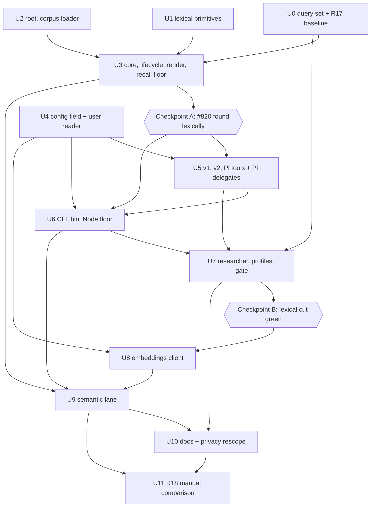
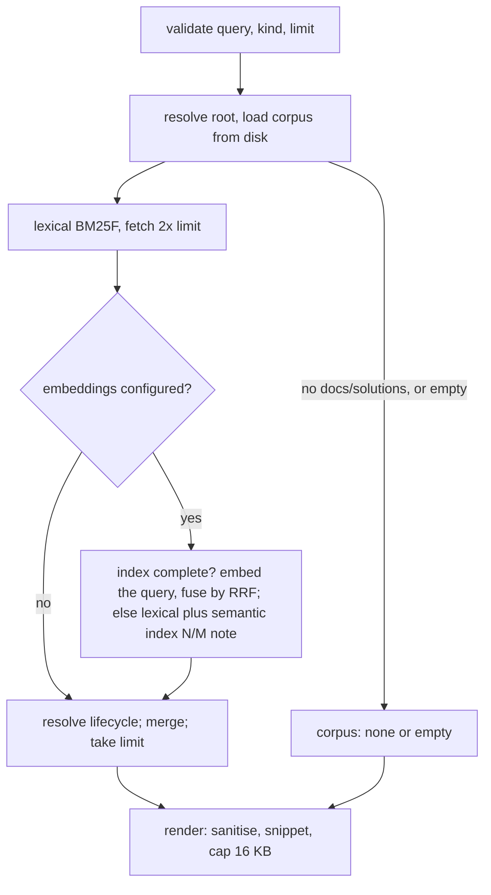

# feat: Search over Systematic's durable outputs

## Overview

Systematic writes learnings into `docs/solutions/`, and its workflows recover them through learnings-researcher, which greps four frontmatter keys and ranks nothing. This plan adds a search over those documents that runs on every surface Systematic supports: a `systematic_search` tool on OpenCode v1, OpenCode v2 and Pi, a `systematic-search` command on Claude Code's Bash path, and a `systematic search` CLI subcommand. learnings-researcher calls it first and keeps its grep path as the fallback.

The lexical lane is a pure TypeScript BM25F with no runtime dependency, and it gives byte-identical results on Bun and Node. A semantic lane joins when user-level config names an Ollama or OpenAI-compatible embeddings endpoint. The two lanes fuse by reciprocal rank.

Everything ships in one `feat` PR. The build order puts the lexical lane, every tool surface and the researcher first, behind two explicit checkpoints. The semantic lane starts only after the lexical cut passes all gates.

---

## Problem Frame

Issue #820 re-derived a root cause that a learning had already recorded three days earlier. The learning was tagged by its lesson, not by the symptom a searcher would type, and grep over `title`, `tags`, `module` and `component` never reached it. Only 53 of the 126 docs in this repo carry `symptoms`. The corpus is about 1 MB and growing, and user repos adopt the same convention through `ce:compound` and `compound-docs`.

Magic Context and AFT offer semantic search over their own stores, not over Systematic's outputs, and not on every harness. Systematic's search stands alone. The origin document carries the full frame (see origin: `docs/brainstorms/2026-10-29-durable-output-search-requirements.md`).

Marcus settled these points before planning (2026-10-29): the whole brainstorm ships in one PR; the lexical engine is a pure TypeScript BM25F; the Pi delegate gets the tool through `customTools`; the Node floor fix is folded in. They appear below as Key Technical Decisions.

---

## Requirements Trace

Requirements R1 to R18 and the acceptance examples are those of the origin document. R19 and R20 are plan-added from the same decisions.

**Search**
- R1. Search covers the host project's durable outputs. The root is the nearest ancestor holding `.git`, else the current directory. Release 1 indexes `docs/solutions/` only. (U2, U3)
- R2. Every document has a kind, and search takes an optional kind filter. Release 1 has one kind, `solution`. (U2, U3)
- R3. A lexical lane always runs with no setup, over frontmatter and body. Title, tags, module, symptoms, `applies_when`, component and problem type outrank body text. (U1, U3)
- R4. With an endpoint configured, a semantic lane also runs and the two rankings fuse. Each hit names its lanes and the result names the lanes that ran. (U3, U9)
- R5. Search follows the solution lifecycle: a successor replaces a superseded doc, a stale doc carries a caution, a superseded doc whose successor is unresolved is returned with `Caution: successor unresolved`, and malformed frontmatter is skipped with a named warning. (U2, U3)
- R6. Each hit shows path, title, kind, rank, matched lanes, snippet, module, tags and status. (U3)

**Embeddings and privacy**
- R7. Ollama and any OpenAI-compatible embeddings endpoint, on any host, with a user-chosen model. (U8)
- R8. Endpoint settings come from user-level config only, including `OPENCODE_CONFIG_DIR`. Project values are dropped with a warning. (U4)
- R9. The API key is read from an environment variable the user config names. It is never a literal value in config, and never appears in config output, logs, search output, failure notes or the cache. (U4, U8, U9)
- R10. Nothing leaves the machine unless an endpoint is configured. The privacy page and landing page scope their claims to the default setup and say a remote host is a third party. (U4, U10)
- R11. Each embeddings call has a timeout. The first query never waits on backfill: embedding is lazy and resumable through `--warm`. Lexical results always return within the bound. (U9)
- R12. Endpoint failure returns lexical results with a note giving a fixed reason. The note never includes the URL, headers or body, and search never errors. (U8, U9)
- R13. Embeddings are cached outside the repository, keyed by content, model and vector size, readable only by the user, never mixed across models. (U9)

**Where it runs**
- R14. Search runs on every surface, and lexical results are identical across them with ties broken by path. (U5, U6)
- R15. learnings-researcher uses search first and falls back to its grep path. With no `docs/solutions/`, search reports so without erroring. (U3, U7)

**Quality**
- R16. A labelled query set of 15 to 20 queries, about five held out, runs against the lexical lane with a recall floor. (U0, U3)
- R17. The query set runs once through today's grep path as a recorded baseline. Manual. (U0)
- R18. With an endpoint, the same set compares lexical and hybrid per query. Manual. (U11)

**Plan-added**
- R19. The Node entry guard works on every supported Node, and `engines.node` states the verified floor. (U6)
- R20. Pi delegates can call `systematic_search`, and no other parent tool. (U5)

| Example | Covers | Verified in |
|---------|--------|-------------|
| AE1 (index complete) | R4, R12 | U9: Ollama configured, every doc embedded, endpoint unreachable gives lexical hits plus an unreachable note |
| AE1 (index incomplete) | R4, R12 | U9: Ollama configured, some docs not yet embedded gives lexical hits plus the `semantic index N/M` note, and no request is sent |
| AE2 | R8 | U4: a project `systematic.json` embeddings block is dropped with a warning; the user value, if any, is used |
| AE3 | R5 | U2 and U3: a superseded best match is replaced by its successor, labelled `Supersedes:`. If the successor is missing, malformed, cyclic or past the hop cap, the matched doc is returned with `Caution: successor unresolved` |
| AE4 | R15 | U3 and U7: a repo with no `docs/solutions/` returns `corpus: none`, and the researcher returns no matches |
| AE5 | R14 | U5 and U6: v1, v2, Pi, the bin and the CLI return the same hits in the same order |
| AE6 | R9, R12 | U8: a 401 gives a rejected-request note, and no output holds the key or the URL |

Flows: F1 (agent retrieves learnings) is covered by R1, R3, R5 and R14 in U3, U5 and U7. F2 (user searches directly) is covered by R2 and R6 in U3 and U6. R13 (the cache) belongs to U9.

---

## Scope Boundaries

- A local-model add-on package for offline semantic search is out.
- Indexing plans, brainstorms and ideation docs is out. The `kind` table is the seam for them.
- Review artifacts under `.context/` are out.
- MCP delivery and reranking are out.
- Using or depending on Magic Context or AFT is out.
- Changing the solution-doc frontmatter contract is out. `src/lib/frontmatter.ts` is not edited, because editing it regenerates four surfaces.
- Search offers no permission prompt on any surface.
- Cache-directory ownership checks, a negative cache for a down endpoint, and refusing `http` for a remote key are out and documented as unsupported (U10).
- Query vectors are never cached or written to disk.

### Deferred to Separate Tasks

- Plan, brainstorm and ideation kinds: a follow-up PR. Whether their frontmatter fits the kind contract is unresolved, because plans use `completed` and carry no `superseded_by`.
- Other skills calling search directly: not in release 1. They reach it through learnings-researcher.
- Converging `src/ce-review-validator.ts` onto the new shared main-module helper: it feeds a committed bundle, so a separate change.
- A camelCase splitter, `root_cause` as an indexed field, and stemming: outside the Checkpoint A grid. A follow-up if the tune split shows a gain.

---

## Success Metrics

Carried from the origin's success criteria.

- The held-out #820 query finds its learning in the top five hits with no endpoint configured (Checkpoint A, U3). U0 writes that query as a symptom a searcher would type, before reading the target doc's frontmatter, and records the query's token overlap with the target's title, tags, module and component. If the overlap is high, the PR description says #820 tests tag matching, not the symptom-vocabulary gap.
- Lexical search is reported beside the grep baseline per split. The comparison informs review. It is not a go/no-go gate.
- With an endpoint, hybrid never does worse than lexical on the set and wins at least one query whose answer shares no key terms with it. Measured only in U11, and only if an endpoint is available.
- A default install gains no heavy dependency, downloads no model and makes no network call.

---

## Context & Research

### Relevant Code and Patterns

- **Runtimes.** OpenCode v1, v2 and the CLI build with `bun build ... --target bun --splitting` and CI imports `dist` under Node 24. Pi builds with `--target node`. The Claude Code bin is `Bun.build({target:'node', minify})` of `src/claude-code-validator.ts`, with the shebang and mode `0o755` applied in `scripts/build-claude-code-plugin.ts`. `CLAUDE_CODE_VALIDATOR_BIN` is hard-coded and `generatePluginFiles` takes one Buffer.
- **Tool registration.** v1: the `tool:` map in `src/lib/opencode-v1.ts`, built by `src/lib/skill-tool.ts` (zod args, `execute(args, context)`). v2: `ctx.tool.transform` in `src/lib/opencode-v2-skills.ts` with a JSON-Schema `input`, `codemode:false`, and keyed installers in `src/lib/opencode-v2.ts`. Pi: `pi.registerTool` in `src/pi.ts`, with typebox parameters. The host truncates tool output at 51,200 bytes or 2,000 lines, and the restore path is keyed to `systematic_skill`, so search caps its own output.
- **Config.** `loadConfig` (v1), `loadConfigWithSources` (Pi at init, CLI) and `buildSnapshot` (v2) all read config once. Load order is user, custom (`OPENCODE_CONFIG_DIR`), project. `profiles` is the protected-field precedent: `collectProjectProtectedFields`, `stripProjectProtectedFields` and `emitTopLevelProtectedFieldWarning` in `src/lib/config.ts`, with the path list in the import-free `src/lib/config-protected-fields.ts`. `trustProtected()` in `src/lib/config-schema.ts` tags a field but enforces nothing.
- **Reusable.** `parseFrontmatter` (js-yaml JSON_SCHEMA, returns `parseError`), `walkDir` (readdir order, does not descend symlinked directories, reports symlinked files as plain entries, throws on an unreadable directory, `isDiscoverableMarkdown` skips README), `isRecord`, and the private `findGitWorktreeRoot` in `src/lib/discovered-skills.ts`.
- **Lifecycle spec.** `agents/research/learnings-researcher.md` Step 4 (5 hops, visited set, form rule, literal `Supersedes:` and `Caution:` lines, and an omit-and-`Skipped:` rule for unresolved chains that this plan replaces). `scripts/content-integrity.ts` `classifySupersededBy` is stricter (no chains), resolves nothing and is not shippable.
- **Cache and fetch patterns.** `scripts/run-evals.ts` (mode `0o700` directory, temp file with `wx` and `0o600`, then rename). `docs/scripts/generate-release-notes.ts` and `scripts/release/gather-publish-facts.ts` (injectable `fetchImpl`, `AbortSignal.timeout`). Nothing in `src/` caches or fetches today.
- **Node precedent.** `tests/unit/claude-code-validator.test.ts` bundles with `Bun.build target node` and runs the result under `node` from a foreign temp dir. `src/ce-review-validator.ts` holds the realpath `isMainModule` guard.
- **Pi delegates.** `src/lib/pi-delegate-session.ts` passes `customTools: []` and loads with `noExtensions:true`. `src/lib/agent-resolver.ts` holds `DEFAULT_READONLY_TOOLS` and `OPENCODE_TO_PI_TOOL`. A custom tool is active only if its name is also in `tools`, and naming a tool with no definition does nothing and raises no error (Pi 1.4.0 `agent-session.js`).
- **Registration obligations.** Each new `src/lib` module needs an `ARCHITECTURE.md` codemap line and a `src/lib/AGENTS.md` row, keyed by basename. `bun scripts/content-integrity.ts` enforces both. Seven committed surfaces regenerate through `scripts/lib/generated-surfaces.ts`.

### Institutional Learnings

- `docs/solutions/best-practices/cross-harness-adapter-parity-contract-tests-2026-07-14.md`: test each adapter's observable results directly. A shared-core test does not prove parity. (U5, U6)
- `docs/solutions/integration-issues/cross-harness-tools-frontmatter-divergence-2026-08-16.md`: verify each host's real tool contract and prefer designs that do not depend on an agent obeying prose. (U5, U7)
- `docs/solutions/best-practices/entry-point-scope-decides-what-a-plugin-can-ship-2026-08-24.md`: a Claude Code bin must be a narrow self-contained entry, verified from a foreign cwd with no `node_modules`. Its "one bin" detail goes stale. (U6)
- `docs/solutions/best-practices/layered-trust-boundaries-overlay-config-2026-05-09.md`: protect endpoint fields at load time, before any mutation. Its throw example is stale, because current code strips and warns. (U4)
- `docs/solutions/best-practices/dependency-free-module-for-a-constant-shared-across-a-boundary-2026-09-20.md`: share the protected-path list through the import-free module. (U4)
- `docs/solutions/workflow-issues/registry-drift-on-skill-description-change-2026-05-20.md`: run `surfaces:affected --run`, then `surfaces:drift`. (U4, U6, U7)
- `docs/solutions/best-practices/typed-config-validation-build-time-codegen-2026-05-16.md`: keep the new field's runtime and schema in parity. (U4)
- `docs/solutions/test-failures/unit-suite-rewrites-repo-file-trap-2026-07-17.md`: tests write to temp copies and assert committed files unchanged. (U2, U6, U9)
- `docs/solutions/integration-issues/isolated-opencode-subprocess-fixtures-2026-05-14.md`: isolate HOME, XDG and caches, and test the packed package root. (U6, U9)
- `docs/solutions/workflow-issues/real-host-ci-catches-what-offline-gates-cannot-2026-09-06.md`: close stdin, use process groups and reap on timeout for spawned processes. (U1, U6)
- `docs/solutions/runtime-errors/circular-yaml-alias-aborts-content-integrity-report-2026-10-26.md`: parsed YAML can hold cyclic aliases. Never stringify an unnarrowed value. (U2)
- `docs/solutions/best-practices/lifecycle-validator-runs-only-in-ci-so-agent-prose-must-enforce-it-2026-10-26.md`: the researcher enforces successor form, existence and cycles. This doc goes stale when the researcher moves to search. (U7)
- `docs/solutions/documentation-gaps/index-learnings-by-symptom-not-only-by-lesson-2026-08-23.md`: index by symptom vocabulary. This is the #820 miss. (U0, U3)
- `docs/solutions/best-practices/unvalidated-artifact-contracts-have-no-conforming-producers-2026-08-23.md`: test the real producers and project diagnostics through an allowlist so untrusted content is never echoed. (U3, U8)
- Gaps: no learning covers the v1 golden pin, the privacy claims or the Node floor. Capture them with `ce:compound` after merge.

### External References

- BM25F: Robertson, Zaragoza and Taylor 2004 (doi 10.1145/1031171.1031181), Lucene `BM25Similarity`. BEIR (Thakur et al. 2021) on BM25 as a robust baseline.
- Reciprocal rank fusion: Cormack, Clarke and Büttcher, SIGIR 2009.
- Ollama `POST /api/embed` (`{model, input, truncate, dimensions?}` returns `{embeddings}`; 404 for an unknown model). OpenAI-compatible `POST /v1/embeddings` (`{model, input, dimensions?}` returns `{data:[{embedding,index}]}`; 2,048 inputs per request; Bearer auth). llama.cpp has ignored `dimensions` (issue #25210), so every response is length-checked.
- Chunking: split on headings, then paragraphs, at 300 to 400 tokens, with the title and heading breadcrumb prepended (Azure chunking guidance).
- Magic Context 0.49.25 and AFT 0.62.0, read as design references only.
- Measured on one machine, 2026-10-29: Ollama 0.40.4 with `nomic-embed-text` (137M, F16, 2,048-token context, 768 dimensions) on an Apple M1 Pro with 16 GB. At this plan's chunker the corpus is 126 docs and 3,011 chunks (mean 401 characters, p95 948). A batch of 8 takes p50 107 ms on GPU and 1,579 ms on CPU. A batch of 32 on CPU takes p50 6.3 s and p95 8.7 s. Per-chunk cost is flat from batch 8 up, about 13 ms on GPU and 197 ms on CPU. A full backfill at batch 8 takes 40 s on GPU and 8.7 min on CPU. A query embed takes about 10 ms on GPU and 27 ms on CPU. Model load takes 0.3 to 0.5 s. The first `ollama serve` launch took about 16 s, and this install unloads the model after 30 s idle (`OLLAMA_KEEP_ALIVE`). Other machines and models will differ.
- `Math.log` is implementation-approximated in ECMAScript. Measured on arm64 macOS: 5,750 of 80,600 IDF inputs differ in the last bit between Node 24.22.2 and Bun 1.4.4. A hand-written `ln` using only + − × ÷ was bit-identical on both. Linux x64 is unverified, and CI is the check.

---

## Prior-Art Survey

```json
{
  "schema_version": 2,
  "verdict": "extend",
  "scope": "src/ and scripts/ of the systematic package, worktree .worktrees/feat/durable-output-search; skills/*/scripts helpers listed, not read",
  "freshness": { "vcs_reference": "d3e2a3524c40cb7749532406f4a5fd298bcb26d2" },
  "budget": { "max_search_passes": 4, "max_candidate_inspections": 14, "exhausted": false },
  "candidates": [
    { "path_or_symbol": "src/lib/frontmatter.ts:parseFrontmatter", "description": "js-yaml JSON_SCHEMA frontmatter parser returning {data, body, hadFrontmatter, parseError}; parseError is the malformed-frontmatter signal.", "disposition": "reuse" },
    { "path_or_symbol": "src/lib/walk-dir.ts:walkDir", "description": "Synchronous recursive directory walker with depth and filter; readdir order, so callers must sort; isDiscoverableMarkdown skips README.md.", "disposition": "reuse" },
    { "path_or_symbol": "src/lib/discovered-skills.ts:findGitWorktreeRoot", "description": "Walks up to the first ancestor holding a .git entry, null otherwise, never throws; private today. Copied into search-corpus (second use).", "disposition": "reuse" },
    { "path_or_symbol": "src/lib/validation.ts:isRecord", "description": "Record type guard; needed to narrow frontmatter data.", "disposition": "reuse" },
    { "path_or_symbol": "agents/research/learnings-researcher.md (Steps 0, 3, 4)", "description": "Prose retrieval path; its Step 4 lifecycle rules are the behavioural spec (5 hops, repo-root form rule, visited set, Skipped and Caution lines).", "disposition": "extend" },
    { "path_or_symbol": "scripts/content-integrity.ts:checkSolutionLifecycle/classifySupersededBy", "description": "Gate that reports malformed superseded_by links; unexported, forbids chains, resolves nothing, unshipped.", "disposition": "insufficient", "insufficiency_reason": "Reports violations instead of resolving a successor; stricter than the researcher (no chains); cannot be imported from shipped src/." },
    { "path_or_symbol": "scripts/content-integrity.ts:findNearMissAgentStem", "description": "Suffix match of kebab-case identifiers against bundled agent stems.", "disposition": "insufficient", "insufficiency_reason": "Identifier suffix check, not a text ranker; no scoring or query model." },
    { "path_or_symbol": "src/lib/pi-delegate-tool.ts:compactText", "description": "Prefix truncation with ellipsis for tool descriptions; private.", "disposition": "insufficient", "insufficiency_reason": "Truncates from the start of text; no match-centred snippet extraction." },
    { "path_or_symbol": "src/lib/review-pipeline.ts:SEVERITY_RANK", "description": "Severity ordering with confidence, path, line and fingerprint tie-breaks for ce:review findings.", "disposition": "insufficient", "insufficiency_reason": "Domain-specific sort of structured findings; no free-text relevance scoring." },
    { "path_or_symbol": "src/lib/skill-catalog.ts:buildCatalogEntries", "description": "Name-sorted listing of bundled skills for tool descriptions; no query input.", "disposition": "insufficient", "insufficiency_reason": "Name-sorted listing of skills only; no query, scoring or docs/solutions corpus." },
    { "path_or_symbol": "src/lib/skills.ts:findSkillsInDir", "description": "Frontmatter indexing of SKILL.md files into SkillInfo records, depth 3.", "disposition": "insufficient", "insufficiency_reason": "Skill-specific schema; indexes name and description only, with no tokenising or scoring." },
    { "path_or_symbol": "src/lib/skill-tool.ts + src/lib/opencode-v2-skills.ts + src/pi.ts (systematic_skill registration)", "description": "Per-host tool registration for v1, v2 and Pi over a shared core; the pattern to follow for a search tool.", "disposition": "extend" },
    { "path_or_symbol": "src/ce-review-validator.ts + scripts/generate-ce-review-validator.ts + skills/ce-review/scripts/validate-review.mjs", "description": "Skill-local Node shim: narrow-entry bundle committed under skills/, invoked via SKILL_DIR on every surface, with provenance drift check and a realpath isMainModule guard.", "disposition": "extend" },
    { "path_or_symbol": "src/claude-code-validator.ts + scripts/build-claude-code-plugin.ts:buildValidatorBundle/generatePluginFiles", "description": "Single Claude Code bin built as a node-target bundle with prepended shebang and 0o755 write; one hard-coded bin name and Buffer.", "disposition": "extend" }
  ],
  "excluded_scopes": [
    { "scope": "docs/scripts and docs/src (Astro workspace)", "reason": "Site generators; only their fetch-with-timeout pattern was read." },
    { "scope": "skills/*/scripts/*.mjs helpers", "reason": "Listed for delivery precedent only; contents not searched for ranking." },
    { "scope": "tests/, evals/, tests/fixtures/config-corpus", "reason": "Searched for Node-subprocess precedent only." },
    { "scope": ".slim/clonedeps/repos", "reason": "Third-party source, not project code." }
  ]
}
```

---

## Key Technical Decisions

Decisions carried from the origin: lexical always, embeddings through an endpoint, a local model later as an add-on; a pure TypeScript BM25 because `bun:sqlite` does not load on Node surfaces and `node:sqlite` needs Node 22; widening the researcher's grep was rejected; solutions first with kinds in the design; every surface ships in release 1; any endpoint host, user config only, key by environment variable; held-out queries and a grep baseline, not a proof gate; no committed index. The rest were settled with Marcus on 2026-10-29 or by this plan.

**Lexical lane**
- **Scoring.** BM25F over eight fields: title, tags, module, symptoms, `applies_when`, component, problem type, body. Per field, a length-normalised weighted term frequency (`w_f · tf / (1 − b_f + b_f · len/avglen)`) is summed across fields, then saturated with `k1`. IDF is `ln(1 + (N − df + 0.5)/(df + 0.5))`, with `df` counted over docs where the term appears in any field.
- **Starting values** (tuned on the tune split only): weights title 3, symptoms 3, tags 2.5, `applies_when` 2, module 2, component 1.5, problem type 1.5, body 1. `b` is 0 for metadata fields and 0.75 for body. `k1` is 1.2.
- **Tokenizer.** `toLowerCase`, then ASCII `[a-z0-9]` runs. A run joined by `_` or `-` also emits the whole joined identifier, so `foo_bar` yields `foo_bar`, `foo` and `bar`, and `a-perfect-measurement` yields the whole slug plus three components. Every other character splits (`src/lib/x.ts` yields `src`, `lib`, `x`, `ts`). No stemming, no stopwords, no camelCase split. A non-ASCII letter splits a word, which is a documented limit.
- **Query terms.** Unique tokens in first-seen order, truncated to 64 with a note, then sorted by code unit before summation.
- **Determinism.** A hand-written `ln` uses only + − × ÷. The search modules avoid `Math.log`, `Math.pow`, `**`, `exp`, `Intl`, `localeCompare`, `toLocale*`, `Bun.` and `bun:` by convention. Two tests enforce the outcome: the Bun-built bundle runs under Node, which fails on any `Bun.*` use, and a float64 bit-pattern comparison catches numeric drift. There is no source-scan test. Summation order is fixed: sorted unique terms, then fixed field order. Ties break on the code-unit order of the root-relative path, and rank is the final position.
- **Why not `Math.log`.** ECMAScript leaves it implementation-approximated, and the two runtimes disagree on 7% of measured inputs. Rounding scores does not prove identical order.

**Corpus**
- **Root.** The nearest ancestor holding `.git` (file or directory), resolved with `realpath`, else the start directory. The ten-line walk-up is copied into `src/lib/search-corpus.ts` from the private `findGitWorktreeRoot`; `src/lib/discovered-skills.ts` stays untouched. This is the second use, so extract it at the third. The two copies differ on purpose: search falls back to the start directory, while `discovered-skills.ts` returns null. A code comment says so, so nobody unifies them. Importing `discovered-skills.ts` would pull its dependencies into the Claude Code bin.
- **Files.** Only `docs/solutions/` directly under the root, read from disk on every call with no memo, because `ce:compound` searches right after it writes. Before walking, take the `realpath` of `docs/solutions` and require it to lie inside the `realpath` of the root. If it does not, emit one warning and load nothing, so a committed symlink cannot pull outside text into output. Inside, a wrapper that never throws walks the tree and calls `lstat` explicitly to skip symlinks. Caps: 256 KB per file, 2,000 files, `maxDepth` 6, and 16 MB of text in total. The walk is in sorted path order, stops at the byte budget, and emits one warning with the count of files skipped. Excluded: README, `_archived/`, `critical-patterns.md`. Paths are root-relative with `/`.
- **Cost of no memo.** Measured on Bun 1.4.4 on an M1 Pro: tokenizing costs about 21 ms/MB, so this repo's 1.0 MB corpus costs about 25 ms per call, and the 16 MB budget bounds a call near 0.35 s warm. A memo would save about 24 ms and is rejected. If one is added later, key it on path, size, mtime, ctime and inode, and re-walk the directory on every call so `ce:compound`'s write-then-search stays correct.
- **Parsing.** A wrapper around `parseFrontmatter` strips a leading BOM and supplies the newline the regex needs at end of file. It reads only known fields, narrows each (`isRecord`, string, array of strings), and never stringifies an unnarrowed value. No frontmatter means body-only with no warning. A `parseError` skips the doc with a warning naming it.
- **Kinds.** A `kind` table with one entry, `solution`, carries the directory, the exclusions and whether lifecycle applies.

**Lifecycle**
- **Rules.** The researcher's, not content-integrity's: at most 5 hops, a visited set, and the form rule (`docs/solutions/…md`, no `..`, no README, not under `_archived/`, the file exists in the loaded corpus). Existence means the doc was loaded, so a skipped or oversize successor is unresolvable.
- **Mechanics.** Fetch about twice the limit before resolving, because merges shrink the list and 2× is the tolerance. A successor takes the best rank among itself and the docs it replaces. Duplicates merge and `Supersedes:` lists every replaced path. Superseded docs stay indexed so they can match.
- **Unresolvable chain.** A successor is unresolved when it is missing, fails the form rule, forms a cycle, or lies past the hop cap. The matched superseded doc is returned at its own rank, with status `superseded` and `Caution: successor unresolved`. Nothing is dropped, and the `Skipped:` label is retired from search output and from the researcher prose. This matches R5 and changes the researcher's current omit-and-skip rule (decided by Marcus, 2026-10-29).
- **Pinning.** The hop cap, path prefix, labels and unresolved-caution text are constants in `search-core.ts`, next to the resolver. The resolver is tested in code over a lifecycle fixture corpus, and the researcher prose is reviewed by hand once in U7. No content-integrity gate compares prose to constants.

**Output**
- Default 8 hits when `limit` is absent. `limit` is an integer from 1 to 20. Host schemas declare a plain integer and state the range in the description only, so a host does not pre-empt the core. The core returns the fixed validation error for anything out of range, with no clamping, and the CLI rejects it with exit 2. U5's real-host tests record what each host does with 0 and 21. Where a host passes the value through, the test asserts the core's fixed error. Where a host pre-validates, the test asserts that host's rejection and the plan drops the identical-error claim for that host. Snippet at most 240 characters on one line, centred on the densest window of query terms. Snippets are extracted only for the hits returned, with a token-position sliding window. Title at most 160. At most 8 tags. At most 5 warnings plus `+N more`.
- Hard cap 16 KB with a UTF-8-safe cut and Systematic's own marker. Query at most 2,000 characters. Empty queries and unknown kinds return fixed error text. Control and ANSI sequences are stripped from everything echoed.
- The result header separates `corpus: none` (no `docs/solutions/`), `empty` (the directory exists but holds no indexable docs) and `N docs, 0 hits`, and lists the lanes that ran.

**Config**
- One top-level `search: { enabled?, embeddings? }`, protected as a whole: stripped from project config with a warning, merged from user and custom only. `enabled` takes the last defining source. `embeddings` is replaced whole by the last defining source.
- `embeddings` fields: `provider` (`ollama` or `openai-compatible`), `base_url` (SDK-style root), `model`, `dimensions?`, `api_key_env?`, `query_prefix?`, `document_prefix?`, `timeout_ms?`. The prefixes stay because nomic-embed-text documents require task prefixes.
- The schema checks shape only, including the `api_key_env` pattern. URL semantics (scheme, no userinfo, query or fragment) are checked at use time and give a fixed note.
- **Invalid `search` block (decided by Marcus, 2026-10-29).** The `search` block of a user or custom file is validated separately from the rest of the file, mirroring the project strip that runs before `safeParse`. If it fails its schema piece, it is dropped with one warning (naming the field, never a value) and the rest of the file loads. Search is then lexical-only with a `config unreadable` note, so the plugin never fails to load over search. The bin does the same.
- `timeout_ms` defaults to 15,000 at use time in the core. It is not a zod `.default()`: the schema only bounds the value (500 to 60,000).
- `search.enabled: false` is a plan decision approved by Marcus, not an origin requirement. It removes the tool from v1, v2 and Pi without a note. The CLI and bin print `disabled` and exit 0. The researcher then falls back to grep.
- Hosts snapshot config at init, so changing the endpoint needs a restart. U10 documents this.

**Claude Code bin**
- `systematic-search`, built from `src/claude-code-search.ts`. It reads both user-level files, `~/.config/opencode/systematic.{jsonc,json}` and `$OPENCODE_CONFIG_DIR/systematic.{jsonc,json}`, and merges them by the loader's rules: custom overrides user, `enabled` takes the last source that defines it, and `embeddings` is replaced whole. It never reads project config. It parses JSONC through jsonc-parser's ESM build (`jsonc-parser/lib/esm/main.js`) via a `Bun.build` `onResolve` alias, because the UMD build crashes when bundled from a foreign directory (reproduced).
- The bin validates `search` with the same zod schema piece the config uses, exported from `src/lib/search-user-config.ts`. There is no hand-written narrower, so there is one producer. U6 records the bundle size.
- Import rule: `search-user-config.ts` imports only zod, jsonc-parser and node builtins, plus type-only imports from `search-core.ts`. It never imports `config.ts` or `config-schema.ts`. `trustProtected` is applied only in `config-schema.ts`.
- A pure `mergeSearchSettings(sources)` in `search-user-config.ts` holds the merge rule, and both `config.ts` and the reader call it. It takes schema-parsed sources in priority order, user then custom, so both callers parse through the schema piece first. That replaces a reader-vs-loader parity test.
- The config file selection (`.jsonc` before `.json`, `OPENCODE_CONFIG_DIR` trimmed with empty treated as unset, `os.homedir()/.config/opencode`) is one exported helper in `search-user-config.ts`. `config.ts` imports it and calls it from `getConfigPaths` and `resolveConfigPath`, so only one copy exists.
- The foreign-directory bin run is the import guard: if the bin pulled in `config.ts`, its UMD jsonc would crash that run. There is no bundle-graph or metafile assertion.
- The bin cannot emit the AE2 project-config warning, and that asymmetry is accepted.

**Surfaces**
- One host-neutral composition in `search-core.ts` does validate, lexical lane, semantic stage, lifecycle and render. Every adapter in `search-tool.ts` and the CLI call it. Adapters do only host I/O: start directory, settings and error mapping. The tool name and argument constants live in `search-core.ts`. The host adapters and the CLI do not import zod or typebox for search. The bin imports zod only through the schema piece in `search-user-config.ts`. `search-core.ts` owns the `SearchSettings` type, and the zod schema's output type must be assignable to it, checked at compile time.
- `runSearchCli` takes an injected settings loader that returns `{ settings?, warnings[], unreadable: boolean }`. `cli.ts` passes a `loadConfigWithSources` adapter, and the bin passes the user-level reader, which returns the same shape.
- Tool name `systematic_search`, arguments `query` (required), `kind` (optional, `solution`), `limit` (optional plain integer, range stated in the description).
- Start directory: Pi uses per-call `ctx.cwd`. v1 uses `context.directory`, which the 1.19.4 types require. U5's floor-lane test decides the fallback: if `context.directory` is absent on 1.18.29, the init-directory fallback stays and is documented as serving the floor; if the field is present, the fallback is dropped. v2 uses `ctx.location?.directory` and returns a no-project note when undefined, because `process.cwd()` would search whichever project the editor started in. The CLI and bin use `--dir` or the cwd.
- One parity test drives each adapter's real entry over one fixture corpus and compares rendered text. Later units add their surfaces (CLI, bin, hybrid) to that same test. They do not write separate parity files.

**Pi delegates**
- `systematic_search` joins `DEFAULT_READONLY_TOOLS` and `OPENCODE_TO_PI_TOOL`. `PiDelegateToolDeps` and the `CreateDelegateSession` options gain a `customTools` field, `runValidatedDelegateSession` passes it to `buildDelegateAgentSessionOptions` in place of the literal empty list, and `src/pi.ts` supplies the one shared definition, or nothing when `search.enabled` is false. A persona with an explicit `tools:` list gets search only if it names it. The parent's other tools never pass. `promptSnippet` stays short.

**Researcher**
- Detection: OpenCode and Pi check whether `systematic_search` is in the tool list. Claude Code probes with `command -v systematic-search`. Step 3b (critical patterns) is unchanged.
- With hits, the researcher skips Steps 2 and 3 and Step 4's grep, and still runs Step 3b. `corpus: none` and `empty` lead to No Matches. `N docs, 0 hits`, a `disabled` reply, an error and no tool all take the existing grep path. There is no new synonym pass, since the existing grep keeps its OR patterns.
- In overlap mode the search score never maps to High, Moderate or Low, and the doc under comparison is dropped from results.

**Semantic lane**
- Chunk by headings. Inside a section, pack consecutive paragraphs into one chunk up to a hard cut at about 1,200 characters (about 300 tokens), so every chunk fits a small model's context. A heading always starts a new chunk. There is no sentence rule. Measured unpacked, the corpus makes 3,011 chunks. Packing gives roughly 1,000, about 3× fewer requests. The title and heading breadcrumb are prepended and count toward the limit. Ollama requests set `truncate: true` explicitly, and the guide documents the truncation. A doc scores the max over its chunks, and candidates are capped at the top 20 by cosine. RRF lives in `search-semantic.ts`, and the core calls the semantic stage.
- Fuse with RRF at `k = 60`. A lane that misses a doc contributes nothing. Vectors are stored as Float32, fresh vectors pass through `Math.fround`, and all are pre-normalised. `Math.sqrt` is correctly rounded under ECMAScript, so normalisation is deterministic. The plan claims no cross-runtime hybrid identity beyond that, and adds no test for it. Zero, NaN and Infinity vectors are rejected.
- The lane contributes only when every indexable doc has valid vectors. Otherwise the result is lexical plus a `semantic index N/M` note. A doc whose embedding fails twice in a `--warm` run is skipped. Only a malformed response, a vector size mismatch, an HTTP 4xx or a 5xx counts toward the two failures. A timeout does not. After the second failure `--warm` writes a per-doc failure marker in the cache directory, keyed like the cache (content hash, model, dimensions, endpoint hash), mode 0600. Search treats a marked doc as skipped and drops it from N/M, so the lane can fuse, and the note gives the skipped count. The next `--warm` retries marked docs and clears a marker on success. `--warm` exits 0 when every doc is embedded or marked and prints the skipped count. It exits 1 only on a run-level failure: endpoint unreachable, invalid config or key missing. There is no in-memory skip count.
- **Backfill is warm-only (decided by Marcus, 2026-10-29).** Backfill runs only through `systematic search --warm`, on the CLI and bin, resumable, persisting each document once all its chunks are embedded (not each batch), with progress on stderr. Tool surfaces never backfill. While the index is incomplete, a search returns lexical results at once with the fixed note `semantic index N/M; run systematic search --warm` and skips the query embedding. Once the index is complete, a search embeds only the query: one request under `timeout_ms`. There is no `first_query_budget_ms`. Measured on CPU, a full backfill takes 8.7 min unpacked, so in-query backfill is not tolerable.
- Transport: `fetch` with `AbortSignal.timeout`, an injectable `fetchImpl`, `redirect:'error'` and a response cap of about 32 MB. The whole batch is validated: count, unique indices, and uniform dimensions equal to `dimensions` when it is set. When it is unset, the first response sets the length, a later response of another length is a `vector size mismatch`, and the length joins the per-doc cache key.
- Defaults, measured on one machine (see External References): 8 chunks per request and `timeout_ms` 15,000 (applied at use time), one setting for document batches and the query embed. Per-chunk cost is flat from batch 8, and a batch of 32 reached 8.7 s at p95 on CPU. The worst observed batch took 2.5 s on CPU, so 15 s leaves room for model load and variance. U11 re-checks them on the user's endpoint.
- Cache: one file per document, holding all of that document's chunk vectors, named by a hash of content, chunker version, model, dimensions, prefixes and a hash of provider plus `base_url`. Provider and `base_url` are in the key because the same model name on two backends gives different vectors. When `dimensions` is unset, the vector length comes from the first response and becomes part of the per-doc key or name. A later response of a different length is a `vector size mismatch`, and the exact-length check uses that stored dimension. Failure markers share the key and the age prune. Directory `$XDG_CACHE_HOME/systematic/embeddings/` when that is an absolute path, else `~/.cache/systematic/embeddings/`. Written as a temp file with `wx` and `0600`, then renamed, in a `0700` directory. An exact-length check (dimension × 4 × chunk count) turns any mismatch into a miss, and the content hash in the filename is the key. There is no magic header and no single-flight map. Pruning is by age (30 days, mtime bumped at most once per process per file), because the cache is shared across repos and worktrees.
- Failure notes use fixed reasons only: unreachable, timeout, unknown model, HTTP status, vector size mismatch, malformed response, key missing, config unreadable, invalid endpoint. The 401 and 403 text says the endpoint rejected the request. Nothing from `fetch`'s `error.message`, the URL, headers or body is surfaced. `api_key_env` is never echoed. If it is unset or empty, no key is sent and a distinct note says so.

**Quality**
- `tests/fixtures/search-queries.json` holds 15 to 20 queries shaped `{id, query, relevant[], split, lexical_reachable}`, phrased from symptoms or issue text, not titles, each with a `source` of `issue`, `paraphrase` or `symptoms`. At least half the tune queries come from issue wording or a paraphrase, so a query copied from a doc's symptoms field cannot inflate the floor. About five are held out, and #820 is one. At least two are `lexical_reachable: false` so R18's win condition is testable.
- One aggregate integer floor covers all `lexical_reachable: true` queries across both splits. A query counts when at least one relevant path is in the top 5. The floor is the first measured count minus 1. Per-split counts are reported. Tuning reads the tune split only. The query-set shape checks (ids, splits, sources, labelled paths exist, reachability) live inside the recall test, with no separate query-file test. The reachability check requires a shared term from the relevant doc's title, symptoms, tags or module, not body text alone.
- The #820 query is written as a symptom a searcher would type, before the target doc's frontmatter is read. The fixture records its token overlap with the target's title, tags, module and component, and pins `lexical_reachable: true`.
- R17: one run of the unmodified researcher per query by a single subagent, before the researcher is edited. Results land in `tests/fixtures/search-baseline-grep.json` with model, commit, date and returned paths. It is not CI.

**Node floor**
- A shared `src/lib/main-module.ts` holds the realpath guard, used by `src/cli.ts`, `src/claude-code-validator.ts` and the new bin. `src/ce-review-validator.ts` keeps its own copy, because it feeds a committed bundle. `package.json` `engines.node` rises to the floor U6 verifies, probably `>=20.11` for `import.meta.dirname`.

---

## Open Questions

### Resolved During Planning

- Chunking (origin, R4 and R13): headings first, then paragraphs, a hard cut at about 1,200 characters (about 300 tokens), breadcrumb prepended.
- Fusion (origin, R4): RRF with `k = 60`, gated on full index coverage.
- Timeout (origin, R11): `timeout_ms` 15,000 and 8 chunks per request, from the measured numbers. There is no first-query budget: backfill is warm-only (decided by Marcus, 2026-10-29). U11 re-checks on the user's endpoint.
- Tool name and shape (origin, R14): `systematic_search(query, kind?, limit?)`, switchable off with `search.enabled: false`.
- Cache location and pruning (origin, R13): the XDG cache path above, pruned by age, not by corpus membership.
- Recall floor (origin, R16): one aggregate integer, the first measured count minus 1 over the `lexical_reachable: true` queries, set in U3.
- Researcher detection (origin, R15): tool-list check on OpenCode and Pi, `command -v` on Claude Code.
- Other skills calling search (origin, R15): no, not in release 1.
- Plans, brainstorms and ideation as kinds (origin, R2): not researched here. The `kind` table is the seam, and the follow-up owns the frontmatter fit.
- Pi researcher: without `customTools` a delegate cannot call a registered tool, so U5 passes the shared definition and the researcher detects it by tool list.
- Hyphens and underscores: a joined run emits the whole identifier plus its components.
- Dangling or cyclic successor (Marcus, 2026-10-29): follow R5. The matched doc is returned with `Caution: successor unresolved`, and `Skipped:` is retired.
- Release workflow guard (Marcus, 2026-10-29): approved. U6 adds the new bin to the required-artifact check in `.github/workflows/publish-claude-code-plugin.yaml` and to its pinning test.
- Where the root walk-up lives: copied into `search-corpus.ts`, because this is the second use and `discovered-skills.ts` stays untouched.
- v2 permission: no prompt is decided. If the v2 host turns out to require `permission.assert` for a tool, stop and ask Marcus.
- Symlinks under the corpus: a realpath containment check on `docs/solutions` plus an explicit `lstat` wrapper, so no deferred question remains.

### Deferred to Implementation

- Whether `context.directory` exists on the v1 floor (1.18.29). The 1.19.4 types require it. U5's floor-lane test is the proof. If the field is absent there, the init-directory fallback stays and is documented as serving the floor. If it is present, the fallback is dropped.
- Whether the `onResolve` alias builds a bin that runs from a foreign directory. It was not tested end to end; U6 proves it.
- Linux x64 `Math.log` behaviour. The hand-written `ln` makes it moot, and the first CI run is the check.
- The #820 issue text that seeds the held-out query. U0 reads it from the issue.
- Exact tuned weights. U3 sets them by running the fixed retune grid once on the tune split.

---

## High-Level Technical Design

> *This illustrates the intended approach and is directional guidance for review, not implementation specification. The implementing agent should treat it as context, not code to reproduce.*

Unit dependencies. The two checkpoints gate the lexical cut before any semantic work. U4 has no upstream and may land before Checkpoint A, which regenerates the schema and config-reference surfaces early.



One search call, as the core sees it:



Result header and hit shape (directional; the exact wording is fixed in U3):

```text
Search "<query>": 126 docs, 5 hits. Lanes: lexical. Corpus: docs/solutions.
Notes: semantic lane unreachable.

1. docs/solutions/best-practices/example-2026-08-16.md
   Title: ... | Kind: solution | Status: active | Lanes: lexical
   Module: ... | Tags: a, b
   Snippet: ...
   Supersedes: docs/solutions/...
   Caution: ...
2. docs/solutions/...
   Title: ... | Kind: solution | Status: superseded | Lanes: lexical
   Caution: successor unresolved
```

---

## Output Structure

    src/lib/
      main-module.ts           realpath entry guard
      search-lexical.ts        tokenizer, ln, BM25F
      search-corpus.ts         root walk-up, kinds table, loader, frontmatter wrapper
      search-render.ts         sanitise, snippet, caps, truncation marker (types only from corpus)
      search-core.ts           the one composition, query validation, lifecycle constants and resolver, SearchSettings type, tool constants
      search-user-config.ts    search zod schema piece, mergeSearchSettings, config file selection, user-level reader
      search-tool.ts           v1, v2 and Pi host factories (host I/O only)
      search-embeddings.ts     endpoint client and fixed failure notes
      search-semantic.ts       chunking, vectors, RRF, cache, backfill
      search-cli.ts            runSearchCli
    src/claude-code-search.ts  narrow bin entry
    tests/fixtures/search-queries.json, search-baseline-grep.json
    tests/fixtures/search-corpus/   lifecycle and hostile-doc fixtures
    docs/src/content/docs/guides/search.mdx

The per-unit `Files` lists are authoritative. Four deep modules carry the design: lexical, core (composition and lifecycle), embeddings and semantic (which owns RRF). The corpus module is deep only in its I/O. `search-user-config` does file I/O, JSONC, merge and schema, so it is not an adapter. `search-render`, `search-tool`, `search-cli` and `main-module` are thin. That is ten `src/lib` modules, each needing a codemap line and a module-table row.

---

## Implementation Units

Phase A is the quality harness (U0). Phase B is the lexical lane (U1 to U3), ending at Checkpoint A. Phase C is config and every surface (U4 to U7), ending at Checkpoint B. Phase D is the semantic lane (U8 to U9). Phase E is docs and the manual comparison (U10, U11).

Every unit that adds a `src/lib` module also adds its `ARCHITECTURE.md` codemap line and its `src/lib/AGENTS.md` row, and verifies them with `bun scripts/content-integrity.ts`. Every unit ends with `bun run surfaces:affected --run` and, from U4 on, `bun run surfaces:drift`.

- [ ] U0. Query set and R17 grep baseline

**Goal:** Commit the labelled query set and the recorded grep baseline, before any edit to the researcher.

**Requirements:** R16, R17

**Dependencies:** None

**Files:**
- Create: `tests/fixtures/search-queries.json`
- Create: `tests/fixtures/search-baseline-grep.json`

**Approach:**
- Read issue #820 first and write its query as a symptom a searcher would type, from the issue's wording, before opening the target `docs/solutions/best-practices/a-perfect-measurement-means-a-broken-instrument-2026-08-16.md`. Only then read the target's frontmatter, and record in the fixture the query's token overlap with the target's title, tags, module and component. Pin `lexical_reachable: true` for it. If the overlap is high, the PR description says #820 tests tag matching rather than the symptom-vocabulary gap (see Success Metrics).
- Author 15 to 20 queries from the `symptoms`, root causes and issue-style wording of `docs/solutions/`. Record each query's `source` (`issue`, `paraphrase` or `symptoms`), and make at least half the tune queries `issue` or `paraphrase`, so copying a doc's symptoms field cannot inflate the floor. Author blind to any ranker, since none exists yet. Fix the splits up front: about five `heldout` including #820, the rest `tune`. At least two are `lexical_reachable: false`, whose answers share no key terms with the query.
- Keep the draft fixture outside the repo (a gitignored scratch path) until the baseline run ends, so the researcher cannot read labels.
- One subagent runs the unmodified learnings-researcher once per query, receiving only the query text as the problem description, in this worktree at the pinned commit. Record the returned paths in the researcher's listed order.
- Score the baseline with the same metric as U3 (queries with at least one relevant path in the first 5). Write model, commit, date, per-query returned paths and per-split counts to `tests/fixtures/search-baseline-grep.json`. Then move the fixture into `tests/fixtures/`.

**Execution note:** The baseline run is manual and single-shot. Do not re-run it to improve numbers.

**Test expectation:** none -- committed fixtures. Their shape checks (15 to 20 entries, unique ids, valid splits, 4 to 6 held out, #820 present, every `relevant` path exists under `docs/solutions/` and is not a README or `_archived/`, at least two `lexical_reachable: false`, every query has a `source`, at least half the tune queries are not `symptoms`, and for each `true` query a relevant doc's title, symptoms, tags or module shares a query token of 3 or more characters, not body text alone) run inside U3's recall test.

**Verification:**
- Both files are committed, and the baseline commit precedes any change to `agents/research/learnings-researcher.md`.
- The #820 query is `heldout`, its target is labelled relevant, and its recorded token overlap is in the fixture.

- [ ] U1. Lexical primitives and the determinism harness

**Goal:** A dependency-free tokenizer, natural log and BM25F scorer that return bit-identical scores on Bun and Node.

**Requirements:** R3, R14

**Dependencies:** None

**Files:**
- Create: `src/lib/search-lexical.ts`
- Test: `tests/unit/search-lexical.test.ts`
- Test: `tests/unit/search-determinism.test.ts`
- Modify: `ARCHITECTURE.md`, `src/lib/AGENTS.md`

**Approach:**
- The module is pure: no I/O, no environment reads, no imports beyond types. It exposes the tokenizer, `ln`, index construction over documents with named fields, and scoring that returns a per-document score for a set of unique query terms.
- `ln` uses only + − × ÷: scale the argument by exact powers of two into a narrow range, then sum an atanh series with a literal `ln 2` constant. Target relative error near 1e-15.
- Summation order is fixed: sorted unique terms, then the fixed field order. Starting weights and `k1`, `b` are the Key Technical Decisions values, exported as one constant table so U3 can tune them in one place.
- The determinism test bundles the module plus a tiny harness entry with `Bun.build` `target: 'node'`, runs it under `node` from a foreign temp directory, and compares float64 bit patterns (as hex) against an in-process run. It follows `tests/unit/claude-code-validator.test.ts`. It fails, not skips, when `node` is missing.
- Running the Bun-built bundle under Node also catches any `Bun.*` use, so there is no source-scan test.

**Execution note:** Test-first for the tokenizer table and the bit-pattern comparison.

**Patterns to follow:**
- `tests/unit/claude-code-validator.test.ts` for the foreign-directory Node run. Close stdin and bound the spawn with a timeout (`docs/solutions/workflow-issues/real-host-ci-catches-what-offline-gates-cannot-2026-09-06.md`).

**Test scenarios:**
- Happy path: `foo_bar` yields `foo_bar`, `foo`, `bar`. `A-Perfect-Measurement` yields the whole slug plus three components. `src/lib/x.ts` yields `src`, `lib`, `x`, `ts`. `v2` stays one token.
- Edge case: empty and whitespace-only input yield no tokens. `_x-` yields `x`. `a__b` yields `a__b`, `a`, `b`. `naïve` yields `na`, `ve`. A 100 KB single token does not hang.
- Happy path: `ln` matches `Math.log` to within 1e-15 relative error on a sweep from 1 up to about 2N+2, the range IDF sends (its argument is 1 plus a positive number), is exactly 0 at 1, and is monotonic on a dense sweep.
- Happy path: a term in the title outranks the same term once in the body. A rarer term scores above a common one. A longer body lowers the score for equal term counts.
- Edge case: an empty corpus, a one-document corpus and a query term in no document score without error and without NaN.
- Edge case: permuting the query terms gives bit-identical scores. Equal scores order by code-unit path, so `Z.md` sorts before `a.md`.
- Integration: the Node-bundle bit patterns equal the Bun run on a fixed corpus and query set.

**Verification:**
- The bit-pattern test passes locally on arm64 macOS, and CI on Linux x64 is the cross-platform check.
- The codemap and AGENTS row exist; `bun scripts/content-integrity.ts` is clean.

- [ ] U2. Corpus loader and project root

**Goal:** Resolve the project root and load `docs/solutions/` safely from disk. The lifecycle resolver lives in U3, next to the ranked list it consumes.

**Requirements:** R1, R2, R5 (malformed frontmatter)

**Dependencies:** None

**Files:**
- Create: `src/lib/search-corpus.ts`
- Test: `tests/unit/search-corpus.test.ts`
- Create: `tests/fixtures/search-corpus/` (lifecycle chains and hostile docs)
- Modify: `ARCHITECTURE.md`, `src/lib/AGENTS.md`

**Approach:**
- `search-corpus.ts` holds the root walk-up (copied from the private helper in `discovered-skills.ts`, which is not edited), with `realpath` and the fallback to the start directory. It also holds the `kind` table, the loader and the frontmatter wrapper described in Key Technical Decisions.
- The loader first checks that the `realpath` of `docs/solutions` lies inside the `realpath` of the root, then walks with a wrapper that never throws and calls `lstat` explicitly on each entry. It sorts by relative path in code-unit order, applies the file, size and 16 MB total caps, and returns documents plus bounded, sanitised warnings. It builds on `walkDir` only if that can be done without its throw-on-unreadable behaviour reaching the caller. Otherwise it uses a small bounded walker of its own.
- The module imports no lifecycle logic. Its documents carry the narrowed `status`, `superseded_by` and `stale_reason` that U3's resolver reads. Both walk-up copies keep a code comment saying they differ on purpose (start-directory fallback here, null in `discovered-skills.ts`).

**Patterns to follow:**
- `agents/research/learnings-researcher.md` Step 4 as the behavioural spec. `src/lib/walk-dir.ts` and `src/lib/validation.ts` for walking and narrowing.

**Test scenarios:**
- Happy path: a start directory two levels below a `.git` directory, and below a `.git` file (worktree), resolves to that ancestor. A start directory with no ancestor `.git` resolves to itself.
- Edge case: a symlinked start directory resolves through `realpath` (macOS `/var` to `/private/var`). Paths are root-relative with `/`.
- Happy path: the loader returns docs sorted by code-unit path, excludes README, `_archived/` and `critical-patterns.md`, and ignores files deeper than 6 levels.
- Error path: a committed `docs/solutions` symlink pointing outside the repo loads nothing, emits one warning, and no text from the target reaches the result or any output.
- Edge case: a symlinked file is skipped, and a symlinked directory is not descended. An unreadable subdirectory gives a warning, never a throw. A 256 KB + 1 file is skipped with a warning. The 2,001st file stops loading with one warning. Files past a 16 MB total byte budget are skipped in sorted path order, with one warning that gives the skipped count (tested with a fixture corpus built over the budget).
- Edge case: no frontmatter indexes body-only with no warning. A BOM, and a closing `---` at end of file with no newline, still parse.
- Error path: invalid YAML skips the doc with a warning naming its path. `tags: &t [*t]` (cyclic alias) and non-string tag entries do not crash and are never stringified. A control character in a title is stripped from the warning.
- Edge case: the lifecycle fixture corpus (chain, 5-hop, 6-hop, cycle, dangling, malformed-target, stale, merge cases) loads with each doc's narrowed lifecycle fields intact. U3 pins the resolver's output over it.

**Verification:**
- `src/lib/discovered-skills.ts` is untouched. The corpus loader runs over this repo's real `docs/solutions/` with no warnings.
- Registration lines exist and `bun scripts/content-integrity.ts` is clean.

---

- [ ] U3. Search core, renderer and recall floor (Checkpoint A)

**Goal:** One host-neutral composition and one renderer that every surface calls, with the lifecycle resolver and the lexical lane tuned against the query set.

**Requirements:** R1, R2, R3, R5, R6, R15, R16

**Dependencies:** U0, U1, U2

**Files:**
- Create: `src/lib/search-render.ts`, `src/lib/search-core.ts`
- Test: `tests/unit/search-render.test.ts`, `tests/unit/search-core.test.ts`, `tests/unit/search-lifecycle.test.ts`, `tests/unit/search-recall.test.ts`
- Modify: `src/lib/search-lexical.ts` (tuned constants only), `ARCHITECTURE.md`, `src/lib/AGENTS.md`

**Approach:**
- The core validates the query, kind and limit, resolves the root, loads the corpus, builds the index, scores, sorts by score then path, takes about twice the limit, resolves the lifecycle, and truncates to the limit. A hit needs a score above zero. Unresolved superseded docs stay in the list with their caution.
- `search-core.ts` also holds the lifecycle constants (hop cap, `docs/solutions/` prefix, `Supersedes:` and `Caution:` labels, the text `successor unresolved`) and the resolver over a ranked list and the loaded corpus. There is no `Skipped:` label. A successor is unresolved when it is missing, fails the form rule, forms a cycle, or lies past the hop cap, and the resolver then keeps the matched doc. The renderer imports only types from the corpus module, so render tests never load filesystem code.
- It returns a structured result: hits, lanes that ran, notes, warnings and a corpus state of `none` (no `docs/solutions/`), `empty` (the directory holds no indexable docs) or `docs` (N docs, M hits). The renderer turns the result into text. Adapters never format text themselves.
- The core is the one composition (validate, lexical lane, semantic stage, lifecycle, render). It owns the `SearchSettings` type and the tool name and argument constants. It accepts an optional injected semantic stage, absent until U9, so lanes read `lexical` alone until then.
- The renderer owns sanitisation, field caps, the snippet window, the warning cap and the 16 KB cut with Systematic's own marker. The snippet picks the window with the most distinct query terms (integer counts), earliest on a tie, and falls back to the symptoms or title when the body has no match.
- A missing limit is 8. A limit that is not an integer from 1 to 20 returns a fixed validation error, so every adapter agrees. Over-long queries and unknown kinds return fixed error text.
- The recall test also runs the query-set shape checks listed under U0 (a failing shape check fails the test before any ranking). It then counts, across all `lexical_reachable: true` queries in both splits, the queries with a relevant path in the top 5, prints per-split counts, and asserts one aggregate integer floor: the first measured count minus 1. A header comment says to re-measure on purpose if corpus growth trips it.

**Checkpoint A (#820).** Retuning is triggered by tune-split recall only, and the rules below are fixed before any held-out look.
- The retune grid is listed in the test header: three field-weight tables (the starting table, a flatter metadata table, a steeper one), body `b` in 0.5, 0.75 and 0.9, and `k1` in 0.9, 1.2 and 1.6. Run it once. Pick the combination with the best tune-split recall, ties to the defaults, and freeze it in `search-lexical.ts`. Tokenizer changes are not in the grid.
- Only after the freeze, check the held-out #820 query. Its target must appear in the top 5 with no endpoint configured. If it does, continue to U5 and U6.
- If it misses, stop and report to Marcus. Do not retune against it.
- The PR description reports the frozen parameters, the aggregate and per-split counts, and the grep baseline beside them. The grep comparison is informational, not a go/no-go gate.

**Patterns to follow:**
- `docs/solutions/best-practices/unvalidated-artifact-contracts-have-no-conforming-producers-2026-08-23.md` for allowlist projection of untrusted text.

**Test scenarios:**
- Happy path: a query matching a doc's title ranks it first. A symptoms-only match surfaces the doc. Each hit carries path, title, kind, 1-based rank, lanes, snippet, module, tags and status.
- Happy path: AE3, a superseded best match is replaced by its successor with `Supersedes:`. A stale hit carries `Caution:`. An unresolvable chain returns the matched superseded doc with `Caution: successor unresolved`.
- Happy path (resolver, over the U2 lifecycle fixture corpus, one expected-output file pinning every case): chain A to B where B is active resolves to B with A in `Supersedes:`. A 5-hop chain resolves. A 6-hop chain does not.
- Error path (resolver): a cycle, a self link, a missing file, `../x.md`, an absolute path, a README, an `_archived/` path, a bare filename, a list value, an empty value, a 6-hop chain, and a successor skipped by the loader each return the matched superseded doc itself, at its own rank, with status `superseded` and `Caution: successor unresolved`. None is dropped and no output contains `Skipped:`.
- Edge case (resolver): an unresolved superseded doc and a resolvable one in the same result keep their own ranks. A doc that is a successor for one chain and unresolved for another appears once. A stale doc yields a `Caution:` carrying its sanitised, truncated `stale_reason`. An unrecognised status counts as active.
- Integration (resolver): two superseded docs sharing a successor merge into one entry whose `Supersedes:` lists both in path order. The merged rank is the best of the successor and the replaced docs.
- Edge case: over-fetch keeps the result at `limit` hits when merging collapses duplicates. A doc that loses a merge never appears twice.
- Edge case: AE4, no `docs/solutions/` renders `corpus: none`. An empty directory renders 0 docs. A populated corpus with no matching term renders `N docs, 0 hits`. The three texts differ.
- Error path: an empty or whitespace query, a query over 2,000 characters and an unknown kind return their fixed errors. A 70-term query is cut to 64 terms with a note. Limit 0, 21, 2.5 and `"x"` return the fixed validation error, and a missing limit gives 8.
- Edge case: control characters, `\r`, NUL and ANSI escapes in the title, tags, module, status, path, snippet, warnings and the echoed query are stripped. The shared fixture corpus includes a filename carrying an ESC byte and a body line carrying an ESC and an OSC 52 sequence. Here they are asserted absent from the rendered text. The parity test asserts the same on the CLI, v1, v2 and Pi output as each surface lands. Title over 160, tags over 8, snippet over 240 and warnings over 5 (plus `+N more`) are all capped.
- Edge case: 20 hits with long metadata exceed 16 KB, and the output ends in the marker, stays at or under 16,384 bytes and is valid UTF-8 even when a multibyte character straddles the cut.
- Edge case: shuffling the corpus load order, or running the core twice, yields identical text. Ties order by code-unit path.
- Integration: a doc written between two calls appears in the second (no memo).
- Integration: the recall test over the live `docs/solutions/` meets the aggregate floor and prints per-split counts and the grep baseline beside them.

**Verification:**
- Checkpoint A is recorded as passed, with the frozen parameters and the measured counts, in the PR description.
- The renderer never emits more than 16,384 bytes. `bun scripts/content-integrity.ts` is clean.

- [ ] U4. The `search` config field and the user-level reader

**Goal:** A protected top-level `search` field, merged from user and custom config only, plus a user-level reader, built on the same zod schema piece, that the Claude Code bin can bundle.

**Requirements:** R8, R9, R10 (config half)

**Dependencies:** None

**Files:**
- Create: `src/lib/search-user-config.ts`, `tests/unit/search-user-config.test.ts`
- Modify: `src/lib/config-schema.ts`, `src/lib/config-protected-fields.ts`, `src/lib/config.ts`, `docs/scripts/generate-config-reference.ts` (`TOP_LEVEL_KEYS`), `src/lib/capability-snapshot.ts` if it serialises config
- Modify: `scripts/lib/generated-surfaces.ts`. `config-schema.ts` now imports `search-user-config.ts`, so add that file, and any local module it imports, to the schema and config-reference triggers. Otherwise `surfaces:affected` will not flag a schema change made there.
- Modify (tests): `tests/unit/config-schema.test.ts` (it pins the parsed key list at lines 114-124, so `search` stays schema-optional with no default), `tests/unit/config.test.ts`, `tests/unit/capability-snapshot.test.ts`. Recheck `tests/unit/generated-surfaces.test.ts` and `generated-surfaces-wiring.test.ts` after the trigger change.
- Regenerate: `docs/public/schemas/v*/systematic-config.schema.json`, `docs/src/content/docs/reference/configuration.mdx`
- Modify: `ARCHITECTURE.md`, `src/lib/AGENTS.md`

**Approach:**
- The `search` zod schema piece (with its `.meta`) is defined in `search-user-config.ts`. The five edits: add the field to `createSystematicConfigSchema` by importing that piece and wrapping it in `trustProtected`; add `search` to `CONFIG_PROTECTED_FIELD_PATHS`; in `config.ts` extend the interface, `DEFAULT_CONFIG`, `PROJECT_ALWAYS_PROTECTED_FIELDS`, collect and strip, the top-level warning call, and the merge (user then custom only, by calling `mergeSearchSettings`); add `search` to `TOP_LEVEL_KEYS`; regenerate surfaces. For the user and custom sources, `config.ts` splits `search` off before the rest of the file goes through `safeParse` and validates it alone against the schema piece (see the invalid-block decision). `getConfigPaths` and `resolveConfigPath` call the exported file-selection helper from `search-user-config.ts` instead of keeping a second copy.
- The strip runs before `safeParse`, so a malformed project `search` cannot fail the load. The warning names the field, never a value, and passes through `sanitizeDiagnosticText`.
- The schema checks shape only: provider enum, strings, positive integer `dimensions`, bounded `timeout_ms` (500 to 60,000, with no zod default; the core applies 15,000 at use time), and `api_key_env` against `^[A-Za-z_][A-Za-z0-9_]*$`. URL semantics wait for use time (U8).
- `search-user-config.ts` exports the schema piece, a pure `mergeSearchSettings(sources)` and the reader. The merge rule is custom over user, `enabled` from the last source that defines it, `embeddings` replaced whole, and both `config.ts` and the reader call the one function. The reader parses `~/.config/opencode/systematic.{jsonc,json}` and `$OPENCODE_CONFIG_DIR/systematic.{jsonc,json}` and feeds them to the merge. The file selection (`.jsonc` before `.json`, `OPENCODE_CONFIG_DIR` trimmed with empty treated as unset, `os.homedir()/.config/opencode`) is an exported helper in this module that `config.ts` also calls. `mergeSearchSettings` takes schema-parsed sources in priority order, user then custom. Each source has the type `SearchSettingsSource`: `{ settings?, unreadable }`, where `settings` is the schema-parsed block and `unreadable` is true when the block failed its schema or the file could not be parsed. The merged result carries `unreadable` when any source did. The reader validates with the schema piece, so there is no hand-written narrower. The module imports only zod, jsonc-parser and node builtins, plus type-only imports from `search-core.ts`, which owns the `SearchSettings` type. It never imports `config.ts` or `config-schema.ts`, and `trustProtected` is applied only in `config-schema.ts`. It never reads project config. An unparseable file, or a schema-invalid `search` block, is dropped with one warning that names the field and no value, the rest of the file still loads, and the merged `unreadable` flag turns into the `config unreadable` note.
- The capability snapshot prints `search.enabled` and, for embeddings, provider, model, dimensions and the `base_url` origin only, never userinfo.

**Patterns to follow:**
- The `profiles` handling in `src/lib/config.ts` and `src/lib/config-protected-fields.ts`. `docs/solutions/best-practices/layered-trust-boundaries-overlay-config-2026-05-09.md`.

**Test scenarios:**
- Happy path: a user config with `search.embeddings` loads and merges. `enabled: false` in user config survives into the merged config.
- Happy path: AE2, a project `systematic.json` with an embeddings block is stripped with one warning. The user value, if present, is used.
- Edge case: a project `search` that is malformed (a string, an array) is stripped and the load succeeds. A project `search: {enabled: false}` is stripped too, so a collaborator cannot disable the user's search.
- Edge case: project erase attempts, namely `search: null`, `search: {}`, and an embeddings block alongside a user block, each keep the user value and emit one warning.
- Edge case: custom `OPENCODE_CONFIG_DIR` overrides user `enabled`, and its `embeddings` replaces the user's wholesale. When custom has no `search` and user sets `enabled: false`, `mergeSearchSettings` returns `enabled: false`, which both the loader and the reader use.
- Error path: the schema rejects an unknown provider, `api_key_env` of `1BAD`, `A B` and `$X`, a non-integer `dimensions`, and out-of-range timeouts.
- Error path: in user config, a bad `timeout_ms`, an unknown `provider` and a bad `api_key_env` (each on its own) leave the file's other fields loaded, emit one warning, and set search to unreadable (lexical-only, `config unreadable` note). The same three cases pass for the custom source. The load never throws over `search`.
- Edge case: the warning and the capability snapshot never contain a `base_url` userinfo, a query string or an env var value.
- Happy path: a unit test on the pure `mergeSearchSettings` covers user only, custom only, both, and `enabled: false` only. One `config.ts` test proves `loadConfigWithSources` uses that function. There is no reader-vs-loader parity test.
- Integration: the reader ignores a project config carrying an endpoint. It accepts JSONC comments and trailing commas, and falls back to `.json`.
- Error path: an unparseable user file gives `unreadable`, never a throw.
- Edge case: the file-selection helper prefers `.jsonc` over `.json`, treats a blank or whitespace `OPENCODE_CONFIG_DIR` as unset, and a `config.ts` test proves `getConfigPaths` uses it.
- Edge case: the core applies `timeout_ms` 15,000 when the merged settings leave it unset, and the schema parse of a block with no `timeout_ms` yields no value.

**Verification:**
- `search` appears in the generated schema and in the config reference. `bun run surfaces:affected --run`, then `bun run surfaces:drift`, are clean.
- Existing config-corpus byte-identity cases still pass (the researcher entry changes only in U7).

---

- [ ] U5. The tool on OpenCode v1, v2 and Pi, plus Pi delegates

**Goal:** `systematic_search` registered on three hosts over one shared execute path, with per-surface start directories, an off switch, and Pi delegates able to call it.

**Requirements:** R14, R20

**Dependencies:** U3, U4, and a passed Checkpoint A

**Files:**
- Create: `src/lib/search-tool.ts`
- Modify: `src/lib/opencode-v1.ts`, `src/lib/opencode-v2.ts` (new installer slot in `V2Installers`, `DEFAULT_INSTALLERS` and `INSTALLER_ORDER`), `src/pi.ts`, `src/lib/pi-delegate-session.ts` (`CreateDelegateSession` options, `runValidatedDelegateSession`, `buildDelegateAgentSessionOptions`), `src/lib/pi-delegate-tool.ts` (`PiDelegateToolDeps`), `src/lib/agent-resolver.ts` (including the `DEFAULT_READONLY_TOOLS` doc comment at line 162, which calls the list Pi built-in names)
- Test: `tests/unit/search-adapters-parity.test.ts`, `tests/unit/opencode-v2-search.test.ts`
- Test (real host): `tests/integration/opencode-v2.test.ts` and `tests/integration/opencode-v1.test.ts`. The v1 file is already in `V1_SMOKE_FILES`, so it runs on the floor and current jobs. The v2 file is already in `V2_SUITE_FILES`. Neither needs a guard change.
- Modify (pins, deliberately): `tests/unit/opencode-v1-golden.test.ts` (tool-keys assertion) with `tests/fixtures/opencode-v1-goldens/expected/hooks.json`, `tests/unit/plugin.test.ts` (tool keys), `tests/unit/pi.test.ts` (lines 116-122 exactly two tools, 380 length 2, 402-410 the catalog-failure test that expects only `systematic_skill`, and 1305-1309 both tools in the init test), `tests/unit/pi-delegate-session.test.ts` (`customTools`), `tests/unit/pi-delegate-tool.test.ts` (default tool list), `tests/unit/agent-resolver.test.ts`
- Modify (stale text): the `opencode-v2.test.ts` comment near line 55 that says the scaffold registers no tools, and the Pi 0.80.6 strings in `tests/integration/pi.test.ts` (lines 5, 18 and 833)
- Modify: `ARCHITECTURE.md`, `src/lib/AGENTS.md`

**Approach:**
- `search-tool.ts` is a host adapter and nothing more. The tool name, description and argument constants and the one composition live in `search-core.ts`. The module exports one factory per host: the v1 tool (zod), the v2 installer (JSON Schema) and the Pi tool definition (typebox). Each does host I/O only: pick the start directory, hand over the settings, map any thrown error to a fixed one-line failure text with no message. Every host schema declares `limit` as a plain integer and states the 1 to 20 range in the description only, so the core owns the out-of-range error.
- v1 adds the key to the `tool:` map only when `search.enabled` is not false, and takes the start directory from `context.directory`, which the 1.19.4 types require, with the init directory as a fallback. The floor test below decides it: if the field is absent on 1.18.29, the fallback stays and is documented as serving the floor, and if present, the fallback is dropped. `REGISTERED_PLUGIN_HOOKS` does not change.
- v2 adds an installer through `ctx.tool.transform` that skips a name the editor already holds and reports a diagnostic, sets `codemode: false`, and uses `ctx.location?.directory`. When that is undefined, the tool returns a one-line no-project note rather than falling back to `process.cwd()`. It does not call `permission.assert`.
- Pi registers the tool in `src/pi.ts` unless disabled, and reads `ctx.cwd` per call. Config is the init-time snapshot.
- Pi delegates: add `systematic_search` to `DEFAULT_READONLY_TOOLS` and to `OPENCODE_TO_PI_TOOL`. Add a `customTools` field to `PiDelegateToolDeps` and to the `CreateDelegateSession` options. `runValidatedDelegateSession` passes it into `buildDelegateAgentSessionOptions` in place of the literal empty list. `src/pi.ts` supplies the one shared definition (a single-element list), or nothing when `search.enabled` is false. Nothing else from the parent passes. Fix the stale "Installed Pi 0.80.6" comment in `src/lib/pi-delegate-tool.ts` (installed is 1.4.0).
- The one parity test drives each adapter's real entry (the v1 `execute`, the v2 installer against a fake `ctx.tool.transform`, the Pi `registerTool` execute) over one fixture corpus and compares the rendered text. U6 and U9 add the CLI, the bin and hybrid cases to this same file. Contract tests stay separate from real-host tests.
- Real-host checks, two tests that reuse existing harness helpers. In `opencode-v2.test.ts`, add the test inside the existing `describe.skipIf(...)` block (around line 252), next to the other tool-call tests, because `callTool` and `startAgentHost` are scoped there. Use `startToolModelServer` and `callTool` with a doc written under `fixture.projectDir` and one scripted `systematic_search` call with a symptom query. Assert that the `toolNames` the model server was offered include `systematic_search` and that the result holds the fixture path and title. In `opencode-v1.test.ts`, use `callToolOnHost`, which returns only the tool-result text, so the v1 leg asserts the result holds the fixture path and title and drops the offered-tool-names assertion: a successful call proves registration. The v1 test is the only proof of whether `context.directory` exists on the floor. Both legs also send `limit` 0 and 21 and record each host's observed behaviour. Where a host passes the value through, assert the core's fixed error. Where it pre-validates, assert that host's rejection and drop the identical-error claim for that host. The v2 test also shows whether the host's default permission blocks the tool. If it does, stop and ask Marcus.

**Patterns to follow:**
- `docs/solutions/best-practices/cross-harness-adapter-parity-contract-tests-2026-07-14.md`. `src/lib/skill-tool.ts`, `src/lib/opencode-v2-skills.ts` and the `systematic_skill` block of `src/pi.ts`.

**Test scenarios:**
- Happy path: the same query over one corpus yields byte-identical text from v1, v2 and Pi (the AE5 legs for these three hosts). The corpus includes the ESC-bearing filename and the ESC and OSC 52 body line from U3, and none of those bytes reach any output.
- Edge case: each tool schema declares `limit` as a plain integer with the range in its description, and a call to each adapter's `execute` with 0 or 21 gets the core's fixed validation error. The real-host legs record what each host does with those values and assert accordingly.
- Happy path: the v1 tool keys are `systematic_search` and `systematic_skill`. The hook list is unchanged. Pi registers exactly three tools (skill, delegate, search). The pins above are updated with a reason.
- Edge case: v1 uses `context.directory` when present and the init directory otherwise (the fallback stays only if the floor test finds the field absent on 1.18.29). Two Pi calls with different `ctx.cwd` search their own projects. v2 with an undefined location returns the no-project note and does not throw.
- Edge case: v2 with a pre-existing `systematic_search` reports a diagnostic and does not add a duplicate.
- Error path: `search.enabled: false` leaves the tool out of v1, never calls v2 `add`, and never calls Pi `registerTool` for search. Delegates then get `customTools` empty and the name in the allowlist stays inert without throwing.
- Error path: a core failure becomes the fixed failure text on all three hosts, never an exception.
- Integration: a persona with no `tools:` line gets `systematic_search` in its allowlist and exactly that one custom tool. A persona with `tools: Read, Grep` (OpenCode names, comma separated) gets neither. A persona with `tools: systematic_search` keeps it through the new `OPENCODE_TO_PI_TOOL` key. The parent's `systematic_skill` and `systematic_delegate` never reach the delegate.
- Integration: a fake delegate session runs the real search tool over the fixture corpus and returns the same text as the parent.
- Integration (real host): the v2 and v1 tests above pass on their CI jobs, including the floor lane. Locally the v2 test skips without `SYSTEMATIC_OPENCODE_V2_BIN`, so CI is the gate for it.

**Verification:**
- Every pin change is explained in the diff and no other host behavior changes.
- `bun run surfaces:affected --run` reports nothing stale. Registration lines exist and the content-integrity gate is clean.

- [ ] U6. CLI, Claude Code bin and the Node floor

**Goal:** `systematic search` and a self-contained `systematic-search` bin that both print the same text as the tools, and an entry guard that works on every supported Node.

**Requirements:** R14, R19

**Dependencies:** U3, U4, U5, and a passed Checkpoint A

**Files:**
- Create: `src/lib/search-cli.ts`, `src/claude-code-search.ts`, `src/lib/main-module.ts`
- Modify: `src/cli.ts` (dispatch, `HELP`, entry guard), `src/claude-code-validator.ts` (entry guard), `scripts/build-claude-code-plugin.ts` (optional third `generatePluginFiles` parameter, search bundle), `package.json` (`engines.node`)
- Modify: `.github/workflows/publish-claude-code-plugin.yaml` (required-artifact guard), with its pinning test `tests/unit/publish-claude-code-plugin-workflow.test.ts`
- Modify: `docs/solutions/best-practices/entry-point-scope-decides-what-a-plugin-can-ship-2026-08-24.md` (the "one bin" detail)
- Test: `tests/unit/search-cli.test.ts`, `tests/unit/claude-code-search.test.ts`, `tests/unit/main-module.test.ts`; extend `tests/unit/search-adapters-parity.test.ts`; update `tests/unit/cli.test.ts`, `tests/unit/build-claude-code-plugin.test.ts`
- Regenerate: `skills/ce-review/scripts/validate-review.mjs`. The entry-guard change to `src/claude-code-validator.ts` triggers the validator surface, so `bun run surfaces:affected --run` regenerates it and `bun run surfaces:drift` checks it.
- Modify: `ARCHITECTURE.md`, `src/lib/AGENTS.md`

**Approach:**
- CLI: `systematic search <query...> [--dir] [--kind] [--limit]`, following the flat `runXCli({argv, errorSink, outputSink})` pattern. `runSearchCli` takes an injected settings loader and never loads config itself. The loader returns `{ settings?, warnings[], unreadable: boolean }`. `cli.ts` passes an adapter that calls `loadConfigWithSources` for `--dir` or the cwd with `invalidSource: 'report'` and maps any thrown or reported invalid source to `unreadable: true`. The CLI prints the warnings to stderr (AE2 on the CLI). The bin passes the user-level reader, which returns the same shape. The CLI rejects a `--limit` that is not an integer from 1 to 20 with exit 2. Exit 0 for results, no hits and disabled; exit 2 for usage errors. There is no `--json`; U11 parses the text output.
- Bin: the same flags minus config warnings, reading settings through the U4 reader (both user-level files, merged by `mergeSearchSettings`) and returning the same loader shape. `disabled` and `config unreadable` follow the rules in Key Technical Decisions.
- Build: `generatePluginFiles` currently takes `(rootDir, validatorBundle)`. It keeps both and gains an optional third parameter for the search bin bundle, so every caller compiles unchanged: `scripts/build-claude-code-plugin.ts` (line 677, which passes the search bundle), `tests/unit/build-claude-code-plugin.test.ts` (nine calls; the two-bin tests go here), `tests/integration/claude-code.test.ts`, `tests/unit/pr-attachments-packaging.test.ts`, `tests/unit/ce-review-validator-packaging.test.ts` and `tests/unit/ce-review-cleanup-packaging.test.ts`. Each bin gets the shebang and mode `0o755`. The search bundle builds with an `onResolve` alias sending `jsonc-parser` to its ESM build. The bundle includes zod through the shared schema piece, so U6 records its size.
- Import guard: the foreign-directory bin run below is the guard that the bin does not pull in `config.ts`, because that module's UMD jsonc would crash the run. There is no bundle-graph or metafile assertion.
- Node floor: `src/lib/main-module.ts` holds the realpath guard, and `src/cli.ts`, `src/claude-code-validator.ts` and the new bin use it in place of `import.meta.main`. To pick the floor, inventory the newest Node API used under `src/` (`import.meta.dirname` is 20.11) and set `engines.node` to that. Where a Node at the floor can be fetched into a temp prefix, run the built CLI help and the bin under it. Otherwise record that the floor rests on API documentation only.
- Publish guard (approved by Marcus, 2026-10-29): add `claude-code/bin/systematic-search` to the required-artifact list of the `Guard built bundle` step and give it the same executable check as the validator bin. The step's other checks are unchanged. The build tests also assert both bins exist and are executable.

**Patterns to follow:**
- `src/ce-review-validator.ts` for the realpath guard. `tests/unit/claude-code-validator.test.ts` for the foreign-directory run. `tests/unit/pr-attachments-packaging.test.ts` for resolving `node`.

**Test scenarios:**
- Happy path: `systematic search "<q>" --dir <fixture>` prints the same text as the tools. `--limit 3` and `--kind solution` work. Multiple query words join. These cases extend the one parity test from U5.
- Edge case: `--dir` at a subdirectory resolves up to the root. No `--dir` uses the cwd. `--` ends flag parsing.
- Error path: an empty query, `--kind bogus`, `--limit abc`, `--limit 0`, `--limit 21` and an unknown flag exit 2 with a fixed message on stderr and nothing on stdout.
- Edge case: user config `search.enabled: false` prints `disabled` and exits 0 on the CLI and the bin, run with isolated HOME and `OPENCODE_CONFIG_DIR`.
- Happy path: the CLI prints the project-config strip warning on stderr (AE2). The bin does not read a project config that carries an endpoint.
- Error path: a loader that reports an invalid source, or throws, gives lexical results with the `config unreadable` note on the CLI. The bin reader does the same for a bad user `search` block.
- Integration: build both bins with the production function and run `systematic-search` under `node` from a foreign temp directory with no `node_modules`, stdin closed, bounded by a timeout. Its output equals the CLI, v1, v2 and Pi text for one query (the full AE5).
- Integration: a user JSONC config with comments and trailing commas is read by the bundled bin. An unparseable one still yields lexical results and exit 0.
- Integration: the workflow test asserts the guard step lists `claude-code/bin/systematic-search` and checks it is executable, alongside every check it already makes for the validator bin and the other required artifacts.
- Happy path: `generatePluginFiles` writes both bins with the shebang and mode `0o755`. An empty bundle throws.
- Integration: the entry guard fires when the built CLI is invoked through a symlink and through a relative path, under Node and Bun. Importing the module runs nothing. A missing `argv[1]` runs nothing.
- Edge case: `package.json` `engines.node` equals the verified floor.

**Verification:**
- The bin runs from a foreign directory with no `node_modules`. All five surfaces return the same lexical text.
- The search bin bundle size is recorded in the PR description.
- `bun run surfaces:affected --run` regenerates `skills/ce-review/scripts/validate-review.mjs` (the validator surface) and `bun run surfaces:drift` is clean. The Claude Code bin is build output, not a surface.
- The entry-point-scope learning describes two narrow bins.

- [ ] U7. Researcher, harness profiles and surfaces (Checkpoint B)

**Goal:** learnings-researcher uses search first and every harness profile lists it. This is the lexical cut.

**Requirements:** R15, R5 (researcher prose), R14 (profiles)

**Dependencies:** U0 (baseline committed), U3, U5, U6

**Files:**
- Modify: `agents/research/learnings-researcher.md`
- Modify: `skills/using-systematic/references/opencode-profile.md`, `opencode-v2-profile.md`, `pi-profile.md`, `claude-code-profile.md`
- Modify: `HARNESSES.md`, `ARCHITECTURE.md`, `STRUCTURE.md`
- Modify: `docs/solutions/best-practices/lifecycle-validator-runs-only-in-ci-so-agent-prose-must-enforce-it-2026-10-26.md`
- Test: `tests/integration/claude-code.test.ts` (the profile assertions), the bootstrap snapshot under `tests/unit/__snapshots__/`, and `tests/unit/compound-contract-parity.test.ts` (lines 137-143 pin `Overlap:`, `count=` and `score=` in the researcher's Output Format, so the Overlap block must survive the edit)
- Regenerate: `registry/registry.jsonc`, the schema outputs, `tests/fixtures/pi-subagents-personas/**`
- Modify (deliberate regeneration of the researcher entry only): `tests/fixtures/config-corpus/*/expected.opencode.json`, checked by `tests/unit/config-corpus.test.ts`

**Approach:**
- Researcher: add a search-first step before the grep steps. Detection is a tool-list check for `systematic_search` on OpenCode and Pi, and `command -v systematic-search` on Claude Code. With search available it calls once with the problem description and `kind` solution. `corpus: none` and `empty` return No Matches. With hits, it skips Steps 2 and 3 and Step 4's grep, still runs Step 3b (critical patterns), and goes straight to reading the top hits. `N docs, 0 hits`, a `disabled` or error reply, and no tool all take the existing grep path unchanged. There is no new synonym pass, since the existing grep keeps its OR patterns. `Supersedes:` and `Caution:` lines are copied literally, including `Caution: successor unresolved` on a superseded doc whose successor does not resolve. Step 3b is untouched. Overlap mode drops the doc under comparison from the results and scores the five dimensions as today, never from the search score.
- Lifecycle rule change: Step 4 and the grep fallback follow the same rule as search. A superseded doc with an unresolvable successor is returned with `Caution: successor unresolved` instead of being omitted. The Step 4 result table row, the unresolvable-successor bullet, the `Skipped:` line in the Output Format and the "return its successor, or skip it" line in the DON'T list all change together, so the retired label appears nowhere.
- The researcher prose is reviewed by hand once against the resolver's constants and fixture corpus. There is no content-integrity gate for it.
- The edit changes the bundled prompt text that `tests/fixtures/config-corpus/*/expected.opencode.json` serialise (the corpus runs against the real `agents/`). Regenerate the `learnings-researcher` entry in each file deliberately, as that corpus's README requires, and confirm nothing else in them changed.
- Profiles list `systematic_search` (OpenCode, v2, Pi) and the `systematic-search` command (Claude Code). The Claude Code profile still says there is no `systematic_skill`.
- `HARNESSES.md` records the new tool surface as host-free contract evidence, plus one real-host test each on OpenCode v1 (floor and current) and v2, gated by CI. Pi and the Claude Code bin have no real-host check, and the file says so. `ARCHITECTURE.md` gains the search module map and invariants (read from disk every call, config protected as a whole, no `Math.log`). `STRUCTURE.md` says where search code lives.
- Update the lifecycle-validator learning: the search tool resolves the lifecycle in code, the researcher prose is the fallback, and an unresolved successor now keeps the doc with a caution.

**Checkpoint B (lexical cut).** Before U8 starts, all of these hold with no semantic code present: typecheck, `typecheck:scripts`, `typecheck:all`, lint, the full test run, build, `bun scripts/content-integrity.ts`, `bun run surfaces:affected --run`, then `bun run surfaces:drift`. CI is the real-host gate: a local v2 run without `SYSTEMATIC_OPENCODE_V2_BIN` goes green with the v2 real-host test skipped, so Checkpoint B waits for the CI v1 floor, v1 current and v2 jobs to pass. Record the per-split found counts for lexical search beside the grep baseline in the PR description. If any gate fails, fix it before moving on.

**Patterns to follow:**
- `docs/solutions/workflow-issues/registry-drift-on-skill-description-change-2026-05-20.md`. `docs/solutions/integration-issues/cross-harness-tools-frontmatter-divergence-2026-08-16.md`.

**Test scenarios:**
- Integration: `tests/unit/config-corpus.test.ts` passes after the deliberate regeneration, and the fixture diff touches only the researcher prompt string.
- Happy path: the prose names `systematic_search`, `command -v systematic-search`, `corpus: none` and `empty`, and the grep path for `N docs, 0 hits`. It keeps Step 3b running when search returns hits. It no longer contains the retired `Skipped:` text. The Step 3b block is byte-identical to before. Prose checks are done in review, and this scenario is a one-time reading of the diff.
- Integration: the Claude Code integration test asserts the profile names the bin and still asserts no `systematic_skill`. The bootstrap snapshot carries the new tool rows on each harness.
- Integration: the generated surfaces (registry, schema, Pi persona fixtures) match their sources after regeneration.

**Verification:**
- Checkpoint B passes.
- No file under `src/lib/` mentions embeddings beyond the settings shape (the `SearchSettings` type and the U4 schema).

---

- [ ] U8. Embeddings endpoint client

**Goal:** Call an Ollama or OpenAI-compatible endpoint safely, validate every response, and report failures with fixed reasons only.

**Requirements:** R7, R9, R12

**Dependencies:** U4, and a passed Checkpoint B

**Files:**
- Create: `src/lib/search-embeddings.ts`
- Test: `tests/unit/search-embeddings.test.ts`
- Create: a local `node:http` fake-server helper under `tests/unit/` used by U8 and U9
- Modify: `ARCHITECTURE.md`, `src/lib/AGENTS.md`

**Approach:**
- The client takes the settings, an environment lookup and an injectable `fetchImpl`, and embeds a list of texts for a purpose (`query` or `document`), applying the matching prefix. It returns either validated vectors or a failure carrying one reason from the fixed set.
- URL semantics are checked at use time: `http` or `https`, a host, and no userinfo, query string or fragment. Anything else is `invalid endpoint`. The path is appended to the root (`/api/embed` for Ollama, `/embeddings` for OpenAI-compatible) after trimming a trailing slash.
- Requests use `AbortSignal.timeout` and `redirect: 'error'`. The body read is capped at about 32 MB by counting bytes as they stream, with the cap injectable for tests.
- The whole batch is validated: the array count equals the input count, OpenAI `index` values are unique and in range, every vector is finite and non-zero, all lengths are equal, and the length equals `dimensions` when set. When `dimensions` is unset, the client returns the length it saw so the caller can record it, and the caller treats a later response of another length as `vector size mismatch`. A count or shape fault is `malformed response`. A length fault is `vector size mismatch`.
- Status mapping: 401 and 403 give a rejected-request reason with the status, 404 gives `unknown model`, other non-2xx give `HTTP <status>`, a timeout gives `timeout`, and any other transport fault (refused, DNS, redirect) gives `unreachable`. Nothing from `error.message`, the URL, headers or the body is kept.
- `api_key_env` is re-checked against its pattern, read from the environment, and sent as a Bearer header. Unset, empty or unusable (for example, holding a line break) sends no key and gives the distinct `key missing` reason. The value is never returned, logged or stored.

**Patterns to follow:**
- `docs/scripts/generate-release-notes.ts` and `scripts/release/gather-publish-facts.ts` for injectable `fetchImpl` and `AbortSignal.timeout`.

**Test scenarios:**
- Happy path: against the fake server, the Ollama shape and the OpenAI-compatible shape both return validated vectors, with the right path, body, prefix and Bearer header. A key-less request sends no `Authorization` header.
- Error path: AE6, a 401 returns the rejected-request reason. 403 does too. 404 gives `unknown model`. 500 gives `HTTP 500`.
- Error path: a slow response beyond `timeout_ms` gives `timeout`. A closed port, a DNS failure and a 302 redirect give `unreachable`.
- Error path: a wrong item count, duplicate or out-of-range OpenAI `index`, non-JSON, a missing field, a non-numeric component and an oversize body each give `malformed response` or the size reason. Mixed lengths, and a length unequal to `dimensions`, give `vector size mismatch`. A zero vector is rejected.
- Edge case: `file:`, a URL with `user:pass@`, a query string, a fragment and an empty host give `invalid endpoint`. A trailing slash and a base with a path prefix join correctly.
- Edge case: an `api_key_env` of `1BAD` or `A B` is rejected. An unset or empty variable gives `key missing` and sends no key.
- Edge case: a canary key placed in the environment never appears in any returned reason, in `JSON.stringify` of the result, or in stderr, on every failure above.
- Integration: a `fetchImpl` that rejects with an error whose message holds the URL and the key yields only the fixed reason.

**Verification:**
- The set of reasons is closed and each has one fixed note string. No test output holds the canary key or the fake server's address.

- [ ] U9. The semantic lane: chunking, cache, fusion and backfill

**Goal:** Hybrid ranking that returns lexical results at once, backfills only through `--warm` (resumable), and fuses only when the index is complete.

**Requirements:** R4, R11, R12, R13, R9

**Dependencies:** U3, U6, U8

**Files:**
- Create: `src/lib/search-semantic.ts`
- Modify: `src/lib/search-core.ts` (wire the semantic stage into the one composition), `src/lib/search-render.ts` (index and failure notes), `src/lib/search-tool.ts` (the v1, v2 and Pi factories pass the settings through; they never backfill), `src/lib/search-cli.ts` and `src/claude-code-search.ts` (`--warm`)
- Test: `tests/unit/search-semantic.test.ts`, `tests/unit/search-semantic-cache.test.ts`, `tests/unit/search-hybrid.test.ts`; extend `tests/unit/search-adapters-parity.test.ts`
- Modify: `ARCHITECTURE.md`, `src/lib/AGENTS.md`

**Approach:**
- Chunker: a pure, versioned function. A metadata chunk (title, symptoms, tags, module, `applies_when`) comes first. Body splits on headings (levels 1 to 4, ignoring fenced code). Inside a section, consecutive paragraphs pack into one chunk up to the cut, and anything over about 1,200 characters (about 300 tokens) is hard-cut, so no chunk exceeds a small model's context. A heading always starts a new chunk. There is no sentence rule. Every chunk is prefixed with the title and heading breadcrumb, and the prefix counts toward the 1,200. The truncation is documented in the guide (U10).
- Vectors: `Math.fround` each fresh component, normalise with `Math.sqrt`, store Float32. Cosine accumulates in a fixed order. Reject zero, NaN and Infinity. A doc scores the max over its chunks, and the top 20 docs by cosine (ties by path) are the semantic candidates.
- Fusion: RRF, `k = 60`, lives in this module, and the core calls the semantic stage. It runs over the full lexical ranking and the semantic candidates. A lane that lacks a doc adds nothing. Lanes per hit are the lanes that placed it.
- Search flow: compute each doc's cache key and read the per-doc vector files. If any non-skipped doc lacks vectors, return the lexical results at once with the fixed note `semantic index N/M; run systematic search --warm`, and skip the query embedding. If every remaining indexable doc has valid vectors, embed the query (one request under `timeout_ms`) and fuse. On failure, return lexical results with the fixed note. No search path, on any surface, embeds documents.
- `--warm` on the CLI and bin is the only backfill. It embeds the missing docs in doc-grouped batches of at most 8 chunks, each request under `timeout_ms`, persists each document once all its chunks are embedded (not per batch) so a rerun resumes, and prints `embedded N/M` progress lines to stderr. A doc whose embedding fails twice gets a persistent failure marker in the cache directory, keyed like the cache (content hash, model, dimensions, endpoint hash) and written with mode 0600. Only a malformed response, a vector size mismatch, an HTTP 4xx or a 5xx counts toward the two failures. A timeout does not. Search treats a marked doc as skipped and drops it from N/M, so the lane can fuse, and the note gives the skipped count. The next `--warm` retries marked docs and clears the marker on success. `--warm` exits 0 when every doc is embedded or marked and prints the skipped count. It exits 1 only on a run-level failure: endpoint unreachable, invalid config or key missing.
- Cache: the layout in Key Technical Decisions, one file per document holding all its chunk vectors. The length check is dimension × 4 × chunk count, using the dimension stored with the entry. When `dimensions` is unset, the first response sets it and it joins the per-doc key. A read bumps mtime at most once per process per file. One prune pass runs per process, bounded to a few thousand entries. There is no single-flight map. Query vectors are never cached.

**Execution note:** Start with a failing end-to-end test against the fake server for the AE1 and resume cases.

**Patterns to follow:**
- `scripts/run-evals.ts` cache writes (directory mode, `wx` temp file, `chmod`, rename). `docs/solutions/test-failures/unit-suite-rewrites-repo-file-trap-2026-07-17.md` for temp-only writes.

**Test scenarios:**
- Happy path: with the fake OpenAI server and a fixture corpus, a search before `--warm` sends no request and returns lexical hits with `semantic index 0/M; run systematic search --warm`. `--warm` embeds every doc. The next search sends exactly one request (the query) and returns hits with lanes `lexical` and `semantic`.
- Happy path (AE1, index complete): with every doc embedded, an Ollama endpoint on a closed port returns lexical hits and the unreachable note, quickly, without throwing.
- Happy path (AE1, index incomplete): with some docs not embedded, the same closed port yields lexical hits and the `semantic index N/M; run systematic search --warm` note, and the fake server records no request.
- Edge case: `--warm` interrupted midway (server killed) leaves the finished docs cached. A rerun embeds only the missing docs. A search while partial returns lexical plus `semantic index N/M`.
- Edge case: a doc edit re-embeds that doc alone. A different model, dimensions, prefix, `base_url` or chunker version uses a different file, so vectors never mix.
- Error path: a cache file with a short or long length, a wrong dimension or garbage counts as a miss (the exact-length check fails) and is rewritten. A failing batch mid-backfill keeps the docs already persisted.
- Edge case: the cache directory is `0700` and files are `0600`. A relative `XDG_CACHE_HOME` is ignored. Files older than 30 days are pruned and recent or just-read ones are not.
- Edge case: the chunker handles headings inside fenced code, an empty body, a single oversize paragraph and a doc with only a metadata chunk, deterministically. No chunk, prefix included, exceeds about 1,200 characters, and an Ollama request carries `truncate: true`.
- Error path: a doc whose embedding fails twice with a malformed response, a vector size mismatch, a 4xx or a 5xx gets a failure marker (mode 0600, in the cache directory, keyed like the cache). A search then treats it as skipped, the note gives the count, the doc leaves N/M, and the lane still fuses over the rest, even in a new process.
- Happy path: a later `--warm` retries a marked doc and clears the marker when it succeeds. `--warm` exits 0 with the skipped count printed when every doc is embedded or marked, and exits 1 only for a run-level failure (endpoint unreachable, invalid config, key missing).
- Edge case: a timeout does not count toward the two failures: a slow server that times out repeatedly writes no marker.
- Edge case: with `dimensions` unset, the first response sets the stored length. A later response of another length is a `vector size mismatch` and writes nothing, and the cache entry's length check uses the stored dimension.
- Edge case: a batch carries at most 8 chunks. Consecutive paragraphs in a section pack into one chunk, and a heading always starts a new one.
- Edge case: RRF gives `1/61 + 1/61` for a doc first in both lanes, nothing for a missing lane, and breaks ties by path. At most 20 semantic candidates enter fusion with a 126-doc corpus.
- Error path: a zero, NaN or wrong-length vector from the server rejects the batch with the right reason and caches nothing.
- Integration: a canary key set in the environment appears in no stdout, stderr or file in the cache directory on a 401 run, a success run, a `--warm` run that fails midway, and one run of the bundled bin.
- Integration: with the fake server returning fixed vectors and a complete index, the CLI, the bundled bin and every tool adapter (v1, v2 and Pi) return identical hybrid text. These cases extend the one parity test from U5.
- Integration: `--warm` prints progress to stderr and exits 1 with the fixed reason when the server dies midway.

**Verification:**
- Lexical results are unchanged when no endpoint is configured: U3's text fixtures still pass byte for byte, and the Bun-built bundle still runs under Node.

- [ ] U10. Docs, privacy rescope and release notes

**Goal:** Say truthfully what leaves the machine, document search setup, and record the floor change.

**Requirements:** R10, R19

**Dependencies:** U7, U9

**Files:**
- Modify: `docs/src/content/docs/privacy.mdx`, `docs/src/content/docs/index.mdx`
- Create: `docs/src/content/docs/guides/search.mdx`. The Guides sidebar autogenerates from the `guides` directory, so no sidebar edit is needed.
- Modify: any CLI reference page that lists subcommands
- Modify: `HARNESSES.md`, `STRUCTURE.md` if the guide moves anything they list

**Approach:**
- Rescope the claims at `privacy.mdx` ("transmits no telemetry of any kind") and `index.mdx` ("No API keys, no accounts, no telemetry" and "Nothing phones home") to the default setup. State that with an endpoint configured, document text and queries go to that host, and a remote host is a third party. Systematic still adds no telemetry.
- The search guide covers: what is indexed and where, the tool and command names per harness, the `search` config block with each field, the user-level-only rule and the Claude Code bin's reader, `search.enabled`, the restart-on-config-change note, the cache path and contents with an export and deletion story (it is a directory of vectors), `--warm` as the only backfill (and what a search says while the index is incomplete), the failure notes, the chunk truncation, the `timeout_ms` default and its measured basis, and the unsupported list (cache-directory ownership checks, a negative cache for a down endpoint, refusing `http` for a remote key).
- Release notes points for the release PR: the new tool, command and subcommand; the Node floor and why; the `search` config field; the privacy wording change.

**Test expectation:** none -- docs wording, including the privacy scoping and the guide's coverage of every `search.embeddings` field, is checked in review. The docs build proves links and navigation.

**Verification:**
- `bun run docs:build` passes. `bun run surfaces:drift` is clean.

- [ ] U11. R18 manual hybrid comparison

**Goal:** Measure hybrid against lexical on the query set when a local endpoint is available, and set the timeout defaults from real latency.

**Requirements:** R18

**Dependencies:** U9, U10

**Files:**
- None committed. Results go in the PR description.

**Approach:**
- With a local Ollama or other endpoint in user-level config, run each query lexical-only and hybrid through `systematic search`, parsing the text output, after a `--warm` run. Record each query's rank of its first relevant path in both modes, by split.
- Record per-chunk embedding latency (p50 and p95) and the time to a full `--warm` backfill on the user's endpoint, and adjust the 8-chunk batch and the 15,000 ms `timeout_ms` defaults in the schema and guide if the numbers disagree. Note that a first `ollama serve` launch can take about 16 s, and that Ollama unloads the model after 30 s idle by default (`OLLAMA_KEEP_ALIVE`), so the first query after idle pays about 0.3 to 0.5 s to reload.
- If hybrid is noisy on queries with few lexical hits, note it. A cosine floor chosen from the data is the follow-up, not part of this plan.
- If no endpoint is available, skip the unit and say in the PR that R18 and the hybrid success criteria are unmeasured.

**Test expectation:** none -- manual measurement, not a CI test.

**Verification:**
- The PR description holds the per-query table, or states that no endpoint was available.

---

## System-Wide Impact

- **Interaction graph:** v1, v2, Pi, the CLI and the bin all reach the one composition in `search-core.ts`, through the `search-tool.ts` factories or `search-cli.ts`, which do only host I/O. The CLI takes injected settings, so it never loads config itself. The researcher calls the tool or the bin. Pi delegates now receive one custom tool. `config.ts` gains one protected field that every host reads at init.
- **Error propagation:** the core never throws. An endpoint failure becomes a fixed note on a lexical result. Adapters convert any thrown error to a fixed failure line. Nothing from `fetch` errors reaches output.
- **State lifecycle risks:** the embedding cache is the only new persistent state. It is machine-local, keyed by content, model and endpoint hash, written atomically, and pruned by age. A half-written or foreign file is a miss. The corpus is never cached, so a doc written a moment ago is searchable.
- **API surface parity:** all five surfaces return identical lexical text, and hybrid text matches when the endpoint returns the same vectors and the index is complete. The bin lacks the AE2 project-config warning, and that asymmetry is documented.
- **Integration coverage:** the parity contract test, the foreign-directory bin run, the Bun-vs-Node bit-pattern test and the fake-server tests cover what mocks cannot. One real-host test each on OpenCode v2 and v1 (the v1 test runs on the floor and current jobs) proves the tool is offered and returns a fixture doc, and shows whether `context.directory` exists on the floor and whether hosts pre-validate `limit`. CI gates both, because local v2 skips without `SYSTEMATIC_OPENCODE_V2_BIN`. Pi and the Claude Code bin have no real-host check, and HARNESSES.md says so.
- **Unchanged invariants:** `REGISTERED_PLUGIN_HOOKS` and the v1 hook set are unchanged. `src/lib/frontmatter.ts` is not edited. The bootstrap and the plugin's default export shape are unchanged. A default install makes no network call, downloads no model and adds no dependency. Bundled agent markdown stays model-free. The `systematic_skill` truncation and restore path is untouched.

---

## Risks & Dependencies

| Risk | Mitigation |
|------|------------|
| The #820 query is not lexically reachable | Checkpoint A runs a fixed retune grid once on the tune split, freezes it, then checks #820. A miss stops the build and goes to Marcus. Nothing is retuned against #820. |
| Tuning leaks into the held-out split | Splits are fixed in U0 before any ranker exists. Tuning reads the tune split only. The held-out result is reported, not optimised. |
| The recall floor trips as the corpus grows | The floor is first measured minus 1, the test header says to re-measure on purpose, and the check covers only `lexical_reachable` queries. |
| `Math.log` or another primitive differs across platforms | The hand-written `ln` and the bit-pattern test, which runs the Bun-built bundle under Node. Linux x64 is checked by CI. |
| Bun `onResolve` alias fails to produce a foreign-directory-safe bin | U6 builds and runs the bin from a foreign directory with no `node_modules` before anything depends on it. The fallback is plain JSON config for the bin, which Marcus would need to approve. |
| A hostile corpus (symlinks, huge files, cyclic YAML, control characters) | A realpath containment check on `docs/solutions`, an explicit `lstat` skip, per-file, count, depth and 16 MB total caps, narrowing with no stringify, sanitised output (paths and snippets included), and fixtures for each. |
| Project config redirects document text to an attacker's host | `search` is stripped from project config as a whole, with a warning, before any parse or merge. |
| An API key or endpoint leaks through errors, config output or the cache | Fixed reason strings only, `api_key_env` is a name not a value, `base_url` prints as an origin, and a canary test asserts absence from output, stderr and cache files. |
| Pi delegates gain a tool that reads project files | The tool is read-only, scoped to `ctx.cwd`, skips symlinks, and is the only parent tool passed. A persona with an explicit `tools:` list must opt in. |
| The `engines.node` bump reads as breaking | The floor already held in practice (`import.meta.dirname`). The release notes say so, and the commit stays `feat`. Marcus can overrule. |
| The new bin is built but never checked by the publish workflow | U6 adds it to the guard step and to the test that pins that step. |
| The researcher edit changes pinned prompt text in the config corpus | U7 regenerates only the researcher entry in each expected file and confirms the diff is limited to it. |
| Semantic-only hits add noise when lexical hits are few | R18 measures it. A cosine floor is the follow-up if the data shows noise. |
| An unreachable but blackholed endpoint costs `timeout_ms` per call | The timeout is user-tunable and the failure note says why. Only a search with a complete index makes a request (the query embed). A negative cache is out of scope and documented. |
| An endpoint that is alive but slow (CPU-only Ollama, a cold model load) | Defaults come from measurement: 8 chunks per request and `timeout_ms` 15,000, against a worst observed CPU batch of 2.5 s. Timeouts do not count toward the skip-after-two-failures rule. Backfill is warm-only, so a search never waits on it. `--warm` prints progress. U11 records p50, p95 and time to a full backfill on the user's endpoint. |
| Per-call corpus reads grow with the corpus | The 16 MB total budget bounds a call near 0.35 s warm (about 21 ms/MB measured, 25 ms for this repo). The no-memo decision rests on that number. |
| The 16 KB cap hides hits | Default 8 hits fit well inside the cap, and the marker is explicit when the cap trims. |

Dependencies: no new runtime dependency and no lockfile change. `jsonc-parser` is already a dependency and the bin bundles its ESM build. The semantic lane needs a user-supplied endpoint and is optional.

---

## Documentation / Operational Notes

- The squash PR title uses the `feat` type so semantic-release cuts a minor. Merging does not publish, because releases go through the gated release PR.
- Release note points: the `systematic_search` tool, `systematic-search` command and `systematic search` subcommand; the `search` config field and its user-level-only rule; hosts snapshot config, so an endpoint change needs a restart; the privacy wording change; and the Node floor and its reason.
- Regenerate surfaces before pushing: `bun run surfaces:affected --run`, then `bun run surfaces:drift`. Surfaces this plan touches: schema and config-reference (U4), registry and Pi personas (U7), and `skills/ce-review/scripts/validate-review.mjs`, the validator surface (U6). A clone without tags needs `git fetch --tags` first, because the schema and config-reference surfaces read the version from tags.
- Each new `src/lib` module needs an `ARCHITECTURE.md` codemap line and a `src/lib/AGENTS.md` row. `bun scripts/content-integrity.ts` checks both.
- Telemetry: none added. With no endpoint, the feature makes no network call. With one, only document text and queries go to the host the user chose, and the guide says so.
- After merge: write the solution docs the learnings review found missing (v1 golden pin, privacy claims, Node floor, and the Bun versus Node `Math.log` finding) with `ce:compound`, and run `ce:compound-refresh` over the layered-trust doc whose throw example is stale.

---

## Sources & References

- **Origin document:** `docs/brainstorms/2026-10-29-durable-output-search-requirements.md`. This path is untracked and gitignored in this repository. It exists only in the primary checkout, so a reader working from a clone will not find it.
- Related code: `agents/research/learnings-researcher.md`, `src/lib/frontmatter.ts`, `src/lib/walk-dir.ts`, `src/lib/discovered-skills.ts`, `src/lib/config.ts`, `src/lib/config-schema.ts`, `src/lib/config-protected-fields.ts`, `src/lib/opencode-v1.ts`, `src/lib/opencode-v2-skills.ts`, `src/lib/opencode-v2.ts`, `src/pi.ts`, `src/lib/pi-delegate-session.ts`, `src/lib/pi-delegate-tool.ts`, `src/lib/agent-resolver.ts`, `src/cli.ts`, `src/claude-code-validator.ts`, `src/ce-review-validator.ts`, `scripts/build-claude-code-plugin.ts`, `scripts/content-integrity.ts`, `scripts/lib/generated-surfaces.ts`, `scripts/run-evals.ts`.
- Related tests: `tests/unit/claude-code-validator.test.ts`, `tests/unit/opencode-v1-golden.test.ts`, `tests/unit/plugin.test.ts`, `tests/unit/pi.test.ts`, `tests/unit/pi-delegate-session.test.ts`, `tests/unit/pi-delegate-tool.test.ts`, `tests/integration/claude-code.test.ts`, `tests/integration/opencode-v1.test.ts`, `tests/integration/opencode-v2.test.ts`, `tests/unit/config-corpus.test.ts`.
- Related plans: `docs/plans/2026-10-27-001-feat-opencode-v2-support-plan.md` (v2 tool installer, host-contract evidence), `docs/plans/2026-10-26-001-feat-generated-surface-manifest-plan.md` (surfaces commands).
- Related issue: #820, the missed retrieval that motivates the feature. Its target is `docs/solutions/best-practices/a-perfect-measurement-means-a-broken-instrument-2026-08-16.md`.
- Ideation: `docs/ideation/2026-10-25-open-ideation.md`, idea 4 and workstream 2.
- External: Robertson, Zaragoza and Taylor 2004 (doi 10.1145/1031171.1031181); Cormack, Clarke and Büttcher, SIGIR 2009; Thakur et al., BEIR 2021; the Ollama embeddings API and the OpenAI embeddings API reference.

---

## Alternative Approaches Considered

- **Widen the researcher's grep to body text:** catches some misses but ranks nothing, reaches no other harness and cannot match on meaning. Rejected in the origin.
- **SQLite FTS5:** `bun:sqlite` does not load on Node surfaces and `node:sqlite` needs Node 22. A pure TypeScript BM25F is the only option that runs everywhere with identical results.
- **A bundled local model (transformers.js):** hundreds of MB of native and WASM runtime in every install, a first-use download, and breakage on some Bun and Intel Mac setups. Left for an add-on.
- **A third-party BM25 package (minisearch, wink-bm25, orama):** adds a dependency and an unverified float path. Cross-runtime bit-identity needs control of the arithmetic.
- **Calling `Math.log` and rounding scores:** rounding does not prove identical order, and 7% of measured inputs differ in the last bit.
- **Ship the lexical cut as its own PR:** Marcus chose one PR. The two checkpoints give the same safety inside it.
- **MCP delivery for Claude Code:** raises the engines floor and was superseded by the narrow-bin approach.
- **Pi delegates reach search by passing the parent's tools:** rejected for least privilege. One shared definition passes through `customTools`.
- **Hand-editing `frontmatter.ts` to expose a tolerant parse:** regenerates four surfaces. A wrapper in the corpus module does the job.

---

## Phased Delivery

### Phase A: Harness (U0)
- Land the query set and the grep baseline before any ranker or researcher edit.

### Phase B: Lexical lane (U1 to U3)
- Primitives, the corpus loader, then the core with lifecycle and the renderer. Checkpoint A decides whether to continue.

### Phase C: Config and surfaces (U4 to U7)
- The protected field and reader, then every tool and the CLI and bin, then the researcher and the gate. Checkpoint B is the lexical cut.

### Phase D: Semantic lane (U8, U9)
- The endpoint client, then chunking, cache, fusion and backfill.

### Phase E: Docs and measurement (U10, U11)
- Privacy rescope, the search guide, and the manual hybrid comparison.
