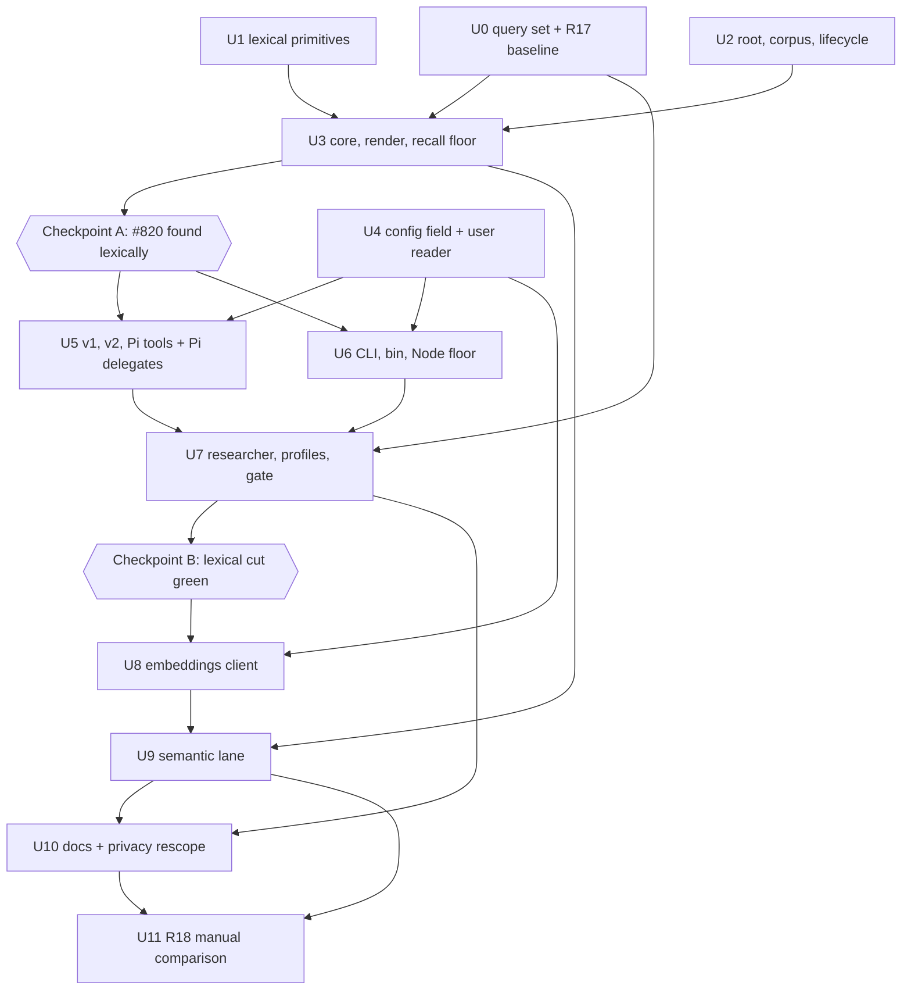
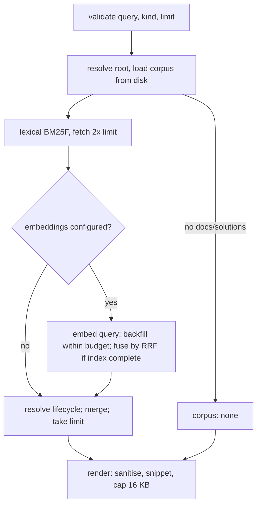

# feat: Search over Systematic's durable outputs

## Overview

Systematic writes learnings into `docs/solutions/`, and its workflows recover them through learnings-researcher, which greps four frontmatter keys and ranks nothing. This plan adds a search over those documents that runs on every surface Systematic supports: a `systematic_search` tool on OpenCode v1, OpenCode v2 and Pi, a `systematic-search` command on Claude Code's Bash path, and a `systematic search` CLI subcommand. learnings-researcher calls it first and keeps its grep path as the fallback.

The lexical lane is a pure TypeScript BM25F with no runtime dependency, and it gives byte-identical results on Bun and Node. A semantic lane joins when user-level config names an Ollama or OpenAI-compatible embeddings endpoint. The two lanes fuse by reciprocal rank.

Everything ships in one `feat` PR. The build order puts the lexical lane, every tool surface and the researcher first, behind two explicit checkpoints. The semantic lane starts only after the lexical cut passes all gates.

---

## Problem Frame

Issue #820 re-derived a root cause that a learning had already recorded three days earlier. The learning was tagged by its lesson, not by the symptom a searcher would type, and grep over `title`, `tags`, `module` and `component` never reached it. Only 53 of the 126 docs in this repo carry `symptoms`. The corpus is about 1 MB and growing, and user repos adopt the same convention through `ce:compound` and `compound-docs`.

Magic Context and AFT offer semantic search over their own stores, not over Systematic's outputs, and not on every harness. Systematic's search stands alone. The origin document carries the full frame (see origin: `docs/brainstorms/2026-10-29-durable-output-search-requirements.md`).

Marcus settled these points before planning (2026-10-29): the whole brainstorm ships in one PR; the lexical engine is a pure TypeScript BM25F; the Pi delegate gets the tool through `customTools`; the Node floor fix is folded in. They appear below as Key Technical Decisions.

---

## Requirements Trace

Requirements R1 to R18 and the acceptance examples are those of the origin document. R19 and R20 are plan-added from the same decisions.

**Search**
- R1. Search covers the host project's durable outputs. The root is the nearest ancestor holding `.git`, else the current directory. Release 1 indexes `docs/solutions/` only. (U2, U3)
- R2. Every document has a kind, and search takes an optional kind filter. Release 1 has one kind, `solution`. (U2, U3)
- R3. A lexical lane always runs with no setup, over frontmatter and body. Title, tags, module, symptoms, `applies_when`, component and problem type outrank body text. (U1, U3)
- R4. With an endpoint configured, a semantic lane also runs and the two rankings fuse. Each hit names its lanes and the result names the lanes that ran. (U3, U9)
- R5. Search follows the solution lifecycle: successor replaces superseded, stale carries a caution, a dangling or cyclic link does not resolve, malformed frontmatter is skipped with a named warning. (U2, U3)
- R6. Each hit shows path, title, kind, rank, matched lanes, snippet, module, tags and status. (U3)

**Embeddings and privacy**
- R7. Ollama and any OpenAI-compatible embeddings endpoint, on any host, with a user-chosen model. (U8)
- R8. Endpoint settings come from user-level config only, including `OPENCODE_CONFIG_DIR`. Project values are dropped with a warning. (U4)
- R9. The API key is read from an environment variable the user config names. It never appears in config output, logs, search output, failure notes or the cache. (U4, U8, U9)
- R10. Nothing leaves the machine unless an endpoint is configured. The privacy page and landing page scope their claims to the default setup and say a remote host is a third party. (U10)
- R11. Each embeddings call has a timeout and the first query has a total budget. Corpus embedding is lazy and resumable. Lexical results always return within the bound. (U9)
- R12. Endpoint failure returns lexical results with a note giving a fixed reason. The note never includes the URL, headers or body, and search never errors. (U8, U9)
- R13. Embeddings are cached outside the repository, keyed by content, model and vector size, readable only by the user, never mixed across models. (U9)

**Where it runs**
- R14. Search runs on every surface, and lexical results are identical across them with ties broken by path. (U5, U6)
- R15. learnings-researcher uses search first and falls back to its grep path. With no `docs/solutions/`, search reports so without erroring. (U3, U7)

**Quality**
- R16. A labelled query set of 15 to 20 queries, about five held out, runs against the lexical lane with a recall floor. (U0, U3)
- R17. The query set runs once through today's grep path as a recorded baseline. Manual. (U0)
- R18. With an endpoint, the same set compares lexical and hybrid per query. Manual. (U11)

**Plan-added**
- R19. The Node entry guard works on every supported Node, and `engines.node` states the verified floor. (U6)
- R20. Pi delegates can call `systematic_search`, and no other parent tool. (U5)

| Example | Covers | Verified in |
|---------|--------|-------------|
| AE1 | R4, R12 | U9: Ollama configured and unreachable gives lexical hits plus an unreachable note |
| AE2 | R8 | U4: a project `systematic.json` embeddings block is dropped with a warning; the user value, if any, is used |
| AE3 | R5 | U2 and U3: a superseded best match is replaced by its successor, labelled `Supersedes:` |
| AE4 | R15 | U3 and U7: a repo with no `docs/solutions/` returns `corpus: none`, and the researcher returns no matches |
| AE5 | R14 | U5 and U6: v1, v2, Pi, the bin and the CLI return the same hits in the same order |
| AE6 | R9, R12 | U8: a 401 gives a rejected-request note, and no output holds the key or the URL |

Flows: F1 (agent retrieves learnings) is covered by R1, R3, R5 and R14 in U3, U5 and U7. F2 (user searches directly) is covered by R2, R6 and R13 in U3 and U6.

---

## Scope Boundaries

- A local-model add-on package for offline semantic search is out.
- Indexing plans, brainstorms and ideation docs is out. The `kind` table is the seam for them.
- Review artifacts under `.context/` are out.
- MCP delivery and reranking are out.
- Using or depending on Magic Context or AFT is out.
- Changing the solution-doc frontmatter contract is out. `src/lib/frontmatter.ts` is not edited, because editing it regenerates four surfaces.
- Search offers no permission prompt on any surface.
- Cache-directory ownership checks, a negative cache for a down endpoint, and refusing `http` for a remote key are out and documented as unsupported (U10).
- Query vectors are never cached or written to disk.

### Deferred to Separate Tasks

- Plan, brainstorm and ideation kinds: a follow-up PR. Whether their frontmatter fits the kind contract is unresolved, because plans use `completed` and carry no `superseded_by`.
- Other skills calling search directly: not in release 1. They reach it through learnings-researcher.
- Converging `src/ce-review-validator.ts` onto the new shared main-module helper: it feeds a committed bundle, so a separate change.
- A camelCase splitter, `root_cause` as an indexed field, and stemming: considered only if the tune split shows a gain (U3).

---

## Context & Research

### Relevant Code and Patterns

- **Runtimes.** OpenCode v1, v2 and the CLI build with `bun build ... --target bun --splitting` and CI imports `dist` under Node 24. Pi builds with `--target node`. The Claude Code bin is `Bun.build({target:'node', minify})` of `src/claude-code-validator.ts`, with the shebang and mode `0o755` applied in `scripts/build-claude-code-plugin.ts`. `CLAUDE_CODE_VALIDATOR_BIN` is hard-coded and `generatePluginFiles` takes one Buffer.
- **Tool registration.** v1: the `tool:` map in `src/lib/opencode-v1.ts`, built by `src/lib/skill-tool.ts` (zod args, `execute(args, context)`). v2: `ctx.tool.transform` in `src/lib/opencode-v2-skills.ts` with a JSON-Schema `input`, `codemode:false`, and keyed installers in `src/lib/opencode-v2.ts`. Pi: `pi.registerTool` in `src/pi.ts`, with typebox parameters. The host truncates tool output at 51,200 bytes or 2,000 lines, and the restore path is keyed to `systematic_skill`, so search caps its own output.
- **Config.** `loadConfig` (v1), `loadConfigWithSources` (Pi at init, CLI) and `buildSnapshot` (v2) all read config once. Load order is user, custom (`OPENCODE_CONFIG_DIR`), project. `profiles` is the protected-field precedent: `collectProjectProtectedFields`, `stripProjectProtectedFields` and `emitTopLevelProtectedFieldWarning` in `src/lib/config.ts`, with the path list in the import-free `src/lib/config-protected-fields.ts`. `trustProtected()` in `src/lib/config-schema.ts` tags a field but enforces nothing.
- **Reusable.** `parseFrontmatter` (js-yaml JSON_SCHEMA, returns `parseError`), `walkDir` (readdir order, does not descend symlinked directories, `isDiscoverableMarkdown` skips README), `isRecord`, and the private `findGitWorktreeRoot` in `src/lib/discovered-skills.ts`.
- **Lifecycle spec.** `agents/research/learnings-researcher.md` Step 4 (5 hops, visited set, form rule, literal `Supersedes:`, `Caution:` and `Skipped:` lines). `scripts/content-integrity.ts` `classifySupersededBy` is stricter (no chains), resolves nothing and is not shippable.
- **Cache and fetch patterns.** `scripts/run-evals.ts` (mode `0o700` directory, temp file with `wx` and `0o600`, then rename). `docs/scripts/generate-release-notes.ts` and `scripts/release/gather-publish-facts.ts` (injectable `fetchImpl`, `AbortSignal.timeout`). Nothing in `src/` caches or fetches today.
- **Node precedent.** `tests/unit/claude-code-validator.test.ts` bundles with `Bun.build target node` and runs the result under `node` from a foreign temp dir. `src/ce-review-validator.ts` holds the realpath `isMainModule` guard.
- **Pi delegates.** `src/lib/pi-delegate-session.ts` passes `customTools: []` and loads with `noExtensions:true`. `src/lib/agent-resolver.ts` holds `DEFAULT_READONLY_TOOLS` and `OPENCODE_TO_PI_TOOL`. A custom tool is active only if its name is also in `tools`, and naming a tool with no definition does nothing and raises no error (Pi 1.4.0 `agent-session.js`).
- **Registration obligations.** Each new `src/lib` module needs an `ARCHITECTURE.md` codemap line and a `src/lib/AGENTS.md` row, keyed by basename. `bun scripts/content-integrity.ts` enforces both. Seven committed surfaces regenerate through `scripts/lib/generated-surfaces.ts`.

### Institutional Learnings

- `docs/solutions/best-practices/cross-harness-adapter-parity-contract-tests-2026-07-14.md`: test each adapter's observable results directly. A shared-core test does not prove parity. (U5, U6)
- `docs/solutions/integration-issues/cross-harness-tools-frontmatter-divergence-2026-08-16.md`: verify each host's real tool contract and prefer designs that do not depend on an agent obeying prose. (U5, U7)
- `docs/solutions/best-practices/entry-point-scope-decides-what-a-plugin-can-ship-2026-08-24.md`: a Claude Code bin must be a narrow self-contained entry, verified from a foreign cwd with no `node_modules`. Its "one bin" detail goes stale. (U6)
- `docs/solutions/best-practices/layered-trust-boundaries-overlay-config-2026-05-09.md`: protect endpoint fields at load time, before any mutation. Its throw example is stale, because current code strips and warns. (U4)
- `docs/solutions/best-practices/dependency-free-module-for-a-constant-shared-across-a-boundary-2026-09-20.md`: share the protected-path list through the import-free module. (U4)
- `docs/solutions/workflow-issues/registry-drift-on-skill-description-change-2026-05-20.md`: run `surfaces:affected --run`, then `surfaces:drift`. (U4, U6, U7)
- `docs/solutions/best-practices/typed-config-validation-build-time-codegen-2026-05-16.md`: keep the new field's runtime and schema in parity. (U4)
- `docs/solutions/test-failures/unit-suite-rewrites-repo-file-trap-2026-07-17.md`: tests write to temp copies and assert committed files unchanged. (U2, U6, U9)
- `docs/solutions/integration-issues/isolated-opencode-subprocess-fixtures-2026-05-14.md`: isolate HOME, XDG and caches, and test the packed package root. (U6, U9)
- `docs/solutions/workflow-issues/real-host-ci-catches-what-offline-gates-cannot-2026-09-06.md`: close stdin, use process groups and reap on timeout for spawned processes. (U1, U6)
- `docs/solutions/runtime-errors/circular-yaml-alias-aborts-content-integrity-report-2026-10-26.md`: parsed YAML can hold cyclic aliases. Never stringify an unnarrowed value. (U2)
- `docs/solutions/best-practices/lifecycle-validator-runs-only-in-ci-so-agent-prose-must-enforce-it-2026-10-26.md`: the researcher enforces successor form, existence and cycles. This doc goes stale when the researcher moves to search. (U7)
- `docs/solutions/documentation-gaps/index-learnings-by-symptom-not-only-by-lesson-2026-08-23.md`: index by symptom vocabulary. This is the #820 miss. (U0, U3)
- `docs/solutions/best-practices/unvalidated-artifact-contracts-have-no-conforming-producers-2026-08-23.md`: test the real producers and project diagnostics through an allowlist so untrusted content is never echoed. (U3, U8)
- Gaps: no learning covers the v1 golden pin, the privacy claims or the Node floor. Capture them with `ce:compound` after merge.

### External References

- BM25F: Robertson, Zaragoza and Taylor 2004 (doi 10.1145/1031171.1031181), Lucene `BM25Similarity`. BEIR (Thakur et al. 2021) on BM25 as a robust baseline.
- Reciprocal rank fusion: Cormack, Clarke and Büttcher, SIGIR 2009.
- Ollama `POST /api/embed` (`{model, input, truncate, dimensions?}` returns `{embeddings}`; 404 for an unknown model). OpenAI-compatible `POST /v1/embeddings` (`{model, input, dimensions?}` returns `{data:[{embedding,index}]}`; 2,048 inputs per request; Bearer auth). llama.cpp has ignored `dimensions` (issue #25210), so every response is length-checked.
- Chunking: split on headings, then paragraphs, at 300 to 400 tokens, with the title and heading breadcrumb prepended (Azure chunking guidance).
- Magic Context 0.49.25 and AFT 0.62.0, read as design references only.
- `Math.log` is implementation-approximated in ECMAScript. Measured on arm64 macOS: 5,750 of 80,600 IDF inputs differ in the last bit between Node 24.22.2 and Bun 1.4.4. A hand-written `ln` using only + − × ÷ was bit-identical on both. Linux x64 is unverified, and CI is the check.

---

## Prior-Art Survey

```json
{
  "schema_version": 2,
  "verdict": "extend",
  "scope": "src/ and scripts/ of the systematic package, worktree .worktrees/feat/durable-output-search; skills/*/scripts helpers listed, not read",
  "freshness": { "vcs_reference": "d3e2a3524c40cb7749532406f4a5fd298bcb26d2" },
  "budget": { "max_search_passes": 4, "max_candidate_inspections": 14, "exhausted": false },
  "candidates": [
    { "path_or_symbol": "src/lib/frontmatter.ts:parseFrontmatter", "description": "js-yaml JSON_SCHEMA frontmatter parser returning {data, body, hadFrontmatter, parseError}; parseError is the malformed-frontmatter signal.", "disposition": "reuse" },
    { "path_or_symbol": "src/lib/walk-dir.ts:walkDir", "description": "Synchronous recursive directory walker with depth and filter; readdir order, so callers must sort; isDiscoverableMarkdown skips README.md.", "disposition": "reuse" },
    { "path_or_symbol": "src/lib/discovered-skills.ts:findGitWorktreeRoot", "description": "Walks up to the first ancestor holding a .git entry, null otherwise, never throws; private today.", "disposition": "extend" },
    { "path_or_symbol": "src/lib/validation.ts:isRecord", "description": "Record type guard; needed to narrow frontmatter data.", "disposition": "reuse" },
    { "path_or_symbol": "agents/research/learnings-researcher.md (Steps 0, 3, 4)", "description": "Prose retrieval path; its Step 4 lifecycle rules are the behavioural spec (5 hops, repo-root form rule, visited set, Skipped and Caution lines).", "disposition": "extend" },
    { "path_or_symbol": "scripts/content-integrity.ts:checkSolutionLifecycle/classifySupersededBy", "description": "Gate that reports malformed superseded_by links; unexported, forbids chains, resolves nothing, unshipped.", "disposition": "insufficient", "insufficiency_reason": "Reports violations instead of resolving a successor; stricter than the researcher (no chains); cannot be imported from shipped src/." },
    { "path_or_symbol": "scripts/content-integrity.ts:findNearMissAgentStem", "description": "Suffix match of kebab-case identifiers against bundled agent stems.", "disposition": "insufficient", "insufficiency_reason": "Identifier suffix check, not a text ranker; no scoring or query model." },
    { "path_or_symbol": "src/lib/pi-delegate-tool.ts:compactText", "description": "Prefix truncation with ellipsis for tool descriptions; private.", "disposition": "insufficient", "insufficiency_reason": "Truncates from the start of text; no match-centred snippet extraction." },
    { "path_or_symbol": "src/lib/review-pipeline.ts:SEVERITY_RANK", "description": "Severity ordering with confidence, path, line and fingerprint tie-breaks for ce:review findings.", "disposition": "insufficient", "insufficiency_reason": "Domain-specific sort of structured findings; no free-text relevance scoring." },
    { "path_or_symbol": "src/lib/skill-catalog.ts:buildCatalogEntries", "description": "Name-sorted listing of bundled skills for tool descriptions; no query input.", "disposition": "insufficient", "insufficiency_reason": "Name-sorted listing of skills only; no query, scoring or docs/solutions corpus." },
    { "path_or_symbol": "src/lib/skills.ts:findSkillsInDir", "description": "Frontmatter indexing of SKILL.md files into SkillInfo records, depth 3.", "disposition": "insufficient", "insufficiency_reason": "Skill-specific schema; indexes name and description only, with no tokenising or scoring." },
    { "path_or_symbol": "src/lib/skill-tool.ts + src/lib/opencode-v2-skills.ts + src/pi.ts (systematic_skill registration)", "description": "Per-host tool registration for v1, v2 and Pi over a shared core; the pattern to follow for a search tool.", "disposition": "extend" },
    { "path_or_symbol": "src/ce-review-validator.ts + scripts/generate-ce-review-validator.ts + skills/ce-review/scripts/validate-review.mjs", "description": "Skill-local Node shim: narrow-entry bundle committed under skills/, invoked via SKILL_DIR on every surface, with provenance drift check and a realpath isMainModule guard.", "disposition": "extend" },
    { "path_or_symbol": "src/claude-code-validator.ts + scripts/build-claude-code-plugin.ts:buildValidatorBundle/generatePluginFiles", "description": "Single Claude Code bin built as a node-target bundle with prepended shebang and 0o755 write; one hard-coded bin name and Buffer.", "disposition": "extend" }
  ],
  "excluded_scopes": [
    { "scope": "docs/scripts and docs/src (Astro workspace)", "reason": "Site generators; only their fetch-with-timeout pattern was read." },
    { "scope": "skills/*/scripts/*.mjs helpers", "reason": "Listed for delivery precedent only; contents not searched for ranking." },
    { "scope": "tests/, evals/, tests/fixtures/config-corpus", "reason": "Searched for Node-subprocess precedent only." },
    { "scope": ".slim/clonedeps/repos", "reason": "Third-party source, not project code." }
  ]
}
```

---

## Key Technical Decisions

Decisions carried from the origin: lexical always, embeddings through an endpoint, a local model later as an add-on; a pure TypeScript BM25 because `bun:sqlite` does not load on Node surfaces and `node:sqlite` needs Node 22; widening the researcher's grep was rejected; solutions first with kinds in the design; every surface ships in release 1; any endpoint host, user config only, key by environment variable; held-out queries and a grep baseline, not a proof gate; no committed index. The rest were settled with Marcus on 2026-10-29 or by this plan.

**Lexical lane**
- **Scoring.** BM25F over eight fields: title, tags, module, symptoms, `applies_when`, component, problem type, body. Per field, a length-normalised weighted term frequency (`w_f · tf / (1 − b_f + b_f · len/avglen)`) is summed across fields, then saturated with `k1`. IDF is `ln(1 + (N − df + 0.5)/(df + 0.5))`, with `df` counted over docs where the term appears in any field.
- **Starting values** (tuned on the tune split only): weights title 3, symptoms 3, tags 2.5, `applies_when` 2, module 2, component 1.5, problem type 1.5, body 1. `b` is 0 for metadata fields and 0.75 for body. `k1` is 1.2.
- **Tokenizer.** `toLowerCase`, then ASCII `[a-z0-9]` runs. A run joined by `_` or `-` also emits the whole joined identifier, so `foo_bar` yields `foo_bar`, `foo` and `bar`, and `a-perfect-measurement` yields the whole slug plus three components. Every other character splits (`src/lib/x.ts` yields `src`, `lib`, `x`, `ts`). No stemming, no stopwords, no camelCase split. A non-ASCII letter splits a word, which is a documented limit.
- **Query terms.** Unique tokens in first-seen order, truncated to 64 with a note, then sorted by code unit before summation.
- **Determinism.** A hand-written `ln` uses only + − × ÷. `Math.log`, `Math.pow`, `**`, `exp`, `Intl`, `localeCompare` and `toLocale*` are banned in the search modules, as are `Bun.` and `bun:`. Summation order is fixed: sorted unique terms, then fixed field order. Ties break on the code-unit order of the root-relative path, and rank is the final position. A Bun-vs-Node test compares float64 bit patterns.
- **Why not `Math.log`.** ECMAScript leaves it implementation-approximated, and the two runtimes disagree on 7% of measured inputs. Rounding scores does not prove identical order.

**Corpus**
- **Root.** The nearest ancestor holding `.git` (file or directory), resolved with `realpath`, else the start directory. The helper moves to a new import-free `src/lib/project-root.ts`, and `discovered-skills.ts` imports it. Importing `discovered-skills.ts` would drag its dependencies into the Claude Code bin.
- **Files.** Only `docs/solutions/` directly under the root, read from disk on every call with no memo, because `ce:compound` searches right after it writes. Symlinks are skipped via `lstat`. Caps: 256 KB per file, 2,000 files, `maxDepth` 6, and (plan-added) 32 MB in aggregate. Excluded: README, `_archived/`, `critical-patterns.md`. Paths are root-relative with `/`.
- **Parsing.** A wrapper around `parseFrontmatter` strips a leading BOM and supplies the newline the regex needs at end of file. It reads only known fields, narrows each (`isRecord`, string, array of strings), and never stringifies an unnarrowed value. No frontmatter means body-only with no warning. A `parseError` skips the doc with a warning naming it.
- **Kinds.** A `kind` table with one entry, `solution`, carries the directory, the exclusions and whether lifecycle applies.

**Lifecycle**
- **Rules.** The researcher's, not content-integrity's: at most 5 hops, a visited set, and the form rule (`docs/solutions/…md`, no `..`, no README, not under `_archived/`, the file exists in the loaded corpus). Existence means the doc was loaded, so a skipped or oversize successor is unresolvable.
- **Mechanics.** Fetch about twice the limit before resolving. A successor takes the best rank among itself and the docs it replaces. Duplicates merge and `Supersedes:` lists every replaced path. Superseded docs stay indexed so they can match.
- **Unresolvable chain.** The doc is omitted and `Skipped: superseded, successor unresolved: <path>` is emitted. This follows the researcher and narrows R5's "returns the matched doc with a caution" (see Open Questions).
- **Drift guard.** `src/lib/search-lifecycle.ts` exports the hop cap, the path prefix and the three literal labels. A content-integrity check asserts the researcher prose contains each. A fixture corpus pins the behaviour.

**Output**
- Default 8 hits, max 20. Snippet at most 240 characters on one line, centred on the densest window of query terms. Title at most 160. At most 8 tags. At most 5 warnings plus `+N more`.
- Hard cap 16 KB with a UTF-8-safe cut and Systematic's own marker. Query at most 2,000 characters. Empty queries and unknown kinds return fixed error text. Control and ANSI sequences are stripped from everything echoed.
- The result header separates `corpus: none` from `N docs, 0 hits` and lists the lanes that ran.

**Config**
- One top-level `search: { enabled?, embeddings? }`, protected as a whole: stripped from project config with a warning, merged from user and custom only. `enabled` takes the last defining source. `embeddings` is replaced whole by the last defining source.
- `embeddings` fields: `provider` (`ollama` or `openai-compatible`), `base_url` (SDK-style root), `model`, `dimensions?`, `api_key_env?`, `query_prefix?`, `document_prefix?`, `timeout_ms?`, `first_query_budget_ms?`.
- The schema checks shape only, including the `api_key_env` pattern. URL semantics (scheme, no userinfo, query or fragment) are checked at use time and give a fixed note.
- `search.enabled: false` removes the tool from v1, v2 and Pi without a note. The CLI and bin print `disabled` and exit 0. The researcher then falls back to grep.
- Hosts snapshot config at init, so changing the endpoint needs a restart. U10 documents this.

**Claude Code bin**
- `systematic-search`, built from `src/claude-code-search.ts`. It reads only user-level `systematic.{jsonc,json}`: `$OPENCODE_CONFIG_DIR` first, then `~/.config/opencode`. It parses JSONC through jsonc-parser's ESM build (`jsonc-parser/lib/esm/main.js`) via a `Bun.build` `onResolve` alias, because the UMD build crashes when bundled from a foreign directory (reproduced).
- A parity test compares the reader with `loadConfigWithSources` over the config corpus. The bin cannot emit the AE2 project-config warning, and that asymmetry is accepted.

**Surfaces**
- Tool name `systematic_search`, arguments `query` (required), `kind` (optional, `solution`), `limit` (optional, 1 to 20).
- Start directory: Pi uses per-call `ctx.cwd`. v1 uses `context.directory` if present, else the init directory (verify the field). v2 uses `ctx.location?.directory` and returns a no-project note when undefined. The CLI and bin use `--dir` or the cwd.
- An adapter parity contract test drives each adapter's real entry over one fixture corpus and compares rendered text.

**Pi delegates**
- `systematic_search` joins `DEFAULT_READONLY_TOOLS` and `OPENCODE_TO_PI_TOOL`, and the delegate passes the one shared definition through `customTools`. A persona with an explicit `tools:` list gets search only if it names it. The parent's other tools never pass. `promptSnippet` stays short.

**Researcher**
- Detection: OpenCode and Pi check whether `systematic_search` is in the tool list. Claude Code probes with `command -v systematic-search`. Step 3b (critical patterns) is unchanged.
- After a zero-hit search where the corpus exists, the researcher runs one grep pass with synonyms, since there is no stemming.
- In overlap mode the search score never maps to High, Moderate or Low, and the doc under comparison is dropped from results.

**Semantic lane**
- Chunk by headings, then paragraphs, at about 300 to 400 tokens, with the title and heading breadcrumb prepended. A doc scores the max over its chunks, and candidates are capped at the top 20 by cosine.
- Fuse with RRF at `k = 60`. A lane that misses a doc contributes nothing. Vectors are stored as Float32, fresh vectors pass through `Math.fround`, and all are pre-normalised. Zero, NaN and Infinity vectors are rejected.
- The lane contributes only when every indexable doc has valid vectors. Otherwise the result is lexical plus a `semantic index N/M` note.
- The query embeds first, then the backfill runs inside the remaining budget and persists per batch. `--warm` on the CLI and bin runs the full backfill with progress on stderr.
- Transport: `fetch` with `AbortSignal.timeout`, an injectable `fetchImpl`, `redirect:'error'` and a response cap of about 32 MB. The whole batch is validated: count, unique indices, uniform dimensions equal to the header.
- Starting values, unmeasured: `timeout_ms` 8,000, `first_query_budget_ms` 20,000, 32 chunks per request. U11 revisits them against a real endpoint.
- Cache: one file per hash of content, chunker version, model, dimensions, prefixes and a hash of provider plus `base_url`. Directory `$XDG_CACHE_HOME/systematic/embeddings/` when that is an absolute path, else `~/.cache/systematic/embeddings/`. Written as a temp file with `wx` and `0600`, then renamed, in a `0700` directory. A header (magic, version, dimension, count) and an exact length make any mismatch a miss. An in-process single-flight map stops duplicate embedding. Pruning is by age (30 days, bumped on hit), because the cache is shared across repos and worktrees.
- Failure notes use fixed reasons only: unreachable, timeout, unknown model, HTTP status, vector size mismatch, malformed response, key missing, config unreadable, invalid endpoint. The 401 and 403 text says the endpoint rejected the request. Nothing from `fetch`'s `error.message`, the URL, headers or body is surfaced. `api_key_env` is never echoed. If it is unset or empty, no key is sent and a distinct note says so.

**Quality**
- `tests/fixtures/search-queries.json` holds 15 to 20 queries shaped `{id, query, relevant[], split, lexical_reachable}`, phrased from symptoms or issue text, not titles. About five are held out, and #820 is one. At least two are `lexical_reachable: false` so R18's win condition is testable.
- The floor counts queries with at least one relevant path in the top 5, over the `lexical_reachable: true` queries, as an integer: the first measured value minus 1. It is reported per split. Tuning reads the tune split only.
- R17: one run of the unmodified researcher per query by a single subagent, before the researcher is edited. Results land in `tests/fixtures/search-baseline-grep.json` with model, commit, date and returned paths. It is not CI.

**Node floor**
- A shared `src/lib/main-module.ts` holds the realpath guard, used by `src/cli.ts`, `src/claude-code-validator.ts` and the new bin. `src/ce-review-validator.ts` keeps its own copy, because it feeds a committed bundle. `package.json` `engines.node` rises to the floor U6 verifies, probably `>=20.11` for `import.meta.dirname`.

---

## Open Questions

### Resolved During Planning

- Chunking (origin, R4 and R13): headings first, then paragraphs, 300 to 400 tokens, breadcrumb prepended.
- Fusion (origin, R4): RRF with `k = 60`, gated on full index coverage.
- Timeout and budget values (origin, R11): starting values set in Key Technical Decisions. Measurement is U11.
- Tool name and shape (origin, R14): `systematic_search(query, kind?, limit?)`, switchable off with `search.enabled: false`.
- Cache location and pruning (origin, R13): the XDG cache path above, pruned by age, not by corpus membership.
- Recall floor (origin, R16): the integer first measured value minus 1, set in U3.
- Researcher detection (origin, R15): tool-list check on OpenCode and Pi, `command -v` on Claude Code.
- Other skills calling search (origin, R15): no, not in release 1.
- Plans, brainstorms and ideation as kinds (origin, R2): not researched here. The `kind` table is the seam, and the follow-up owns the frontmatter fit.
- Pi researcher: without `customTools` a delegate cannot call a registered tool, so U5 passes the shared definition and the researcher detects it by tool list.
- Hyphens and underscores: a joined run emits the whole identifier plus its components.
- Where the shared root helper lives: a new `src/lib/project-root.ts`, so the bin bundle stays small.

### Deferred to Implementation

- The exact field name that v1's `ToolContext` uses for the project directory. U5 reads the installed plugin types and falls back to the init directory.
- Whether v2 `permission.assert` is needed for a read-only tool. The decision is no prompt, and U5 confirms the host does not require one.
- Whether the `onResolve` alias builds a bin that runs from a foreign directory. It was not tested end to end; U6 proves it.
- Linux x64 `Math.log` behaviour. The hand-written `ln` makes it moot, and the first CI run is the check.
- The #820 issue text that seeds the held-out query. U0 reads it from the issue.
- Whether a symlinked file under `docs/solutions/` needs an explicit `lstat` filter or `walkDir` already hides it. U2 tests both.
- Exact tuned weights. U3 sets them from the tune split.

### Needs Marcus

- **Dangling and cyclic links.** R5 says such a link "returns the matched doc with a caution". The researcher omits the doc and emits `Skipped:`. Marcus's lifecycle decision (2026-10-29) says follow the researcher, so this plan omits the doc and emits `Skipped:`, which names it. If R5's wording must stand, U2 returns the matched doc with a `Caution:` instead and the researcher prose changes to match.
- **Release workflow guard.** `.github/workflows/publish-claude-code-plugin.yaml` and its test list `claude-code/bin/systematic-validate-review-artifact` as a required artifact. The new bin needs the same guard, which edits a release workflow and is ask-first. U6 asserts the bin in the build tests and leaves the workflow alone until Marcus approves.

---

## High-Level Technical Design

> *This illustrates the intended approach and is directional guidance for review, not implementation specification. The implementing agent should treat it as context, not code to reproduce.*

Unit dependencies. The two checkpoints gate the lexical cut before any semantic work.



One search call, as the core sees it:



Result header and hit shape (directional; the exact wording is fixed in U3):

```text
Search "<query>": 126 docs, 5 hits. Lanes: lexical. Corpus: docs/solutions.
Notes: semantic lane unreachable.

1. docs/solutions/best-practices/example-2026-08-16.md
   Title: ... | Kind: solution | Status: active | Lanes: lexical
   Module: ... | Tags: a, b
   Snippet: ...
   Supersedes: docs/solutions/...
   Caution: ...
Skipped: superseded, successor unresolved: docs/solutions/...
```

---

## Output Structure

    src/lib/
      project-root.ts          findGitWorktreeRoot, resolveProjectRoot
      main-module.ts           realpath entry guard
      search-lexical.ts        tokenizer, ln, BM25F
      search-corpus.ts         kinds table, loader, frontmatter wrapper
      search-lifecycle.ts      lifecycle constants and resolver
      search-render.ts         sanitise, snippet, caps, truncation marker
      search-core.ts           query validation, lanes, fusion, result
      search-user-config.ts    SearchSettings shape, narrow user-level reader
      search-tool.ts           tool name, description, args, shared execute
      search-embeddings.ts     endpoint client and fixed failure notes
      search-semantic.ts       chunking, vectors, RRF, cache, backfill
      search-cli.ts            runSearchCli
      opencode-v2-search.ts    v2 installer
      pi-search-tool.ts        Pi tool definition shared with delegates
    src/claude-code-search.ts  narrow bin entry
    tests/fixtures/search-queries.json, search-baseline-grep.json
    tests/fixtures/search-corpus/   lifecycle and hostile-doc fixtures
    docs/src/content/docs/guides/search.mdx

The per-unit `Files` lists are authoritative. Five deep modules carry the design (lexical, corpus with lifecycle, core with render, embeddings, semantic). The rest are thin adapters.

---

## Implementation Units

Phase A is the quality harness (U0). Phase B is the lexical lane (U1 to U3), ending at Checkpoint A. Phase C is config and every surface (U4 to U7), ending at Checkpoint B. Phase D is the semantic lane (U8 to U9). Phase E is docs and the manual comparison (U10, U11).

Every unit that adds a `src/lib` module also adds its `ARCHITECTURE.md` codemap line and its `src/lib/AGENTS.md` row, and verifies them with `bun scripts/content-integrity.ts`. Every unit ends with `bun run surfaces:affected --run` and, from U4 on, `bun run surfaces:drift`.

- [ ] U0. Query set and R17 grep baseline

**Goal:** Commit the labelled query set and the recorded grep baseline, before any edit to the researcher.

**Requirements:** R16, R17

**Dependencies:** None

**Files:**
- Create: `tests/fixtures/search-queries.json`
- Create: `tests/fixtures/search-baseline-grep.json`
- Test: `tests/unit/search-queries.test.ts`

**Approach:**
- Read issue #820 and the target `docs/solutions/best-practices/a-perfect-measurement-means-a-broken-instrument-2026-08-16.md`. Phrase the held-out query from the issue's symptom text, not the doc's title.
- Author 15 to 20 queries from the `symptoms`, root causes and issue-style wording of `docs/solutions/`. Author blind to any ranker, since none exists yet. Fix the splits up front: about five `heldout` including #820, the rest `tune`. At least two are `lexical_reachable: false`, whose answers share no key terms with the query.
- Keep the draft fixture outside the repo (a gitignored scratch path) until the baseline run ends, so the researcher cannot read labels.
- One subagent runs the unmodified learnings-researcher once per query, receiving only the query text as the problem description, in this worktree at the pinned commit. Record the returned paths in the researcher's listed order.
- Score the baseline with the same metric as U3 (queries with at least one relevant path in the first 5). Write model, commit, date, per-query returned paths and per-split counts to `tests/fixtures/search-baseline-grep.json`. Then move the fixture into `tests/fixtures/`.

**Execution note:** The baseline run is manual and single-shot. Do not re-run it to improve numbers.

**Patterns to follow:**
- `docs/scripts/generate-release-notes.ts` style of small committed JSON fixtures; the fixture shape check mirrors the `tests/unit/config-corpus.test.ts` approach of validating a committed corpus.

**Test scenarios:**
- Happy path: the fixture parses; has 15 to 20 entries, unique ids, `split` in {tune, heldout}, 4 to 6 held out, and includes the #820 query.
- Happy path: the baseline file has one entry per query id, plus model, commit, date and per-split counts.
- Edge case: every `relevant` path exists, lies under `docs/solutions/`, and is neither a README nor under `_archived/`.
- Edge case: for each `lexical_reachable: true` query, some relevant doc's text contains at least one query token of 3 or more characters. At least two entries are `false`.
- Error path: the validator rejects a duplicate id, an unknown split, an empty `relevant` list and a missing path (checked on synthetic inputs).

**Verification:**
- Both files are committed, and the baseline commit precedes any change to `agents/research/learnings-researcher.md`.
- The #820 query is `heldout` and its target is labelled relevant.

- [ ] U1. Lexical primitives and the determinism harness

**Goal:** A dependency-free tokenizer, natural log and BM25F scorer that return bit-identical scores on Bun and Node.

**Requirements:** R3, R14

**Dependencies:** None

**Files:**
- Create: `src/lib/search-lexical.ts`
- Test: `tests/unit/search-lexical.test.ts`
- Test: `tests/unit/search-determinism.test.ts`
- Modify: `ARCHITECTURE.md`, `src/lib/AGENTS.md`

**Approach:**
- The module is pure: no I/O, no environment reads, no imports beyond types. It exposes the tokenizer, `ln`, index construction over documents with named fields, and scoring that returns a per-document score for a set of unique query terms.
- `ln` uses only + − × ÷: scale the argument by exact powers of two into a narrow range, then sum an atanh series with a literal `ln 2` constant. Target relative error near 1e-15.
- Summation order is fixed: sorted unique terms, then the fixed field order. Starting weights and `k1`, `b` are the Key Technical Decisions values, exported as one constant table so U3 can tune them in one place.
- The determinism test bundles the module plus a tiny harness entry with `Bun.build` `target: 'node'`, runs it under `node` from a foreign temp directory, and compares float64 bit patterns (as hex) against an in-process run. It follows `tests/unit/claude-code-validator.test.ts`. It fails, not skips, when `node` is missing.
- A guard test scans `src/lib/search-*.ts` and `src/claude-code-search.ts` for `Math.log`, `Math.pow`, `**`, `exp`, `Intl`, `localeCompare`, `toLocale*`, `Bun.` and `bun:`, with comments stripped.

**Execution note:** Test-first for the tokenizer table and the bit-pattern comparison.

**Patterns to follow:**
- `tests/unit/claude-code-validator.test.ts` for the foreign-directory Node run. Close stdin and bound the spawn with a timeout (`docs/solutions/workflow-issues/real-host-ci-catches-what-offline-gates-cannot-2026-09-06.md`).

**Test scenarios:**
- Happy path: `foo_bar` yields `foo_bar`, `foo`, `bar`. `A-Perfect-Measurement` yields the whole slug plus three components. `src/lib/x.ts` yields `src`, `lib`, `x`, `ts`. `v2` stays one token.
- Edge case: empty and whitespace-only input yield no tokens. `_x-` yields `x`. `a__b` yields `a__b`, `a`, `b`. `naïve` yields `na`, `ve`. A 100 KB single token does not hang.
- Happy path: `ln` matches `Math.log` to within 1e-15 relative error across the IDF input range (about 0.5 to 5,000), is exactly 0 at 1, and is monotonic on a dense sweep.
- Happy path: a term in the title outranks the same term once in the body. A rarer term scores above a common one. A longer body lowers the score for equal term counts.
- Edge case: an empty corpus, a one-document corpus and a query term in no document score without error and without NaN.
- Edge case: permuting the query terms gives bit-identical scores. Equal scores order by code-unit path, so `Z.md` sorts before `a.md`.
- Integration: the Node-bundle bit patterns equal the Bun run on a fixed corpus and query set.
- Error path: the guard test flags a synthetic source that calls `Math.log`, and passes the real modules.

**Verification:**
- The bit-pattern test passes locally on arm64 macOS, and CI on Linux x64 is the cross-platform check.
- The guard test passes on every `search-*` module present at this point, and later units keep it green.
- The codemap and AGENTS row exist; `bun scripts/content-integrity.ts` is clean.

- [ ] U2. Project root, corpus loader and lifecycle resolver

**Goal:** Resolve the project root, load `docs/solutions/` safely from disk, and resolve supersession exactly as the researcher does.

**Requirements:** R1, R2, R5

**Dependencies:** None

**Files:**
- Create: `src/lib/project-root.ts`, `src/lib/search-corpus.ts`, `src/lib/search-lifecycle.ts`
- Modify: `src/lib/discovered-skills.ts` (import the moved helper)
- Test: `tests/unit/project-root.test.ts`, `tests/unit/search-corpus.test.ts`, `tests/unit/search-lifecycle.test.ts`
- Create: `tests/fixtures/search-corpus/` (lifecycle chains and hostile docs)
- Modify: `ARCHITECTURE.md`, `src/lib/AGENTS.md`

**Approach:**
- `project-root.ts` holds the moved `findGitWorktreeRoot` and `resolveProjectRoot` (realpath, falling back to the start directory). `discovered-skills.ts` imports it and its tests stay green.
- `search-corpus.ts` holds the `kind` table, the loader and the frontmatter wrapper described in Key Technical Decisions. It uses `walkDir` with `maxDepth` 6, sorts by relative path in code-unit order, applies the caps, and returns documents plus bounded, sanitised warnings. It never throws.
- `search-lifecycle.ts` exports the hop cap, the `docs/solutions/` prefix and the `Supersedes:`, `Caution:` and `Skipped: superseded, successor unresolved:` labels, and a resolver over a ranked list and the loaded corpus.

**Execution note:** Characterization-first for `discovered-skills.ts`: run its existing tests before and after the move.

**Patterns to follow:**
- `agents/research/learnings-researcher.md` Step 4 as the behavioural spec. `src/lib/walk-dir.ts` and `src/lib/validation.ts` for walking and narrowing.

**Test scenarios:**
- Happy path: a start directory two levels below a `.git` directory, and below a `.git` file (worktree), resolves to that ancestor. A start directory with no ancestor `.git` resolves to itself.
- Edge case: a symlinked start directory resolves through `realpath` (macOS `/var` to `/private/var`). Paths are root-relative with `/`.
- Happy path: the loader returns docs sorted by code-unit path, excludes README, `_archived/` and `critical-patterns.md`, and ignores files deeper than 6 levels.
- Edge case: a symlinked file is skipped, and a symlinked directory is not descended. A 256 KB + 1 file is skipped with a warning. The 2,001st file and the aggregate 32 MB cap each stop loading with one warning.
- Edge case: no frontmatter indexes body-only with no warning. A BOM, and a closing `---` at end of file with no newline, still parse.
- Error path: invalid YAML skips the doc with a warning naming its path. `tags: &t [*t]` (cyclic alias) and non-string tag entries do not crash and are never stringified. A control character in a title is stripped from the warning.
- Happy path: AE3 chain A to B where B is active resolves to B with A in `Supersedes:`. A 5-hop chain resolves. A 6-hop chain does not.
- Error path: a cycle, a self link, a missing file, `../x.md`, an absolute path, a README, an `_archived/` path, a bare filename, a list value, an empty value, and a successor skipped by the loader each emit `Skipped: superseded, successor unresolved: <path>` and omit the doc.
- Edge case: a stale doc yields a `Caution:` carrying its sanitised, truncated `stale_reason`. An unrecognised status counts as active.
- Integration: two superseded docs sharing a successor merge into one entry whose `Supersedes:` lists both in path order. The merged rank is the best of the successor and the replaced docs.
- Integration: the exported constants equal the literals in `agents/research/learnings-researcher.md` (the same assertion U7's gate makes).

**Verification:**
- `discovered-skills` tests are unchanged and green. The corpus loader runs over this repo's real `docs/solutions/` with no warnings.
- Registration lines exist and `bun scripts/content-integrity.ts` is clean.

---

- [ ] U3. Search core, renderer and recall floor (Checkpoint A)

**Goal:** One `search` function and one renderer that every surface calls, with the lexical lane tuned against the query set.

**Requirements:** R1, R2, R3, R5, R6, R15, R16

**Dependencies:** U0, U1, U2

**Files:**
- Create: `src/lib/search-render.ts`, `src/lib/search-core.ts`
- Test: `tests/unit/search-render.test.ts`, `tests/unit/search-core.test.ts`, `tests/unit/search-recall.test.ts`
- Modify: `src/lib/search-lexical.ts` (tuned constants only), `ARCHITECTURE.md`, `src/lib/AGENTS.md`

**Approach:**
- The core validates the query, kind and limit, resolves the root, loads the corpus, builds the index, scores, sorts by score then path, takes about twice the limit, resolves the lifecycle, and truncates to the limit. A hit needs a score above zero.
- It returns a structured result: hits, lanes that ran, notes, warnings and a corpus state of `none` (no `docs/solutions/`), `empty` (the directory holds no indexable docs) or `docs` (N docs, M hits). The renderer turns the result into text. Adapters never format text themselves.
- The core accepts an optional injected semantic stage, absent until U9. Lanes read `lexical` alone until then.
- The renderer owns sanitisation, field caps, the snippet window, the warning cap and the 16 KB cut with Systematic's own marker. The snippet picks the window with the most distinct query terms (integer counts), earliest on a tie, and falls back to the symptoms or title when the body has no match.
- Limit below 1 or non-numeric falls back to 8, and above 20 clamps to 20. Over-long queries and unknown kinds return fixed error text.
- Tuning: weights and `k1`, `b` move only to improve the tune split. The recall test measures the found count on the `lexical_reachable: true` queries per split, prints both, and asserts the integer floor (the first measured value minus 1). A header comment says to re-measure on purpose if corpus growth trips it.

**Checkpoint A (#820).** After the recall test passes, check the held-out #820 query. The target must appear in the top 5 with no endpoint configured.
- If it does, continue to U5 and U6.
- If it does not, stop. Retune global parameters (field weights, `b`, `k1`) judged on the tune split only, then re-check #820. A tokenizer change (camelCase split, `root_cause` as a field) is allowed only if it improves the tune split too.
- After two retune rounds without success, stop and report to Marcus. Do not tune against the held-out query itself.

**Patterns to follow:**
- `docs/solutions/best-practices/unvalidated-artifact-contracts-have-no-conforming-producers-2026-08-23.md` for allowlist projection of untrusted text.

**Test scenarios:**
- Happy path: a query matching a doc's title ranks it first. A symptoms-only match surfaces the doc. Each hit carries path, title, kind, 1-based rank, lanes, snippet, module, tags and status.
- Happy path: AE3, a superseded best match is replaced by its successor with `Supersedes:`. A stale hit carries `Caution:`. An unresolvable chain yields a `Skipped:` line.
- Edge case: over-fetch keeps the result at `limit` hits when merging collapses duplicates. A doc that loses a merge never appears twice.
- Edge case: AE4, no `docs/solutions/` renders `corpus: none`. An empty directory renders 0 docs. A populated corpus with no matching term renders `N docs, 0 hits`. The three texts differ.
- Error path: an empty or whitespace query, a query over 2,000 characters and an unknown kind return their fixed errors. A 70-term query is cut to 64 terms with a note. Limit 0, `"x"` and 50 follow the rules above.
- Edge case: control characters, `\r`, NUL and ANSI escapes in the title, tags, module, status, warnings and the echoed query are stripped. Title over 160, tags over 8, snippet over 240 and warnings over 5 (plus `+N more`) are all capped.
- Edge case: 20 hits with long metadata exceed 16 KB, and the output ends in the marker, stays at or under 16,384 bytes and is valid UTF-8 even when a multibyte character straddles the cut.
- Edge case: shuffling the corpus load order, or running the core twice, yields identical text. Ties order by code-unit path.
- Integration: a doc written between two calls appears in the second (no memo).
- Integration: the recall test over the live `docs/solutions/` meets the floor on the tune and held-out splits and prints the grep baseline beside them.

**Verification:**
- Checkpoint A is recorded as passed, with the measured per-split counts, in the PR description.
- The renderer never emits more than 16,384 bytes. `bun scripts/content-integrity.ts` is clean.

- [ ] U4. The `search` config field and the user-level reader

**Goal:** A protected top-level `search` field, merged from user and custom config only, plus a narrow reader that the Claude Code bin can bundle.

**Requirements:** R8, R9, R10 (config half)

**Dependencies:** None

**Files:**
- Create: `src/lib/search-user-config.ts`, `tests/unit/search-user-config.test.ts`
- Modify: `src/lib/config-schema.ts`, `src/lib/config-protected-fields.ts`, `src/lib/config.ts`, `docs/scripts/generate-config-reference.ts` (`TOP_LEVEL_KEYS`), `src/lib/capability-snapshot.ts` if it serialises config
- Modify (tests): `tests/unit/config-schema.test.ts`, `tests/unit/config.test.ts`, `tests/unit/capability-snapshot.test.ts`
- Create: `tests/fixtures/config-corpus/` entries for `search` cases
- Regenerate: `docs/public/schemas/v*/systematic-config.schema.json`, `docs/src/content/docs/reference/configuration.mdx`
- Modify: `ARCHITECTURE.md`, `src/lib/AGENTS.md`

**Approach:**
- The five edits: add the field to `createSystematicConfigSchema` with `.meta` and `trustProtected`; add `search` to `CONFIG_PROTECTED_FIELD_PATHS`; in `config.ts` extend the interface, `DEFAULT_CONFIG`, `PROJECT_ALWAYS_PROTECTED_FIELDS`, collect and strip, the top-level warning call, and the merge (user then custom only; `enabled` last-wins, `embeddings` replaced whole); add `search` to `TOP_LEVEL_KEYS`; regenerate surfaces.
- The strip runs before `safeParse`, so a malformed project `search` cannot fail the load. The warning names the field, never a value, and passes through `sanitizeDiagnosticText`.
- The schema checks shape only: provider enum, strings, positive integer `dimensions`, bounded `timeout_ms` (500 to 60,000) and `first_query_budget_ms` (500 to 120,000), and `api_key_env` against `^[A-Za-z_][A-Za-z0-9_]*$`. URL semantics wait for use time (U8).
- `search-user-config.ts` exports the settings shape and a hand narrower with no zod. It reads `$OPENCODE_CONFIG_DIR/systematic.{jsonc,json}` first, then `~/.config/opencode/systematic.{jsonc,json}`, with the same precedence as the loader. It never reads project config. An unparseable file, or a schema-invalid `search` block, returns an `unreadable` state that U8 turns into the `config unreadable` note.
- The capability snapshot prints `search.enabled` and, for embeddings, provider, model, dimensions and the `base_url` origin only, never userinfo.

**Patterns to follow:**
- The `profiles` handling in `src/lib/config.ts` and `src/lib/config-protected-fields.ts`. `docs/solutions/best-practices/layered-trust-boundaries-overlay-config-2026-05-09.md`.

**Test scenarios:**
- Happy path: a user config with `search.embeddings` loads and merges. `enabled: false` in user config survives into the merged config.
- Happy path: AE2, a project `systematic.json` with an embeddings block is stripped with one warning. The user value, if present, is used.
- Edge case: a project `search` that is malformed (a string, an array) is stripped and the load succeeds. A project `search: {enabled: false}` is stripped too, so a collaborator cannot disable the user's search.
- Edge case: custom `OPENCODE_CONFIG_DIR` overrides user `enabled`, and its `embeddings` replaces the user's wholesale.
- Error path: the schema rejects an unknown provider, `api_key_env` of `1BAD`, `A B` and `$X`, a non-integer `dimensions`, and out-of-range timeouts.
- Edge case: the warning and the capability snapshot never contain a `base_url` userinfo, a query string or an env var value.
- Integration: the reader and `loadConfigWithSources` agree on the merged `search` for every config-corpus case, run with isolated HOME and `OPENCODE_CONFIG_DIR`.
- Integration: the reader ignores a project config carrying an endpoint. It accepts JSONC comments and trailing commas, and falls back to `.json`.
- Error path: an unparseable user file gives `unreadable`, never a throw.

**Verification:**
- `search` appears in the generated schema and in the config reference. `bun run surfaces:affected --run`, then `bun run surfaces:drift`, are clean.
- Existing config-corpus byte-identity cases still pass.

---

- [ ] U5. The tool on OpenCode v1, v2 and Pi, plus Pi delegates

**Goal:** `systematic_search` registered on three hosts over one shared execute path, with per-surface start directories, an off switch, and Pi delegates able to call it.

**Requirements:** R14, R20, R10 (off switch)

**Dependencies:** U3, U4, and a passed Checkpoint A

**Files:**
- Create: `src/lib/search-tool.ts`, `src/lib/opencode-v2-search.ts`, `src/lib/pi-search-tool.ts`
- Modify: `src/lib/opencode-v1.ts`, `src/lib/opencode-v2.ts` (new installer slot in `V2Installers`, `DEFAULT_INSTALLERS` and `INSTALLER_ORDER`), `src/pi.ts`, `src/lib/pi-delegate-session.ts`, `src/lib/pi-delegate-tool.ts`, `src/lib/agent-resolver.ts`
- Test: `tests/unit/search-adapters-parity.test.ts`, `tests/unit/opencode-v2-search.test.ts`
- Modify (pins, deliberately): `tests/unit/opencode-v1-golden.test.ts` (tool-keys assertion) with `tests/fixtures/opencode-v1-goldens/expected/hooks.json`, `tests/unit/plugin.test.ts` (tool keys), `tests/unit/pi.test.ts` (exactly-two-tools and the two later pins), `tests/unit/pi-delegate-session.test.ts` (`customTools`), `tests/unit/pi-delegate-tool.test.ts` (default tool list), `tests/unit/agent-resolver.test.ts`
- Modify: `ARCHITECTURE.md`, `src/lib/AGENTS.md`

**Approach:**
- `search-tool.ts` holds the tool name, a short description, the argument definitions as plain data, and one execute path: take a start directory and settings, call the core, render. The adapters translate the arguments to zod (v1), JSON Schema (v2) and typebox (Pi). Any thrown error becomes a fixed one-line failure text with no message.
- v1 adds the key to the `tool:` map only when `search.enabled` is not false, and takes the start directory from `context.directory` when it is a non-empty string, else the init directory. Verify the field name against the installed plugin types. `REGISTERED_PLUGIN_HOOKS` does not change.
- v2 adds an installer through `ctx.tool.transform` that skips a name the editor already holds and reports a diagnostic, sets `codemode: false`, and uses `ctx.location?.directory`. When that is undefined, the tool returns a one-line no-project note. It does not call `permission.assert`.
- Pi registers the tool in `src/pi.ts` unless disabled, and reads `ctx.cwd` per call. Config is the init-time snapshot.
- Pi delegates: add `systematic_search` to `DEFAULT_READONLY_TOOLS` and to `OPENCODE_TO_PI_TOOL`; the delegate session passes the one shared definition as `customTools` (a single-element list, or empty when disabled) instead of `[]`. Nothing else from the parent passes. Fix the stale "Installed Pi 0.80.6" comment in `src/lib/pi-delegate-tool.ts` (installed is 1.4.0).
- Contract test: drive each adapter's real entry (the v1 `execute`, the v2 installer against a fake `ctx.tool.transform`, the Pi `registerTool` execute) over one fixture corpus and compare the rendered text. Contract tests stay separate from real-host tests.

**Patterns to follow:**
- `docs/solutions/best-practices/cross-harness-adapter-parity-contract-tests-2026-07-14.md`. `src/lib/skill-tool.ts`, `src/lib/opencode-v2-skills.ts` and the `systematic_skill` block of `src/pi.ts`.

**Test scenarios:**
- Happy path: the same query over one corpus yields byte-identical text from v1, v2 and Pi (the AE5 legs for these three hosts).
- Happy path: the v1 tool keys are `systematic_search` and `systematic_skill`. The hook list is unchanged. Pi registers exactly three tools (skill, delegate, search). The pins above are updated with a reason.
- Edge case: v1 uses `context.directory` when present and the init directory otherwise. Two Pi calls with different `ctx.cwd` search their own projects. v2 with an undefined location returns the no-project note and does not throw.
- Edge case: v2 with a pre-existing `systematic_search` reports a diagnostic and does not add a duplicate.
- Error path: `search.enabled: false` leaves the tool out of v1, never calls v2 `add`, and never calls Pi `registerTool` for search. Delegates then get `customTools` empty and the name in the allowlist stays inert without throwing.
- Error path: a core failure becomes the fixed failure text on all three hosts, never an exception.
- Integration: a persona with no `tools:` line gets `systematic_search` in its allowlist and exactly that one custom tool. A persona with `tools: [read]` gets neither. A persona naming `systematic_search` keeps it. The parent's `systematic_skill` and `systematic_delegate` never reach the delegate.
- Integration: a fake delegate session runs the real search tool over the fixture corpus and returns the same text as the parent.

**Verification:**
- Every pin change is explained in the diff and no other host behavior changes.
- `bun run surfaces:affected --run` reports nothing stale. Registration lines exist and the content-integrity gate is clean.

- [ ] U6. CLI, Claude Code bin and the Node floor

**Goal:** `systematic search` and a self-contained `systematic-search` bin that both print the same text as the tools, and an entry guard that works on every supported Node.

**Requirements:** R14, R19

**Dependencies:** U3, U4, and a passed Checkpoint A

**Files:**
- Create: `src/lib/search-cli.ts`, `src/claude-code-search.ts`, `src/lib/main-module.ts`
- Modify: `src/cli.ts` (dispatch, `HELP`, entry guard), `src/claude-code-validator.ts` (entry guard), `scripts/build-claude-code-plugin.ts` (bin map, search bundle), `package.json` (`engines.node`)
- Modify: `docs/solutions/best-practices/entry-point-scope-decides-what-a-plugin-can-ship-2026-08-24.md` (the "one bin" detail)
- Test: `tests/unit/search-cli.test.ts`, `tests/unit/claude-code-search.test.ts`, `tests/unit/main-module.test.ts`; extend `tests/unit/search-adapters-parity.test.ts`; update `tests/unit/cli.test.ts`, `tests/unit/build-claude-code-plugin.test.ts`
- Regenerate if triggered: `skills/ce-review/scripts/validate-review.mjs` (the validator surface lists `src/claude-code-validator.ts`)
- Modify: `ARCHITECTURE.md`, `src/lib/AGENTS.md`

**Approach:**
- CLI: `systematic search <query...> [--dir] [--kind] [--limit] [--json]`, following the flat `runXCli({argv, errorSink, outputSink})` pattern. Config comes from `loadConfigWithSources` for `--dir` or the cwd, and its warnings go to stderr (AE2 on the CLI). `--json` prints the core's structured result through the same sanitiser. Exit 0 for results, no hits and disabled; exit 2 for usage errors.
- Bin: the same flags minus config warnings, reading settings through the U4 reader. `disabled` and `config unreadable` follow the rules in Key Technical Decisions.
- Build: `generatePluginFiles` takes a map of bin names to bundles, and each gets the shebang and mode `0o755`. The search bundle builds with an `onResolve` alias sending `jsonc-parser` to its ESM build. The validator bundle is unchanged byte for byte.
- Node floor: `src/lib/main-module.ts` holds the realpath guard, and `src/cli.ts`, `src/claude-code-validator.ts` and the new bin use it in place of `import.meta.main`. To pick the floor, inventory the newest Node API used under `src/` (`import.meta.dirname` is 20.11) and set `engines.node` to that. Where a Node at the floor can be fetched into a temp prefix, run the built CLI help and the bin under it. Otherwise record that the floor rests on API documentation only.
- Do not edit `.github/workflows/publish-claude-code-plugin.yaml` (see Needs Marcus). The build tests assert both bins exist and are executable.

**Patterns to follow:**
- `src/ce-review-validator.ts` for the realpath guard. `tests/unit/claude-code-validator.test.ts` for the foreign-directory run. `tests/unit/pr-attachments-packaging.test.ts` for resolving `node`.

**Test scenarios:**
- Happy path: `systematic search "<q>" --dir <fixture>` prints the same text as the tools. `--limit 3`, `--kind solution` and `--json` (parses, bounded, sanitised) work. Multiple query words join.
- Edge case: `--dir` at a subdirectory resolves up to the root. No `--dir` uses the cwd. `--` ends flag parsing.
- Error path: an empty query, `--kind bogus`, `--limit abc` and an unknown flag exit 2 with a fixed message on stderr and nothing on stdout.
- Edge case: user config `search.enabled: false` prints `disabled` and exits 0 on the CLI and the bin, run with isolated HOME and `OPENCODE_CONFIG_DIR`.
- Happy path: the CLI prints the project-config strip warning on stderr (AE2). The bin does not read a project config that carries an endpoint.
- Integration: build both bins with the production function and run `systematic-search` under `node` from a foreign temp directory with no `node_modules`, stdin closed, bounded by a timeout. Its output equals the CLI, v1, v2 and Pi text for one query (the full AE5).
- Integration: a user JSONC config with comments and trailing commas is read by the bundled bin. An unparseable one still yields lexical results and exit 0.
- Happy path: `generatePluginFiles` writes both bins with the shebang and mode `0o755`, and the validator bytes match the old output. An empty bundle throws.
- Integration: the entry guard fires when the built CLI is invoked through a symlink and through a relative path, under Node and Bun. Importing the module runs nothing. A missing `argv[1]` runs nothing.
- Edge case: no `import.meta.main` remains in `src/`. `package.json` `engines.node` equals the verified floor.

**Verification:**
- The bin runs from a foreign directory with no `node_modules`. All five surfaces return the same lexical text.
- `bun run surfaces:affected --run` regenerates the validator bundle if triggered, and `bun run surfaces:drift` is clean.
- The entry-point-scope learning describes two narrow bins.

- [ ] U7. Researcher, harness profiles, drift gate and surfaces (Checkpoint B)

**Goal:** learnings-researcher uses search first, every harness profile lists it, and the lifecycle drift guard is enforced. This is the lexical cut.

**Requirements:** R15, R5 (drift guard), R14 (profiles)

**Dependencies:** U0 (baseline committed), U3, U5, U6

**Files:**
- Modify: `agents/research/learnings-researcher.md`
- Modify: `skills/using-systematic/references/opencode-profile.md`, `opencode-v2-profile.md`, `pi-profile.md`, `claude-code-profile.md`
- Modify: `HARNESSES.md`, `ARCHITECTURE.md`, `STRUCTURE.md`, `scripts/content-integrity.ts`
- Modify: `docs/solutions/best-practices/lifecycle-validator-runs-only-in-ci-so-agent-prose-must-enforce-it-2026-10-26.md`
- Test: `tests/unit/content-integrity.test.ts`, `tests/integration/claude-code.test.ts` (the profile assertions), the bootstrap snapshot under `tests/unit/__snapshots__/`
- Regenerate: `registry/registry.jsonc`, the schema outputs, `tests/fixtures/pi-subagents-personas/**`, the Claude Code output style

**Approach:**
- Researcher: add a search-first step before the grep steps. Detection is a tool-list check for `systematic_search` on OpenCode and Pi, and `command -v systematic-search` on Claude Code. With search available it calls once with the problem description and `kind` solution. `corpus: none` returns No Matches. `N docs, 0 hits` runs one grep pass with synonyms. Hits skip Steps 2 to 4 and go straight to reading the top hits. `Supersedes:`, `Caution:` and `Skipped:` lines are copied literally. Step 3b is untouched. A `disabled` or error reply, or no tool, takes the existing path unchanged. Overlap mode drops the doc under comparison from the results and scores the five dimensions as today, never from the search score.
- Gate: a content-integrity check imports the lifecycle constants and fails when the researcher prose lacks the hop cap, the path prefix or any of the three literal labels.
- Profiles list `systematic_search` (OpenCode, v2, Pi) and the `systematic-search` command (Claude Code). The Claude Code profile still says there is no `systematic_skill`.
- `HARNESSES.md` records the new tool surface as host-free contract evidence, with no real-host claim. `ARCHITECTURE.md` gains the search module map and invariants (read from disk every call, config protected as a whole, no `Math.log`). `STRUCTURE.md` says where search code lives.
- Update the lifecycle-validator learning: the search tool resolves the lifecycle in code, the researcher prose is the fallback, and the drift check pins both.

**Checkpoint B (lexical cut).** Before U8 starts, all of these hold with no semantic code present: typecheck, `typecheck:scripts`, `typecheck:all`, lint, the full test run, build, `bun scripts/content-integrity.ts`, `bun run surfaces:affected --run`, then `bun run surfaces:drift`. Record the per-split found counts for lexical search beside the grep baseline in the PR description. If any gate fails, fix it before moving on.

**Patterns to follow:**
- `docs/solutions/workflow-issues/registry-drift-on-skill-description-change-2026-05-20.md`. `docs/solutions/integration-issues/cross-harness-tools-frontmatter-divergence-2026-08-16.md`.

**Test scenarios:**
- Happy path: the gate passes on the real researcher prose.
- Error path: the gate fails on prose with the `Skipped:` label removed, and on a hop cap that disagrees with the constant (synthetic fixtures).
- Happy path: the prose names `systematic_search`, `command -v systematic-search`, `corpus: none` and the one-grep-pass fallback. The Step 3b block is byte-identical to before.
- Integration: the Claude Code integration test asserts the profile names the bin and still asserts no `systematic_skill`. The bootstrap snapshot carries the new tool rows on each harness.
- Integration: the generated surfaces (registry, schema, Pi persona fixtures) match their sources after regeneration.

**Verification:**
- Checkpoint B passes. The edited researcher is run once manually over the query set by the same kind of subagent as U0, and its found counts are recorded in the PR description beside the baseline. This run is informational.
- No file under `src/lib/` mentions embeddings beyond the U4 config shape.

---

- [ ] U8. Embeddings endpoint client

**Goal:** Call an Ollama or OpenAI-compatible endpoint safely, validate every response, and report failures with fixed reasons only.

**Requirements:** R7, R9, R12

**Dependencies:** U4, and a passed Checkpoint B

**Files:**
- Create: `src/lib/search-embeddings.ts`
- Test: `tests/unit/search-embeddings.test.ts`
- Create: a local `node:http` fake-server helper under `tests/unit/` used by U8 and U9
- Modify: `ARCHITECTURE.md`, `src/lib/AGENTS.md`

**Approach:**
- The client takes the settings, an environment lookup and an injectable `fetchImpl`, and embeds a list of texts for a purpose (`query` or `document`), applying the matching prefix. It returns either validated vectors or a failure carrying one reason from the fixed set.
- URL semantics are checked at use time: `http` or `https`, a host, and no userinfo, query string or fragment. Anything else is `invalid endpoint`. The path is appended to the root (`/api/embed` for Ollama, `/embeddings` for OpenAI-compatible) after trimming a trailing slash.
- Requests use `AbortSignal.timeout` and `redirect: 'error'`. The body read is capped at about 32 MB by counting bytes as they stream, with the cap injectable for tests.
- The whole batch is validated: the array count equals the input count, OpenAI `index` values are unique and in range, every vector is finite and non-zero, all lengths are equal, and the length equals `dimensions` when set. A count or shape fault is `malformed response`. A length fault is `vector size mismatch`.
- Status mapping: 401 and 403 give a rejected-request reason with the status, 404 gives `unknown model`, other non-2xx give `HTTP <status>`, a timeout gives `timeout`, and any other transport fault (refused, DNS, redirect) gives `unreachable`. Nothing from `error.message`, the URL, headers or the body is kept.
- `api_key_env` is re-checked against its pattern, read from the environment, and sent as a Bearer header. Unset, empty or unusable (for example, holding a line break) sends no key and gives the distinct `key missing` reason. The value is never returned, logged or stored.

**Patterns to follow:**
- `docs/scripts/generate-release-notes.ts` and `scripts/release/gather-publish-facts.ts` for injectable `fetchImpl` and `AbortSignal.timeout`.

**Test scenarios:**
- Happy path: against the fake server, the Ollama shape and the OpenAI-compatible shape both return validated vectors, with the right path, body, prefix and Bearer header. A key-less request sends no `Authorization` header.
- Error path: AE6, a 401 returns the rejected-request reason. 403 does too. 404 gives `unknown model`. 500 gives `HTTP 500`.
- Error path: a slow response beyond `timeout_ms` gives `timeout`. A closed port, a DNS failure and a 302 redirect give `unreachable`.
- Error path: a wrong item count, duplicate or out-of-range OpenAI `index`, non-JSON, a missing field, a non-numeric component and an oversize body each give `malformed response` or the size reason. Mixed lengths, and a length unequal to `dimensions`, give `vector size mismatch`. A zero vector is rejected.
- Edge case: `file:`, a URL with `user:pass@`, a query string, a fragment and an empty host give `invalid endpoint`. A trailing slash and a base with a path prefix join correctly.
- Edge case: an `api_key_env` of `1BAD` or `A B` is rejected. An unset or empty variable gives `key missing` and sends no key.
- Edge case: a canary key placed in the environment never appears in any returned reason, in `JSON.stringify` of the result, or in stderr, on every failure above.
- Integration: a `fetchImpl` that rejects with an error whose message holds the URL and the key yields only the fixed reason.

**Verification:**
- The set of reasons is closed and each has one fixed note string. No test output holds the canary key or the fake server's address.

- [ ] U9. The semantic lane: chunking, cache, fusion and backfill

**Goal:** Hybrid ranking that returns lexical results within budget, resumes embedding across calls, and fuses only when the index is complete.

**Requirements:** R4, R11, R12, R13, R9

**Dependencies:** U3, U8

**Files:**
- Create: `src/lib/search-semantic.ts`
- Modify: `src/lib/search-core.ts` (wire the injected stage), `src/lib/search-render.ts` (index and failure notes), `src/lib/search-cli.ts` and `src/claude-code-search.ts` (`--warm`)
- Test: `tests/unit/search-semantic.test.ts`, `tests/unit/search-semantic-cache.test.ts`, `tests/unit/search-hybrid.test.ts`
- Modify: `ARCHITECTURE.md`, `src/lib/AGENTS.md`

**Approach:**
- Chunker: a pure, versioned function. A metadata chunk (title, symptoms, tags, module, `applies_when`) comes first. Body splits on headings (levels 1 to 4, ignoring fenced code), then packs paragraphs to about 1,400 characters (a proxy for 300 to 400 tokens), and cuts any oversize paragraph at line or sentence boundaries, then at a hard 2,000 characters. Every chunk is prefixed with the title and heading breadcrumb.
- Vectors: `Math.fround` each fresh component, normalise with `Math.sqrt`, store Float32. Cosine accumulates in a fixed order. Reject zero, NaN and Infinity. A doc scores the max over its chunks, and the top 20 docs by cosine (ties by path) are the semantic candidates.
- Fusion: RRF, `k = 60`, over the full lexical ranking and the semantic candidates. A lane that lacks a doc adds nothing. Lanes per hit are the lanes that placed it.
- Flow: embed the query first. On failure, return lexical results with the fixed note and stop. Then compute each doc's cache key and read hits. Embed misses in doc-grouped batches of at most 32 chunks until the budget deadline, each request timing out at the smaller of `timeout_ms` and the time left, and persist each doc as soon as it completes. If every indexable doc has valid vectors, fuse. Otherwise return lexical results plus `semantic index N/M` with a hint to run `--warm`.
- Cache: the layout in Key Technical Decisions. Read bumps mtime. One prune pass runs per process, bounded to a few thousand entries. A shared in-process map keyed by cache key lets concurrent calls share one in-flight request. Query vectors are never cached.
- `--warm` on the CLI and bin embeds the whole corpus with no budget (each request still times out), prints `embedded N/M` progress lines to stderr, exits 0 when complete and 1 with the fixed reason when not.

**Execution note:** Start with a failing end-to-end test against the fake server for the AE1 and resume cases.

**Patterns to follow:**
- `scripts/run-evals.ts` cache writes (directory mode, `wx` temp file, `chmod`, rename). `docs/solutions/test-failures/unit-suite-rewrites-repo-file-trap-2026-07-17.md` for temp-only writes.

**Test scenarios:**
- Happy path: with the fake OpenAI server and a fixture corpus, the first call embeds the query and all docs and returns hits with lanes `lexical` and `semantic`. The second call sends only the query request.
- Happy path (AE1): an Ollama endpoint on a closed port returns lexical hits and the unreachable note, quickly, without throwing.
- Edge case: a slow server and a short budget returns lexical plus `semantic index N/M`. The next call embeds only the missing docs.
- Edge case: a doc edit re-embeds that doc alone. A different model, dimensions, prefix, `base_url` or chunker version uses a different file, so vectors never mix.
- Error path: a cache file with a bad magic, a short length, a wrong dimension or garbage counts as a miss and is rewritten. A failing batch mid-backfill keeps the docs already persisted.
- Edge case: the cache directory is `0700` and files are `0600`. A relative `XDG_CACHE_HOME` is ignored. Files older than 30 days are pruned and recent or just-read ones are not. Two concurrent calls make one request per batch.
- Edge case: the chunker handles headings inside fenced code, an empty body, a single oversize paragraph and a doc with only a metadata chunk, deterministically.
- Edge case: RRF gives `1/61 + 1/61` for a doc first in both lanes, nothing for a missing lane, and breaks ties by path. At most 20 semantic candidates enter fusion with a 126-doc corpus.
- Error path: a zero, NaN or wrong-length vector from the server rejects the batch with the right reason and caches nothing.
- Integration: a canary key set in the environment appears in no output, stderr or cache file on a 401 run and on a success run.
- Integration: with the fake server returning fixed vectors, the CLI, the bundled bin and one tool adapter return identical hybrid text.
- Integration: `--warm` prints progress to stderr, ignores the first-query budget, and exits 1 when the server dies midway.

**Verification:**
- Lexical results are unchanged when no endpoint is configured: U3's text fixtures still pass byte for byte.
- The guard test still passes over the new modules.

- [ ] U10. Docs, privacy rescope and release notes

**Goal:** Say truthfully what leaves the machine, document search setup, and record the floor change.

**Requirements:** R10, R19

**Dependencies:** U7, U9

**Files:**
- Modify: `docs/src/content/docs/privacy.mdx`, `docs/src/content/docs/index.mdx`
- Create: `docs/src/content/docs/guides/search.mdx`
- Modify: the docs sidebar or nav source if it lists guides explicitly, and any CLI reference page that lists subcommands
- Test: `tests/unit/search-privacy-docs.test.ts`
- Modify: `HARNESSES.md`, `STRUCTURE.md` if the guide moves anything they list

**Approach:**
- Rescope the claims at `privacy.mdx` ("transmits no telemetry of any kind") and `index.mdx` ("No API keys, no accounts, no telemetry" and "Nothing phones home") to the default setup. State that with an endpoint configured, document text and queries go to that host, and a remote host is a third party. Systematic still adds no telemetry.
- The search guide covers: what is indexed and where, the tool and command names per harness, the `search` config block with each field, the user-level-only rule and the Claude Code bin's reader, `search.enabled`, the restart-on-config-change note, the cache path and contents with an export and deletion story (it is a directory of vectors), `--warm`, the failure notes, the starting timeout values, and the unsupported list (cache-directory ownership checks, a negative cache for a down endpoint, refusing `http` for a remote key).
- Release notes points for the release PR: the new tool, command and subcommand; the Node floor and why; the `search` config field; the privacy wording change.

**Test scenarios:**
- Happy path: the privacy page and the landing page each keep a scoping phrase next to the no-telemetry claim, so a later edit cannot drop it.
- Edge case: the guide documents every field of the `search.embeddings` schema (checked against the generated schema's property names).
- Integration: the docs build succeeds and the guide is reachable from the navigation.

**Verification:**
- `bun run docs:build` passes. `bun run surfaces:drift` is clean.

- [ ] U11. R18 manual hybrid comparison

**Goal:** Measure hybrid against lexical on the query set when a local endpoint is available, and set the timeout defaults from real latency.

**Requirements:** R18

**Dependencies:** U9

**Files:**
- None committed. Results go in the PR description.

**Approach:**
- With a local Ollama or other endpoint in user-level config, run each query lexical-only and hybrid through `systematic search --json`, after a `--warm` run. Record each query's rank of its first relevant path in both modes, by split.
- Record per-chunk embedding latency and the first-query time, and adjust the starting `timeout_ms` and `first_query_budget_ms` defaults in the schema and guide if the numbers disagree.
- If hybrid is noisy on queries with few lexical hits, note it. A cosine floor chosen from the data is the follow-up, not part of this plan.
- If no endpoint is available, skip the unit and say in the PR that R18 and the hybrid success criteria are unmeasured.

**Test expectation:** none -- manual measurement, not a CI test.

**Verification:**
- The PR description holds the per-query table, or states that no endpoint was available.

---

## System-Wide Impact

- **Interaction graph:** v1, v2, Pi, the CLI and the bin all call `search-core.ts` through `search-tool.ts` or `search-cli.ts`. The researcher calls the tool or the bin. Pi delegates now receive one custom tool. `config.ts` gains one protected field that every host reads at init.
- **Error propagation:** the core never throws. An endpoint failure becomes a fixed note on a lexical result. Adapters convert any thrown error to a fixed failure line. Nothing from `fetch` errors reaches output.
- **State lifecycle risks:** the embedding cache is the only new persistent state. It is machine-local, keyed by content, model and endpoint hash, written atomically, and pruned by age. A half-written or foreign file is a miss. The corpus is never cached, so a doc written a moment ago is searchable.
- **API surface parity:** all five surfaces return identical lexical text, and hybrid text matches when the endpoint returns the same vectors. The bin lacks the AE2 project-config warning, and that asymmetry is documented.
- **Integration coverage:** the parity contract test, the foreign-directory bin run, the Bun-vs-Node bit-pattern test and the fake-server tests cover what mocks cannot. No test runs a real host with the tool, and HARNESSES.md says so.
- **Unchanged invariants:** `REGISTERED_PLUGIN_HOOKS` and the v1 hook set are unchanged. `src/lib/frontmatter.ts` is not edited. The bootstrap and the plugin's default export shape are unchanged. A default install makes no network call, downloads no model and adds no dependency. Bundled agent markdown stays model-free. The `systematic_skill` truncation and restore path is untouched.

---

## Risks & Dependencies

| Risk | Mitigation |
|------|------------|
| The #820 query is not lexically reachable | Checkpoint A stops the build. Retune on the tune split, allow a tokenizer change only if it helps the tune split, and escalate after two rounds. |
| Tuning leaks into the held-out split | Splits are fixed in U0 before any ranker exists. Tuning reads the tune split only. The held-out result is reported, not optimised. |
| The recall floor trips as the corpus grows | The floor is first measured minus 1, the test header says to re-measure on purpose, and the check covers only `lexical_reachable` queries. |
| `Math.log` or another primitive differs across platforms | The hand-written `ln`, the banned-API guard and the bit-pattern test. Linux x64 is checked by CI. |
| Bun `onResolve` alias fails to produce a foreign-directory-safe bin | U6 builds and runs the bin from a foreign directory with no `node_modules` before anything depends on it. The fallback is plain JSON config for the bin, which Marcus would need to approve. |
| A hostile corpus (symlinks, huge files, cyclic YAML, control characters) | `lstat` skip, per-file, count, depth and aggregate caps, narrowing with no stringify, sanitised output, and fixtures for each. |
| Project config redirects document text to an attacker's host | `search` is stripped from project config as a whole, with a warning, before any parse or merge. |
| An API key or endpoint leaks through errors, config output or the cache | Fixed reason strings only, `api_key_env` is a name not a value, `base_url` prints as an origin, and a canary test asserts absence from output, stderr and cache files. |
| Pi delegates gain a tool that reads project files | The tool is read-only, scoped to `ctx.cwd`, skips symlinks, and is the only parent tool passed. A persona with an explicit `tools:` list must opt in. |
| The `engines.node` bump reads as breaking | The floor already held in practice (`import.meta.dirname`). The release notes say so, and the commit stays `feat`. Marcus can overrule. |
| The new bin is not in the publish workflow's artifact guard | Flagged under Needs Marcus. Build tests assert the bin until the workflow is approved for edit. |
| Semantic-only hits add noise when lexical hits are few | R18 measures it. A cosine floor is the follow-up if the data shows noise. |
| An unreachable but blackholed endpoint costs `timeout_ms` per call | The timeout is user-tunable and the failure note says why. A negative cache is out of scope and documented. |
| The 16 KB cap hides hits | Default 8 hits fit well inside the cap, and the marker is explicit when the cap trims. |

Dependencies: no new runtime dependency and no lockfile change. `jsonc-parser` is already a dependency and the bin bundles its ESM build. The semantic lane needs a user-supplied endpoint and is optional.

---

## Documentation / Operational Notes

- The squash PR title uses the `feat` type so semantic-release cuts a minor. Merging does not publish, because releases go through the gated release PR.
- Release note points: the `systematic_search` tool, `systematic-search` command and `systematic search` subcommand; the `search` config field and its user-level-only rule; hosts snapshot config, so an endpoint change needs a restart; the privacy wording change; and the Node floor and its reason.
- Regenerate surfaces before pushing: `bun run surfaces:affected --run`, then `bun run surfaces:drift`. Surfaces this plan touches: schema and config-reference (U4), registry and Pi personas (U7), and the validator bundle (U6, if triggered). A clone without tags needs `git fetch --tags` first, because the schema and config-reference surfaces read the version from tags.
- Each new `src/lib` module needs an `ARCHITECTURE.md` codemap line and a `src/lib/AGENTS.md` row. `bun scripts/content-integrity.ts` checks both.
- Telemetry: none added. With no endpoint, the feature makes no network call. With one, only document text and queries go to the host the user chose, and the guide says so.
- After merge: write the solution docs the learnings review found missing (v1 golden pin, privacy claims, Node floor, and the Bun versus Node `Math.log` finding) with `ce:compound`, and run `ce:compound-refresh` over the layered-trust doc whose throw example is stale.

---

## Sources & References

- **Origin document:** `docs/brainstorms/2026-10-29-durable-output-search-requirements.md`. This path is untracked and gitignored in this repository. It exists only in the primary checkout, so a reader working from a clone will not find it.
- Related code: `agents/research/learnings-researcher.md`, `src/lib/frontmatter.ts`, `src/lib/walk-dir.ts`, `src/lib/discovered-skills.ts`, `src/lib/config.ts`, `src/lib/config-schema.ts`, `src/lib/config-protected-fields.ts`, `src/lib/opencode-v1.ts`, `src/lib/opencode-v2-skills.ts`, `src/lib/opencode-v2.ts`, `src/pi.ts`, `src/lib/pi-delegate-session.ts`, `src/lib/pi-delegate-tool.ts`, `src/lib/agent-resolver.ts`, `src/cli.ts`, `src/claude-code-validator.ts`, `src/ce-review-validator.ts`, `scripts/build-claude-code-plugin.ts`, `scripts/content-integrity.ts`, `scripts/lib/generated-surfaces.ts`, `scripts/run-evals.ts`.
- Related tests: `tests/unit/claude-code-validator.test.ts`, `tests/unit/opencode-v1-golden.test.ts`, `tests/unit/plugin.test.ts`, `tests/unit/pi.test.ts`, `tests/unit/pi-delegate-session.test.ts`, `tests/unit/pi-delegate-tool.test.ts`, `tests/integration/claude-code.test.ts`, `tests/unit/config-corpus.test.ts`.
- Related plans: `docs/plans/2026-10-27-001-feat-opencode-v2-support-plan.md` (v2 tool installer, host-contract evidence), `docs/plans/2026-10-26-001-feat-generated-surface-manifest-plan.md` (surfaces commands).
- Related issue: #820, the missed retrieval that motivates the feature. Its target is `docs/solutions/best-practices/a-perfect-measurement-means-a-broken-instrument-2026-08-16.md`.
- Ideation: `docs/ideation/2026-10-25-open-ideation.md`, idea 4 and workstream 2.
- External: Robertson, Zaragoza and Taylor 2004 (doi 10.1145/1031171.1031181); Cormack, Clarke and Büttcher, SIGIR 2009; Thakur et al., BEIR 2021; the Ollama embeddings API and the OpenAI embeddings API reference.

---

## Alternative Approaches Considered

- **Widen the researcher's grep to body text:** catches some misses but ranks nothing, reaches no other harness and cannot match on meaning. Rejected in the origin.
- **SQLite FTS5:** `bun:sqlite` does not load on Node surfaces and `node:sqlite` needs Node 22. A pure TypeScript BM25F is the only option that runs everywhere with identical results.
- **A bundled local model (transformers.js):** hundreds of MB of native and WASM runtime in every install, a first-use download, and breakage on some Bun and Intel Mac setups. Left for an add-on.
- **A third-party BM25 package (minisearch, wink-bm25, orama):** adds a dependency and an unverified float path. Cross-runtime bit-identity needs control of the arithmetic.
- **Calling `Math.log` and rounding scores:** rounding does not prove identical order, and 7% of measured inputs differ in the last bit.
- **Ship the lexical cut as its own PR:** Marcus chose one PR. The two checkpoints give the same safety inside it.
- **MCP delivery for Claude Code:** raises the engines floor and was superseded by the narrow-bin approach.
- **Pi delegates reach search by passing the parent's tools:** rejected for least privilege. One shared definition passes through `customTools`.
- **Hand-editing `frontmatter.ts` to expose a tolerant parse:** regenerates four surfaces. A wrapper in the corpus module does the job.

---

## Phased Delivery

### Phase A: Harness (U0)
- Land the query set and the grep baseline before any ranker or researcher edit.

### Phase B: Lexical lane (U1 to U3)
- Primitives, corpus and lifecycle, then the core and renderer. Checkpoint A decides whether to continue.

### Phase C: Config and surfaces (U4 to U7)
- The protected field and reader, then every tool and the CLI and bin, then the researcher and the gate. Checkpoint B is the lexical cut.

### Phase D: Semantic lane (U8, U9)
- The endpoint client, then chunking, cache, fusion and backfill.

### Phase E: Docs and measurement (U10, U11)
- Privacy rescope, the search guide, and the manual hybrid comparison.
