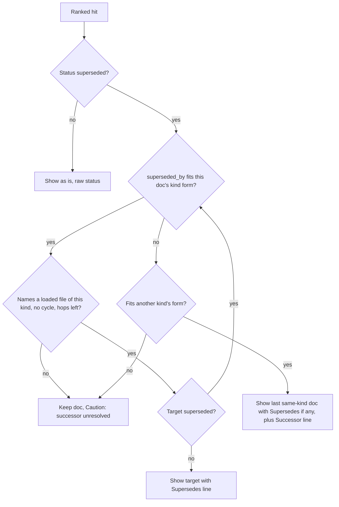

# feat: Search past plans, brainstorms and ideation

## Overview

v3.28.0 search reads `docs/solutions/` and nothing else. The plans, brainstorms and ideation docs that Systematic's own workflows write are reachable only through narrow scans, so a rejected direction or a finished plan from two months ago can be proposed again without anyone noticing. This plan extends search to three more kinds (`plan`, `brainstorm`, `ideation`), adds an explicit `kind: all` selector, gives each new kind its own lifecycle rules, and widens learnings-researcher with a `past-work` scope. ce:plan, ce:ideate, ce:brainstorm and deepen-plan then dispatch the researcher in that scope and cite what it finds.

Everything ships in one `feat` PR. Its gate is proof that a dispatched researcher subagent really calls search on four host configurations (OpenCode v1 at its floor and at its current pin, OpenCode v2, Pi), plus one manual Claude Code run. The proof harness is built first, against today's solution-only search, so a stall there is found before any engine work is spent. If the harness cannot be made to work, the engine units (U3 to U5) split off as their own PR.

The plan also fixes a bug it would otherwise trip over: five existing plans fail frontmatter parsing because the ce:plan template leaves `title:` unquoted and conventional titles contain a colon. Those plans would be invisible to search, and every `plan` or `all` query would print a warnings block.

---

## Problem Frame

v3.28.0 search accepts a `kind` argument on every surface, but its lifecycle handling assumes solutions. Successor links must point into `docs/solutions/`. Every status except `stale` renders as `active`. Most brainstorms carry `topic` rather than `title`, so they would show filenames as titles. Of the 23 plans that carry `superseded_by`, 18 point at solutions, 1 at a brainstorm and 4 at plans, so a solution-only successor rule would leave most plan successors unresolved.

Around the engine, the skills reach past work only by narrow scans:

- ce:plan scans the last 30 days of `docs/brainstorms/` for an origin document.
- ce:ideate scans the last 30 days of `docs/ideation/`.
- ce:brainstorm's topic scan names no path.
- No skill searches plans by topic, and nothing reads a plan's `origin:`.

This repo holds 101 plans, 59 brainstorms and 1 ideation doc next to 128 solutions. The origin document carries the full frame and the 24 requirements; see origin: `docs/brainstorms/2026-10-30-search-past-work-requirements.md`.

---

## Requirements Trace

The origin defines R1 to R24 and AE1 to AE8. Every requirement maps to at least one unit.

| ID | Requirement (short form) | Units |
|----|--------------------------|-------|
| R1 | Index `plan`, `brainstorm` and `ideation`; every Markdown file counts; exclude `README.md` and `_archived/` | U3 |
| R2 | Title is `title`, else `topic`, else filename | U3 |
| R3 | Read local files whether git tracks or ignores them | U3 |
| R4 | `kind` accepts each kind and `all`; omitted still means `solution` | U5 |
| R5 | `all` returns one combined ranking, each hit names its kind, the output cap applies to the whole | U5 |
| R6 | Every surface behaves the same; tool descriptions and help name the new kinds and `all`; harness profiles keep their search row | U5, U8 |
| R7 | `all` reports corpus state per kind; `none` only when no kind has a directory | U5 |
| R8 | Non-solution hits show recorded status raw, or `unspecified`; solution output unchanged | U4 |
| R9 | Only `superseded` triggers successor handling; only `stale` adds a caution | U4 |
| R10 | Same-kind successors resolve as solutions do today, bounded and cycle-safe | U4 |
| R11 | Cross-kind successors stay visible and name the successor's path | U4 |
| R12 | learnings-researcher takes a scope: `solutions` (default) or `past-work` | U7 |
| R13 | A missing `docs/solutions/` does not end a `past-work` search when other kinds have docs | U7 |
| R14 | `past-work` output is grouped; every item carries path and recorded status; no proposal is presented as implemented | U7 |
| R15 | The researcher says once whether it used search or fell back to grep, and why | U7 |
| R16 | The overlap check for ce:compound stays solution-only | U7 |
| R17 | ce:ideate's learnings dispatch moves to `past-work` | U7 |
| R18 | ce:plan keeps origin discovery and prior-art survey; its learnings dispatch moves to `past-work` and receives the chosen origin | U7 |
| R19 | ce:brainstorm dispatches `past-work` at Standard and Deep; Lightweight searches directly; resume detection unchanged | U7 |
| R20 | ce:review and ce:compound keep `solutions` scope | U7 |
| R21 | Skills cite surfaced rejected, deferred, superseded or completed overlap and say how the new work differs; never block | U7 |
| R22 | Real-host tests show a dispatched researcher invoking search on four configurations, with a planted rejected brainstorm named | U2, U6 |
| R23 | Claude Code subagent search verified by one manual run, recorded in HARNESSES | U9 |
| R24 | Per-call search time measured and reported for `solution`, each new kind and `all` on this repo's full corpus | U9 |

Supporting obligations the plan adds beyond the origin:

- S1. Every plan under `docs/plans/` parses, and the ce:plan template keeps them parsing (U1).
- S2. The evidence set (about 12 labelled queries and two recorded baselines) is committed before any new ranker runs (U1).
- S3. Generated surfaces, registry entries and docs reflect the widened tool text, researcher and skills (U8).

Acceptance examples AE1 to AE8 are pinned by tests in these units: AE1 and AE6 in U5 (AE6's researcher half in U7), AE2 in U3 and U4, AE3 and AE4 in U4, AE5 and AE8 in U7, AE7 in U2 and U6.

---

## Scope Boundaries

- Hybrid or semantic search. It comes after this work and is measured against the expanded lexical baseline.
- Per-kind weight tuning, chunking or section indexing of long plans, and a persistent index.
- Reading `supersedes` links in reverse to retire documents.
- Todos, review artifacts, `ONBOARDING.md` and instruction files as searchable kinds.
- A new decisions-researcher agent, or a rename of learnings-researcher.
- Lenient frontmatter parsing. The five unparseable titles are fixed at the source rather than worked around in the parser.
- Changing harness profile text. Profiles keep their current search row (R6), and the Pi profile is already near the 4,000-character budget.
- Fixing frontmatter problems in brainstorms or ideation docs that the new kinds expose. U3 reports the count per kind; this plan fixes only plans.

### Deferred to Separate Tasks

- Pi qualified-name normalization in `resolveAgent`: a small separate PR that ships first. It strips the exact `systematic:<category>:` prefix and adds no other aliases. This plan depends on it (see Dependencies) but does not implement it.
- External decision stores: a read-only trial comes first and decides whether Systematic should own adapters at all. It covers Deciduous in marcusrbrown/sparkle, the RFCs and PRDs fro-bot/agent kept before it adopted Systematic, the LLM wiki fro-bot/.github maintains over the Fro Bot collaboration repos, and the runbooks and ADRs in marcusrbrown/infra.

---

## Context & Research

### Relevant Code and Patterns

Engine (`src/lib/`):

- `search-corpus.ts:45-52` holds `KIND_TABLE` with one entry (`solution`). `KindSpec` at `:30-39` carries `dir`, `excludedFiles`, `excludedDirs` and a `lifecycle` flag that nothing reads. `loadCorpus` (`:414-475`) probes the directory, walks, parses and returns `{state, documents, warnings}`; caps (`MAX_FILES` 2,000, `MAX_FILE_BYTES` 256 KB, `MAX_TOTAL_BYTES` 16 MB, `:18-24`) apply per call, so they are per kind once a call is per kind. Title is the `title` string else the filename (`:336-342`); there is no `topic` fallback.
- `search-core.ts:86` sets `SUCCESSOR_PATH_PREFIX` to the solution directory. `isSuccessorPathForm` (`:131-140`) and `resolveSuccessor` (`:149-168`, call at `:157`) hard-code it. `entryStatus` (`:236-239`) maps everything except `stale` to `active`. `resolveLifecycle` (`:191-234`) merges successors by path. `validate` (`:288-319`) rejects any `kind` outside `KIND_TABLE`, and `runSearch` takes a `corpusLoader(root, kind)` seam (`:121-123`, used at `:334`) that tests inject.
- `search-render.ts:306-317` renders the header (`corpus: none` and `corpus: empty` name `docs/solutions/` literally); `:17-20` set the 16 KB cap and its marker; `:24` caps warnings at 5; `:36` caps a label at 40 characters, which clips the status.
- Tool text lives in `search-core.ts:66-72` (description and argument texts), `search-tool.ts:8-9` and `:248-256` (comment and Pi `promptSnippet`), `search-cli.ts:35-50` (usage) and `cli.ts:110-124` (CLI help); the Claude Code bin is `src/claude-code-search.ts`.

Researcher and skills:

- `agents/research/learnings-researcher.md`: Step 0 (`:16-22`) stops when `docs/solutions/` is missing; Step 1b (`:32-60`) is the search-first path with its header-routing table (`:45-52`) and overlap mode (`:43`); Step 3b (`:98-100`) reads critical patterns; the output template is `:202-241`.
- Dispatch sites: `skills/ce-plan/SKILL.md:230` (learnings dispatch) with origin discovery at `:92-101`; `skills/ce-ideate/SKILL.md:114`; `skills/ce-brainstorm/SKILL.md:101` (Lightweight scan) and `:107` (Standard and Deep topic scan; today there is no dispatch); `skills/deepen-plan/SKILL.md:216` and `skills/ce-plan/references/deepening-workflow.md:106`. `ce-review` and `ce-compound` also dispatch the researcher and stay on `solutions`.
- Pi: `src/lib/agent-resolver.ts:144` matches a persona by exact flat name; its one call site is `src/lib/pi-delegate-tool.ts:507`. `DEFAULT_READONLY_TOOLS` (`agent-resolver.ts:170`) includes `systematic_search`, which a delegate holds only when `src/pi.ts` also passes the definition as a custom tool.

Tests and gates:

- Single-kind pins that must change: `tests/unit/search-core.test.ts:112-120`, `:141-147` and `:216-219` (the last asserts `plan` is rejected), `tests/unit/search-lifecycle.test.ts:211-224`, `tests/unit/search-corpus.test.ts:114-131` (asserts the `KIND_TABLE` keys equal `['solution']`) and `tests/unit/search-adapters-parity.test.ts:532`.
- `tests/unit/search-recall.test.ts` plus `tests/fixtures/search-queries.json` and `tests/fixtures/search-baseline-grep.json` are the existing solution recall floor and grep baseline.
- Harness mocks: `tests/integration/opencode-v1.test.ts:91-143` (`startToolCallModel`, a single-shot `issued` flag); `tests/integration/opencode-v2.test.ts:1382-1435` (an `@@TOOL subagent` dispatch whose child turns are filtered by a marker and by the absence of `@@TOOL`); `tests/integration/pi.test.ts:1055-1092` (a child's tool calls are visible only in the mock model's request log). Planted-doc precedent: `tests/integration/opencode-v1.test.ts:439-460` and `opencode-v2.test.ts:577-601` write `docs/solutions/zebra-flake.md`. Pass floors live in `scripts/host-contract-guard.ts:174-178`.
- `scripts/content-integrity.ts`: `checkStalePlanStatus` (`:3448`) with `collectPlanFiles` (`:3407`) is the model for a plan-wide gate; `checkSolutionLifecycle` (`:1996`) is the model for lifecycle checks; the codemap and lib-module-table gates (`:3281`, `:3348`) enforce the two registration surfaces.
- `tests/unit/config-corpus.test.ts:25-85` holds `runCorpusEntry` and `canonicalJson`; the 14 fixtures under `tests/fixtures/config-corpus/` embed the researcher prompt.

### Institutional Learnings

- `docs/solutions/best-practices/a-retrieval-lane-that-recalls-well-can-still-lose-after-fusion-2026-10-30.md`: every comparison names its comparator and its cutoff, and compares per query against the best single lane. The solution-results gate and the evidence table follow it.
- `docs/solutions/workflow-issues/host-contract-evidence-is-ci-owned-2026-09-04.md`: real-host evidence is owned by CI; a new real-host file must appear in the host-contract profile lists, v2 additions need refreshed timings, and an unavailable host fails closed.
- `docs/solutions/workflow-issues/real-host-ci-catches-what-offline-gates-cannot-2026-09-06.md`: close stdin, bound spawns with timeouts, assert on process-group membership.
- `docs/solutions/best-practices/pi-real-runtime-integration-harness-2026-07-16.md`: run the real Pi runtime with an isolated environment and a mock SSE model; hard-fail when the CLI is missing.
- `docs/solutions/best-practices/cross-harness-adapter-parity-contract-tests-2026-07-14.md`: test core, adapter contracts and subprocess behavior as separate layers and compare real adapter outputs.
- `docs/solutions/logic-errors/pi-chained-bootstrap-composition-2026-07-14.md`: harness prompt text belongs in the bootstrap seam, which is why profiles stay untouched here.
- `docs/solutions/best-practices/qualified-persona-ids-are-canonical-validated-references-2026-07-17.md`: keep `systematic:<category>:<name>` in source and translate only at host output, so the Pi fix normalizes at runtime and never rewrites skill text.
- `docs/solutions/best-practices/lifecycle-validator-runs-only-in-ci-so-agent-prose-must-enforce-it-2026-10-26.md`: the researcher's prose repeats the lifecycle rules because the CI validator never runs in a user's repo; the same duplication applies to the new kinds.
- `docs/solutions/workflow-issues/registry-drift-on-skill-description-change-2026-05-20.md`: a skill or agent description change drifts the registry; run the surface regeneration.

No learning covers conditional researcher scope, fixture regeneration, profile budgets or `customTools`; those decisions below have no prior art in `docs/solutions/`.

### Corpus and Cost Facts

- This repo: 101 plans (3.39 MB), 59 brainstorms (0.90 MB, gitignored), 1 ideation doc, 128 solutions (1.02 MB). `all` reads about 5.3 MB per call against about 1 MB today. Warm timings under Bun: solution 42 ms, plan 122 ms, brainstorm 34 ms, `all` about 200 ms, roughly 35 ms per MB.
- Crowding: one plan-flavoured query's top 20 under a merged ranking held 12 plans, 4 brainstorms, 3 solutions and 1 ideation doc. Mean body length is 7.2k characters for solutions, 33k for plans and 15k for brainstorms, and only solutions carry `tags`, `symptoms` and `module`. Under BM25F that favors long plans on common terms; the evidence table measures it and per-kind weighting stays out of scope.
- Plan lifecycle in this repo: 69 completed, 25 superseded, 2 active, 5 unparseable. Three superseded plans carry no `superseded_by`. Brainstorms: 48 have `topic` only, 9 have `title`, 2 have no frontmatter. No solution carries `topic`, so solution output does not change.

### External References

- OpenCode v1 (1.19.4; unchanged from the 1.18.29 floor for this purpose): the `task` tool takes `description`, `prompt`, `subagent_type`, optional `task_id`, `command` and `background`; it creates a child session with a `parentID`; plugin tools sit in the host-wide registry, so a child can call them subject to its permissions; the child denies `task` and `todowrite` by default (upstream `packages/opencode/src/tool/task.ts` and `tool/registry.ts` at v1.19.4). The cloned source under `.slim/clonedeps/repos/anomalyco__opencode/` is v1.17.6, older than both lanes, so it is not used as authority here.
- OpenCode v2 (2.2.0): the tool is `subagent` with `agent`, `description`, `prompt`, `model`, `sessionID` and `background`; the child's first prompt part starts "You are a subagent spawned by another session" (upstream `packages/core/src/tool/plugin/subagent.ts` at v2.2.0). Whether tools added through `ctx.tool.transform` reach the child is unverified; U2 probes it.
- Pi 1.4.0: `systematic_delegate` passes `tools` and `customTools` to a child with `noExtensions`; in a real-host RPC test the child lives inside the pi subprocess, so only the mock model's request log shows its tool calls.
- No upstream test drives a real host with a mock HTTP provider and a subagent calling a plugin tool, so this harness has no external precedent.

---

## Prior-Art Survey

```json
{
  "schema_version": 2,
  "verdict": "extend",
  "scope": "src/lib search modules, agents/research/learnings-researcher.md, skills dispatch sites, tests/integration host harnesses and scripts/content-integrity.ts of the systematic package at a3fa17f4",
  "freshness": { "vcs_reference": "a3fa17f4" },
  "budget": { "max_search_passes": 5, "max_candidate_inspections": 24, "exhausted": false },
  "candidates": [
    { "path_or_symbol": "src/lib/search-corpus.ts:KIND_TABLE", "description": "Per-kind table of directory, excluded files, excluded directories and an unread lifecycle flag, with loadCorpus walking one kind under per-call caps and returning state, documents and warnings.", "disposition": "extend" },
    { "path_or_symbol": "src/lib/search-core.ts:resolveLifecycle", "description": "Host-neutral runSearch plus the successor resolver: five hops, visited set, solution-only path form rule, entryStatus mapping everything but stale to active, and the corpusLoader seam.", "disposition": "extend" },
    { "path_or_symbol": "src/lib/search-render.ts:renderSearchResult", "description": "Renders the corpus header, notes, five warnings, per-hit lines and the 16 KB cut with Systematic's marker.", "disposition": "extend" },
    { "path_or_symbol": "src/lib/search-tool.ts + src/lib/search-cli.ts + src/cli.ts + src/claude-code-search.ts", "description": "Per-surface adapters and help text for systematic_search; host I/O only over runSearch.", "disposition": "extend" },
    { "path_or_symbol": "agents/research/learnings-researcher.md", "description": "Search-first, grep-fallback researcher with a solution-only stop rule, header routing table, overlap mode and a single output template.", "disposition": "extend" },
    { "path_or_symbol": "skills/ce-plan/SKILL.md + skills/ce-ideate/SKILL.md + skills/ce-brainstorm/SKILL.md + skills/deepen-plan/SKILL.md", "description": "Dispatch sites for the researcher and the narrow brainstorm and ideation scans that search would replace.", "disposition": "extend" },
    { "path_or_symbol": "tests/integration/opencode-v2.test.ts:@@TOOL subagent dispatch", "description": "Existing v2 real-host test that dispatches a subagent and filters child turns by marker and absence of the parent directive.", "disposition": "reuse" },
    { "path_or_symbol": "tests/integration/opencode-v1.test.ts:startToolCallModel", "description": "Single-shot scripted OpenCode v1 model that issues one tool call and records the first tool result.", "disposition": "extend" },
    { "path_or_symbol": "tests/integration/pi.test.ts:mockModel.requests", "description": "Pi real-runtime mock model whose request log is the only place a delegate child's tool calls show.", "disposition": "extend" },
    { "path_or_symbol": "src/lib/agent-resolver.ts:resolveAgent", "description": "Exact flat-name persona lookup used by the Pi delegate tool.", "disposition": "insufficient", "insufficiency_reason": "Matches bare names only, so the qualified dispatch the skills write fails on Pi; the prefix strip ships in a separate prerequisite PR." },
    { "path_or_symbol": "scripts/content-integrity.ts:checkStalePlanStatus", "description": "Plan-wide gate over docs/plans using collectPlanFiles and parseFrontmatter; the pattern for a plan-parse gate.", "disposition": "extend" },
    { "path_or_symbol": "scripts/content-integrity.ts:checkSolutionLifecycle", "description": "Gate that reports malformed superseded_by links in docs/solutions, forbids chains and resolves nothing.", "disposition": "insufficient", "insufficiency_reason": "Reports violations instead of resolving a successor, covers solutions only and is not shipped in src." },
    { "path_or_symbol": "src/lib/frontmatter.ts:parseFrontmatter", "description": "js-yaml JSON_SCHEMA frontmatter parser returning data, body, hadFrontmatter and parseError.", "disposition": "reuse" },
    { "path_or_symbol": "tests/unit/search-recall.test.ts", "description": "Recall floor over 19 labelled solution queries against the live corpus.", "disposition": "reuse" },
    { "path_or_symbol": "tests/unit/config-corpus.test.ts:runCorpusEntry", "description": "Corpus runner and canonicalJson that produce the 14 config-corpus expectations embedding the researcher prompt.", "disposition": "reuse" }
  ]
}
```

---

## Key Technical Decisions

Decisions carried from the origin are marked (see origin). The rest were settled during planning.

**Scope and shape**

- KTD1. **Widen learnings-researcher with a `past-work` scope; add no agent and rename nothing** (see origin). The retrieval is identical and there is no second dispatch. A separate decisions agent that called learnings-researcher would fail on Pi, where `systematic_delegate` refuses nested delegates. A dedicated agent can be split out later if decision research grows its own workflow.
- KTD2. **Leaving `kind` out still means `solution`; `all` is a selector, not a document kind** (see origin). Direct callers, ce:review and ce:compound keep today's results. `all` expands to every kind in the table. The kind table stays the one source of truth for document kinds, so `all` never becomes a key in it, and the validation error lists the kinds plus `all`.
- KTD3. **Cite and differentiate; never block** (see origin). A surfaced rejected, deferred, superseded or completed item that overlaps the proposal is cited with its path and status, and the skill says how the new work differs. Blocking would stop legitimate revisits, and silence would let rejected ideas return unnoticed.
- KTD4. **One PR, gated on delegated reach** (see origin). A researcher that silently falls back to grep would make the wiring a no-op, so wiring is not claimed until a real host shows the call. The harness is the first unit. If it stalls, the engine units split off as their own PR.

**Corpus and ranking**

- KTD5. **Load once per kind through the existing loader seam, then merge.** `all` calls the loader for each kind, merges documents in code-unit path order, merges warnings and keeps per-kind state. Caps stay per kind, which preserves the `corpusLoader` seam tests inject and keeps cap warnings attributable; plans, the largest kind, use about 3.4 MB of the 16 MB byte budget. IDF is computed over the merged set for `all`; the single-kind path is unchanged, so solution scores are bit-identical to v3.28.0. Cap warnings gain the directory (`docs/plans: file limit of 2000 reached; skipped 12 files`).
- KTD6. **Title is the first non-empty string of `title`, `topic`, then the filename.** A non-string `title`, an empty string and the placeholder-array shape (`title: [Plan Title]` parses as a list) all fall through. No solution carries `topic`, so solution titles do not change.
- KTD7. **Show recorded status raw; map nothing** (see origin). Plan, brainstorm and ideation hits print the status as written, or `unspecified`. A solution with no status still prints `active`. The `superseded` and `stale` triggers compare trimmed and lower-cased for the three new kinds, because plans were hand-written with mixed case; the solution comparison stays exact so solution output cannot change. The renderer's 40-character label clip stays: a status is a label, the longest recorded values are short words, and the clip only bounds hostile input.
- KTD8. **Successors resolve within a kind and are shown across kinds.** The walk follows only links whose target passes the current document's own kind-form rule and names a loaded file of that kind. At the first link that passes another kind's form rule, the walk stops without an existence check and the last same-kind document is shown with `Supersedes:` (if it replaced others) and a `Successor: <path>` line. That line is information, not a `Caution:`. Hops count toward the existing 5 and a visited set still guards cycles. The form rule is driven by each kind's table entry (directory prefix, `.md` suffix, no `..`, excluded file names, excluded directory segments); existence is not checked across kinds, because a kind whose directory is absent in a clone (brainstorms are untracked here) must not turn into a false caution. A link that fits no kind's form, or a same-kind link naming a missing file, keeps `Caution: successor unresolved`. A solution whose `superseded_by` names a plan behaves the same way, and a mutual cross-kind pair names each other without a caution. For the solution kind the result is unchanged, because an excluded file such as `critical-patterns.md` already fails the existence check.
- KTD9. **Header and warnings report corpus state per kind.** The `Search "…": N docs, M hits.` prefix stays. For `all` it appends `Corpus: solution 128, plan 96, brainstorm none, ideation 1`; a single-kind search keeps `Corpus: <dir>.`. The state is `none` when every kind is none, `empty` when no kind has docs and at least one directory exists, and `docs` otherwise. Skip warnings aggregate into one line per kind with counts per reason; structural warnings (unreadable directory, outside the root, cap reached) come first with their exact text. The five-line warning cap and `+N more` stay.
- KTD10. **The 16 KB output cap stays one cap over the combined result.** The renderer already cuts at a line boundary with its marker. A test runs `limit: 20` on `all` against the cap, and the researcher asks for at most 12 results and treats the truncation marker as "more exist, narrow the query".

**Researcher and skills**

- KTD11. **Scope arrives as the first prompt line, `scope: <value>`, with an optional `exclude: <path>` line after it.** Every harness passes only prompt text, so a line is the one transport that works everywhere. A missing line means `solutions`. An unknown value is named in the reply and the researcher falls back to `solutions`. Overlap mode forces `solutions` (see origin R16). ce:plan passes the chosen origin as `exclude` so the researcher does not rediscover it.
- KTD12. **A `past-work` search makes exactly two search calls, `kind: all` and `kind: solution`, deduplicated by path.** The `all` call finds plans, brainstorms and ideation next to solutions; the dedicated `solution` call keeps proven lessons from being crowded out of a merged ranking, which the crowding measurement shows is real. No further calls. The researcher may also grep `docs/plans` for a brainstorm's `origin:` link, so its one-line method statement reads "search, plus origin lookups by grep".
- KTD13. **Groups come from recorded status mechanically, never from inference.** `completed` is existing or completed work. `abandoned`, `deferred`, `archived` and `superseded` are rejected, deferred or superseded directions. `draft`, `active` and `unspecified` are reported as "proposed in <doc>". Solutions are proven lessons. Decisions and rationale come from a document's body sections. When nothing matches, the researcher says "no recorded plan or solution found in the results" rather than implying absence from the repo. This is what stops a brainstorm's proposal from being presented as shipped (AE5).
- KTD14. **The researcher's read budget is frontmatter plus targeted headings, at most 3 full reads and at most 12 items.** Past-work prose grows the agent prompt by at most 25%, measured in U7; the 14 config-corpus fixtures embed the prompt, so growth is also fixture churn.
- KTD15. **Cite rule scope.** A skill cites only an item with the same behavior or surface, at most 3 items, worded "recorded as completed in <path>" or the matching status. Placement: ce:plan cites in Sources & References or Key Technical Decisions and never in the prior-art JSON; ce:ideate in rejection or survivor reasoning; ce:brainstorm in Key Decisions; deepen-plan wherever its findings are integrated. A cite names path and status only. Text from a gitignored file is never quoted into a tracked document.
- KTD16. **Wiring.** ce:ideate and ce:plan move their existing dispatch to `past-work`. ce:brainstorm dispatches at Standard and Deep scope and searches directly (`kind: all`) at Lightweight, where a dispatch costs more than the brainstorm is worth. ce:plan's origin discovery keeps its relevance rules and gains a `kind: brainstorm` search when a search tool exists, so an older relevant requirements document is ranked rather than missed by the 30-day window. Both deepen-plan dispatches widen to `past-work` and follow the cite rule. ce:review and ce:compound stay on `solutions`.

**Hygiene and prerequisites**

- KTD17. **Quote plan titles at the source and gate them.** The five plans that fail to parse get quoted `title:` values, and the ce:plan template and title guidance quote the title so the bug stops recurring. No lenient parsing is added. The repo-wide guarantee is a content-integrity check modeled on the stale-plan check, not a unit test over the live tree: the gate runs in CI over every future plan, reports the file and field, and follows the existing registration pattern. A unit test of the check uses temp-dir fixtures, and a separate template contract test asserts the template quotes `title:`.
- KTD18. **The Pi qualified-name fix ships first, as its own small PR.** Skills dispatch `systematic:research:learnings-researcher`; Pi's resolver matches exact flat names, and the Pi profile tells models to use the bare name. The fix is an exact `systematic:<category>:` strip with a unit test and no other aliases, normalizing at runtime and never rewriting skill source. This plan lists it as a prerequisite for the skill wiring, not as a unit.
- KTD19. **Worktree sessions see `brainstorm: none`.** `docs/brainstorms/` is gitignored here, so a worktree has none. That is correct behavior, and the docs say so. Timing (R24) and the evidence table are measured from the primary checkout, where the corpus is complete.

**Verification**

- KTD20. **The harness probes before it builds, with an explicit stop gate.** U2 first checks whether tools added through the OpenCode v2 `ctx.tool.transform` reach a child session, and whether the OpenCode v1 `opencode run` permission set lets the parent call `task`. If a child cannot reach search, work stops and goes back to the maintainer: file an upstream issue and offer to split the engine PR off. The harness is not bent to pass.
- KTD21. **Three layers of proof per host, with a negative control.** (1) The tool is advertised to the child. (2) The child's next model request carries a `role: tool` message that starts `Search "` and contains the planted path, and not `Error:`. (3) Where a client exists, a completed child tool part. The mock echoes the planted path in its final answer, and the parent's task result is asserted to contain it. With search disabled, layer 2 must fail, and the assertion helper has its own unit tests. Child requests are told apart per host: v1 by a state machine keyed on the researcher's own system line (read from the agent file at test time), v2 by the existing subagent filter, Pi by a function-form `push` that chooses each turn from the request content. A mock request cap bounds runaway loops.
- KTD22. **Solution results are gated once; new-kind results are reported.** One comparison between a `v3.28.0` build and the branch, on a frozen copy of `docs/solutions`, uses the 19 recall queries plus every solution title and must show no top-5 loss. It is run once and recorded in the PR; `search-recall.test.ts` stays as the standing floor and no golden harness is committed. The evidence table (about 12 queries, labelled first) and the timings are reported, not gated; any call over 1 second is flagged.
- KTD23. **Config-corpus fixtures are regenerated with a throwaway script.** They are not a generated surface. A script outside the repo copies `runCorpusEntry` and `canonicalJson`, rewrites the 14 fixtures, and its diff must show that only the researcher key changed.

---

## Open Questions

### Resolved During Planning

- How does the scope reach the researcher? A `scope: <value>` first prompt line with an optional `exclude: <path>` line (KTD11).
- Does Pi already fail on the qualified dispatch name? Yes: `resolveAgent` matches exact flat names and has one call site, and nothing strips the prefix. The Pi profile tells models to use the bare name, which is why nothing has surfaced. The fix is a prerequisite PR (KTD18).
- What does each host call a subagent dispatch? OpenCode v1 uses `task` with `subagent_type`; v2 uses `subagent` with `agent`; Pi uses `systematic_delegate({agent, task})`; Claude Code dispatches by name in prompt text, translated at build time to `systematic:learnings-researcher`.
- Do `all` searches keep per-kind input caps or one combined cap? Per kind in, one 16 KB cap out (KTD5, KTD10).
- What is the size budget for the `past-work` synthesis? At most 12 items, at most 3 full reads, and at most +25% on the agent prompt (KTD14).
- Which `superseded_*` keys does search read? Only `superseded_by`. Plans also carry `superseded_date`, `superseded_reason` and `superseded_at` inconsistently; none of them is read.
- How are cross-kind successors validated? By form only, with exclusions taken from each kind's table entry (KTD8).
- How are the five unparseable plans handled? Their titles are quoted at the source, the template is fixed, and a gate keeps new plans honest (KTD17).
- How does ce:plan's origin discovery use search? It keeps its relevance rules and adds a `kind: brainstorm` search when the tool exists (KTD16). This reads R18's "keeps its direct origin discovery" as keeping the discovery step, not forbidding search inside it.

### Deferred to Implementation

- Whether tools added through the OpenCode v2 `ctx.tool.transform` reach a child session, and whether the v1 `opencode run` permission set lets the parent call `task`. U2 probes both first; a negative answer triggers the stop gate (KTD20).
- The exact field that carries the parent tool-use id in Claude Code's `stream-json` output. U9 verifies it on the live run before recording it.
- The exact wording of the aggregated skip-warning lines and the `Successor:` line. The plan fixes the structure; the tests pin the final text.
- Whether the +25% prompt budget holds once the past-work prose is written. If it does not, U7 trims prose rather than raising the budget.
- Whether the evidence table shows plans crowding out other kinds under `all`. The result is reported; ranker tuning is out of scope.
- The mock request cap value per host, chosen from the observed request count of a passing run.
- How many brainstorm and ideation docs fail to parse once those kinds load. U3 reports the count; fixing them is outside this plan.
- The new profile pass floors. They are raised after CI shows the new counts, as a reviewed diff.

---

## High-Level Technical Design

> *This illustrates the intended approach and is directional guidance for review, not implementation specification. The implementing agent should treat it as context, not code to reproduce.*

**Kind selection.** One request resolves to a set of kinds, a ranking basis and a header form.

| `kind` argument | Kinds loaded | IDF basis | Header corpus text |
|-----------------|--------------|-----------|--------------------|
| omitted or `solution` | solution | solution only (unchanged) | `Corpus: docs/solutions.` |
| `plan`, `brainstorm` or `ideation` | that kind | that kind | `Corpus: <that kind's dir>.` |
| `all` | all four, one loader call each | merged documents | `Corpus: solution 128, plan 96, brainstorm none, ideation 1` |
| anything else | none | n/a | fixed error naming the kinds and `all` |

**Lifecycle walk.** Applies to every hit whose status marks it superseded; each hop counts toward the 5-hop bound.



**Researcher calls by scope.**

| Scope | Search calls | Grouping | Stops early when |
|-------|--------------|----------|------------------|
| `solutions` (default, overlap mode, ce:review, ce:compound) | `kind: solution`, once | today's output | `docs/solutions/` is missing |
| `past-work` | `kind: all`, then `kind: solution`, deduplicated by path | five groups by recorded status | every kind reports `none` |

---

## Implementation Units

Phase A is evidence and proof (U1, U2) and has no engine change. Phase B is the engine (U3 to U5). Phase C turns the harness into the delivery gate and wires the researcher and skills (U6, U7). Phase D is generated surfaces, docs and measurement (U8, U9).

| Unit | Content | Depends on |
|------|---------|------------|
| U1 | Baselines and hygiene | none |
| U2 | Delegated-reach harness against today's search | none; runs in parallel with U3 to U5 |
| U3 | Corpus kinds | U1 |
| U4 | Lifecycle | U3 |
| U5 | `all` selector and every surface's text | U3, U4 |
| U6 | Flip the harness to assert the planted brainstorm through `kind: all` | U2, U5 |
| U7 | Researcher and skill wiring | U5, U2's result, the Pi fix PR merged |
| U8 | Generated surfaces and docs | U7 |
| U9 | Measurement and evidence | U8 |

No unit adds a `src/lib` module, so the codemap and module-table obligations are met by editing existing rows, which U8 does in one pass. Every unit that edits a skill, agent or tool text ends with `bun run surfaces:affected --run`, and U8 and U9 end with `bun run surfaces:drift` and `bun scripts/content-integrity.ts`.

### Phase A: Evidence and proof

- [ ] U1. Baselines and hygiene

**Goal:** Make every plan parse and keep it that way, and commit the evidence labels and both recorded baselines before any new ranker exists.

**Requirements:** S1, S2

**Dependencies:** None

**Files:**
- Modify: `docs/plans/2026-05-09-001-feat-agent-model-configuration-plan.md`, `docs/plans/2026-05-09-002-feat-provider-model-mcp-overlays-plan.md`, `docs/plans/2026-05-13-001-feat-bootstrap-message0-skill-catalog-plan.md`, `docs/plans/2026-05-14-001-fix-isolated-opencode-integration-plan.md`, `docs/plans/2026-05-16-002-feat-typed-config-validation-plan.md` (quote `title:` only)
- Modify: `skills/ce-plan/SKILL.md` (Phase 3.1 title guidance and the Core Plan Template `title:` line), `skills/ce-plan/references/plan-sections.md` (the `title` field bullet)
- Modify: `scripts/content-integrity.ts` (new plan-parse check, registered in `CheckResult`, `checkContentIntegrity`, `printResult` and `totalViolations`)
- Create: `tests/fixtures/search-past-work-queries.json`, `tests/fixtures/search-past-work-baseline.json`
- Create: `tests/unit/ce-plan-template-contract.test.ts`, `tests/unit/search-past-work-fixtures.test.ts`
- Test: `tests/unit/content-integrity.test.ts`

**Approach:**
- Confirm the failing set by running the frontmatter parser over `docs/plans/` rather than trusting a list: five files, all with an unquoted `feat: …` or `fix: …` title. Quote each value; change nothing else in those files.
- The template line becomes a quoted title, and Phase 3.1 gains one sentence saying to quote it because a conventional-commit title contains a colon that YAML reads as a mapping. `plan-sections.md` says the same in the `title` bullet. No other template text changes.
- The gate follows the stale-plan check: walk `docs/plans/`, normalize the way the search loader does (strip a BOM, ensure a trailing newline), parse, and report a violation with the file, the cause and a remediation that names quoting. A file with no frontmatter is not a violation. Choosing a gate over a live-tree unit test follows KTD17.
- Evidence labels come first and are authored blind to any ranker: about 12 queries phrased as a person would ask ("did we reject X", "what shipped for Y"), each with `target_kind` (a known kind, or `any`), the relevant paths with their kinds, and a `source` (`paraphrase`, `title` or `body`). Cover at least two rejected or deferred brainstorms, two completed plans, one ideation doc, one superseded chain and some mixed-kind targets. Labels that point at untracked brainstorm files carry `requires_local: true` so a clone without them skips only the existence check, not the fixture.
- Keep the drafts outside the repo until both baselines are recorded, so no later step reads labels it should not.
- Baseline A emulates today's skill scans: the 30-day `*-requirements.md` window of ce:plan and the 30-day `docs/ideation/` window of ce:ideate, with a deterministic token-overlap stand-in for "topic matches" and the as-of date recorded. ce:brainstorm names no path and plans have no scan, so those rows record "no scan". Baseline B is one single-shot grep-only run over the four directories using the researcher's own frontmatter-grep technique, with model, repo ref and date recorded. Both run from the primary checkout (KTD19), and both are scored at top 5 with the same function.

**Execution note:** Test-first for the gate: a temp-dir fixture with an unquoted colon title fails before the five files are quoted. The baseline run is manual and single-shot; do not re-run it to improve numbers.

**Patterns to follow:**
- `scripts/content-integrity.ts:3448` (`checkStalePlanStatus`) and `:3407` (`collectPlanFiles`) for the walk and violation shape.
- `tests/unit/git-worktree-skills-contract.test.ts` for a skill-text contract test.
- `tests/fixtures/search-queries.json` and `tests/fixtures/search-baseline-grep.json` for fixture shape, and unit U0 of `docs/plans/2026-10-29-001-feat-durable-output-search-plan.md` for the label-before-ranker discipline.

**Test scenarios:**
- Happy path: the gate over a temp tree holding a plan with `title: "feat: x"` reports nothing.
- Error path: a temp plan with `title: feat: x` yields one violation naming the file and the `title` field, and its remediation mentions quoting.
- Edge case: a plan with no frontmatter, a BOM-prefixed valid plan, a plan whose closing `---` is the last line with no trailing newline, and a quoted title that contains a colon all pass. `title: [Plan Title]` parses (a list) and is not flagged.
- Integration: the gate over the real repo reports zero violations, and the parser reads 101 of 101 plans.
- Contract: the template's frontmatter `title:` value begins with a double quote; substituting `feat: Add x` and parsing returns that exact string; Phase 3.1 mentions quoting.
- Fixture shape: 10 to 14 queries with unique ids; every non-`requires_local` relevant path exists; the coverage mix above holds; the baseline file records model, ref, date and as-of; both baselines are re-scored by one function and agree with their stored counts.

**Verification:**
- `bun scripts/content-integrity.ts` is clean, including the new check, and `bun run surfaces:affected --run` regenerates whatever the `ce-plan` text change touches (registry and docs reference).
- Both fixture files are committed, and that commit precedes any change under `src/lib/search-*.ts` or `agents/research/learnings-researcher.md`.

- [ ] U2. Delegated-reach harness against today's solution-only search

**Goal:** Show on four host configurations that a dispatched learnings-researcher child really calls `systematic_search` and receives its result, using v3.28.0 search and a planted solution, and learn now whether that is possible.

**Requirements:** R22 (first half), AE7

**Dependencies:** None; runs in parallel with U3 to U5.

**Files:**
- Create: `tests/helpers/delegated-search-proof.ts` (the three-layer assertion over a recorded request list, shared by the three host files)
- Test: `tests/unit/delegated-search-proof.test.ts`
- Modify: `tests/integration/opencode-v1.test.ts`, `tests/integration/opencode-v2.test.ts`, `tests/integration/pi.test.ts`
- Modify (after CI, as a reviewed diff): `scripts/host-contract-guard.ts` (pass floors), `tests/integration/host-contract-timings.json` (v2 timings)

**Approach:**
- Stop gate, first. Before building anything else, probe two facts: on a v2 host, whether a child session's request advertises a tool registered through `ctx.tool.transform`; on a v1 host, whether `opencode run` lets the parent call `task` and whether the child advertises the plugin tool. If either answer is no, stop, record the observation, and ask the maintainer whether to file an upstream issue and split the engine PR off (KTD20). Do not bend the harness to pass.
- The fixture project holds a planted solution with distinctive tokens and a planted `abandoned` brainstorm, so U6 changes only the tool arguments and one assertion. Planted names live in one shared constants spot.
- Each host scripts the same four turns: the parent dispatches the researcher; the child calls `systematic_search` with the planted query; the child, seeing the tool result, answers with text that echoes the path found in that result; the parent finishes. The echo is read from the real tool message, so the final answer depends on the real result. The parent's last request is asserted to carry that path.
- Child requests are told apart per host. v1: a small state machine replacing the single-shot flag, with the child recognized by the researcher's opening line, read from the agent file at test time so the marker cannot drift. v2: the existing subagent filter (marker present, parent directive absent). Pi: a function-form `push` in place of the positional script, choosing a turn by request content, with the observation read from the mock's request log because RPC hides the child's own tool events. Pi dispatches with the bare persona name its profile documents, with search enabled, and the persona's default read-only tools include search.
- The helper checks three layers: the child's first request advertises the tool; the child's next request has a `role: tool` message that starts `Search "`, contains the planted path and does not start `Error:`; and, where a client exists (v2), a completed child tool part. Its failure message names the failing layer.
- Negative control: the same scenario with `search.enabled: false` must fail layer 1, and the helper has unit tests over hand-built request lists. A mock request cap, chosen from a passing run, fails runaway loops fast.
- What this proves: a researcher child can reach search and get a result on each host. It does not prove a live model chooses to call it; the scripted model makes the call. U9's manual Claude Code run is the live-model evidence for that host only.
- The tests live in the three existing files, so the host-contract profile lists need no change. Floors are raised only after CI shows the new counts. No workflow YAML changes.

**Patterns to follow:**
- `tests/integration/opencode-v2.test.ts:1382-1435` for the subagent dispatch and child filter; `tests/integration/opencode-v1.test.ts:91-143` for the scripted model; `:439-460` and `opencode-v2.test.ts:577-601` for planting a doc; `tests/integration/pi.test.ts:1055-1092` for reading the request log.
- `docs/solutions/workflow-issues/host-contract-evidence-is-ci-owned-2026-09-04.md`, `docs/solutions/workflow-issues/real-host-ci-catches-what-offline-gates-cannot-2026-09-06.md` and `docs/solutions/best-practices/pi-real-runtime-integration-harness-2026-07-16.md`: close stdin, bound spawns, isolate the environment, fail closed when a host is unavailable.

**Test scenarios:**
- Happy path (each of v1 floor, v1 current, v2, Pi): the four-turn script passes all applicable layers, and the parent's result contains the planted path.
- Error path: with search disabled, layer 1 fails and the failure names it; a scripted tool message beginning `Error:` fails layer 2.
- Edge case: a child that answers in text without calling the tool (the grep-fallback shape, AE7) fails with a no-tool-call message; a runaway script hits the request cap and fails fast.
- Edge case: on v2, the parent's directive turn is not mistaken for the child turn, and on v1 the state machine does not treat the parent's second request as a child request.
- Integration: each host's run goes through the real packaged plugin, so registration, permissions and child inheritance are exercised, not mocked.
- Unit (helper): no tool advertised, wrong path, a message not starting `Search "`, a missing tool message and a passing list each give the expected verdict.

**Verification:**
- Both probes are answered and recorded before the rest is built; a negative answer stops the unit.
- All four configurations pass in the CI host-contract jobs, the negative controls fail where expected, and the floors and v2 timings are raised in a reviewed diff.

### Phase B: Engine

- [ ] U3. Corpus kinds

**Goal:** Search loads plans, brainstorms and ideation docs, with correct titles, from disk whether or not git tracks them.

**Requirements:** R1, R2, R3, AE2 (title half)

**Dependencies:** U1 (all plans parse)

**Files:**
- Modify: `src/lib/search-corpus.ts` (three `KIND_TABLE` entries, the title chain, narrowing `topic`)
- Create: fixture trees under `tests/fixtures/search-corpus/` for each new kind
- Test: `tests/unit/search-corpus.test.ts` (the `['solution']` key pin at `:114-131` becomes the four kinds), `tests/unit/search-core.test.ts` (the `plan`-is-rejected pin at `:216-219` becomes accepted-and-`bogus`-rejected), `tests/unit/search-adapters-parity.test.ts` (`:532`, same pin)

**Approach:**
- Each new entry names its directory (`docs/plans`, `docs/brainstorms`, `docs/ideation`), excludes `readme.md` and the `_archived` directory, and sets the lifecycle flag like the solution entry. Every Markdown file under the root counts, including older filename styles without a sequence number.
- The title chain is `title`, then `topic`, then the filename, each narrowed to a trimmed non-empty string (KTD6). Nothing else about a document changes; `tags`, `module` and the other solution-only fields stay empty for the new kinds, so body and title carry the ranking.
- The loader already reads the filesystem and never consults git, so R3 needs no new code path, only a test that proves it with an ignored directory. A worktree that lacks `docs/brainstorms/` reports that kind as `none` (KTD19).
- Between U3 and U5, `kind: plan` is accepted but still renders solution-style statuses; U4 fixes that. Both land in the same PR and are not released separately.
- Run the parser over each new directory in the primary checkout and record the number of documents that fail to parse per kind in the PR. Fixing brainstorm or ideation frontmatter is outside this plan.

**Execution note:** Test-first with fixture trees; the new-kind loader tests fail before the table entries exist.

**Patterns to follow:**
- `src/lib/search-corpus.ts:45-52` for the table entry shape and `tests/unit/search-corpus.test.ts` for loader fixtures and warning assertions.
- `docs/solutions/best-practices/cross-harness-adapter-parity-contract-tests-2026-07-14.md`: keep core, adapter and subprocess layers separate when updating the parity pin.

**Test scenarios:**
- Happy path: a `docs/plans` fixture of three documents, one with an older filename style, loads all three; a `README.md` and an `_archived/old.md` are excluded for each of the three kinds.
- Happy path (AE2, title): a brainstorm with `topic: foo` shows title `foo`; a document with both `title: A` and `topic: B` shows `A`; a document with neither shows its filename without `.md`.
- Edge case: `title: ''`, `title: [Plan Title]` (a list) and a numeric `title` each fall through to `topic`, and to the filename when `topic` is absent or not a string.
- Edge case: a document with no frontmatter loads as body-only with its filename as title and no warning; invalid YAML and a non-mapping frontmatter block are skipped with the existing fixed reasons.
- Edge case: a missing directory gives state `none` with no warning; an existing directory with no indexable file loads zero documents.
- Error path: a `docs/plans` symlink that resolves outside the project root is not loaded, and the warning names `docs/plans`.
- Integration (R3): a temp project with a `.git` file and a `.gitignore` listing `docs/brainstorms/` still loads its brainstorms; no git binary is involved.
- Integration: `runSearch` with `kind: 'plan'` over a fixture returns a plan hit end to end, and `kind: 'bogus'` returns the fixed error.

**Verification:**
- `loadCorpus` over this repo loads 101 plans with no warnings, the primary checkout's brainstorms, the ideation doc and 128 solutions; the solution count and solution recall test are unchanged.
- The PR records the per-kind unparseable counts.

- [ ] U4. Lifecycle for the new kinds

**Goal:** Status, caution and successor rules are right per kind, and a successor in a different kind stays visible instead of replacing or erasing the requested document.

**Requirements:** R8, R9, R10, R11, AE2 (status half), AE3, AE4

**Dependencies:** U3

**Files:**
- Modify: `src/lib/search-core.ts` (kind-aware successor form check, the walk, `ResolvedEntry`, `entryStatus`, `lifecycleLines`, a `Successor:` label constant)
- Modify: `src/lib/search-render.ts` (the hit status type becomes a string; `Successor:` lines are sanitized per path like `Supersedes:`)
- Test: `tests/unit/search-lifecycle.test.ts` (the pin at `:211-224` changes), `tests/unit/search-core.test.ts` (`:112-120`, `:141-147`), `tests/unit/search-render.test.ts`

**Approach:**
- Form check: the successor path rule takes the kind and reads its prefix and exclusions from the table (KTD8). A second helper returns the kind whose form a link fits, in table order. The solution default keeps today's behavior for the existing exported function.
- Walk, per hop: a link that is not a string value is unresolved; a link that fits the current document's kind must name a loaded file of that kind and not revisit one (else unresolved); a target that is not superseded ends the walk with a `Supersedes:` replacement; a link that fits another kind ends the walk at the current document with a `Successor: <path>` line and no existence check; a link that fits no kind is unresolved. Hops count toward 5.
- A document that is the last same-kind document stays at its own rank. Its `Supersedes:` line lists the documents it replaced; its `Successor:` line names the cross-kind link. Merging by path, best rank and sorted `Supersedes:` lists work as today.
- Status: solutions print exactly as today. The new kinds print the recorded status as written, or `unspecified`. Superseded-ness and staleness compare trimmed and lower-cased for the new kinds (KTD7), so a `Superseded` plan resolves while a `Superseded` solution stays active. `Caution: marked stale` appears only for a `stale` status, with `stale_reason` appended when present. A superseded document with no `superseded_by`, with a malformed one, or whose chain fails keeps `Caution: successor unresolved`; it is not hidden.
- `Successor:` is informational and never a caution. Nothing is dropped.

**Execution note:** Characterization first: pin today's solution lifecycle output byte for byte (a stale doc, a resolved chain, an unresolved chain, a merge) before touching the walk, so the refactor cannot change solution output.

**Patterns to follow:**
- `src/lib/search-core.ts:131-168` and `:191-261` for the walk, merge and line builders; `tests/unit/search-lifecycle.test.ts` for chain and cycle fixtures.
- `docs/solutions/best-practices/lifecycle-validator-runs-only-in-ci-so-agent-prose-must-enforce-it-2026-10-26.md` for the five-hop, visited-set and form-rule semantics the walk must keep.

**Test scenarios:**
- Happy path (AE3): plan P1 `superseded` with `superseded_by: docs/plans/P2.md`, P2 `completed`: the hit is P2 with `Supersedes: docs/plans/P1.md` and `Status: completed`.
- Happy path (AE4): plan P1 `superseded` with `superseded_by: docs/solutions/x.md`: P1 stays in the results with `Status: superseded` and `Successor: docs/solutions/x.md`, no `Caution:`, and the solution need not match the query or even exist.
- Happy path (chain): P1 to P2 (`superseded`) to `docs/solutions/x.md`: the hit is P2 with `Supersedes: docs/plans/P1.md` and `Successor: docs/solutions/x.md`.
- Happy path (symmetry): a solution `S` with `status: superseded` and `superseded_by: docs/plans/p.md` stays with a `Successor:` line; a mutual pair names each other with no caution.
- Happy path (AE2, status): a brainstorm with `status: deferred` prints `deferred`; an ideation doc with no status prints `unspecified`; `Completed` prints as written; a 50-character status is clipped to 40.
- Edge case: two superseded plans resolving to one plan return it once with both paths sorted in `Supersedes:`; a successor that is also a direct hit merges into one entry at the better rank.
- Edge case: a chain of six same-kind links is unresolved (5 hops); a cycle and a self-link are unresolved; a plan with `status: Superseded` resolves while a solution with `status: Superseded` is treated as active.
- Edge case (R9): `status: archived` gets no successor handling and no caution; `status: stale` with `stale_reason` gets `Caution: marked stale: <reason>`.
- Error path: `superseded_by` values `../x.md`, `docs/plans/README.md`, `docs/plans/_archived/x.md`, an absolute path, `docs/other/x.md`, a list, a number and an empty string each give `Caution: successor unresolved`; a same-kind link to a missing file does too.
- Integration: a cross-kind link into a kind whose directory is absent still shows its `Successor:` line and no caution.
- Regression: the solution characterization outputs are byte-identical before and after.
- Render: a `Successor:` path with terminal escapes or control characters is sanitized, and one longer than 400 characters is capped.

**Verification:**
- Solution lifecycle output is unchanged and `tests/unit/search-recall.test.ts` still passes.
- Every pinned single-kind test in the two unit files is updated to the new truth, with no test deleted to make it pass.

- [ ] U5. The `all` selector and every surface's text

**Goal:** `kind: all` returns one combined ranking that names each hit's kind, reports corpus state per kind, and every tool description and help text names the new kinds.

**Requirements:** R4, R5, R6, R7, AE1, AE6 (engine half)

**Dependencies:** U3, U4

**Files:**
- Modify: `src/lib/search-core.ts` (kind validation and its fixed error, per-kind loading and the merge in `runSearch`, `SEARCH_TOOL_DESCRIPTION` and `SEARCH_ARG_DESCRIPTIONS`)
- Modify: `src/lib/search-render.ts` (header, aggregated warnings, `Corpus:` text, `none` and `empty` texts that name directories), `src/lib/search-corpus.ts` (cap warnings gain the directory)
- Modify: `src/lib/search-tool.ts` (header comment, Pi `promptSnippet`), `src/lib/search-cli.ts` (usage), `src/cli.ts` (help at `:110-124`), `src/claude-code-search.ts` (confirm it reuses the shared usage; edit only if it carries its own kind text)
- Test: `tests/unit/search-core.test.ts`, `tests/unit/search-render.test.ts`, `tests/unit/search-corpus.test.ts`, `tests/unit/search-cli.test.ts`, `tests/unit/search-adapters-parity.test.ts`, `tests/unit/claude-code-search.test.ts`, `tests/unit/harness-profiles-search.test.ts`, `tests/unit/opencode-v2-search.test.ts`

**Approach:**
- Validation accepts every table kind and `all`; the fixed error lists the kinds in table order followed by `all` and never echoes the rejected value. An omitted `kind` stays `solution` (KTD2).
- `runSearch` resolves the requested kinds, calls the loader seam once per kind in table order, merges documents in code-unit path order and builds one lexical index over the merged set (KTD5). A single-kind request takes the same path with one kind, so its scores and ranks match v3.28.0.
- Corpus state becomes a per-kind list plus the combined state (KTD9). The header, warning aggregation and cap-warning wording follow KTD9 exactly; the final strings are pinned by the render tests. The renderer already prints `Kind:` on every hit, which satisfies R5's "names its kind".
- The tool text everywhere states the four kinds, `all` and the default. Harness profiles are not edited (R6): they keep their search row, and the bootstrap length test keeps passing.
- The 16 KB cap applies to the combined output with no change to the renderer's cut logic (KTD10).

**Execution note:** Test-first for the header and warning text against render fixtures, then the merge.

**Patterns to follow:**
- `src/lib/search-render.ts:306-317` for header cases, `src/lib/search-core.ts:288-319` and `:334` for validation and the loader seam.
- `tests/unit/search-adapters-parity.test.ts`: one fixture corpus, each adapter's real entry, compared rendered text.

**Test scenarios:**
- Happy path (AE1): a project with solutions and plans: no `kind` returns solutions only; `kind: all` also returns plans, and each hit shows `Kind: solution` or `Kind: plan`.
- Happy path (AE6, engine half): a project with plans and no `docs/solutions/`: `kind: all` returns plan hits and the header reads `Corpus: solution none, plan 3, brainstorm none, ideation none`; `kind: solution` on the same project reports `corpus: none`.
- Edge case (R7): every directory absent gives `corpus: none` naming all four directories; directories present with no indexable files give `corpus: empty`; one kind with docs gives `docs` even when the other three are `none`.
- Edge case: seven unparseable plans and three oversized solutions give one warning line per kind with counts, structural warnings first, at most five lines plus `+N more`; a file-limit warning names its directory.
- Edge case: the loader seam is called once per kind in table order; merged documents are in code-unit path order; running twice gives identical text; the `solution` single-kind scores and order equal the v3.28.0 characterization.
- Edge case: a term common in plans and rare in solutions ranks differently under `all` than under `solution`, which proves IDF is computed over the merged set.
- Error path: `kind` values `'ALL'`, `'all '`, `['all']`, `''` and `7` each return the fixed error; `limit: 21` keeps its fixed error.
- Edge case (cap): `limit: 20` on `all` over long bodies renders at most 16,384 bytes, ends with the truncation marker on its own line and never cuts inside a hit line.
- Integration: the OpenCode v1, OpenCode v2, Pi, CLI and bin adapters render identical text for the same `kind: all` fixture; the CLI accepts `--kind all` and `--kind plan` and exits 2 with the fixed error on `--kind bogus`.
- Integration: each surface's description or usage mentions `plan`, `brainstorm`, `ideation` and `all`; the harness profile files are unchanged and stay under the 4,000-character budget.

**Verification:**
- Single-kind solution output differs from v3.28.0 only in the aggregated warning wording; `tests/unit/search-recall.test.ts` passes.
- `bun run surfaces:affected --run` regenerates any surface the CLI help or tool text touches, and the parity and bootstrap tests pass.

### Phase C: Delivery gate and wiring

- [ ] U6. Flip the harness to assert the planted brainstorm through `kind: all`

**Goal:** On all four host configurations, the child's search call uses `kind: all`, and the planted rejected brainstorm appears in the child's tool result and in the parent's final answer.

**Requirements:** R22, AE7

**Dependencies:** U2, U5

**Files:**
- Modify: `tests/integration/opencode-v1.test.ts`, `tests/integration/opencode-v2.test.ts`, `tests/integration/pi.test.ts`, `tests/helpers/delegated-search-proof.ts`
- Test: `tests/unit/delegated-search-proof.test.ts`
- Modify (after CI, as a reviewed diff): `scripts/host-contract-guard.ts` floors, `tests/integration/host-contract-timings.json`

**Approach:**
- The scripted child call changes from `kind: "solution"` to `kind: "all"` with a query that matches both planted documents. Layer 2 now also requires the brainstorm's path, `Kind: brainstorm` and `Status: abandoned` in the tool message, and the parent's final answer must name the brainstorm path, which is the requirement that "the child's output must name it".
- The negative control stays. A new grep-fallback case scripts a child that answers from file-read text and never calls the tool; the helper must fail it by name (AE7).
- The fixture creates the brainstorm inside the temp project, so the repo's gitignore is irrelevant to the test.
- The scripted model makes the call, so these tests prove reach and plumbing, not that a live model chooses search. U7 adds prompt-level checks of the researcher's own text, and U9 supplies live-model evidence for Claude Code.

**Patterns to follow:**
- The U2 scenarios and helper; `tests/unit/search-adapters-parity.test.ts` for asserting rendered hit text.

**Test scenarios:**
- Happy path (each of the four configurations): the child's tool message carries both planted paths, `Kind: brainstorm` and `Status: abandoned`, and the parent's answer names the brainstorm path.
- Error path: a child call with `kind: "solution"` against the same fixture lacks the brainstorm path, so the helper fails layer 2 and names the missing path.
- Error path (AE7): a child that never calls the tool fails with the no-tool-call verdict; with search disabled the run fails layer 1.
- Edge case: a tool message that starts `Search "` but ends in the truncation marker still passes when the planted paths are present before the cut.

**Verification:**
- All four configurations pass in the CI host-contract jobs; the new pass counts are reflected in the floors and v2 timings through a reviewed diff.

- [ ] U7. Researcher and skill wiring

**Goal:** learnings-researcher gains the `past-work` scope, and ce:plan, ce:ideate, ce:brainstorm and deepen-plan dispatch it and cite what it surfaces.

**Requirements:** R12, R13, R14, R15, R16, R17, R18, R19, R20, R21, AE5, AE6 (researcher half), AE8

**Dependencies:** U5; U2's result (the stop gate has passed); the Pi qualified-name PR merged.

**Files:**
- Modify: `agents/research/learnings-researcher.md`
- Modify: `skills/ce-plan/SKILL.md` (Phase 0.2 origin discovery, the Phase 1.1 dispatch at `:230` and its collect list, Phase 1.4 consolidation, the Sources & References template bullet), `skills/ce-ideate/SKILL.md` (`:114`, the `:125` grounding bullet, the rejection and survivor reasoning), `skills/ce-brainstorm/SKILL.md` (`:101` Lightweight scan, `:107` Standard and Deep topic scan, the Key Decisions guidance), `skills/deepen-plan/SKILL.md` (`:216`), `skills/ce-plan/references/deepening-workflow.md` (`:106`)
- Test: `tests/unit/past-work-wiring-contract.test.ts` (create), `tests/integration/pi.test.ts` (one qualified-name variant)
- Unchanged by design: `skills/ce-review/SKILL.md`, `skills/ce-compound/SKILL.md` (a missing scope line already means `solutions`)

**Approach:**
- Scope block, placed before Step 0: read `scope: <value>` from the first prompt line and an optional `exclude: <path>` from the next. Missing means `solutions`; an unknown value is named in the reply and treated as `solutions`; overlap mode forces `solutions` whatever the line says (KTD11, R16). The `exclude` path is dropped from hits by exact path, as overlap mode drops its document today, while `Supersedes:` lists keep their other entries.
- Step 0 and the stop rule: `solutions` is unchanged. `past-work` lists the four directories, skips README files and `_archived/`, never reads a missing path, and stops only when none of the four exists. Step 1b: `past-work` makes exactly two calls, `kind: all` then `kind: solution`, each asking for at most 12 results, and merges by path (KTD12). The header-routing table says `none` only when every kind is none, and the `Corpus:` line names which kinds are absent. A reply ending in the truncation marker gets a row: say results were cut and narrow the query. Step 3b stays solution-only.
- Grep fallback for `past-work` extends the content-search patterns over the four directories (frontmatter `title`, `topic`, `status`, `type`, `origin`, `date` plus filenames) and reads those fields in Steps 5 and 6. The researcher may grep `docs/plans` for a brainstorm's `origin:` link; its method line then reads "search, plus origin lookups by grep" (KTD12). When search is unavailable, one line states that grep was used and why (R15).
- Output for `past-work` has five groups in a fixed order: proven lessons, recorded decisions and their rationale, existing or completed work, rejected, deferred or superseded directions, and conflicts and open questions. The status-to-group table from KTD13 is written out in full, including that `draft`, `active` and `unspecified` are reported as "proposed in <path>" and that a proposal is never presented as implemented or decided. Decisions come from body sections such as Key Decisions and Scope Boundaries. Every item carries its path and recorded status. The read budget is frontmatter plus targeted headings, at most 3 full reads and at most 12 items (KTD14). With nothing found it says "no recorded plan or solution found in the results". The `solutions` output template is untouched.
- Skill wiring follows KTD16 and KTD15. Each dispatch puts `scope: past-work` on the first line of the prompt; ce:plan adds `exclude: <chosen origin>` when it has one and otherwise omits the line. Each skill's cite text states: same behavior or surface only, at most 3 items, "recorded as completed in <path>" or the matching status, path and status only, and how the new work differs. ce:plan places cites in Sources & References or Key Technical Decisions and never in the prior-art JSON; ce:ideate in rejection or survivor reasoning; ce:brainstorm in Key Decisions; deepen-plan wherever findings are integrated. ce:brainstorm's Lightweight path calls the search tool directly with `kind: all` when the tool exists and otherwise keeps its current topic search; its resume detection is untouched.
- The prompt grows by at most 25% over the body measured at the start of the unit (about 19,000 characters); trim prose before raising the budget. Dispatch prose stays harness-neutral, with no pseudo-call syntax and a qualified agent id.

**Execution note:** Test-first: write the contract test (it fails against today's prose) before editing the agent or any skill.

**Patterns to follow:**
- `agents/research/learnings-researcher.md:43-52` for the header-routing table and overlap-mode drop; `:188-241` for the output template.
- `docs/plans/2026-07-17-001-refactor-ce-dispatch-prose-harness-neutral-plan.md` and `docs/solutions/best-practices/qualified-persona-ids-are-canonical-validated-references-2026-07-17.md` for dispatch prose and qualified ids.
- `scripts/content-integrity.ts` dispatch-identifier and dispatch-argument checks (`checkDispatchIdentifiers`, `checkDispatchArguments`), which the new prose must pass.

**Test scenarios:**
- Contract (researcher): the agent file defines the first-line `scope:` and optional `exclude:` rules, the `solutions` default, the unknown-value handling and the overlap override; Step 0 names four directories for `past-work`; the group table maps each of `completed`, `abandoned`, `deferred`, `archived`, `superseded`, `draft`, `active` and `unspecified` to exactly one group; the absence sentence, the 12-item and 3-read budgets, the truncation row and both method statements appear.
- Contract (wiring): the five dispatch sites each carry `scope: past-work` on the prompt's first line; ce:plan's dispatch also describes `exclude:`; `ce-review` and `ce-compound` dispatch text contains no `past-work`; ce:plan's cite text names Sources & References or Key Technical Decisions and excludes the prior-art JSON.
- Contract (budget): the agent body length is at most 1.25 times the baseline constant recorded in the test.
- Error path: an unknown `scope: everything` line is covered by the prose (named in the reply, treated as `solutions`).
- Edge case (AE5): the table puts a `draft` brainstorm proposing X in "proposed in <path>", never in decisions or existing work, and the contract test pins that row.
- Edge case (AE6, researcher half): the prose continues to the `kind: all` call when `docs/solutions/` is missing and the plan directory exists.
- Edge case (AE8, R21): ce:plan, ce:ideate and ce:brainstorm each carry the cite-and-differentiate text with the 3-item bound and the never-block wording.
- Integration: after the Pi PR has merged, a Pi scenario dispatches the researcher by `systematic:research:learnings-researcher` and passes the three-layer proof from U2; before it, the same call fails with the unknown-persona message, which is why the PR is a prerequisite.

**Verification:**
- The contract test and `bun scripts/content-integrity.ts` pass; the prompt budget holds.
- The config-corpus unit test stays red until U8 regenerates the 14 fixtures; the rest of the suite is green.
- `bun run surfaces:affected --run` runs at the end; the registry and docs reference regenerate in U8.

### Phase D: Surfaces, docs and measurement

- [ ] U8. Generated surfaces and documentation

**Goal:** Every committed generated surface, registry entry and document reflects the widened tools, researcher and skills.

**Requirements:** R6, S3

**Dependencies:** U7

**Files:**
- Modify: the 14 `tests/fixtures/config-corpus/*/expected.opencode.json` files (regenerated; only the researcher key may change)
- Regenerate: `registry/registry.jsonc` (the researcher description at `:143-146`) and any docs reference pages the skill and agent edits touch
- Modify: `docs/src/content/docs/guides/search.mdx` (the intro, the kinds section, the status and successor explanation, the worktree note, the disable section)
- Modify: `ARCHITECTURE.md` (invariant 6 at `:248-255` and the codemap lines at `:168-176`), `STRUCTURE.md` (`:86-92`), `src/lib/AGENTS.md` (the search rows at `:88-94`)
- Modify: `HARNESSES.md` (the capability row at `:17`, the search section at `:91-99`, a new SR-5 for the delegated-reach tests)

**Approach:**
- Config-corpus is not a generated surface. Write a throwaway script outside the repo that copies `runCorpusEntry` and `canonicalJson` from `tests/unit/config-corpus.test.ts:25-85`, rewrites the 14 expectations, and diff them: the only changed key in each file must be the researcher's prompt (KTD23). Run it once, after the prose from U7 is final.
- Run `bun run registry:generate` for the researcher description, then `bun run surfaces:affected --run`, then `bun run surfaces:drift`. The Pi persona fixtures should not change, because learnings-researcher is not a curated Pi persona; the drift check confirms it.
- `guides/search.mdx` says in plain prose that search covers four kinds plus `all`, shows recorded status as written, explains the cross-kind `Successor:` line, and states that brainstorms are untracked in this repo so a worktree reports that kind as `none` while the primary checkout has them (KTD19).
- `ARCHITECTURE.md` invariant 6 and the codemap lines describe the per-kind loader, the merged `all` index and the lifecycle rules. `src/lib/AGENTS.md` rows are updated to match, and the stale "fetches 2× the limit" claim in the `search-core.ts` row is replaced with what the code does: every lexical hit goes through the lifecycle merge and the limit applies afterwards. No module is added, so both registration surfaces are edits to existing rows; `bun scripts/content-integrity.ts` verifies them.
- `HARNESSES.md`: the capability row names the four kinds; the line saying no real-host check exists for the Pi tool becomes false once U2 and U6 land and is rewritten to cite SR-5, which describes the three-layer proof on four configurations. SR-4, the Claude Code manual run, is added in U9 with its result, because it cannot be written before the run exists.

**Patterns to follow:**
- `docs/solutions/workflow-issues/registry-drift-on-skill-description-change-2026-05-20.md` and the Generated surfaces paragraph of `AGENTS.md` for regeneration order.
- `docs/solutions/best-practices/lifecycle-validator-runs-only-in-ci-so-agent-prose-must-enforce-it-2026-10-26.md` for how architecture notes describe lifecycle duplication.

**Test scenarios:**
- Test expectation: none -- documentation and regenerated artifacts. Their guards are the existing config-corpus unit test, `bun run surfaces:drift`, `bun scripts/content-integrity.ts` (codemap and module-table gates) and `tests/unit/harness-profiles-search.test.ts`.

**Verification:**
- The config-corpus unit test passes, and the fixture diff changes the researcher key and nothing else.
- `bun run surfaces:affected --run`, `bun run surfaces:drift` and `bun scripts/content-integrity.ts` pass; `bun run docs:build` succeeds; the harness profile files are byte-unchanged.

- [ ] U9. Measurement and evidence

**Goal:** Produce the manual Claude Code evidence, the timings, the solution-results gate result and the evidence table, and set the final host-contract floors.

**Requirements:** R23, R24

**Dependencies:** U8

**Files:**
- Modify: `HARNESSES.md` (SR-4, the Claude Code manual run)
- Modify (as a reviewed diff after the final CI run): `scripts/host-contract-guard.ts`, `tests/integration/host-contract-timings.json`
- Results are recorded in the PR description. No golden harness is committed, and `tests/unit/search-recall.test.ts` stays as the standing solution floor.

**Approach:**
- Solution-results gate (KTD22). Build search from a `git archive` of `v3.28.0` into a scratch directory, and freeze a copy of `docs/solutions`. Run the 19 recall queries plus every solution title through both builds with `kind: solution`, once. The comparator is v3.28.0 and the cutoff is top 5. The check passes when no labelled query loses a relevant path from its top 5 and every title query still finds its own document in the top 5. Because single-kind solution scoring is bit-identical by construction, zero rank differences are expected; any difference is listed and explained.
- Evidence table. Run the two merged search calls of a `past-work` scope (KTD12) in process for each U1 query, from the primary checkout so brainstorms exist. Score at top 5 and report per query: the `past-work` result, today's skill scans (baseline A), the recorded grep run (baseline B), and, for queries whose target kind is known, `all` against a kind-specific search. Every comparison names its comparator and cutoff. This is reported, not gated, and it scores retrieval, not the researcher's model-written synthesis.
- Timings (R24). From the primary checkout, measure cold (fresh process) and warm (median of five repeats) per-call time for in-process `runSearch`, the `systematic search` CLI and the Claude Code bin under Node, at `limit` 8 and 20, for `solution`, `plan`, `brainstorm`, `ideation` and `all`. Flag any call over 1 second. No gate.
- Claude Code manual run (R23). Build the plugin bundle, then in a project with the planted solution and brainstorm run `claude -p` with a prompt that makes the researcher subagent search, using `--output-format stream-json`. Look for a Bash call to `systematic-search` that carries a non-null parent tool-use id, and confirm the real field name in the live output before citing it. Record the Claude Code version, date, prompt, outcome and the field name in HARNESSES as SR-4, labelled manual evidence and not a CI check. If the subagent falls back to grep, record that and say so. This run needs the maintainer's Claude Code authentication, so it cannot run unattended.
- Qualitative success check: run ce:ideate on the focus "search" from the primary checkout and record whether it surfaces the durable-output search plan and its requirements document, citing path and status only.
- After the final CI run, raise the three host-contract floors and refresh the v2 timings as one reviewed diff. No workflow YAML changes.

**Patterns to follow:**
- `docs/solutions/best-practices/a-retrieval-lane-that-recalls-well-can-still-lose-after-fusion-2026-10-30.md`: name the comparator and the cutoff in every comparison, and compare per query against the best single lane.
- `docs/solutions/workflow-issues/host-contract-evidence-is-ci-owned-2026-09-04.md` for raising floors from CI output rather than a local run.

**Test scenarios:**
- Test expectation: none -- measurement and manual evidence that change no behavior. The standing guards are `tests/unit/search-recall.test.ts` and the host-contract floors.

**Verification:**
- The PR records the gate result (or its explained differences), the evidence table with comparators and cutoffs, the timing table with any call over 1 second flagged, and the ideation check.
- HARNESSES carries SR-4 with a real result, and the floors and timings are updated from the final CI run.

---

## System-Wide Impact

- **Interaction graph:** `runSearch` feeds five adapters (OpenCode v1, OpenCode v2, Pi, the CLI and the Claude Code bin) and the researcher. The researcher's scope line is a new input from ce:plan, ce:ideate, ce:brainstorm and deepen-plan. ce:review and ce:compound dispatch it without a scope line and must see no change.
- **Error propagation:** A malformed or missing frontmatter in one document becomes one aggregated warning for its kind and never stops a search. A search that cannot run (disabled, no project, error text) sends the researcher to its grep path, now across four directories in `past-work` scope, with the fallback stated once.
- **State lifecycle risks:** Search reads the disk on every call with no memo, so ce:compound's write-then-search still sees fresh files. `all` reads about 5.3 MB per call in this repo; the measurement in U9 decides whether that needs follow-up, and a persistent index is out of scope.
- **API surface parity:** All five adapters share one validation, one header and one lifecycle. The tool descriptions, CLI usage and bin usage change together in U5, and the parity test compares their rendered output.
- **Integration coverage:** Mocks cannot prove that a child session inherits a plugin tool; the four real-host configurations in U2 and U6 do, within the limit that a scripted model makes the call.
- **Unchanged invariants:** Leaving `kind` out means `solution`. Single-kind solution scores and ranks are bit-identical to v3.28.0. Harness profiles keep their search row and their 4,000-character budget. `search.enabled: false` still removes the tool everywhere. Bundled agent markdown stays model-free. The researcher's overlap check for ce:compound stays solution-only.

---

## Risks & Dependencies

| Risk | Mitigation |
|------|------------|
| A child session on OpenCode v2 or v1 cannot reach the search tool, so the researcher wiring would be a silent no-op | U2 probes first and has an explicit stop gate; a negative result goes to the maintainer to file an upstream issue and offers to split the engine PR off (KTD20) |
| A scripted model passes the harness while a live model never calls search | The tests claim reach, not model choice; the researcher prose makes search the first step, and U9's manual Claude Code run is live-model evidence for that host |
| Merged ranking lets long plans crowd out other kinds | The researcher's second, solution-only call protects proven lessons; U9's evidence table measures crowding; per-kind weighting stays out of scope |
| `all` is slow on a large corpus | Timings are measured and anything over 1 second is flagged; caps stay per kind; a persistent index is deferred |
| Skills dispatch the qualified agent name and Pi cannot resolve it | The Pi normalization PR merges first and U7 depends on it; U7 has a Pi scenario that fails without it |
| Researcher prompt growth causes fixture churn and slower runs | The +25% budget is a test; fixtures regenerate once, after the prose is final, with a diff that must touch only the researcher key |
| Untracked brainstorms make labels and counts differ between clones and this repo | Labels carry `requires_local`; measurements run from the primary checkout; the docs state that a clone without brainstorms reports that kind as `none` |
| Citing ignored-file text leaks local content into tracked documents | The cite rule allows path and status only (KTD15) |
| Case-insensitive status matching for new kinds diverges from the solution rule | Deliberate (KTD7); the solution comparison stays exact so solution output cannot change, and tests pin both |

Dependencies:

- The Pi qualified-name normalization PR (an exact `systematic:<category>:` strip in `resolveAgent`, a unit test, no other aliases) must merge before U7.
- Real hosts and their pinned versions are available in CI for the host-contract jobs: OpenCode v1 1.18.29 and 1.19.4, OpenCode v2 2.2.0, Pi 1.4.0.
- The manual Claude Code run needs the maintainer's authenticated `claude` CLI.

---

## Documentation / Operational Notes

- `guides/search.mdx`, `ARCHITECTURE.md` invariant 6, `STRUCTURE.md`, `src/lib/AGENTS.md` and `HARNESSES.md` are updated in U8; SR-4 follows in U9.
- Worktree sessions in this repo see `brainstorm: none` because `docs/brainstorms/` is gitignored; the docs say so, and all measurements run from the primary checkout.
- Systematic's skills tell users to commit brainstorms. A user clone that does so gets the new kind for free; one that ignores the directory sees `none`.
- No telemetry, no network access and no new dependency are added. Search stays local and read-only.
- The PR description carries the gate result, evidence table, timings and the per-kind unparseable-document counts from U3.

---

## Sources & References

- **Origin document:** [docs/brainstorms/2026-10-30-search-past-work-requirements.md](docs/brainstorms/2026-10-30-search-past-work-requirements.md). This file is gitignored and untracked in this repository, so a reader cloning the repo will not find it; the requirements it defines (R1 to R24, AE1 to AE8) are restated in the Requirements Trace above.
- Earlier plan: `docs/plans/2026-10-29-001-feat-durable-output-search-plan.md` (the search this plan extends). Its requirements document, `docs/brainstorms/2026-10-29-durable-output-search-requirements.md`, is also untracked, and its claim that plans carry no `superseded_by` is wrong (see Problem Frame).
- Related code: `src/lib/search-corpus.ts`, `src/lib/search-core.ts`, `src/lib/search-render.ts`, `src/lib/search-tool.ts`, `src/lib/search-cli.ts`, `src/cli.ts`, `src/claude-code-search.ts`, `src/lib/agent-resolver.ts`, `src/lib/pi-delegate-tool.ts`, `agents/research/learnings-researcher.md`, `scripts/content-integrity.ts`.
- Related skills: `skills/ce-plan/SKILL.md`, `skills/ce-ideate/SKILL.md`, `skills/ce-brainstorm/SKILL.md`, `skills/deepen-plan/SKILL.md`, `skills/ce-plan/references/deepening-workflow.md`.
- Related tests: `tests/integration/opencode-v1.test.ts`, `tests/integration/opencode-v2.test.ts`, `tests/integration/pi.test.ts`, `tests/unit/search-recall.test.ts`, `tests/unit/config-corpus.test.ts`.
- Learnings: the nine documents listed under Institutional Learnings.
- External: upstream OpenCode `task` tool (v1.19.4) and `subagent` tool (v2.2.0) sources, as described under External References.
