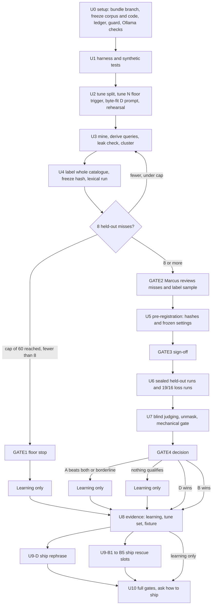

# feat: Measure meaning-only search recall and ship the winning approach

## Overview

Search is lexical (BM25F) over four kinds: `solution`, `plan`, `brainstorm` and `ideation`. It misses a document when the question and the document share no terms. A parked embeddings lane tried to fix that with rank fusion and lost lexical hits. No existing query set can show a meaning-only win.

This plan measures first and ships second. Phase A is a scratch evaluation. It builds a held-out set of real questions mined from history, plus a vocabulary-disjoint tune set. It runs three candidates against lexical, query by query:

- B: rescue slots. Lexical results stay byte-identical, and an embeddings lane adds a separately labeled group of documents.
- D: the researcher rephrases a weak search once in different vocabulary.
- A: weighted fusion at semantic weight 0.5, as a reference that never ships.

Phase B commits the evidence: one learning, the tune set and an evidence fixture. Phase C1 ships D, or Phase C2 ships B, but only the winner of the decision rule. If nothing qualifies, nothing ships and the PR is docs-only.

There are five terminal states: floor stop, A-wins stop, no candidate qualifies, D ships and B ships. The first three commit a learning and nothing else. The likely outcome is the floor stop, because eight held-out lexical misses may not exist in 60 representatives. The plan treats that as a valid result, not a failure.

Everything lands in one PR. Evidence commits come first and ship-path commits follow. The decision gate is a local stop before any ship-path work starts.

---

## Problem Frame

Lexical search needs shared terms. A learning written in fix vocabulary is invisible to a question written in symptom vocabulary. The author-side `symptoms` field helps, but only about 55 of 131 solutions carry it, and aliases on the index side are a separate lever (see Scope Boundaries).

The parked branch `feat/search-semantic` built an Ollama or OpenAI-compatible client, a per-document vector cache and RRF fusion. On 19 solution queries it lowered top-5 hits from 16 to 14 and lost hits at ranks 1 and 4. The best variant was picked after seeing every query, so the result is post hoc. On the 5-query held-out subset, plain fusion gained nothing and lost a hit. The 19 solution queries also tuned the lexical ranker, and on the 16 past-work queries an agent grep baseline already finds all 16. So neither set can show a meaning-only win.

Search now spans four kinds, and the parked lane was built for one. The decision therefore needs a fresh query set whose labels exist before any candidate runs, whose held-out half comes from real history, and whose gates are fixed before the held-out set is touched. The held-out set can be used once.

This plan implements the origin requirements R1 to R21 and acceptance examples AE1 to AE6 from `docs/brainstorms/2026-10-31-hybrid-search-requirements.md`. That file is untracked, so a clone will not have it (see Sources & References).

---

## Requirements Trace

The origin defines R1 to R21. Every requirement maps to at least one unit. Requirements under "If rescue slots ship" and "If agent rephrase ships" bind only the matching Phase C unit.

| ID | Requirement (short form) | Units |
|----|--------------------------|-------|
| R1 | The set covers all four kinds, and every relevant document is labeled before any candidate ranks the query | U3, U4 |
| R2 | The held-out split holds real mined questions in original wording; leaking queries are dropped; lexical successes stay in | U3, U4 |
| R3 | The tune split holds paraphrases, and a mechanical check rejects any that share a content term with the target | U2 |
| R4 | Mining runs until 8 held-out lexical misses or a cap of 60 real queries; at the cap, stop and report without choosing | U3, U4, GATE1 |
| R5 | Candidates, settings and the decision rule are recorded before any held-out run; tuning never touches held-out | U2, U5, GATE3 |
| R6 | Raw mined text stays in gitignored scratch; committed artifacts cite IDs and outcomes; the tune split may be committed | U3, U8 |
| R7 | Each candidate is scored per query at top 5 against lexical: gains, losses, precision of added docs, cost; grep and read cost as context | U1, U6, U7 |
| R8 | Rephrase is scored with the trigger it would ship with | U1, U2, U6 |
| R9 | A candidate qualifies on 3 rescues, at least half its added docs relevant, and zero lexical top-5 losses on three sets | U1, U6, U7 |
| R10 | Rephrase ships if it qualifies, unless rescue slots qualify and lead by at least 2 | U7, GATE4 |
| R11 | Weighted fusion is a reference; if it beats both others, report and stop | U7, GATE4 |
| R12 | With no qualifying candidate, nothing ships and a learning is recorded | U8 |
| R13 | The report scopes its conclusion to one corpus and one model, and records `symptoms` metadata per held-out miss | U4, U7, U8 |
| R14 | With an endpoint, lexical output stays byte-identical and a labeled group adds a bounded number of absent documents | U9-B3, U9-B4 |
| R15 | The endpoint is user-config only; Ollama or OpenAI-compatible; non-loopback needs https; the key comes from a named env var and is never sent over http or echoed | U9-B1, U9-B2 |
| R16 | Output differs from lexical only when an endpoint is configured; failures yield lexical plus one fixed note | U9-B2, U9-B3, U9-B4 |
| R17 | The cache lives in the user cache dir, is owner-only, is keyed by endpoint and model, is clearable, and is never written without an endpoint | U9-B3, U9-B5 |
| R18 | The rescue group follows the kind selector, per kind and under `all` | U9-B3, U9-B4 |
| R19 | All five surfaces give identical output for identical settings and cache | U9-B4 |
| R20 | Privacy docs say a non-loopback endpoint receives query and document text and only loopback keeps both local | U9-B5 |
| R21 | The researcher reissues a weak search once in different vocabulary, merges by path, and stays within its size budget | U9-D |

Acceptance examples:

| ID | Covers | Where it is proved |
|----|--------|--------------------|
| AE1 | R4 | U4 and GATE1 stop with the report "N misses after 60 mined, below 8"; no candidate chosen |
| AE2 | R9, R10 | U7 decision table: both qualify, B leads by under 2, D ships |
| AE3 | R9 | U7 precision gate: 4 relevant of 12 added fails |
| AE4 | R11 | U7 and GATE4: A qualifies and leads the best candidate by 2 or more; report and stop |
| AE5 | R14, R16 | U9-B3 and U9-B4: warm loopback adds a labeled group; stopped server adds one note; no endpoint adds nothing |
| AE6 | R15, R20 | U9-B2: a non-loopback `http://` URL is rejected and no key is sent |

---

## Scope Boundaries

- No bundled local model package.
- No change to the lexical ranker's weights or tokenizer.
- No LLM reranking of results.
- No committed index.
- Embeddings never run by default.
- Semantic search never reorders or removes lexical results.
- No content screening before a hosted send. The hosted endpoint is the user's opt-in, and the docs state what it receives.
- Symptom aliases on the index side are a separate lever. This work records whether the target of each held-out miss carries `symptoms` metadata (R13) and builds nothing for it.
- The evaluation harness is never committed (KTD11).

### Deferred to Separate Tasks

- A bundled or documented local model package: future iteration, only if B ships and users ask.
- Symptom aliases on the index side: separate plan; R13 evidence informs it.
- Deleting the parked `feat/search-semantic` branch: Marcus decides after the PR merges. U0 bundles it and the learning records its three SHAs, so deletion loses nothing.

---

## Context & Research

### Relevant Code and Patterns

- `src/lib/search-core.ts` holds `runSearch`. It loads each kind, merges in path order, builds one lexical index, runs lifecycle resolution over all hits and slices to `limit`. The B rescue stage inserts after the hits and before the finish step.
- `src/lib/search-lexical.ts` is pure. It may not use `Math.log`, `pow`, `Intl` or Bun APIs, which is why determinism tests compare Bun and Node bit for bit.
- Import rules: `src/lib/search-cli.ts` may import only `search-core` and builtins. `src/lib/search-user-config.ts` may import only zod, jsonc-parser, builtins and core types. So the config module cannot import shared URL validators (KTD8).
- `src/lib/search-render.ts` owns `renderHit` and `sanitizeInline`. The 16 KB output cut applies to the whole text.
- `src/lib/search-user-config.ts`: `SearchSettingsSchema` is strict with `enabled` only, and `mergeSearchSettings` must learn `embeddings` with the rule that the last source replaces the whole block. `src/lib/config.ts` already protects the `search` key from project config, so a nested `embeddings` key is protected for free.
- `tests/unit/search-adapters-parity.test.ts` checks OpenCode v1, v2, Pi, the CLI, the in-process Claude Code bin and the built bin under Node, byte for byte. Its header says later units add the hybrid cases there.
- `tests/unit/search-determinism.test.ts` checks float64 bit equality across Bun and Node. `tests/helpers/real-node.ts` finds the real Node binary and `tests/helpers/fake-http-server.ts` fakes an endpoint.
- `tests/unit/past-work-wiring-contract.test.ts` pins the researcher's scope block, Step 0, Step 1b, the routing table, the fallback, the output and the budgets. `tests/unit/compound-contract-parity.test.ts` pins part of the same text. The prompt is also embedded in 14 config-corpus fixtures and the Pi personas.
- `agents/research/slack-researcher.md` already says to try one broader rephrasing after an empty result. That is the in-repo precedent for D.
- Eval assets: `tests/fixtures/search-queries.json` (19 solution queries), `tests/fixtures/search-baseline-grep.json`, `tests/fixtures/search-past-work-queries.json` (16 queries) and `tests/fixtures/search-past-work-baseline.json`. No scoring library is committed.
- Parked branch `feat/search-semantic` (7f179183 client, 4e8df291 semantic lane, f2cf775e privacy and guide) supplies the client, chunker and cosine. Its client imports a `SearchEmbeddingsSettings` type that main lacks. Bun erases type imports, so it runs, but `tsc` and bundling fail until the type is redefined or repointed.
- Scratch precedents from earlier work: a run-evidence script, a compare gate that prints LOSS lines, a temp corpus root created with `git init` that holds all four kinds, a CLI timing script, and the `wrrf` fusion function in a prior worktree. The fusion script's repo path points at a removed worktree and needs repointing.

### Institutional Learnings

- `docs/solutions/best-practices/a-retrieval-lane-that-recalls-well-can-still-lose-after-fusion-2026-10-30.md`: compare against the strongest single lane, per query, at the cutoff. A lexical-reachable label does not establish meaning-only behavior, so validate it against real retrieval.
- `docs/solutions/best-practices/search-kinds-separately-instead-of-one-merged-ranking-2026-10-31.md`: earlier results were post hoc. Account for how many candidates each query returns.
- `docs/solutions/best-practices/prove-a-dispatched-subagent-reached-a-plugin-tool-on-a-real-host-2026-10-31.md`: gate on the tool result and the final answer, add a negative control and a request cap, and keep contract tests separate from host reach tests.
- `docs/solutions/best-practices/lifecycle-validator-runs-only-in-ci-so-agent-prose-must-enforce-it-2026-10-26.md`: pin the prompt contract where it acts, and watch the prompt budget.
- The registry-drift learning (`docs/solutions/workflow-issues/registry-drift-on-skill-description-change-2026-05-20.md`) explains why researcher prompt edits regenerate several surfaces.
- The past-work plan fixed three conventions this plan reuses: labels and baselines are committed before any new ranker runs, results are scored at top 5 with one function, and the researcher contract allows 12 items and 3 full reads.

### External References

- Paired found-at-5 comparisons use the exact McNemar test, a sign test over discordant pairs. At these sample sizes it is context only, so this plan reports the full 2x2 table and never gates on a p-value.
- A one-shot rewrite followed by lexical retrieval is the cleanest challenger, and HyDE needs dense retrieval, so it is out. Keep the original query and compare both lists.
- Pooling bias: judge the union of all systems' new documents blind before computing precision.
- Ollama `/api/embed` accepts a string or an array and returns `embeddings`; OpenAI `/v1/embeddings` takes `encoding_format: "float"`. Validate vector count, non-empty vectors, consistent dimensions, finite values and index order.
- Loopback is `localhost`, 127.0.0.0/8 and ::1. Parse with URL and IP libraries and handle IPv4-mapped IPv6 deliberately. Never forward credentials across a cross-host redirect or downgrade to http.

---

## Prior-Art Survey

```json
{
  "schema_version": 2,
  "verdict": "extend",
  "scope": "main @ 32e2097f: src/lib/search-*.ts, adapters, agents/research, skills/ce-compound, tests/fixtures/search-*; plus branch feat/search-semantic leaf modules",
  "freshness": {
    "vcs_reference": "32e2097f112d11c26bc507344900f8707ee2ec87"
  },
  "budget": {
    "max_search_passes": 3,
    "max_candidate_inspections": 10,
    "exhausted": false
  },
  "candidates": [
    {
      "path_or_symbol": "src/lib/search-lexical.ts:tokenize / BM25F_PARAMS",
      "description": "Exact-term BM25F over eight fields; weight-3 symptoms field; no stemming, stopwords or expansion",
      "disposition": "insufficient",
      "insufficiency_reason": "Shared-term only, so a doc in different vocabulary scores zero; ranker weights and tokenizer are out of scope to change"
    },
    {
      "path_or_symbol": "skills/ce-compound/references/schema.yaml:symptoms",
      "description": "Author-side symptoms frontmatter, indexed at weight 3",
      "disposition": "insufficient",
      "insufficiency_reason": "Depends on authors writing symptom wording; covers about 55 of 131 solutions; aliases are a separate lever"
    },
    {
      "path_or_symbol": "agents/research/learnings-researcher.md (Step 1b routing and the zero-hit synonym sentence)",
      "description": "Grep path keeps OR-synonym patterns; Step 1b says a zero-hit search adds no new synonym pass",
      "disposition": "extend"
    },
    {
      "path_or_symbol": "agents/research/slack-researcher.md (one broader rephrasing rule)",
      "description": "Existing try-one-broader-rephrasing rule after a zero-result search, for a different source",
      "disposition": "reuse"
    },
    {
      "path_or_symbol": "branch feat/search-semantic:src/lib/search-embeddings.ts",
      "description": "Ollama and OpenAI-compatible embeddings client with fixed failure notes, timeout and response cap",
      "disposition": "reuse"
    },
    {
      "path_or_symbol": "branch feat/search-semantic:src/lib/search-semantic.ts:chunkDocument,normalizeVector,cosine",
      "description": "Versioned chunker, normalisation and cosine, sharing a file with the single-kind cache and RRF fusion",
      "disposition": "extend"
    },
    {
      "path_or_symbol": "branch feat/search-semantic:src/lib/search-semantic.ts:fuseRrf / SemanticStage",
      "description": "Rank-only RRF fusion through an injected stage that returns a fused order",
      "disposition": "insufficient",
      "insufficiency_reason": "Lowered top-5 from 16 to 14 on the solution queries and reorders lexical hits, which the zero-loss gate forbids"
    },
    {
      "path_or_symbol": "tests/fixtures/search-baseline-grep.json",
      "description": "Recorded grep-first researcher baseline",
      "disposition": "reuse"
    }
  ]
}
```

---

## Key Technical Decisions

Marcus approved every decision below. Each carries its rationale.

- KTD1. **Equal-slot control.** A rescue counts only if the target is outside lexical top-(5+N). B shows 5+N documents, and a target at lexical rank 6 would be a lexical find with a bigger window, not a meaning-only find. The same rule applies to rephrase, with M, the number of slots rephrase adds, in place of N. Rescues are stratified by lexical rank: 6 to 20, over 20, and no term overlap. Stratification shows how far the win reaches beyond a deeper lexical cut. Eligibility is checked after the lifecycle merge, so a predecessor folded into a hit's `Supersedes` counts as already present.
- KTD2. **Query derivation.** Each mined item yields one verbatim problem sentence of at most about 40 words:
  - issues and PRs: the title or the first problem sentence;
  - dispatches: the parent's topic sentence;
  - sessions: Marcus's own where, how or why questions;
  - the researcher's actual `systematic_search` calls, where they exist.

  Both lanes get exactly that string. Issue bodies and dispatch descriptions are not queries, and the tokenizer caps a query at 64 terms, so a bounded sentence is the honest unit.
- KTD3. **Gating configuration.** Gate on the researcher-shaped run: four per-kind calls at limit 5, where a find in any kind counts. That is how the shipped researcher actually calls search. The `all` run is reported as secondary.
- KTD4. **Rephrase trigger.** The trigger is the model's own judgment. Hit counts cannot serve, because a limit-5 search returns about 5 hits and zero-hit queries are rare.
  - The final rephrase prompt diff is written before pre-registration, byte-fitted to the cap and hashed.
  - The harness runs that exact prompt text with a pinned model, provider, temperature and date, and stores the raw outputs.
  - Merge rule: the original top 5 verbatim, then the additions.
  - The tune side uses the 19 and 16 lexical-success queries as negatives. It measures the false-trigger rate and the extra calls.
  - Take one gating sample and two context samples. If the context samples flip the result, mark it borderline.
  - The researcher body is 24,026 of 24,027 bytes, and the cap is a review convention. If the diff does not fit in the roughly 1-byte headroom after trimming, stop and ask Marcus.
- KTD5. **Labeling and judging.**
  - A fresh subagent labels every plausible document by scanning the whole catalogue before any ranker runs. Labels are hash-frozen.
  - Documents added by candidates but not labeled are judged blind afterwards. The pool is the union of B, D and A, shuffled, with provenance hidden in a key. It includes seeded controls and uses a different model family from D. "Uncertain" counts as not relevant. A second pass covers 25% of the sample and reports agreement.
  - If the second pass flips the gate, mark the result borderline and stop for Marcus.
  - Rescue and miss counts use the frozen labels only. Precision uses the frozen labels plus the blind judgments.
  - Never pool candidate documents from the embeddings lane at labeling time. Pooling from the system under test would bias the labels toward it.
- KTD6. **Clusters and statistics.** Cluster by thread or session, or by primary target. The representative rule, for example the earliest item, is fixed before any lexical run. If the leak check drops a representative, promote the next one in order. The 8-miss floor, the 60 cap and every gate count are in representatives, so one long thread cannot dominate. Report the full 2x2 table and the discordant counts. Never gate on a p-value. Exact McNemar is context only.
- KTD7. **Decision rule and no-ship outcomes.**
  - If only B qualifies, B ships.
  - D ships unless B also qualifies and leads it by at least 2.
  - "A beats both" means A passes the same gate and leads the best candidate by at least 2, at the untuned weight of 0.5. Then report and stop.
  - "At least half" includes exactly half. Zero added documents fails the precision gate.
  - A learning is committed in all three no-ship states: the floor stop, the A-wins stop and nothing qualifying.
- KTD8. **Config URL policy (B).** `src/lib/search-user-config.ts` cannot import shared validators, so it duplicates the loopback and https check, and the client re-checks at runtime. Loopback means `localhost`, 127.0.0.0/8 and ::1, parsed with the URL and IP libraries. IPv4-mapped addresses are handled deliberately. The key is never forwarded across a cross-host redirect and never sent after a downgrade to http. Duplication costs one more copy to keep in sync, which a parity test pins. Amending the import rule instead would loosen a boundary other modules rely on.
- KTD9. **One PR.** Evidence commits come first, then ship-path commits. The decision gate is a local stop. If nothing ships, the PR is docs-only. Two PRs would split a decision from its evidence and let the evidence merge without the work it justified.
- KTD10. **The parked branch stays.** U0 bundles it into scratch. The learning records its SHAs (7f179183, 4e8df291, f2cf775e). Deleting it is a separate decision.
- KTD11. **The harness is never committed.** The learning records the protocol and cites the scratch git tree hash. Repo artifacts are exactly three: the learning, the committed tune set (committed kinds only, disjointness checked with the real tokenizer) and an evidence fixture with opaque IDs `q-h001`, source kind and target paths. The fixture carries no raw mined text and no session IDs. Brainstorm targets are marked `ci_reproducible:false`, because brainstorms are gitignored.
- KTD12. **Protocol integrity.** The held-out set is single use, so the protocol is mechanical.
  - Freeze and hash the corpus at label time. The frozen corpus is a temp root created with `git init` that holds all four kinds, including the 60 brainstorms from the primary checkout.
  - Freeze the lexical code at 32e2097f.
  - Exclude sessions about this evaluation. Exclude the session or PR that authored a target, because it leaks provenance.
  - Run a full pipeline rehearsal on the tune split before mining.
  - Retry clause: infrastructure failures retry identically. Nothing that depends on results is retried. Anything done after unsealing is exploratory and labeled so.
  - An append-only ledger in scratch records each phase and its hashes.
  - A phase guard refuses a held-out run without a matching pre-registration hash and labels hash. It writes outputs read-only and drops a consumed marker.
  - Tune and held-out live in separate directories.
  - Mining is checkpointed per source. The opencode database is snapshotted by timestamp and queried by `session.directory` first, because a full-text scan of the live database takes over five minutes.
- KTD13. **Frozen settings, all chosen on the tune split.** N, the cosine floor, chunk aggregation (max per document), prefixes, the D trigger and prompt, sampling, the A weight (0.5, untuned), the model digest and the timeout. None changes after pre-registration.
- KTD14. **Gates are hard stops** through the question tool or `wait_for_user`:
  - GATE1: the floor.
  - GATE2: Marcus reviews the miss list and a label sample.
  - GATE3: Marcus signs off the pre-registration.
  - GATE4: the decision. Every outcome pauses here for Marcus. A-wins, borderline and B-ships need his explicit call, because B ships network egress; the other outcomes need his confirmation.
- KTD15. **Measurements and reporting.** Warm time (cold-full and incremental one-document), cold first-query latency (it sets the timeout), query latency, extra calls, grep baseline and read cost. A per-kind breakdown of misses and rescues is reported without gating on it. Grep is context because the researcher skips grep whenever search returns hits.
- KTD16. **Zero-loss checks.** For B the check is a wiring assertion in the harness, because adding documents after the hits cannot remove a hit. The shipped risk is elsewhere (lifecycle interplay, the 16 KB cut, notes ordering), and U9-B3 and U9-B4 test it. For D the check applies to the retrieved candidate list, and it holds only if the merge is non-additive to the top 5. The 19 and 16 sets rerun lexical on the frozen corpus instead of trusting a stored baseline.
- KTD17. **Eval-time privacy.** Embeddings use loopback Ollama. D, labeler and judge calls go only to the provider the mined sessions already used. Raw mined text never leaves scratch or that provider.
- KTD18. **B shape (applies only if B ships).** Rescue is a stage after the hits and before the finish step in `src/lib/search-core.ts`. It never touches the hits.
  - Lifecycle resolves on the lexical set alone. Rescued documents are handled separately and deduped by path.
  - `SearchResult` gains an optional `related` group with its own rank space. The header count stays lexical-only. `renderHit` and `sanitizeInline` are reused, and the group renders last so the 16 KB cut drops it whole.
  - One fixed note, at most 200 characters, carries no query or document text. Precedence is fixed: unreachable, cold, partial, malformed, timeout, bad key. Only one shows.
  - The cache is content-keyed (chunker version, chunk hash, provider, model, dimensions, prefix, endpoint hash), so `all` and per-kind calls share vectors. Query vectors are never cached. Warming happens only through an explicit CLI command, with no lazy writes.

---

## Open Questions

### Resolved During Planning

- Is the equal-slot control a gate? Yes (KTD1).
- What is a query? One verbatim problem sentence (KTD2).
- Which run gates? The researcher-shaped four-call run (KTD3).
- What triggers rephrase? Model judgment, with the exact prompt run by the harness (KTD4).
- Who labels and who judges? Fresh subagents, with Marcus reviewing misses and adjudicating flips (KTD5, GATE2).
- Does the cap count raw items? No, representatives (KTD6).
- What if only B qualifies, or A ties? See KTD7.
- Config URL check: duplicate and re-check at runtime (KTD8).
- One PR or two? One (KTD9).
- Keep the parked branch? Yes (KTD10).

### Deferred to Implementation

- The exact N and cosine floor. They come from the tune split (U2) and are frozen in U5.
- The mining yield: how many representatives survive the leak check, and how many are lexical misses. U3 and U4 report it, and GATE1 acts on it.
- The cold first-query latency and the resulting timeout. U0 measures it and U2 freezes the timeout.
- Whether the D prompt diff fits the byte cap after trimming. U2 finds out and stops to ask if not.
- How `docs/scripts/generate-config-reference.ts` renders nested `search.embeddings.*` fields. U9-B1 spikes it.
- The cache file layout and the warm command's name. U9-B3 decides within the permission and atomicity rules in KTD18.
- The final names of the new `src/lib` modules. The names in U9-B2 and U9-B3 are provisional; whatever they become, each needs its codemap entry and module-table row.

---

## Output Structure

Phase A writes only to scratch. Paths below are described, not repo paths.

    ~/.cache/systematic-scratch/hybrid/eval/
      ledger (append-only phase and hash log)
      guard (phase guard and consumed markers)
      code/        frozen lexical build, parked-branch bundle, harness source
      corpus/      frozen temp corpus root and its hash
      tune/        tune split, negatives, rehearsal outputs
      heldout/     mined text, labels, runs, judging pool and key (sealed)
      report/      tables, decision record, pre-registration

---

## High-Level Technical Design

> *This illustrates the intended approach and is directional guidance for review, not implementation specification. The implementing agent should treat it as context, not code to reproduce.*



The decision table at U7 reads:

| B qualifies | D qualifies | A beats both | Outcome |
|-------------|-------------|--------------|---------|
| any | any | yes | Report and stop (A-wins); learning only |
| yes | no | no | B ships |
| no | yes | no | D ships |
| yes | yes | no | D ships, unless B leads D by at least 2, then B ships |
| no | no | no | Nothing ships; learning only |

---

## Implementation Units

Phase A (U0 to U7) is scratch-only and commits nothing. Phase B (U8) commits the evidence and always runs. Phase C1 (U9-D) runs only if D wins, and Phase C2 (U9-B1 to U9-B5) only if B wins. U10 closes every path.

| Unit | Content | Depends on |
|------|---------|------------|
| U0 | Setup (scratch) | none |
| U1 | Harness (scratch) | U0 |
| U2 | Tune and rehearsal (scratch) | U1 |
| U3 | Mining (scratch) | U2 |
| U4 | Label and lexical run (scratch) | U3; loops back to U3 until 8 misses or the cap |
| GATE1, GATE2 | Floor; miss list and label sample | U4 |
| U5 | Pre-registration record (scratch) | GATE2 |
| GATE3 | Pre-registration sign-off | U5 |
| U6 | Sealed held-out and loss runs (scratch) | GATE3 |
| U7 | Blind judging, gate and decision table (scratch) | U6 |
| GATE4 | The decision | U7 |
| U8 | Evidence (repo) | U7, or GATE1 on a floor stop |
| U9-D | Ship D (repo, only if D wins) | GATE4, U8 |
| U9-B1 to B5 | Ship B (repo, only if B wins) | GATE4, U8 |
| U10 | Full gates and ship question | U8, and whichever of U9-D or U9-B applies |

### Phase A: Evaluation (scratch only)

- [ ] U0. Setup (scratch)

**Goal:** Everything the protocol freezes exists, hashed and recorded, before any harness code or query exists.

**Requirements:** R5 (setup half), R6

**Dependencies:** None

**Files (all scratch, described paths under `~/.cache/systematic-scratch/hybrid/eval/`):**
- Create: a bundle of the parked branch (all three SHAs) under `code/`
- Create: a frozen build of main's lexical code at 32e2097f under `code/`
- Create: the frozen temp corpus root under `corpus/`, created with `git init`, holding all four kinds including the 60 brainstorms from the primary checkout, plus a corpus content hash
- Create: the append-only `ledger` and the phase guard under `guard/`
- Create: a setup note recording the Ollama version, the `nomic-embed-text` digest and measured latencies

**Approach:**
- Bundle `feat/search-semantic` so deleting the branch later loses nothing (KTD10). Record the three SHAs in the ledger.
- Build the corpus from the primary checkout, because the worktree holds no brainstorms. Hash the file list and contents, and record the hash. Every later phase re-hashes and refuses to run on a mismatch.
- Build the lexical code once at 32e2097f and run every lexical measurement from that build (KTD12).
- The guard implements the phase machine: tune, label, lexical, preregistered, sealed-run, consumed. It refuses a held-out run unless the pre-registration hash and the labels hash match the ledger. It writes outputs read-only and drops a consumed marker (KTD12).
- Check the Ollama version, the model digest, cold first-query latency, warm query latency and cold full-corpus warm time. Cold latency sets the timeout in U2.
- Verify the assumption that lexical matches any shared term: a query with one shared term and no others must return the document. If this fails, the zero-overlap stratum in KTD1 needs a different definition, and the plan stops to ask.

**Patterns to follow:**
- The earlier temp-corpus script for the four-kind corpus layout.
- The earlier timing script for latency measurement.

**Test scenarios:**
- Happy path: re-hashing the unchanged corpus matches the ledger entry.
- Error path: touching one corpus file makes the guard refuse a phase transition.
- Error path: running a held-out phase without a pre-registration hash is refused.
- Edge case: the single-shared-term probe returns the target; a zero-overlap probe does not.

**Verification:**
- The ledger holds the bundle SHAs, corpus hash, code hash, Ollama version and model digest.
- The guard refuses each out-of-order phase transition in a dry run.
- The measured latencies are recorded.

- [ ] U1. Harness (scratch)

**Goal:** A tested harness that scores every candidate the same way, so no scoring logic is written after results exist.

**Requirements:** R7, R8, R9, R11

**Dependencies:** U0

**Files (scratch, under `code/`):**
- Create: a lexical runner over main's `runSearch` from the frozen build
- Create: a scorer covering found, loss, the equal-slot control and stratification
- Create: a B runner that ports the parked client, chunker and cosine, warms only from an explicit command, and never caches query vectors
- Create: an A runner using `wrrf` from the earlier fusion script, repointed at the frozen code
- Create: a D runner that executes the exact researcher prompt text with a pinned model
- Create: a judging-pool builder and a gate script
- Test: tests on synthetic data

**Approach:**
- The lexical runner makes the researcher-shaped run (four per-kind calls at limit 5, a find in any kind counts) and the `all` run, with the same query string (KTD2, KTD3).
- The scorer takes frozen labels and a result list and reports: found at 5, loss against the lexical baseline, rescue (found, lexical miss, target outside lexical top-(5+N) after the lifecycle merge), stratum (6 to 20, over 20, no term overlap), and added-document counts. It rejects a candidate list that lacks the original top 5 in order.
- The B runner takes N, the cosine floor, prefixes and max-per-document aggregation as inputs. It computes cosine over chunks, aggregates by max per document, drops anything in the lexical comparison window, and returns at most N documents. Query vectors are computed per call and discarded.
- The D runner sends the exact prompt text, the pinned model, provider, temperature and date, and stores the raw output beside the parsed rephrasing. The trigger is the model's own judgment, so the runner records whether the model chose to rephrase. The merge is the original top 5 verbatim, then the additions (KTD4).
- The A runner fuses at weight 0.5 and nothing else. It is never tuned (KTD13).
- The pool builder takes the union of B, D and A additions, removes frozen-label documents, shuffles, hides provenance in a separate key, and seeds known-relevant and known-irrelevant controls (KTD5).
- The gate script applies KTD7 exactly: 3 rescues, precision of at least half (exactly half passes, zero added fails), zero losses on three sets, the 2-lead rules, and the borderline rules.
- The zero-loss check for B is a wiring assertion. For D it checks the candidate list.

**Execution note:** Test-first on synthetic data. Write the scorer and gate tests from the KTD7 table before the runners exist.

**Test scenarios:**
- Happy path: a synthetic query with a lexical miss and a B hit outside top-(5+N) scores one rescue in its stratum.
- Edge case: a target at lexical rank 7 with N=3 is not a rescue (inside 5+N).
- Edge case: a target folded into a hit's `Supersedes` counts as present, so it is not a rescue.
- Edge case: exactly half relevant passes the precision gate; zero added documents fails it.
- Edge case: B leads D by exactly 2 selects B; by 1 selects D; only B qualifying selects B.
- Edge case: A passing and leading by 2 returns the A-wins stop; leading by 1 does not.
- Error path: a D candidate list whose top 5 differ from lexical order is rejected.
- Error path: a query vector appearing in any cache write fails the B runner's no-cache assertion.
- Integration: running the full runner chain on a six-document synthetic corpus reproduces hand-computed counts for every table.

**Verification:**
- Synthetic tests pass and cover each row of the decision table.
- The scorer reproduces the committed lexical results for the 19 and 16 sets within the recorded numbers.
- The ledger records the harness tree hash.

- [ ] U2. Tune and rehearsal (scratch)

**Goal:** Every frozen setting is chosen without touching held-out data, and the whole pipeline has run once end to end.

**Requirements:** R3, R5, R8

**Dependencies:** U1

**Files (scratch, under `tune/`):**
- Create: the vocabulary-disjoint tune split, the 19 and 16 negatives, tune results, the D prompt diff with its hash, the frozen settings draft, and the rehearsal outputs

**Approach:**
- Write paraphrases from each target's problem. Reject any paraphrase that shares a content term with the target's indexed fields, using the real tokenizer (R3). Cover all four kinds.
- Tune N, the cosine floor and chunk aggregation on this split only. Choose the timeout from U0's cold-latency numbers.
- Build the D prompt diff now. Use the 19 and 16 lexical-success queries as negatives and measure the false-trigger rate and extra calls. Edit the zero-hit no-synonym sentence and the two grep-path synonym lines, add the Step 1b rephrase rule after the routing table, byte-fit to the cap, and hash the diff.
- If the diff does not fit after trimming, stop and ask Marcus before anything else runs (KTD4).
- Rehearse the full pipeline on the tune split: harness, guard, labels, judging pool, gate. A rehearsal failure is fixed here, never during the sealed run.

**Test scenarios:**
- Error path: a paraphrase sharing one content term with the target is rejected.
- Happy path: the disjointness check passes the committed-kinds subset of the tune split.
- Integration: the rehearsal produces a gate verdict from tune data through every script and guard phase.
- Edge case: the D diff's byte count equals the cap or less, and the recorded hash matches the file.

**Verification:**
- Frozen settings draft lists N, floor, aggregation, prefixes, D trigger and prompt hash, sampling, A weight, model digest and timeout.
- The false-trigger rate and extra-call count are recorded.
- The rehearsal completes end to end with the guard enforcing its phases.

- [ ] U3. Mining (scratch)

**Goal:** A deduplicated, leak-checked, clustered set of real questions in original wording, kept out of the tune directory.

**Requirements:** R1, R2, R4, R6

**Dependencies:** U2

**Files (scratch, under `heldout/`):**
- Create: per-source checkpoints, the derived query list, the leak-check log, cluster assignments and the representative list

**Approach:**
- Sources, each checkpointed so an interrupted run resumes: GitHub issues and PRs, the snapshotted opencode database (queried by `session.directory` first), dispatches to the researcher, and the researcher's actual `systematic_search` calls where they exist. Magic Context history, Claude Code transcripts and the with-without recordings are optional extra sources if the first four under-yield.
- Derive one query per item by the KTD2 rules. Both lanes get exactly that string.
- Exclude sessions about this evaluation, and exclude the session or PR that authored a target (KTD12).
- Leak check: drop a query that quotes its target's path, title or filename (mechanical), then a manual leak review of what survives (R2). Keep lexical successes, so losses can be measured.
- Cluster by thread or session, or by primary target. Apply the representative rule fixed before any lexical run (the earliest item). If the leak check drops a representative, promote the next in order (KTD6).
- The mining loop is driven by U4's miss count. Every count here is in representatives.

**Test scenarios:**
- Edge case: a query quoting a target filename is dropped, and the next cluster member becomes representative.
- Edge case: two issues about one target fall into one cluster and count once.
- Error path: killing the run mid-source and resuming reproduces the same checkpoint contents.
- Error path: an item from this evaluation's own session is excluded.
- Integration: raw mined text appears only under `heldout/`, never under `tune/` or any repo path.

**Verification:**
- Every representative has a source kind, an opaque ID and a derived query of at most about 40 words.
- The leak-check log lists each drop with its reason.
- The representative rule is recorded in the ledger before the first lexical run.

- [ ] U4. Label and lexical run (scratch)

**Goal:** Frozen labels exist before any ranker has seen a held-out query, and the lexical-only baseline says how many misses there are.

**Requirements:** R1, R4, R13

**Dependencies:** U3

**Files (scratch, under `heldout/`):**
- Create: frozen labels with their hash, the lexical run outputs, a miss list with per-kind counts and a `symptoms` flag per miss

**Approach:**
- A fresh subagent labels every plausible document by scanning the whole catalogue, with the single rule "would this help with the information need?" across all kinds. It never sees ranker output, and candidates from the embeddings lane are never pooled in (KTD5).
- Freeze the labels, hash them, and record the hash in the ledger. After this point labels do not change; blind judging in U7 adds judgments and never edits labels.
- Run lexical only (researcher-shaped and `all`), score found at 5, and list the misses. Record for each miss whether the target carries `symptoms` metadata (R13).
- Loop to U3 until there are 8 misses or 60 representatives. Report the 2x2 table inputs as they accumulate.
- At 60 representatives with fewer than 8 misses, stop at GATE1.

**Test scenarios:**
- Happy path: a synthetic labeled query whose target is absent from the lexical top 5 appears in the miss list with its `symptoms` flag.
- Edge case: a query with several relevant documents counts as found if any relevant document is in the top 5 of any kind.
- Error path: modifying a label file after freezing makes the guard refuse the next phase.
- Edge case: exactly 8 misses at the cap proceeds; 7 stops.

**Verification:**
- The labels hash and lexical run are in the ledger.
- The miss list is per-kind broken down and not used as a gate.
- The loop ends with either 8 misses or 60 representatives.

**GATE1. The floor.** If 60 representatives yield fewer than 8 held-out misses, report the count and stop. Choose no candidate (AE1). Skip to U8 and commit the floor-stop learning. A hard stop through the question tool or `wait_for_user`.

**GATE2. Misses and labels.** Marcus reviews the miss list and a sample of labels before pre-registration. He may reject labels or leaks. Any change reopens U4 before the hash is final. A hard stop.

- [ ] U5. Pre-registration record (scratch)

**Goal:** One immutable record fixes everything the held-out runs will use.

**Requirements:** R5

**Dependencies:** GATE2

**Files (scratch, under `report/`):**
- Create: the pre-registration document and its hash

**Approach:**
- Record: corpus hash, frozen code hash, harness tree hash, labels hash, representative list hash, the D prompt diff hash, and the D model, provider, temperature and date.
- Record every frozen setting from KTD13, the sampling plan (one gating sample, two context samples), the candidates, the decision rule from KTD7, the equal-slot control and its strata, the gate on the researcher-shaped run, and the borderline rules.
- Write the hash to the ledger. The guard will accept a held-out run only with this exact hash (KTD12).

**Test expectation: none -- a scratch record. The guard's mismatch refusal is exercised in U0 and rehearsed in U2.**

**Verification:**
- Every item in KTD13 appears with a value.
- The ledger holds the pre-registration hash, and the guard accepts it in a dry run.

**GATE3. Sign-off.** Marcus approves the pre-registration. Nothing runs on held-out before this. A hard stop.

- [ ] U6. Sealed held-out and loss runs (scratch)

**Goal:** Every candidate runs once on the held-out set and on the 19 and 16 loss sets, under the frozen settings.

**Requirements:** R7, R8, R9

**Dependencies:** GATE3

**Files (scratch, under `heldout/`):**
- Create: outputs for B, D and A (read-only), a consumed marker, cost tables, and the 19 and 16 loss-run outputs

**Approach:**
- Run B, D and A on the representatives through the guard. The guard writes outputs read-only and drops the consumed marker. Infrastructure failures retry identically. Nothing that depends on results is retried. Anything after unsealing is exploratory (KTD12).
- D takes one gating sample and two context samples. If the context samples flip the result, mark it borderline.
- Rerun lexical on the frozen corpus for the 19 and 16 sets, then run each candidate and check loss (KTD16).
- Record warm time (cold-full, incremental one-document), cold first-query latency, query latency, extra calls, and the grep baseline and read cost (KTD15).
- Eval-time privacy applies: embeddings via loopback Ollama, D via the provider the sessions used (KTD17).

**Test scenarios:**
- Error path: a held-out run with a mismatched pre-registration hash is refused.
- Error path: a second held-out run after the consumed marker is refused.
- Edge case: an infrastructure failure on one query retries with identical input and the retry is logged; a failed-gate result is never retried.
- Integration: outputs land read-only in `heldout/`, never in `tune/`.

**Verification:**
- Outputs for all three candidates, the cost tables and the loss runs exist and are read-only.
- The ledger records the run and the consumed marker.

- [ ] U7. Blind judging, gate and decision table (scratch)

**Goal:** One mechanical decision with its evidence, and a clear borderline signal when the evidence is thin.

**Requirements:** R7, R9, R10, R11, R13

**Dependencies:** U6

**Files (scratch, under `report/`):**
- Create: the judging pool and key, judgments, the second-pass agreement, the gate output, the 2x2 tables with discordant counts, the per-kind rescue breakdown, the stratification table and the decision record

**Approach:**
- Build the pool by the KTD5 rules and judge it in a fresh session with a different model family from D. "Uncertain" counts as not relevant. A second pass covers 25% of the sample, and agreement is reported.
- Unmask. Rescue and miss counts use the frozen labels only. Precision uses the frozen labels plus the blind judgments (KTD5).
- Run the gate script and the KTD7 decision table. Report the full 2x2 table and discordant counts per candidate, with exact McNemar as context only (KTD6).
- If the second judging pass flips the gate, mark the result borderline and stop for Marcus. If D's context samples flip it, mark borderline too.
- Report that the conclusion covers one maintainer's corpus and one embedding model (R13).

**Test scenarios:**
- Happy path (AE2): B rescues 5 and D rescues 4, both with zero losses and precision at least half, so D ships.
- Edge case (AE3): B rescues 4 with no losses and 4 of 12 added documents relevant, so B fails.
- Edge case (AE4): A qualifies and leads the best candidate by 2, so the outcome is report and stop.
- Edge case: a second-pass flip yields borderline and no automatic decision.
- Integration: unmasking restores provenance exactly, and the key file is the only place provenance lives before it.

**Verification:**
- The decision record names one of the five terminal states.
- The agreement rate, second-pass flip check and borderline flags are recorded.

**GATE4. The decision.** Marcus reviews the decision record. This gate is mandatory for A-wins, borderline and B-ships, because B ships network egress. D-ships and nothing-qualifies also pause here for a final read. A hard stop.

### Phase B: Evidence (repo)

- [ ] U8. The learning, the tune set and the evidence fixture

**Goal:** The decision and its protocol survive in the repo without the harness or any raw mined text.

**Requirements:** R6, R12, R13

**Dependencies:** U7 and GATE4, or GATE1 on a floor stop

**Files:**
- Create: a learning under `docs/solutions/best-practices/` (or the category the solution-doc contract picks) recording the protocol, frozen settings, outcome and the scratch harness tree hash
- Create: `tests/fixtures/search-hybrid-tune.json` (the tune set, committed kinds only)
- Create: `tests/fixtures/search-hybrid-evidence.json` (opaque IDs, source kind, target paths, per-candidate outcomes, strata, `symptoms` flag, `ci_reproducible`)
- Create: `tests/unit/search-hybrid-fixtures.test.ts`

**Approach:**
- The learning records whichever terminal state occurred. Floor stop, A-wins stop and nothing qualifying each get one (KTD7). It records the parked-branch SHAs (7f179183, 4e8df291, f2cf775e), the equal-slot control, the labeling and judging protocol, borderline flags, the one-corpus and one-model scope, and cost numbers.
- The learning follows the solution-doc contract (frontmatter fields, category) and cites the fusion learning as the earlier lesson this work extends.
- The tune fixture holds only paraphrases whose targets are in committed kinds. Disjointness was checked with the real tokenizer in U2. The test re-checks shape, not vocabulary (the check needs the corpus).
- The evidence fixture holds `q-h001`-style IDs. Brainstorm targets carry `ci_reproducible:false`, so a clone that lacks brainstorms skips only the existence check. It carries no raw mined text and no session IDs.
- The harness is not committed.

**Patterns to follow:**
- `tests/fixtures/search-past-work-queries.json` and `tests/unit/search-past-work-fixtures.test.ts` for fixture shape and its test.
- `docs/solutions/best-practices/a-retrieval-lane-that-recalls-well-can-still-lose-after-fusion-2026-10-30.md` for learning shape.

**Test scenarios:**
- Happy path: both fixtures parse and every ID matches the `q-h` pattern.
- Error path: a fixture entry with a free-text field longer than a path, a session ID pattern or a raw-text field fails the no-raw-text check.
- Edge case: a `brainstorm` target without `ci_reproducible:false` fails; a committed-kind target with it set fails.
- Integration: every committed-kind target path in the tune fixture exists in the repo.

**Verification:**
- The solution-doc contract and the frontmatter parse pass for the learning.
- `bun scripts/content-integrity.ts` passes.
- A search for the learning's symptom returns it.

### Phase C1: Ship D (only if D wins)

- [ ] U9-D. Researcher prompt edit

**Goal:** learnings-researcher reissues a weak search once in different vocabulary, merges by path, and stays within its size budget.

**Requirements:** R21, R8

**Dependencies:** GATE4 chose D, U8

**Files:**
- Modify: `agents/research/learnings-researcher.md` (Step 1b after the routing table; the zero-hit no-synonym sentence; the two grep-path synonym lines)
- Modify: `tests/unit/past-work-wiring-contract.test.ts`, `tests/unit/compound-contract-parity.test.ts` if its pinned text moves
- Create: a byte-cap test, in the contract test file or beside it
- Modify: `tests/helpers/delegated-search-proof.ts` and `tests/unit/delegated-search-proof.test.ts` (a scripted rephrase step and its checks)
- Test: `tests/integration/opencode-v1.test.ts`, `tests/integration/opencode-v2.test.ts` and `tests/integration/pi.test.ts` (the real-host proof, beside the existing delegated-search cases)
- Regenerate: the 14 config-corpus fixtures, the Pi persona fixtures and the registry through `surfaces:affected --run`

**Approach:**
- Apply the hashed diff from U2 as written. A diff that drifted from the pre-registered hash is not the shipped candidate, so re-evaluate it, never ship it silently.
- The rule: after the Step 1b searches, if the hits look weak or off-target by the model's own judgment, reissue each affected search once in different vocabulary and merge by path, keeping the original top 5 first (KTD4). Precedent: the one broader rephrasing line in `agents/research/slack-researcher.md`.
- The body must stay within the byte cap. Define byte counting in the test (UTF-8 bytes of the body below the frontmatter). The cap test enforces it, which the earlier convention never did.
- Update the contract tests for the new rule while keeping the pinned budgets (12 items, 3 full reads), the one-search-per-kind rule and the `limit 5` rule.
- The real-host proof checks the tool result and the final answer, has a negative control (a query that must not trigger a rephrase) and a request cap, per the prove-dispatched learning. The model is scripted, so the proof shows the second search and the merge reach the parent, not that a live model chooses to rephrase; the held-out run in U6 is the evidence for the trigger.

**Patterns to follow:**
- `agents/research/slack-researcher.md` for the rephrase wording.
- `docs/solutions/workflow-issues/registry-drift-on-skill-description-change-2026-05-20.md` for the regeneration order.

**Test scenarios:**
- Happy path: the contract test finds the rephrase rule in Step 1b and no remaining sentence forbidding a synonym pass after a zero-hit search.
- Edge case: the body is at or under the byte cap; one extra byte fails.
- Error path: removing the merge-by-path clause fails the contract test.
- Integration: in the real-host proof, a weak query triggers one rephrased search whose extra hit appears in the final answer; the negative control triggers none; the request cap holds.

**Verification:**
- `surfaces:affected --run` then `surfaces:drift` pass.
- The contract tests, the cap test and `bun scripts/content-integrity.ts` pass.
- The real-host proof records the child result and the parent answer.

### Phase C2: Ship B (only if B wins)

- [ ] U9-B1. Config rendering spike and egress design gate

**Goal:** Learn how nested `search.embeddings.*` renders in generated docs, and get design approval for network egress and the key.

**Requirements:** R15

**Dependencies:** GATE4 chose B, U8

**Files:**
- Read: `docs/scripts/generate-config-reference.ts`, `src/lib/config-schema.ts`
- Create: a short design note in the PR description or the learning (not a new doc)

**Approach:**
- Add a throwaway nested `embeddings` field to the schema in a scratch copy and run the config-reference generator. Record whether nested fields render, and if not, what the generator needs.
- Present the egress design for approval: which fields exist, where the key comes from, the URL policy (KTD8), what leaves the machine, and what the privacy docs will say. This is an Ask First item (new network egress and key handling), so it is a hard stop with Marcus.

**Test expectation: none -- a spike and a design gate; no behavior changes.**

**Verification:**
- The rendering outcome is recorded.
- Marcus approves the egress and key design, or the plan stops.

- [ ] U9-B2. Config, client, chunker and cosine

**Goal:** A validated `search.embeddings` block that only user config can set, plus the ported leaf modules.

**Requirements:** R15, R16

**Dependencies:** U9-B1

**Files:**
- Modify: `src/lib/search-user-config.ts` (schema, merge, duplicated URL policy)
- Modify: `src/lib/search-core.ts` (the `SearchSettings` type)
- Modify: `src/lib/config-schema.ts` and regenerate the schema surface
- Create: `src/lib/search-embeddings.ts` (client), `src/lib/search-chunk.ts` (chunker), `src/lib/search-cosine.ts` (normalise and cosine)
- Modify: `ARCHITECTURE.md` (codemap entries), `src/lib/AGENTS.md` (module-table rows)
- Test: `tests/unit/search-user-config.test.ts`, `tests/unit/search-embeddings.test.ts`, `tests/unit/search-chunk.test.ts`, `tests/unit/search-cosine.test.ts`

**Approach:**
- `search.embeddings` carries provider, base URL, model, dimensions, key env-var name and timeout. The last source replaces the whole block, so no field merges across files.
- Duplicate the loopback-or-https check in the user-config module (it cannot import the shared validators), and re-check in the client at runtime (KTD8). Loopback is `localhost`, 127.0.0.0/8 and ::1 via URL and IP parsing, with IPv4-mapped addresses handled on purpose. The key is read from the named env var at call time, sent only over https or loopback, never forwarded across a cross-host redirect, and never printed, cached or echoed.
- An invalid block degrades to lexical plus a note instead of failing search.
- Port the client, chunker and cosine from the bundle. Fix the `SearchEmbeddingsSettings` type import by defining it in `src/lib/search-core.ts` or the config module. Keep `Math.log` and other banned functions out of anything the determinism test covers.
- Validate responses: vector count, non-empty vectors, consistent dimensions, finite values and index order.
- Register the three new `src/lib` modules in the ARCHITECTURE codemap and the `src/lib/AGENTS.md` module table. Both are gate-enforced.

**Patterns to follow:**
- The existing `mergeSearchSettings` and `splitSearchBlock` handling for `search.enabled`.
- `tests/helpers/fake-http-server.ts` for client tests.

**Test scenarios:**
- Happy path: a user config with a loopback Ollama URL parses and merges.
- Error path (AE6): a non-loopback `http://` URL is rejected and the fake server sees no request or key.
- Edge case: `http://[::ffff:127.0.0.1]`, `http://127.0.0.2`, `http://localhost.evil.test` and `http://127.0.0.1.evil.test` classify correctly.
- Error path: project config setting `search.embeddings` is ignored or rejected, matching how other protected fields behave.
- Error path: a cross-host redirect never carries the key; an https-to-http redirect is refused.
- Error path: malformed response (wrong count, wrong dims, NaN, out-of-order indexes) yields the malformed note.
- Edge case: a later config source replaces the whole embeddings block.

**Verification:**
- `bun scripts/content-integrity.ts` passes with the three module registrations.
- The tests above pass, and `typecheck:all` has no import-type errors.
- The generated schema surface regenerates cleanly.

- [ ] U9-B3. Cache, rescue stage, render group and notes

**Goal:** With an endpoint configured, search appends a labeled related group after byte-identical lexical output. Every failure degrades to lexical plus one fixed note.

**Requirements:** R14, R16, R17, R18

**Dependencies:** U9-B2

**Files:**
- Create: `src/lib/search-vector-cache.ts` (cache) and `src/lib/search-rescue.ts` (rescue stage and note selection)
- Modify: `src/lib/search-core.ts` (the stage between the hits and the finish step; `related` on `SearchResult`)
- Modify: `src/lib/search-render.ts` (the group, rendered last)
- Modify: `src/lib/search-cli.ts` (the explicit warm command and cache-clear instructions)
- Modify: `ARCHITECTURE.md`, `src/lib/AGENTS.md` (rows for the two new modules)
- Test: `tests/unit/search-vector-cache.test.ts`, `tests/unit/search-rescue.test.ts`, `tests/unit/search-core.test.ts`, `tests/unit/search-render.test.ts`, `tests/unit/search-cli.test.ts`

**Approach:**
- Cache (KTD18): the user cache dir, directory mode 0700, files 0600, written to a temp file and renamed. The key covers chunker version, chunk hash, provider, model, dimensions, prefix and endpoint hash. A corrupt or short entry counts as a miss. Nothing is written when no endpoint is configured. Warming is an explicit CLI command only. The docs name the directory and how to clear it.
- Rescue stage: lexical hits are final before it runs. Lifecycle resolves on the lexical set alone. The stage ranks documents by max chunk cosine, applies the frozen floor and N, drops anything in the lexical comparison window, runs lifecycle handling on rescued documents separately, and dedupes by path against the hits. The kind selector filters its document set, per kind and under `all`.
- Render: `related` has its own rank space. The header count stays lexical-only. The group reuses `renderHit` and `sanitizeInline`, renders last, and the 16 KB cut drops it whole before it can touch a lexical hit.
- Notes: one fixed note at most 200 characters, with no query or document text. Precedence is fixed: unreachable, cold, partial, malformed, timeout, bad key. Partial warm is the steady state, so a partly warm cache shows the partial note and still returns what it has. The note renders before the hits, and the hit block stays byte-identical.
- The query vector is computed per call and never cached.

**Patterns to follow:**
- The fixed-note and timeout handling in the parked client.
- The existing `kind` selector handling in `src/lib/search-core.ts`.

**Test scenarios:**
- Happy path (AE5): warm cache and a loopback fake server return the same lexical hits as before plus a two-document related group labeled as related by meaning.
- Error path (AE5): server stopped returns lexical hits plus the unreachable note; no endpoint returns today's output with no note and no cache write.
- Edge case: empty lexical results with a non-empty rescue group render the group and the right header.
- Edge case: a rescued document whose lexical predecessor is already in the hits is not added (the folded `Supersedes` rule from KTD1).
- Edge case: output near 16 KB drops the whole group and keeps every lexical hit.
- Edge case: two notes apply and only the higher-precedence one shows.
- Error path: a corrupt cache entry counts as a miss; a partly warm cache shows the partial note.
- Error path: the cache directory is 0700 and files are 0600; a crash mid-write leaves no partial file visible as an entry.
- Integration: a per-kind call and an `all` call share cached vectors, and the group follows the kind selector.

**Verification:**
- With no endpoint, search output is byte-identical to the frozen baseline (the invariant test in U9-B4).
- `bun scripts/content-integrity.ts` passes with the two new module rows.

- [ ] U9-B4. Parity, determinism and real-host tests

**Goal:** Prove the group renders identically on every surface and reaches the final answer on a real host.

**Requirements:** R14, R16, R18, R19

**Dependencies:** U9-B3

**Files:**
- Modify: `tests/unit/search-adapters-parity.test.ts` (hybrid cases on five surfaces including the built bin under Node)
- Modify: `tests/unit/search-determinism.test.ts` (extend to cosine)
- Modify: `tests/helpers/delegated-search-proof.ts` and `tests/unit/delegated-search-proof.test.ts` (accept and check a related group)
- Test: `tests/integration/opencode-v1.test.ts`, `tests/integration/opencode-v2.test.ts` and `tests/integration/pi.test.ts` (group docs reach the final answer)
- Test: `tests/unit/search-core.test.ts` (lifecycle interplay, truncation, empty-lexical cases)

**Approach:**
- Add the hybrid cases the parity file's header promised, covering OpenCode v1, OpenCode v2, Pi, the CLI, the in-process bin and the built bin under Node. Use the fake HTTP server and a prepared cache.
- Extend the determinism test so normalise and cosine produce the same float64 bit patterns under Bun and Node.
- Assert the central invariant: with no endpoint configured, output is byte-identical to the baseline on every surface.
- Cover lifecycle interplay (a superseded lexical hit plus a rescue candidate that is its predecessor), the 16 KB cut, and empty lexical plus a non-empty group.
- The real-host check follows the prove-dispatched learning: a dispatched researcher gets a related group in its tool result, and the document appears in the parent's final answer. It has a negative control and a request cap.

**Test scenarios:**
- Happy path: the same settings and cache give byte-equal output across all five surfaces.
- Edge case: cosine of a fixed vector pair matches to the bit under Bun and Node.
- Error path: unreachable endpoint output is equal across surfaces and carries the same note.
- Integration: the real-host run shows a group document in the final answer, and the negative control with no endpoint shows none.

**Verification:**
- The parity, determinism and real-host tests pass in the host profiles.
- The no-endpoint invariant test passes.

- [ ] U9-B5. Docs and privacy rewrites

**Goal:** No document claims what B makes untrue, and the new egress is documented exactly.

**Requirements:** R17, R20

**Dependencies:** U9-B3

**Files:**
- Modify: `docs/src/content/docs/privacy.mdx` (the sentence at about line 46 that denies any network use for search)
- Modify: `docs/src/content/docs/guides/search.mdx` (the claims at about lines 10 and 191 become "by default" statements; add a configuration, warm and cache-clearing section)
- Modify: `README.md`, `ARCHITECTURE.md` (sweep for the same claim)
- Modify: `HARNESSES.md` (evidence rows)
- Regenerate: `docs/src/content/docs/reference/configuration.mdx` and the other affected surfaces

**Approach:**
- Rewrite the privacy statement: by default search makes no network call. With a configured endpoint, any non-loopback endpoint receives the query and document text, and only a loopback endpoint keeps both on the machine (R20). Say that no content screening happens before a hosted send.
- Document the cache location, how to clear it, and that nothing is written without an endpoint.
- Sweep README and ARCHITECTURE for lexical-only or no-embeddings claims and scope each to "by default".
- Add HARNESSES evidence rows for the real-host group check.
- Run `surfaces:affected --run`, then `surfaces:drift` (fetch tags first, since the schema and reference read the version from tags) and `bun scripts/content-integrity.ts`.

**Test expectation: none -- documentation and generated surfaces; the drift and content-integrity gates verify them.**

**Verification:**
- A search for "no network" and "does not use embeddings" across docs finds no unscoped claim.
- `surfaces:drift` and content-integrity pass.

### Final

- [ ] U10. Full gates and the ship question

**Goal:** Every path ends with green gates and an explicit question to Marcus about shipping.

**Requirements:** all (verification)

**Dependencies:** U8, and U9-D or U9-B5 when one applies

**Files:**
- No new files. Reads the result of the gates.

**Approach:**
- Run `typecheck:all`, lint, unit tests and integration tests per the host profiles, `surfaces:drift` and the docs build.
- For a no-ship PR (docs-only), confirm it contains only the learning and the two fixtures with their test.
- Report the outcome, the evidence summary and any borderline flags, then ask Marcus how to ship (PR, merge strategy, release timing). The orchestrator owns commits and release.

**Test expectation: none -- an aggregate verification unit.**

**Verification:**
- All gates pass, or the failures are reported with causes.
- Marcus has the question about shipping.

---

## System-Wide Impact

- **Interaction graph:** Phase A touches nothing in the repo. D touches the researcher prompt and everything that embeds it. B touches `src/lib/search-core.ts`, `src/lib/search-render.ts`, `src/lib/search-user-config.ts` and `src/lib/search-cli.ts`, plus every adapter's output, since the adapters call the same core.
- **Error propagation:** B failures never throw into search. Each maps to one fixed note, and lexical output stays intact.
- **State lifecycle risks:** The vector cache is the only new persistent state. Atomic temp-then-rename writes and the corrupt-entry-is-a-miss rule cover partial writes. Partial warm is the steady state, not an error.
- **API surface parity:** The five surfaces (OpenCode v1, v2, Pi, CLI, Claude Code bin) must match byte for byte. D has no code surface but reaches every host through the prompt.
- **Integration coverage:** Parity and real-host tests carry what unit tests cannot: the built bin under Node, and the group reaching the parent's final answer.
- **Unchanged invariants:** Lexical hits and their order. With no endpoint, output is byte-identical to today. Embeddings never run by default. Project config cannot set an endpoint. The ranker weights and tokenizer do not change.

---

## Risks & Dependencies

| Risk | Mitigation |
|------|------------|
| The floor stop is the likely outcome: 60 representatives may yield under 8 lexical misses | Treat it as a valid result; commit a learning and the evidence fixture, and ship nothing |
| The D prompt has about 1 byte of headroom | Trim first, byte-fit before pre-registration, stop and ask if it does not fit; U9-D adds an enforcing cap test |
| The held-out set is single use | Rehearse the full pipeline on tune; hash-freeze corpus, code, labels and pre-registration; guard refuses reuse |
| Labeler and judge can be biased toward a candidate | Label before any ranker, never pool from the embeddings lane, judge blind with a different model family, seed controls, report agreement |
| The opencode database is about 52 GB and slow to scan | Snapshot by timestamp, query by `session.directory` first, checkpoint per source |
| One model and one corpus | State the scope in the learning (R13); no general claim |
| Eight misses make one query 12.5% | Gates use counts and a lead of 2; no p-value gate; 2x2 table reported |
| Mined text is private | Scratch only; opaque IDs; no raw text or session IDs in the fixture; hosted calls go only to the provider the sessions used |
| B introduces network egress and key handling | GATE4 is mandatory for B; U9-B1 is a design gate; URL policy and redirect rules are tested |
| The parked branch has no remote | U0 bundles it into scratch; the learning records its SHAs |
| `docs/scripts/generate-config-reference.ts` may not render nested fields | U9-B1 spikes it before B2 starts |

---

## Documentation / Operational Notes

- The learning is the main durable output. It records the protocol and the scratch harness tree hash, so the work can be repeated without the harness being in the repo.
- If B ships, the guide gains configuration, warm-command and cache-clearing instructions, and the privacy page gains the scoped statement.
- If D ships, the researcher change is a patch-level prompt edit with regenerated fixtures.
- Ollama must be installed and running for B evidence runs. It is not running by default on Marcus's machine.

---

## Sources & References

- **Origin document:** `docs/brainstorms/2026-10-31-hybrid-search-requirements.md`. This path is untracked (gitignored) and exists only in the primary checkout. A clone will not have it. The plan restates R1 to R21 and AE1 to AE6 in full meaning, so it can be read without the origin.
- Related past work, recorded completed lesson: `docs/solutions/best-practices/a-retrieval-lane-that-recalls-well-can-still-lose-after-fusion-2026-10-30.md`. It proved plain RRF loses lexical hits. This plan avoids reordering by using rescue slots, and uses a fresh multi-kind held-out set instead of the old 19 queries.
- Related past work, recorded completed: `docs/plans/2026-10-29-001-feat-durable-output-search-plan.md`. It deferred the semantic lane after fusion failed. This plan decides that lane's fate.
- Related past work, recorded completed: `docs/plans/2026-10-30-001-feat-search-past-work-plan.md`. It added the four kinds and the `all` selector and recorded the grep baseline. This plan builds on that corpus, adds an evaluation set, and compares against search rather than grep.
- Related proposal, status unspecified: `docs/ideation/2026-10-25-open-ideation.md`. It suggested a local-only hybrid proof. This plan differs: it covers four kinds, gates on held-out real queries and includes a candidate with no embeddings.
- Related learnings: `docs/solutions/best-practices/search-kinds-separately-instead-of-one-merged-ranking-2026-10-31.md`, `docs/solutions/best-practices/prove-a-dispatched-subagent-reached-a-plugin-tool-on-a-real-host-2026-10-31.md`, `docs/solutions/best-practices/lifecycle-validator-runs-only-in-ci-so-agent-prose-must-enforce-it-2026-10-26.md`.
- Related code: `src/lib/search-core.ts`, `src/lib/search-render.ts`, `src/lib/search-user-config.ts`, `agents/research/learnings-researcher.md`, `agents/research/slack-researcher.md`.
- Parked branch: `feat/search-semantic` (7f179183, 4e8df291, f2cf775e), local and unpushed.
