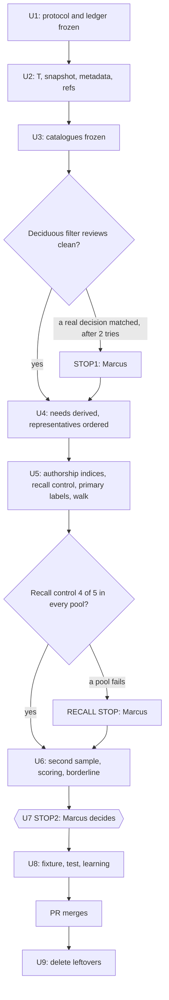

# feat: Measure whether real needs depend on decision stores outside Systematic docs

## Overview

This is a measurement, not a feature. Nothing is built to reach any external store.

Four trial repos each get one need pool. A need is a real "why, how, what did we" sentence that a human wrote in that repo's issues, PRs or opencode sessions. Each pool is labeled against a frozen catalogue: the repo's Systematic docs plus its external stores. A store earns a follow-up only if at least 5 needs in one pool cell are answered or helped by the store and by no Systematic doc.

There are five stores and six store-by-pool cells:

| Pool | Store | Cell |
|---|---|---|
| marcusrbrown/sparkle | Deciduous | 1 |
| fro-bot/agent | legacy records (RFCs/, PRD, `docs/decisions`) | 2 |
| fro-bot/agent | agent wiki (`docs/wiki`) | 3 |
| fro-bot/agent | .github wiki | 4 |
| fro-bot/.github | .github wiki | 5 |
| marcusrbrown/infra | runbooks | 6 |

The work runs in three phases. Phase A is scratch: mine, freeze, label and score, then stop for Marcus. Phase B commits three files: one learning, one evidence fixture and its shape test. Phase C deletes the leftovers after merge. The learning is written whatever the outcome, and a result where no store qualifies is valid.

## Problem Frame

The past-work researcher reads only `docs/solutions`, `docs/plans`, `docs/brainstorms` and `docs/ideation`. Some projects keep decisions elsewhere, and none of those stores reach the researcher. Building access has a carrying cost: a new source model, Pi delegate limits, config and tests. The hybrid-search evaluation found real lexical misses too rare to justify a second retrieval lane. The same question applies here: before building access to a store, count how many real needs depend on it.

In most trial repos the live decisions already sit in Systematic docs (118 solutions and 124 plans in fro-bot/agent, for example). Sparkle is the exception, with three Systematic docs. The origin document carries the full frame, R1 to R19 and AE1 to AE7; see origin: `docs/brainstorms/2026-11-01-decision-store-trial-requirements.md`.

## Requirements Trace

The origin defines R1 to R19 and AE1 to AE7. Every requirement maps to at least one unit.

| ID | Requirement (short form) | Units |
|----|--------------------------|-------|
| R1 | Five stores: Deciduous, legacy records, agent wiki, .github wiki, runbooks | U3 |
| R2 | One pool per repo; catalogue per pool; .github wiki scored in two pools, never summed | U3, U6 |
| R3 | Sources are human-written issue, PR and comment text plus sessions in the repo; read-only | U2, U4 |
| R4 | Fetch every issue and PR past list limits; record totals; text is fetched lazily in time order | U2, U4 |
| R5 | Dispatch prompts pass the verbatim filter, stay out of the floor and are reported as a count per pool; report the top-level and subagent split | U2, U4, U6 |
| R6 | Mining rules: human text only, leak check, authorship exclusion, one need per thread, "not a need" cut, echo drop | U4, U5 |
| R7 | At most 30 kept needs per pool, earliest first by `(t, id)`; `thin` below 15; pools never widened | U4, U5, U6 |
| R8 | Catalogue entry holds path, kind, status, title, headings and a bounded excerpt, built by direct reads | U3 |
| R9 | Deciduous entry adds description and edge rationale; a tightened title regex plus `autohealing` drops bot decisions, checked by two reviews; action nodes never answer | U3, U6 |
| R10 | Corrections file enters the catalogue; the ingest log stays out | U3 |
| R11 | Primary labeler sees only the catalogue and the need; a per-pool recall control gates its labels, which then freeze and count | U5 |
| R12 | Second labeler labels a hash-chosen 30% of each pool; agreement reported per pool | U6 |
| R13 | A need counts for a store when the store answers or helps and no Systematic doc does | U6 |
| R14 | A cell qualifies at 5 or more needs; counts are never summed across pools; `untestable` goes to Marcus | U6, U7 |
| R15 | Borderline by swap-in of second labels, both directions; Marcus decides | U6, U7 |
| R16 | A qualifying store becomes its own follow-up; others get nothing built | U7 |
| R17 | Every need is Systematic only, store only, both or nothing | U6, U8 |
| R18 | One learning with counts, floor, source mix, agreement, borderline stores, strata (including Deciduous post-write), sensitivities and caveats | U6, U8 |
| R19 | Raw text stays in scratch and is deleted after merge; committed evidence uses opaque IDs | U5, U8, U9 |

Acceptance examples AE1 to AE7 become scratch test scenarios in U6.

## Scope Boundaries

- No ranker runs. Whether search or grep reaches a qualifying store is a question for its follow-up.
- Nothing is built to reach any store: no extra Markdown roots, no store settings in config, no Deciduous query path.
- No change to `src/`, `agents/`, `skills/` or generated surfaces. No new `src/lib` module.
- infra ADRs are out, because infra has none.
- No store is changed, migrated or synced.
- The harness is never committed. Raw mined text, thread numbers and session IDs are never committed.
- Pools are never widened after the fact. A short pool reports its actual count.
- Extra labeling beyond the protocol is an amendment: logged in the ledger and named in the learning.

### Deferred to Separate Tasks

- A follow-up per qualifying store, designing how the researcher reaches it: separate plan, started only after Marcus's decision in U7.
- A fix for runbook-changing PRs that also add a plan or solution (residual risk in the origin): only if the runbook cell fails and the follow-up question is asked.

## Context & Research

### Relevant Code and Patterns

- The scratch harness at `~/.cache/systematic-scratch/hybrid/eval/code/` holds the reusable parts. It is outside the repo, uncommitted and never modified; U1 copies it. Reuse by class:
  - As-is: the `opencode run` cliproxy transport (fixture, hygiene, proxy, events, key), `retry.ts`, and the `guard/` and `ledger` pair that sit beside `code/`.
  - Generalize: `mining/{lib,sources,extract,authors,merge,label-lib}.ts` and `snapshot-opencode-db.ts`.
  - Pattern only: `mining/batch.ts` (`labelNext`) and `make-fixtures.ts`.
  - Drop: lexical runner, scorer, judge pool, gate, query conversion and the D, A and B candidates.
- Hybrid defaults that would silently break this trial:
  - `label-none` drops the item (here `nothing` is a valid outcome).
  - Sorting is source-rank first (here time only).
  - The same-primary-target merge collapses needs that share one store record.
  - `isBot` drops `fro-bot` (here the decisions define who is a bot).
  - Authorship keys are bare PR numbers, which collide across repos.
  - `sources.ts` has silent `--limit` caps that lose the earliest items.
  - Dedup is global, which makes pools order-dependent.
  - The session table drops `directory`.
  - `EVAL_MARKERS` and `EVAL_START_MS` are the hybrid eval's own.
  - The transport pins `OPENCODE_PIN = '1.19.5'` and reads the Systematic `.env` for `CLIPROXY_API_KEY`; keep the same machine and path.
  - The transport sets `XDG_DATA_HOME` per throwaway fixture, so labeler sessions never reach the live opencode DB.
- `src/lib/search-corpus.ts` (`loadCorpus`, `CorpusDocument`) reads the four Systematic kinds with a 256 KiB per-file skip. It enumerates the Systematic half of each catalogue as a cross-check (KTD14).
- `tests/unit/search-hybrid-fixtures.test.ts` and `tests/fixtures/search-hybrid-evidence.json` are the fixture and test precedent. Its raw-text guard, derived-totals recomputation and mutation test carry over. Its in-repo existence check, four-kind path grammar, hard-coded 60 entries and `floor-stop` assertions do not.
- `scripts/content-integrity.ts` loads `skills/ce-compound/references/schema.yaml` at runtime. A solution doc gets parse-safety, schema, citation and lifecycle checks. The citation scanner reads any `path.ext:N` token as an in-repo cite, including inside fenced lines.
- `.gitignore` ignores `docs/brainstorms/`, so the origin is untracked.

### Institutional Learnings

- `docs/solutions/best-practices/count-real-lexical-misses-before-adding-an-embeddings-lane-2026-11-01.md` is the protocol precedent:
  - cap and dedup, labels frozen before any evaluation, authorship and leak exclusions;
  - raw text in scratch, opaque IDs in the repo;
  - source mix and labeler agreement as caveats;
  - its Provenance and When-to-reopen sections are the learning template.
- Recommendations from the past-work scan: freeze the catalogue and rubric before labeling, and do not call a need store-only unless both sides can be reproduced. Take transport, PID-reaping and leak-scan details from the harness itself.

### External References

- GitHub GraphQL cursor paging at 100 nodes per page needs about 100 pages for the metadata of about 10,087 threads. The rate budget is 5,000 points per hour, so comment text is fetched lazily, not in bulk.

## Prior-Art Survey

```json
{
  "schema_version": 2,
  "verdict": "build-new-within-scope",
  "scope": "marcusrbrown/systematic worktree .worktrees/feat/decision-store-trial: scripts/, src/, tests/, agents/research/, .agents/skills/; plus fro-bot/.github packages/wiki-write-core/src",
  "freshness": {
    "vcs_reference": "0a5fa53003a77e3d1c2d666e22216583ef917fbd"
  },
  "budget": {
    "max_search_passes": 4,
    "max_candidate_inspections": 10,
    "exhausted": false
  },
  "candidates": [
    {
      "path_or_symbol": "src/lib/search-corpus.ts#loadCorpus",
      "description": "Reads one kind (KIND_TABLE: solution, plan, brainstorm, ideation) from a root and returns CorpusDocument records (path, kind, title, status, supersededBy, body) with per-file and total size limits and skip warnings.",
      "disposition": "insufficient",
      "insufficiency_reason": "It covers only the four Systematic kinds in one root and has no GitHub, session, or non-Systematic store input. It can enumerate the Systematic half of a catalogue as a library call, but it is not a mining or labeling pipeline and does not satisfy the concern alone."
    },
    {
      "path_or_symbol": "scripts/run-evals.ts",
      "description": "Runs fixed opencode evaluation cases (CASE_IDS bootstrap-loading, fixture-local-write, host-skill-coverage, model-inheritance) in isolated fixtures with an opencode availability probe and SDK pin.",
      "disposition": "insufficient",
      "insufficiency_reason": "It executes four fixed behavior cases against OpenCode; it has no need mining, no GitHub or session source, no labeling and no catalogue."
    },
    {
      "path_or_symbol": "tests/manual/with-without-eval/run-arm.sh",
      "description": "Runs one isolated opencode session per arm and captures the JSON transcript, with pre-registration documents and results directories.",
      "disposition": "insufficient",
      "insufficiency_reason": "It records A/B transcripts for a task; it does not mine existing history or label store coverage."
    },
    {
      "path_or_symbol": ".agents/skills/running-with-without-evals",
      "description": "Procedure for a pre-registered with/without-plugin comparison: pre-register the bar, keep a clean baseline, include the control that could disprove the thesis.",
      "disposition": "insufficient",
      "insufficiency_reason": "Process guidance for transcript comparisons; no code that mines needs or counts store answers. Its pre-registration discipline is a method reference only."
    },
    {
      "path_or_symbol": "agents/research/issue-intelligence-analyst.md",
      "description": "Agent that fetches GitHub issues with gh and groups them into themes and severity trends.",
      "disposition": "insufficient",
      "insufficiency_reason": "It produces themes, not verbatim need sentences; it has no authorship exclusion, leak check, cluster representatives, session source, or labeling."
    },
    {
      "path_or_symbol": "agents/research/learnings-researcher.md",
      "description": "Searches docs/solutions, and with past-work scope the plans, brainstorms and ideation kinds, through systematic_search; follows superseded successors within a kind.",
      "disposition": "insufficient",
      "insufficiency_reason": "It is the consumer whose reach the trial measures, bound to the four kinds. It is not a miner or labeler and cannot reach any external store."
    },
    {
      "path_or_symbol": "tests/unit/search-hybrid-fixtures.test.ts + tests/fixtures/search-hybrid-evidence.json",
      "description": "Committed opaque-id evidence fixture with a shape-only test: id regex, raw-text key ban, 160-char value cap, session-id regex, derived totals, in-repo target existence check.",
      "disposition": "insufficient",
      "insufficiency_reason": "Used as a pattern, not as the concern's mechanism. Its in-repo existence check, four-kind path grammar, 60-entry count and floor-stop assertions do not fit other-repo targets, so a new fixture and test follow its shape."
    },
    {
      "path_or_symbol": "scripts/content-integrity.ts#checkSolutionSchema",
      "description": "Validates docs/solutions frontmatter against skills/ce-compound/references/schema.yaml, with parse-safety, citation and lifecycle checks.",
      "disposition": "insufficient",
      "insufficiency_reason": "Used as a gate, not as the concern's mechanism: it checks the committed learning and measures nothing. It is run unchanged on the new learning."
    },
    {
      "path_or_symbol": "fro-bot/.github: packages/wiki-write-core/src/corrections.ts",
      "description": "Reads and writes knowledge/corrections.yaml: correction record types, lifecycle states, and read and write functions over the file with the yaml package.",
      "disposition": "insufficient",
      "insufficiency_reason": "It is the write-side library, with writeFile, stringify and imports of sibling modules in the package. The trial only reads one YAML file and needs none of that, so a plain YAML read of corrections.yaml is smaller than depending on the package."
    },
    {
      "path_or_symbol": "fro-bot/.github: packages/wiki-write-core/src/frontmatter.ts",
      "description": "Parses wiki page frontmatter (parseFrontmatterDocument) and renders or reconstructs a page with system-owned frontmatter.",
      "disposition": "insufficient",
      "insufficiency_reason": "Its parser throws on a page without frontmatter and its other functions write pages. The trial reads many files, some without frontmatter, and writes none, so a plain frontmatter read is enough and the package's build and dependencies are not needed."
    }
  ],
  "excluded_scopes": [
    {
      "scope": "~/.cache/systematic-scratch/hybrid/eval/code (mining, harness/transport, guard)",
      "reason": "Outside the repo and uncommitted. It is the reusable asset set described under Relevant Code and Patterns, not repo prior art."
    },
    {
      "scope": "docs/ (Starlight site) and skills/",
      "reason": "Documentation content and bundled skills that contain no mining, labeling or catalogue-building code; the skill contracts touched (ce-compound schema, ce-plan survey schema) are listed above."
    },
    {
      "scope": "the four trial repos' own scripts and tooling (sparkle, fro-bot/agent, fro-bot/.github, infra), except fro-bot/.github packages/wiki-write-core/src",
      "reason": "They are data sources for the trial, not the place a measurement harness would live. Their record readers (deciduous CLI, wiki ingest) are not used: the trial reads files directly. The wiki-write-core modules are the one exception, inspected above."
    }
  ]
}
```

## Key Technical Decisions

Decisions marked (Marcus) were confirmed by Marcus on 2026-11-01. The rest are planner defaults, recorded in the protocol so they are pinned before any pool data is seen.

- KTD1. **Measure in scratch; commit three files.** Everything runs under `~/.cache/systematic-scratch/dstore/eval/`. The repo gets one learning, one evidence fixture and one shape test. The hybrid harness is copied, never modified, and its tree hash is recorded before and after.
- KTD2. **Pre-register, then freeze in order.** One `protocol.md` is hashed at P0 and its hash goes into the hybrid hash-chained, write-once ledger, reused as it is. Phase order is enforced by the hybrid guard's existing phase machine where its steps fit, and by recording and checking the earlier phase's hash otherwise. Any change after P0 is a ledger-recorded amendment with a reason, and the learning names it.
- KTD3. **The catalogue freezes before any need text is derived.** The origin's listed order built the catalogue after leak and authorship checks, which need it. Freezing first stops a catalogue shaped by seen needs, the largest steering path.
- KTD4. **Mining unit: human-written text (Marcus).**
  - In: human issue and PR bodies, and every human comment and review comment on any thread, including threads a bot opened. The title of a human-opened thread counts as human text (Marcus).
  - Out: anything a bot wrote, and the title of a bot-opened thread.
  - Human means a GitHub `User` account not on the bot list: `app/*`, `*[bot]`, `fro-bot`, Renovate, `github-actions`, Copilot. A deleted account (null author) is unknown, not human.
  - Marcus's token may post agent-generated text, which cannot be detected. The learning states this.
- KTD5. **Sessions.** Top-level (root) session question sentences from `synthetic=0` user messages count. Subagent dispatch prompts are agent-written (Marcus), so they never take a pool slot or count toward the floor. They pass the verbatim need filter and are reported as a count per pool, with no extractor model call and no labels (KTD18).
- KTD6. **Echo and tool-meta rules (Marcus).** A human sentence that echoes 6 or more contiguous words of bot text on the same thread is dropped. A question about operating a store's tool, such as the Deciduous CLI, is not a need.
- KTD7. **Cluster and order.**
  - Thread is the cluster key. Linked issue and PR pairs merge through closing refs. Session items cluster by root session and a 3 h gap. There is no label-dependent same-primary merge.
  - Dedup is per pool by normalized sentence, so the same sentence in two pools is two needs.
  - The representative is the earliest non-dropped member by the need's own timestamp.
  - A pool keeps the first 30 needs that survive authorship and label drops, ordered by `(t, id)` only (Marcus). The cut happens in U5, never in U4.
  - The walk examines at most 105 representatives per pool. The hybrid run dropped 147 items against 60 kept, an attrition of about 71%, and 105 examined leaves about 30.
- KTD8. **Fetch scope.**
  - Thread metadata is fetched for every issue and PR with GraphQL cursor paging, and reconciled to `totalCount`.
  - Text is fetched lazily in ascending time, one calendar quarter at a time, until the pool has 105 representatives or the window edge `W` is reached, whichever comes first. `W` is recorded per pool. No label exists at this point, so the stop cannot depend on kept counts.
  - Items created after the cutoff `T` are ignored. `T` is fixed before the read.
- KTD9. **Six cells; floor is an absolute 5 per cell (Marcus).** A store qualifies if any one of its cells reaches 5. The .github wiki has two cells and is never summed across them (3 + 3 does not qualify; AE4 does).
- KTD10. **Relevance: helps counts like answers (Marcus).**
  - The labeler marks each catalogue record `answers` or `helps`.
  - A need counts for a store when the store has a record in either tier and no Systematic doc is in either tier. The same set drives authorship and leak checks.
  - This is the one definition of store-only: the store has a labeled record and no Systematic doc is labeled.
  - The answers-only count is a reported sensitivity.
  - Consequence: a Systematic doc that only helps moves a need from store-only to both, which is conservative for the stores.
  - Superseded records are labeled as-is, with no redirect to a successor.
- KTD11. **Deciduous filter (Marcus).**
  - The source is the pinned sparkle archive's `.deciduous/sync/nodes/*.json` and `.deciduous/sync/edges/*.json`, not `deciduous.db`, which is empty. The fields used are `node_type`, `title`, `description`, `metadata.commit` and the edge `rationale`.
  - The catalogue drops bot decisions by the broader tested title regex, case-insensitive, with `autohealing` added as an unanchored alternative and the first alternative tightened. R9 in the origin is updated to match.
  - The first alternative now requires either a `deps`, `deps-dev` or `dev` scope, or a dependency word after the verb. Unscoped `chore: update tsconfig and vite.config for WASM support` was wrongly dropped by the old form.
  - Regex: `^(chore|fix|build|ci|deps?)\((deps|deps-dev|dev)\)!?:\s*(update|bump|pin|lock file maintenance|migrate|replace)\b|^(chore|fix|build|ci|deps?)!?:\s*(update|bump|pin|migrate|replace)\s.*\b(dependenc(y|ies)|lockfile|lock file|renovate|monorepo|devDependencies)\b|^(update|bump|pin|lock file maintenance|pin dependencies)\b|^(chore|fix)\(deps(-dev)?\)|^chore\(deps|autohealing`. U1 pins the exact text; U3's two checks are the only allowed reason to change it.
  - Action nodes stay in the catalogue but never count as the record that answers or helps with a need (Marcus). Edges attach only to surviving nodes.
  - Two checks replace a single sample: review every matched title that carries no dependency signal, and review 20 kept titles chosen with a recorded seed. The reviewer is a fresh subagent working to a written standard: a dependency or lockfile change, or an autohealing or automation run. Titles stay in scratch for audit.
  - STOP1 fires if any reviewed match is a real decision after 2 iterations. A kept title that meets the standard is recorded and may prompt a regex iteration, but it does not stop the run.
- KTD12. **Thin and untestable (Marcus).** A pool with fewer than 15 kept needs is `thin`. A store whose only pool has fewer than 5 kept needs is `untestable` and goes to Marcus, not to "nothing built". For the two-pool .github wiki, untestable means both pools are under 5 (planner extension). Pools are never widened.
- KTD13. **Needs older than a store still count (Marcus).** The report gives each pool's need date range and a separate pre-store stratum, keyed to the first commit date of the store's records in that pool. The stratum is descriptive and never gates.
  - Deciduous also gets a post-write stratum: needs dated on or after the store's first commit, 2026-09-09. Its nodes were backfilled, with `created_at` dates back to 2020.
  - The stratum is reported next to the full count and at STOP2, and it never gates. The trial asks whether reaching the store would help a researcher now, and a backfilled record answers that as well as a live one.
- KTD14. **Equal catalogue entries.** Every entry has path or change ID, a code-assigned `store` column, kind, status, title, at most 12 headings, a 400-character excerpt, and for Deciduous a description and edge rationale capped at 300 characters. Entries are built once per `(repo, ref, path)` by direct file reads from a `git archive` of the pinned oid and reused byte for byte in both pools that hold them. `loadCorpus` runs as a cross-check and its size skips are reported, but no file is skipped from the catalogue.
- KTD15. **Includes and excludes.**
  - In: Systematic docs in the four kinds; agent `RFCs/*`, `docs/product/*`, `docs/decisions/*`; agent `docs/wiki/*`; .github `knowledge/wiki/{repos,topics,entities,comparisons}/*` and `knowledge/corrections.yaml`; infra `docs/runbooks/*`; filtered Deciduous nodes with edges.
  - Out: `knowledge/log.md`, `knowledge/index.md`, `knowledge/schema.md`, wiki READMEs, agent `docs/wiki/index.md`, `RFCS.md`, other repo docs (README, ARCHITECTURE, AGENTS).
  - Systematic docs in the catalogue are the only Systematic side. Store-only follows KTD10's labels, not a second rule. A need answered only by ARCHITECTURE.md shows as store-only or nothing, and the learning says so.
- KTD16. **Authorship is item-level, with per-store rules.** If a thread's PR, or a PR that closes it, authored any record in the need's relevant set, the whole need is dropped. A bot PR that authored a labeled target drops the human comments on that PR for that target. Keys are `owner/repo#n`. Rules per store:
  - Docs, legacy, agent wiki: `git log --diff-filter=A` at the pinned ref plus the `(#N)` squash suffix, and session write parts matched on absolute path per checkout.
  - Deciduous: `metadata.commit` to PR, the `(#N)` suffix on action titles, and `deciduous` CLI bash calls within 24 h. Unresolved nodes are reported as unmapped.
  - .github wiki: `sources[]` url and sha in page frontmatter, because its ingest PRs live in another repo.
- KTD17. **Labelers.** The primary labeler is `anthropic/claude-sonnet-5-5` and the second is `openai/gpt-5.6-luna`, both through the cliproxy transport with opencode 1.19.5.
  - One call per need. The first successful output is stored. A retry is allowed only on transport failure or an unparseable format, at most 2, with the same prompt.
  - The resolved model string is recorded per call. If it changes mid-run, the run stops.
  - `label-none` is the valid outcome `nothing`, not a drop. A failure after retries is a drop with reason `label-error`. Paths not in the catalogue are discarded and logged.
  - The second labeler labels `ceil(0.3 n)` of each pool's kept needs, chosen by lowest salted hash. Membership is frozen before any second call, and second labels never cause drops.
- KTD18. **Borderline and sensitivities.**
  - For each cell, swap the second labeler's outcome in for each sampled need, in both directions, and recompute the count with no extrapolation. A cell that crosses 5 is borderline.
  - A second label that would trigger an authorship drop removes that need's primary contribution to the swapped count, but not the need from `n`.
  - The stop package goes to Marcus with per-cell counts and every flipped need with both labels (Marcus).
  - Descriptive sensitivities that never gate: answers-only counts, a count of dispatch-prompt needs per pool, Deciduous cells resting only on unmapped nodes, the pre-store stratum and the Deciduous post-write stratum.
- KTD19. **The evidence fixture is a new file with a new test.** It stores pinned refs and catalogue hashes, not existence checks, and checks a path grammar per store. The hybrid test hard-codes 60 entries and `floor-stop`, so it stays untouched.
- KTD20. **Retention.** Delete the session snapshot (mode 0400) once the authorship indices are built and hashed. Delete everything under the scratch tree except the ledger and `protocol.md` after merge. The transport already isolates `XDG_DATA_HOME` per fixture, so labeler sessions never reach the live opencode DB and no sweep of it is needed. Cliproxy server logs are outside the trial's control. If the PR is abandoned, the same deletion runs 30 days after the stop decision (Marcus).
- KTD21. **Rehearse on non-pool data only.** The rubric and labeler prompts are tuned on the Systematic repo's own history and frozen before the first pool item. Reading pool label output before the rubric and walk rules are frozen is forbidden.
- KTD22. **Recall control before the primary labels freeze (Marcus).** Excerpts are truncated and both labelers see the same truncation, so a hidden Systematic doc would inflate store-only counts.
  - Each pool gets a seeded handful of planted needs. The seed, the count of 5 per pool and the bar are recorded in the protocol. Each need is written by hand from a Systematic doc in that pool's catalogue, labeled as such in scratch, and hashed before the first real label call. A pool with fewer than 5 candidate docs may reuse a doc, as sparkle's three must.
  - The primary labeler must return the planted doc for at least 4 of 5 in every pool.
  - A pool that fails stops for Marcus, and the record names the excerpt cap and the result.
  - Planted needs never enter the kept set or the counts. There is no blind human sample, because Marcus reviews flips at STOP2.

## Open Questions

### Resolved During Planning

- Who counts as human? A GitHub `User` not on the bot list (KTD4).
- Do dispatch prompts count? No. They are reported as a count per pool after the verbatim filter, with no labels (KTD5).
- Is the agent wiki in? Yes, as a fifth store in the agent pool only (R1).
- Does `helps` count? Yes, equally (KTD10).
- Which Deciduous filter? The tested regex, tightened, plus `autohealing`, with action nodes never answering and two reviews instead of one sample (KTD11).
- Do backfilled Deciduous needs count? Yes, with a post-write stratum reported next to the full count (KTD13).
- How is "first 30" ordered? By `(t, id)` after authorship and label drops, from a walk of at most 105 representatives (KTD7).
- Can truncated excerpts hide a Systematic doc? A recall control tests the labeler per pool before labels freeze (KTD22).
- How is the Systematic half of the catalogue built despite the 256 KiB skip? Direct reads, with `loadCorpus` as a cross-check (KTD14).

### Deferred to Implementation

- Catalogue size per labeler call: about 50 to 60k tokens is expected for the agent pool. U3 measures it and lowers the uniform excerpt cap before the freeze if the model context needs it.
- The trial marker list for the eval-window exclusion: U1 pins narrow trial-only terms (for example `decision-store`, `store trial`, `need pool`, the branch name). `deciduous` and `wiki` alone are not markers.
- The salt value, the quarter boundaries and the exact cutoff `T`: fixed in U1 and U2 before the read.
- Whether the GraphQL budget forces a pause between pools: U2 and U4 checkpoint and resume.
- The unmapped-node share for Deciduous authorship: known only after U5.

## Output Structure

Scratch only, described paths under `~/.cache/systematic-scratch/dstore/eval/`:

```text
eval/
  protocol.md              hashed at P0, amendments appended
  ledger/                  hybrid ledger, copied as it is
  guard/                   hybrid guard, copied as it is
  code/                    copy of the hybrid harness, without frozen/ and cache/
  prompts/                 rubric, labeler system and user templates
  snapshot/                session snapshot (0400), deleted in U5
  work.db                  sessions with directory and parent
  gh/                      thread metadata per repo, then lazy text
  refs/                    git archive extractions per pinned oid
  catalogue/               entry text and parts per pool
  needs/                   candidates, exclusions, ordered representatives
  labels/                  raw primary, second and recall-control labels
  report/                  counts, swaps, stop package
```

Committed:

```text
docs/solutions/best-practices/<slug>-<date>.md
tests/fixtures/decision-store-trial-evidence.json
tests/unit/decision-store-trial-fixtures.test.ts
```

## High-Level Technical Design

> *This illustrates the intended approach and is directional guidance for review, not implementation specification. The implementing agent should treat it as context, not code to reproduce.*



Each phase records its hash in the ledger. The hybrid guard's phase machine enforces order where its steps fit, and each script checks the earlier phase's hash otherwise. U7 always stops. Borderline and untestable stores are named in its package.

## Implementation Units

### Phase A: Measurement (scratch only)

- [ ] U1. Protocol, ledger and harness fork

**Goal:** Every decision the protocol pins is hashed in the ledger before any pool data is read.

**Requirements:** R3, R6, R7, R11, R19

**Dependencies:** None

**Files (all scratch, described paths under `~/.cache/systematic-scratch/dstore/eval/`):**
- Create: `code/`, a copy of `~/.cache/systematic-scratch/hybrid/eval/code/` without `code/frozen/` (1.3 GB) and `code/cache/`, and with the hybrid-specific modules removed
- Create: `guard/` and `ledger/`, copies of the hybrid `guard/` and `ledger` that sit beside `code/`, unmodified
- Create: `protocol.md`, `prompts/` and the first ledger records

**Approach:**
- Copy `code/`, `guard/` and `ledger` from the hybrid tree, skipping `code/frozen/` and `code/cache/`, which stay out of the tree hash. Record the original's hash before and after. Never modify the original.
- Keep the transport, `retry.ts`, the guard and the ledger as they are. Add `protocol.md` and put its hash in the ledger. Use the guard's existing phase machine where its steps fit, and record per-pool corpus and phase hashes in the ledger otherwise, with each script checking the earlier hash before it runs. There is no generalized ten-phase guard.
- Replace the hybrid defaults listed under Relevant Code and Patterns: keep `nothing` as an outcome, sort by `(t, id)`, key threads by `owner/repo#n`, dedup per pool, and widen the `Kind` type.
- Drop the hybrid-specific modules, the `search` source and the hybrid eval's markers.
- Freeze in `protocol.md`: every KTD number (thresholds 6 words, 24 h, 3 h, 105, 30, 15, 5, quarter windows), the exact Deciduous regex and review standard, the recall-control seed, count and bar, the bot list, the trial marker list and trial date window, the salt, the rubric, all prompts, the two model pins, the opencode pin and the code tree hash.
- Freeze the "not a need" rubric here, so a model call that only classifies "not a need" is allowed in U4. Rehearse the rubric and labeler prompts on the Systematic repo's own history, which is not a pool (KTD21).

**Execution note:** Port the hybrid tests first and keep them green before changing the mining modules.

**Patterns to follow:**
- `guard/guard.ts`, `guard/ledger.ts` and `harness/transport/probe.ts` in the hybrid tree.

**Test scenarios:**
- Happy path: the ledger accepts the protocol record and re-hashing the unchanged tree matches.
- Error path: tampering with an earlier ledger line breaks the chain and `verify` fails.
- Error path: starting a phase without the previous phase's hash is refused, and a second write of a write-once record is refused.
- Edge case: two pools produce distinct corpus hashes, recorded in the ledger, and a script refuses to run on a mismatch.
- Edge case: the copy omits `code/frozen/` and `code/cache/`, and the tree hash is the same with or without them present in the original.
- Integration: the transport probe reaches both pinned models through opencode 1.19.5.

**Verification:**
- The ledger holds the P0 record with `protocol_sha256`, `prompts_sha256` and `code_tree_sha256`.
- A dry run refuses every out-of-order transition the guard covers, and the scripts refuse the rest.
- The hybrid tree hash is unchanged.

- [ ] U2. Snapshot, thread metadata and pinned refs

**Goal:** The session snapshot, thread metadata and per-repo refs exist, hashed, under a fixed cutoff `T`.

**Requirements:** R3, R4, R5

**Dependencies:** U1

**Files (scratch):**
- Create: `snapshot/` and `work.db`, from a generalized `snapshot-opencode-db.ts` and `extract.ts`
- Create: `gh/` metadata per repo, and `refs/` extractions per pinned oid

**Approach:**
- Record `T` in the ledger before any read.
- Open the live DB read-only with `query_only`. Filter by exact `session.directory` for the four checkouts before touching parts; never use `LIKE` on `part.data`. Expect a snapshot of about 2.7 to 2.9 GB. Keep `directory` and `parent_id` in `work.db` so sessions map to pools and split into top-level and subagent.
- Fetch metadata for every issue and PR with GraphQL cursor paging: number, kind, createdAt, state, author login and type, comment count and closing refs. Reconcile to `totalCount` at the same instant. Tag transferred issues and fork PRs. Treat a null author as unknown.
- Report totals per repo by state and by author class (human, bot, deleted), and the top-level and subagent session split per pool.
- Fetch and pin the remote default-branch oid per repo once, then `git archive` it. Never read the working trees: sparkle's checkout sits on a feature branch and two local `origin/main` refs are stale.

**Patterns to follow:**
- `snapshot-opencode-db.ts` and `mining/extract.ts` in the hybrid tree.

**Test scenarios:**
- Happy path: a page source of 1,600 fake items is fetched in full and totals match the reported `totalCount`.
- Edge case: the earliest item survives a fake source larger than 1,500, which the hybrid `--limit` caps would lose.
- Edge case: a null author is classed unknown, not human.
- Error path: a sampled session in `bfra-me/.github` is excluded by exact directory match.
- Error path: the snapshot file is not writable after creation, and the read-only DB open refuses a write.
- Edge case: `work.db` keeps `directory` and `parent_id` for every session.

**Verification:**
- The ledger holds `T`, the manifest hashes, per-repo totals and the four refs.
- The top-level and subagent split per pool is recorded.
- GraphQL totals reconcile for all four repos.

- [ ] U3. Catalogues, Deciduous filter and yield forecast

**Goal:** Four frozen catalogues, each built from pinned archives, and a metadata-only forecast, before any need text is derived.

**Requirements:** R1, R2, R8, R9, R10

**Dependencies:** U2

**Files (scratch, plus the repo reader noted):**
- Create: `catalogue/` entry text, parts and per-pool hashes, and the Deciduous review record
- Read: `src/lib/search-corpus.ts` for the cross-check

**Approach:**
- Build one entry per record as KTD14 specifies, using each store's native metadata: Systematic `symptoms` and `tags`, Deciduous description plus edge rationale, wiki `type` and `tags`. Apply the KTD15 includes and excludes.
- Read Deciduous from the pinned archive's `.deciduous/sync/nodes/*.json` and `.deciduous/sync/edges/*.json`, using `node_type`, `title`, `description`, `metadata.commit` and the edge `rationale`.
- Run the KTD11 regex, then the two checks: a fresh subagent reviews every matched title with no dependency signal, plus 20 kept titles chosen with a recorded seed, to the written standard (a dependency or lockfile change, or an autohealing or automation run). Allow at most 2 iterations. Titles stay in scratch for audit; the ledger gets the seed, the counts and the regex.
- Measure catalogue tokens per labeler call. If the agent pool exceeds the model context, lower the uniform excerpt cap for every kind and rebuild before the freeze.
- Write a forecast per pool from metadata only: counts of human-opened threads, human-commented bot threads, comment totals, and thread dates against each store's first record. The forecast pre-flags `thin` and `untestable` and changes no rule.
- Freeze the catalogues in the ledger. A change after this point is an amendment, allowed only before U4 starts.

**Execution note:** Hard stop. If any reviewed match is a real decision after 2 iterations, STOP1 sends the regex, the seed and the flagged titles to Marcus. Nothing continues until he decides.

**Patterns to follow:**
- `buildCatalogue` in `mining/label-lib.ts` for the line shape, widened per KTD14.

**Test scenarios:**
- Happy path: the regex drops Renovate-style titles, `chore(deps): maintain lockfiles` and `autohealing` titles, and keeps `docs:`-prefixed and `feat(graph)` titles.
- Edge case: `chore: update tsconfig and vite.config for WASM support` is kept, because it has no deps scope and no dependency word.
- Error path: a reviewed match judged a real decision after the second iteration raises STOP1.
- Edge case: a Deciduous action node is present in the catalogue but flagged so U6 never counts it.
- Edge case: a file over 256 KiB is in the catalogue, and the `loadCorpus` cross-check reports it as skipped.
- Edge case: wiki entries are byte-identical in the agent and .github catalogues.
- Error path: `knowledge/log.md`, `index.md`, `schema.md`, wiki READMEs and `RFCS.md` are absent from every catalogue.
- Happy path: the corrections record enters as an entry.
- Edge case: entry text for a plan and a Deciduous node obey the same excerpt and heading bounds.
- Integration: the catalogue hash is stable across two builds from the same pinned oid.

**Verification:**
- `catalogue_parts[]`, per-pool `catalogue_sha256`, the review record and the forecast are in the ledger.
- The token estimate fits the model context.
- STOP1 either did not trigger or is recorded as decided.

- [ ] U4. Need derivation

**Goal:** Per pool, an ordered, frozen list of human-text representatives, derived before any label exists.

**Requirements:** R3, R4, R5, R6, R7

**Dependencies:** U3

**Files (scratch):**
- Create: `needs/` candidates with drop reasons, clusters, ordered representatives, the window edge `W` and the walk limit

**Approach:**
- Fetch text lazily in ascending quarter windows (KTD8) until the pool has 105 representatives or reaches `W`, whichever comes first. The 30-kept cut is not made here; it happens in U5.
- Apply the eval-marker step first: drop sessions and threads that match the trial-only marker list or fall in the trial date window.
- Strip HTML comments, code fences, quoted lines, checklists, link-only lines and suggestion blocks before sentence splitting.
- Candidate classes: `human-body`, `human-comment-human-thread`, `human-comment-bot-thread`, `session-question` and `session-dispatch`. Tag each with `need_form`: title, body sentence or comment question.
- Sentence rule: a GitHub title (prefix stripped) if it has at least 5 words, else the first body sentence; for comments, the first qualifying question or WH sentence by position. No picking by judgment.
- Apply in order: bot-text exclusion, the 6-word echo drop, the store-tool meta rule, the verbatim filter and the frozen "not a need" rubric (regex plus model classification). No post-label manual drops.
- Dispatch prompts pass the same verbatim filter and are counted per pool. They get no extractor call, no label and no pool slot.
- Dedup per pool, run the mechanical leak check against the frozen catalogue (paths, filenames, titles and store-native IDs such as `RFC-012`, wiki slugs, Deciduous change IDs and plan filenames), cluster by KTD7 and order by `(t, id)`.

**Patterns to follow:**
- `splitSentences`, `questionSentences`, `leakReason`, `buildClusters` and `pickRepresentatives` in `mining/lib.ts`, with the ordering changed to time only.

**Test scenarios:**
- Happy path: a human comment on a bot-opened thread yields a need tagged `human-comment-bot-thread`.
- Error path: a bot-written body or comment never yields a candidate, and the bot thread still serves the echo rule.
- Edge case: a human sentence sharing a 6-word run with the bot text is dropped; a 5-word run is kept.
- Edge case: "how do I run the deciduous CLI" is dropped by the meta rule.
- Edge case: `fro-bot` (a User account) is classed as a bot; a null author is not a need source.
- Edge case: a session need timestamped before a GitHub need sorts first (time only, no source rank).
- Edge case: the same sentence in two pools yields two needs.
- Edge case: a linked issue and PR merge into one cluster; two session items 4 h apart do not.
- Edge case: a thread dated inside the trial window, or a session that names a trial marker, is dropped by the eval-marker step.
- Error path: a dispatch need never enters a pool's representative list, and only its per-pool count is reported.
- Error path: a candidate sentence that is not a verbatim substring of its source text is dropped with `extraction_not_verbatim`.
- Integration: the lazy fetch stops at 105 representatives or at `W`, whichever comes first, records `W`, and does not stop at 30.
- Edge case: a pool that reaches `W` with 80 representatives passes all 80 to U5.

**Verification:**
- Per-pool `needs_sha256`, the exclusions log hash, the ordered representative list, `W` and the source mix by class are in the ledger. No relevance label call has run. A model call that only classifies "not a need" is allowed, and its rubric was frozen in U1.
- Every drop has a reason.

- [ ] U5. Authorship indices and primary labels

**Goal:** Each pool's kept set (up to 30), from frozen primary labels that passed the recall control.

**Requirements:** R5, R6, R7, R11, R19

**Dependencies:** U4

**Files (scratch):**
- Create: authorship indices per pool under `needs/`, the planted recall-control needs, raw `labels/` rows, the walk log and the kept-set hash

**Approach:**
- Build the authorship indices (KTD16) after the catalogue freeze and before the first label call. Report the unmapped Deciduous share.
- Run the recall control (KTD22) before the real walk: write the planted needs from the seeded Systematic docs, hash them, label them with the primary labeler, and check that each pool returns the planted doc for at least 4 of 5. A failing pool stops for Marcus (RECALL STOP) with the excerpt cap and the result recorded. Planted needs are discarded from every kept set and count.
- Walk each pool's representatives in strict `(t, id)` order. For each: one primary call, with catalogue plus need and no search output (R11). Drop on authorship against the relevant set or a label-time leak. Promote the next member of the same cluster on a drop. Stop at 30 kept or 105 examined. This is where the 30-kept cut happens.
- Store the first successful output append-only. Apply the KTD17 retry and model-string rules.
- Delete the session snapshot once the indices are built and hashed (KTD20).

**Patterns to follow:**
- `labelNext` in `mining/batch.ts` and `authorshipReason` in `mining/label-lib.ts`.

**Test scenarios:**
- Happy path: a need whose labels hit a store record and no Systematic doc is kept as store-only.
- Edge case: `label-none` is kept as `nothing`, not dropped.
- Error path: a label failing after 2 retries is dropped as `label-error` and counted.
- Edge case: PR #50 in fro-bot/agent and PR #50 in fro-bot/.github never collide.
- Edge case: a need whose PR authored one labeled record is dropped whole, not reduced to store-only.
- Edge case: a Deciduous action title with `(#N)` maps to PR N; a node with an unresolvable commit is counted as unmapped.
- Edge case: a wiki page citing the need's own PR in `sources[]` triggers the authorship drop.
- Integration: a session in the agent directory that wrote into the .github checkout counts as authoring a .github record, matched on absolute path.
- Error path: a catalogue path not in the catalogue is discarded and logged; if nothing valid remains the label is `nothing` and flagged.
- Error path: a changed resolved model string stops the run.
- Edge case: a pool that hits the walk cap of 105 with 22 kept reports 22.
- Happy path: the recall control passes a pool that returns the planted doc for 4 of 5, and the planted needs appear in no kept set.
- Error path: a pool that returns the planted doc for 3 of 5 raises the RECALL STOP and records the excerpt cap.
- Edge case: a planted need written from one of sparkle's three docs shares a doc with another planted need.

**Verification:**
- The planted needs and the recall-control result per pool are in the ledger before the first real label call.
- Per-pool `labels_sha256`, `walk_sha256` and `kept_set_sha256` are in the ledger, with every drop reason and the unmapped share.
- The snapshot file is deleted and the deletion is recorded.

- [ ] U6. Second sample, scoring and borderline

**Goal:** Frozen second labels, a pure decision function, and per-cell counts with borderline flags.

**Requirements:** R2, R5, R9, R12, R13, R14, R15, R17, R18

**Dependencies:** U5

**Files (scratch):**
- Create: `labels/` second rows, the outcome table, `report/` counts, swap table, agreement and sensitivities

**Approach:**
- Compute second-sample membership (KTD17) from each pool's kept set and the P0 salt, hash it, then call the second labeler. A sampled need whose second call fails is excluded from the swap and listed.
- Write the outcome function once, pure, in one place. Per need it takes the primary labels and returns the outcome plus per-store flags under KTD10, with Deciduous action nodes removed from the store side. A need answered by two stores and no Systematic doc counts for both.
- Report per cell: `n`, count, ratio and `distinct_store_records`; `thin` and `untestable`; the overlap matrix for the agent pool; the source mix and `need_form` per pool; the date range, the pre-store stratum and the Deciduous post-write stratum (needs dated on or after 2026-09-09); and agreement per pool (kappa, Jaccard, primary agreement, universe the catalogue size), as `null` when n is 0 or the second sample is empty.
- Report the descriptive sensitivities in KTD18, including the dispatch-prompt count per pool.
- Compute borderline by the swap rule in KTD18.

**Patterns to follow:**
- `labelAgreement` in `mining/label-lib.ts` and the derived-totals idea in `make-fixtures.ts`.

**Test scenarios:**
- Happy path (AE1): 9 legacy-answered needs, 6 of which a Systematic doc also helps, give a count of 3.
- Happy path (AE2): 7 of 25 sparkle needs answered by Deciduous and no Systematic doc qualify Deciduous.
- Happy path (AE3): infra yields 12 representatives and 2 count for runbooks; the report shows 2 of 12.
- Edge case (AE4): the wiki has 2 in the agent pool and 6 in the .github pool, so it qualifies; 3 and 3 does not.
- Edge case (AE5): a cell at 5 that drops to 4 under the swap is borderline; so is a cell at 4 that rises to 5.
- Edge case: a sampled need whose second labels would trigger an authorship drop removes its contribution to the swapped count but stays in `n`.
- Edge case: sample size is `ceil(0.3 n)` for n = 1, 5, 10 and 30.
- Edge case: a need that a store answers and a Systematic doc only helps is `both`, and the answers-only sensitivity shows it differently.
- Edge case: a need whose only Deciduous hit is an action node has no store contribution.
- Edge case (AE6): a pool at 14 is `thin`; a single-pool store at 4 is `untestable`; the wiki is untestable only if both pools are under 5.
- Edge case (AE7): `helps`-only store hits count toward the floor.
- Error path: a failed second call leaves that need on its primary outcome and is listed.
- Integration: the outcome function gives the same answer on the same labels in any order.

**Verification:**
- `sample_sha256`, `second_sha256`, `outcomes_sha256` and `counts_sha256` are in the ledger.
- Every qualifying, borderline, `thin` and `untestable` flag is derived, not typed.

- [ ] U7. Stop package and Marcus's decision

**Goal:** Marcus decides each store with the evidence in front of him, and the decision is recorded without recomputation.

**Requirements:** R14, R15, R16

**Dependencies:** U6

**Files (scratch):**
- Create: `report/stop-package` and the `decisions` ledger record

**Approach:**
- STOP2 is mandatory, whatever the result. The package holds per-cell counts, the swap table, every flipped need with both labels (IDs, with sentences available from scratch on request), source mix, agreement, the pre-store stratum, the Deciduous post-write stratum next to the full Deciduous count, the recall-control results, the sensitivities, `thin` and `untestable` flags, and the share of any Deciduous count that rests only on unmapped nodes.
- Marcus decides every borderline and untestable store and the final decision per store. The record names the inputs he saw and the date and reason.
- Extra labeling, such as the second labeler on all unsampled needs, is an amendment and is reported as one.

**Test expectation:** none -- a human decision gate; scratch checks cover the package contents.

**Verification:**
- A `decisions_sha256` record exists naming the date, the inputs shown and each store's outcome.
- Any amendment is in the ledger with its reason.

### Phase B: Evidence (repo)

- [ ] U8. Learning, evidence fixture and shape test

**Goal:** The decision and its protocol survive in the repo without the harness or any raw mined text.

**Requirements:** R17, R18, R19

**Dependencies:** U7

**Files:**
- Create: `docs/solutions/best-practices/<slug>-<date>.md`
- Create: `tests/fixtures/decision-store-trial-evidence.json`
- Create: `tests/unit/decision-store-trial-fixtures.test.ts`

**Approach:**
- Write the learning whatever the outcome, from the hybrid learning's template: Context, Finding, Protocol, Frozen settings, Caveats, Cost, When to reopen, Provenance, Related. It records:
  - counts per cell, the floor, the source mix by class, agreement, borderline and untestable stores and Marcus's decisions;
  - every ledger amendment, the recall-control results, the Deciduous post-write stratum and the sensitivities;
  - caveats: agent-written text in Marcus's account, the Systematic-only catalogue scope, early-history sampling, unmapped authorship, the lazy window edge, topic mismatch for the .github pool, and the scratch tree hash.
- Citation hygiene: no `path.ext:N` token for any other repo's file. Cite by opaque ID or `repo@short-sha`. Verify with `bun scripts/content-integrity.ts`.
- The fixture holds:
  - a header: pinned refs per `(repo, pool)`, catalogue hashes, the decision rule, labelers, scratch hashes and `ci_reproducible:false` for every external target;
  - agreement stats per pool, `null` when n is 0 or the second sample is empty;
  - derived totals;
  - one entry per kept need: an opaque ID (`n-(sp|ag|gh|in)-NNN`, assigned after sorting by a salted hash), pool, `source` class, a month bucket, outcome, Systematic paths, store references and the second-labeler record;
  - a `decisions[]` block present only where a cell is borderline or untestable.
- The test checks shape and derived values, with no filesystem existence check:
  - IDs match the pool prefix, are unique, and a pool has 0 to 30 entries, with no hard-coded total;
  - outcome agrees with the arrays (`systematic-only`, `store-only`, `both`, `nothing`);
  - each store is in the pool's `stores`, and `repo` agrees with the store (the wiki is always in `fro-bot/.github`);
  - paths match a grammar per store: Systematic `^docs/(solutions|plans|brainstorms|ideation)/.+\.md$`, legacy `^(RFCs/RFC-\d{3}-.+\.md|docs/(decisions|product)/.+\.md)$`, agent wiki `^docs/wiki/(?:.+/)?(?!index\.md$|README\.md$)[^/]+\.md$`, wiki `^knowledge/wiki/(repos|topics|entities|comparisons)/(?:.+/)?(?!index\.md$|README\.md$)[^/]+\.md$`, corrections `^knowledge/corrections\.yaml$`, runbook `^docs/runbooks/.+\.md$`, Deciduous a UUID;
  - every ref is 40-hex;
  - totals, `qualifies`, borderline, `thin` and `untestable` are recomputed from entries, and a mutation test proves a tampered total differs;
  - Marcus's override is a separate field from the derived `qualifies`;
  - the hybrid raw-text guard carries over: banned keys, values of at most 160 characters, and the `ses_` session-ID regex over the whole file text, plus no thread numbers.

**Patterns to follow:**
- `tests/unit/search-hybrid-fixtures.test.ts` and `tests/fixtures/search-hybrid-evidence.json`.
- `docs/solutions/best-practices/count-real-lexical-misses-before-adding-an-embeddings-lane-2026-11-01.md`.
- `make-fixtures.ts` in the hybrid scratch tree for emitting the fixture from frozen files.

**Test scenarios:**
- Happy path: the fixture parses and every ID, enum and path matches its grammar.
- Error path: a `store-only` entry with a non-empty `systematic` array fails.
- Error path: a wiki entry outside `knowledge/` paths, or a Deciduous ref that is not a UUID, fails.
- Error path: a free-text value over 160 characters, a banned key or a `ses_` ID fails the raw-text guard.
- Edge case: a pool with 31 entries fails; a pool with 0 entries passes, and its agreement stats are `null`.
- Error path: a legacy entry at `RFCS.md`, an agent-wiki entry at `docs/wiki/index.md` and a wiki entry at a `README.md` each fail the grammar.
- Edge case: a tampered total, `qualifies` flag or `thin` flag differs from the recomputed value.
- Edge case: `decisions[]` present without a borderline or untestable cell fails.
- Edge case: a store not in its pool's `stores` fails.
- Edge case: the .github wiki appears in both pools and is counted per pool, never summed.

**Verification:**
- `bun test tests/unit/decision-store-trial-fixtures.test.ts` passes; `bun run typecheck:all` and `bun run lint` pass.
- `bun scripts/content-integrity.ts` passes with the new learning.
- `bun run surfaces:affected` reports no generated surface touched.
- A `systematic_search` for the learning's symptom returns it.
- The fixture holds no raw text, thread numbers or session IDs.

### Phase C: Retention (after merge)

- [ ] U9. Delete leftovers

**Goal:** No raw mined text, catalogue text or harness copy remains once the PR merges.

**Requirements:** R19

**Dependencies:** U8 and the merged PR. The 30-day deadline after the stop decision applies only if the PR is abandoned.

**Files (scratch):**
- Delete: everything under `~/.cache/systematic-scratch/dstore/eval/` except the ledger and `protocol.md`, including `gh/`, `refs/`, `work.db`, `needs/`, `labels/`, `catalogue/`, `code/`, `guard/`, `prompts/`, `report/` and transport logs
- Keep: the ledger and `protocol.md`, which hold hashes and decisions only
- Create: the `deleted` ledger record with the manifest

**Approach:**
- Run the deletion as a dry run listing paths and sizes, then delete.
- Labeler sessions need no cleanup in the live opencode DB, because the transport isolates `XDG_DATA_HOME` per fixture. Cliproxy server logs are outside the trial's control, and the learning says so.
- Record the manifest hash in the ledger.
- If the PR is abandoned, run the same deletion 30 days after the stop decision.

**Test scenarios:**
- Happy path: after deletion the only entries under the scratch tree are the ledger and `protocol.md`.
- Edge case: the dry-run listing names `code/`, `prompts/` and `report/`, which an incomplete delete list would miss.
- Edge case: the deletion refuses to run while the PR is open and fewer than 30 days have passed since the stop decision.

**Verification:**
- The `deleted` record names what was removed and when.
- No raw directory remains, and the snapshot deletion from U5 is on record.

## System-Wide Impact

- **Interaction graph:** Phase A touches nothing in the repo. Phase B adds three files and changes no existing code.
- **Error propagation:** A failed phase stops at its recorded hash check. Nothing re-runs silently; each re-run is an amendment.
- **State lifecycle risks:** The ledger is append-only. Raw data is the only mutable state, and U9 removes it. After deletion a recount is impossible, so ce:review fixes finish before merge.
- **API surface parity:** None. No search, researcher or config surface changes.
- **Integration coverage:** The scratch tests cover the join points that a shape test cannot: cross-repo keys, authorship per store, the swap arithmetic and the pure outcome function.
- **Unchanged invariants:** `systematic_search` still reads only four Systematic kinds. The researcher prompt is unchanged. The hybrid fixture and test are untouched. No generated surface regenerates.

## Risks & Dependencies

| Risk | Mitigation |
|------|------------|
| Catalogue per labeler call is too large for the model context | U3 measures it and lowers one uniform excerpt cap for every kind before the freeze; never trim one store |
| Attrition (about 71% in the hybrid run: 147 drops against 60 kept) leaves a pool short | The 105-representative walk cap, with the 30-kept cut only in U5; a short pool reports its actual count, flagged `thin`; no widening |
| Sparkle yields few needs, so Deciduous may be `untestable` | The forecast pre-flags it; `untestable` goes to Marcus at STOP2 |
| The label bar decides the result | `helps` counts equally by decision; the answers-only count is a reported sensitivity |
| Early needs predate their stores, and Deciduous was backfilled | They count; the report adds a pre-store stratum and a Deciduous post-write stratum, both descriptive and shown at STOP2 |
| Truncated excerpts hide a Systematic doc, inflating store-only | Per-pool recall control at 4 of 5 before labels freeze; a failing pool stops for Marcus; Marcus reviews flips at STOP2 |
| The Deciduous filter drops real decisions | Tightened regex; every matched title with no dependency signal reviewed, plus 20 kept titles; 2-iteration cap; STOP1 |
| Authorship is asymmetric across stores and inflates store-only | Per-store rules; unmapped share reported; a Deciduous count resting only on unmapped nodes is named at STOP2 |
| The echo of store-derived bot text inflates counts | The 6-word echo drop; bot text never counts |
| Marcus's token posts agent-written text | Stated as a caveat; cannot be detected |
| Providers ignore temperature 0, so labels change on re-run | Store the first successful output; retry only on transport or format failure |
| GraphQL budget (5,000 points per hour) | Metadata for all threads, text lazily; checkpoint and resume |
| The live opencode DB is 51 GB | Filter by `session.directory` first; no `LIKE` on part data |
| Raw text lingers on disk or in logs | Session snapshot deleted after U5; labeler sessions are isolated per fixture; U9 deletes the rest after merge, with a 30-day deadline only for an abandoned PR; cliproxy server logs are outside the trial's control |
| The citation scanner fails the learning on `path.ext:N` | Cite other repos' files by ID or `repo@short-sha`; run the content gate |
| A post-data choice steers the counts | Freeze order, amendments logged, sensitivities descriptive only; STOP2 is the intended human judgment |
| Runbooks may fail by construction | Reported as is, with `n`, count and `distinct_store_records` |

## Documentation / Operational Notes

- The learning is the main durable output. It records the protocol and the scratch tree hash, so the work can be repeated without the harness in the repo.
- Phase A needs the cliproxy key from the Systematic `.env` and the pinned opencode 1.19.5 on the same machine. Disk need is about 4 to 5 GB; the risk is retention, not space.
- Budget (planner estimate): primary labels up to 420 at the walk cap (about 150 expected), 20 recall-control labels, about 40 second labels, and the "not a need" rubric calls. This replaces the origin's earlier 300 to 400 estimate.
- Token budget: each agent-pool call carries about 70 to 80k tokens of catalogue. That gives about 11M tokens expected and up to about 30M at the cap.

## Sources & References

- **Origin document:** `docs/brainstorms/2026-11-01-decision-store-trial-requirements.md`. This path is untracked (gitignored) and exists only in the primary checkout. A clone will not have it. The plan restates R1 to R19 and AE1 to AE7 in short form, so it can be read without the origin.
- Related past work, recorded completed: `docs/plans/2026-10-31-001-feat-hybrid-search-evaluation-plan.md`. It measured lexical misses on 60 mined needs against Systematic docs only, behind a floor of 8, and ended in a floor stop. This plan reuses its protocol and harness. It differs in four ways: four pools, each with its own catalogue that spans external stores; the mining unit is human-written text with comments and bot-opened threads; the floor is 5 per store-by-pool cell; and it has no ship path, only a decision for Marcus.
- Related past work, recorded completed: `docs/plans/2026-10-30-001-feat-search-past-work-plan.md`. It added the plan, brainstorm and ideation kinds and deferred external stores to a read-only trial. This plan is that trial. It changes no search code and builds no reach.
- Related learning: `docs/solutions/best-practices/count-real-lexical-misses-before-adding-an-embeddings-lane-2026-11-01.md`.
- Related code: `src/lib/search-corpus.ts`, `tests/unit/search-hybrid-fixtures.test.ts`, `tests/fixtures/search-hybrid-evidence.json`, `scripts/content-integrity.ts`, `skills/ce-compound/references/schema.yaml`.
- Scratch inputs (uncommitted): the hybrid harness at `~/.cache/systematic-scratch/hybrid/eval/code/`, and the store survey, research, flow analysis and decisions notes under `~/.cache/systematic-scratch/dstore/`.
