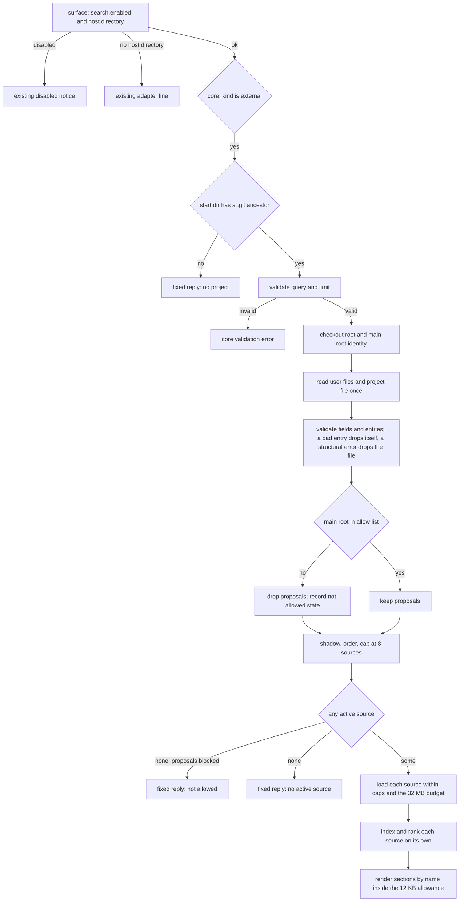
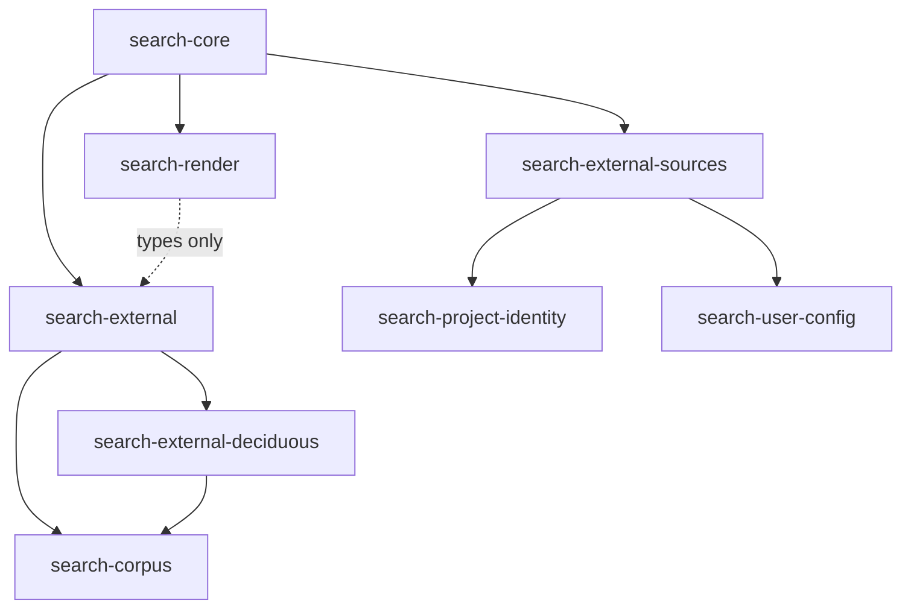
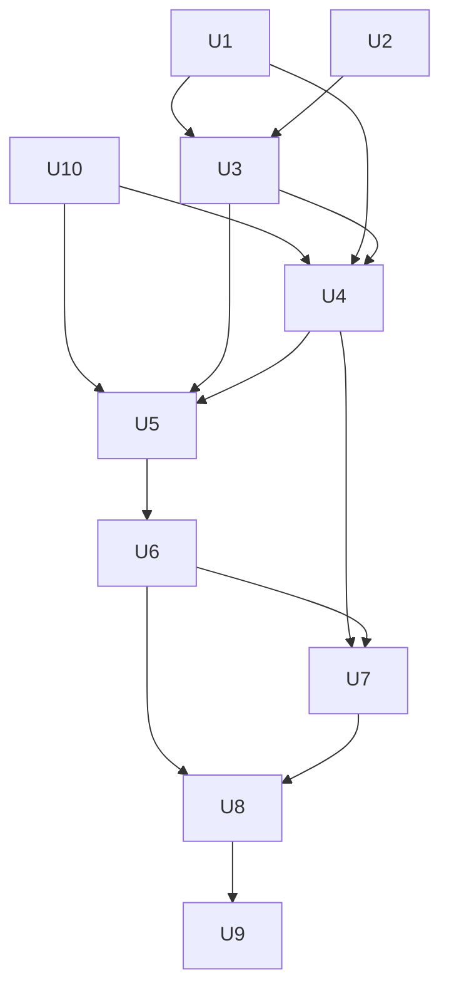

# feat: search opt-in external decision sources

## Overview

Past-work search reads four folders under `docs/`. The decisions Marcus's other projects rely on live elsewhere: RFCs, wikis, runbooks and a Deciduous graph. This plan adds a fifth search selector, `kind: "external"`, that reads user-allowed folders of Markdown and Deciduous sync JSON and returns each source's hits in its own section with its own share of the output.

A repo may propose sources inside itself, but nothing it proposes is read until the user allows that project in user config. User config may also map folders anywhere on disk to a project. A project is identified by its main repository root, so a linked worktree resolves to its main checkout. The learnings-researcher adds one `external` call in past-work scope and shows the hits in a separate External records group.

External sources are a selector beside the four kinds, not a fifth kind. The kind table, `all`, and the built-in render path stay untouched, so built-in output is unchanged by construction. The plan extends existing search modules and adds four small `src/lib` modules. It ships as one feature PR, with the Markdown format built and proven before the Deciduous format.

---

## Problem Frame

The origin document carries the full frame (untracked; see Sources & References). In short: a plan can propose something that a runbook already settles or an RFC rejected, because none of those stores reach the researcher. A trial could not settle whether the stores matter, and closed with a decision to build bounded, opt-in access with no usefulness gate before shipping.

The design has to hold four things at once:

- A repo-supplied path must not become a way to read arbitrary files or to plant records the user never agreed to trust.
- Work runs in linked worktrees by default, and search's own root walk stops at a worktree, so identity cannot come from that walk.
- Five surfaces read config differently: v1 loads once at init, v2 per snapshot, Pi at init with a per-call `cwd`, the CLI through its own loader, and the Claude Code bin from user config only with no config loader at all.
- The researcher prompt body sits about 2 bytes under its working ceiling, and the new text adds 700 to 900 bytes.

---

## Requirements Trace

The origin defines R1 to R24 and AE1 to AE11. Every requirement maps to at least one unit.

| ID | Requirement (short form) | Units |
|----|--------------------------|-------|
| R1 | A source has a name, a format and one or more roots | U1, U3 |
| R2 | Project roots resolve to strict subfolders; no `.`, no dot segment except the `.deciduous/` exception (KTD9); a bad root drops its source with a named warning | U1, U4, U7 |
| R3 | Proposed sources load only for allowed projects; otherwise search says so and reads nothing | U3, U5 |
| R4 | User config declares sources anywhere, mapped to projects | U1, U3 |
| R5 | Project identity is the main repo root; a worktree matches its main checkout; exact path match | U2, U3 |
| R6 | When project and user name the same source, the user wins | U3 |
| R7 | Sources read files only: no commands, no network, no writes | U4, U7 |
| R8 | Markdown: `.md` under roots; title is `title`, then first H1, then filename; recorded status only | U4 |
| R9 | Deciduous: `decision`, `option`, `outcome`, `goal` nodes; edge rationale searchable; edges are not records; `deleted_at` skipped | U7 |
| R10 | Deciduous records show `node_type` in place of status | U5, U7 |
| R11 | Symlinks skipped at every depth in every source | U4, U7 |
| R12 | Per-source built-in caps, with the record count taken after filtering | U4, U7 |
| R13 | Maximum source count and a total read budget; an over-limit source is dropped with a named warning | U3, U4 |
| R14 | A missing or empty source reports a quiet per-source state; the others still load | U4, U5 |
| R15 | `kind: "external"` ranks each active source on its own and labels it `project` or `user` | U5 |
| R16 | External results have their own output allowance; no source takes all of it | U5 |
| R17 | Built-in kinds, the default and `all` are unchanged and never return external records | U5, U6, U10 |
| R18 | With no active source, `external` returns a fixed, non-error reply | U5 |
| R19 | `external` behaves the same on OpenCode v1 and v2, Pi, the CLI and the bin; `search.enabled` stays user-only | U3, U6 |
| R20 | Past-work scope adds one `external` call, five in all | U8 |
| R21 | External hits go in a separate External records group with recorded status or `node_type` only | U8 |
| R22 | The cite-and-differentiate rule covers external records | U8 |
| R23 | Solutions scope, compound overlap and ce:review never call `external` | U8 |
| R24 | The search guide documents sources, the allow step, both formats and the bounds | U9 |

Acceptance examples and where they are pinned:

| ID | Pinned in |
|----|-----------|
| AE1 | U3 (allowed resolution), U5 (section label), U6 (parity) |
| AE2 | U3, U5 (not-allowed reply) |
| AE3 | U1 (root rejection), U3 (other sources still load) |
| AE4 | U2 (worktree identity), U3 (mapping) |
| AE5 | U4 (committed symlink, no warning names its target) |
| AE6 | U5 (per-source allowance) |
| AE7 | U5 (fixed reply), U8 (researcher carries on) |
| AE8 | U7 |
| AE9 | U7 |
| AE10 | U8 |
| AE11 | U10 (supplies the baseline), U5 and U6 (pin the comparison with sources active) |

---

## Scope Boundaries

- Stores reached through MCP servers, commands or network services.
- Writing to any store.
- Applying wiki corrections to page text. `corrections.yaml` is not read.
- Embeddings or any ranking beyond the existing lexical search.
- A usefulness gate before shipping.
- Following successor links between external records, or from them to Systematic docs.
- Formats beyond Markdown and Deciduous sync JSON.
- Matching projects by glob or remote URL.
- Redacting secrets from external excerpts. Runbook and wiki text reaches the model provider and can be copied into a plan. The stores in scope are Marcus's own, and the risk is accepted.
- Adjacent cleanup. Nothing outside the files each unit names changes.

### Deferred to Separate Tasks

- Running the real-host delegated proof on OpenCode v1, Pi and Claude Code: later work, if the v2 proof and the host-free parity test leave a gap.
- A size guard for the Claude Code bin bundle: none exists today. U6 records the size change in the PR notes, and no guard is added.

---

## Context & Research

### Relevant Code and Patterns

Engine (`src/lib/`):

- `search-corpus.ts`: `KIND_TABLE` is closed at four entries, and `DocumentKind` derives from it. `loadCorpus` checks realpath containment of the root argument and applies caps per call (`MAX_FILE_BYTES`, `MAX_FILES`, `MAX_TOTAL_BYTES`, `MAX_DEPTH`, and a discovery ceiling of four times `MAX_FILES`). `discoverFiles` and `classifyEntry` hard-code `.md`, and `classifyEntry` skips every symlink. `readCandidates` hard-codes the logical path. `narrowNonEmptyString` is private. `resolveSearchRoot` walks up to the nearest `.git`, so a linked worktree is its own root.
- `search-core.ts`: `requestedKinds`, `validate` and `runSearch`, with the `corpusLoader(root, kind)` injection seam. `SEARCH_ERRORS.kindUnknown` and the argument and description constants live here.
- `search-render.ts`: the 16 KB cap applies after ranking, with a pinned truncation marker. `kindTokens` builds the `Corpus:` header that `search-render.test.ts` pins.
- `search-user-config.ts`: `SearchSettingsSchema` (today `enabled` only), `validateSearchBlock`, `mergeSearchSettings`, `selectConfigFile`, `loadUserLevelSearchSettings`. May import only zod, jsonc-parser, node builtins and core types, because the bin bundles it.
- `config.ts`, `config-protected-fields.ts`, `config-schema.ts`: `search` is fully protected in four places (`PROJECT_ALWAYS_PROTECTED_FIELDS`, the protected-fields list, `collectProjectProtectedFields`, the strip warning), and `config-schema.ts` wraps the whole field in `trustProtected`. `splitSearchBlock` assumes a project has no `search` block. `allow_project_profiles` is the allow-list pattern to follow.
- Surfaces: `search-tool.ts` (v1, v2, Pi adapters), `search-cli.ts`, `src/cli.ts` (`loadSearchSettingsForCli`), `src/claude-code-search.ts` (the bin; it ignores the start directory it is given and reads user config only).
- Shell precedent for main-root derivation: `resolve_main_root` in `skills/git-worktree/scripts/worktree-manager.sh`. No TypeScript helper reads `commondir`.

Researcher and tests:

- `agents/research/learnings-researcher.md` holds the past-work flow. `tests/unit/past-work-wiring-contract.test.ts` pins the per-kind call count (a `countsNamedIn` helper that must return `[1,4]` today), the Error and unsearched routing rows, and the Past-Work Output section with its five groups, status table and 12 and 3 budgets.
- Delegated proof: `tests/helpers/delegated-search-proof.ts`, `tests/unit/delegated-search-proof.test.ts`, and the v2 case in `tests/integration/opencode-v2.test.ts`.
- Identity fixtures: `tests/unit/git-worktree-fixtures.ts` (real git in isolated temp repos).
- Pins the new text must move together: `tests/unit/search-core.test.ts`, `tests/unit/cli.test.ts`, `tests/unit/search-cli.test.ts`, `tests/unit/search-adapters-parity.test.ts`, `tests/unit/search-render.test.ts`, `tests/unit/search-lifecycle-characterization.test.ts`, `tests/unit/claude-code-search.test.ts`, and the `fieldPath: 'search'` pins in `tests/unit/capability-snapshot.test.ts` and `tests/unit/config.test.ts`.
- Generated surfaces affected: schema (`docs/public/schemas/v*/systematic-config.schema.json`), config-reference (`docs/src/content/docs/reference/configuration.mdx`), and the registry only if the researcher change triggers it. Both config surfaces already list `src/lib/search-user-config.ts` as a trigger.

### Institutional Learnings

- `layered-trust-boundaries-overlay-config-2026-05-09`: classify trust-sensitive fields and enforce the boundary at config load, with a test that project config cannot bypass the allow list. Use a separate allow list modeled on `allow_project_profiles`, not that list itself.
- `dependency-free-module-for-a-constant-shared-across-a-boundary-2026-09-20`: protected-field constants live in one place; register new fields together and test each.
- `lifecycle-validator-runs-only-in-ci-so-agent-prose-must-enforce-it-2026-10-26`: rules belong in prose where the researcher acts on them, and every call limit is pinned by a test.
- `prove-a-dispatched-subagent-reached-a-plugin-tool-on-a-real-host-2026-10-31`: a real-host proof checks both the child's result and the parent's final answer, with a negative control.
- `infer-main-worktree-root-from-git-common-dir-2026-10-25`: derive the main root from `commondir`, not from a path convention.
- `search-kinds-separately-instead-of-one-merged-ranking-2026-10-31` and `mining-real-needs-cannot-settle-whether-a-decision-store-matters-2026-11-02` (both cited by the origin).
- Past-work plan carry-overs: keep canonical-root containment and symlink skipping with caps per kind; keep kind text in sync across descriptions, args, the Pi snippet, CLI help, the bin and the parity pins; config-corpus fixtures are not a generated surface, so regenerate them with a throwaway script and check that only the researcher text changed.
- Durable-output plan carry-over: keep the bin narrow, and verify it under Node from a foreign directory with no `node_modules`, covering jsonc ESM, the Node floor and size.
- Project contributor guidance: a new `src/lib` module needs an `ARCHITECTURE.md` codemap entry and a `src/lib/AGENTS.md` row, both gate-enforced; a new config field follows the five edits listed in U1; generated surfaces are checked by `surfaces:affected --run` then `surfaces:drift`.

### External References

- Prior art cited by the origin: Pi settings read path arrays from user and project settings; Claude Code applies repo-declared `additionalDirectories` only after the user trusts them. No external lookup was needed.

---

## Prior-Art Survey

```json
{
  "schema_version": 2,
  "verdict": "extend",
  "scope": "marcusrbrown/systematic worktree .worktrees/feat/external-sources: src/lib/, src/*.ts, scripts/, skills/git-worktree/, agents/research/, tests/",
  "freshness": {
    "vcs_reference": "4b2d736db02ae8f37f1164f14d5065099ee5040a"
  },
  "budget": {
    "max_search_passes": 6,
    "max_candidate_inspections": 14,
    "exhausted": false
  },
  "candidates": [
    {
      "path_or_symbol": "src/lib/search-corpus.ts#loadCorpus",
      "description": "Bounded, symlink-safe loader: discoverFiles and classifyEntry walk a root, readCandidates reads under per-file and total caps, results are CorpusDocument records with warnings. Caps apply per call.",
      "disposition": "extend"
    },
    {
      "path_or_symbol": "src/lib/search-corpus.ts#KIND_TABLE",
      "description": "Closed table of the four durable-output kinds (solution, plan, brainstorm, ideation) with directory and exclusions per kind; DocumentKind derives from it.",
      "disposition": "insufficient",
      "insufficiency_reason": "Closed and docs-relative by design. Adding an external kind would leak external records into the all selector and the lifecycle resolver."
    },
    {
      "path_or_symbol": "src/lib/search-core.ts#runSearch",
      "description": "Host-neutral search composition: validate, load through the injectable corpusLoader seam, rank, resolve lifecycle, render.",
      "disposition": "extend"
    },
    {
      "path_or_symbol": "src/lib/search-render.ts#renderSearchResult",
      "description": "Sanitises, snippets and truncates a ranked result to the shared 16 KB cap, with a Corpus header pinned by tests.",
      "disposition": "insufficient",
      "insufficiency_reason": "Shaped around the built-in kinds: one ranking, one cap, a pinned Corpus header. External needs per-source sections and its own allowance. It stays untouched, and a separate renderer reuses truncateUtf8 and the marker."
    },
    {
      "path_or_symbol": "src/lib/search-lexical.ts",
      "description": "Pure tokenizer and BM25F scorer with bit-identical scores on Bun and Node.",
      "disposition": "reuse"
    },
    {
      "path_or_symbol": "src/lib/search-user-config.ts#SearchSettingsSchema",
      "description": "Zod piece for the search config field (enabled only), the pure user-then-custom merge, shared config file selection, and the user-level reader the bin uses.",
      "disposition": "extend"
    },
    {
      "path_or_symbol": "src/lib/config.ts#PROJECT_ALWAYS_PROTECTED_FIELDS",
      "description": "Top-level list of fields no project source may set, with the allow_project_profiles opt-in pattern: strip, per-path warning, user-and-custom-only resolution.",
      "disposition": "extend"
    },
    {
      "path_or_symbol": "src/lib/config-protected-fields.ts",
      "description": "Single home of the protected-field constants shared across the config and schema modules.",
      "disposition": "extend"
    },
    {
      "path_or_symbol": "src/lib/search-cli.ts",
      "description": "Flag parsing and exit codes for systematic search and the systematic-search bin, with an injected settings loader.",
      "disposition": "extend"
    },
    {
      "path_or_symbol": "src/claude-code-search.ts",
      "description": "The Claude Code bin entry: reads user-level config only and ignores the start directory it is handed.",
      "disposition": "extend"
    },
    {
      "path_or_symbol": "src/lib/search-corpus.ts#resolveSearchRoot",
      "description": "Walks up to the nearest .git entry and falls back to the start directory. A linked worktree is its own root.",
      "disposition": "reuse"
    },
    {
      "path_or_symbol": "skills/git-worktree/scripts/worktree-manager.sh#resolve_main_root",
      "description": "Shell function that derives the main checkout root from a worktree through git's common directory.",
      "disposition": "insufficient",
      "insufficiency_reason": "Shell. The bin cannot spawn git, and a source must run no commands. The logic is mirrored as a pure filesystem reader."
    },
    {
      "path_or_symbol": "src/lib/discovered-skills.ts#findGitWorktreeRoot",
      "description": "Private walk-up that returns the nearest ancestor holding a .git entry, or null.",
      "disposition": "insufficient",
      "insufficiency_reason": "Returns the worktree itself, not the main root, and is private to a module the bin must not import."
    }
  ]
}
```

---

## Key Technical Decisions

Decisions below were settled in planning. The first group came from Marcus's review of the spec-flow findings; the later ones are structural.

- KTD1. `external` is a selector, not a document kind. `KIND_TABLE` and `DocumentKind` stay closed. External records are their own type (source, origin, optional `node_type`, optional status) with no lifecycle. `validate` returns a tagged result, the core branches once, and `renderSearchResult` is untouched. This is what makes R17 and the byte-identity criterion true by construction.
- KTD2. One shared per-call reader serves all five surfaces. For `external`, the core calls a reader that reads the user config files and the project file on every call, through an injectable seam like `corpusLoader`. Init-time captured settings are never used for `external`, because v1 and Pi load config once while taking a per-call directory. Fixed at init: `search.enabled`, tool registration and descriptions, and the `config unreadable` note captured at registration. Re-read on every call: the start directory, the user files (allow list and user sources), the project file, project identity, and the record files. The CLI and the bin run one call per process, so they read everything at start. The per-call reader reports its own `config unreadable` state for the files it read on that call. The core merges that with the registration note by logical OR and prints the note once; a repair between calls clears only the per-call part.
- KTD3. The `search` block is validated by field and by entry, with two error levels. A structural error means the file cannot be read or parsed, or a container is invalid (`search` is not an object, `sources` is not an array); it yields zero proposals for that file. An entry error means one source entry or one allow entry is invalid; it drops only that entry and keeps its valid siblings. `enabled`, `allow_project_sources` and `sources` validate separately, so a typo in `sources` can never lose `enabled: false`. A bad allow entry never allows anything and sets the user-config `config unreadable` note (the project-level state for a project file with a structural error is the separate "project config unreadable", KTD13). `search-user-config.ts` owns one pure set of field and entry validators, called from both `config.ts` and the per-call reader, so the two paths cannot disagree. A mixed file (valid and invalid entries, plus `enabled: false`) is tested through both paths.
- KTD4. Trust is per field. `enabled` and `allow_project_sources` are user-only, tagged inline with the trust meta, and are protected paths with per-path warnings. A project may set `sources` only. The outer `trustProtected` wrapper on `search` goes away, `search` leaves the always-protected list, and a project step keeps only `sources`. That step keeps `search.sources` through the strip so the strip warning stays silent, validates it with the shared validators (KTD3), then discards it from the resolved config. The per-call reader (KTD2) is the only consumer of project `sources`, and nothing merges them in `config.ts`. The schema still accepts the field.
- KTD5. Project identity is the main root, derived by pure filesystem reads, and verified from the common-dir side. Three cases decide the starting point:
  - A `.git` directory is its own root.
  - A `.git` file whose gitdir sits under a `modules/` directory is a submodule, so it is its own root.
  - A `.git` file whose gitdir sits under a `worktrees/` directory is a linked worktree and requires `commondir`. If `commondir` is missing, the result is unresolved.

  For a linked worktree, the `gitdir:` path (relative values resolve against the `.git` file) gives the gitdir, and `commondir` resolves to the common directory. The gitdir must be exactly `<commondir>/worktrees/<name>`, and `<commondir>/worktrees/<name>/gitdir` must equal this `.git` path. The back-pointer is resolved against its own directory first, because git writes relative paths when `worktree.useRelativePaths` is set. Both sides are compared as realpaths. This stops a self-consistent forgery, where an attacker writes both the gitdir and the commondir, from inheriting an allowed identity, because the common directory's own `worktrees/` entry will not point back at the forged `.git`. When the common directory's basename is `.git`, the main root is its parent. If the common directory's `config` sets `core.worktree`, the result is unresolved, mirroring the refusal in `resolve_main_root`; this is a pure text read of the config file. Anything corrupt, inconsistent or unreadable fails closed and never matches. A bare-repo worktree never matches, and is documented as unsupported. Allow comparison is exact on realpaths.
- KTD6. The allow list is `search.allow_project_sources`, an array of absolute or `~`-prefixed main-root paths. Entries are realpath'd at compare time with the native realpath, and stale entries are silent. The list is the union across user and custom config dirs. Matching is exact; an allowed project covers whatever any of its branches proposes, which is accepted and documented. User sources reach a project the same way, through `projects[]` entries of the same form.
- KTD7. Source resolution order is fixed. Drop proposals for a project that is not allowed, apply shadowing, order user sources (user file, then custom dir, in declared order) before project sources, and cap at 8 active sources. A user source shadows a same-named project source only when the user source is mapped to this project. Names are case-sensitive. A duplicate within one file keeps the first and warns. `sources` merge by name with the custom dir winning.
- KTD8. Bounds. Maximum 8 sources and a 32 MB read budget, measured as stat bytes of every file the loader opens. A source that does not fit the remaining budget is dropped whole with a named warning, and later, smaller sources are still tried. Built-in kinds keep their 256 KiB per-file cap. External sources use a 1 MB per-file cap, so the 443 KB `fro-bot/.github` wiki page is indexed; the per-source 16 MB truncation is a separate check from the total budget, and the 32 MB budget bounds total memory. "Drop whole" means summing the candidates' stat sizes after discovery and checking the sum against the remaining 32 MB before any file is read. For Markdown, `MAX_FILES` bounds files read. For Deciduous, `MAX_DISCOVERED_FILES` bounds the files scanned and `MAX_FILES` bounds kept decision-shaped records, so edge files and filtered nodes do not consume the record cap (KTD15).
- KTD9. Root rules. Project roots are relative, resolve against the checkout root, must not be `.` or contain `..`, and reject any dot segment, with one named exception: a source with `format: deciduous` may propose a root under `.deciduous/`, such as `.deciduous/sync`. The first segment may be `.deciduous` only when at least one non-dot segment follows it, and every later segment is held to the same no-dot rule. A project root that is itself a symlink is dropped. User roots must be absolute or `~`-prefixed, and a relative user root is rejected. A user root that is a symlink is followed once. Symlinks inside any root are skipped at every depth. Project roots keep realpath containment inside the checkout root; user roots skip it.
- KTD10. Source entries are bounded: names match a restricted charset (letters, digits, `-`, `_`) and a 40-character length, an unknown format drops the entry, roots may not be empty, and each source takes at most 8 roots.
- KTD11. Ranking and output. Each source gets its own lexical index, because scores are not comparable across sources. Records map to the lexical fields as title to title, `node_type` to tags, and body to body. `limit` applies per source and is capped at 5 there. Sections sort by source name in code-unit order, and hits within a section by rank, then path. The external allowance is 12 KB, split evenly across sources, and a source over its share drops whole hits and prints `+N more hits not shown`. The 16 KB built-in cap is not shared. When the 12 KB allowance truncates a reply, the marker says 12 KB, not 16 KB; the researcher's truncation row recognizes both markers. Hit paths are `<source>/<relative path>`, and each section header shows its root with the home directory collapsed to `~`. External reads are optional and count against the researcher's three full reads.
- KTD12. Fixed replies and prefix. The core owns three fixed replies, all `ok: true`: no project, project proposes sources that are not allowed, and no active source. For external, "no project" means no `.git` ancestor of the start directory; `resolveSearchRoot` never reports it, so the core checks for it. The disabled reply stays with its surface: the CLI and bin keep `SEARCH_CLI_DISABLED_NOTICE`, and the tool adapters never register the tool. The adapters' existing line for a missing host directory also stays and runs before the core. These existing notices are exempt from the prefix rule and are pinned as they are, which is a smaller change than moving them into the core. Precedence is disabled (surface), then a missing host directory (adapter), then no project (core, checked before query and limit validation), then the core's existing validation errors, then per-source states. The replies follow the `SEARCH_ERRORS` and `SEARCH_NOTICES` pattern: fixed templates with sanitized interpolation. Every echoed string (the query, the proposal count, the main-root string, source names, roots and titles) passes `sanitizeInline` and the existing field caps, including in replies produced before query validation. Tests use control and bidi characters, and pin both the verified and the unresolved not-allowed variants. A declared root that is missing still counts as an active source, so it does not get the no-active-source reply. The not-allowed reply gives the proposal count and the exact main-root string to add, and never echoes source names or roots. It prints the main-root path only when the identity is verified. An unresolved identity gets the same fixed not-allowed reply with no path. Every external reply starts with `External sources for "<q>":` and carries none of the built-in routing tokens (`corpus: none`, `corpus: empty`, `N docs, M hits`, `Search "`). A negative test pins this.
- KTD13. Per-source and project-level states. Per-source: missing, empty, unreadable, dropped. Project-level: project config unreadable (a project file with a structural error) and not allowed (the user allow list has no entry for this project's main root). An invalid project entry is a warning, not a state. A bad allow entry sets the user-config `config unreadable` note and is not a project state. Project-source problems never touch built-in replies, `MAX_WARNINGS` stays 5 with source drops listed first, and a gitignored source inside a worktree shows as missing.
- KTD14. Markdown records. The title is `title`, then the first H1, then the filename; status is the recorded `status` string, never inferred. A separate external parser shares the narrowing helpers, the BOM and newline normalization, and the rejection of malformed YAML and non-mapping frontmatter that the corpus parser applies. No kind-specific excludes apply (a `README.md` is searchable). The shared loader gains a `loadSourceFiles` core with optional `extensions`, a parse callback, a display prefix, a warning label (the built-in `spec.dir` warning text is pinned), a per-file byte cap, and optional containment; `loadCorpus` becomes a caller of it with unchanged behavior.
- KTD15. Deciduous records. Deciduous does not use the shared `min(candidates, MAX_FILES)` cut. It has its own scan, `nodes/` first and then `edges/`, in that explicit order rather than a path sort. `MAX_DISCOVERED_FILES` bounds the files scanned, `MAX_FILES` bounds the kept decision-shaped records, and the per-source byte caps still apply. Ids must match `[A-Za-z0-9_-]{1,64}`; anything else is skipped as a bad id. Display paths are built only from validated ids, and no file is ever opened by an id taken from content. A missing root is a missing source; a missing `nodes/` is empty with a warning; a missing `edges/` yields records without rationale and a warning. Malformed files and bad ids are skipped and aggregated; a duplicate `change_id` keeps the first. Title is `title`, then the first description line, then `change_id`. An edge contributes rationale to a node when its other endpoint is any live node; tombstoned nodes and edges are skipped. Rationale is capped at 300 characters per edge, 20 edges per node and 2 KB per node. Hit paths are `nodes/<id>.json`, and the hit shows `node_type`.
- KTD16. The Claude Code bin gets a bin-safe reader. It reads the project file once, with a 1 MB cap enforced during the read (an fd read of at most the cap plus one byte, rejected if it reaches the cap plus one; this is new code, since `readSearchBlock` has no size check today), and never imports `config.ts`. The file is `<checkout root>/.opencode/systematic.jsonc`, falling back to `.json`, chosen by `selectConfigFile`, which mirrors `getConfigPaths` in `src/lib/config.ts`. Every surface uses the same selection. A missing file is normal. A structural error (read error, parse error or an invalid container, KTD3) yields zero proposals, an aggregate line in the reply, and one stderr warning, for `external` only. An invalid entry drops only that entry. The bin uses the start directory it is given.
- KTD17. Researcher. The call is `kind: external` at `limit: 3`. The total output budget rises from 12 items to 16: external gets at most 4, and the built-in groups keep all 12. Full reads stay at 3. The External records group is the sixth group, outside the status table. Items read `source, path, no recorded status` or `node_type decision`. The external call runs regardless of the stop rules: Step 0 and the stop when all four built-in kinds report none do not end the run before it. Disabled, error and not-allowed replies go to Search Context through an external error row placed ahead of the existing Error-to-grep row; the researcher never greps or globs source roots and never retries.
- KTD18. Prompt budget. Trim the identified unpinned prose first. The researcher body ceiling then becomes 25,000 bytes after frontmatter, set on purpose: the body is 24,025 bytes today against a working ceiling of about 24,027, the new text adds 700 to 900 bytes, and the identified trims recover 520 to 700. Worst case without any trim is 24,925 bytes, so 25,000 holds. One test on the body bytes after frontmatter pins 25,000. Line 3 (the description) and line 8 (the delegated-proof marker) do not change.
- KTD19. Proof scope. One real-host delegated proof on OpenCode v2, plus a negative control. The other three hosts are covered by the host-free parity test (CLI, bin and v1) and the existing per-host search proofs. The scripted model makes the call, so the proof shows reach and plumbing, not that a model chooses to call `external`; the wiring contract pins the prompt side.
- KTD20. One feature PR; Markdown format before Deciduous.
- KTD21. Errors are classed the same way on every surface: an expected source failure is an `ok: true` reply, an invalid request is `ok: false`, and an unexpected failure is a throw. "Unexpected" means a fault inside search itself. A throwing settings loader is not unexpected: it is an expected per-call state on every surface, reported as `config unreadable`. The external reader reads the user files itself, so an external call still runs with the user-declared sources it can read, and with no project proposals when it cannot read the allow list (nothing is allowed without a readable allow entry); when it can read nothing safely, it returns no sources plus the note. No surface uses a fixed failure line for this case. The byte-parity claim covers valid inputs only; the table in High-Level Technical Design gives text, exit code and warning sink per surface.
- KTD22. Performance. Keep the no-cache design. Budgets are ratios measured in one harness run, not absolute times, because no harness reproduces absolute numbers across machines. A small timing harness (U6) runs the built-in `plan` kind and the external call on the same machine in the same run, and records warm p50 and p95 on a persistent host and cold p50 and p95 for the one-shot built bin under Node and for the CLI, with the stores and sizes it measured. Warm budget: external warm p95 at or under twice the built-in `plan` warm p95. If missed, add a bounded process-local memo keyed on path, size, mtime, ctime and inode (mtime alone is not enough), with trust and identity re-walked on every call; the memo is the expected remedy on persistent hosts. Cold budget: external cold p95 at or under twice the built-in `plan` cold p95. No memo applies, because the memo is process-local and the CLI and bin are one-shot. If the cold budget is missed, stop and report the numbers to Marcus before U7. Candidate levers for that conversation, not pre-decided: capping external reads in the bin, and lazy per-source indexing. The store size used for scale (about 6.7 MB across six stores) was measured from local clones on 2026-11-02 and is not reproducible from the repo.
- KTD23. Setup versus per-call failure. A project file that parses but holds an invalid `search.sources` never fails v2 setup. A project file that cannot be parsed keeps today's behavior, because the whole project config loads before search is split out. Project `sources` are validated by `splitSearchBlock`, or the shared-validator successor in `search-user-config.ts`, and its `unreadable` result is ignored for project trust, because `config.ts` consumes only `settings`. The per-call reader cannot rescue a plugin that never initialized, and the guide says so.
- KTD24. Runtime imports are acyclic, and the bin's graph excludes `config.ts` and `config-schema.ts`. Type-only edges (for example `search-user-config` importing types from `search-core`) are erased at build and are allowed. The required graph is in High-Level Technical Design, and a test over the built bin's build metafile pins the exclusion.

---

## Open Questions

### Resolved During Planning

- Allow list shape and worktree identity: KTD5 and KTD6.
- Source limit, budget, per-source hit count, allowance and header state: KTD8, KTD11 to KTD13.
- How the bin reads project config without the loader: KTD16.
- Where the prompt gives up bytes, and the ceiling: KTD18 (25,000 bytes).
- How a per-call unreadable note combines with the one captured at registration: KTD2.
- Which layer owns the disabled and no-project replies: KTD12.
- Can Deciduous be proposed by a project: yes, under `.deciduous/` only (KTD9).

### Deferred to Implementation

- The exact wording of the three core fixed replies and the header lines: they are pinned as constants when written, and only the prefix and the forbidden tokens are fixed here.
- Exact function names and the final names of the four new modules (proposed: `search-project-identity.ts`, `search-external-sources.ts`, `search-external.ts`, `search-external-deciduous.ts`). Whatever they are called, each needs its codemap entry and AGENTS row.
- The schema generator renumbers its `__schemaNN` definitions, so the generated diff will be large; its shape is known only after generation.
- Which unpinned researcher prose actually gets trimmed (KTD18). The ceiling does not depend on it.
- How many of the 14 config-corpus fixtures change beyond the researcher prompt string. The expectation is none, and a throwaway diff check confirms it.
- The bin bundle size change, observed and recorded in the PR notes. No guard is added (see Deferred to Separate Tasks).

---

## High-Level Technical Design

> *This illustrates the intended approach and is directional guidance for review, not implementation specification. The implementing agent should treat it as context, not code to reproduce.*

The per-call flow for `kind: "external"`, from the surface to render. The surface owns the first two exits and the core owns the rest. Fixed replies exit early; everything else reaches a section per active source.



Runtime module imports must stay acyclic; type-only edges are erased at build and are allowed. The bin reaches the core through `search-cli`, so everything the core imports is bundled into it. Render imports types only, and the deciduous module must not import the dispatcher.



Neither `config.ts` nor `config-schema.ts` appears anywhere under the bin's entry. `config.ts` and `config-schema.ts` import `search-user-config.ts`, never the reverse.

Error classes by surface. The text of each cell is the existing constant for that class; this plan adds no new exit code. Warnings from the per-call reader are bounded (`MAX_WARNINGS`) and ride in the reply text on every surface; the CLI and bin also print loader warnings to stderr, as today.

| Class | Core result | CLI and bin | Tool adapters (v1, v2, Pi) |
|-------|-------------|-------------|----------------------------|
| Expected source failure (no project, not allowed, no active source, source states) | `ok: true`, prefixed reply | Text on stdout, exit 0 | Reply text as the tool result |
| Invalid request (empty query, bad `kind`, bad `limit`) | `ok: false`, `SEARCH_ERRORS` text | The runner's existing error output, exit 2 | The same text as the tool result |
| Unexpected failure (a fault inside search itself) | Throw | Exit 1 through the runner's existing path | Adapter catches and returns its fixed failure line |
| Throwing settings loader | Not a throw: an expected per-call state | Reports `config unreadable`; the external call still runs under the KTD21 rule | Reports `config unreadable`; the external call still runs under the KTD21 rule |
| Existing surface notices (disabled, missing host directory) | Never reached | Disabled notice on stdout, exit 0 | No tool registered when disabled; missing-directory line returned before the core |

Unit dependencies. U10 records the built-in goldens before U4 and U5. U7 waits behind U6 by decision (Markdown ships first), though it only needs U4.



---

## Implementation Units

### Phase A: Config, identity and goldens

- [x] U1. Search config: fields, validation, trust and generated surfaces

**Goal:** Extend the `search` block with `allow_project_sources` and `sources`, validate per field and per entry, let a project set `sources` only, and regenerate the config surfaces.

**Requirements:** R1, R2, R4, R19 (`enabled` stays user-only)

**Dependencies:** None

**Files:**
- Modify: `src/lib/search-user-config.ts` (schema fields, project variant, validators, doc comments; the user-then-custom merge gains `allow_project_sources` as a union and `sources` by name)
- Modify: `src/lib/config.ts` (`PROJECT_ALWAYS_PROTECTED_FIELDS`, `collectProjectProtectedFields`, `splitSearchBlock`, the strip warning, the validate-then-discard project step, stale comments)
- Modify: `src/lib/config-protected-fields.ts`
- Modify: `src/lib/config-schema.ts` (drop the outer `trustProtected`; inline trust meta on the two user-only fields)
- Modify: `docs/scripts/generate-config-reference.ts` (new `search` branch with examples on every nested field)
- Modify: `src/cli.ts` (the comment that calls a project source unable to affect search is wrong once `sources` exists)
- Regenerate: `docs/public/schemas/v*/systematic-config.schema.json`, `docs/src/content/docs/reference/configuration.mdx`
- Test: `tests/unit/search-user-config.test.ts`, `tests/unit/config.test.ts`, `tests/unit/config-schema.test.ts`, `tests/unit/capability-snapshot.test.ts`, `tests/unit/generate-config-reference.test.ts`, `tests/unit/generate-config-schema.test.ts`

**Approach:**
- Follow the config-field edits the repo already established for a new protected field: drop the outer wrapper, change the protected paths to `search.enabled` and `search.allow_project_sources`, remove `search` from the always-protected list and add a project step that keeps only `sources`, emit per-path warnings, and pass trust into `splitSearchBlock`. The project step keeps `search.sources` through the strip so the strip warning stays silent, validates it with the shared validators, then discards it from the resolved config. The schema keeps accepting the field. Validation runs in `splitSearchBlock`, or the shared-validator successor in `search-user-config.ts`. Its `unreadable` result is ignored for project trust: `config.ts` consumes only `settings` from it.
- `search-user-config.ts` owns the shared pure field and entry validators (KTD3), and both `config.ts` and the per-call reader (U3) call them. A structural error (an invalid container) discards the block's `sources`; an entry error drops only that entry.
- `sources[]` is `{name, format, roots[]}`. A user entry adds `projects[]`. The project variant adds the root rules of KTD9, including the single `.deciduous/` exception, and rejects `.`, `..`, absolute roots and every other dot segment. The user variant requires absolute or `~` roots.
- Validate `enabled`, `allow_project_sources` and `sources` separately, then each entry. Warnings name fields and source names, never values.
- Project `sources` are not merged in `config.ts`. The per-call reader (U3) is their only consumer, and it applies the precedence in KTD7.
- Update the docs comments at the old user-only statements in `search-user-config.ts`, `config-schema.ts` and `config.ts`.
- If `config-schema.ts` ends up importing a new module, add it as a trigger in `scripts/lib/generated-surfaces.ts`. Keeping everything in `search-user-config.ts` avoids that, and both config surfaces already list it.

**Execution note:** Add characterization for today's protected-field behavior of `search` before changing it, so the three existing `fieldPath: 'search'` pins move deliberately.

**Patterns to follow:**
- `allow_project_profiles` handling in `config.ts` and the per-path warning shape.
- The `bootstrap` and `pi_subagents` branches in the config-reference generator.

**Test scenarios:**
- Happy path: a user config with `enabled`, `allow_project_sources` and two valid sources parses and merges custom over user by name, with `allow_project_sources` as a union and `enabled` last-defining.
- Happy path: a project file with `sources` only keeps its sources; a project file that also sets `enabled` or `allow_project_sources` has exactly those fields stripped, each with its own per-path warning, and `sources` raise no strip warning. The resolved config carries no project `sources`; the project block is validated and then discarded, and no test pins a project value in the merged result.
- Edge case (the `.deciduous` rule test lives here, not in U7): a project `sources` entry with root `.deciduous/sync` and `format: deciduous` is accepted; the same root with `format: markdown` is rejected; `.deciduous` alone is rejected; `.deciduous/.cache` is rejected; `.slim/clonedeps` is rejected for either format.
- Error path (AE3): roots `.`, `.slim/clonedeps` and `../other-repo/docs` each drop only their own source with one warning that names the source, and a sibling valid source stays.
- Error path (C1): an invalid `sources` entry does not drop `enabled: false`; a non-string allow entry allows nothing, keeps valid siblings and sets the user-config `config unreadable` note; a duplicate name within one file keeps the first and warns; an unknown format, an overlong or badly charactered name, an empty `roots` and a ninth root each drop their entry.
- Error path: a relative user root is rejected; a user `projects[]` entry that is not absolute or `~` is rejected.
- Error path (structural versus entry): a file whose `sources` is not an array drops all its sources and keeps `enabled`; a file with one valid and one invalid entry keeps the valid one. One mixed fixture (valid and invalid source entries, a bad allow entry, and `enabled: false`) is run through both the `config.ts` path and the shared validator entry point the per-call reader uses, and both give the same kept entries and `enabled: false`.
- Error path: a project file that parses but holds an invalid `search.sources` loads without throwing and without losing its other fields; a project file that cannot be parsed behaves exactly as it does today.
- Integration: the generated schema and config reference list the new fields with examples, and `surfaces:drift` is clean afterwards.

**Verification:**
- The three `fieldPath: 'search'` pins now name the two user-only paths, and a test proves a project cannot set either.
- Both generated surfaces regenerate and pass their drift checks; the large schema renumbering diff is the only noise.
- Nothing in `config.ts` reads project `sources` after validation.
- `config.ts` and `config-schema.ts` import `search-user-config.ts`; the reverse import does not exist.

---

- [x] U2. Project identity helper

**Goal:** Return a checkout's main repository root, or an unresolved result that never matches, using only filesystem reads, and provide the exact-path allow match.

**Requirements:** R5

**Dependencies:** None

**Files:**
- Create: `src/lib/search-project-identity.ts`
- Modify: `ARCHITECTURE.md` (codemap entry), `src/lib/AGENTS.md` (module-table row)
- Test: `tests/unit/search-project-identity.test.ts`

**Approach:**
- Implement KTD5 as a pure reader with node builtins only, because the bin bundles it. It classifies the checkout as a `.git` directory (own root), a `.git` file under `modules/` (submodule, own root) or a `.git` file under `worktrees/` (linked worktree). For a linked worktree it verifies from the common-dir side: `commondir` is required, the gitdir must be `<commondir>/worktrees/<name>`, the `gitdir` back-pointer in that entry resolves against its own directory and must equal this `.git` path by realpath, and a `core.worktree` setting in the common directory's `config` gives unresolved. It returns a tagged result (main root, or unresolved with a reason) and a separate matcher that realpaths both sides and compares exactly.
- It takes the checkout root that `resolveSearchRoot` already returns. Do not unify with `resolveSearchRoot` or `findGitWorktreeRoot`; the existing AGENTS note says those copies differ on purpose.

**Execution note:** Test-first. The fixtures create real repositories, so write the cases before the derivation.

**Patterns to follow:**
- `tests/unit/git-worktree-fixtures.ts` for isolated real-git repos and temp-dir cleanup. Reuse its `createSubmoduleRepo`, `createDetachedDotGitRepo` (with its `coreWorktree` option), `createSeparateGitDirRepo` and `createBareRepo` helpers instead of writing new fixtures.
- `resolve_main_root` in the git-worktree manager script for the commondir logic and its `core.worktree` refusal, mirrored in pure fs.

**Test scenarios:**
- Happy path: a plain checkout returns its own root.
- Happy path (AE4): a real `git worktree add` worktree returns the main checkout's root, and a worktree created from another linked worktree still returns the main root.
- Happy path: a real worktree created with `worktree.useRelativePaths=true` (git writes relative back-pointers) resolves to the main root. That setting needs git 2.48 or later, so the case is gated on a version probe: an older git skips it, and a probe that errors fails the test rather than skipping it.
- Edge case: a real submodule checkout (a `.git` file under `modules/`) returns its own root, a `.git` directory returns its own root, and a nested repo is its own project.
- Edge case: a symlinked checkout path and the real path compare equal after realpath; a relative `gitdir:` resolves correctly.
- Error path: a forged `.git` file whose `gitdir:` points at a real worktree's git dir, with no matching back-pointer, returns unresolved.
- Error path: a self-consistent forgery, with an attacker-written gitdir and `commondir` that agree with each other and with a forged back-pointer, returns unresolved because the common directory's own `worktrees/<name>` entry does not point back at the forged `.git`.
- Error path: a `.git` file whose gitdir sits under `worktrees/` but has no `commondir` returns unresolved.
- Error path: a common directory whose `config` sets `core.worktree` returns unresolved (the detached-`.git` helper with `coreWorktree` builds this fixture).
- Error path: a corrupt `.git`, an unreadable file and a bare-repo worktree each return unresolved, never throw, and never match any allow entry.
- Integration: the matcher expands `~`, treats a stale (non-existent) allow entry as a silent non-match, and matches only the exact main root, not a parent or a child.

**Verification:**
- The module imports only node builtins, so the bin bundle stays Node-clean.
- Both registration surfaces name the module, and the content-integrity gate passes.

---

- [x] U10. Built-in output goldens

**Goal:** Record the byte-exact output of every built-in search path before U4 and U5 change search behavior, so "built-in output is unchanged" is checked against a recorded baseline for all four kinds and `all`, not only the 11 solution requests pinned today.

**Requirements:** R17

**Dependencies:** None. It runs before U4 and U5 and before any change to `search-corpus.ts`, `search-core.ts` or `search-render.ts`.

**Files:**
- Create: `tests/fixtures/search-builtin-goldens.json` (request, rendered text and warnings per case)
- Create: `tests/unit/search-builtin-goldens.test.ts`
- Test: `tests/unit/search-lifecycle-characterization.test.ts` and `tests/unit/search-render.test.ts` stay unchanged and keep passing

**Approach:**
- Drive the real core over the existing corpus fixtures (`tests/fixtures/search-corpus`, the hostile fixtures, and the past-work queries in `tests/fixtures/search-past-work-queries.json`) for `plan`, `brainstorm`, `ideation` and `all`, plus the default `solution` request. Store the full rendered text and the warnings block as JSON.
- Record the goldens from the unmodified code. The test compares exact bytes, with no normalization.
- U4 and U5 cite these goldens in their own byte-identity checks.

**Execution note:** Characterization-first. This unit lands before U4 and U5; units that do not touch search behavior (U1 to U3) may land in either order.

**Patterns to follow:**
- The existing characterization tests and the fixtures they read.

**Test scenarios:**
- Happy path: each of `plan`, `brainstorm`, `ideation`, `all` and the default `solution` request reproduces its recorded text exactly.
- Edge case: the hostile fixtures (control characters, oversized files, symlinks, malformed frontmatter) reproduce their recorded text and warnings exactly.
- Edge case: the past-work fixtures reproduce their recorded status and successor lines exactly.
- Error path: an empty query, a bad `limit` and a bad `kind` reproduce the recorded error text.

**Verification:**
- The goldens pass against the code as it stood before this plan, and they still pass after every later unit, except the bad-kind error text, which U5 re-records because it changes to list `external`.

---

### Phase B: Reader and Markdown loader

- [x] U3. Per-call source reader shared by all surfaces

**Goal:** Produce the active source list for one `external` call from the user files and the project file, honoring identity, allow list, shadowing, order and the source cap.

**Requirements:** R1, R3, R4, R5, R6, R13, R19

**Dependencies:** U1, U2

**Files:**
- Create: `src/lib/search-external-sources.ts` (resolution and the per-call composer)
- Modify: `src/lib/search-user-config.ts` (a bin-safe `loadProjectSearchSources` that reuses `readSearchBlock` and `selectConfigFile`, 1 MB cap, never importing `config.ts`, reading `<checkout root>/.opencode/systematic.jsonc` and falling back to `.json`, as `getConfigPaths` in `src/lib/config.ts` does)
- Modify: `ARCHITECTURE.md`, `src/lib/AGENTS.md`
- Test: `tests/unit/search-external-sources.test.ts`, `tests/unit/search-user-config.test.ts`

**Approach:**
- Inputs: start directory, injectable config-dir resolution (defaulting to the same env and file selection the other readers use), and the identity result. Output: ordered active sources (name, format, resolved roots, `project` or `user` origin) plus project-level states and bounded warnings.
- Apply the order in KTD7. A project file is read from the checkout root of the start directory, so a worktree reads its own copy of the project config while matching its main root's allow entry.
- Project-source problems never throw and never affect `enabled` or built-in replies. A structural error (a read error, a parse error or an invalid container) yields zero proposals and the project config unreadable state. An invalid entry drops only itself with a warning, and its valid siblings load. The shared validators in `search-user-config.ts` (U1) make the call. The project config unreadable state is separate from the user-config `config unreadable` note.
- Add the 1 MB project-file cap as new code: an fd read of at most the cap plus one byte, rejected if it reaches the cap plus one. `readSearchBlock` has no size check today, so the project-file path is where the cap is introduced.
- U3 exports the composer as a plain function. U5 owns the resolver seam: its type and its default implementation, which binds to this composer. Tests inject through U5's seam.

**Patterns to follow:**
- `loadUserLevelSearchSettings` for non-throwing readers that return `{settings, warnings, unreadable}`.
- `mergeSearchSettings` for the custom-over-user rule.

**Test scenarios:**
- Happy path (AE1): the project proposes `decisions` at `docs/decisions`, the main root is allowed, and the source resolves as `project`.
- Happy path (AE4): a user source mapped to the agent repo's main root resolves when the start directory is the repo root and when it is one of its real worktrees, and does not resolve at an unrelated repo root.
- Error path (AE2): the same proposal with no allow entry resolves to no sources, records the not-allowed state with the proposal count, and echoes no names or roots. The main-root string is carried only when the identity is verified.
- Edge case: a user source and a project source share a name. The user source shadows the project source only when it is mapped to this project; when it is mapped elsewhere, the project source loads and the user source does not.
- Edge case: names are case-sensitive, so `Wiki` and `wiki` coexist.
- Edge case: ten declared sources cap at 8, in the KTD7 order, with a warning naming the dropped ones first.
- Edge case: `allow_project_sources` in the user file and the custom config dir unions; `sources` of the same name resolve with the custom dir winning.
- Error path: a project file over 1 MB, malformed JSONC, or with an invalid container (`sources` not an array) yields zero proposals and the project config unreadable state, while `enabled` and user sources are unaffected.
- Error path: a project file with one valid and one invalid source entry loads the valid one and warns about the other; no project config unreadable state is set.
- Error path (bounded read): a file already larger than 1 MB is rejected after reading at most the cap plus one byte, and a file that grows past 1 MB while it is being read is rejected the same way.
- Error path: the same mixed fixture used in U1 produces the same kept entries here as in the `config.ts` path.
- Error path: an unresolved identity (U2) allows nothing, maps no user source, and yields the not-allowed state with no main-root string.
- Edge case: a worktree reads `.opencode/systematic.jsonc` at its own checkout root, falls back to `.json` when the `.jsonc` file is absent, and prefers `.jsonc` when both exist.
- Integration (C2): editing the allow list or the project file between two calls changes the second call's result without restarting anything.

**Verification:**
- The module graph under the bin's entry contains no `config.ts` import.
- A test pins that tool presence and `enabled` come only from the fixed init settings.

---

- [x] U4. Markdown external loader

**Goal:** Load `.md` files from a resolved source into bounded external records, sharing the corpus loader's walk, symlink and cap logic without changing built-in behavior.

**Requirements:** R2, R7, R8, R11, R12, R13, R14

**Dependencies:** U1, U3, U10

**Files:**
- Modify: `src/lib/search-corpus.ts` (export `loadSourceFiles`; `KindSpec` gains optional `extensions`; `readCandidates` takes a parse callback, a display prefix, a warning label, a per-file byte cap and optional containment, and returns bytes used; export the narrowing helper)
- Create: `src/lib/search-external.ts` (record type, per-source state, Markdown parser, source loader with the shared 32 MB budget, format dispatch)
- Modify: `ARCHITECTURE.md`, `src/lib/AGENTS.md`
- Test: `tests/unit/search-corpus.test.ts`, `tests/unit/search-external.test.ts`

**Approach:**
- Refactor first, with the built-in tests and the U10 goldens unchanged: `loadCorpus` becomes a caller of `loadSourceFiles` and its output stays identical. Keep `KIND_TABLE` and `DocumentKind` closed.
- `loadSourceFiles` takes a warning label and display prefix, because the built-in `spec.dir` warning text is pinned and external warnings name the source; a per-file byte cap (256 KiB for the built-in kinds, 1 MB for external); and optional containment, which `loadCorpus` and project roots use and user roots skip.
- "Drop whole" is a pre-read check: after discovery, sum the candidates' stat sizes and compare the sum with the remaining 32 MB budget before reading any file. The per-source 16 MB truncation remains a separate check inside the read.
- The external record is `{source, origin, path, title, status?, nodeType?, body}`. The Markdown parser applies KTD14 and shares frontmatter parsing, narrowing helpers, BOM and newline normalization, and the rejection of malformed YAML and non-mapping frontmatter with the corpus parser.
- Containment: project roots must realpath inside the checkout root and are dropped otherwise; a project root that is a symlink is dropped; a user root symlink is followed once. Symlinks inside roots are skipped through the existing `classifyEntry` rule, with no warning that names a target.
- The loader draws on the shared budget in the order given by U3, drops a non-fitting source whole, and still tries later ones.
- Dispatch is by format. The `loadSourceFiles` file-count cut (`min(candidates, MAX_FILES)`) serves Markdown only; Deciduous has its own scan (U7). Until U7, the dispatch table has no Deciduous entry, and such a source reports the dropped state.
- Sources only read files. Nothing in this module spawns, fetches or writes.

**Execution note:** Characterization-first. U10 already pins `loadCorpus` output for every built-in kind; confirm those goldens pass before extracting `loadSourceFiles`, and keep them green.

**Patterns to follow:**
- `loadCorpus` containment, caps, symlink skip and bounded warnings; `tests/fixtures/search-corpus`.

**Test scenarios:**
- Happy path: a root of mixed `.md` and non-`.md` files returns only Markdown, with the title from `title`, else the first H1, else the filename, and the status only when the file records one.
- Happy path (AE10 input): a runbook with an H1 and no frontmatter has a title and no status.
- Edge case: frontmatter with a non-string `title` or `status` falls through without stringifying; a BOM or a missing trailing newline parses.
- Error path: malformed YAML frontmatter and frontmatter that is not a mapping are rejected the way the corpus parser rejects them, with a bounded warning and no record from the bad block.
- Edge case (per-file cap): a 900 KB external file is indexed, and a 1.1 MB external file is skipped with a warning. A representative fixture of about 443 KB (the size of the real `.github` wiki page) is indexed, while the same size under a built-in kind is still skipped at 256 KiB.
- Edge case: a source whose summed candidate sizes exceed the remaining 32 MB budget is dropped whole before any file is read, and a later smaller source still loads.
- Edge case: a source declared `format: deciduous` before U7 reports the dropped state with a named warning, and every other source still loads.
- Edge case: a missing root reports the missing state; a root with no readable records reports empty; each leaves other sources loading.
- Edge case (R12): per-file and per-source caps apply, a file over the cap is skipped with a warning, and the budget drop is whole-source with a later smaller source still loading.
- Error path (AE5): a committed symlink inside a root pointing outside the project yields no record and no warning containing its target; a symlinked directory is not descended.
- Error path: a project root that is a symlink is dropped with a named warning; a user root that is a symlink is followed once; a project root that resolves outside the checkout is dropped.
- Integration: `loadCorpus` output is identical before and after the refactor, including warnings and ordering, across all four kinds, checked against the U10 goldens.

**Verification:**
- The existing corpus, lifecycle and determinism tests pass unchanged.
- The loader exercises only the filesystem reads; a test spies that no process or network API is touched.

---

### Phase C: Core, render and surfaces

- [x] U5. Core selector and external render

**Goal:** Add the `external` selector to validation and `runSearch`, rank each source separately, and render sections inside the external allowance with the fixed replies and prefix.

**Requirements:** R3, R10, R14, R15, R16, R17, R18

**Dependencies:** U3, U4, U10

**Files:**
- Modify: `src/lib/search-core.ts` (selector, tagged `validate` result, branch in `runSearch`, the external-resolver seam with its type and default implementation, a config-dir field on `SearchOptions`, `SEARCH_ERRORS.kindUnknown`, argument and description constants)
- Modify: `src/lib/search-render.ts` (`renderExternalResult`, reusing `truncateUtf8`, `sanitizeInline` and the field caps; `renderSearchResult` untouched)
- Modify: `src/lib/search-tool.ts`, `src/lib/search-cli.ts`, `src/cli.ts` (kind text, descriptions, the Pi `promptSnippet`, CLI help, usage strings)
- Test: `tests/unit/search-core.test.ts`, `tests/unit/search-render.test.ts`, `tests/unit/search-lifecycle-characterization.test.ts`, `tests/unit/search-determinism.test.ts`, `tests/unit/search-cli.test.ts`, `tests/unit/cli.test.ts`, `tests/unit/harness-profiles-search.test.ts`

**Approach:**
- `external` is exclusive: it is not combinable with the four kinds or `all`. The kind error lists `external` among the valid values, and every pin that quotes the text moves together: `search-core.test.ts`, `cli.test.ts`, `search-cli.test.ts` and the parity test.
- U5 owns the external-resolver seam: the type, and a default implementation that binds to U3's composer. `SearchOptions` today carries only the start directory, settings and notes, so it gains a config-dir field; the core forwards it to the resolver as the user-level config options, so a host or CLI config-dir override reaches the reader. The same option is added to the `runSearchCli` inputs, so the CLI and the bin hand their directory options (the bin's `userLevel`, the CLI's `configOptions`) to both the settings loader and the external reader. Notes are merged by logical OR and printed once (KTD2).
- Before the query and limit checks, the external branch resolves the project root; no `.git` ancestor gives the core's no-project reply (KTD12). Disabled stays with the surface.
- The external branch builds one lexical index per source from `search-lexical.ts`, mapping title to title, `node_type` to tags and body to body. It ranks, applies the per-source `limit` cap, orders sections and hits as in KTD11, and hands sections to `renderExternalResult`.
- The renderer owns the prefix, the section label (`<name> (project|user)`), the root with `~` collapsed, `+N more hits not shown`, per-source states, the project-level states, and the three core fixed replies as exported templates with sanitized interpolation (the `SEARCH_ERRORS` and `SEARCH_NOTICES` pattern). Every echoed string goes through `sanitizeInline` and the existing field caps, including the query echoed in the prefix of replies produced before query validation. It prints `node_type` where a record has one and the recorded status where it has that, and prints no status when neither exists.
- Output is capped at 12 KB for external, with whole-hit drops and a truncation marker that says 12 KB. The researcher's truncation recognition accepts both this marker and the 16 KB one (U8).
- The existing disabled notice and the adapters' missing-directory line are exempt from the prefix rule and stay pinned as they are.
- The kind error changes to list `external`, so U5 re-records that one U10 golden (the bad-kind error text). Every other U10 golden stays byte-identical.
- Tool descriptions grow by the minimum needed. They are constants read by all adapters, so one edit moves every surface.

**Execution note:** The built-in byte-identity check comes first. Run the U10 goldens and the existing characterization and render fixtures against the current renderer, then keep them green through every change in this unit.

**Patterns to follow:**
- `corpusLoader` for the injectable seam; the existing header-state conventions in `search-render.ts`.

**Test scenarios:**
- Happy path (AE6): a 48-file wiki source and a 5-file decisions source both match; each section appears, and the decisions source keeps its top hits.
- Happy path: sections sort by name in code-unit order, and hits by rank then path, deterministically across repeated calls.
- Happy path (field mapping): a record whose `node_type` is the only place a query term appears ranks above one with no match, and a title match outranks the same term in the body, so the title, tags and body mapping is pinned by ranking.
- Happy path (AE8 render): a Deciduous-shaped record prints `node_type decision` and not `pending`.
- Edge case: `limit` above 5 is capped at 5 per source; a source past its 12 KB share drops whole hits and prints the count line.
- Edge case: a missing root, an empty source and an unreadable source print quiet states, and the other sources still render.
- Error path (AE2): not-allowed with no other source returns the fixed not-allowed reply with the count and the main-root string and no names or roots; with another active source it adds the project-level state line instead.
- Error path: with a verified identity the not-allowed reply prints the main-root path; with an unresolved identity it returns the same fixed reply with no path.
- Error path (AE7): no active source returns the fixed reply with `ok: true`; a declared root that is missing does not.
- Error path (KTD12 precedence, one case per step): through the CLI runner, which owns it, `enabled: false` with an empty query gives the existing disabled notice; with search enabled, no `.git` ancestor and an empty query, the core's no-project reply wins; with a project and an empty query, the core validation error wins over any per-source state; with a project and a valid query, per-source states render.
- Error path (sanitization): a query, source name, root and title containing control and bidi characters come out sanitized and capped in every external reply, including the no-project and not-allowed replies produced before query validation.
- Error path (merged note): a registration-time `config unreadable` note and a per-call one print once; after a failed read is repaired between two calls, the second call drops the per-call note and keeps the registration one.
- Edge case: a truncated external reply carries the 12 KB marker, not the 16 KB one.
- Error path: a config-dir override passed in `SearchOptions` reaches the resolver and changes which allow list is read.
- Error path (KTD21 rule): a throwing settings loader yields `config unreadable` and no fixed failure line; the external call still runs with the user sources it can read and no project proposals, or returns no sources plus the note when it can read nothing.
- Negative: no external reply contains `Corpus:`, `corpus: none`, `corpus: empty`, `N docs, M hits` or `Search "`; the three core constants contain none of those tokens either. The existing disabled notice and missing-directory line are pinned unchanged.
- Integration (AE11): with sources active, `all`, the four kinds and the default produce text byte-identical to the U10 goldens; the existing characterization and render fixtures pass unmodified.

**Verification:**
- Built-in output is byte-identical against the U10 goldens, `search-lifecycle-characterization.test.ts` and `search-render.test.ts`, except the bad-kind error text, which U5 re-records in the U10 goldens because it now lists `external`.
- Every pinned kind and usage string reflects `external`.

---

- [x] U6. Surface wiring and parity

**Goal:** Put all five surfaces on the per-call reader and prove they return the same `external` text, including the Claude Code bin under Node from a foreign directory.

**Requirements:** R17, R19

**Dependencies:** U5

**Files:**
- Create: `tests/manual/search-external-timing.ts` (the timing harness: runs the built-in `plan` kind and the external call in the same run)
- Modify: `scripts/build-claude-code-plugin.ts` (`buildSearchBundle` also returns the build metafile, or takes an optional flag that does, so the graph test reads the same build the bin ships)
- Modify: `src/lib/search-tool.ts` (the v1, v2 and Pi adapters live here; the per-call start directory and config-dir options reach the core; the Pi `promptSnippet`; `enabled` stays init-fixed)
- Modify: `src/cli.ts` (`loadSearchSettingsForCli`, the start directory, passing its directory options to both the settings loader and the external reader, the stale comment), `src/lib/search-cli.ts` (the config-dir option on the `runSearchCli` inputs)
- Modify: `src/claude-code-search.ts` (use the start directory it is given; read project sources and the allow list through the bin-safe reader)
- No edit: `src/lib/opencode-v1.ts`, `src/lib/opencode-v2.ts` and `src/pi.ts`; they call `search-tool.ts` and need no change
- Test: `tests/unit/search-adapters-parity.test.ts`, `tests/unit/claude-code-search.test.ts`, `tests/unit/opencode-v2-search.test.ts`, `tests/unit/pi.test.ts`, `tests/unit/search-cli.test.ts`, `tests/unit/cli.test.ts`, `tests/integration/opencode-v1.test.ts`

**Approach:**
- Surfaces pass their per-call directory (v1 `context.directory`, v2 `ctx.location?.directory`, Pi per-call `ctx.cwd`, CLI `--dir` or cwd, bin start directory) into the core, and the core's default resolver does the rest (KTD2). No surface carries source or allow state of its own.
- A project file that parses but holds an invalid `search.sources` never fails v2 setup. A project file that cannot be parsed keeps today's behavior, and the per-call reader cannot rescue a plugin that never initialized (KTD23).
- Each surface follows the error-class table in High-Level Technical Design (KTD21). The byte-parity claim covers valid inputs only. A missing host directory is handled by the adapter's existing line before the core, and for external that is the deliberate route.
- Add a transitive-import test over the built bin. `buildSearchBundle` returns only a Buffer today, so it also returns the build metafile (or takes an optional flag that does). The test reads `metafile.inputs` from the same build the bin ships and pins that neither `config.ts` nor `config-schema.ts` is present (the existing ban, KTD24).
- The bin's `userLevel` option and the CLI's directory options reach the external reader as well as the settings loader.
- Narrow the existing bin test that asserts it reads user config only to say it reads only sources and the allow list from project config.
- The bin test also covers the project config unreadable path of KTD16.

**Patterns to follow:**
- The existing parity test, which drives each adapter's real entry over one fixture.
- The foreign-directory Node test, which uses `tests/helpers/real-node.ts`.

**Test scenarios:**
- Integration (parity): one fixture with a project proposal, an allow entry, a user-mapped source and a symlink plant yields byte-identical `external` text from the CLI, the bin and v1.
- Integration (AE1/AE2): the same fixture with the allow entry removed yields the identical not-allowed reply on all three.
- Integration: Pi and v2 are covered by their adapter tests with the same expectations on the shared text; Pi's per-call `cwd` outside any `.git` ancestor gives the core's no-project reply, and a missing host directory on v2 gives the adapter's existing line.
- Integration (config dir): a config-dir override on the CLI and on the adapters reaches the reader and selects the allow list it names, and the bin's `userLevel` reaches the external reader, not only the settings loader.
- Integration (throwing loader): on the CLI, the bin and the adapters, a throwing settings loader reports `config unreadable` and the external call still runs under the KTD21 rule, with no fixed failure line on any surface.
- Integration (note merge): a registration-time `config unreadable` note and a per-call failure print one note, and a repair between calls clears only the per-call part.
- Integration (foreign dir): the built bin, run under Node from a directory with no `node_modules`, reads user config and the project file at the start directory it is passed and returns the expected sections; jsonc parsing works in the ESM bundle.
- Error path (v2, two cases): a project file that parses with an invalid `search.sources` leaves v2 setup intact, built-in search working, and `external` carrying a warning for the dropped entry; a project file that cannot be parsed fails exactly as it does today.
- Error path: a bin project file with a structural error prints one stderr warning and the aggregate line, for `external` only.
- Integration (bin graph): the built bin's transitive module graph contains neither `config.ts` nor `config-schema.ts`.
- Edge case (AE11): with sources active, `kind: "all"` is byte-identical to its pre-change output on every surface.
- Edge case: `search.enabled: false` removes the tool as before and suppresses `external` everywhere.

**Verification:**
- The parity and bin tests pass.
- The bin bundle size change is recorded in the PR notes; no guard is added.
- Measurement gate, recorded in the PR notes and not a CI test. A small timing harness runs the built-in `plan` kind and the external call on the same machine in the same run, and records warm p50 and p95 on a persistent host and cold p50 and p95 for the one-shot built bin under Node and for the CLI, with the stores and sizes it measured. This unit measures the Markdown stores only (the RFCs, the decisions folder, both wikis and the runbooks); the Deciduous part is in U7.
- Warm budget: external warm p95 at or under twice the built-in `plan` warm p95; if missed, apply the KTD22 memo. Cold budget: external cold p95 at or under twice the built-in `plan` cold p95; no memo applies, so if missed, stop and report the numbers to Marcus before U7 (candidate levers: capping external reads in the bin, lazy per-source indexing).

---

### Phase D: Deciduous

- [x] U7. Deciduous loader

**Goal:** Read a Deciduous sync folder into external records: decision-shaped nodes only, with edge rationale as searchable text.

**Requirements:** R9, R10, R11, R12

**Dependencies:** U4, U6

**Files:**
- Create: `src/lib/search-external-deciduous.ts` (imports `search-corpus.ts` helpers; never imports the dispatcher)
- Modify: `src/lib/search-corpus.ts` (export the private helpers the Deciduous scan needs: `MAX_DISCOVERED_FILES`, `safeLstat`, `safeReaddir`, `cleanForWarning`, `compareCodeUnits` and `isInside`; behavior unchanged)
- Modify: `src/lib/search-external.ts` (dispatch entry), `ARCHITECTURE.md`, `src/lib/AGENTS.md`
- Create: `tests/fixtures/search-external/deciduous/` (nodes, edges, README-style notes, a tombstone fixture)
- Test: `tests/unit/search-external-deciduous.test.ts`, `tests/unit/search-external.test.ts`, `tests/unit/search-corpus.test.ts` (the exports change nothing; the U10 goldens still pass)

**Approach:**
- Implement KTD15 with a Deciduous-specific scan, not the shared `min(candidates, MAX_FILES)` cut. Scan `nodes/` first and then `edges/`, in that explicit order rather than a path sort. `MAX_DISCOVERED_FILES` bounds the files scanned and `MAX_FILES` bounds kept decision-shaped records; the per-source byte caps still apply.
- Only `decision`, `option`, `outcome` and `goal` nodes become records, and `action` and `observation` nodes are never indexed. Ids must match `[A-Za-z0-9_-]{1,64}`; anything else is skipped as a bad id. Display paths are built only from validated ids, and no file is ever opened by an id taken from content.
- Rationale joins the searchable body of both endpoints' records, subject to the caps in KTD15. Edges themselves are never records.
- The `.deciduous/` project-root exception and its rule test live in U1; this unit only proves a `.deciduous/sync` source loads end to end.
- This unit replaces U4's interim state, in which a `format: deciduous` source reports the dropped state.
- `deleted_at` is tested against a fixture only. The real snapshot carries none.

**Patterns to follow:**
- The Markdown loader's state, warning and budget handling in `search-external.ts`.

**Test scenarios:**
- Happy path (AE8): every `decision` node is searchable and no `action` node is; the hit shows `decision`, not `pending`.
- Happy path (AE9): a `decision` node whose incoming edge rationale names the query term is returned, and so is a node whose outgoing edge does.
- Edge case: a node with `deleted_at` is skipped, and an edge to or from a tombstoned node contributes nothing.
- Edge case: title falls back from `title` to the first description line to `change_id`.
- Edge case: rationale caps hold (300 characters per edge, 20 edges per node, 2 KB per node).
- Edge case: a fixture with 2,146 node files and 664 edge files, over 1,100 of them decision-shaped, loads every decision-shaped node. The test fails if any one is dropped.
- Edge case: node files are read before edge files, in the explicit order, and results are identical across repeated runs.
- Error path: a missing root is missing; no `nodes/` is empty with a warning; no `edges/` yields records without rationale and a warning; a malformed JSON file, a symlinked file and an id outside `[A-Za-z0-9_-]{1,64}` (including one containing `..` or a path separator) are skipped and aggregated; a duplicate `change_id` keeps the first.
- Error path: an edge whose content names an id with a path-shaped value causes no file open and appears in no display path.
- Integration: a project that proposes `.deciduous/sync` with `format: deciduous` and an allow entry produces records through the whole per-call path, and the dropped state from U4 no longer appears for it.

**Verification:**
- Nodes load before edges, and the loader order is deterministic.
- No decision-shaped node is lost to a file-count cut.
- Deciduous never reads or writes outside the source root.
- Measurement gate, using the U6 harness and the same ratios: with the sparkle-shaped Deciduous store added to the measured stores, external warm p95 stays at or under twice the built-in `plan` warm p95 and external cold p95 at or under twice the `plan` cold p95. The cold-miss stop rule and the memo rule are those of KTD22.

---

### Phase E: Researcher and docs

- [ ] U8. Researcher prompt, wiring contract and the v2 delegated proof

**Goal:** Add the fifth call and the External records group to past-work scope, keep the prompt inside its ceiling, and prove on a real OpenCode v2 host that the researcher's `external` call reaches the parent's final answer.

**Requirements:** R20, R21, R22, R23

**Dependencies:** U6, U7

**Files:**
- Modify: `agents/research/learnings-researcher.md` (the four sites that state the per-kind call count, the Past-Work Output section, the routing rows including a new external error row, the stop rules, the efficiency rule, the truncation row, and trims)
- Modify: `tests/unit/past-work-wiring-contract.test.ts`
- Modify: `tests/fixtures/config-corpus/*` (the 14 fixtures; researcher prompt string only)
- Modify: `tests/helpers/delegated-search-proof.ts` (parameterized by mode), `tests/integration/opencode-v2.test.ts`
- Modify: `tests/integration/host-contract-timings.json` (if the guard requires a refreshed entry); a new integration file would also need a place in the profile lists in `scripts/host-contract-guard.ts`
- Regenerate: run the generated-surfaces affected check. No registry diff is expected, since the description is unchanged; keep `registry/registry.jsonc` in the change only if that check says the agents change triggers it.
- Test: `tests/unit/delegated-search-proof.test.ts`, `tests/unit/host-contract-guard.test.ts`, `tests/unit/config-corpus.test.ts`, plus one body-size assertion in `tests/unit/past-work-wiring-contract.test.ts`

**Approach:**
- Add the fifth call (`kind: external`, `limit: 3`), the sixth group, the item format, the 16-item total budget (external at most 4, the built-in groups keeping all 12, full reads still 3) and the routing from KTD17. Edit the four call-count sites by their wording; today they sit near lines 25, 53, 299 and 310. Keep stray count words such as "twice" out of the line the wiring test counts on.
- Stop rules: the external call runs regardless of Step 0 (which stops when `docs/solutions/` is missing) and of the stop when all four built-in kinds report none. Add an external error row ahead of the existing Error-to-grep row (near line 67), so a disabled, error or not-allowed external reply goes to Search Context and never to grep. The truncation row recognizes both the 12 KB and 16 KB markers.
- Trim the unpinned prose first: the lines near 23, 69, 90-93, 98 (second sentence), 104-107 and the "Aim" sentence near 316. The ceiling is then 25,000 bytes of body after frontmatter (KTD18), decided now; there is no raise-if-trimming-fails branch. Do not touch the description or the delegated-proof marker.
- Add one test that asserts the researcher body (bytes after frontmatter) is at or under 25,000.
- The skills need no edit. A negative wiring test proves the solutions scope, the compound overlap mode and the ce:review prose never mention `external`.
- The delegated-proof helper hardwires four defaults: the header prefix `Search "`, the path pattern `docs/[a-z]+/...`, the search arguments `kind: 'all'`, and the `Kind:` and `Status:` label checks. It is shared with the v1 and Pi proofs. Parameterize it with a mode object that sets all four, with today's constants as the defaults, so the default mode stays byte-stable for v1 and Pi and the existing `delegated-search-proof` unit test pins it. An external mode plants a source folder and a project file proposing it, expects the external prefix, a `<source>/<relative path>` path pattern and `kind: external`, and drops the `Kind:` and `Status:` checks. Add evaluator unit cases for the external mode.
- In the v2 proof the allow entry goes in the fixture's user config directory (the one the existing `search.enabled: false` control writes to), and the proposing project file goes at the planted project's `.opencode/systematic.jsonc`.
- The proof reuses the helper's scripted model. The parent dispatches the researcher, the child calls the search tool with `kind: external` against a planted allowed source, and the parent's final assistant message must carry the marker and the external path. The negative control removes the allow entry so the child receives the not-allowed reply, and the evaluator reports a distinct failure code. The existing `search.enabled: false` control stays.
- Regenerate the config-corpus fixtures with a throwaway script and diff them: only the researcher prompt string may change.

**Execution note:** Characterization-first for the wiring contract: update the count assertion and the group assertions together with the prompt edit so the pin never goes stale.

**Patterns to follow:**
- The existing v2 delegated search proof, its helper, and the verdict codes in `delegated-search-proof.ts`.
- `docs/solutions` learning on proving a dispatched subagent reached a plugin tool.

**Test scenarios:**
- Happy path: the wiring contract counts exactly five per-kind calls (`[1,5]`), names `external`, and describes six output groups in order with External records last and outside the status table.
- Happy path (AE10): the prompt directs a hit with no status to External records with "no recorded status", never to a lifecycle group.
- Edge case: the 16-item total budget (12 built-in plus at most 4 external), the 3 full reads and the `limit: 3` call are pinned; the cite rule names source, path and recorded status or `node_type`.
- Error path (AE7): routing rows send disabled, error and not-allowed replies to Search Context with no grep, glob or retry, and the external error row sits ahead of the Error-to-grep row; a wiring assertion pins that order.
- Happy path (stop rules): wiring assertions pin that the external call is not skipped by Step 0 or by the all-four-none stop.
- Edge case: the truncation row names both markers.
- Negative: the solutions-scope text, the compound overlap text and the ce:review skill text contain no mention of `external`.
- Integration (v2 proof): the parent's final answer carries the marker and the external path from the child's result.
- Integration (negative control): with the allow entry absent, the child's result is the not-allowed reply, the parent's answer lacks the external path, and the evaluator names the failure.
- Edge case (ceiling): a test asserts the researcher body, in bytes after frontmatter, is at or under 25,000.
- Edge case (default mode): the v1 and Pi delegated proofs run unchanged against the parameterized helper, and the helper's default-mode output is byte-identical to before.
- Integration: the config-corpus regeneration changes only the researcher prompt string in all 14 fixtures.

**Verification:**
- The researcher body is at or under 25,000 bytes and the body-size test passes.
- Run the generated-surfaces affected check for this unit, then the full drift check.
- The host-contract guard recognizes the proof's test file and timing.

---

- [ ] U9. Documentation

**Goal:** Document the feature in the search guide and bring every contributor and harness doc in line with the new behavior.

**Requirements:** R24

**Dependencies:** U8

**Files:**
- Modify: `docs/src/content/docs/guides/search.mdx` (declaring sources, allowing a project, both formats, the bounds including the 1 MB external per-file cap, the fixed replies, and the v2 setup behavior)
- Modify: `HARNESSES.md` (the durable-output search row, the search prose near the SR rows, SR-1, SR-3, SR-4)
- Modify: `ARCHITECTURE.md` (the search section, the `external` selector, and the allow-pattern section so `allow_project_sources` appears beside `allow_project_profiles`)
- Modify: `src/lib/AGENTS.md` (the `search-user-config.ts`, `search-core.ts`, `search-corpus.ts`, `search-cli.ts` and bin rows, which currently say project config is never read)
- Modify: `STRUCTURE.md` (only if the new modules change the described layout)
- Test: `tests/unit/harness-profiles-search.test.ts`

**Approach:**
- The guide gets one worked example per format and states the three trust boundaries: a repo proposes, the user allows, user roots are unrestricted. It documents the not-allowed reply, the exact string to add (the main root), and two accepted limits. First, every worktree of an allowed project, including a PR worktree under review, contributes its proposals and Markdown, and an allowed project covers whatever a branch proposes. Second, a stale allow entry trusts whatever repo is later cloned to that path, so remove entries for paths you no longer use. It also says that a project file that parses never fails plugin setup over an invalid `search.sources`, that a project file that cannot be parsed fails as it always has, and that the per-call reader cannot rescue a plugin that never initialized.
- HARNESSES says the bin now reads project sources and the allow list (it was user-only), and that the v2 delegated proof covers `external`.
- Preserve the privacy note: external text reaches the model provider and nothing is redacted.

**Test expectation:** none for new behavior. Existing docs tests continue to pass, and the content-integrity gate verifies the module registration.

**Verification:**
- The docs build succeeds with the updated guide.
- The content-integrity gate passes, and a read of the guide against the shipped behavior finds no mismatch.

---

## System-Wide Impact

- **Interaction graph:** `search-core.ts` gains a second path, so the bin's bundle now carries the identity helper, the per-call reader and the external loaders. The import graph is acyclic and excludes `config.ts` and `config-schema.ts` from the bin (KTD24). The researcher and the four skills that dispatch it are the only prompt-side consumers; ce:review and ce:compound must stay unaware of `external`.
- **Error propagation:** an expected external failure is a text reply, never a thrown error or a failed tool call. An invalid request keeps today's `ok: false` path and exit code 2, and an unexpected failure (a fault inside search itself) keeps its throw and exit code 1 (KTD21). A throwing settings loader is an expected per-call state, reported as `config unreadable` on every surface with no fixed failure line (KTD21). Project-source problems never reach built-in replies. A project file that parses never fails v2 setup over its `search.sources`; one that cannot be parsed fails as it does today (KTD23). A bad allow entry fails closed. A structural error in a file drops that file's sources; an entry error drops only the entry (KTD3).
- **State lifecycle risks:** nothing is cached. Fixed at init: `search.enabled`, tool registration and descriptions, and the registration-time `config unreadable` note. Re-read per call: the start directory, user files, the project file, identity and the record files, so an allow-list edit or a deleted source takes effect on the next call (KTD2). The CLI and bin read everything at process start. The cost is bounded by the 1 MB project-file cap, the 1 MB external per-file cap and the 32 MB budget, and the measurement gate in U6 checks it on the real stores (KTD22).
- **API surface parity:** all five surfaces read the same per-call reader and render the same text for valid inputs; error classes follow the table in High-Level Technical Design. The parity test pins CLI, bin and v1; v2 and Pi share the same core and are pinned by their adapter tests; the v2 real-host proof covers the dispatched path.
- **Integration coverage:** the pieces unit tests cannot prove alone are a real `git worktree add` identity, the bin under Node from a foreign directory, and the child-to-parent path on a real v2 host.
- **Security surface:** every echoed string passes `sanitizeInline` and the field caps, including the query in replies produced before validation. The allow list is the trust gate. A project's own dot-segment, symlink and containment rules bound what a proposal can reach, and a user root is deliberately unrestricted because the user wrote it. Reads happen with the user's privileges. The not-allowed reply echoes no source name or root the project wrote, and it prints the main-root path only when the identity is verified; an unresolved identity gets the fixed reply with no path.
- **Unchanged invariants:**
  - The four built-in kinds, the default `solution` search and `kind: "all"` return the same text as before whether or not sources exist, and never return external records. `renderSearchResult` and `KIND_TABLE` are not modified.
  - A project with no active source gets byte-identical output from every built-in search.
  - Solutions scope, ce:compound overlap mode and ce:review never call `external`.
  - `search.enabled` stays user-only and fixed at init, and `false` removes the tool everywhere.
  - Lifecycle, status and successor handling stay confined to the built-in kinds. External records show recorded status or `node_type` only.
  - Search remains read-only: no commands, network or writes.

---

## Risks & Dependencies

| Risk | Likelihood | Impact | Mitigation |
|------|-----------|--------|------------|
| A project-supplied path reads outside the project or plants a record the user never agreed to trust | Low | High | Allow gate, relative-only roots, dot-segment and containment rules, symlink drops, the narrow `.deciduous/` exception, per-field trust tests |
| A forged `.git` inherits an allowed identity | Low | High | Verification from the common-dir side: the gitdir must be `<commondir>/worktrees/<name>` and that entry's `gitdir` back-pointer (relative or absolute, realpath-compared) must equal this `.git`; `core.worktree` and missing `commondir` fail closed; fixtures for a self-consistent forgery and for `worktree.useRelativePaths` |
| Built-in output changes by accident during the loader refactor | Medium | High | U10 records byte-exact goldens for every built-in kind and `all` before U4 and U5; renderer untouched; goldens run through every later unit, with the bad-kind error the one golden U5 re-records |
| Config validators disagree between the `config.ts` path and the per-call reader, or a bad entry drops a whole file | Medium | Medium | One set of pure validators in `search-user-config.ts`; structural errors and entry errors are separate levels; one mixed fixture, with `enabled: false`, runs through both paths |
| A bad project `search.sources` fails v2 setup | Low | High | The project step validates then discards; a parsing file never throws; a test covers both a parsing and a non-parsing file on v2, and the guide says the reader cannot rescue a plugin that never initialized |
| An echoed string carries control or bidi characters into a reply | Medium | Medium | `sanitizeInline` and the field caps on every echoed string, including pre-validation replies; tests with control and bidi characters |
| The project file is read without a size bound | Medium | Medium | The 1 MB cap is new code: an fd read of at most the cap plus one byte; tests for an already-oversized file and one that grows during the read |
| An import cycle, or `config.ts` reaching the bin bundle | Medium | Medium | The acyclic graph in High-Level Technical Design, and a transitive-graph test over the built bin |
| Init-captured settings drift from the per-call project | Medium | Medium | One per-call reader for all surfaces; a test that edits config between two calls |
| The bin grows or breaks under Node | Medium | Medium | No `config.ts` import, foreign-directory Node test, recorded size change |
| Per-call rereads are too slow on the real stores (about 6.7 MB across six stores, measured from local clones on 2026-11-02 and not reproducible from the repo) | Medium | Medium | Keep no cache. The U6 harness compares external to the built-in `plan` kind in the same run. Warm budget: external p95 at or under twice the `plan` p95; if missed, apply the bounded process-local memo (path, size, mtime, ctime, inode; trust and identity re-walked every call), which is the expected remedy on persistent hosts. Cold budget: external p95 at or under twice the `plan` cold p95, with no memo available for the one-shot CLI and bin; if missed, stop and report to Marcus before U7, with capped bin reads and lazy per-source indexing as candidate levers, not pre-decided |
| The 1 MB external per-file cap raises memory per call | Low | Low | The 32 MB budget bounds total memory, the 16 MB per-source truncation stays, and a test indexes a 900 KB file and skips a 1.1 MB file with a warning |
| The researcher prompt cannot absorb the new text | Medium | Medium | Trim the identified unpinned prose, and the body ceiling is set to 25,000 bytes on purpose (24,025 today plus 700 to 900 added); a test pins 25,000 |
| Wiring pins go stale or leak `external` into other flows | Medium | Medium | `[1,5]` assertion, six-group assertion, negative tests on solutions, compound and review |
| The v2 proof is mistaken for evidence that a model calls `external` | Medium | Low | State that the proof shows plumbing; the prompt side is pinned by the wiring contract |
| An allowed project's later branch proposes something broader | Medium | Medium | Accepted and documented: the allow covers the project, and roots still pass the dot and containment rules |
| Every worktree of an allowed project, including a PR worktree under review, contributes proposals and Markdown | Medium | Medium | Accepted and documented in the guide; roots still pass the dot, symlink and containment rules |
| A stale allow entry trusts whatever repo is later cloned to that path | Low | Medium | Accepted and documented in the guide; the entry is an exact path, so the user removes it when the path goes away |
| A Deciduous id taken from content reaches a file open or a display path | Low | Medium | Ids must match `[A-Za-z0-9_-]{1,64}`, display paths use validated ids only, and a test plants a path-shaped id |
| The schema generator's renumbering hides a real change in review | Medium | Low | Regenerate once in U1, review the semantic diff by field, and keep later units from re-touching the schema |
| Source text with embedded instructions influences a plan | Medium | Medium | Accepted for Marcus's own stores; documented. No redaction in scope |

Dependencies: none external. The plan adds no package and touches no lockfile.

---

## Documentation / Operational Notes

- The user-facing change is config only: `search.allow_project_sources`, `search.sources`, and project `search.sources`. A user must add each project's main root to the allow list. The not-allowed reply tells them the exact string when the identity is verified.
- Accepted limits, also stated in the guide (U9): every worktree of an allowed project, including a PR worktree under review, contributes its proposals and Markdown; and a stale allow entry trusts whatever repo is later cloned to that path.
- Release: a `feat` that semantic-release publishes as a minor version. No migration is needed because the new fields are optional.
- No telemetry is added. The post-ship record below is a manual note.

---

## Success Criteria

- A project with no active source gets byte-identical output from every built-in search, checked against the U10 goldens. The researcher's extra `external` call returns the fixed reply, and it adds nothing and carries on.
- The behavior is the same on every surface that has search, and `search.enabled` and `search.allow_project_sources` are the user-only switches.
- Before shipping, the timing-harness ratios are recorded in the PR notes: external against the built-in `plan` kind, warm on a persistent host and cold for the built bin under Node and the CLI, Markdown stores in U6 and Deciduous in U7.
- A planner can build against the document without inventing source semantics, the allow rule, the bounds, the output grouping or which workflows call `external`.
- After shipping, not as a gate: keep a manual record of the next 10 past-work runs in the repos Marcus plans in. Marcus keeps that record in a local file outside the repo. Note what external material was read, what was cited, what changed a decision, plus noise and cost, with no telemetry. "Changed a decision" means an external record is cited and the plan or brainstorm differs because of it. If external material changes no decision in any of the 10 runs, cut back or remove the feature.

---

## Sources & References

- **Origin document:** `docs/brainstorms/2026-11-02-external-sources-requirements.md`. This path is untracked (the brainstorms directory is gitignored), so a clone will not contain it. R1 to R24 and AE1 to AE11 are carried into this plan.
- Related past work: `docs/plans/2026-10-30-001-feat-search-past-work-plan.md`, recorded completed. It added the four kinds and the researcher's past-work scope; this plan adds a fifth selector beside them without touching those kinds.
- Related past work: `docs/plans/2026-11-01-001-feat-decision-store-trial-plan.md`, recorded completed. It built no access; this plan builds what it deferred.
- Related code: `src/lib/search-corpus.ts`, `src/lib/search-core.ts`, `src/lib/search-render.ts`, `src/lib/search-user-config.ts`, `src/lib/config.ts`, `src/lib/config-schema.ts`, `src/claude-code-search.ts`, `agents/research/learnings-researcher.md`.
- Learnings: `docs/solutions/best-practices/search-kinds-separately-instead-of-one-merged-ranking-2026-10-31.md`, `docs/solutions/best-practices/mining-real-needs-cannot-settle-whether-a-decision-store-matters-2026-11-02.md`, and the others listed under Institutional Learnings.
