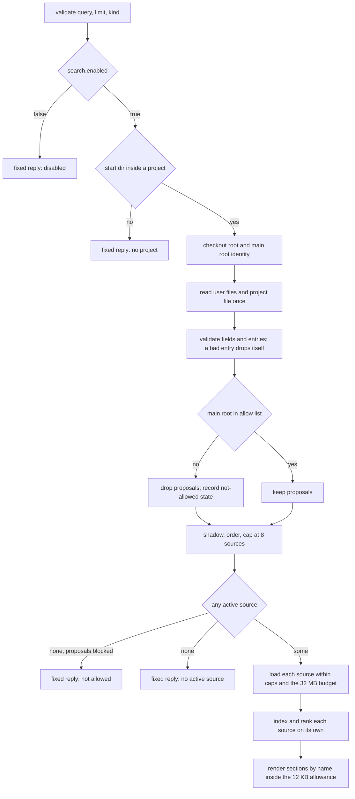
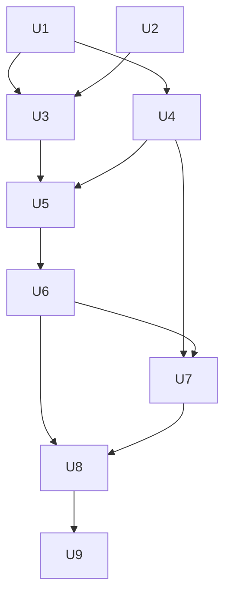

# feat: search opt-in external decision sources

## Overview

Past-work search reads four folders under `docs/`. The decisions Marcus's other projects rely on live elsewhere: RFCs, wikis, runbooks and a Deciduous graph. This plan adds a fifth search selector, `kind: "external"`, that reads user-allowed folders of Markdown and Deciduous sync JSON and returns each source's hits in its own section with its own share of the output.

A repo may propose sources inside itself, but nothing it proposes is read until the user allows that project in user config. User config may also map folders anywhere on disk to a project. A project is identified by its main repository root, so a linked worktree resolves to its main checkout. The learnings-researcher adds one `external` call in past-work scope and shows the hits in a separate External records group.

External sources are a selector beside the four kinds, not a fifth kind. The kind table, `all`, and the built-in render path stay untouched, so built-in output is unchanged by construction. The plan extends existing search modules and adds four small `src/lib` modules. It ships as one feature PR, with the Markdown format built and proven before the Deciduous format.

---

## Problem Frame

The origin document carries the full frame (untracked; see Sources & References). In short: a plan can propose something that a runbook already settles or an RFC rejected, because none of those stores reach the researcher. A trial could not settle whether the stores matter, and closed with a decision to build bounded, opt-in access with no usefulness gate before shipping.

The design has to hold four things at once:

- A repo-supplied path must not become a way to read arbitrary files or to plant records the user never agreed to trust.
- Work runs in linked worktrees by default, and search's own root walk stops at a worktree, so identity cannot come from that walk.
- Five surfaces read config differently: v1 loads once at init, v2 per snapshot, Pi at init with a per-call `cwd`, the CLI through its own loader, and the Claude Code bin from user config only with no config loader at all.
- The researcher prompt sits about 2 bytes under its working ceiling.

---

## Requirements Trace

The origin defines R1 to R24 and AE1 to AE11. Every requirement maps to at least one unit.

| ID | Requirement (short form) | Units |
|----|--------------------------|-------|
| R1 | A source has a name, a format and one or more roots | U1, U3 |
| R2 | Project roots resolve to strict subfolders; no `.`, no dot segment; a bad root drops its source with a named warning | U1, U4 |
| R3 | Proposed sources load only for allowed projects; otherwise search says so and reads nothing | U3, U5 |
| R4 | User config declares sources anywhere, mapped to projects | U1, U3 |
| R5 | Project identity is the main repo root; a worktree matches its main checkout; exact path match | U2, U3 |
| R6 | When project and user name the same source, the user wins | U3 |
| R7 | Sources read files only: no commands, no network, no writes | U4, U7 |
| R8 | Markdown: `.md` under roots; title is `title`, then first H1, then filename; recorded status only | U4 |
| R9 | Deciduous: `decision`, `option`, `outcome`, `goal` nodes; edge rationale searchable; edges are not records; `deleted_at` skipped | U7 |
| R10 | Deciduous records show `node_type` in place of status | U5, U7 |
| R11 | Symlinks skipped at every depth in every source | U4, U7 |
| R12 | Per-source built-in caps, with the record count taken after filtering | U4, U7 |
| R13 | Maximum source count and a total read budget; an over-limit source is dropped with a named warning | U3, U4 |
| R14 | A missing or empty source reports a quiet per-source state; the others still load | U4, U5 |
| R15 | `kind: "external"` ranks each active source on its own and labels it `project` or `user` | U5 |
| R16 | External results have their own output allowance; no source takes all of it | U5 |
| R17 | Built-in kinds, the default and `all` are unchanged and never return external records | U5, U6 |
| R18 | With no active source, `external` returns a fixed, non-error reply | U5 |
| R19 | `external` behaves the same on OpenCode v1 and v2, Pi, the CLI and the bin; `search.enabled` stays user-only | U3, U6 |
| R20 | Past-work scope adds one `external` call, five in all | U8 |
| R21 | External hits go in a separate External records group with recorded status or `node_type` only | U8 |
| R22 | The cite-and-differentiate rule covers external records | U8 |
| R23 | Solutions scope, compound overlap and ce:review never call `external` | U8 |
| R24 | The search guide documents sources, the allow step, both formats and the bounds | U9 |

Acceptance examples and where they are pinned:

| ID | Pinned in |
|----|-----------|
| AE1 | U3 (allowed resolution), U5 (section label), U6 (parity) |
| AE2 | U3, U5 (not-allowed reply) |
| AE3 | U1 (root rejection), U3 (other sources still load) |
| AE4 | U2 (worktree identity), U3 (mapping) |
| AE5 | U4 (committed symlink, no warning names its target) |
| AE6 | U5 (per-source allowance) |
| AE7 | U5 (fixed reply), U8 (researcher carries on) |
| AE8 | U7 |
| AE9 | U7 |
| AE10 | U8 |
| AE11 | U5, U6 (`all` unchanged with sources active) |

---

## Scope Boundaries

- Stores reached through MCP servers, commands or network services.
- Writing to any store.
- Applying wiki corrections to page text. `corrections.yaml` is not read.
- Embeddings or any ranking beyond the existing lexical search.
- A usefulness gate before shipping.
- Following successor links between external records, or from them to Systematic docs.
- Formats beyond Markdown and Deciduous sync JSON.
- Matching projects by glob or remote URL.
- Redacting secrets from external excerpts. Runbook and wiki text reaches the model provider and can be copied into a plan. The stores in scope are Marcus's own, and the risk is accepted.
- Adjacent cleanup. Nothing outside the files each unit names changes.

### Deferred to Separate Tasks

- Running the real-host delegated proof on OpenCode v1, Pi and Claude Code: later work, if the v2 proof and the host-free parity test leave a gap.
- A size assertion for the Claude Code bin bundle: none exists today; U6 records the size change and leaves a guard for follow-up.

---

## Context & Research

### Relevant Code and Patterns

Engine (`src/lib/`):

- `search-corpus.ts`: `KIND_TABLE` is closed at four entries, and `DocumentKind` derives from it. `loadCorpus` checks realpath containment of the root argument and applies caps per call (`MAX_FILE_BYTES`, `MAX_FILES`, `MAX_TOTAL_BYTES`, `MAX_DEPTH`, and a discovery ceiling of four times `MAX_FILES`). `discoverFiles` and `classifyEntry` hard-code `.md`, and `classifyEntry` skips every symlink. `readCandidates` hard-codes the logical path. `narrowNonEmptyString` is private. `resolveSearchRoot` walks up to the nearest `.git`, so a linked worktree is its own root.
- `search-core.ts`: `requestedKinds`, `validate` and `runSearch`, with the `corpusLoader(root, kind)` injection seam. `SEARCH_ERRORS.kindUnknown` and the argument and description constants live here.
- `search-render.ts`: the 16 KB cap applies after ranking, with a pinned truncation marker. `kindTokens` builds the `Corpus:` header that `search-render.test.ts` pins.
- `search-user-config.ts`: `SearchSettingsSchema` (today `enabled` only), `validateSearchBlock`, `mergeSearchSettings`, `selectConfigFile`, `loadUserLevelSearchSettings`. May import only zod, jsonc-parser, node builtins and core types, because the bin bundles it.
- `config.ts`, `config-protected-fields.ts`, `config-schema.ts`: `search` is fully protected in four places (`PROJECT_ALWAYS_PROTECTED_FIELDS`, the protected-fields list, `collectProjectProtectedFields`, the strip warning), and `config-schema.ts` wraps the whole field in `trustProtected`. `splitSearchBlock` assumes a project has no `search` block. `allow_project_profiles` is the allow-list pattern to follow.
- Surfaces: `search-tool.ts` (v1, v2, Pi adapters), `search-cli.ts`, `src/cli.ts` (`loadSearchSettingsForCli`), `src/claude-code-search.ts` (the bin; it ignores the start directory it is given and reads user config only).
- Shell precedent for main-root derivation: `resolve_main_root` in `skills/git-worktree/scripts/worktree-manager.sh`. No TypeScript helper reads `commondir`.

Researcher and tests:

- `agents/research/learnings-researcher.md` holds the past-work flow. `tests/unit/past-work-wiring-contract.test.ts` pins the per-kind call count (a `countsNamedIn` helper that must return `[1,4]` today), the Error and unsearched routing rows, and the Past-Work Output section with its five groups, status table and 12 and 3 budgets.
- Delegated proof: `tests/helpers/delegated-search-proof.ts`, `tests/unit/delegated-search-proof.test.ts`, and the v2 case in `tests/integration/opencode-v2.test.ts`.
- Identity fixtures: `tests/unit/git-worktree-fixtures.ts` (real git in isolated temp repos).
- Pins the new text must move together: `tests/unit/search-core.test.ts`, `tests/unit/cli.test.ts`, `tests/unit/search-cli.test.ts`, `tests/unit/search-adapters-parity.test.ts`, `tests/unit/search-render.test.ts`, `tests/unit/search-lifecycle-characterization.test.ts`, `tests/unit/claude-code-search.test.ts`, and the `fieldPath: 'search'` pins in `tests/unit/capability-snapshot.test.ts` and `tests/unit/config.test.ts`.
- Generated surfaces affected: schema (`docs/public/schemas/v*/systematic-config.schema.json`), config-reference (`docs/src/content/docs/reference/configuration.mdx`), registry, and the Pi persona fixtures. Both config surfaces already list `src/lib/search-user-config.ts` as a trigger.

### Institutional Learnings

- `layered-trust-boundaries-overlay-config-2026-05-09`: classify trust-sensitive fields and enforce the boundary at config load, with a test that project config cannot bypass the allow list. Use a separate allow list modeled on `allow_project_profiles`, not that list itself.
- `dependency-free-module-for-a-constant-shared-across-a-boundary-2026-09-20`: protected-field constants live in one place; register new fields together and test each.
- `lifecycle-validator-runs-only-in-ci-so-agent-prose-must-enforce-it-2026-10-26`: rules belong in prose where the researcher acts on them, and every call limit is pinned by a test.
- `prove-a-dispatched-subagent-reached-a-plugin-tool-on-a-real-host-2026-10-31`: a real-host proof checks both the child's result and the parent's final answer, with a negative control.
- `infer-main-worktree-root-from-git-common-dir-2026-10-25`: derive the main root from `commondir`, not from a path convention.
- `search-kinds-separately-instead-of-one-merged-ranking-2026-10-31` and `mining-real-needs-cannot-settle-whether-a-decision-store-matters-2026-11-02` (both cited by the origin).
- Past-work plan carry-overs: keep canonical-root containment and symlink skipping with caps per kind; keep kind text in sync across descriptions, args, the Pi snippet, CLI help, the bin and the parity pins; config-corpus fixtures are not a generated surface, so regenerate them with a throwaway script and check that only the researcher text changed.
- Durable-output plan carry-over: keep the bin narrow, and verify it under Node from a foreign directory with no `node_modules`, covering jsonc ESM, the Node floor and size.
- Project contributor guidance: a new `src/lib` module needs an `ARCHITECTURE.md` codemap entry and a `src/lib/AGENTS.md` row, both gate-enforced; a new config field follows the five edits listed in U1; generated surfaces are checked by `surfaces:affected --run` then `surfaces:drift`.

### External References

- Prior art cited by the origin: Pi settings read path arrays from user and project settings; Claude Code applies repo-declared `additionalDirectories` only after the user trusts them. No external lookup was needed.

---

## Prior-Art Survey

```json
{
  "schema_version": 2,
  "verdict": "extend",
  "scope": "marcusrbrown/systematic worktree .worktrees/feat/external-sources: src/lib/, src/*.ts, scripts/, skills/git-worktree/, agents/research/, tests/",
  "freshness": {
    "vcs_reference": "4b2d736db02ae8f37f1164f14d5065099ee5040a"
  },
  "budget": {
    "max_search_passes": 6,
    "max_candidate_inspections": 14,
    "exhausted": false
  },
  "candidates": [
    {
      "path_or_symbol": "src/lib/search-corpus.ts#loadCorpus",
      "description": "Bounded, symlink-safe loader: discoverFiles and classifyEntry walk a root, readCandidates reads under per-file and total caps, results are CorpusDocument records with warnings. Caps apply per call.",
      "disposition": "extend"
    },
    {
      "path_or_symbol": "src/lib/search-corpus.ts#KIND_TABLE",
      "description": "Closed table of the four durable-output kinds (solution, plan, brainstorm, ideation) with directory and exclusions per kind; DocumentKind derives from it.",
      "disposition": "insufficient",
      "insufficiency_reason": "Closed and docs-relative by design. Adding an external kind would leak external records into the all selector and the lifecycle resolver."
    },
    {
      "path_or_symbol": "src/lib/search-core.ts#runSearch",
      "description": "Host-neutral search composition: validate, load through the injectable corpusLoader seam, rank, resolve lifecycle, render.",
      "disposition": "extend"
    },
    {
      "path_or_symbol": "src/lib/search-render.ts#renderSearchResult",
      "description": "Sanitises, snippets and truncates a ranked result to the shared 16 KB cap, with a Corpus header pinned by tests.",
      "disposition": "insufficient",
      "insufficiency_reason": "Shaped around the built-in kinds: one ranking, one cap, a pinned Corpus header. External needs per-source sections and its own allowance. It stays untouched, and a separate renderer reuses truncateUtf8 and the marker."
    },
    {
      "path_or_symbol": "src/lib/search-lexical.ts",
      "description": "Pure tokenizer and BM25F scorer with bit-identical scores on Bun and Node.",
      "disposition": "reuse"
    },
    {
      "path_or_symbol": "src/lib/search-user-config.ts#SearchSettingsSchema",
      "description": "Zod piece for the search config field (enabled only), the pure user-then-custom merge, shared config file selection, and the user-level reader the bin uses.",
      "disposition": "extend"
    },
    {
      "path_or_symbol": "src/lib/config.ts#PROJECT_ALWAYS_PROTECTED_FIELDS",
      "description": "Top-level list of fields no project source may set, with the allow_project_profiles opt-in pattern: strip, per-path warning, user-and-custom-only resolution.",
      "disposition": "extend"
    },
    {
      "path_or_symbol": "src/lib/config-protected-fields.ts",
      "description": "Single home of the protected-field constants shared across the config and schema modules.",
      "disposition": "extend"
    },
    {
      "path_or_symbol": "src/lib/search-cli.ts",
      "description": "Flag parsing and exit codes for systematic search and the systematic-search bin, with an injected settings loader.",
      "disposition": "extend"
    },
    {
      "path_or_symbol": "src/claude-code-search.ts",
      "description": "The Claude Code bin entry: reads user-level config only and ignores the start directory it is handed.",
      "disposition": "extend"
    },
    {
      "path_or_symbol": "src/lib/search-corpus.ts#resolveSearchRoot",
      "description": "Walks up to the nearest .git entry and falls back to the start directory. A linked worktree is its own root.",
      "disposition": "reuse"
    },
    {
      "path_or_symbol": "skills/git-worktree/scripts/worktree-manager.sh#resolve_main_root",
      "description": "Shell function that derives the main checkout root from a worktree through git's common directory.",
      "disposition": "insufficient",
      "insufficiency_reason": "Shell. The bin cannot spawn git, and a source must run no commands. The logic is mirrored as a pure filesystem reader."
    },
    {
      "path_or_symbol": "src/lib/discovered-skills.ts#findGitWorktreeRoot",
      "description": "Private walk-up that returns the nearest ancestor holding a .git entry, or null.",
      "disposition": "insufficient",
      "insufficiency_reason": "Returns the worktree itself, not the main root, and is private to a module the bin must not import."
    }
  ]
}
```

---

## Key Technical Decisions

Decisions below were settled in planning. The first group came from Marcus's review of the spec-flow findings; the later ones are structural.

- KTD1. `external` is a selector, not a document kind. `KIND_TABLE` and `DocumentKind` stay closed. External records are their own type (source, origin, optional `node_type`, optional status) with no lifecycle. `validate` returns a tagged result, the core branches once, and `renderSearchResult` is untouched. This is what makes R17 and the byte-identity criterion true by construction.
- KTD2. One shared per-call reader serves all five surfaces. For `external`, the core calls a reader that reads the user config files and the project file on every call, through an injectable seam like `corpusLoader`. `search.enabled` and tool presence stay fixed at init; allow-list and source edits take effect on the next call. Init-time captured settings are never used for `external`, because v1 and Pi load config once while taking a per-call directory.
- KTD3. The `search` block is validated by field and by entry. `enabled`, `allow_project_sources` and `sources` validate separately, and each source entry validates on its own, so one bad entry drops only itself. A bad allow entry never allows anything and sets the `config unreadable` note. A typo in `sources` can never lose `enabled: false`. Project and user sources use one pure validator set, called from both `config.ts` and the per-call reader, so the two paths cannot disagree.
- KTD4. Trust is per field. `enabled` and `allow_project_sources` are user-only, tagged inline with the trust meta, and are protected paths with per-path warnings. A project may set `sources` only. The outer `trustProtected` wrapper on `search` goes away, `search` leaves the always-protected list, and a project step keeps only `sources`. The runtime authority for `external` is the per-call reader (KTD2), but `config.ts` still carries project `sources` as a third merge input, so the resolved config is coherent and the schema accepts the field.
- KTD5. Project identity is the main root, derived by pure filesystem reads. The `.git` file gives the `gitdir:` path, `commondir` gives the common directory, and when its basename is `.git` the main root is its parent. The `<gitdir>/gitdir` back-pointer must equal this `.git` path, so a forged `.git` cannot inherit an allowed identity. No `commondir` (a submodule or separate git dir) means the checkout's own root. A relative `gitdir:` resolves against the `.git` file. Anything corrupt or inconsistent fails closed and never matches. A bare-repo worktree never matches, and is documented as unsupported. Comparison is exact on realpaths.
- KTD6. The allow list is `search.allow_project_sources`, an array of absolute or `~`-prefixed main-root paths. Entries are realpath'd at compare time with the native realpath, and stale entries are silent. The list is the union across user and custom config dirs. Matching is exact; an allowed project covers whatever any of its branches proposes, which is accepted and documented. User sources reach a project the same way, through `projects[]` entries of the same form.
- KTD7. Source resolution order is fixed. Drop proposals for a project that is not allowed, apply shadowing, order user sources (user file, then custom dir, in declared order) before project sources, and cap at 8 active sources. A user source shadows a same-named project source only when the user source is mapped to this project. Names are case-sensitive. A duplicate within one file keeps the first and warns. `sources` merge by name with the custom dir winning.
- KTD8. Bounds. Maximum 8 sources and a 32 MB read budget, measured as stat bytes of every file the loader opens. A source that does not fit the remaining budget is dropped whole with a named warning, and later, smaller sources are still tried. Per-source caps stay the built-in ones. The record cap applies to kept records for Deciduous, so edge files and filtered nodes do not consume it.
- KTD9. Root rules. Project roots are relative, resolve against the checkout root, must not be `.` or contain `..`, and reject any dot segment, with one named exception: a source with `format: deciduous` may propose a root under `.deciduous/`, such as `.deciduous/sync`. The first segment may be `.deciduous` only when at least one non-dot segment follows it, and every later segment is held to the same no-dot rule. A project root that is itself a symlink is dropped. User roots must be absolute or `~`-prefixed, and a relative user root is rejected. A user root that is a symlink is followed once. Symlinks inside any root are skipped at every depth. Project roots keep realpath containment inside the checkout root; user roots skip it.
- KTD10. Source entries are bounded: names match a restricted charset (letters, digits, `-`, `_`) and a 40-character length, an unknown format drops the entry, roots may not be empty, and each source takes at most 8 roots.
- KTD11. Ranking and output. Each source gets its own lexical index, because scores are not comparable across sources. `limit` applies per source and is capped at 5 there. Sections sort by source name in code-unit order, and hits within a section by rank, then path. The external allowance is 12 KB, split evenly across sources, and a source over its share drops whole hits and prints `+N more hits not shown`. The 16 KB built-in cap is not shared. Hit paths are `<source>/<relative path>`, and each section header shows its root with the home directory collapsed to `~`. External reads are optional and count against the researcher's three full reads.
- KTD12. Fixed replies and prefix. Four fixed replies, all `ok: true` and pinned as constants: disabled, no project, project proposes sources that are not allowed, and no active source. Precedence is disabled, then no project, then the core's existing validation errors, then per-source states. A root that exists but is missing still counts as an active source, so it does not get the no-active-source reply. The not-allowed reply gives the count and the exact main-root string to add, and never echoes source names or roots. Every external reply starts with `External sources for "<q>":` and carries none of the built-in routing tokens (`corpus: none`, `corpus: empty`, `N docs, M hits`, `Search "`). A negative test pins this.
- KTD13. Per-source and project-level states. Per-source: missing, empty, unreadable, dropped. Project-level: not allowed, project config unreadable. Project-source problems never touch built-in replies, `MAX_WARNINGS` stays 5 with source drops listed first, and a gitignored source inside a worktree shows as missing.
- KTD14. Markdown records. The title is `title`, then the first H1, then the filename; status is the recorded `status` string, never inferred. A separate external parser shares the narrowing helpers, and no kind-specific excludes apply (a `README.md` is searchable). The shared loader gains a `loadSourceFiles` core with optional `extensions`, a parse callback and a display prefix; `loadCorpus` becomes a caller of it with unchanged behavior.
- KTD15. Deciduous records. Read `nodes/` before `edges/`. A missing root is a missing source; a missing `nodes/` is empty with a warning; a missing `edges/` yields records without rationale and a warning. Malformed files and bad ids are skipped and aggregated; a duplicate `change_id` keeps the first. Title is `title`, then the first description line, then `change_id`. An edge contributes rationale to a node when its other endpoint is any live node; tombstoned nodes and edges are skipped. Rationale is capped at 300 characters per edge, 20 edges per node and 2 KB per node. Hit paths are `nodes/<id>.json`, and the hit shows `node_type`.
- KTD16. The Claude Code bin gets a bin-safe reader. It reads the project file once, with a 1 MB cap and the same file selection as the other surfaces, and never imports `config.ts`. A missing file is normal. A read error, JSON error or invalid content yields zero proposals, an aggregate line in the reply, and one stderr warning, for `external` only. The bin uses the start directory it is given.
- KTD17. Researcher. The call is `kind: external` at `limit: 3`. It takes at most 4 of the 12 items in the output budget. The External records group is the sixth group, outside the status table. Items read `source, path, no recorded status` or `node_type decision`. Disabled, error and not-allowed replies go to Search Context; the researcher never greps or globs source roots and never retries.
- KTD18. Prompt budget. Measure the body first, then trim the unpinned prose the research lane identified. If trimming cannot absorb the 700 to 900 bytes added, raise the working ceiling on purpose and record the new ceiling and why in the unit's verification notes. Line 3 (the description) and line 8 (the delegated-proof marker) do not change.
- KTD19. Proof scope. One real-host delegated proof on OpenCode v2, plus a negative control. The other three hosts are covered by the host-free parity test (CLI, bin and v1) and the existing per-host search proofs. The scripted model makes the call, so the proof shows reach and plumbing, not that a model chooses to call `external`; the wiring contract pins the prompt side.
- KTD20. One feature PR; Markdown format before Deciduous.

---

## Open Questions

### Resolved During Planning

- Allow list shape and worktree identity: KTD5 and KTD6.
- Source limit, budget, per-source hit count, allowance and header state: KTD8, KTD11 to KTD13.
- How the bin reads project config without the loader: KTD16.
- Where the prompt gives up bytes: KTD18.
- Can Deciduous be proposed by a project: yes, under `.deciduous/` only (KTD9).

### Deferred to Implementation

- The exact wording of the four fixed replies and the header lines: they are pinned as constants when written, and only the prefix and the forbidden tokens are fixed here.
- Exact function names and the final names of the four new modules (proposed: `search-project-identity.ts`, `search-external-sources.ts`, `search-external.ts`, `search-external-deciduous.ts`). Whatever they are called, each needs its codemap entry and AGENTS row.
- The schema generator renumbers its `__schemaNN` definitions, so the generated diff will be large; its shape is known only after generation.
- Which unpinned researcher prose actually gets trimmed, and whether the ceiling has to move (KTD18). That depends on measuring.
- How many of the 14 config-corpus fixtures change beyond the researcher prompt string. The expectation is none, and a throwaway diff check confirms it.
- The bin bundle size change, observed and recorded rather than asserted.

---

## High-Level Technical Design

> *This illustrates the intended approach and is directional guidance for review, not implementation specification. The implementing agent should treat it as context, not code to reproduce.*

The per-call flow for `kind: "external"`, from validation to render. Fixed replies exit early; everything else reaches a section per active source.



Unit dependencies. U7 waits behind U6 by decision (Markdown ships first), though it only needs U4.



---

## Implementation Units

### Phase A: Config and identity

- [ ] U1. Search config: fields, validation, trust and generated surfaces

**Goal:** Extend the `search` block with `allow_project_sources` and `sources`, validate per field and per entry, let a project set `sources` only, and regenerate the config surfaces.

**Requirements:** R1, R2, R4, R19 (`enabled` stays user-only)

**Dependencies:** None

**Files:**
- Modify: `src/lib/search-user-config.ts` (schema fields, project variant, validators, `mergeSearchSettings` third input, doc comments)
- Modify: `src/lib/config.ts` (`PROJECT_ALWAYS_PROTECTED_FIELDS`, `collectProjectProtectedFields`, `splitSearchBlock`, the strip warning, merge wiring, stale comments)
- Modify: `src/lib/config-protected-fields.ts`
- Modify: `src/lib/config-schema.ts` (drop the outer `trustProtected`; inline trust meta on the two user-only fields)
- Modify: `docs/scripts/generate-config-reference.ts` (new `search` branch with examples on every nested field)
- Modify: `src/cli.ts` (the comment that calls a project source unable to affect search is wrong once `sources` exists)
- Regenerate: `docs/public/schemas/v*/systematic-config.schema.json`, `docs/src/content/docs/reference/configuration.mdx`
- Test: `tests/unit/search-user-config.test.ts`, `tests/unit/config.test.ts`, `tests/unit/config-schema.test.ts`, `tests/unit/capability-snapshot.test.ts`, `tests/unit/generate-config-reference.test.ts`, `tests/unit/generate-config-schema.test.ts`

**Approach:**
- Follow the config-field edits the repo already established for a new protected field: drop the outer wrapper, change the protected paths to `search.enabled` and `search.allow_project_sources`, remove `search` from the always-protected list and add a project step that keeps only `sources`, emit per-path warnings, and pass trust into `splitSearchBlock`.
- `sources[]` is `{name, format, roots[]}`. A user entry adds `projects[]`. The project variant adds the root rules of KTD9, including the single `.deciduous/` exception, and rejects `.`, `..`, absolute roots and every other dot segment. The user variant requires absolute or `~` roots.
- Validate `enabled`, `allow_project_sources` and `sources` separately, then each entry. Warnings name fields and source names, never values.
- Feed the project's validated `sources` into the merge as a third input, with the precedence in KTD7.
- Update the docs comments at the old user-only statements in `search-user-config.ts`, `config-schema.ts` and `config.ts`.
- If `config-schema.ts` ends up importing a new module, add it as a trigger in `scripts/lib/generated-surfaces.ts`. Keeping everything in `search-user-config.ts` avoids that, and both config surfaces already list it.

**Execution note:** Add characterization for today's protected-field behavior of `search` before changing it, so the three existing `fieldPath: 'search'` pins move deliberately.

**Patterns to follow:**
- `allow_project_profiles` handling in `config.ts` and the per-path warning shape.
- The `bootstrap` and `pi_subagents` branches in the config-reference generator.

**Test scenarios:**
- Happy path: a user config with `enabled`, `allow_project_sources` and two valid sources parses and merges custom over user by name, with `allow_project_sources` as a union and `enabled` last-defining.
- Happy path: a project file with `sources` only keeps its sources; a project file that also sets `enabled` or `allow_project_sources` has exactly those fields stripped, each with its own per-path warning, and `sources` survive.
- Edge case: a project `sources` entry with root `.deciduous/sync` and `format: deciduous` is accepted; the same root with `format: markdown` is rejected; `.deciduous` alone is rejected; `.deciduous/.cache` is rejected; `.slim/clonedeps` is rejected for either format.
- Error path (AE3): roots `.`, `.slim/clonedeps` and `../other-repo/docs` each drop only their own source with one warning that names the source, and a sibling valid source stays.
- Error path (C1): an invalid `sources` entry does not drop `enabled: false`; a non-string allow entry allows nothing, keeps valid siblings and sets the `config unreadable` note; a duplicate name within one file keeps the first and warns; an unknown format, an overlong or badly charactered name, an empty `roots` and a ninth root each drop their entry.
- Error path: a relative user root is rejected; a user `projects[]` entry that is not absolute or `~` is rejected.
- Integration: the generated schema and config reference list the new fields with examples, and `surfaces:drift` is clean afterwards.

**Verification:**
- The three `fieldPath: 'search'` pins now name the two user-only paths, and a test proves a project cannot set either.
- Both generated surfaces regenerate and pass their drift checks; the large schema renumbering diff is the only noise.

---

- [ ] U2. Project identity helper

**Goal:** Return a checkout's main repository root, or an unresolved result that never matches, using only filesystem reads, and provide the exact-path allow match.

**Requirements:** R5

**Dependencies:** None

**Files:**
- Create: `src/lib/search-project-identity.ts`
- Modify: `ARCHITECTURE.md` (codemap entry), `src/lib/AGENTS.md` (module-table row)
- Test: `tests/unit/search-project-identity.test.ts`

**Approach:**
- Implement the steps in KTD5 as a pure reader with node builtins only, because the bin bundles it. It returns a tagged result (main root, or unresolved with a reason) and a separate matcher that realpaths both sides and compares exactly.
- It takes the checkout root that `resolveSearchRoot` already returns. Do not unify with `resolveSearchRoot` or `findGitWorktreeRoot`; the existing AGENTS note says those copies differ on purpose.

**Execution note:** Test-first. The fixtures create real repositories, so write the cases before the derivation.

**Patterns to follow:**
- `tests/unit/git-worktree-fixtures.ts` for isolated real-git repos and temp-dir cleanup.
- `resolve_main_root` in the git-worktree manager script for the commondir logic, mirrored in pure fs.

**Test scenarios:**
- Happy path: a plain checkout returns its own root.
- Happy path (AE4): a real `git worktree add` worktree returns the main checkout's root, and a worktree created from another linked worktree still returns the main root.
- Edge case: a submodule checkout (no `commondir`) returns its own root, and a nested repo is its own project.
- Edge case: a symlinked checkout path and the real path compare equal after realpath; a relative `gitdir:` resolves correctly.
- Error path: a forged `.git` file whose `gitdir:` points at a real worktree's git dir but lacks the back-pointer match returns unresolved.
- Error path: a missing `commondir` where one is required, a corrupt `.git`, an unreadable file and a bare-repo worktree each return unresolved, never throw, and never match any allow entry.
- Integration: the matcher expands `~`, treats a stale (non-existent) allow entry as a silent non-match, and matches only the exact main root, not a parent or a child.

**Verification:**
- The module imports only node builtins, so the bin bundle stays Node-clean.
- Both registration surfaces name the module, and the content-integrity gate passes.

---

### Phase B: Reader and Markdown loader

- [ ] U3. Per-call source reader shared by all surfaces

**Goal:** Produce the active source list for one `external` call from the user files and the project file, honoring identity, allow list, shadowing, order and the source cap.

**Requirements:** R1, R3, R4, R5, R6, R13, R19

**Dependencies:** U1, U2

**Files:**
- Create: `src/lib/search-external-sources.ts` (resolution and the per-call composer)
- Modify: `src/lib/search-user-config.ts` (a bin-safe `loadProjectSearchSources` that reuses `readSearchBlock` and `selectConfigFile`, 1 MB cap, never importing `config.ts`)
- Modify: `ARCHITECTURE.md`, `src/lib/AGENTS.md`
- Test: `tests/unit/search-external-sources.test.ts`, `tests/unit/search-user-config.test.ts`

**Approach:**
- Inputs: start directory, injectable config-dir resolution (defaulting to the same env and file selection the other readers use), and the identity result. Output: ordered active sources (name, format, resolved roots, `project` or `user` origin) plus project-level states and bounded warnings.
- Apply the order in KTD7. A project file is read from the checkout root of the start directory, so a worktree reads its own copy of the project config while matching its main root's allow entry.
- Project-source problems never throw and never affect `enabled` or built-in replies. A read error, JSON error or invalid content yields zero proposals and the project-config-unreadable state.
- Expose the resolver through the injectable seam the core will take (U5); tests inject it.

**Patterns to follow:**
- `loadUserLevelSearchSettings` for non-throwing readers that return `{settings, warnings, unreadable}`.
- `mergeSearchSettings` for the custom-over-user rule.

**Test scenarios:**
- Happy path (AE1): the project proposes `decisions` at `docs/decisions`, the main root is allowed, and the source resolves as `project`.
- Happy path (AE4): a user source mapped to the agent repo's main root resolves when the start directory is the repo root and when it is one of its real worktrees, and does not resolve at an unrelated repo root.
- Error path (AE2): the same proposal with no allow entry resolves to no sources, records the not-allowed state with the proposal count, and echoes no names or roots.
- Edge case: a user source and a project source share a name. The user source shadows the project source only when it is mapped to this project; when it is mapped elsewhere, the project source loads and the user source does not.
- Edge case: names are case-sensitive, so `Wiki` and `wiki` coexist.
- Edge case: ten declared sources cap at 8, in the KTD7 order, with a warning naming the dropped ones first.
- Edge case: `allow_project_sources` in the user file and the custom config dir unions; `sources` of the same name resolve with the custom dir winning.
- Error path: a project file over 1 MB, malformed JSONC, or schema-invalid yields zero proposals and the unreadable state, while `enabled` and user sources are unaffected.
- Error path: an unresolved identity (U2) allows nothing and maps no user source.
- Integration (C2): editing the allow list or the project file between two calls changes the second call's result without restarting anything.

**Verification:**
- The module graph under the bin's entry contains no `config.ts` import.
- A test pins that tool presence and `enabled` come only from the fixed init settings.

---

- [ ] U4. Markdown external loader

**Goal:** Load `.md` files from a resolved source into bounded external records, sharing the corpus loader's walk, symlink and cap logic without changing built-in behavior.

**Requirements:** R2, R7, R8, R11, R12, R13, R14

**Dependencies:** U1, U3

**Files:**
- Modify: `src/lib/search-corpus.ts` (export `loadSourceFiles`; `KindSpec` gains optional `extensions`; `readCandidates` takes a parse callback and a display prefix and returns bytes used; export the narrowing helper)
- Create: `src/lib/search-external.ts` (record type, per-source state, Markdown parser, source loader with the shared 32 MB budget, format dispatch)
- Modify: `ARCHITECTURE.md`, `src/lib/AGENTS.md`
- Test: `tests/unit/search-corpus.test.ts`, `tests/unit/search-external.test.ts`

**Approach:**
- Refactor first, with the built-in tests unchanged: `loadCorpus` becomes a caller of `loadSourceFiles` and its output stays identical. Keep `KIND_TABLE` and `DocumentKind` closed.
- The external record is `{source, origin, path, title, status?, nodeType?, body}`. The Markdown parser applies KTD14 and shares frontmatter parsing and narrowing helpers with the corpus parser.
- Containment: project roots must realpath inside the checkout root and are dropped otherwise; a project root that is a symlink is dropped; a user root symlink is followed once. Symlinks inside roots are skipped through the existing `classifyEntry` rule, with no warning that names a target.
- The loader draws on the shared budget in the order given by U3, drops a non-fitting source whole, and still tries later ones.
- Dispatch is by format. Until U7, the dispatch table has no Deciduous entry, and such a source reports the dropped state.
- Sources only read files. Nothing in this module spawns, fetches or writes.

**Execution note:** Characterization-first. Pin `loadCorpus` output on the existing corpus fixtures before extracting `loadSourceFiles`.

**Patterns to follow:**
- `loadCorpus` containment, caps, symlink skip and bounded warnings; `tests/fixtures/search-corpus`.

**Test scenarios:**
- Happy path: a root of mixed `.md` and non-`.md` files returns only Markdown, with the title from `title`, else the first H1, else the filename, and the status only when the file records one.
- Happy path (AE10 input): a runbook with an H1 and no frontmatter has a title and no status.
- Edge case: frontmatter with a non-string `title` or `status` falls through without stringifying; a BOM or a missing trailing newline parses.
- Edge case: a missing root reports the missing state; a root with no readable records reports empty; each leaves other sources loading.
- Edge case (R12): per-file and per-source caps apply, a file over the cap is skipped with a warning, and the budget drop is whole-source with a later smaller source still loading.
- Error path (AE5): a committed symlink inside a root pointing outside the project yields no record and no warning containing its target; a symlinked directory is not descended.
- Error path: a project root that is a symlink is dropped with a named warning; a user root that is a symlink is followed once; a project root that resolves outside the checkout is dropped.
- Integration: `loadCorpus` output is identical before and after the refactor, including warnings and ordering, across all four kinds.

**Verification:**
- The existing corpus, lifecycle and determinism tests pass unchanged.
- The loader exercises only the filesystem reads; a test spies that no process or network API is touched.

---

### Phase C: Core, render and surfaces

- [ ] U5. Core selector and external render

**Goal:** Add the `external` selector to validation and `runSearch`, rank each source separately, and render sections inside the external allowance with the fixed replies and prefix.

**Requirements:** R3, R10, R14, R15, R16, R17, R18

**Dependencies:** U3, U4

**Files:**
- Modify: `src/lib/search-core.ts` (selector, tagged `validate` result, branch in `runSearch`, injectable external-resolver seam, `SEARCH_ERRORS.kindUnknown`, argument and description constants)
- Modify: `src/lib/search-render.ts` (`renderExternalResult`, reusing `truncateUtf8` and the pinned marker; `renderSearchResult` untouched)
- Modify: `src/lib/search-tool.ts`, `src/lib/search-cli.ts`, `src/cli.ts` (kind text, descriptions, the Pi `promptSnippet`, CLI help, usage strings)
- Test: `tests/unit/search-core.test.ts`, `tests/unit/search-render.test.ts`, `tests/unit/search-lifecycle-characterization.test.ts`, `tests/unit/search-determinism.test.ts`, `tests/unit/search-cli.test.ts`, `tests/unit/cli.test.ts`, `tests/unit/harness-profiles-search.test.ts`

**Approach:**
- `external` is exclusive: it is not combinable with the four kinds or `all`. The kind error lists `external` among the valid values, and every pin that quotes the text moves together: `search-core.test.ts`, `cli.test.ts`, `search-cli.test.ts` and the parity test.
- The external branch builds one lexical index per source from `search-lexical.ts`, ranks, applies the per-source `limit` cap, orders sections and hits as in KTD11, and hands sections to `renderExternalResult`.
- The renderer owns the prefix, the section label (`<name> (project|user)`), the root with `~` collapsed, `+N more hits not shown`, per-source states, the project-level states, and the four fixed replies as exported constants. It prints `node_type` where a record has one and the recorded status where it has that, and prints no status when neither exists.
- Output is capped at 12 KB for external, with whole-hit drops and the same truncation marker so the researcher's truncation row still works.
- Tool descriptions grow by the minimum needed. They are constants read by all adapters, so one edit moves every surface.

**Execution note:** The built-in byte-identity check comes first. Run the existing characterization and render fixtures against the current renderer, then keep them green through every change in this unit.

**Patterns to follow:**
- `corpusLoader` for the injectable seam; the existing header-state conventions in `search-render.ts`.

**Test scenarios:**
- Happy path (AE6): a 48-file wiki source and a 5-file decisions source both match; each section appears, and the decisions source keeps its top hits.
- Happy path: sections sort by name in code-unit order, and hits by rank then path, deterministically across repeated calls.
- Happy path (AE8 render): a Deciduous-shaped record prints `node_type decision` and not `pending`.
- Edge case: `limit` above 5 is capped at 5 per source; a source past its 12 KB share drops whole hits and prints the count line.
- Edge case: a missing root, an empty source and an unreadable source print quiet states, and the other sources still render.
- Error path (AE2): not-allowed with no other source returns the fixed not-allowed reply with the count and the main-root string and no names or roots; with another active source it adds the project-level state line instead.
- Error path (AE7): no active source returns the fixed reply with `ok: true`; a missing-but-declared root does not.
- Error path: the disabled and no-project replies appear in that precedence order, and an empty query or bad limit still returns the core's existing error first.
- Negative: no external reply contains `Corpus:`, `corpus: none`, `corpus: empty`, `N docs, M hits` or `Search "`; the four constants contain none of those tokens either.
- Integration (AE11): with sources active, `all`, the four kinds and the default produce text byte-identical to the pre-change golden outputs; the existing characterization and render fixtures pass unmodified.

**Verification:**
- Built-in output is byte-identical against `search-lifecycle-characterization.test.ts` and `search-render.test.ts`.
- Every pinned kind and usage string reflects `external`.

---

- [ ] U6. Surface wiring and parity

**Goal:** Put all five surfaces on the per-call reader and prove they return the same `external` text, including the Claude Code bin under Node from a foreign directory.

**Requirements:** R17, R19

**Dependencies:** U5

**Files:**
- Modify: `src/lib/opencode-v1.ts`, `src/lib/opencode-v2.ts`, `src/pi.ts`, `src/lib/search-tool.ts` (per-call start directory reaches the shared reader; `enabled` stays init-fixed)
- Modify: `src/cli.ts` (`loadSearchSettingsForCli`, `resolveSearchRoot` start directory), `src/lib/search-cli.ts`
- Modify: `src/claude-code-search.ts` (use the start directory it is given; read project sources and the allow list through the bin-safe reader)
- Test: `tests/unit/search-adapters-parity.test.ts`, `tests/unit/claude-code-search.test.ts`, `tests/unit/opencode-v2-search.test.ts`, `tests/unit/search-cli.test.ts`, `tests/unit/cli.test.ts`, `tests/integration/opencode-v1.test.ts`

**Approach:**
- Surfaces pass their per-call directory (v1 `context.directory`, v2 `ctx.location?.directory`, Pi per-call `ctx.cwd`, CLI `--dir` or cwd, bin start directory) into the core, and the core's default resolver does the rest (KTD2). No surface carries source or allow state of its own.
- A v2 setup must never fail because a project `sources` block is bad (KTD3).
- Narrow the existing bin test that asserts it reads user config only to say it reads only sources and the allow list from project config.
- The bin test also covers the unreadable-project-file path of KTD16.

**Patterns to follow:**
- The existing parity test, which drives each adapter's real entry over one fixture.
- The foreign-directory Node test, which uses `tests/helpers/real-node.ts`.

**Test scenarios:**
- Integration (parity): one fixture with a project proposal, an allow entry, a user-mapped source and a symlink plant yields byte-identical `external` text from the CLI, the bin and v1.
- Integration (AE1/AE2): the same fixture with the allow entry removed yields the identical not-allowed reply on all three.
- Integration: Pi and v2 are covered by their adapter tests with the same expectations on the shared text; Pi's per-call `cwd` outside the project gives the no-project reply.
- Integration (foreign dir): the built bin, run under Node from a directory with no `node_modules`, reads user config and the project file at the start directory it is passed and returns the expected sections; jsonc parsing works in the ESM bundle.
- Error path: an invalid project block leaves v2 setup intact, built-in search working, and `external` carrying the unreadable state; a bin project-file read error prints one stderr warning and the aggregate line, for `external` only.
- Edge case (AE11): with sources active, `kind: "all"` is byte-identical to its pre-change output on every surface.
- Edge case: `search.enabled: false` removes the tool as before and suppresses `external` everywhere.

**Verification:**
- The parity and bin tests pass.
- The bin bundle size change is recorded in the PR notes; no assertion is added.

---

### Phase D: Deciduous

- [ ] U7. Deciduous loader

**Goal:** Read a Deciduous sync folder into external records: decision-shaped nodes only, with edge rationale as searchable text.

**Requirements:** R9, R10, R11, R12

**Dependencies:** U4, U6

**Files:**
- Create: `src/lib/search-external-deciduous.ts`
- Modify: `src/lib/search-external.ts` (dispatch entry), `ARCHITECTURE.md`, `src/lib/AGENTS.md`
- Create: `tests/fixtures/search-external/deciduous/` (nodes, edges, README-style notes, a tombstone fixture)
- Test: `tests/unit/search-external-deciduous.test.ts`, `tests/unit/search-external.test.ts`, `tests/unit/search-user-config.test.ts`

**Approach:**
- Implement KTD15. Only `decision`, `option`, `outcome` and `goal` nodes become records, and `action` and `observation` nodes are never indexed. The record-count cap applies to kept records, with the discovery ceiling bounding files scanned; a source with a few thousand node and edge files must keep all its decision-shaped nodes under the cap.
- Rationale joins the searchable body of both endpoints' records, subject to the caps in KTD15. Edges themselves are never records.
- The `.deciduous/` project-root exception is validated in U1; this unit proves it end to end.
- `deleted_at` is tested against a fixture only. The real snapshot carries none.

**Patterns to follow:**
- The Markdown loader's state, warning and budget handling in `search-external.ts`.

**Test scenarios:**
- Happy path (AE8): every `decision` node is searchable and no `action` node is; the hit shows `decision`, not `pending`.
- Happy path (AE9): a `decision` node whose incoming edge rationale names the query term is returned, and so is a node whose outgoing edge does.
- Edge case: a node with `deleted_at` is skipped, and an edge to or from a tombstoned node contributes nothing.
- Edge case: title falls back from `title` to the first description line to `change_id`.
- Edge case: rationale caps hold (300 characters per edge, 20 edges per node, 2 KB per node).
- Edge case: a fixture shaped like the real snapshot (about 2,100 node files and 600 edge files, over 1,100 decision-shaped nodes) loads every decision-shaped node under the cap.
- Error path: a missing root is missing; no `nodes/` is empty with a warning; no `edges/` yields records without rationale and a warning; a malformed JSON file, a bad id and a symlinked file are skipped and aggregated; a duplicate `change_id` keeps the first.
- Integration: a project that proposes `.deciduous/sync` with `format: deciduous` and an allow entry produces records through the whole per-call path; the same root with `format: markdown`, or any other dot-segment root, is dropped with a named warning.

**Verification:**
- Nodes load before edges, and the loader order is deterministic.
- Deciduous never reads or writes outside the source root.

---

### Phase E: Researcher and docs

- [ ] U8. Researcher prompt, wiring contract and the v2 delegated proof

**Goal:** Add the fifth call and the External records group to past-work scope, keep the prompt inside its ceiling, and prove on a real OpenCode v2 host that the researcher's `external` call reaches the parent's final answer.

**Requirements:** R20, R21, R22, R23

**Dependencies:** U6, U7

**Files:**
- Modify: `agents/research/learnings-researcher.md` (the four sites that state the per-kind call count, the Past-Work Output section, the routing rows, the efficiency rule, and trims)
- Modify: `tests/unit/past-work-wiring-contract.test.ts`
- Modify: `tests/fixtures/config-corpus/*` (the 14 fixtures; researcher prompt string only)
- Modify: `tests/helpers/delegated-search-proof.ts`, `tests/integration/opencode-v2.test.ts`
- Modify: `tests/integration/host-contract-timings.json` (if the guard requires a refreshed entry); a new integration file would also need a place in the profile lists in `scripts/host-contract-guard.ts`
- Regenerate: `registry/registry.jsonc`, `tests/fixtures/pi-subagents-personas/**`
- Test: `tests/unit/delegated-search-proof.test.ts`, `tests/unit/host-contract-guard.test.ts`, `tests/unit/config-corpus.test.ts`

**Approach:**
- Measure the body size first. Add the fifth call (`kind: external`, `limit: 3`), the sixth group, the item format and the routing from KTD17. Edit the four call-count sites by their wording; today they sit near lines 25, 53, 299 and 310. Keep stray count words such as "twice" out of the line the wiring test counts on.
- Trim from the unpinned prose before moving the ceiling: the lines near 23, 69, 90-93, 98 (second sentence), 104-107 and the "Aim" sentence near 316. If that is not enough, raise the ceiling deliberately and record why under this unit's notes (KTD18). Do not touch the description or the delegated-proof marker.
- The skills need no edit. A negative wiring test proves the solutions scope, the compound overlap mode and the ce:review prose never mention `external`.
- The proof reuses the helper's scripted model. The parent dispatches the researcher, the child calls the search tool with `kind: external` against a planted allowed source, and the parent's final assistant message must carry the marker and the external path. The negative control removes the allow entry so the child receives the not-allowed reply, and the evaluator reports a distinct failure code. The existing `search.enabled: false` control stays.
- Regenerate the config-corpus fixtures with a throwaway script and diff them: only the researcher prompt string may change.

**Execution note:** Characterization-first for the wiring contract: update the count assertion and the group assertions together with the prompt edit so the pin never goes stale.

**Patterns to follow:**
- The existing v2 delegated search proof, its helper, and the verdict codes in `delegated-search-proof.ts`.
- `docs/solutions` learning on proving a dispatched subagent reached a plugin tool.

**Test scenarios:**
- Happy path: the wiring contract counts exactly five per-kind calls (`[1,5]`), names `external`, and describes six output groups in order with External records last and outside the status table.
- Happy path (AE10): the prompt directs a hit with no status to External records with "no recorded status", never to a lifecycle group.
- Edge case: the 4-of-12 external budget and the `limit: 3` call are pinned; the cite rule names source, path and recorded status or `node_type`.
- Error path (AE7): routing rows send disabled, error and not-allowed replies to Search Context with no grep, glob or retry.
- Negative: the solutions-scope text, the compound overlap text and the ce:review skill text contain no mention of `external`.
- Integration (v2 proof): the parent's final answer carries the marker and the external path from the child's result.
- Integration (negative control): with the allow entry absent, the child's result is the not-allowed reply, the parent's answer lacks the external path, and the evaluator names the failure.
- Integration: the config-corpus regeneration changes only the researcher prompt string in all 14 fixtures.

**Verification:**
- The researcher body is within the ceiling in force, and any change to that ceiling is written down in this unit.
- Run the generated-surfaces affected check for this unit, then the full drift check.
- The host-contract guard recognizes the proof's test file and timing.

---

- [ ] U9. Documentation

**Goal:** Document the feature in the search guide and bring every contributor and harness doc in line with the new behavior.

**Requirements:** R24

**Dependencies:** U8

**Files:**
- Modify: `docs/src/content/docs/guides/search.mdx` (declaring sources, allowing a project, both formats, the bounds, the fixed replies)
- Modify: `HARNESSES.md` (the durable-output search row, the search prose near the SR rows, SR-1, SR-3, SR-4)
- Modify: `ARCHITECTURE.md` (the search section, the `external` selector, and the allow-pattern section so `allow_project_sources` appears beside `allow_project_profiles`)
- Modify: `src/lib/AGENTS.md` (the `search-user-config.ts`, `search-core.ts`, `search-corpus.ts`, `search-cli.ts` and bin rows, which currently say project config is never read)
- Modify: `STRUCTURE.md` (only if the new modules change the described layout)
- Test: `tests/unit/harness-profiles-search.test.ts`

**Approach:**
- The guide gets one worked example per format and states the three trust boundaries: a repo proposes, the user allows, user roots are unrestricted. It documents the not-allowed reply, the exact string to add (the main root), and the caveat that an allowed project covers whatever a branch proposes.
- HARNESSES says the bin now reads project sources and the allow list (it was user-only), and that the v2 delegated proof covers `external`.
- Preserve the privacy note: external text reaches the model provider and nothing is redacted.

**Test expectation:** none for new behavior. Existing docs tests continue to pass, and the content-integrity gate verifies the module registration.

**Verification:**
- The docs build succeeds with the updated guide.
- The content-integrity gate passes, and a read of the guide against the shipped behavior finds no mismatch.

---

## System-Wide Impact

- **Interaction graph:** `search-core.ts` gains a second path, so the bin's bundle now carries the identity helper, the per-call reader and the external loaders. The researcher and the four skills that dispatch it are the only prompt-side consumers; ce:review and ce:compound must stay unaware of `external`.
- **Error propagation:** every external failure is a text reply, never a thrown error or a failed tool call. Project-source problems never reach built-in replies or v2 setup. A bad allow entry fails closed.
- **State lifecycle risks:** nothing is cached. Each call rereads config and files, so an allow-list edit or a deleted source takes effect on the next call. The cost is a few small file reads per call, bounded by the 1 MB project-file cap and the 32 MB budget.
- **API surface parity:** all five surfaces read the same per-call reader and render the same text. The parity test pins CLI, bin and v1; v2 and Pi share the same core and are pinned by their adapter tests; the v2 real-host proof covers the dispatched path.
- **Integration coverage:** the pieces unit tests cannot prove alone are a real `git worktree add` identity, the bin under Node from a foreign directory, and the child-to-parent path on a real v2 host.
- **Security surface:** the allow list is the trust gate. A project's own dot-segment, symlink and containment rules bound what a proposal can reach, and a user root is deliberately unrestricted because the user wrote it. Reads happen with the user's privileges, so the not-allowed reply echoes nothing the project wrote.
- **Unchanged invariants:**
  - The four built-in kinds, the default `solution` search and `kind: "all"` return the same text as before whether or not sources exist, and never return external records. `renderSearchResult` and `KIND_TABLE` are not modified.
  - A project with no active source gets byte-identical output from every built-in search.
  - Solutions scope, ce:compound overlap mode and ce:review never call `external`.
  - `search.enabled` stays user-only and fixed at init, and `false` removes the tool everywhere.
  - Lifecycle, status and successor handling stay confined to the built-in kinds. External records show recorded status or `node_type` only.
  - Search remains read-only: no commands, network or writes.

---

## Risks & Dependencies

| Risk | Likelihood | Impact | Mitigation |
|------|-----------|--------|------------|
| A project-supplied path reads outside the project or plants a record the user never agreed to trust | Low | High | Allow gate, relative-only roots, dot-segment and containment rules, symlink drops, the narrow `.deciduous/` exception, per-field trust tests |
| A forged `.git` inherits an allowed identity | Low | High | Back-pointer check, fail-closed results, a forged-`.git` fixture |
| Built-in output changes by accident during the loader refactor | Medium | High | Characterization before refactor, renderer untouched, byte-identity fixtures run through every unit |
| Init-captured settings drift from the per-call project | Medium | Medium | One per-call reader for all surfaces; a test that edits config between two calls |
| The bin grows or breaks under Node | Medium | Medium | No `config.ts` import, foreign-directory Node test, recorded size change |
| The researcher prompt cannot absorb the new text inside its ceiling | High | Medium | Measure, trim unpinned prose, then raise the ceiling deliberately with the reason recorded |
| Wiring pins go stale or leak `external` into other flows | Medium | Medium | `[1,5]` assertion, six-group assertion, negative tests on solutions, compound and review |
| The v2 proof is mistaken for evidence that a model calls `external` | Medium | Low | State that the proof shows plumbing; the prompt side is pinned by the wiring contract |
| An allowed project's later branch proposes something broader | Medium | Medium | Accepted and documented: the allow covers the project, and roots still pass the dot and containment rules |
| The schema generator's renumbering hides a real change in review | Medium | Low | Regenerate once in U1, review the semantic diff by field, and keep later units from re-touching the schema |
| Source text with embedded instructions influences a plan | Medium | Medium | Accepted for Marcus's own stores; documented. No redaction in scope |

Dependencies: none external. The plan adds no package and touches no lockfile.

---

## Documentation / Operational Notes

- The user-facing change is config only: `search.allow_project_sources`, `search.sources`, and project `search.sources`. A user must add each project's main root to the allow list. The not-allowed reply tells them the exact string.
- Release: a `feat` that semantic-release publishes as a minor version. No migration is needed because the new fields are optional.
- No telemetry is added. The post-ship record below is a manual note.

---

## Success Criteria

- A project with no active source gets byte-identical output from every built-in search. The researcher's extra `external` call returns the fixed reply, and it adds nothing and carries on.
- The behavior is the same on every surface that has search, and `search.enabled` is the only switch that stays user-only.
- A planner can build against the document without inventing source semantics, the allow rule, the bounds, the output grouping or which workflows call `external`.
- After shipping, not as a gate: keep a manual record of the next 10 past-work runs in the repos Marcus plans in. Note what external material was read, what was cited, what changed a decision, plus noise and cost, with no telemetry. If external material changes no decision in any of the 10 runs, cut back or remove the feature.

---

## Sources & References

- **Origin document:** `docs/brainstorms/2026-11-02-external-sources-requirements.md`. This path is untracked (the brainstorms directory is gitignored), so a clone will not contain it. R1 to R24 and AE1 to AE11 are carried into this plan.
- Related past work: `docs/plans/2026-10-30-001-feat-search-past-work-plan.md`, recorded completed. It added the four kinds and the researcher's past-work scope; this plan adds a fifth selector beside them without touching those kinds.
- Related past work: `docs/plans/2026-11-01-001-feat-decision-store-trial-plan.md`, recorded completed. It built no access; this plan builds what it deferred.
- Related code: `src/lib/search-corpus.ts`, `src/lib/search-core.ts`, `src/lib/search-render.ts`, `src/lib/search-user-config.ts`, `src/lib/config.ts`, `src/lib/config-schema.ts`, `src/claude-code-search.ts`, `agents/research/learnings-researcher.md`.
- Learnings: `docs/solutions/best-practices/search-kinds-separately-instead-of-one-merged-ranking-2026-10-31.md`, `docs/solutions/best-practices/mining-real-needs-cannot-settle-whether-a-decision-store-matters-2026-11-02.md`, and the others listed under Institutional Learnings.
