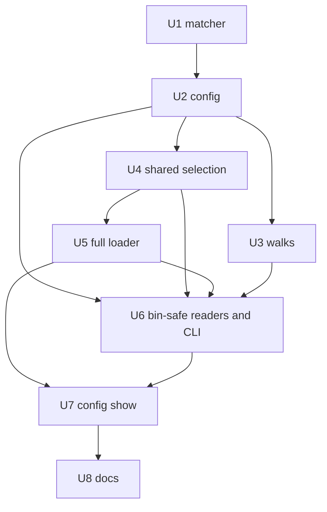

# feat: Repo-root project config, local user overlay and search source excludes

## Overview

Three config features reach every surface that reads Systematic config: the OpenCode v1 and v2 plugins, Pi, the `systematic` CLI and the Claude Code bin `systematic-search`.

- **Source excludes.** An external search source gains a gitignore-style `exclude` list, matched by a new dependency-free module.
- **Repo-root project file.** `.systematic.jsonc` (or `.json`) at the repository root becomes a project config location that beats `.opencode/`. Every reader resolves it from the repository root, not from the start directory.
- **Local user overlay.** `systematic.local.jsonc` (or `.json`) beside the user file and beside the `OPENCODE_CONFIG_DIR` file adds two layers: user → user.local → project → custom → custom.local, with profile bundles placed by KTD3. Prose and layer values say `user.local` and `custom.local`; JSON keys say `userLocal` and `customLocal`.

Three defects get fixed on the way. `systematic search` drops the fallback's warnings and the caught exception today, so an invalid local file could not be named. The CLI is silent about a schema-invalid project file. And `config show` has no search section at all.

The plan extends `search-user-config.ts`, `config.ts`, `search-corpus.ts` and the external walks. It adds one module, `src/lib/search-exclude.ts`.

---

## Problem Frame

The origin document carries the full frame and is untracked (see Sources & References). In short:

- Some stores hold files that only add noise to external search: an activity log in a wiki, test-tool sandbox copies of the docs. Nothing can exclude them.
- Project config must live under `.opencode/`. A repository worked on only through Claude Code or Pi has no other reason to create that directory.
- A user who keeps `~/.config/opencode/systematic.jsonc` in dotfiles must commit machine-specific paths (absolute source roots, `projects`, the allow list) or keep the file out of dotfiles.
- Readers disagree on where the project file is. The CLI and the per-call search reader start at the repository root. The plugins and Pi start at the directory they were given, so a session in a subfolder misses the project config.

The loader treats trust as the unit of everything: each file is a source with a `user`, `project` or `custom` kind, and strip rules, merge rules and observation metadata key on that kind. Locals are the first case of two files sharing a kind, so the change touches every place that enumerates sources.

---

## Requirements Trace

The origin defines R1–R18 and AE1–AE11. Planning decisions refine four of them, and the refined wording takes precedence:

- R2/R4 (patterns). `**` is special only as a whole segment. Also invalid: a leading `./`, an embedded `**` (`a**b`), an empty segment (`a//b`), a `.` segment. The 64-pattern limit is by index.
- R18. No regex and no exponential backtracking. For a bounded pattern (at most 256 characters) the cost is linear in path length. The origin states the same bound. U1 asserts correct results on adversarial inputs and that they finish; it does not measure complexity.
- R15. The CLI fallback must surface the diagnostics it discards today (KTD9).
- R16. Parity is defined for the same effective start directory (KTD2).

| ID | Requirement (short form) | Units |
|----|--------------------------|-------|
| R1 | Every external source entry accepts `exclude` | U2 |
| R2 | Patterns match the path relative to the root; no `/` means any depth; `/` anchors; trailing `/` ignored | U1, U3 |
| R3 | `*`, `**`, `?` only; a matched directory excludes its subtree | U1, U3 |
| R4 | Invalid pattern drops alone with a warning; source still loads; 64-pattern cap | U1, U2 |
| R5 | Excluded directory never entered; excluded file never examined or counted; listing budget still charged | U3 |
| R6 | Deciduous matches `nodes/<file>` and `edges/<file>` | U3 |
| R7 | `.systematic.jsonc`/`.json` at the repo root; `.opencode/` keeps working | U4, U5, U6 |
| R8 | Root file wins, `.opencode/` ignored with a warning naming both, never merged | U4, U5, U6 |
| R9 | Root file has exactly project trust | U5, U6 |
| R10 | Every reader resolves the project file from the repo root | U4, U5, U6 |
| R11 | `systematic.local.jsonc`/`.json` beside the user and custom files | U4, U5, U6 |
| R12 | Order user, user.local, custom, custom.local with custom-layer merge rules | U5, U6 |
| R13 | A local has its sibling's trust and may set every field the sibling may | U5, U6 |
| R14 | A local with no sibling is valid | U4, U5, U6 |
| R15 | Invalid local behaves like an invalid sibling per surface | U5, U6 |
| R16 | Same files, same order, identical search output on all surfaces | U6 (parity), U5 |
| R17 | Reference and search guide document locations, precedence, overlay, excludes | U8 |
| R18 | Matching has no regex and no exponential backtracking | U1 |

Scope added during planning, beyond the origin:

| ID | Scope | Units |
|----|-------|-------|
| S1 | `config show` lists the local and ignored-project paths and never prints a local file's raw text (KTD8) | U7 |
| S2 | `config show` gains a Search section for the current project (KTD11) | U7 |
| S3 | `loadSearchSettingsForCli` surfaces fallback warnings and the caught exception; an invalid project file is no longer silent in the CLI (KTD9) | U5, U6 |

| AE | Pinned in |
|----|-----------|
| AE1, AE2 | U1 (matcher), U3 (walk) |
| AE3 | U2 |
| AE11 | U1 (bounded match), U2 (`!log.md` reported) |
| AE4 | U4 (selection), U5 (loader), U6 (bin-safe reader) |
| AE5 | U5 (full-loader surfaces: v1, v2, Pi, CLI). The bin never reads `enabled` or `allow_project_sources` from a project file, so it has nothing to strip or warn about. |
| AE6, AE9 | U4 (root lookup), U5, U6 |
| AE7, AE10 | U5 (full loader), U6 (bin-safe reader) |
| AE8 | U5 (plugin, Pi throw), U6 (CLI, bin report) |

---

## Scope Boundaries

- A project-level `.local` file.
- Absolute roots in project files.
- Honoring `.gitignore` when walking source roots.
- Excludes for the four built-in kinds.
- Writing or gitignoring the local file automatically.
- Negation (`!`) and character classes in patterns.
- Adjacent cleanup. Nothing outside the files a unit names changes.

### Deferred to Separate Tasks

- Pi per-call config reload: Pi keeps its startup load (KTD2); a reload design is its own task.
- Merging `findGitWorktreeRoot` and `resolveSearchRoot`: the doc comment on `resolveSearchRoot` still says not to unify them, and this plan keeps that.

---

## Context & Research

### Relevant Code and Patterns

- `src/lib/search-user-config.ts` is bin-safe and must not import `config.ts` or `config-schema.ts`. It owns `selectConfigFile`, `resolveUserLevelConfigDirs`, `mergeSearchSettings` (already N-source), `validateEntry`, `loadUserLevelSearchSettings` and `loadProjectSearchSources`. The full loader and the bin both call it, which makes it the right home for shared selection.
- `src/lib/config.ts`: `getConfigPaths`, `loadConfigWithSources`, `loadConfigSource` (trust comes from the kind, not the path), `resolveOverlayEntryValue`, `buildConfigObservationMetadata`, `mergePiSubagentsOverlaySources`, and the profile lookups.
- `src/lib/search-corpus.ts`: `resolveSearchRoot` (nearest `.git`, realpath, falls back to the realpath of the start), `listDirectoryWithin` (charges the entry budget per listed name), `discoverFiles`, `discoverSourceFiles`.
- `src/lib/search-external.ts`: `MARKDOWN_WALK` is a shared constant, so a per-source matcher cannot ride on `WalkSpec`. `gatherCandidates` builds per-source inputs.
- `src/lib/search-external-deciduous.ts`: `scanFolder` and `classifyJsonEntry` list `nodes/` and `edges/` without recursion.
- `src/lib/search-external-sources.ts`: `resolveExternalSources`, `ActiveSource`. Both source mappings (user, project) must copy `exclude`.
- `src/lib/config-protected-fields.ts`: an import-free module shared across the loader/bin boundary (`CONFIG_PROTECTED_FIELD_PATHS`). It is the precedent for `search-exclude.ts`. The protected search field list, `PROJECT_PROTECTED_SEARCH_FIELDS`, lives in `src/lib/config.ts`.
- `src/cli.ts`: `loadSearchSettingsForCli`, `buildConfigShowJson`, `configShow`.
- `scripts/lib/generated-surfaces.ts`, `docs/scripts/generate-config-reference.ts` (`SEARCH_SOURCE_ENTRY_FIELDS`).

### Institutional Learnings

- `docs/solutions/best-practices/entry-point-scope-decides-what-a-plugin-can-ship-2026-08-24.md`: keep the bin's import graph narrow, test the packaged bin under Node from a foreign directory. `search-exclude.ts` has no imports, so the graph stays narrow.
- `docs/solutions/best-practices/dependency-free-module-for-a-constant-shared-across-a-boundary-2026-09-20.md`: an import-free module for anything shared across a boundary, and a test that it is registered.
- `docs/solutions/best-practices/typed-config-validation-build-time-codegen-2026-05-16.md` and `docs/solutions/workflow-issues/registry-drift-on-skill-description-change-2026-05-20.md`: regenerate in order, then check drift; watch for ESM import caching in generator tests.
- The completed external-sources plan: shared validators and selection, five host lifecycles, a parity test, entry budget charged at consumption. It warns that platform `readdir` and `realpath` differences bite.
- The completed durable-search plan: do not merge nearest-`.git` walks casually when fallback semantics differ.
- No earlier glob matcher exists in the repo, so pattern semantics need explicit tests.

### External References

- OpenCode repo-root `opencode.json` and glob `watcher.ignore`; Claude Code `settings.local.json` (local over shared over user). Prior art for naming and layering only; no behavior is copied.

---

## Prior-Art Survey

```json
{
  "schema_version": 2,
  "verdict": "extend",
  "scope": "systematic repo (single package): src/, src/lib/, scripts/lib/, docs/scripts/, tests/unit, tests/helpers, tests/integration (not walked)",
  "freshness": {
    "vcs_reference": "7325f46739fea6546be31b996339e3b6f995fd20 (branch feat/config-locations-excludes, clean)"
  },
  "budget": {
    "max_search_passes": 8,
    "max_candidate_inspections": 24,
    "exhausted": false
  },
  "candidates": [
    {
      "path_or_symbol": "src/lib/search-user-config.ts#selectConfigFile",
      "description": "Picks <basename>.jsonc else <basename>.json in a dir; the single file-selection chokepoint config.ts and the bin-safe reader both call. Already parameterised by basename, so '.systematic' and 'systematic.local' need no new primitive.",
      "disposition": "extend"
    },
    {
      "path_or_symbol": "src/lib/search-user-config.ts#resolveUserLevelConfigDirs",
      "description": "Resolves homeDir, userConfigDir and the trimmed OPENCODE_CONFIG_DIR (blank = unset) for config.ts and the reader alike; gives the two directories the local files sit beside.",
      "disposition": "reuse"
    },
    {
      "path_or_symbol": "src/lib/search-user-config.ts#loadUserLevelSearchSettings",
      "description": "Bin-safe reader: reads the user file then the custom file, validates each search block, merges with mergeSearchSettings, never throws. Also the CLI's fallback when a source is invalid, so adding local files here satisfies R15.",
      "disposition": "extend"
    },
    {
      "path_or_symbol": "src/lib/search-user-config.ts#loadProjectSearchSources",
      "description": "Bin-safe project reader: selectConfigFile on <root>/.opencode, 1 MB bounded fd read, project-trust validation, returns sources/warnings/unreadable. Hard-codes the .opencode location and has nowhere to report an ignored second file.",
      "disposition": "extend"
    },
    {
      "path_or_symbol": "src/lib/search-user-config.ts#mergeSearchSettings",
      "description": "Pure merge over an ordered source list: enabled last-defining, allow_project_sources union, sources by name with the later whole entry winning. Already N-source, so user/user-local/custom/custom-local needs only a longer input list.",
      "disposition": "reuse"
    },
    {
      "path_or_symbol": "src/lib/search-user-config.ts#validateEntry",
      "description": "Per-entry validator with ENTRY_KEYS and SearchSourceSchema (name, format, roots, projects); an unknown key drops the entry. Needs an 'exclude' key, per-pattern validation and warnings routed through warn().",
      "disposition": "extend"
    },
    {
      "path_or_symbol": "src/lib/config.ts#getConfigPaths",
      "description": "Builds userConfig, projectConfig, customConfig and unused dir fields from the raw projectDir; no repo-root resolution, no local files, no root project file.",
      "disposition": "extend"
    },
    {
      "path_or_symbol": "src/lib/config.ts#loadConfigWithSources",
      "description": "Full loader with loadUserAndCustomSources, buildOverlaySources, profile lookup/selector, scalar and list merges, observation metadata, all assuming exactly three file sources keyed by trust. Local layers need a layer discriminator and edits at each enumeration.",
      "disposition": "extend"
    },
    {
      "path_or_symbol": "src/lib/config.ts#resolveOverlayEntryValue",
      "description": "Overlay merge branches on source.trust: 'user' merges field-additively and 'custom' replaces whole. A user-local file given trust 'user' would merge additively, contradicting R12, so the branch must key on a layer field.",
      "disposition": "extend"
    },
    {
      "path_or_symbol": "src/lib/config.ts#loadConfigSource",
      "description": "Loads and validates one file under a trust kind; project trust drives every strip and warning (protected fields, security overlays, search protected warnings) from the kind, not the path, so a root .systematic.jsonc gets identical trust once passed as projectConfig.",
      "disposition": "reuse"
    },
    {
      "path_or_symbol": "src/lib/config.ts#buildConfigObservationMetadata",
      "description": "Maps sources by ConfigSourceKind (user/project/custom) and feeds the CLI invalid-source check and capability snapshot allowlist; a second user-trust source would collide, so local presence needs folding into the sibling entry.",
      "disposition": "extend"
    },
    {
      "path_or_symbol": "src/lib/search-corpus.ts#resolveSearchRoot",
      "description": "Nearest ancestor holding .git (directory or file), realpath'd, falling back to the realpath of the start dir; already used by the CLI and every per-call reader. Needs a variant that reports whether .git was found so the loader can keep the unresolved start dir otherwise.",
      "disposition": "extend"
    },
    {
      "path_or_symbol": "src/lib/search-corpus.ts#discoverFiles",
      "description": "Recursive external/built-in walk: listWalkedDirectory charges the shared EntryBudget per listed name, then safeLstat and classifyEntry per name. Has no per-source exclude hook; a name-only check fits between the sort loop and safeLstat via a Discovery field like entryBudget.",
      "disposition": "extend"
    },
    {
      "path_or_symbol": "src/lib/search-corpus.ts#WalkSpec",
      "description": "Static per-kind excludedFiles/excludedDirs: lower-case exact names, no glob, no depth or path anchoring. MARKDOWN_WALK is a shared constant and KIND_TABLE is 'as const satisfies', so it cannot carry a per-source matcher.",
      "disposition": "insufficient",
      "insufficiency_reason": "Exact lower-case name lists only; no glob, no anchoring, and the walk spec is shared across sources while excludes are per source."
    },
    {
      "path_or_symbol": "src/lib/search-external-deciduous.ts#scanFolder",
      "description": "Lists nodes/ and edges/ without recursion, charges the budget, then classifyJsonEntry does the name test, safeLstat, symlink and id checks. Accepts no exclude input; the test belongs after the .json suffix check and before safeLstat.",
      "disposition": "extend"
    },
    {
      "path_or_symbol": "src/lib/search-external-sources.ts#resolveExternalSources",
      "description": "Per-call reader shared by every surface: resolveSearchRoot, user settings, project sources, identity, ActiveSource list. ActiveSource carries name/format/roots/origin only, so exclude must be added and copied in both source mappings.",
      "disposition": "extend"
    },
    {
      "path_or_symbol": "src/cli.ts#loadSearchSettingsForCli",
      "description": "CLI search settings: full loader at resolveSearchRoot(startDir) in report mode, falling back to loadUserLevelSearchSettings on an invalid non-project source. The fallback already reads whatever that reader reads, so local files follow; the pre-resolve becomes redundant.",
      "disposition": "extend"
    },
    {
      "path_or_symbol": "src/lib/config-protected-fields.ts",
      "description": "Import-free shared module for a constant used across the config-loader/bin boundary (CONFIG_PROTECTED_FIELD_PATHS); the protected search field list PROJECT_PROTECTED_SEARCH_FIELDS lives in config.ts and already covers search.enabled and allow_project_sources, and exclude needs no protection. Precedent for hosting the matcher module.",
      "disposition": "reuse"
    },
    {
      "path_or_symbol": "src/lib/search-bounded-read.ts#readBytesBounded",
      "description": "The bounded, non-blocking, regular-file fd read used by the project reader; a root .systematic.jsonc is read through the same path with no new I/O primitive.",
      "disposition": "reuse"
    },
    {
      "path_or_symbol": "docs/scripts/generate-config-reference.ts#SEARCH_SOURCE_ENTRY_FIELDS",
      "description": "Hard-coded display list of sources[] entry fields (name, format, roots, projects) that drives the search sub-sections of the generated reference; exclude must be appended or it will not render.",
      "disposition": "extend"
    },
    {
      "path_or_symbol": "scripts/lib/generated-surfaces.ts#matchesGlob",
      "description": "Glob match built on Bun.Glob for generated-surface triggers; build-time script code outside src/ and unavailable to the Node-run bin.",
      "disposition": "insufficient",
      "insufficiency_reason": "Depends on the Bun runtime and lives in scripts/, so it cannot ship in the plugin or the Node 20.11 bin, and its semantics are not the gitignore subset."
    },
    {
      "path_or_symbol": "node:path#matchesGlob",
      "description": "Built-in glob matcher reported by the requirements doc as stable only from Node 22; not verified in this survey.",
      "disposition": "insufficient",
      "insufficiency_reason": "Engines floor is Node >=20.11 and the bin runs under Node, so it cannot be relied on; its pattern semantics also differ from the specified subset."
    },
    {
      "path_or_symbol": "src/lib/discovered-skills.ts#findGitWorktreeRoot",
      "description": "Private .git walk-up that returns null without a repo; deliberately different from resolveSearchRoot and documented as not to be unified.",
      "disposition": "insufficient",
      "insufficiency_reason": "Private, null-on-miss behavior contradicts the R10 start-directory fallback, and its doc says not to unify it with resolveSearchRoot."
    }
  ]
}
```

---

## Key Technical Decisions

Where a decision changes today's behavior, the Documentation section lists it.

| # | Decision | Rationale |
|---|----------|-----------|
| KTD1 | **Repo root.** The root is the nearest ancestor holding `.git` (directory or file). A found root is realpathed, the same way `resolveSearchRoot` does it; with none, the start directory is used unresolved, and the lookup variant reports whether `.git` was found. The lookup runs in `getConfigPaths`/`loadConfigWithSources` only when `includeProject` is true. | One change covers v1, v2, Pi, the CLI's non-search commands and the pi-subagents export. Not realpathing the no-repo fallback keeps no-repo behavior byte-identical; a macOS tmpdir realpath would break existing tests. A symlinked checkout does show its realpath in `config show` and in warnings. The v2 home fallback stays `includeProject:false`. |
| KTD2 | **Pi keeps its split.** Config loads once at startup from `process.cwd()`; search resolves per call from `ctx.cwd`. R16 parity means the same effective start directory. | A per-call reload is a separate task. The split is documented rather than hidden. |
| KTD3 | **Layer order** [advisory project-sourced bundle,] user, [user- or custom-sourced bundle,] user.local, project, custom, custom.local. The bundle slots are today's, from `buildOverlaySources`: the advisory bundle first, any other bundle between the user base and project; a bundle defined in a local file takes that same slot. user.local therefore beats any user- or custom-sourced bundle, and the custom file still beats project and its own bundle. `FileConfigSource` gains a `layer` discriminator, and overlay replace-vs-additive branches on `layer`, not trust. Metadata consumers read a sibling-folded per-kind view built after validation; the overlay merge, the pi-subagents export and the removed-key warnings read the layered list. A kind is invalid if either of its files is. | A local shares its sibling's kind and trust, so trust cannot tell them apart. Keeping today's bundle slots changes no existing precedence. The folded view keeps the capability snapshot's closed kind allowlist intact and keeps a local from replacing its sibling's path or authority. Files are validated separately before folding so messages name the right file. |
| KTD4 | **Selection by existence, not validity.** `.jsonc` beats `.json`; a root file beats `.opencode/`. An invalid winner never falls back. If the user and custom directories are the same directory or realpath aliases, each file is read from disk once and its diagnostics are emitted once. | Matches how `.jsonc` already wins. Falling back past a broken file would silently apply the wrong config. |
| KTD5 | **Patterns.** Rules per the Requirements Trace refinements, plus: trailing `/` stripped, case-sensitive, `*` matches dotfiles. Matching is a segment DP across pattern × path segments, with an iterative two-pointer match inside a segment. No regex. The pattern validator runs per element inside the hand-written `validateEntry`; a non-array `exclude` drops the source; bad elements drop one by one; warnings name `exclude[i]` and the reason, never the pattern text. | Search settings are validated by `validateEntry`, not by Zod, which only feeds the emitted editor schema. A strict schema array would have rejected the whole value before the per-pattern drop AE3 needs, so the list validator owns the limits. Regex invites ReDoS, and the bin must run on Node 20.11. |
| KTD6 | **Excluded names still cost listing budget.** The check runs after the listing is charged and before `safeLstat`. Excluded entries are never descended into and never count toward file or byte caps. A Deciduous folder removed whole by excludes is intentionally absent and raises no warning. | The walk stays bounded. Excludes cannot be used to hide an oversized directory from the budget. |
| KTD7 | **Diagnostics.** Search never throws. Each invocation reports each failed file once, deduped by file plus issue. v1 and Pi fail at init and name the file; v2 fails in `setupOpenCodeV2` at its one config load. The bin validates only the `search` block and cannot detect other invalid fields; the docs say so. | Failure is loud where a loader exists and non-fatal where search must still answer. |
| KTD8 | **`config show --json` is additive.** Existing keys stay; new keys carry the user.local, custom.local and ignored-project paths. `config show` never prints a local file's raw text; the Search section shows resolved values, including sources defined in a local file and the merged allow list. The capability snapshot folds locals into the user/custom kinds. | Consumers pinned to the old key set keep working. Resolved values are what the user needs; the raw text of an overlay may hold paths the user keeps out of shared output. |
| KTD9 | **Fix `loadSearchSettingsForCli` and the CLI's silence on invalid files.** The user-level fallback's warnings and the caught exception reach the CLI's warning list. In report mode the loader warns about any invalid file, project included, and the CLI marks an invalid project file unreadable. The loader's project pass gets the bin's 1 MB cap, so both give the same outcome for an oversized file. | Without it, AE8 cannot name an invalid local file on the CLI, and a schema-invalid project file is silent today. |
| KTD10 | **No major version.** The compatibility changes ship in a minor release with a Compatibility paragraph in the commit body and PR description, not a `BREAKING CHANGE:` footer. | Each affects narrow setups, and each has a one-step migration or a warning. |
| KTD11 | **`config show` gains a Search section** for the current project, in human and `--json` output. It reports whether search is enabled; the allow list and whether this project is on it; each external source with origin (`user`, `user.local`, `custom`, `custom.local`, `project`), name, format, roots, `exclude`, status and warnings; and each built-in kind (solution, plan, brainstorm, ideation) with its directory and whether it is present, empty, missing or unreadable. Statuses: `active`, `not allowed`, `over source cap`, `dropped invalid`, `missing root` (one `lstat` per root). User sources mapped only to other projects are left out, and a project proposal replaced by a same-named user source is not listed, because the merge keeps only the winner. The section lists the names and roots of not-allowed project proposals. Tool and bin replies keep their current rule: never a name or a root. It runs no search. | Today `config show` shows only model routing, so nobody can see why a source is or is not active. Reusing the resolver and discovery keeps the answer equal to what search does. |

---

## Open Questions

### Resolved During Planning

- A lone `**` pattern: valid, equals `*` for a name-only pattern. A source whose every file it excludes reports the existing empty/missing state.
- `**` matches zero or more segments, so `a/**` also matches `a` itself (dropping the directory) and `**/b` matches a root `b`.
- More than 64 patterns: elements from index 64 on are dropped, with one aggregate warning naming `exclude[64]` and the count. An invalid element still occupies an index.
- A non-string element is invalid with reason "not a string".
- Aliased user/custom directories: both layer positions keep applying, as today, so a user file named by `OPENCODE_CONFIG_DIR` still ranks over project. Each file is read once; diagnostics dedupe by file plus issue; one warning names the alias. Dropping the custom pair was rejected because it silently lowers that file's precedence.
- Profile bundle position: today's slots stay. The order is [advisory project-sourced bundle,] user, [user- or custom-sourced bundle,] user.local, project, custom, custom.local. A bundle defined in a local file takes the same slot as one defined in its sibling. user.local therefore beats any user- or custom-sourced bundle; the custom file still beats project and its own bundle, as today.
- Layer names: prose and the `layer` values use `user.local` and `custom.local`. JSON keys use `userLocal` and `customLocal`.
- Selection when no project file exists: the `.opencode/systematic.json` path is reported, as today.
- The pattern-list validator is a list-level function in `search-exclude.ts` so the one `validateEntry` (called by the full loader and the bin-safe readers) gives one result.
- `config show --json` key names: `locations.userLocal`, `locations.customLocal` (null when no custom directory) and `locations.ignoredProject`: one path, the `.opencode/` file a root file shadowed, or null. Local keys carry the selected path even when absent, like `user` does.
- `config show` keeps printing the sibling user and project file contents it prints today. It never prints a local file's raw text (KTD8). `config path` picks up the resolved project path and adds no rows.
- When the full load fails, `config show --json` still returns `{locations, error}` and now also `search`, because the bin-safe readers never throw and the failure is when the section helps most.
- Search-section statuses and data: see KTD11. `missing root` comes from one `lstat` per root; external sources are not walked. Built-in kinds use the discovery state: `present`, `empty`, `missing`, `unreadable`.
- `loadSearchSettingsForCli` drops its `resolveSearchRoot` pre-resolve (U6), because it realpaths the no-repo fallback that KTD1 keeps unresolved.
- `config.ts` importing `search-corpus.ts` creates no cycle (`search-corpus.ts` imports nothing from the loader) and does not widen the bin's import graph, which never loads `config.ts`.
- The start-directory warning (U5) lives in the full loader only. The per-call readers start from the root, so they never see the start directory's own file.

### Deferred to Implementation

- Exact function, option and key names beyond those fixed above.
- The present per-field behavior of `resolveOverlayEntryValue`, `lookupProfileBundle` and `resolveProfileSelector`. Characterize before changing (U5).
- Whether the inspector in U7 extends `resolveExternalSources`' result or sits beside it.
- Whether the CLI fallback needs a sanitizer on exception text before printing.
- Wording of the new warnings.

---

## High-Level Technical Design

> *This illustrates the intended approach and is directional guidance for review, not implementation specification. The implementing agent should treat it as context, not code to reproduce.*

User-level positions and what each does to what is below it. An advisory project-sourced profile bundle (only under the `allow_project_profiles` opt-in) sits ahead of all of these, as it does today.

| Position | Layer | File (beside) | Trust | Merge over earlier positions |
|----------|-------|---------------|-------|------------------------------|
| 1 | user | `~/.config/opencode/systematic.*` | user | base (field-additive over an advisory bundle, as today) |
| 2 | user- or custom-sourced profile bundle | a bundle defined in the user, user.local, custom or custom.local file | the defining file's | field-additive over user; today's slot between the user base and project |
| 3 | user.local | `systematic.local.*` beside the user file | user | custom rules: scalars by field, allow list union, a same-key entry or source replaced whole |
| 4 | project | repo-root `.systematic.*`, else `.opencode/systematic.*` | project | project strip rules, unchanged |
| 5 | custom | `OPENCODE_CONFIG_DIR/systematic.*` | custom | replaces a same-key entry whole |
| 6 | custom.local | `systematic.local.*` beside the custom file | custom | custom rules |

The search settings merge in the order user, user.local, custom, custom.local. The bin-safe reader sees only the search block, in that order, then the project sources separately.

Project file selection (existence only):

| Root `.systematic.jsonc` | Root `.systematic.json` | `.opencode/` file | Used | Warning |
|---|---|---|---|---|
| yes | any | any | root `.jsonc` | names the ignored `.opencode/` file, when one exists |
| no | yes | any | root `.json` | names the ignored `.opencode/` file, when one exists |
| no | no | yes | `.opencode` file | none |
| no | no | no | nothing (`.opencode/systematic.json` reported) | none |

Pattern examples (relative paths use `/`):

| Pattern | Matches | Does not match |
|---|---|---|
| `log.md` | `log.md`, `a/log.md` | `log.md.bak` |
| `.stryker-tmp` | the directory at any depth, so its subtree | `stryker-tmp` |
| `drafts/*.md` | `drafts/a.md` | `notes/drafts/a.md`, `drafts/x/a.md` |
| `a/**/b` | `a/b`, `a/x/b`, `a/x/y/b` | `b`, `x/a/b` |
| `a/**/**/**/b` | same as `a/**/b` (runs collapse) | |
| `**/b` | `b`, `x/b` | |
| `!log.md`, `a**b`, `a//b`, `./a`, `[a]` | invalid, dropped with a warning | |

Dependency order:



---

## Implementation Units

The units land as separate commits on one feature branch. U4 follows U2 only because both edit `src/lib/search-user-config.ts`; otherwise U1–U3 (excludes) and U4–U5 (locations) are independent until U6.

### Phase A: Source excludes

- [x] **U1. Exclude matcher module**

**Goal:** A pure, import-free module that validates exclude patterns and matches relative paths with a bounded algorithm.

**Requirements:** R2, R3, R4, R18; AE1, AE2, AE11

**Dependencies:** None

**Files:**
- Create: `src/lib/search-exclude.ts`
- Test: `tests/unit/search-exclude.test.ts`
- Modify (registration): `ARCHITECTURE.md` (codemap entry), `src/lib/AGENTS.md` (module-table row)

**Approach:**
- Exports a per-pattern validator that returns the invalid reason or ok, a list-level validator taking `unknown` and returning kept patterns plus indexed issues, the 64-pattern limit constant, and a compile step returning a matcher over root-relative `/`-joined paths.
- The list validator owns every KTD5 rule: non-array drops the source, element-wise drop, index-based cap, reason text without pattern text.
- Compile splits on `/`, strips one trailing `/`, collapses runs of `**`, and records whether the pattern was name-only (no `/` after the strip).
- A name-only pattern tests the entry's own name. An anchored pattern runs the segment DP against the full relative path. The walk checks every entry it reaches, so a matched directory removes its subtree without the matcher knowing entry type.
- Inside a segment, `*` and `?` use an iterative two-pointer match with a single saved star position.
- Registration lands in this unit because the content-integrity gate enforces both surfaces.

**Execution note:** Test-first. The matcher has no precedent in the repo, so the failing table of cases defines the semantics.

**Patterns to follow:**
- `src/lib/config-protected-fields.ts` (import-free shared module and its registration test).
- Module-graph tests in `tests/unit/claude-code-search.test.ts`.

**Test scenarios:**
- Happy path (AE1): `log.md` matches `log.md` and `a/log.md` but not `log.md.bak`; `.stryker-tmp` matches the directory at depth 0 and depth 3.
- Happy path (AE2): `drafts/*.md` matches `drafts/a.md`; not `notes/drafts/a.md`; not `drafts/x/a.md`.
- Happy path: `a/**/b` matches `a/b`, `a/x/b`, `a/x/y/b`; not `b`, `x/a/b`. `**/b` matches `b` and `x/b`. `a/**` matches `a/x/y`. `?` matches one character and never `/`. A trailing `/` gives the same result as none.
- Edge: `*` matches `.hidden`. `README.md` does not match `readme.md`. Pattern length 256 is valid, 257 invalid. Exactly 64 patterns kept; the 65th element reports `exclude[64]`.
- Edge: a lone `**` is valid and excludes every name.
- Error path (AE11): each of `''`, `/a`, `!a`, `./a`, `a//b`, `a/./b`, `../a`, `a/../b`, `[a]`, `a\b`, `a**b`, `***` is invalid with a distinct reason; none of the reasons contain the pattern text.
- Error path: a non-array value drops the source; a number element is dropped as "not a string" while its valid neighbors survive.
- Integration (R18): `a/**/**/**/b` compiles to the same matcher as `a/**/b`. Adversarial inputs (`*a*a*a*a*b` against a 255-character `a` run; a 10,000-segment path against stacked `**`) return the correct answer within the default test timeout. The test checks correctness and that these inputs finish; it does not measure complexity.

**Verification:**
- `tests/unit/search-exclude.test.ts` passes and covers the table above.
- `bun scripts/content-integrity.ts` passes, which confirms the ARCHITECTURE.md and `src/lib/AGENTS.md` registration.

---

- [x] **U2. `exclude` in config validation and the active-source model**

**Goal:** `exclude` is a recognized, validated field on external source entries, carried to every walk input, and visible in the generated schema and reference.

**Requirements:** R1, R4; AE3, AE11

**Dependencies:** U1

**Files:**
- Modify: `src/lib/search-user-config.ts` (`ENTRY_KEYS`, `SearchSourceSchema`, `validateEntry`, `validateSources`, `validateSearchConfig`; `SearchConfigValidation` gains a structured `dropped` list of `{label, reason}` for every entry dropped, alongside the existing warnings)
- Modify: `src/lib/search-external-sources.ts` (`ActiveSource`, user mapping, project mapping)
- Modify: `src/lib/config-schema.ts` (`.meta` description for `exclude`)
- Modify: `docs/scripts/generate-config-reference.ts` (`SEARCH_SOURCE_ENTRY_FIELDS`)
- Modify: `scripts/lib/generated-surfaces.ts` (add `src/lib/search-exclude.ts` to the `schema` and `config-reference` triggers)
- Regenerate: `docs/public/schemas/v*/systematic-config.schema.json`, `docs/src/content/docs/reference/configuration.mdx`
- Test: `tests/unit/search-user-config.test.ts`, `tests/unit/config.test.ts`, `tests/unit/search-external-sources.test.ts`, `tests/unit/generate-config-reference.test.ts`, `tests/unit/generated-surfaces.test.ts`

**Approach:**
- Runtime validation of `search` is hand-written. The full loader's `splitSearchBlock` runs before `SystematicConfigSchema.safeParse`, and the bin-safe readers call the same `validateSearchConfig`, which runs `validateSources` and `validateEntry`. Zod never sees `search` at runtime. `SearchSourceSchema` feeds only the emitted editor schema and the reference.
- So `validateEntry` owns `exclude`: add the key to `ENTRY_KEYS` (otherwise the entry is dropped as having an unknown field), run the U1 list validator, and keep the surviving patterns. That validator enforces the 64-pattern and 256-character limits and the per-element drop. `SearchSourceSchema` declares the field with a `.meta` description so editors see it.
- Each issue goes through `warn()` as `exclude[i]` plus the reason. No trust difference: `exclude` is not a protected field, so project and user entries are treated alike.
- `validateSources` already holds a label and reason for each rejected entry; it now also returns them as the `dropped` list. U6 passes the list through both bin-safe loaders.
- Both `ActiveSource` mappings copy the validated list, defaulting to empty.
- The trigger edit is a registration obligation no gate catches by name; the wiring test compares literals with real imports, so add the trigger and let it confirm.
- Execution order: U2 and U4 both edit `search-user-config.ts`; run them serially.

**Execution note:** Test-first on `validateEntry` behavior; regenerate after the code is green.

**Patterns to follow:**
- Existing `validateEntry` warnings that name a field and source name but never a value.
- The `PROJECT_PROTECTED_SEARCH_FIELDS` handling in `src/lib/config.ts` for what a project entry may carry.

**Test scenarios:**
- Happy path: a source with `["log.md", ".stryker-tmp"]` loads with both patterns on `ActiveSource`, for a user entry and a project entry.
- Error path (AE3): `["drafts/*.md", "[bad]"]` loads, keeps the first, warns once with `exclude[1]` and a reason, and the warning text does not contain `[bad]`.
- Error path (AE11): `["!log.md", "a/**/**/**/b"]` warns for `exclude[0]` and keeps the second.
- Error path: `exclude: "log.md"` drops the source with a warning and lists it in `dropped` with its label and reason; `exclude: []` is a no-op with no warning.
- Edge: 70 patterns keep the first 64 with one warning.
- Integration: the full loader and `loadUserLevelSearchSettings` produce identical sources, warnings and `dropped` lists for the same fixture (bin-safe parity).
- Integration: the trigger lists for the `schema` and `config-reference` surfaces include `search-exclude.ts`.

**Verification:**
- `bun run surfaces:affected --run` regenerates the schema and config-reference surfaces; `bun run surfaces:drift` is clean, and the reference lists `exclude`.
- The unit tests above pass.

---

- [ ] **U3. Exclude in the Markdown and Deciduous walks**

**Goal:** Excluded files and directories are never examined, never entered and never counted toward file or byte caps, while every listed name still costs listing budget.

**Requirements:** R2, R3, R5, R6; AE1, AE2

**Dependencies:** U1, U2

**Files:**
- Modify: `src/lib/search-corpus.ts` (`Discovery`, `DiscoverSourceFilesOptions`, `discoverFiles`)
- Modify: `src/lib/search-external.ts` (`gatherCandidates`, `loadDeciduousSource`)
- Modify: `src/lib/search-external-deciduous.ts` (`DeciduousLoadInput`, `scanRoots`, `scanFolder`, `classifyJsonEntry`)
- Test: `tests/unit/search-corpus.test.ts`, `tests/unit/search-external.test.ts`, `tests/unit/search-external-deciduous.test.ts`, `tests/unit/search-builtin-goldens.test.ts` (unchanged, must still pass)

**Approach:**
- Build the matcher once per source in `gatherCandidates`, not on `WalkSpec`. Pass it to discovery as an optional `isExcluded` on the options, copied onto `Discovery`.
- In `discoverFiles`, test `${prefix}${name}` after the truncated check and before `safeLstat`. The budget is already charged by the listing call, so excluded names still count.
- Deciduous: thread the matcher through `scanRoots` → `scanFolder` → `classifyJsonEntry`. Check the folder name at the top of `scanFolder`, before the folder stat. Check `${folder}/${name}` after the `.json` suffix test and before `safeLstat`. An excluded entry does not count toward `skips`, and a folder excluded whole produces no warning.
- Patterns are relative to each root of a multi-root source.
- Built-in kinds pass no matcher, so their output is unchanged by construction.

**Execution note:** Test-first with a `safeLstat`/`readdir` spy so the "never examined" claim is observed, not inferred.

**Patterns to follow:**
- The existing budget-at-consumption tests in `tests/unit/search-corpus.test.ts` and the lstat counting in the external-sources tests.

**Test scenarios:**
- Happy path (AE1): a tree with `log.md`, `sub/log.md`, `.stryker-tmp/x.md`, `keep.md` and `exclude: ["log.md", ".stryker-tmp"]` loads only `keep.md`.
- Happy path (AE2): `drafts/a.md` excluded and `notes/drafts/a.md` indexed under `["drafts/*.md"]`.
- Happy path: with two roots in one source, an anchored pattern applies relative to each root.
- Edge (R5): a spy shows `safeLstat` is never called for an excluded file, and an excluded directory is never listed.
- Edge (R5): with a listing budget of N, a directory of N names where some are excluded still hits the truncation warning; excludes do not buy more budget.
- Edge: excluded oversized files do not trip the per-file, source or shared byte caps, and do not count toward the file cap.
- Happy path (R6): Deciduous `["nodes/legacy-*.json"]` skips matching nodes; `["edges"]` removes the `edges/` folder with no warning and no `skips` increment; `["*.json"]` excludes every entry in both folders.
- Edge: an excluded Deciduous entry that would otherwise fail a symlink or id check reports nothing.
- Regression: built-in golden outputs are byte-identical.

**Verification:**
- Spy-based tests pass; the golden suite passes unmodified.

---

### Phase B: Config locations

- [ ] **U4. Shared file selection and repo-root lookup**

**Goal:** One bin-safe place decides which user-level files and which project file a reader looks at, and one lookup says where the repository root is.

**Requirements:** R7, R8, R10, R11, R14; AE4, AE6, AE9

**Dependencies:** U2 (no data dependency; U2 and U4 both edit `src/lib/search-user-config.ts`, so run them serially)

**Files:**
- Modify: `src/lib/search-user-config.ts` (user-level selection with layers, project selection with the ignored `.opencode/` path)
- Modify: `src/lib/search-corpus.ts` (root lookup variant reporting whether `.git` was found; update the comment above `resolveSearchRoot`)
- Test: `tests/unit/search-user-config.test.ts`, `tests/unit/search-corpus.test.ts`
- Modify: `tests/helpers/search-external-env.ts` (`writeProjectSearch` root-file variant; a local-file writer)

**Approach:**
- User-level selection takes the resolved directories and returns ordered layer/path pairs: user, user.local, custom, custom.local. Local selection reuses `selectConfigFile` with the basename `systematic.local`. A blank `OPENCODE_CONFIG_DIR` yields no custom pair, as `resolveUserLevelConfigDirs` already treats it. Aliased user/custom directories are flagged here (same path or same realpath) so callers read once.
- Project selection takes the root and returns the winning path plus the ignored `.opencode/` path when the root file won over an existing `.opencode/` file, per the selection table in High-Level Technical Design. It uses existence only and never looks at validity. A `.json` shadowed by a `.jsonc` in the same directory stays silent, as today.
- The root lookup variant shares `resolveSearchRoot`'s walk, including its first step of realpathing the start directory, and returns the found root (realpathed) when `.git` exists. When none is found it signals not-found, and the caller keeps its original unresolved start directory. `resolveSearchRoot` itself keeps its behavior. A permission error on an ancestor stops the walk as "not found", never throws.
- Update the comment on `resolveSearchRoot` so it names the variant and keeps the "do not unify with `findGitWorktreeRoot`" guidance.

**Execution note:** Test-first.

**Patterns to follow:**
- `selectConfigFile`, `resolveUserLevelConfigDirs`, and the existing fixture style in `tests/helpers/search-external-env.ts`.

**Test scenarios:**
- Happy path: `.systematic.jsonc` beats `.systematic.json` beats `.opencode/systematic.jsonc`; the ignored path is the `.opencode/` file in the first two cases and absent otherwise.
- Edge: no file anywhere returns the `.opencode/systematic.json` path and no ignored path, as today.
- Edge: a directory named `.systematic.jsonc` is selected (existence, not validity).
- Happy path: user-level selection returns four pairs in order; with `OPENCODE_CONFIG_DIR` unset or blank it returns two; a local present without a sibling is still selected (R14); `systematic.local.jsonc` beats `systematic.local.json`.
- Edge: `OPENCODE_CONFIG_DIR` equal to the user directory — by string, with a trailing slash, and through a symlink — is flagged as aliased.
- Happy path (AE6): start `packages/app` under a directory holding `.git` returns that directory.
- Happy path (AE9): a nested repository returns its own root from `vendor/lib/src`, and the parent root from the parent's `docs/`.
- Edge: `.git` as a file counts (linked worktree). No `.git` anywhere returns not-found and the caller's start directory string is unchanged; a symlinked tmpdir start is not realpathed.
- Edge: a symlinked start directory under a repository returns the repository root's realpath, and the config path resolution and the search reader both select the same root file from it.
- Error path: an unreadable ancestor returns not-found without throwing.
- Regression: `resolveSearchRoot` outputs are unchanged.

**Verification:**
- New selection and lookup tests pass; existing `resolveSearchRoot` tests pass unmodified.

---

- [ ] **U5. Full-loader layers, root project file and repo-root resolution**

**Goal:** `loadConfigWithSources` loads the two local layers and the root project file in the right order with the right trust, resolves the project from the repository root, and reports invalid files per surface.

**Requirements:** R7–R16; AE4–AE10

**Dependencies:** U4

**Files:**
- Modify: `src/lib/config.ts` (`getConfigPaths` and `ConfigPathOptions`, `LoadConfigOptions`, `FileConfigSource`, `loadJsoncFile` for the project pass, `loadUserAndCustomSources`, `buildOverlaySources`, the sources list, `mergedDisabled*`, `bootstrap`, `skills_as_commands`, `allow_project_profiles`, the `mergeSearchSettings` call, `ProfileSelectionInput`, `resolveProfileSelector`, `lookupProfileBundle`, `trustedDefaultProfileName`, `resolveActiveProfile`, `assertAllProfileBundlesAreValid`, `mergePiSubagentsOverlaySources`, `warnRemovedKeys`, `resolveOverlayEntryValue`, `resolveOverlayEntryOrigin`, `buildConfigObservationMetadata`, `collectVisibleProtectedFields`, `dedupeSourceMetadata`)
- Modify: `src/lib/search-user-config.ts` (`SearchSettingsSource` takes an origin layer label; `MergedSearchSettings` carries the origin layer of each surviving source)
- Modify: `src/lib/capability-snapshot.ts` only if the closed kind allowlist needs a test-visible adjustment (expected: none)
- Test: `tests/unit/config.test.ts`, `tests/unit/capability-snapshot.test.ts`, `tests/unit/pi.test.ts`, `tests/unit/opencode-v2.test.ts`, `tests/unit/opencode-v2-search.test.ts`, `tests/unit/config-handler.test.ts`, `tests/unit/search-user-config.test.ts`

**Approach:**
- `getConfigPaths` reads the loader's existing `includeProject` (declared on `LoadConfigOptions`); derive `ConfigPathOptions` from that declaration instead of declaring the option twice. When true it resolves the root with the U4 variant and derives the project path, the `projectDir` field and the ignored path from it. With no `.git` it keeps the start directory unresolved. The v2 home fallback passes `includeProject: false` and does no lookup. CLI display callers get the same resolution.
- `getConfigPaths` also returns the local paths, the ignored project path, and the start directory's own `.opencode/systematic.*` path when the root is elsewhere.
- `FileConfigSource` gains `layer`: `user`, `user.local`, `project`, `custom`, `custom.local`. Kind and trust stay as they are. Merge branches on `layer`: the `user` layer keeps today's field-additive merge over an advisory bundle; every other layer follows today's rule for its trust (project strips and keeps security fields; custom and the locals replace a same-key entry whole).
- Chain order: [advisory project-sourced bundle,] user, [user- or custom-sourced bundle,] user.local, project, custom, custom.local. This keeps today's slots from `buildOverlaySources`: the advisory bundle first, any other bundle between the user base and project. A bundle defined in a local file takes the same slot. So user.local beats any user- or custom-sourced bundle, and the custom file still beats project and its own bundle, as today.
- Profile selection: the user-layer selector is `user.local ?? user`, the custom-layer selector is `custom.local ?? custom`, and project is unchanged. Bundle lookup order is custom.local, custom, user.local, user, then project under the opt-in. `trustedDefaultProfileName` reads the user-layer selector. `ProfileSelectionInput` carries the effective sources.
- The same "local over sibling" rule applies to the other user-level scalars: `allow_project_profiles`, `skills_as_commands` and `bootstrap` resolve user.local over user and custom.local over custom, with project where it sits today.
- Two inputs to metadata. The layered `FileConfigSource` list feeds the overlay merge, `mergePiSubagentsOverlaySources` and `warnRemovedKeys`. A sibling-folded per-kind view, built after validation, feeds `buildConfigObservationMetadata`, `collectVisibleProtectedFields` and `dedupeSourceMetadata`. In that view a kind is present if either file exists, invalid if either is invalid, defined for a field if either file defines it, and keeps the sibling's path. Each file is still validated alone, so errors name the right file.
- `originForSource` reports a local file's origin as its sibling's kind. That stays, and U8 documents it.
- The search merge call passes each file's origin layer, and the merge output carries the layer of every surviving source. Existing callers ignore it; U6 parity and U7 use it.
- The R8 warning goes to `warningSink`. An invalid root file never falls back to `.json` or `.opencode/`.
- When the start directory has its own `.opencode/systematic.*` and the resolved root is elsewhere, the loader warns once naming that file and the root's project config path. It does not read the start directory's file.
- The project pass reads through the same 1 MB bounded read the bin uses. An oversized project file is invalid with the same unreadable outcome.
- Aliased user/custom directories: parse each file once, keep both layer positions, dedupe diagnostics by file plus issue, and emit one alias warning.
- `invalidSource: 'throw'` (v1, v2, Pi) throws with the invalid file's own path; `'report'` (CLI) records it in metadata.

**Execution note:** Characterization-first. Pin today's behavior of `resolveOverlayEntryValue`, the profile lookups, the selector and the three-source metadata before changing them, so only the intended differences show in the diff.

**Patterns to follow:**
- The existing project/custom alias handling around `resolveAliasedCustomConfigPath` for buffered warnings.
- Existing `loadConfigSource` kind-driven strip and warning behavior (reused untouched).

**Test scenarios:**
- Happy path: a scalar overlay field set at all six layers resolves to the custom.local value; removing the highest layer falls to the next.
- Happy path (AE7): user defines `wiki` for two projects; user.local adds an allow entry and redefines `wiki` with another root. The allow list is the union; `wiki` uses the local root with no field merging from the user entry.
- Happy path (AE10): user.local and custom both define `wiki`; custom wins.
- Happy path (R13, R14): a local alone sets `search.enabled` and `allow_project_sources`; both apply.
- Happy path: for each of `allow_project_profiles`, `skills_as_commands` and `bootstrap`, user.local overrides user and custom.local overrides custom. For `skills_as_commands`, a project value sitting between user.local and custom is overridden by custom and overrides user.local.
- Happy path (profile position): the active profile bundle sets `agents.X.model=B` and user.local sets `agents.X.model=A`; the merged result is A. The same holds when the bundle is custom-sourced.
- Happy path (advisory bundle): a project-sourced bundle is advisory, first in the chain; user's field-additive merge over it is unchanged, and a key user.local sets replaces the merged entry whole.
- Happy path (selector): `profile` set in user and in user.local selects the user.local value; set in custom and custom.local selects the custom.local value; project keeps its place between them.
- Happy path (AE4): root and `.opencode/` files both present; only the root file's settings apply, a field only in `.opencode/` is absent, and a warning names both paths.
- Happy path (AE5): a root `.systematic.jsonc` setting `search.enabled: false` and `allow_project_sources` is stripped with the same warning text a `.opencode/` file produces today.
- Happy path (AE6, AE9): a session in `packages/app/` applies the root file; a nested repository applies only its own file.
- Edge: no `.git` anywhere reads `<start>/.opencode/systematic.json` exactly as today, with the start path unresolved (existing `config.test.ts` tests pass unmodified).
- Edge: `includeProject: false` performs no lookup and reads no project file.
- Edge: a symlinked checkout resolves to its realpath, so `getConfigPaths` and the loader's warnings show the realpath, and the root's file is the one read.
- Edge (compat, pinned): `packages/app/.opencode/systematic.json` below a repository root with its own `.git` elsewhere is not read, and one warning names that file and the root's project config path.
- Edge: a project file over 1 MB is invalid with the unreadable outcome; the bin reader's outcome for the same file matches.
- Error path (AE8): a syntax error in user.local makes the loader throw naming the local file, not its sibling; with `report` the `user` metadata entry is invalid and the sibling's valid fields still load. Same for custom.local and for an invalid non-search field.
- Error path: an invalid root `.systematic.jsonc` does not fall back to the valid `.opencode/` file or to `.systematic.json`; the error names the root file.
- Edge: metadata for the `user` kind is present when only user.local exists, and the capability snapshot sees no new kind (the unknown-key hard failure is not triggered).
- Edge (metadata inputs): with user and user.local both present, `config show` metadata has exactly one `user` source whose path is the user file's canonical path, and field authorities carry kind `user`; a user.local value does not replace the user file's path or authority.
- Edge: a profile bundle defined in user.local is found and sits in the bundle slot; user.local beats it.
- Edge (unchanged): a custom-sourced bundle keeps its position relative to project. Project's value for a key beats the bundle, and the custom file's own overlay beats both.
- Edge: with `OPENCODE_CONFIG_DIR` aliasing the user directory, each diagnostic appears once, one alias warning appears, both layers still apply, and a scalar set in the shared file resolves to that file's value at both positions.
- Integration: the pi-subagents export includes local layers; `warnRemovedKeys` names the local file for a removed key.
- Integration (KTD2): Pi at init with `process.cwd()` in a subfolder applies the root file and throws on an invalid local naming it; v2 with a subfolder `ctx.location.directory` applies it, and `setupOpenCodeV2` rejects on an invalid local naming it; v2 home fallback applies no project.

**Verification:**
- Characterization tests pass before and after except where the plan changes behavior: the project 1 MB cap.
- All `config.test.ts` start-directory tests pass without edits to their expectations.

---

- [ ] **U6. Bin-safe readers, CLI diagnostics and cross-surface parity**

**Goal:** The per-call reader, the CLI and the Claude Code bin read the same files in the same order as the full loader, and the CLI names every invalid file.

**Requirements:** R7–R16; S3 (KTD9); AE4–AE10

**Dependencies:** U2, U3, U4, U5

**Files:**
- Modify: `src/lib/search-user-config.ts` (`loadUserLevelSearchSettings` reads the four layers; `loadProjectSearchSources` uses project selection and returns the R8 warning; both load results return the structured `dropped` list of `{label, reason}` that `validateSearchConfig` produces (U2); `formatProjectFileWarning` wording)
- Modify: `src/lib/search-external-sources.ts` (per-invocation diagnostic dedupe; passes `dropped` through)
- Modify: `src/lib/config.ts` (in `report` mode `loadConfigSource` emits one warning naming the invalid file and its error class, never its content)
- Modify: `src/cli.ts` (`loadSearchSettingsForCli`: surface fallback warnings and the caught exception, drop the `resolveSearchRoot` pre-resolve, warn on and mark unreadable an invalid project file, dedupe on print)
- Test: `tests/unit/search-user-config.test.ts`, `tests/unit/search-external-sources.test.ts`, `tests/unit/search-cli.test.ts`, `tests/unit/cli.test.ts`, `tests/unit/config.test.ts`, `tests/unit/search-adapters-parity.test.ts`, `tests/unit/claude-code-search.test.ts`

**Approach:**
- `loadUserLevelSearchSettings` iterates the U4 pairs. A failed local gives one warning naming that file and marks the result unreadable; the valid remainder still merges.
- `loadProjectSearchSources` takes the winning path from project selection, keeps the 1 MB bounded read and project-trust validation (sources only; `enabled` and `allow_project_sources` are never read), and returns the R8 warning in `warnings`. An oversized or unreadable winner makes the project unreadable with no fallback.
- Today the CLI is silent about a schema-invalid project file: report mode returns metadata only, and the CLI filters `project` out of its invalid-source check. The loader now warns in report mode, and the CLI warns on an invalid project file and marks the result unreadable. The project file's valid `search` block is still read by the per-call reader.
- `loadSearchSettingsForCli` merges the fallback's warnings into its list, adds the caught exception's message in the `catch` path, and dedupes the final list so the CLI no longer prints the same file twice.
- The CLI calls the loader with the start directory directly. The `resolveSearchRoot` pre-resolve realpaths the no-repo fallback, which contradicts KTD1, and the loader's own lookup replaces it.
- The reader and the CLI dedupe by file plus issue per invocation; the message text carries both.
- The bin keeps its narrow import graph: it gains `search-exclude.ts` (import-free) and nothing else.

**Execution note:** Add the parity fixture first, red, then bring each surface in line.

**Patterns to follow:**
- The five-surface fixture structure in `tests/unit/search-adapters-parity.test.ts`; the foreign-directory and module-graph tests in `tests/unit/claude-code-search.test.ts`.

**Test scenarios:**
- Happy path (AE7, AE10): the bin-safe reader returns the same merged settings as the full loader for the AE7 and AE10 fixtures, and its merge output carries the origin layer of each source (U5 type).
- Happy path (AE4): the project reader selects the root file, returns the R8 warning naming both paths, and never merges.
- Happy path: the project reader does not read `enabled` or `allow_project_sources` from a root or `.opencode/` file. The bin has no strip warning for them, so AE5 applies to the full-loader surfaces only (v1, v2, Pi, CLI).
- Error path: a syntax error in user.local yields one warning naming it and `unreadable`, while user and custom still merge. A local with no sibling is read alone.
- Error path: a dropped entry appears in `dropped` with its label and reason for both loaders.
- Error path (AE8, CLI): a syntax error in user.local prints the file name on stderr, results carry the `config unreadable` note, and search runs with the valid files. A valid `search.enabled: false` in a local file is still honored by the fallback.
- Error path (AE8, CLI): an invalid non-search field in custom.local makes the full loader report it, and the report-mode warning names the file; the fallback reads that file's valid search block.
- Error path (project parity gap): a root `.systematic.jsonc` with an invalid non-search field and a valid search block makes the CLI warn naming that file and mark the result unreadable, and its sources are still proposed to the per-call reader.
- Error path (S3): the exception path prints the caught message; a regression test fails if fallback warnings are dropped again.
- Edge: the same file and issue reported by the loader and the fallback appears once; two calls in one process each report their own.
- Edge: an oversized root `.systematic.jsonc` makes the project unreadable and does not fall back to `.opencode/`.
- Edge: with no `.git` anywhere and a start directory reached through a symlinked tmpdir, the CLI reads `<start>/.opencode/systematic.json` under the unresolved start path and its warnings show that path.
- Integration (R16): one fixture — a `.git` ancestor, a root `.systematic.jsonc` with `exclude`, user + user.local + custom + custom.local, session started in a subfolder — produces identical search output on v1, v2, Pi, CLI and bin, including the exclude effect. The warning-set assertion covers the four full-loader surfaces (v1, v2, Pi, CLI). Pi uses the same directory for startup and for `ctx.cwd`.
- Integration (AE8, other surfaces): v1 and Pi throw at init naming the local file; v2 `setupOpenCodeV2` rejects naming it; the bin warns and continues.
- Integration (bin): the built bin run under Node from a foreign directory with a `.git` ancestor and a root file resolves the project file; the module-graph test shows `search-exclude.ts` reachable and `config.ts` not; no API beyond Node 20.11 is used.

**Verification:**
- The parity and bin tests pass; `tests/unit/search-cli.test.ts` no longer shows duplicated warnings.

---

### Phase C: Surfacing and documentation

- [ ] **U7. `config show` locations and Search section**

**Goal:** `config show` lists every config file it can read and answers "what will search do for this project, and why" in both human and `--json` forms, without running a search.

**Requirements:** S1, S2 (KTD8, KTD11)

**Dependencies:** U5, U6

**Files:**
- Modify: `src/cli.ts` (`buildConfigShowJson`, `configShow`, the JSON output types)
- Modify: `src/lib/search-external-sources.ts` (an inspector that shares the resolver's internals and adds the cap and root checks; whether it extends the resolution or sits beside it is decided during implementation)
- Test: `tests/unit/cli.test.ts`, `tests/unit/search-external-sources.test.ts`

**Approach:**
- Locations: keep `user`, `project`, `custom`; add `userLocal`, `customLocal` and `ignoredProject` (one path or null). The human output lists the same paths. `config show` never prints a local file's raw text (KTD8).
- One lookup (the U4 variant, from `process.cwd()`) feeds both the locations block and the Search section, so both show the same root string.
- Search section per KTD11. Source origin comes from the origin-carrying merge output (U5). Dropped entries come from the structured `dropped` lists (U2, U6). `over source cap` and `missing root` come from the inspector: the cap from the resolver's ordered list, and one `lstat` per root. External sources are not walked. Built-in state comes from discovery without reading files.
- Not-allowed project proposals: the section lists their names and roots, which the inspector reads directly from `loadProjectSearchSources`. The resolver's `ProjectState` contract (counts only, never a name or a root) is unchanged, so tool and bin replies stay as they are.
- JSON adds `search` beside `routing`, and also on the `{error}` shape because these readers never throw.
- Existing exit codes are unchanged.

**Execution note:** Test-first on the JSON shape; the human rendering follows it.

**Patterns to follow:**
- `buildConfigShowJson`'s file-paths-only convention and its comment on why file contents are not dumped.

**Test scenarios:**
- Happy path: the `locations` key set in the existing pin test becomes the new set (`custom`, `customLocal`, `ignoredProject`, `project`, `user`, `userLocal`); existing key values are unchanged.
- Happy path: a root file shadowing an `.opencode/` file fills `ignoredProject` with that `.opencode/` path; otherwise it is null. With no custom directory, `custom` and `customLocal` are null.
- Happy path: the Search section reports `enabled`, the allow list and `projectAllowed` for a fixture, with the right origin (`user.local`) on a source defined there.
- Happy path: one fixture produces each status: `active`; `not allowed` (project proposal without an allow entry); `over source cap` (nine sources); `dropped invalid` (bad entry, with label and reason); `missing root` (one `lstat` per root).
- Edge: a user source mapped only to other projects is absent from the section.
- Happy path: `exclude` patterns appear on the source, and warnings appear without pattern text.
- Happy path: all four built-in kinds list their directory with `present`, `empty`, `missing` or `unreadable`.
- Integration (KTD8): a sentinel string placed in a comment of a local file never appears in either output, while a source defined in that file appears with its resolved name and roots, and a local `allow_project_sources` entry appears in the allow list.
- Integration (names rule): on one fixture with a not-allowed project proposal, `config show` (human and JSON) lists its name and roots, while the search tool reply and the bin reply for the same fixture contain neither.
- Error path: with an invalid local file, JSON is the error shape plus `search` and the process still exits 1; human output prints the same section.
- Integration: a spy shows no search runs and no document file is read.

**Verification:**
- The updated `config show` tests pass and human and JSON output agree on the same fixture.

---

- [ ] **U8. Documentation and descriptive strings**

**Goal:** The reference, the search guide and the architecture docs describe the new locations, precedence, overlay and exclude syntax, and state the accepted compatibility changes.

**Requirements:** R17

**Dependencies:** U1–U7

**Files:**
- Modify: `docs/src/content/docs/reference/configuration.mdx` (hand-written sections: Config File Locations, project-versus-user notes, the search subsection; a "Migrating" note with the compatibility changes and a worked example)
- Modify: `docs/src/content/docs/guides/search.mdx` (sources section: `exclude` syntax and examples, project file location and root rule, local overlay, the Pi split, the bin's validation limit, the `OPENCODE_CONFIG_DIR` warning)
- Modify: `ARCHITECTURE.md` (config priority, invariants, codemap sentence for the new layers)
- Modify: `HARNESSES.md` (the Search row, SR-3, SR-6; see the evidence rule below)
- Modify: `src/lib/AGENTS.md` (rows for the changed modules)
- Modify: `src/lib/config-schema.ts`, `src/lib/config.ts` (descriptive strings that say project config lives only under `.opencode/`, including the `LoadConfigOptions.includeProject` comment)
- Regenerate: schema and config-reference surfaces

**Approach:**
- State the layer order table, the selection rule (existence, never validity), the no-merge rule, and which fields a local may set.
- State the compatibility changes from the Documentation section, with the example: move `packages/app/.opencode/systematic.json` to the repository root; mention the one-time warning that names both paths.
- Document the Pi split and the bin's limit next to the surfaces they affect. The limit: the bin validates the `search` block only, so an invalid non-search field in any config file is invisible to it. No test pins this behavior; the docs carry it.
- Say that a source in `systematic.local.jsonc` that redefines a source of the same name replaces the whole entry, including its `exclude`.
- Say that routing provenance in `config show` reports a local file's origin as its sibling's kind (`user` or `custom`).
- HARNESSES rows change only with evidence from the implementation: the test file paths and counts that now cover the behavior. U8 fills them in after the tests exist and writes nothing speculative.
- Docs refer to sections and symbols, not line numbers.

**Execution note:** Test expectation: none -- prose and string edits. The gates below check them.

**Patterns to follow:**
- The external-sources documentation passes in the same files; the registry-drift solution doc for regeneration order.

**Test scenarios:**
- Integration: `generate-config-reference.test.ts` and the schema tests pass after the string edits, so the generated surfaces are in step.

**Verification:**
- `bun run surfaces:affected --run` then `bun run surfaces:drift` are clean.
- `bun scripts/content-integrity.ts` and `bun run docs:build` pass.
- Every statement in the two docs pages about locations, precedence and exclude syntax matches the KTDs.

---

## System-Wide Impact

- **Interaction graph:** `loadConfigWithSources` serves v1, v2, Pi, the CLI and the pi-subagents export. The per-call reader serves every search call. The bin uses only the bin-safe readers.
- **Error propagation:** v1 and Pi throw naming the file at init. v2 rejects in `setupOpenCodeV2`, at the single config load its snapshot builder runs per location, before any plan is built. The CLI and the bin report and continue. Per-call readers never throw.
- **State lifecycle risks:** Pi reads config once, so a root file added mid-session is missed until restart. Search sources resolved per call pick it up.
- **API surface parity:** `LoadConfigOptions.includeProject` is passed through to `getConfigPaths`; `config show --json` gains `userLocal`, `customLocal`, `ignoredProject` and `search`; `ActiveSource` gains `exclude`; `SearchConfigValidation` and the two bin-safe load results gain a `dropped` list; the search merge output carries origin layers. All additive.
- **Integration coverage:** the five-surface parity fixture and the built-bin foreign-directory test cover what unit mocks cannot. No new real-host integration test is added.
- **Unchanged invariants:** project trust and its strip rules; project files never carry absolute roots; `search.enabled` and `allow_project_sources` stay user-only; built-in kinds and their goldens; v2's home fallback applies no project config; tool and bin search replies never name a not-allowed project proposal or its roots.

---

## Risks & Dependencies

| Risk | Mitigation |
|------|------------|
| A missed enumeration site drops a local layer silently (the widest change) | Characterization tests first; one scenario per consumer of the layered list (U5); the parity fixture. |
| Observation metadata built from the layered list lets a local replace its sibling's path or authority | Metadata consumers read a sibling-folded per-kind view built after validation; a test pins the sibling's path and authority (U5). |
| Monorepo subfolder `.opencode/` configs without their own `.git` stop loading | Accepted. Pinned by a test, announced by a one-time warning naming both paths, and documented with a migration example. |
| A git-managed home directory becomes the root for non-repo directories beneath it | Accepted; it matches search's existing behavior. Documented. |
| The loader's new 1 MB cap invalidates an oversized project file that loaded before | Accepted; it matches the bin. A test pins the outcome, and the Compatibility notes list it. |
| The alias interpretation (read once, both positions kept) differs from a reader's expectation | Recorded in Resolved During Planning; the alternative is dropping the custom pair, which lowers precedence. |
| Folding locals into one metadata entry hides which file broke | Validate files separately and fold after; error messages come from the per-file result. |
| Pattern semantics drift between the full loader and the bin | One list validator in the import-free module, called from the one `validateEntry`; parity test for the validators (U2). |
| Generated surfaces drift from the new trigger or field list | Trigger and `SEARCH_SOURCE_ENTRY_FIELDS` change land in U2 with regeneration; U8 regenerates again after string edits. |
| `config show` source statuses need data the resolver does not expose | Structured dropped-entry output (U2, U6) and the origin-carrying merge output (U5) supply it; the inspector in U7 only adds the cap and root checks. |

---

## Documentation / Operational Notes

- Release notes (the commit body and PR description) carry a Compatibility paragraph with these changes and the migration example from U8. No `BREAKING CHANGE:` footer (KTD10).
  - A monorepo subfolder `packages/app/.opencode/systematic.json` with no `.git` of its own is no longer read. Move it to the repository root. When the start directory has its own `.opencode/systematic.*` and the resolved root is elsewhere, the loader warns once and names both paths. That warning is the migration aid.
  - A git-managed home directory becomes the root for non-repo directories beneath it.
  - A found repository root is realpathed, so a symlinked checkout shows its realpath in `config show` and in warnings.
  - A project config file over 1 MB is now invalid in the full loader, as it already was for the bin.
- New modules require the `ARCHITECTURE.md` codemap entry and the `src/lib/AGENTS.md` row, done in U1.
- Run `bun run surfaces:affected --run`, then `bun run surfaces:drift`, before the PR. A clone without tags needs `git fetch --tags` first.
- Full gates before the PR: `bun run typecheck:all`, `bun run lint`, `bun test`, `bun run docs:build`.

---

## Alternative Approaches Considered

- A glob library or `path.matchesGlob`: adds a dependency or needs Node 22; the bin runs on 20.11 and the semantics differ from the specified subset.
- Compiling patterns to regex: ReDoS risk and no bounded cost; R18 forbids it.
- Merging the root file with `.opencode/`: a reader would have to explain a merged result; one file wins, as `.jsonc` already beats `.json`.
- A new `local` trust class: a local has its sibling's trust, so a new class adds a policy with no use.
- Resolving the root separately in each surface: five lookups to keep in sync; one lookup in the loader covers them.

---

## Sources & References

- **Origin document:** `docs/brainstorms/2026-11-03-config-locations-and-source-excludes-requirements.md`. The path is gitignored (`docs/brainstorms/` is not tracked), so a clone will not have it; this plan carries the requirements it needs in the Requirements Trace.
- Related past work: `docs/plans/2026-11-02-001-feat-external-sources-plan.md`, completed. It introduced the sources, the trust model and the five-surface parity test; this plan adds excludes and a second location without changing them.
- Related past work: `docs/plans/2026-10-29-001-feat-durable-output-search-plan.md`, completed. Source of the nearest-`.git` fallback caution.
- Related code: `src/lib/search-user-config.ts`, `src/lib/config.ts`, `src/lib/search-corpus.ts`, `src/lib/search-external.ts`, `src/lib/search-external-deciduous.ts`, `src/lib/search-external-sources.ts`, `src/cli.ts`.
