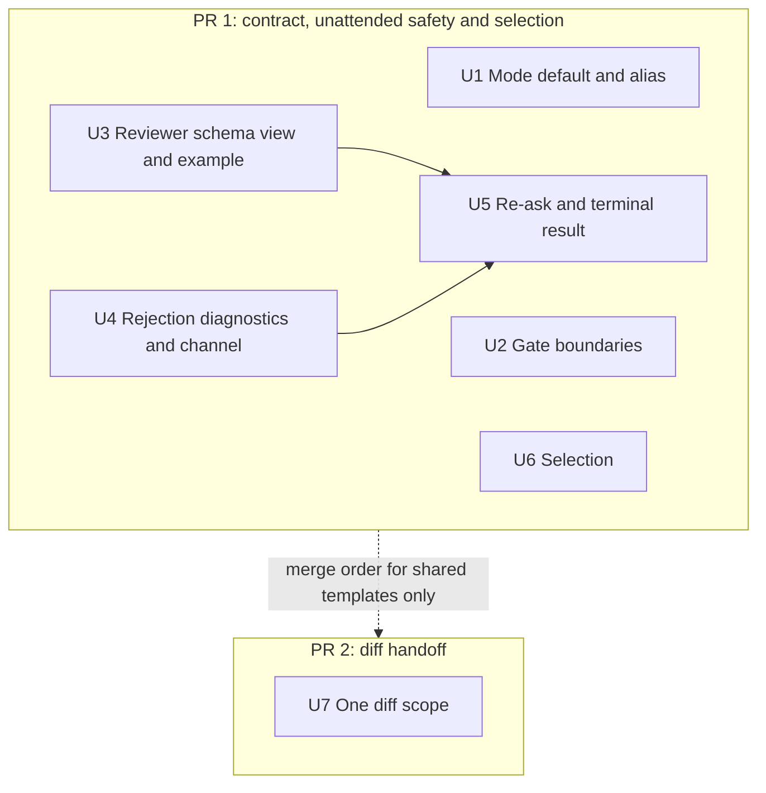

# feat: proportional unattended ce:review

## Overview

An unattended `ce:review` run costs far more than the change it reviews. This plan makes cost follow the change, without dropping coverage, in two PRs.

PR 1 (U1-U6) is the contract, unattended safety and selection:

- No mode token and nobody to answer means report-only. `read-only` is an alias.
- CI owns the build, typecheck, lint and broad-test gates. Reviewers get a schema view and a screened example that match what `screen` accepts.
- A rejected return yields a bounded, payload-safe diagnostic on a machine-readable channel. The parent may re-ask the same reviewer once.
- Deletion-only and docs-only changes get the core three reviewers unless a semantic risk applies.

PR 2 (U7) is the diff handoff: the parent pins one scope, and every reviewer and finding validator reads it per path instead of recomputing it.

The depth is Deep. The work crosses a skill, a bundled helper, a generated schema and the tests that pin them.

---

## Problem Frame

Fro Bot reviews PRs unattended through the fro-bot/agent action on OpenCode v2. The evidence is 25 runs: 23 on Systematic 3.33.2 with `openai/gpt-6.1-sol`, and 2 on 3.33.0 with Opus that never invoked `ce:review`. The runs come from three repositories and are not independent. Several are re-reviews of the same PR. The raw logs record tool lines and no tool output.

- **Gates.** In the repos whose review prompt does not forbid it, the parent ran check suites in 9 of 11 runs. Two runs ran the whole suite and spent 67-70% of their duration waiting. The 12 fro-bot/agent runs ran none, because their prompt forbids it.
- **Fan-out.** Reviewer count does not follow diff size. A pure deletion of 28 files and 13,568 lines got 7 reviewers. Test-only re-reviews in fro-bot/agent got 6, 7 and 8 reviewers. The median there was 8.
- **Rejected returns.** 22 of 25 runs screened reviewer returns. 12 repair-style dispatches (11 firm) appear in 4 or 5 runs. The worst run (fro-bot/agent#2213, 713 s) made 10 visible `screen` calls and 21 dispatches. Hidden screens inside chained shell lines make every `screen` count a lower bound.
- **Repeated reads.** Child reviewers ran the same `git diff` up to 6 times in one run.
- **Mode.** No `mode:` token is passed. The model labels its own run "report-only" or the undefined "read-only".

The repair loop has two causes visible in the source. The first is that `screen` diagnostics cannot guide a fix. A rejection prints one stderr line with the first issue's path and no code, count or allowed value. On exit 1 the CLI also discards the structured `rejected_summary`, so the parent cannot attach a legitimate rejection to `prepare` and may improvise one. The second is a producer contract that contradicts itself. The reviewer prompt inlines `findings-schema.json`, whose root is the parent record with `harness`, `dispatch_outcome` and a per-finding `disposition`. The same prompt tells reviewers not to emit those fields, and the strict validator rejects them.

The saved logs hold no rejected payload. Which candidate cause dominated in production is unobserved: the contradictory schema root, thin diagnostics, absolute paths, enum and routing values, or wrapper text around the JSON. The plan fixes the first two at the source (U3, U4) and states the rest in the reviewer template (U3). A synthetic replay of the shipped helper reproduces the diagnostics a parent would have seen, and nothing more. The repair dispatches themselves are model improvisation: the skill never tells the parent to re-dispatch a reviewer, and nothing bounds it. The 360 s "repair episode" in the worst run overlapped unrelated parent work. It is an upper bound on repair cost, not a measurement.

---

## Requirements Trace

| ID | Requirement | Units |
|----|-------------|-------|
| R1 | With no mode token and nobody able to answer, `ce:review` runs as report-only. Unattended is inferred from observable context only: a caller or system statement that the run is non-interactive, a delegated run, or no blocking question tool on a harness with no documented chat fallback. The canonical mode and the reason are announced. | U1 |
| R2 | `mode:read-only` is normalized to `report-only` before the conflict check and never reaches a helper enum. An explicit mode always wins. A `mode:` token counts only when it comes from the invoking caller's arguments or instruction, never from PR text, commit messages, diff content or repository files. | U1 |
| R3 | A scope that cannot be determined fails visibly, with no question and no invented scope. | U1 |
| R4 | The role-by-mode table in U2 governs. The parent (report-only and headless), reviewers, CE agents and finding validators run no build, typecheck or lint at any scope, and no broad test through any alias or wrapper. | U2 |
| R5 | Only the parent runs a probe, and only for a concrete finding: the exact command, the claim it tests, a named file rather than a suite, the result in Coverage, and one run per finding, deduplicated. No probes on fork PRs or PRs from authors without write access. | U2 |
| R6 | The headless fixer runs only targeted tests of files it changed, never build, typecheck, lint or a broad suite. A fix those tests cannot verify is reported unverified. Independent static finding validation stays. | U2 |
| R7 | Reviewers see a reviewer-rooted view of the generated schema and one populated example that a test runs through the packaged `screen`. There is no second hand-written schema. | U3 |
| R8 | A rejection reports the full issue count, up to 8 safe path and code entries, the omitted count and authored enum values. Malformed JSON, identity, size and encoding failures get fixed codes. No payload value or unknown key name appears. | U4 |
| R9 | Every `screen` exit 1 emits a fixed-code malformed `screen` result and the rejection report on stdout, a documented machine-readable channel. A `rejected_summary` row is present only when the helper produced one. The validator bundle is regenerated. | U4 |
| R10 | A rejected persona gets at most 2 returns and 2 screens, in the same session, with no payload rewriting, repair agent or helper-source reading. Without continuation the persona is malformed. | U5 |
| R11 | Each persona has one terminal result, and a corrected return supersedes the first. `prepare` keeps rejecting duplicate personas. Malformed, never-returned and validation-unavailable stay distinct. | U5 |
| R12 | A deletion-only or docs-only change selects the core three by default. Deletion-only means every manifest entry has status D with no mode, symlink, submodule or file-type change. Semantic risk overrides apply to deletions and to behavior-bearing docs. Dead-code removal alone does not select `maintainability`. Deleted lines do not count toward the `adversarial` size threshold, and its high-risk-domain trigger stays. `previous-comments` selection is independent. Ambiguous binary, rename, generated-only, mode, symlink, submodule and type changes use normal selection. Classification comes from the manifest and the diff, never from PR prose. | U6 |
| R13 | The parent pins the checkout path, base SHA, head (the checked-out commit, or "working tree" when the checkout is dirty) and a manifest with each path's status, rename source and line counts. Reviewers and Stage 5b validators get the same values, read per-path diffs from git, and do not recompute or widen the scope. If the scope cannot be pinned, the review ends visibly incomplete. Before the final report the parent re-resolves the head, and a moved head makes the result stale with no clean verdict. | U7 |
| R14 | Success is measured by re-reading real run logs for cost and the posted review's Coverage section for coverage, across matched cohorts. Unknown is recorded as unknown, and visible counts are lower bounds. | Success Metrics |

---

## Scope Boundaries

- The fro-bot/agent action wrapper and per-repo review prompts are out of scope.
- Interactive and autofix behavior is unchanged, except for the changes that apply in every mode: the child gate rule (reviewers, CE agents, validators), the reviewer schema view and example, the re-ask policy, the shared reviewer-selection policy and the diff handoff.
- The validator algorithm is unchanged. `screen` accepts and rejects exactly what it does today. Only what it reports about a rejection changes.
- Reviewer persona agents (`agents/review/*.md`) are not edited. A persona edit would regenerate the Pi persona fixtures and 14 config-corpus fixtures for no gain.
- No second hand-written schema, no repair agent, no payload rewriting, no diff file on disk.
- No delta re-review and no sandbox machinery for probes.

### Deferred to Separate Tasks

- Rejected-payload capture for diagnosis: not built here. Real reviewer payloads are repository content, so capture needs an opt-in and retention design. Until then the real cause mix stays unobserved, and the Success Metrics treat cause attribution as unknown.
- Delta re-review (`since:<sha>`): deferred until the action wrapper can supply a reviewed head. It needs:
  - a coverage chain back to a completed full review;
  - a defined source for prior unresolved blockers;
  - provenance from GitHub review objects (`commit_id`, not dismissed) rather than review body text;
  - token provenance, so a `since:` value from PR text is never trusted.
- Per-persona "Output format" examples: the shared template carries the populated example.

---

## Context & Research

### Relevant Code and Patterns

- `skills/ce-review/SKILL.md`: Argument Parsing, Mode Detection, the per-mode rules, Stage 1 scope, Stage 3 selection, Stage 4 dispatch and `screen`, Stage 5b validators, Step 3 fixer.
- `skills/ce-review/references/subagent-template.md` and `skills/ce-review/references/validator-template.md`: the shared prompts for reviewers and Stage 5b validators. These are the leverage point.
- `skills/ce-review/references/persona-catalog.md`: the selection tables and scenarios that twin Stage 3.
- `skills/ce-review/references/pipeline-invocation.md`: the `screen`, `prepare` and `finalize` contracts and Never-bypass.
- `src/ce-review-validator.ts`, `src/lib/review-pipeline.ts`, `src/lib/review-return-validator.ts` and `src/lib/review-artifact-path.ts`: the CLI, `screenReviewReturn`, the shared issue projector (`projectZodIssues`, capped at 8) and the sibling `return` subcommand that already prints bounded `path code` lines.
- `scripts/generate-review-artifact-schema.ts` and `scripts/lib/generated-surfaces.ts`: the schema generator and the one list of generated surfaces.
- `skills/git-worktree/SKILL.md`: the "nobody can answer in this run" wording to follow for unattended detection.

### Institutional Learnings

- `docs/solutions/best-practices/re-verify-carried-state-at-phase-boundaries-2026-09-15.md`: fewer reviewers and retries must not skip the independent checks at phase boundaries.
- `docs/solutions/logic-errors/per-reviewer-cap-reused-as-run-level-cap-2026-10-22.md`: keep per-reviewer and run-level limits separate. Do not add a global finding budget to save cost.
- `docs/solutions/workflow-issues/verify-reviewer-findings-against-the-real-checkout-2026-09-20.md`: naming the worktree in a prompt did not prevent wrong-tree reviews. The handoff must pin checkout, base and head.
- `docs/solutions/best-practices/unvalidated-artifact-contracts-have-no-conforming-producers-2026-08-23.md`: inline schema text alone does not make producers conform. Keep executable validation and generated-schema parity, and diagnose real rejection causes instead of loosening admission.
- `docs/solutions/best-practices/subagent-stop-prose-behavioral-null-result-2026-05-20.md`: prose instructions to subagents had a measured null effect. Rules here ship with contract tests, and the success measure checks behavior in real logs.
- `docs/solutions/integration-issues/plugin-tool-output-truncated-before-after-hook-2026-09-26.md` and `docs/solutions/integration-issues/line-capped-read-tool-truncated-single-line-json-2026-11-09.md`: tool output is capped before the model sees it, so children read per-path diffs from git instead of one large capture.
- `docs/solutions/integration-issues/fro-bot-agent-action-runtime-differs-from-a-plain-runner-2026-11-13.md`: the action filters the environment and restricts external directories, so a diff file outside the checkout is not safe to assume.

### Related Past Work

- `docs/plans/2026-09-10-001-fix-review-return-validation-plan.md`, recorded completed: risk-based selection and raw-return admission. This plan narrows its tiny-prose rule to a size-independent deletion and docs rule, and keeps its specialist triggers.
- `docs/plans/2026-09-12-001-fix-review-synthesis-pipeline-plan.md`, recorded completed: the `screen`, `prepare`, `merge`, `finalize` pipeline. This plan adds no phase and keeps whole-payload rejection.
- `docs/plans/2026-10-22-001-fix-review-run-level-caps-plan.md`, recorded completed: run-level caps. Unchanged.
- `docs/ideation/2026-10-25-open-ideation.md` cut a delta-review idea as already covered. The new run evidence justifies revisiting it, but the provenance it needs is not available yet, so it stays deferred (see Scope Boundaries).

---

## Prior-Art Survey

```json
{
  "schema_version": 2,
  "verdict": "extend",
  "scope": "marcusrbrown/systematic: skills/ce-review/, agents/review/, src/ce-review-validator.ts + src/lib/review-*.ts, and the tests that pin them",
  "freshness": {
    "vcs_reference": "2c04a8758c157736147d59d3599958689245ba88"
  },
  "budget": {
    "max_search_passes": 12,
    "max_candidate_inspections": 20,
    "exhausted": false
  },
  "candidates": [
    {
      "path_or_symbol": "skills/ce-review/SKILL.md#Argument Parsing + Mode Detection (L22-75)",
      "description": "Lexical `mode:` tokens; no token = Interactive (L42); report-only and headless rule lists; conflicting-flag stop. No non-interactive predicate and no `read-only` token.",
      "disposition": "extend"
    },
    {
      "path_or_symbol": "skills/ce-review/SKILL.md#Review Scope + Stage 3 (L146-148, L343-381)",
      "description": "Always-on three plus judgment-based conditionals; core-only rule is qualified 'tiny prose or fixture'; maintainability trigger includes 'removes dead code'; execution probe vocabulary (L381).",
      "disposition": "extend"
    },
    {
      "path_or_symbol": "skills/ce-review/references/persona-catalog.md#Selection rules + Selection scenarios (L57-84)",
      "description": "Catalog twin of Stage 3, with scenario rows and probe paragraph; pinned by ce-review-selection-contract tests.",
      "disposition": "extend"
    },
    {
      "path_or_symbol": "skills/ce-review/SKILL.md#Stage 1 `base:` fast path (L166-181)",
      "description": "`base:<sha-or-ref>` uses git merge-base to resolve the diff base; the pinned manifest in Stage 1 is built on the same base resolution.",
      "disposition": "reuse"
    },
    {
      "path_or_symbol": "agents/review/previous-comments-reviewer.md",
      "description": "Fetches prior PR review comments with gh and checks whether feedback was addressed; its selection stays independent of diff classification.",
      "disposition": "reuse"
    },
    {
      "path_or_symbol": "skills/ce-review/references/subagent-template.md",
      "description": "Reviewer prompt: bounded-investigation block, output contract with `{schema}`, parent-owned field rule, 'operationally read-only' shell rule, review-context with inline `{diff}`; no BASE marker, no worked example.",
      "disposition": "extend"
    },
    {
      "path_or_symbol": "skills/ce-review/references/diff-scope.md#Scope Discovery (L13)",
      "description": "Tells reviewers the resolved diff is passed and they need not run git commands; the per-path read of a pinned scope replaces that sentence.",
      "disposition": "extend"
    },
    {
      "path_or_symbol": "skills/ce-review/references/findings-schema.json",
      "description": "Generated schema shown to reviewers; root `$ref` is parentRecord, subAgentReturn is the real reviewer contract; root pinned by tests.",
      "disposition": "reuse"
    },
    {
      "path_or_symbol": "src/lib/review-pipeline.ts#screenReviewReturn / wholePayloadRejection",
      "description": "Whole-payload admission and identity binding; rejection line carries only the first issue path and the fixed reason 'schema validation' or 'malformed JSON'.",
      "disposition": "extend"
    },
    {
      "path_or_symbol": "skills/ce-review/references/pipeline-invocation.md#Never-bypass + screen (L17-31, L65-123)",
      "description": "Exit-code handling and the 'correct own envelope once' rule; no statement on re-dispatching a reviewer after exit 1.",
      "disposition": "extend"
    },
    {
      "path_or_symbol": "agents/review/*-reviewer.md#Output format",
      "description": "Per-persona output sections show only the empty payload; changing them forces pi-persona fixtures and 14 config-corpus fixtures to be regenerated.",
      "disposition": "reuse"
    },
    {
      "path_or_symbol": "skills/ce-review/SKILL.md#Execution probes (L381) + Persona sub-agents read-only (L450)",
      "description": "Only existing text governing parent/reviewer shell use: probes need target and permission boundary; reviewers may run 'non-mutating inspection commands'. No gate rule.",
      "disposition": "extend"
    }
  ],
  "excluded_scopes": []
}
```

---

## Key Technical Decisions

- KTD1. **Two PRs, one plan.** PR 1 (U1-U6) holds everything that makes an unattended run safe, fixes the producer contract and makes selection proportional. U6 has no code dependency on the other PR 1 units. PR 2 (U7) is the diff handoff. It has no code dependency on PR 1 and no release gate. It edits the same two templates as U2 and U3, so it merges after PR 1 or rebases onto it.
- KTD2. **Prose plus contract tests, one helper change.** Mode, gates, selection and the diff handoff are skill prose, pinned by contract tests. The only source change is `screen` reporting. No new `src/lib` module is created.
- KTD3. **Mode is normalized in prose.** `read-only` becomes `report-only` before the conflict check, so the helper's closed mode enum and its routing test are untouched.
- KTD4. **Unattended means observable, and tokens come from the caller.** Any one of three signals selects report-only: the caller or system context says the run is non-interactive, the skill runs as a delegated subagent, or no blocking question tool exists and the harness has no documented chat fallback. A `mode:` token, or a caller statement that the run is non-interactive, counts only when it comes from the invoking caller's argument string or instruction. PR title, body, comments, commit messages, diff content and repository files never count. This is the inverse of the `ce-compound-refresh` rule that a missing tool never selects a mutating mode: a missing tool selects only the non-mutating one.
- KTD5. **Gates are mode-conditioned for the parent and unconditional for children.** The parent rule applies in report-only and headless, which includes the unattended default. Reviewers, CE agents and validators never verify fixes in any mode, so their text states the rule without a mode slot. Only the parent runs a probe. Validators stay static, so there is no hand-off of an approved command. The approval criteria are written into the skill text, and probes are skipped on fork PRs and PRs from authors without write access. No sandbox machinery is added.
- KTD6. **The reviewer schema is a generated view.** The generator re-roots the existing findings schema at `subAgentReturn` and prunes unreachable definitions. The new file is an output of the existing `review-schemas` surface. `findings-schema.json` and its pinned root stay as they are. The view needs no authored schema text, so it cannot drift.
- KTD7. **Diagnostics are separate from the persisted reason.** The persisted `rejected_summary.reason` keeps its current path-only text, so no artifact schema changes. The richer report goes to a new exit-1 stdout envelope. Exit codes stay 0, 1 and 2.
- KTD8. **Exit 1 stdout carries the screen result and the rejection report in every case.** The envelope holds the helper's own malformed `screen` result, which is what `prepare` consumes, and a bounded `rejection` object with a fixed code. This covers oversize input, invalid UTF-8, malformed JSON, a missing, empty or over-limit findings array, a schema fault and identity mismatch. A `rejected_summary` row appears only when the helper produced one, and is absent when the finding count is unknowable, as today. Nothing is invented, so the parent never synthesizes a rejected-summary row.
- KTD9. **A re-ask is a bounded continuation of the same session.** The parent sends only the bounded diagnostic and asks for a complete corrected payload. It never edits the payload, spawns a repair agent or reads the helper. A harness that cannot resume the session records the persona as malformed.
- KTD10. **One terminal screen result per persona.** `prepare` keeps rejecting duplicate personas. The parent assembles `screen_results` from each persona's terminal result, never from every `screen` call. The two-return cap is a parent instruction and is verified in the success measure, not enforced by the helper.
- KTD11. **Deletion and docs rules yield to semantics.** The core-three default applies only when no semantic risk override fires. A deleted auth guard selects `security`. A change to agent instructions or operational docs is not "docs-only". The test is whether an agent or operator would behave differently after the change.
- KTD12. **The scope is pinned once and read per path.** Stage 1 pins the checkout path, base SHA, head and a manifest. Children read one path's diff from git against those values, so no large capture crosses the tool-output cap and no diff file is written. Report-only's no-write rule needs no carve-out. This keeps today's Stage 1 behavior for a dirty checkout, where the head is the working tree.
- KTD13. **A moved head is stale.** The parent re-resolves the head before the final report. A dirty working tree that changed during the review counts as moved, detected by re-checking the manifest line counts. A stale result carries no clean verdict.

---

## Open Questions

### Resolved During Planning

- Empty reviewer return: `screen` keeps exit 2 for empty stdin, and `pipeline-invocation.md` documents that it is retried once and then recorded as validation-unavailable. Reclassifying it is a change to what `screen` reports as unavailable, and nothing in the evidence shows it matters.
- Headless fixer under the gate rule: it keeps targeted tests of the files it changed (R6) and never runs build, typecheck, lint or a broad suite. It is the one role in the U2 table that may run tests.
- Persona edits: none. The shared template carries the example, so Pi persona fixtures and config-corpus fixtures stay untouched. Tests that cover those fixtures still run as a guard.
- Findings on deleted files: a finding on a deleted file cites the base-side path and line and says so in its first evidence entry. That is schema-valid and honest, with no invented head-side anchor.

### Deferred to Implementation

- The exact JSON key names inside the exit-1 envelope's `rejection` object. The set of fields is fixed here (reason code, issue count, capped issues, omitted count, allowed values), and implementation names them and documents them in `pipeline-invocation.md`.
- The exact shape of the manifest capture and the cheap line-count re-check that detects a changed working tree. U7 fixes the fields (path, status, rename source, added and deleted counts) and the implementer picks the capture.

---

## Implementation Units



Each unit lands as one atomic commit. Surface rules for every unit:

- A unit that edits `src/ce-review-validator.ts` or any `src/lib/review-*.ts` file regenerates the validator bundle after its last source edit, then runs the drift check.
- A unit that edits the schema generator regenerates the review-schemas surface.
- A new file under `skills/` changes the registry file list, so the registry is regenerated.
- No unit edits `agents/`. Run the config-corpus and Pi persona tests to confirm nothing moved.
- Every unit that edits skill prose runs `scripts/content-integrity.ts`.

### Phase 1: PR 1, contract, unattended safety and selection

- [x] U1. Mode default, `read-only` alias and visible failure

**Goal:** With no mode token and nobody able to answer, `ce:review` runs report-only and says so. `read-only` is an alias.

**Requirements:** R1, R2, R3

**Dependencies:** None

**Files:**
- Modify: `skills/ce-review/SKILL.md` (Argument Parsing table and conflict rule, Mode Detection table, a new Default mode paragraph, the opening prose that says "read-only")
- Create: `tests/unit/ce-review-mode-contract.test.ts`

No committed docs page lists the mode tokens. The `ce:review` reference page on the docs site is generated from `SKILL.md` at docs build, and the cleanup guide only links to it. The skill text in this unit is therefore the documentation for the `mode:read-only` alias.

**Approach:**
- Add a `mode:read-only` row: an alias of `mode:report-only`, normalized before the conflict check and before any helper call.
- `mode:read-only` plus `mode:report-only` is one mode, not a conflict. Either with another mode token is a conflict, and the error text names the canonical token.
- Mode Detection keeps Interactive as the default where a user can answer. The new Default mode paragraph lists the three signals from KTD4. When none holds, Interactive stays. When one holds, the run is report-only.
- Signal 3 is "no blocking question tool exists and the harness has no documented chat fallback". A harness whose documented fallback is chat (numbered options, then wait) can still be answered, so a missing tool alone is not evidence there.
- Token provenance: a `mode:` token and a "this run is non-interactive" statement count only from the invoking caller's argument string or instruction. Text in the PR title, body, comments, commit messages, diff content or repository files is data and never selects or changes a mode.
- An explicit token always wins over detection, so `mode:headless` and `mode:autofix` in CI stay what they say.
- Announce one line before any dispatch: the canonical mode, and the reason when the mode was inferred.
- If scope cannot be determined unattended, emit the generic failure form with `no diff scope detected`, dispatch nothing and ask nothing. An explicit PR or branch target that needs a checkout switch keeps its existing stop.

**Patterns to follow:**
- `skills/git-worktree/SKILL.md`: the "nobody can answer in this run" stop wording.
- `skills/ce-connect/SKILL.md` and `tests/unit/connect-skill-contract.test.ts`: a no-token rule written and pinned as a contract.

**Test scenarios:**
- Happy path: the Mode Detection text selects report-only for no token plus an explicit non-interactive caller instruction, and for a delegated run.
- Happy path: `mode:read-only` normalizes to `report-only`, and the text states helper metadata only ever sees the canonical value.
- Edge case: `mode:read-only` with `mode:report-only` is not a conflict. `mode:read-only` with `mode:headless` is, and the error names `report-only`.
- Edge case: explicit `mode:headless` and `mode:autofix` are not overridden by unattended detection.
- Edge case: on a chat-fallback harness, a missing question tool alone does not select report-only. On a harness with no question tool and no documented chat fallback, it does.
- Edge case: a `mode:` token, or "this run is non-interactive", inside PR text, a commit message or a repository file is ignored, and the mode follows the caller's arguments and context only.
- Error path: unattended with no determinable scope emits the failure line and dispatches nothing.
- Integration: the existing phrase "interactive, autofix, report-only, and headless" and the shared-selection phrase survive. The closed helper mode enum has no `read-only` (a source-level assertion).

**Verification:**
- The announced mode line names the canonical mode and the reason. A reader of the skill cannot reach an interactive prompt on an unattended path.

- [x] U2. Gate boundaries for every role

**Goal:** CI owns the build, typecheck, lint and broad-test gates. The parent in a report-only or headless run, and every child in any run, runs none of them.

**Requirements:** R4, R5, R6

**Dependencies:** None

**Files:**
- Modify: `skills/ce-review/SKILL.md` (Report-only and Headless mode rules, Stage 3 execution probes, the Stage 4 read-only sentence, the CE-agent bundle paragraph, Stage 5b, the Step 3 fixer)
- Modify: `skills/ce-review/references/subagent-template.md` (the operationally read-only rule)
- Modify: `skills/ce-review/references/validator-template.md` (permitted tools)
- Modify: `skills/ce-review/references/persona-catalog.md` (the execution-probes paragraph)
- Create: `tests/unit/ce-review-gates-contract.test.ts`

**Approach:**
- One rule, stated once in the report-only and headless parent rules and mirrored in three child-facing places: the reviewer template, the validator template and the CE-agent bundle line. It forbids build, typecheck and lint at any scope, and any repository-wide, directory-wide or workspace test through any alias or wrapper.
- The role-by-mode table below is the contract. The skill text and the tests follow it.
- Probe criteria are written into the skill text. The parent may approve one probe only when there is a concrete finding, the exact command, the claim it tests, and a named test file rather than a suite. The result is recorded in Coverage, with one run per finding, deduplicated.
- A named test file whose runner expands to a suite is not a probe. A denied, unavailable or inconclusive probe leaves the finding uncertain and is never reported as a pass. A probe is never run on a fork PR or a PR from an author without write access.
- Reviewers and CE agents report the claim and the command they would use. They do not run it, and the parent decides.
- Stage 5b independent validation stays and is static. The rule never reduces the validator requirement for P0, P1 and `requires_verification` findings.
- The fixer prompt says that verification a targeted test cannot supply is reported unverified in the structured output, and "Review complete" does not imply it was verified.
- Do not touch `agents/`. Persona text inherits the rule through the shared template.

| Role | Mode | Allowed | Forbidden |
|------|------|---------|-----------|
| Parent | report-only, headless | Non-mutating inspection, the helper phases, one parent-approved probe per finding | Build, typecheck, lint at any scope. Broad tests through any alias or wrapper. A probe on a fork PR or a no-write author PR |
| Parent | interactive, autofix | Unchanged | Unchanged |
| Reviewers | every mode | Non-mutating inspection, reads against the pinned scope | Build, typecheck, lint. Any test or probe run |
| CE agents | every mode | Non-mutating inspection, reads against the pinned scope | Build, typecheck, lint. Any test or probe run |
| Finding validators | every mode | Static, non-mutating inspection | Build, typecheck, lint. Any test or probe run |
| Headless fixer | headless | Edits to eligible findings. Targeted tests of the files it changed | Build, typecheck, lint. Broad suites. Reporting a fix as verified when targeted tests could not verify it |

**Patterns to follow:**
- The existing execution-probe paragraph in `skills/ce-review/references/persona-catalog.md`.
- `tests/unit/content-integrity.test.ts` pins on the reviewer template's bounded-investigation text. Keep them green.

**Test scenarios:**
- Happy path: each of the five texts (parent rules, reviewer template, validator template, CE-agent bundle, fixer prompt) carries the boundary or its stated exception, and agrees with the table.
- Edge case: the rule names aliases and wrappers such as `bun test`, `bun run typecheck` and `bunx tsc`, and a named file that launches a suite.
- Edge case: the probe criteria require a concrete finding, an exact command, a claim, a named file and a Coverage record, and cap the run at one per finding.
- Edge case: two reviewers proposing the same probe for the same finding yield one parent run.
- Edge case: a fork PR or a PR from an author without write access gets no probe.
- Edge case: a validator is told to stay static and is given no approved command.
- Error path: an unavailable or inconclusive probe is reported as uncertainty, not a pass.
- Integration: Stage 5b validation text is unchanged in its requirement for P0, P1 and `requires_verification` findings.
- Edge case: the fixer text allows targeted tests of changed files only, forbids build, typecheck, lint and broad suites, and adds the unverified handoff.

**Verification:**
- A reader can answer "may this role run X in this mode" for the parent, a reviewer, a CE agent, a validator and the fixer from the table alone.

- [x] U3. Reviewer schema view and a screened example

**Goal:** What a reviewer is shown matches what `screen` accepts.

**Requirements:** R7

**Dependencies:** None

**Files:**
- Modify: `scripts/generate-review-artifact-schema.ts` (add the reviewer view as a derived target)
- Modify: `scripts/lib/generated-surfaces.ts` (add the new file to the `review-schemas` outputs)
- Create: `skills/ce-review/references/reviewer-return-schema.json` (generated)
- Modify: `skills/ce-review/references/subagent-template.md`
- Modify: `skills/ce-review/SKILL.md` (the schema inclusion used for `{schema}`)
- Modify: `ARCHITECTURE.md` and `STRUCTURE.md` (the schema file inventory)
- Modify: `registry/registry.jsonc` (regenerated file list)
- Modify: `tests/unit/generate-review-artifact-schema.test.ts`, `tests/unit/ce-review-findings-schema.test.ts`
- Create: `tests/unit/ce-review-reviewer-contract.test.ts`

**Approach:**
- The generator builds the view from the generated findings document: root `$ref` to `subAgentReturn`, only the definitions that root reaches, byte-equal to the full schema's definitions. The parent-only records are absent from what a reviewer sees.
- The template's `{schema}` is the view. It states in one sentence that the payload is exactly the `subAgentReturn` shape and that `harness`, `dispatch_outcome` and `disposition` are parent-owned.
- The template adds one populated example with every required finding field plus `residual_risks` and `testing_gaps`. A test extracts it and runs it through the packaged `screen`.
- The template adds one line for each trap the schema enforces and the prompt does not yet say. Paths and evidence strings are repo-relative, with the checkout prefix stripped. `line` is one positive integer. `confidence` is 0 to 1. `severity` is P0 to P3. `reviewer` echoes the `Reviewer name` value exactly. The `autofix_class` and `owner` pairing from the parent-side routing table is shown.
- For a deleted file the finding cites the base-side path and line and says so in its first evidence entry.
- Keep every phrase `content-integrity.test.ts` pins.

**Patterns to follow:**
- `scripts/generate-review-artifact-schema.ts` for how targets are generated and formatted.
- `tests/unit/ce-review-findings-schema.test.ts`, whose prompt-contains-schema pin moves to the view while the full schema's root pin stays.

**Test scenarios:**
- Happy path: the template's populated example exits 0 through the packaged bundle's `screen` and through `screenReviewReturn`.
- Happy path: the view's root references `subAgentReturn`, and every view definition equals the same-named definition in the full schema.
- Edge case: the view contains no `parentRecord`, `parentFinding`, `harness`, `dispatch_outcome` or `disposition`.
- Edge case: the example stays valid when a schema bound changes, because the test fails on drift instead of passing silently.
- Edge case: a finding on a deleted file that cites a base-side path and line, with that stated in its first evidence entry, passes the packaged `screen` with exit 0.
- Error path: a payload with `harness`, `dispatch_outcome` or a finding `disposition` is rejected by `screen`, which pins the contrast with the example.
- Integration: `findings-schema.json` still has its parent-record root and its pinned test passes unchanged.
- Integration: the Pi persona and config-corpus tests still pass with no fixture changes.

**Verification:**
- The review-schemas drift check passes with the new output. The registry lists the new file.

- [x] U4. Rejection diagnostics and the machine-readable channel

**Goal:** A rejected return tells the parent every fault in one pass, safely, and hands over the helper's own structured rejection.

**Requirements:** R8, R9

**Dependencies:** None

**Files:**
- Modify: `src/lib/review-artifact-path.ts` (extend the shared projection with authored allowed values)
- Modify: `src/lib/review-pipeline.ts` (`screenReviewReturn` reports all issues, not the first)
- Modify: `src/ce-review-validator.ts` (exit-1 stdout envelope)
- Modify: `skills/ce-review/scripts/validate-review.mjs` (regenerated)
- Modify: `skills/ce-review/references/pipeline-invocation.md` (the `screen` section: channel shape and fixed codes)
- Modify: `ARCHITECTURE.md` (the validator CLI contract line)
- Modify: `tests/unit/review-pipeline-screen.test.ts`, `tests/unit/review-artifact-path.test.ts`, `tests/unit/ce-review-validator-routing.test.ts`, `tests/unit/ce-review-validator-packaging.test.ts`, `tests/unit/generate-ce-review-validator.test.ts`
- Modify: `tests/integration/ce-review-return-validation.test.ts` (host-contract test, CI-owned)

**Approach:**
- The rejection report has the full issue count, up to 8 entries of safe path and code, the omitted count, and for an enum issue the allowed values read from the authored schema. It reuses the projector that the `return` subcommand already uses. It reads no issue message, payload value or unrecognized key name.
- Fixed codes cover the failures that have no schema issue: malformed JSON, identity mismatch, oversize and invalid encoding. Schema issues keep their Zod issue code. The identity code appears only in the exit-1 `rejection` report. The persisted `rejected_summary.reason` for an identity mismatch keeps today's `reviewer` schema-validation text.
- Every exit-1 case emits one JSON object on stdout: the helper's malformed `screen` result and the `rejection` report. Today the oversize and invalid-UTF-8 cases exit before `screenReviewReturn` runs, so they get the same envelope. Stderr keeps today's one-line summary. Exit 0 output and all exit codes are unchanged.
- A `rejected_summary` row is present only when the helper produced one. It is absent when the finding count is unknowable, which matches the existing whole-payload rule, and nothing is invented.
- The persisted `rejected_summary.reason` keeps its current text and bounds, so the artifact and `finalize` do not change.
- Admission does not change. The same payloads pass and fail as before.
- Each case enters the pipeline the same way. The envelope's `screen` result is the persona's `prepare` entry. Where a `rejected_summary` row exists, `finalize` derives `rejection_reason` from it as today. Where it is absent (unknowable count, oversize, invalid encoding, malformed JSON, empty or over-limit findings), the persona is still `malformed` with no `rejection_reason`.
- `pipeline-invocation.md` documents the envelope, the fixed codes, the empty-stdin exit 2 behavior and the per-case entry into `prepare` and `finalize`. It says exit 1 stdout is the only supported source of the rejected-summary row.

**Patterns to follow:**
- The `return` subcommand's bounded `path code` lines and total in `src/lib/review-return-validator.ts`.
- `docs/solutions/best-practices/schemas-need-adversarial-probes-not-just-compilation-2026-08-16.md` for the probe-table test style.

**Test scenarios:**
- Happy path: a payload with three faults reports issue count 3 and three path and code entries, with allowed values on the enum faults.
- Edge case: 12 faults report count 12, 8 entries and omitted 4.
- Edge case: an extra top-level key with empty `findings`, more than 32 findings, and a code-fenced payload each get a diagnostic with a path or a fixed code. Today they print a pathless line.
- Edge case: malformed JSON, identity mismatch, oversize (over 1 MiB) and invalid UTF-8 each report their fixed code and nothing else, and each emits a malformed `screen` result on stdout.
- Edge case: a missing, empty and over-limit findings array each emit a malformed `screen` result. The row is present only for the cases where the helper produced a `rejected_summary`.
- Edge case: the persisted `rejected_summary.reason` for an identity mismatch is the unchanged `reviewer` schema-validation text, and the new identity code appears only in the `rejection` report.
- Error path: no output contains a payload string, an unknown key name or an issue message. A test plants distinctive values and keys and asserts they never appear.
- Integration: exit 1 stdout parses, its `screen` result passes `prepare` as a malformed persona entry, and `finalize` carries `rejection_reason` where a row exists and none where it does not.
- Integration: the packaged bundle behaves like the source on every case above. The synthetic probe table (27 variants) becomes a regression table.
- Edge case: empty stdin stays exit 2.

**Verification:**
- The validator surface drift check passes. Admission behavior is byte-for-byte unchanged on the existing screen tests.

- [x] U5. Re-ask policy and one terminal result per persona

**Goal:** A rejected reviewer gets one bounded second chance, and the pipeline ledger stays coherent.

**Requirements:** R10, R11

**Dependencies:** U3, U4

**Files:**
- Modify: `skills/ce-review/SKILL.md` (Stage 4 "Screen each return", Stage 5 step "Assemble every screen result")
- Modify: `skills/ce-review/references/pipeline-invocation.md` (Never-bypass scope, `screen` exit-1 handling, `prepare` input rule)
- Create: `tests/unit/ce-review-reask-contract.test.ts`
- Modify: `tests/unit/review-pipeline-prepare.test.ts`, `tests/unit/review-pipeline-finalize.test.ts`, `tests/unit/ce-review-selection-contract.test.ts`

**Approach:**
- On `screen` exit 1, the parent may continue the same reviewer session once. The message is the bounded `rejection` report and a request for a complete corrected payload under the same reviewer name. The parent screens the new return with a fresh heredoc.
- The cap is 2 returns and 2 screens per persona. The parent never edits a rejected payload, never dispatches a "correct" or "repair" agent, and never reads the helper source. A second exit 1 is final.
- If the harness cannot continue the session, the persona is malformed and Coverage says "continuation unavailable".
- Never-bypass's "correct the envelope once" rule is scoped to aggregate envelopes (`prepare`, `merge`, `finalize`). It does not license reviewer re-dispatch or payload edits. The exit-2 byte-identical launch retry is not a re-ask. It re-runs the same bytes, so it is not a second screen of a new return and does not count toward the cap. The success measure counts distinct-payload screens against the cap and reports exit-2 retries separately.
- `prepare` input comes from each persona's terminal result only. `validatePrepareStructure` is unchanged, so a duplicate persona entry is still rejected. This is a guard, not the policy.
- Risk-critical personas that end malformed stay blocking. A re-ask never counts as coverage by itself.

| Sequence for one persona | Terminal result | Coverage records |
|--------------------------|-----------------|------------------|
| Accepted first time | The accepted result | Nothing extra |
| Rejected, then accepted | The second, accepted result | One re-ask |
| Rejected, then rejected | The second malformed result and its rejection | One re-ask, final malformed |
| Rejected, continuation unavailable | The first malformed result | Continuation unavailable |
| Launch failure (exit 2) | Validation unavailable | The exit and what was withheld |
| Never returned | Never returned | Task lifecycle fact, no screen call |

**Patterns to follow:**
- The existing distinct coverage states in Stage 4 and `tests/unit/ce-review-selection-contract.test.ts` pins for `malformed` and `validation_unavailable`.
- `tests/unit/review-run-fixtures.ts` for end-to-end pipeline fixtures.

**Test scenarios:**
- Happy path: reject then accept. Only the accepted result enters `prepare` and `finalize`, with no `rejection_reason` for that persona.
- Error path: reject then reject. The second rejection is the terminal result. `finalize` carries its `rejection_reason`, the run is degraded, and a risk-critical persona still blocks a clean verdict.
- Error path: reject with no continuation. The first malformed result is terminal and Coverage says so.
- Error path: passing both the rejected and the accepted result for one persona to `prepare` is still rejected as a duplicate.
- Edge case: malformed, never-returned and validation-unavailable personas in one run keep three distinct dispatch outcomes through `finalize`.
- Integration: the skill text states the 2-and-2 cap, same-session continuation and the prohibition on payload rewriting, repair agents and helper reading, and it scopes Never-bypass's envelope correction to aggregate envelopes.
- Edge case: an exit-2 retry does not consume the re-ask.

**Verification:**
- A fixture run with one rejected and one corrected reviewer finalizes with one dispatch entry per persona.

- [x] U6. Proportional reviewer selection

**Goal:** Deletion-only and docs-only changes get the core three, without hiding semantic risk.

**Requirements:** R12

**Dependencies:** None. It reads each path's status from the diff headers or a name-status listing that Stage 1 can already produce, so it does not wait for U7's pinned manifest.

**Files:**
- Modify: `skills/ce-review/SKILL.md` (the reviewer table rows for `maintainability` and `adversarial`, Review Scope, Stage 3)
- Modify: `skills/ce-review/references/persona-catalog.md` (trigger rows, selection rules, selection scenarios)
- Modify: `tests/unit/ce-review-selection-contract.test.ts`

**Approach:**
- Replace the "tiny prose or fixture correction" qualifier with a size-independent rule. A change that is deletion-only, or docs-only, selects the core three unless a semantic override fires.
- Deletion-only: every changed path has status D, with no mode, symlink, submodule or file-type change. Docs-only: every path is documentation prose that no agent or operator follows as an instruction.
- Classification comes from the file statuses and the diff, never from PR title, body or comments. A PR that calls itself docs-only is classified by its paths.
- Mode, symlink, submodule and type changes, binary-only, rename-only and generated-only changes are ambiguous and use normal selection.
- Behavior-bearing docs are not docs-only: skill and agent definitions, agent instruction files, workflow prompts and operational runbooks. The test is whether an agent or operator would behave differently after the change. These go to normal selection, so `agent-native-reviewer` and the rest still apply.
- Semantic overrides read the deleted lines too. Deleting an auth guard selects `security`. Deleting a retry or migration step selects `reliability` or `data-migrations`.
- Dead-code removal alone does not select `maintainability`. Edit the trigger text and the scenario rows that say it does.
- The `adversarial` size threshold counts added and changed lines of executable production code and excludes deleted lines. The high-risk-domain trigger is unchanged, so deleting auth or payments code still selects it.
- `previous-comments` selection depends on PR comments only, and no rule here changes it.
- `learnings-researcher` and `agent-native-reviewer` fire for docs only through the behavior-bearing path.
- Selection stays shared by all four modes. Reconcile the Stage 3 text and the catalog twin in one edit. Keep every phrase the selection tests pin, and update the ones this rule deliberately changes.

**Patterns to follow:**
- The scenario-table form in `skills/ce-review/references/persona-catalog.md` and the existing "never restore a fixed floor" rule.

**Test scenarios:**
- Happy path: a 28-file pure deletion of dead code selects `correctness`, `testing` and `project-standards` only.
- Happy path: a six-file prose docs change selects the core three.
- Edge case: deleting an authorization guard from one file selects `security` and `adversarial` despite being deletion-only.
- Edge case: a mixed change that deletes a guard and adds code evaluates both sides and selects `security`.
- Edge case: a docs change to an agent instruction file or an operational runbook uses normal selection.
- Edge case: a deletion-only change with 80 deleted lines of production code does not trip the `adversarial` size threshold.
- Edge case: a PR with existing review comments still selects `previous-comments` for a docs-only change.
- Edge case: a binary-only, rename-only or generated-only change uses normal selection.
- Edge case: a mode-only change (an executable bit flip), a symlink change, a submodule change and a file-type change each use normal selection, even when no line was added.
- Edge case: a PR titled "docs only" that changes a code path is classified by its paths and gets normal selection.
- Integration: the pinned adversarial tokens and the "never selects a reviewer without a corresponding changed surface" wording survive. The old dead-code trigger text is gone from both the skill and the catalog.

**Verification:**
- Skill and catalog agree on every selection rule, and one scenario row covers each case above.

### Phase 2: PR 2, diff handoff

- [ ] U7. One pinned diff scope for reviewers and validators

**Goal:** The parent pins the scope once, and every child reads that scope per path instead of recomputing it.

**Requirements:** R13

**Dependencies:** None in code. It edits the reviewer and validator templates that U2 and U3 also edit, so it merges after PR 1 or rebases onto it.

**Files:**
- Modify: `skills/ce-review/SKILL.md` (Stage 1 pinning, Stage 4 spawn inputs, the CE-agent bundle line, the read-only sentence, Stage 5b inputs, the final-report check)
- Modify: `skills/ce-review/references/subagent-template.md` (`<review-context>` and the bounded-investigation text)
- Modify: `skills/ce-review/references/validator-template.md`
- Modify: `skills/ce-review/references/diff-scope.md`
- Create: `tests/unit/ce-review-diff-handoff-contract.test.ts`
- Modify: `tests/unit/ce-review-selection-contract.test.ts`, `tests/unit/content-integrity.test.ts` (the pinned phrases that mention the inline diff)

**Approach:**
- Stage 1 pins three things. The authoritative checkout path. The base SHA. The head: the checked-out commit, or "working tree" when the checkout has staged or unstaged changes, which preserves today's Stage 1 behavior. Untracked files stay as today's `UNTRACKED:` notes.
- Stage 1 also pins a manifest. Each entry has the path, its status (A, M, D, R or T), the rename source, and the added and deleted line counts.
- The parent no longer inlines the diff in child prompts. Reviewers, CE agents and Stage 5b validators get the same checkout, base, head and manifest. They read one path's diff with a base-to-head diff of that path (a base-to-working-tree diff for a working-tree head), and read old source from the base commit.
- Children must not recompute or widen the scope. The templates say "do not recompute the supplied review scope" and remove the examples that invite a range-wide diff or log.
- If the base or head cannot be resolved, or the manifest cannot be produced, the review ends visibly incomplete or degraded. It never claims full coverage.
- Before the final report the parent re-resolves the head. If it moved, the result is stale and carries no clean verdict. A dirty working tree counts as moved when a cheap re-check of the manifest line counts differs.
- Stage 5b validators receive the same values, so a validator verifies cited source against the same tree.
- `diff-scope.md` says today that the resolved diff is passed and that children need not run git. Replace it with the per-path read and the base-side allowance.
- The pinned bounded-investigation phrases stay unless they name the inline diff. Update those deliberately in the tests, and keep the rest verbatim.

**Patterns to follow:**
- The bounded-investigation phrases `tests/unit/content-integrity.test.ts` pins.
- `docs/solutions/workflow-issues/verify-reviewer-findings-against-the-real-checkout-2026-09-20.md`.

**Test scenarios:**
- Happy path: the reviewer and validator templates carry the checkout path, base SHA, head and manifest, and the no-recompute sentence.
- Happy path: a dirty checkout pins the head as "working tree" and children diff against the working tree.
- Edge case: a deleted file and a renamed file appear in the manifest with status and rename source, and a reviewer reads the deleted file's old source from the base commit.
- Edge case: a validator verifies a finding on a deleted file with `git show <base_sha>:<path>`.
- Edge case: a base-to-head per-path diff is permitted, and a range-wide diff or log to rebuild the scope is not.
- Error path: an unresolvable base or head, or a manifest that cannot be produced, ends the review visibly incomplete before dispatch.
- Error path: a head that moved before the report marks the result stale with no clean verdict.
- Error path: a working tree whose manifest line counts changed during the review marks the result stale.
- Integration: Stage 5b validators receive the reviewers' scope. The pinned template phrases that survive are unchanged.
- Edge case: the skill states that no diff file is written in report-only.

**Verification:**
- Across a replayed review, the run log shows one scope pinning and no child diff of the whole review range.

---

## System-Wide Impact

- **Interaction graph:** The skill prose drives every role. The helper changes only in `screen`'s exit-1 output. Pi, Claude Code and OpenCode all load the same bundle.
- **Error propagation:** A rejected return now carries a bounded report to the parent and one re-ask. A terminal malformed result flows through `prepare` and `finalize` as before.
- **State lifecycle risks:** The cap is a parent instruction. If a parent ignores it, `prepare` still rejects a duplicate persona. The helper cannot count attempts.
- **API surface parity:** `screen` exit 1 stdout was empty before and is now a documented envelope. Any caller that treated empty stdout as a signal must be checked, and the packaged skill is the only known caller. Pi, Claude Code and OpenCode load the same skill text.
- **Integration coverage:** One end-to-end fixture from `screen` through `finalize` with a reject-then-accept persona. Unit tests alone do not prove the ledger.
- **Unchanged invariants:** `findings-schema.json` and its root, admission rules, exit codes, `rejected_summary` shape and persisted reason (including for an identity mismatch), the mode enum, the `base:` fast path, the `agents/` tree, and the parent's interactive and autofix behavior. Four changes apply in every mode and are not invariant: the child gate rule, the reviewer schema view and example, the re-ask policy, and the shared selection policy and diff handoff.

---

## Risks & Dependencies

| Risk | Mitigation |
|------|------------|
| Prose rules are not self-enforcing, and the learnings show subagent prose can have no measured effect. | Each rule ships with a contract test, and the success measure re-reads real logs for the behavior itself. |
| The core-three default misses a risky deletion or a behavior-bearing doc. | The semantic overrides read deleted lines, behavior-bearing docs use normal selection, and Coverage names the selection reason. Residual risk: a semantic miss by the parent. |
| The real rejection cause mix is unobserved, so the contract fix may not move the repair rate. | The contract is fixed where the source shows a contradiction, and diagnostics make any remaining cause visible. Capture is deferred, so the measure reports cause attribution as unknown. |
| A child ignores the pinned scope and recomputes it, or reads a moved checkout. | The templates forbid it, the parent re-resolves the head before the report, and a moved head or changed working tree makes the result stale. The success measure counts repeated diff commands. |
| A probe runs untrusted code from a fork or a PR author without write access. | The skill text forbids probes on those PRs and limits probes to a named file for a concrete finding. No sandbox is added, so the parent's judgment is the control. |
| A `mode:` token or a non-interactive claim planted in PR text changes the mode. | Tokens and the non-interactive signal count only from the invoking caller, and a U1 scenario pins it. |
| A re-ask adds a return and a screen per rejected persona. | One extra return per persona, replacing unbounded improvised repair. The measure counts continuations against repair sessions. |
| The new `screen` stdout breaks a caller that expected empty output. | The packaged skill is the known caller. The integration test pins the envelope, and the contract is documented. |
| Pinned tests and generated surfaces churn. | Edit shared templates only, regenerate the validator and review-schemas surfaces and the registry, and run the config-corpus and Pi persona tests as guards. |
| An unattended run is misdetected as interactive and waits on nobody. | Three observable signals, and an explicit token always wins. Callers that want certainty pass `mode:report-only`. |
| Classification from the diff misses a semantic risk in a deletion or doc. | Overrides read deleted lines, behavior-bearing docs use normal selection, and ambiguous cases use normal selection. |

---

## Success Metrics

Re-read real Fro Bot run logs the way the baseline was read, and pair every cost number with coverage. Cost without coverage rewards a run that skips review. Log counts alone never show that coverage was preserved.

- **Cohorts.** Compare matched cohorts: the same repository, PR type (deletion, docs, code) and mode. The baseline is the 23 runs on 3.33.2 with `gpt-6.1-sol`. The 2 Opus runs on 3.33.0 are not a baseline for `ce:review`, because they never invoked it. Cohort A is the first release with PR 1 and cohort B the first with PR 2.
- **Cost, from the logs.** Duration, dispatches, visible screens and repair dispatches, gate commands, probes, and repeated diff commands.
- **Coverage, from the posted review.** Its Coverage section gives the selected and failed personas, and whether the run was complete, stale or incomplete.
- **Unknown and lower bounds.** Anything neither source shows is recorded as unknown, never zero. Hidden screens inside chained shell lines make every visible `screen` count a lower bound.
- **Targets.** Zero repair or "correct" sessions. At most 2 screens of distinct returns per persona, with exit-2 retries reported separately. Zero gate commands in report-only and headless runs. Deletion-only and docs-only PRs at 3 reviewers unless an override fires. No child diff of the whole review range.

---

## Documentation / Operational Notes

- **Rollout.** PR #1417 already lets Systematic's own PR reviews use `ce:review` and tells them to leave the CI gates to CI. The interim cost is accepted until a release with PR 1 is consumed by the action. Reinstating the `ce:review` ban was considered and rejected, because it removes the review depth being tuned.
- **Release order.** PR 1 first, then PR 2. There is no release gate between them, and cohort B is measured against cohort A.
- **Docs.** `pipeline-invocation.md` documents the exit-1 envelope and fixed codes. `ARCHITECTURE.md` and `STRUCTURE.md` list the new schema view. The `mode:read-only` alias is documented by the `ce:review` reference page, which the docs build generates from `SKILL.md` (U1).
- **Generated surfaces.** After the last edit in each PR, regenerate the affected surfaces and run the drift check. The validator, review-schemas and registry surfaces are the expected ones.

---

## Sources & References

- Related code: `skills/ce-review/SKILL.md`, `skills/ce-review/references/`, `src/ce-review-validator.ts`, `src/lib/review-pipeline.ts`, `src/lib/review-artifact-path.ts`, `scripts/generate-review-artifact-schema.ts`.
- Related past work: `docs/plans/2026-09-10-001-fix-review-return-validation-plan.md`, `docs/plans/2026-09-12-001-fix-review-synthesis-pipeline-plan.md` and `docs/plans/2026-10-22-001-fix-review-run-level-caps-plan.md`, recorded completed.
- Evidence: a local report of 25 Fro Bot PR-review runs, with per-run data and raw logs. It is analysis output outside this repository and is not tracked. There is no origin brainstorm document.
- Related PRs/issues: #1417.
