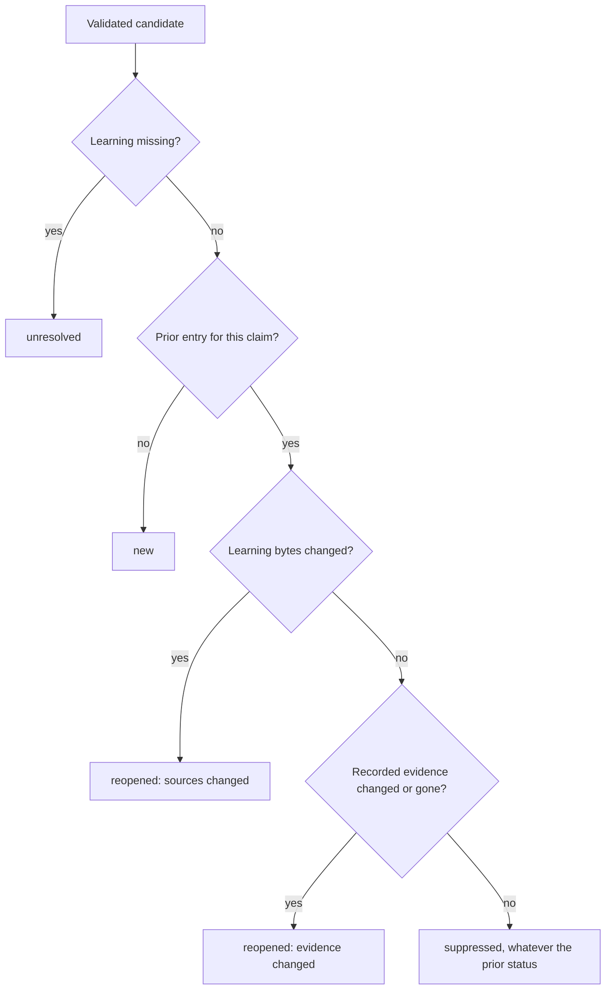
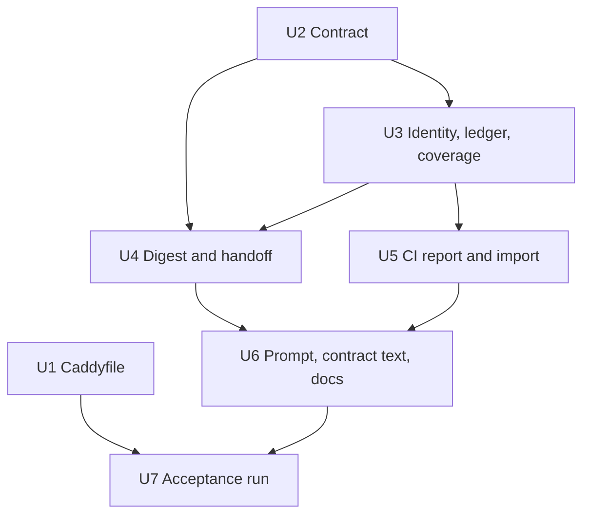

# feat: ce:connect code-mismatch candidates

## Overview

`ce:connect` gets a third candidate kind, `code-mismatch`, for a learning whose present-tense claim the code no longer supports. A candidate names one learning, gives a reason (`stale` or `unscoped`), quotes positive evidence from any allowed project, and ends as `refresh-learning` (a `/ce:compound-refresh path:` handoff in the learning's own project) or `investigate`. The helper checks provenance only; the researcher judges meaning; the operator rechecks and confirms every refresh.

The work spans seven units: one eligibility rule, the candidate contract, identity and ledger behaviour, digest and handoff, CI report and import, the researcher prompt with contract text and docs, and a pass/fail real run. The depth is Standard: no new module and no new config, but the change crosses the helper, the ledger, import, the CI report, the researcher prompt and the generated bundle.

---

## Problem Frame

The origin document carries the full frame and is untracked (see Sources & References). `ce:connect` compares learnings with each other or with code in a project other than the source. It never tests a learning's own behavioural claim against the code it describes. The stale-citation check only confirms a cited symbol is still in a cited span, and most learnings carry no such citation.

A hand probe of three real cases showed the gap. A dashboard learning still says the infrastructure proxy rewrites extensionless paths, and that rewrite is gone (stale). An agent learning names the `plugins` config key with no host qualifier, true for the v2 host the agent runs and false for v1 (unscoped). A Systematic learning about v1 headless reads is current. Today the stale case is out of reach because the infrastructure repository that owns the Caddy configuration is not on the allow list and a bare `Caddyfile` is not an eligible evidence file.

Actors: the operator owns the allow list, reads the digest and confirms every refresh; the connections researcher is the read-only agent that checks one rule family per dispatch; the helper checks provenance and never judges meaning.

---

## Requirements Trace

Carried from the origin document.

**The kind**
- R1. `code-mismatch` is a third kind. A candidate names exactly one learning to refresh, in that learning's own project. (U2)
- R2. A candidate carries one reason. `stale`: code at the governing revision contradicts a present-tense claim. `unscoped`: the claim holds where the learning was written but the learning does not name that context, and positive evidence shows it false in another supported context. (U2, U6)
- R3. A learning that deliberately describes past behaviour is never a candidate. (U6)

**What "current" means**
- R4. A claim is checked at its governing revision: the owning project's checkout; another project's checkout; or, for a dependency, the version the consumer pins. (U6)
- R5. A claim correct at the consumer's pin is never `stale`. It can still be `unscoped`. (U6)
- R6. A claim whose governing version cannot be determined is not called stale. The helper cannot see a version, so the prompt alone enforces this. (U6)

**Evidence**
- R7. A candidate quotes positive counterevidence verbatim. For `unscoped`, the evidence shows the claim failing in the other context, and a fixture that merely uses a different spelling is not enough. A search that found nothing, a missing path or a partial configuration never counts. The helper checks the excerpt's provenance (U2); the prompt carries the rest (U6).
- R8. Evidence weaker than R7 requires gives next step `investigate` with no refresh command, or nothing. (U2, U4)
- R9. Each excerpt names its project, path, line span and content fingerprint. (U2, U3, U5)
- R10. The digest shows each evidence project's checkout HEAD from the run record, and already renders `overlapCheck.note` (U4). A `stale` dependency claim also needs the consumer's pin shown: a cited `package.json` or workflow `uses:` excerpt, or a prose note in `overlapCheck.note` labelled unverified. The prompt alone enforces this (U6).
- R11. Dependency evidence comes only from an allow-listed dependency checkout. Lockfiles may be read as plain text; the helper parses none. (U6, U7)
- R12. An extensionless `Caddyfile` is an eligible evidence file. (U1)

**Validation and output**
- R13. The helper checks provenance only: project, path, fingerprint, span and verbatim text. (U2)
- R14. The kind appears in the digest heading, with the reason, claim excerpt, evidence with HEADs and next step. It moves through the ledger, import and the CI report like the other kinds. (U3, U4, U5)
- R15. `refresh-learning` hands off as `/ce:compound-refresh path:<learning>` in the learning's own project with the evidence listed. The operator rechecks other-project evidence. Nothing is applied automatically. (U4)

**Acceptance**
- R16. A real run with infrastructure and an OpenCode v1 clone at its pinned tag allow-listed: the stale dashboard learning is found; the unscoped agent learning is found; the current Systematic v1 learning, a still-true dashboard claim and a historical agent learning each produce no candidate. (U7)

Success criteria: R16 passes, and every promoted candidate survives the operator's manual recheck of its evidence.

### Acceptance Examples

- AE1. A dashboard learning says the proxy rewrites extensionless paths; infrastructure is allow-listed and its Caddy configuration ends in a catch-all with no rewrite, asserted by a test. Result: `stale`, `refresh-learning`, quoting the learning and the catch-all. Covers R2, R7, R9, R12. (Fixture in U2; real run in U7)
- AE2. An agent learning names `plugins` with no host; the agent pins v2; an allow-listed v1 clone at its tag shows the loader reading only `plugin`. Result: `unscoped`, `refresh-learning`, evidence is the v1 loader. Covers R2, R4, R11. (Fixture in U2; real run in U7)
- AE3. A learning is correct for the version its consumer pins, and upstream has since changed. The learning names its scope, or no supported context makes it false. Result: no candidate. This differs from AE2, whose learning omits a scope that a supported context contradicts. Covers R5. (Prompt in U6; run in U7)
- AE4. A learning says a route "no longer exists" and the only support is an empty search. Result: `investigate` with no refresh command, or nothing. Covers R7, R8. (U2, U4)
- AE5. A decision record says "when this was written, the action ran OpenCode v1". Result: no candidate. Covers R3. (Prompt in U6; run in U7)

---

## Scope Boundaries

- Duplicate-learning and experiment-proposal candidates stay deferred.
- No web access, registry lookups, lockfile parsing, dependency graph or helper-side proof that an excerpt came from a revision.
- No automatic edits; a refresh stays operator-confirmed and limited to the exact path.
- No change to the allow-list trust model. Adding infrastructure or a dependency clone to `connect.allow_projects` is the operator's config change. No new config key and no helper revision attestation.
- One checkout per dependency; import already refuses several allowed clones of one repository.
- No absence prover; the stale-citation check is unchanged.
- Bundled prompt caps stay in parity with `CANDIDATE_LIMITS`; no new limit is added.
- Pi persona fixtures do not move: `connections-researcher` is deliberately not a curated persona.

### Deferred to Separate Tasks

- Raising `CONNECT_BOUNDS` or adding rule-id targeting for a run: revisit only if the acceptance run shows the bounds cannot reach the named cases.
- Duplicate-learning and experiment-proposal kinds.

---

## Context & Research

### Relevant Code and Patterns

- `src/lib/connect-helper-core.ts`: `CANDIDATE_KINDS`, `NEXT_STEPS`, `CANDIDATE_LIMITS`, `shapeProblem`, `checkCandidate`, `verifyFile`, `verifySource`, `verifyTargetEvidence`, `toCandidateRecord`, `findRecorded`, `checkCoverage`, `renderCandidate`, `projectLines`, `handoffLine`. `shapeProblem` handles `contradiction` explicitly and sends every other kind down the transferable-lesson tail, which would validate `code-mismatch` backwards (it forbids a target-owned source and forbids `refresh-learning`).
- `counterevidence` is already cross-project and provenance-checked (project, path, fingerprint, verbatim excerpt) but has no span. `targetEvidence` is bound to the target project and requires a symbol.
- `src/lib/connect-state.ts`: `candidateIdentity` (kind, target, rule id, source roles and paths), `classifyCandidate`, the ledger entry and history shapes. `kind` is a free string in the ledger, so a new kind needs no version bump. `CandidateRecord` carries only sources and target evidence, so evidence in another project never reopens a decided entry today.
- `src/ce-connect-helper.ts`: `classifyOne` (duplicate drop, `findRecorded`, ledger classification), `digestModel` (drops each project's `commit`), `buildCandidateBlock`, the held-record reuse in import.
- `src/lib/connect-import.ts` (`Shape`, `shapeOf`, `localRaw`, `land`, `REFUSAL_TEXT`) and `src/lib/connect-ci.ts` (`Payload`, `payloadText`, `payloadStoreText`, `factsOf`). Import copies named fields only, so a new field is silently dropped unless added in every place.
- `src/lib/connect-evidence.ts`: `classifyPath` matches `Dockerfile` and `Makefile` by name at any depth.
- Precedent for a target-owned refresh candidate: the `contradiction` branch of `handoffLine`, gated by `REFRESH_PATH`, with `ce:compound` refusing every non-lesson kind.
- Contract tests loop over exported constants (`tests/unit/connect-skill-contract.test.ts`), so skill reference and researcher prompt change together with the code.

### Institutional Learnings

- `docs/solutions/logic-errors/already-recorded-check-ran-before-ledger-reopen-2026-11-09.md`: a shortcut that runs before ledger classification hides a changed source. Drives KTD1 and KTD2.
- `docs/solutions/best-practices/evidence-boundary-for-reading-other-repositories-2026-11-09.md`: one narrow provenance check per claim, no semantics.
- `docs/solutions/best-practices/promote-a-cross-project-lesson-in-the-targets-own-words-2026-11-09.md`: a producer once emitted handoff tokens the consumer rejected; test the real consumer contract.
- `docs/solutions/best-practices/skill-around-an-untrusted-researcher-needs-baseline-pressure-tests-2026-11-09.md`: the researcher's output is a proposal; shape checks never repair; rerun pressure cases on a real host after a prompt change. Drives U6.

### Related Past Work

- `docs/plans/2026-11-12-001-feat-connect-groups-scheduled-runs-plan.md`, recorded active, defers stale-against-code and says its slice leaves the researcher and candidate contract alone. This plan is that deferred kind, combined with the refresh half of the deferral.
- `docs/plans/2026-11-06-001-feat-cross-project-connections-plan.md`, recorded completed, shipped the two existing kinds and `investigate`. This plan adds a kind without changing them.
- `docs/brainstorms/2026-11-12-ce-connect-groups-and-scheduled-runs-requirements.md`, recorded unspecified, is where the deferral was written.

### External References

None. The change stays inside the repository and the no-web evidence boundary.

---

## Prior-Art Survey

The survey searched the repository at the recorded revision only. The `ce:connect` subsystem already owns every seam this work needs; three seams are reused, four are extended, and three are insufficient and stay unchanged.

```json
{
  "schema_version": 2,
  "verdict": "extend",
  "scope": "systematic repo, ce:connect subsystem: src/ce-connect-helper.ts, src/lib/connect-*.ts, agents/research/connections-researcher.md, skills/ce-connect/**, skills/ce-compound{,-refresh}/**, tests/unit/connect-*, docs guide",
  "freshness": {
    "vcs_reference": "16853e805470d7e00329acd2e05fbdfa54a8299e (HEAD = origin/main, clean tree)"
  },
  "budget": {
    "max_search_passes": 3,
    "max_candidate_inspections": 10,
    "exhausted": false
  },
  "candidates": [
    {
      "path_or_symbol": "src/lib/connect-helper-core.ts:CANDIDATE_KINDS / shapeProblem / checkCandidate",
      "description": "Owns the kind enum, per-kind shape rules (contradiction branch, else the transferable-lesson tail), provenance checks and drop reasons. A third kind needs its own shapeProblem branch.",
      "disposition": "extend"
    },
    {
      "path_or_symbol": "src/lib/connect-helper-core.ts:verifySource (counterevidence)",
      "description": "Verifies any tracked file in any allowed project by project, path, fingerprint and verbatim excerpt. Already cross-project. Lacks a line span.",
      "disposition": "reuse"
    },
    {
      "path_or_symbol": "src/lib/connect-helper-core.ts:verifyTargetEvidence (targetEvidence)",
      "description": "Target-project-only evidence with span, symbol and checkCitation, tied to the transferable-lesson semantics.",
      "disposition": "insufficient",
      "insufficiency_reason": "Bound to the target project and requires a symbol; R9 needs evidence from a different project and a plain span."
    },
    {
      "path_or_symbol": "src/lib/connect-helper-core.ts:contradictionProblem (kind contradiction)",
      "description": "Cross-project learning-vs-learning candidate with next step refresh-learning.",
      "disposition": "insufficient",
      "insufficiency_reason": "Needs two learning sources, one in another project; has no code evidence and does not test claims against code."
    },
    {
      "path_or_symbol": "src/lib/connect-evidence.ts:checkCitation / reportProjectCitations / digest 'Stale citations'",
      "description": "Deterministic check that a cited path:line still holds the cited symbol.",
      "disposition": "insufficient",
      "insufficiency_reason": "Checks symbol presence in a span, not whether the claim around it is true; covers only learnings that carry a citation; does not produce candidates. Stays unchanged."
    },
    {
      "path_or_symbol": "src/lib/connect-evidence.ts:classifyPath",
      "description": "Eligibility by extension and by the extensionless names Dockerfile and Makefile.",
      "disposition": "extend"
    },
    {
      "path_or_symbol": "src/lib/connect-helper-core.ts:handoffLine (contradiction branch) and skills/ce-compound-refresh exact path scope",
      "description": "Builds /ce:compound-refresh path:<learning> for a target-owned learning, gated by REFRESH_PATH; the skill runs once per project.",
      "disposition": "reuse"
    },
    {
      "path_or_symbol": "src/lib/connect-state.ts:candidateIdentity / classifyCandidate / ledger",
      "description": "Kind-agnostic identity (kind, target, rule, source roles and paths) and reopen logic; free-string kind. Does not track counterevidence.",
      "disposition": "reuse"
    },
    {
      "path_or_symbol": "src/lib/connect-import.ts:verifyOne / localRaw / shapeOf and src/lib/connect-ci.ts:Payload",
      "description": "Generic re-verification against local checkouts and generic report payload; named-field copies that drop unknown fields.",
      "disposition": "extend"
    },
    {
      "path_or_symbol": "src/lib/connect-repo-identity.ts:readRepoIdentity + run.json projects[].commit",
      "description": "Records each checkout's HEAD commit in the run record; the digest does not show it.",
      "disposition": "extend"
    }
  ]
}
```

---

## Key Technical Decisions

- KTD1. **Identity is per claim: the existing identity plus the reason plus a claim fingerprint.** A rule id maps one-to-one to a learning (it is derived from the learning's project and path), so the existing inputs (kind, target, rule id, source roles and paths) already name the learning. For this kind the identity adds the reason and a fingerprint of the learning's verbatim source excerpt, which is the claim. Two claims in one learning, or a `stale` and an `unscoped` finding on one claim, are separate decisions; evidence never enters the identity. Two rule families that find the same claim produce the same identity, and the later copy is an ordinary `duplicate-candidate` drop, as it is today. If the claim excerpt is edited, the identity changes and the edited claim is a new candidate. `findRecorded`'s "already recorded" shortcut is skipped for this kind: its source is the target's own learning, so a sibling learning that cites or names it says nothing about whether the claim was refreshed. The added inputs exist only for this kind, so existing kinds keep their ids and their duplicate behaviour (see origin: R1, R14).
- KTD2. **A decided mismatch reopens when the learning's bytes change, when any recorded evidence file's bytes change, or when a recorded evidence file disappears.** The ledger stores project-qualified evidence fingerprints (project key, path, fingerprint) and the mismatch reason as `mismatchReason`, separate from the decision `reason` the ledger already holds. Classification keeps its current order: the missing-source check, then the source comparison, then a comparison of each recorded evidence ref with the file's current hash in the run's inventory (changed or absent reopens as "evidence changed"), then suppression. A learning that changed while an evidence file is gone therefore reopens as "sources changed". A changed citation set whose recorded files are unchanged does not reopen. The new fields are optional, so entries written before this change stay readable and classify as they did; no ledger version bump. This follows the lesson that a shortcut ahead of the ledger hides a change.
- KTD3. **A project with no learning-role files owes no coverage.** `untouched-project` no longer degrades a run for a selected project that has zero learnings, because it has no rules to cover. The digest still states that such a project was read only as evidence, so silence cannot pass for a search.
- KTD4. **Evidence minimums are counts and provenance, never meaning.** `investigate` may carry zero opposing excerpts. `refresh-learning` needs at least one verified positive excerpt. A dependency pin stated in prose goes in the candidate's `overlapCheck.note`, labelled unverified; if the pin cannot be shown, the next step is `investigate`. An excerpt of a `package.json` or a workflow `uses:` line can serve as pin evidence. Lockfiles are excluded from the inventory and are not citable.
- KTD5. **Evidence rides on `counterevidence`, with a span added for this kind.** The alternatives were a new `evidence` array or a project field on `targetEvidence`. `counterevidence` already verifies project, path, fingerprint and verbatim text for any tracked file in any allowed project, is capped at 8, and already flows through import's `Shape` and the CI payload. `targetEvidence` is target-bound and symbol-required, and a new array would add a fourth list to every carrier. The cost is one name for two uses (opposing evidence and pin evidence); the candidate summary labels which is which. For `code-mismatch` each item additionally requires `start` and `end`, checked as a span that contains the excerpt, with no symbol and no `checkCitation`. Other kinds neither read nor carry a span, so their behaviour is untouched. The ledger gets its own project-qualified evidence refs (KTD2) rather than reusing `targetEvidence`, which loses the project.
- KTD6. **Validation routing is a new `shapeProblem` branch, and `reason` is a flat field.** The branch lands before the transferable-lesson tail and before the kind joins the enum. It requires exactly one source that is a learning in the target, empty `targetEvidence`, a next step of `refresh-learning` or `investigate`, a valid `reason`, and at least one evidence item for `refresh-learning`. `reason` is a field, not a union: the other fields are common to both reasons, and import's `Shape`, the CI payload, the ledger record and the identity all handle flat records, so a union would multiply the carry for no extra safety. The field is required for `code-mismatch` and rejected on any other kind, which keeps the impossible state out at the validation boundary. On the candidate it is `reason`; the ledger and the candidate record call it `mismatchReason` so it never collides with the decision `reason`.
- KTD7. **The digest keeps its per-candidate heading and adds the reason and evidence HEADs.** The origin's R14 says a `code-mismatch` candidate "gets its own heading in the digest". This plan reads that as the existing `### Candidate N: <kind> (<standing>)` heading, which already names the kind; a per-kind section would move numbering and ordering tests for no gain. Each candidate shows the reason, and each evidence project's checkout HEAD from `run.json`, or an explicit "HEAD unavailable". The helper hashes working-tree bytes and reads no history, so a HEAD line is context for the operator's recheck, not attestation.
- KTD8. **The CI report and import carry the new facts end to end.** The report shows the reason and each evidence as `project:path:span:HEAD`; full excerpts appear only after `fetch:`. Import carries `reason` and the span through `shapeOf`, `localRaw` and `buildCandidateBlock`, and reuses a held record only when an evidence signature that includes both matches. When an evidence project has no allow-listed local checkout, import refuses with a fix-it remedy (allow-list a checkout of that repository, at the pinned ref for a dependency, then retry) rather than importing as if verified. Old payloads without the fields still render and import.
- KTD9. **`Caddyfile` is an eligible extensionless config file, next to `Dockerfile` and `Makefile`,** at any depth, with the existing exclusions still applying.
- KTD10. **Acceptance is a single pass/fail real run.** The operator adds `marcusrbrown/infra` and an OpenCode v1 clone at its pinned tag to `connect.allow_projects` first. A degraded or incomplete run is inconclusive, never a pass. The run uses the operator's existing OpenCode authentication, so the plan names no provider and no new credential. Selection and families are named in U7.
- KTD11. **No helper revision attestation and no new config.** Showing each HEAD, requiring the pin to be shown for dependency `stale` claims, and the operator's recheck before a refresh carry the trust.
- KTD12. **The researcher prompt and contract text learn the kind.** That covers the method for checking a learning's own claim against code at the governing revision, the historical-claim exclusion, and the positive-evidence rule. Prompt caps stay in parity with `CANDIDATE_LIMITS`. The 14 hand-regenerated `config-corpus` fixtures move; Pi personas do not.

---

## Open Questions

### Resolved During Planning

- Should the reason be a field or a union? A field (KTD6).
- Which rule families does the acceptance run need? Two named themes, with a bounded rotation to reach them (U7).

### Deferred to Implementation

- Exact new drop-reason names for a missing reason, a missing span and a `refresh-learning` with no evidence: reuse `invalid-structure` unless a distinct name makes the sanitized drop report clearer.
- Whether an evidence-only project (no `docs/solutions`) inventories and has its files citable: the role table assigns roles by path prefix, so it should. U3 inventories such a fixture; U7 is the real proof.
- Whether `skills/ce-connect/references/headless-and-outcomes.md` names the kinds and needs text.
- Confirm an older helper reading a newer ledger ignores the optional `mismatchReason` and evidence fields: `isLedgerEntry` does not reject unknown keys, so no version bump is expected.
- Which file in the v1 clone is the config loader to cite for AE2, and whether v1 warns on an unknown `plugins` key (unverified; the evidence is that the loader reads `plugin` only).

---

## High-Level Technical Design

> *This illustrates the intended approach and is directional guidance for review, not implementation specification. The implementing agent should treat it as context, not code to reproduce.*

What the helper enforces for a `code-mismatch` candidate. The helper checks counts and provenance; everything in the right-hand column is the researcher's and the operator's judgement.

| Next step | Learning excerpt | Evidence items | Handoff | Helper does not judge |
|---|---|---|---|---|
| `refresh-learning` | exactly one, a learning in the target | at least 1, at most 8; each with project, path, span, fingerprint, verbatim text | `/ce:compound-refresh path:<learning>` in the target, evidence listed beside it | whether the evidence is the governing revision, or contradicts the claim |
| `investigate` | exactly one | 0 to 8 | none; no token | whether anything remains to investigate |

Ledger standing for this kind, in the order the classifier checks it, all before any shortcut:



---

## Implementation Units

The units depend as follows. U1 stands alone and feeds U7; U2 gates the helper units; U6 reads the final behaviour; U7 needs everything.



Every unit that edits `src/` regenerates the committed helper bundle and checks it for drift (the connect-helper surface). The final surface sweep and the citation re-pointing happen in U6.

- [ ] U1. **Eligible `Caddyfile` evidence**

**Goal:** An extensionless `Caddyfile` is inventoried as a config file at any depth.

**Requirements:** R12

**Dependencies:** None

**Files:**
- Modify: `src/lib/connect-evidence.ts`
- Test: `tests/unit/connect-evidence.test.ts`
- Generated: `skills/ce-connect/scripts/connect.mjs` (regenerate, never hand-edit)

**Approach:**
- Add the name beside `Dockerfile` and `Makefile` in the extensionless match in `classifyPath`. Exclusions (`node_modules`, `.env*`, lockfiles, minified files) still apply.
- The 4,000-file inventory cap is unchanged. The v1 clone sits 116 files under it; this rule adds no meaningful count there.

**Execution note:** Test-first; load the `test-driven-development` skill. No existing test names `Dockerfile` or `Makefile`, so add the sibling cases with it.

**Patterns to follow:**
- The eligibility-by-role and exclusion cases in `tests/unit/connect-evidence.test.ts`.

**Test scenarios:**
- Happy path: `apps/dashboard/config/Caddyfile` is eligible with role `config`.
- Happy path: a root-level `Caddyfile` is eligible with role `config`.
- Happy path: `Dockerfile` and `Makefile` are eligible with role `config` at the root and nested (for example `services/api/Dockerfile`).
- Edge case: `Caddyfile.test.ts` stays role `code`.
- Edge case: `caddyfile` (lowercase), `Caddyfile.bak` and `Caddyfile.example` are not eligible.
- Error path: `node_modules/pkg/Caddyfile` stays excluded.

**Verification:**
- The tests above pass and the existing eligibility and exclusion tests are unchanged.
- The bundle is regenerated and the connect-helper surface shows no drift.

- [ ] U2. **The `code-mismatch` candidate contract and validation**

**Goal:** The helper parses and validates a `code-mismatch` candidate with provenance-only checks, ahead of any other behaviour.

**Requirements:** R1, R2, R6, R7, R8, R9, R13

**Dependencies:** None (U1 is independent)

**Files:**
- Modify: `src/lib/connect-helper-core.ts`
- Test: `tests/unit/connect-helper-core.test.ts`
- Generated: `skills/ce-connect/scripts/connect.mjs`

**Approach:**
- Write the `shapeProblem` branch and its tests first, then add the kind to `CANDIDATE_KINDS`; the reverse order passes tests for the wrong shape.
- Add a reason constant (`stale`, `unscoped`) and parse it. Required for this kind, rejected on any other.
- Shape rules per KTD6 and the matrix above; `compound-learning` is not a valid next step for this kind.
- For this kind only, read `start` and `end` on each `counterevidence` item and verify it as a span that contains the excerpt, sharing the span check with `verifyTargetEvidence`. No symbol, no `checkCitation`.
- Carry the reason and the span on the validated candidate. Reuse `CANDIDATE_LIMITS.counterevidence` and `spanLines`; add no limit, so the contract-table parity test needs no new row.
- Candidate text stays untrusted: new fields reach output only through the existing `quote`, `fenced` and `inline` helpers.

**Execution note:** Test-first; load the `test-driven-development` skill. Start with failing cases for the shape branch.

**Patterns to follow:**
- `contradictionProblem` and the `contradiction` fixtures in `tests/unit/connect-helper-core.test.ts` (`checkCandidate` section).

**Test scenarios:**
- Happy path, stale: one target learning, one `counterevidence` item in another allowed project with a valid span, `reason: stale`, `refresh-learning` is valid (AE1 shape).
- Happy path, unscoped: evidence in a dependency-clone project, `reason: unscoped`, valid (AE2 shape).
- Happy path, same-project evidence: evidence in the target's own project is valid.
- Edge case, investigate with no evidence: `investigate` with zero `counterevidence` is valid (AE4).
- Edge case: `refresh-learning` with zero `counterevidence` is dropped.
- Error path: missing or unknown `reason`; `reason` on a `contradiction` or `transferable-lesson`; two sources; a source outside the target; non-empty `targetEvidence`; next step `compound-learning`.
- Error path: span that does not contain the excerpt, a reversed span, a span over `spanLines`, a changed fingerprint, an excerpt not verbatim in the file, a path outside the project.
- Error path: more than 8 evidence items drops the whole candidate with the sanitized reason.
- Integration: existing `contradiction` and `transferable-lesson` fixtures validate exactly as before, and their `counterevidence` stays spanless.

**Verification:**
- Every scenario passes and the existing `checkCandidate` tests are untouched.
- The bundle is regenerated and shows no drift.

- [ ] U3. **Identity, reopen and coverage**

**Goal:** One decision per claim; a decided mismatch reopens when the learning or any recorded evidence file changes or disappears; an evidence-only project no longer degrades a run.

**Requirements:** R1, R9, R14 (KTD1, KTD2, KTD3)

**Dependencies:** U2

**Files:**
- Modify: `src/lib/connect-state.ts` (candidate record, `candidateIdentity`, `classifyCandidate`, ledger entry creation, reopen and history, entry validation)
- Modify: `src/lib/connect-helper-core.ts` (`toCandidateRecord`, `checkCoverage` input)
- Modify: `src/ce-connect-helper.ts` (`classifyOne` `findRecorded` skip, coverage input)
- Test: `tests/unit/connect-state.test.ts`, `tests/unit/connect-helper-core.test.ts`, `tests/unit/ce-connect-helper-ops.test.ts`
- Generated: `skills/ce-connect/scripts/connect.mjs`

**Approach:**
- Add optional `mismatchReason`, a claim fingerprint (a hash of the learning's verbatim source excerpt) and a list of project-qualified evidence refs to the candidate record. The identity gains the reason and the claim fingerprint only when they are present, so every existing id is unchanged.
- Classification for this kind keeps the current order: missing-source check, source comparison, then each recorded evidence ref against the file's current hash in the run's inventory (changed or absent reopens), then suppression. Add an "evidence changed" reopen reason beside "sources changed" and "target changed". Promoted entries keep their refresh pointer on reopen.
- `mismatchReason` is its own ledger field, separate from the decision `reason`. Carry it, and the evidence refs, through entry creation, reopen, history and entry validation. All three are optional, so entries without them classify as before.
- Skip `findRecorded` for this kind so the ledger decides. A repeated identity is dropped as `duplicate-candidate` exactly as for the other kinds; there is no merge.
- `checkCoverage` is given only the selected projects that have at least one learning-role file. A run whose only unread project is evidence-only is not degraded.

**Execution note:** Test-first; load the `test-driven-development` skill. Characterize the existing contradiction reopen and suppression behaviour before changing classification.

**Patterns to follow:**
- `classifyCandidate`'s existing "sources changed" and "target changed" paths, and the `contradictionCandidate` helper in `tests/unit/ce-connect-helper-ops.test.ts`.

**Test scenarios:**
- Happy path, reopen on changed evidence: a rejected entry, then the evidence file in another project changes bytes and the learning is unchanged. The entry reopens as "evidence changed".
- Happy path, same-project evidence: same, with evidence in the target's own project.
- Happy path: a promoted entry whose learning changed reopens as "sources changed" with the refresh pointer, and is not shown as already recorded.
- Edge case, evidence gone: the learning is unchanged and a recorded evidence file disappears. The entry reopens as "evidence changed".
- Edge case, order: the learning changed and a recorded evidence file is gone. The entry reopens as "sources changed", the first check that fires.
- Edge case, order: the learning itself is missing. The standing is `unresolved`, as today.
- Edge case: an unchanged learning and unchanged evidence suppress whatever the prior status.
- Edge case: the new proposal cites a different evidence set whose recorded files are unchanged: suppressed, not reopened.
- Edge case, identity: two claims in one learning have different ids; `stale` and `unscoped` on one claim have different ids; an edited claim excerpt makes a new id; changing evidence never changes the id.
- Edge case, same claim from two rule families: the second is dropped as `duplicate-candidate`.
- Edge case, evidence-only project: a fixture project with no `docs/solutions` inventories, its files can be cited as evidence, and it does not add `untouched-project` when no batch names it. A project with learnings that no batch names still does.
- Error path: a sibling learning that cites the target learning or names its rule id does not suppress the candidate as already recorded.
- Integration: a ledger written before this change loads and classifies its existing kinds unchanged; a new-kind entry round-trips through the ledger and its history with `mismatchReason` kept apart from a decision `reason`.
- Integration: `contradiction` and `transferable-lesson` ids are unchanged, they still collapse a repeat to `duplicate-candidate` and still use `findRecorded`.

**Verification:**
- Every scenario passes, and the existing identity tests (`candidateIdentity` section) still pass with unchanged ids.
- The bundle is regenerated and shows no drift.

- [ ] U4. **Digest, summary and handoff**

**Goal:** The operator sees the reason, the evidence with each checkout HEAD, and a handoff that the real refresh skill accepts.

**Requirements:** R8, R10, R14, R15 (KTD3, KTD7)

**Dependencies:** U2 (U3 for the standing labels)

**Files:**
- Modify: `src/lib/connect-helper-core.ts` (`DigestProject`, `projectLines`, `renderCandidate`, `handoffLine`, `candidateLines`)
- Modify: `src/ce-connect-helper.ts` (`digestModel` copies each project's recorded commit)
- Test: `tests/unit/connect-helper-core.test.ts`, `tests/unit/ce-connect-helper-ops.test.ts`, `tests/unit/ce-connect-helper-packaging.test.ts`
- Generated: `skills/ce-connect/scripts/connect.mjs`

**Approach:**
- Add an optional `commit` to the digest's project model, copy it in `digestModel`, and print it in the project lines. A project with zero learning-role files is marked as read only as evidence.
- `renderCandidate` adds a `Reason:` line and prints each evidence as project, path, span and fingerprint, with its project's HEAD or "HEAD unavailable", beside the fenced excerpt. The heading stays as it is.
- `handoffLine` gives `code-mismatch` the refresh branch (the `contradiction` branch widened or a sibling), gated by `REFRESH_PATH`, and lists the evidence as project, path and span built from helper-verified values, never candidate text. `investigate` keeps its no-token line.
- `ce:compound` already refuses every kind except a lesson, so a mismatch needs no change there.

**Execution note:** Test-first; load the `test-driven-development` skill. Include a test of the real refresh path contract, not just the printed string.

**Patterns to follow:**
- The `contradiction` handoff and its review-by-hand fallback; renderer tests in `tests/unit/connect-helper-core.test.ts` (`renderDigest`, `renderSummary`); `contradiction()` in the packaging test as the end-to-end template.

**Test scenarios:**
- Happy path, stale: the digest entry shows the heading with the kind, `Reason: stale`, the claim excerpt, the evidence with its HEAD, and the next step.
- Happy path, unscoped: `Reason: unscoped` with the dependency clone's HEAD.
- Happy path: `refresh-learning` gives `/ce:compound-refresh path:docs/solutions/...` in the learning's project with the evidence listed beside it.
- Edge case, investigate with no evidence: no evidence block, no token, and the line says what to check (AE4).
- Edge case: a project whose run record has no commit prints "HEAD unavailable" for its evidence.
- Edge case, evidence-only project: the project lines say it was read only as evidence.
- Error path: a learning path that `REFRESH_PATH` rejects gives the review-by-hand line, not a refresh command.
- Edge case: a prose pin in `overlapCheck.note` is rendered in the candidate entry as quoted, untrusted text.
- Integration: an end-to-end `validate` then `publish` with a `code-mismatch` batch produces the digest, the summary and a ledger entry carrying `mismatchReason`.

**Verification:**
- Every scenario passes; ordering and numbering tests for the digest are unchanged.
- The bundle is regenerated with no drift.

- [ ] U5. **CI report and import carry the new facts**

**Goal:** The reason and the evidence survive the run record, the persistent report payload, the report and a local import; an unmapped evidence project is refused with a remedy.

**Requirements:** R9, R14 (KTD8)

**Dependencies:** U2, U3

**Files:**
- Modify: `src/lib/connect-ci.ts` (`Payload`, `payloadText`, `payloadStoreText`, `factsOf`)
- Modify: `src/lib/connect-import.ts` (`Shape`, `shapeOf`, `localRaw`, `recordedIdentity`, the unmapped-project refusal text)
- Modify: `src/ce-connect-helper.ts` (`buildCandidateBlock`, the held-record evidence signature)
- Create: `tests/fixtures/connect-import/code-mismatch/run.json`
- Test: `tests/unit/connect-ci.test.ts`, `tests/unit/connect-import.test.ts`
- Generated: `skills/ce-connect/scripts/connect.mjs`

**Approach:**
- Add the reason and the evidence refs as optional fields in the payload and its stored form (the store stays at version 1). The report renders the reason and each evidence as `project:path:span:HEAD`, with the HEAD from the run record's project entry or an explicit unavailable marker. Excerpts are not rendered; `fetch:` supplies them.
- Import carries `reason` and the evidence span through all four places that copy named fields (`shapeOf`, `localRaw`, `buildCandidateBlock`, and the shape itself). A field missing from any one is silently dropped and the candidate then fails or mis-validates.
- `recordedIdentity` in `connect-import.ts` recomputes the id from the producer's record and from the local roots. For this kind it parses the reason and the claim fingerprint and passes both into `candidateIdentity`; without them the recomputed id would differ from the recorded one and every `code-mismatch` candidate would be refused as `candidate-id-mismatch`. Both the producer-id check and the local recomputation use them. Other kinds pass neither, so their ids are unchanged.
- The held-record reuse compares an evidence signature that includes the reason and each evidence's project, path, span and fingerprint. Unchanged bytes on a different local commit still import, because bytes are verified and revisions are not; the import summary already shows CI and local commits.
- When the unmapped project is an evidence project of a `code-mismatch` candidate, the refusal carries one added line: allow-list a checkout of that repository (at the pinned ref for a dependency) and retry. The fixed refusal reasons stay.

**Execution note:** Test-first; load the `test-driven-development` skill. Write the carry-through test that fails when a field is dropped before editing the copies.

**Patterns to follow:**
- The existing `verifyRecord` cases and the good, drifted and tampered fixtures in `tests/fixtures/connect-import/`; the payload cases in `tests/unit/connect-ci.test.ts`.

**Test scenarios:**
- Happy path, CI report fields: a `code-mismatch` payload renders `Reason`, each evidence as `project:path:span:HEAD`, and no excerpt.
- Happy path, import carry-through: `reason` and the evidence span survive import and the recomputed candidate id matches.
- Happy path, identity: a record whose id was computed with the reason and claim fingerprint passes producer-id validation, and the id recomputed from the local roots equals it.
- Happy path: an evidence project that maps to an allow-listed local checkout lands and verifies.
- Edge case: a run record whose evidence project has no commit renders the unavailable marker in the report.
- Edge case, compatibility: an old payload and an old record without the new fields still render and import, and the existing candidates' recomputed ids are unchanged.
- Edge case: a held open import is reused only when the evidence signature matches; changed evidence under the same id writes a fresh record.
- Error path: a tampered reason gives `candidate-id-mismatch`.
- Error path, missing evidence project: no allow-listed checkout of the evidence repository gives `repo-not-allowed` plus the one-line remedy.

**Verification:**
- Every scenario passes, and the existing import and report tests are unchanged.
- The bundle is regenerated with no drift.

- [ ] U6. **Researcher prompt, contract text, docs and registrations**

**Goal:** The researcher knows the kind, the contract text and docs describe it, and every generated or hand-registered surface agrees.

**Requirements:** R2 to R7, R10, R11, R14, R15 (KTD12)

**Dependencies:** U2, U3, U4, U5

**Files:**
- Modify: `agents/research/connections-researcher.md`
- Modify: `skills/ce-connect/SKILL.md`, `skills/ce-connect/references/candidate-contract.md` (and `references/headless-and-outcomes.md` if it names the kinds)
- Modify: `docs/src/content/docs/guides/cross-project-connections.mdx` (intro, run steps, digest, promote and ledger sections, import refusal table and remedy, allow-listing a dependency clone or evidence-only project)
- Modify: `ARCHITECTURE.md`, `src/lib/AGENTS.md` (the module rows and the "what is written into a project" row that name the kinds, `findRecorded` and eligibility); `STRUCTURE.md` only if its helper entry text changes
- Modify: `registry/files/profiles/standalone/AGENTS.md`, `registry/files/profiles/omo/AGENTS.md` (hand-written one-liners)
- Modify: the generated surfaces the edits touch (regenerate, never hand-edit): `skills/ce-connect/scripts/connect.mjs`, and `registry/registry.jsonc` if an agent or skill description changed
- Modify: the 14 `tests/fixtures/config-corpus/*/expected.opencode.json` and, if the instructions change, `tests/fixtures/config-corpus/README.md`
- Modify: `docs/solutions/` entries that cite spans or symbols in the connect modules or the researcher prompt (re-point after the last source edit)
- Test: `tests/unit/connect-skill-contract.test.ts`, `tests/unit/config-corpus.test.ts`

**Approach:**
- The prompt gains a method step beside the contradiction and transferable-lesson steps: for a present-tense claim, read the code at the governing revision (R4); judge a claim at the consumer's pin; call a claim `stale` only with a positive contradicting excerpt; call it `unscoped` only with positive evidence that it fails in another supported context; skip any learning that deliberately describes past behaviour; state a prose pin in `overlapCheck.note` as unverified and choose `investigate` when the pin or the checkout cannot be shown; read a lockfile as plain text only to learn which version to look at; never treat a fixture that merely spells a value differently as `unscoped` evidence (R7). The prompt alone enforces R6 and R10, since the helper cannot see a version or a pin. The JSON template gains `reason` and a span on evidence items.
- Examples in the prompt and the guide are generic: a renamed route, a config key that differs between host lines, a version-gated option. They never use the cases the acceptance run checks (the Caddy rewrite, the `plugins` and `plugin` keys, the OpenCode v1 isolation case), so a pass cannot come from the prompt describing its own answer.
- Keep parity: new template lines must not add `at most N characters` to the title, summary and overlap lines, and the wording the contract tests pin (one candidate per rule and target, truncation and `"complete": false`) stays intact. Add the new field names to the pinned field list.
- The skill text stays harness-neutral; host-specific wording is limited to what the existing prompt and guide already carry.
- Contract text: kind, next steps and per-kind rules, the helper checks, the limits table (no new row), and the summary wording the skill prints.
- Regenerate in the documented order: after the last source and prompt edit, the affected-surfaces pass then the drift check; then the config-corpus fixtures by the README's throwaway-script method, confirming only the researcher string moved; then the content-integrity gate. Pi persona drift is expected clean; confirm it.
- Re-check every moved citation in `docs/solutions/` and update it; a stale citation misdirects readers even when no gate fails.

**Execution note:** Test-first for the contract tests: extend the parity tests, see them fail on the old prompt and text, then edit the prompt and references.

**Patterns to follow:**
- The generated-surfaces convention in `AGENTS.md`; the throwaway-script method in `tests/fixtures/config-corpus/README.md`.

**Test scenarios:**
- Happy path: the contract tests find `code-mismatch` and every new field in the prompt and in `candidate-contract.md`.
- Edge case: cap parity still holds for the title, summary and overlap lines and the `Free text` sentence.
- Edge case: a check on the researcher prompt and the guide finds none of `Caddy`, `extensionless` or the `plugins` key, so no acceptance case leaks into them. The existing `external_directory` text predates this change and is not the target; new text must not add the v1 isolation example.
- Edge case: the researcher stays absent from the curated Pi personas; persona drift is clean.
- Integration: the config-corpus test passes with the 14 fixtures differing from before only in the researcher string.
- Integration: the content-integrity gate passes, including the harness-neutrality gate for the skill text.

**Verification:**
- The affected-surfaces pass and the drift check are clean for all eight surfaces.
- The content-integrity gate, typecheck for tests and scripts, lint and the connect unit tests pass.
- Every moved citation in `docs/solutions/` points at the symbol it names.

- [ ] U7. **Acceptance: a pass/fail real run**

**Goal:** Show on a real host that the researcher reaches both positive cases and stays silent on the three negatives (R16).

**Requirements:** R16, and the success criteria

**Dependencies:** U1 to U6, merged into the build the run uses

**Files:** None. The result is recorded in the pull request description, not in a committed document.

**Approach:**
- Prerequisites, the operator's own user-level config change: add `marcusrbrown/infra` and an OpenCode v1 clone at the tag pinned in `.slim/clonedeps.json` (`v1.19.5`) to `connect.allow_projects`. No other config changes. The run uses the operator's existing OpenCode authentication.
- Selection: a one-off project pick of five projects: Systematic, `fro-bot/dashboard`, `fro-bot/agent`, `marcusrbrown/infra` and the v1 clone. The last two own no learnings and serve as evidence only (KTD3).
- Named learnings, by path inside their projects:
  - stale positive: the dashboard's `docs/solutions/integration-issues/public-route-swallowed-by-caddy-extensionless-rewrite-2026-09-20.md`, with evidence in the infrastructure `Caddyfile` and its routing test;
  - unscoped positive: the agent's `docs/solutions/best-practices/versioned-tool-config-plugin-pattern-2026-03-29.md`, with the v1 loader in the clone and the agent's v2 pin file as pin evidence;
  - current negative: Systematic's `docs/solutions/integration-issues/opencode-v1-headless-external-directory-auto-reject-2026-11-09.md`;
  - still-true negative: the dashboard's `docs/solutions/security-issues/gateway-operator-oauth-rate-limit-shared-key-behind-caddy-2026-09-21.md`;
  - historical negative: a learning that marks itself as describing past behaviour. Before dispatch, pick one that is not the unscoped positive's file, in any selected project, and write its path in the run record. It is named before any result exists, so it cannot be chosen to fit one.
- Families: two themes, edge routing (the two dashboard learnings) and OpenCode host configuration (the agent learnings and the Systematic learning). The skill forms the families, so the plan names themes, not groupings. Bounds stay as they are: 20 turns and 8 rules per family. Each family is expected to hold a handful of rules so a claim-versus-code probe has turns to spare; a family that runs out of turns is incomplete.
- Reaching the learnings: a slice offers never-covered rules first, round-robin across projects, then by path, so the named learnings may not be in the first slice. Before dispatching, check the rule ids the run offers against the five. If a named learning is missing, run the next slice (the sweep rotates to uncovered rules), at most four slices in all. Do not edit the ledger or coverage to steer a slice. If a named learning is still not offered after four slices, the result is inconclusive.
- Judgement is against the five named outcomes plus the operator's manual recheck of every promoted candidate's evidence. A degraded or incomplete run, an incomplete family batch, or an outcome that depends on a rule left uncovered is inconclusive, never a pass. Each attempt is recorded; a later rerun does not replace an earlier result. Earlier runs measured 13 to 16 minutes per slice on a four-project sweep; that is an observation, not a budget for this run.
- The description notes what was not verified: whether the v1 host warns on an unknown `plugins` key, and whether any run reached the cases for reasons other than the prompt.

**Test scenarios:**
- Integration: the dashboard Caddy learning yields `stale` with `refresh-learning`, citing the learning and the infrastructure catch-all (AE1).
- Integration: the agent `plugins` learning yields `unscoped` with `refresh-learning`, citing the v1 loader (AE2).
- Integration: Systematic's v1 headless learning yields no candidate.
- Integration: the dashboard `/operator/*` learning yields no candidate.
- Integration: the historical learning yields no candidate (AE5).
- Error path: a degraded run, an incomplete batch, or a named learning never offered is recorded as inconclusive.

**Verification:**
- The pull request description states the selection, the historical negative's path, every slice's run id and outcome, each family's `complete` flag, the five outcomes and the verdict (pass, fail or inconclusive).
- Every promoted candidate has had its evidence rechecked by hand before any refresh is confirmed.

---

## System-Wide Impact

- **Interaction graph:** the researcher's batch, `checkCandidate`, the ledger, the digest and summary, `import`, the CI report and `ce:compound-refresh path:`. `ce:compound` refuses the kind.
- **Error propagation:** new candidates drop with sanitized reasons through the existing drop report. A decided entry whose recorded evidence file changed or disappeared reopens; there is no `unresolved` state for evidence. An unmapped evidence project is an import refusal with a remedy.
- **State lifecycle risks:** the ledger gains optional `mismatchReason` and evidence fields. Older entries classify as before. An older helper is expected to ignore the fields (confirmed in implementation); if it rewrites a newer ledger it drops them, which only weakens reopen for new-kind entries.
- **API surface parity:** the one `connect.mjs` bundle serves OpenCode, Pi and Claude Code layouts, and the packaging tests run it from each. The researcher is not a curated Pi persona, so the Pi fixtures do not move.
- **Integration coverage:** researcher, validate, publish, digest, decision and reopen, CI payload and report, fetch and import, and a confirmed refresh. Only the real run (U7) shows the researcher reaches the cases.
- **Unchanged invariants:** the allow list as the only trust boundary; the stale-citation check; import's one-checkout rule; no automatic edit; the `contradiction` and `transferable-lesson` behaviour, identity and ids; the ledger version.

---

## Risks & Dependencies

| Risk | Mitigation |
|---|---|
| Claim-versus-code probes use more turns than the 20-turn cap and 8-rules-per-family bound assume, so batches come back incomplete | Bounds stay frozen and test-pinned. The prompt limits the probe to claims it can check and tells the researcher to stop and report. U7 records completeness; incomplete is inconclusive. Changing the bounds is a separate task. |
| The researcher never reaches the named cases from its families | U7 names the learnings, checks the offer first and rotates at most four slices. A miss is recorded, not tuned around. |
| An evidence-only project is never opened and now does not degrade the run (KTD3), so a missed search looks complete | U4's project lines state which projects were read only as evidence. Coverage stays researcher self-report. |
| A working-tree HEAD does not match what was cited (dirty tree, detached tag) | The helper does not attest revisions (KTD11). Show HEAD, require the pin to be shown (a cited excerpt, or an unverified note), and keep the operator's recheck before any refresh. |
| Prompt parity tests are brittle to wording | Extend them with the new fields first; change prompt text only after they fail. |

Dependencies: the operator's allow-list change, a local checkout of the infrastructure repository at its main branch, and a v1 clone at its pinned tag, all before U7. U7 also depends on the other six units being in the build it runs.

---

## Documentation / Operational Notes

- The guide, ARCHITECTURE, the `src/lib/AGENTS.md` row, the skill text and the two profile one-liners are updated in U6. `HARNESSES.md` covers host support and the researcher's tool limits, not candidate kinds; confirm it names no kind and leave it unchanged.
- The guide documents allow-listing a dependency clone or an evidence-only project, and the import remedy.
- Creating no module under `src/lib/` means no new codemap entry is required; the content-integrity gate verifies the rows that were edited.
- The acceptance result in U7 is separate from the historical evaluation metrics. Do not carry earlier precision or recall figures over to this kind.

---

## Sources & References

- **Origin document:** `docs/brainstorms/2026-11-19-ce-connect-code-mismatch-candidates-requirements.md`. This path is untracked (the brainstorm directory is gitignored), so a clone will not contain it; the requirements it carried are restated in Requirements Trace and Acceptance Examples.
- Related code: `src/lib/connect-helper-core.ts`, `src/lib/connect-state.ts`, `src/lib/connect-evidence.ts`, `src/lib/connect-import.ts`, `src/lib/connect-ci.ts`, `src/ce-connect-helper.ts`, `agents/research/connections-researcher.md`, `skills/ce-connect/references/candidate-contract.md`.
- Related past work: `docs/plans/2026-11-12-001-feat-connect-groups-scheduled-runs-plan.md`, recorded active (the stale-against-code deferral; this plan adds the kind); `docs/plans/2026-11-06-001-feat-cross-project-connections-plan.md`, recorded completed (the two shipped kinds); `docs/brainstorms/2026-11-12-ce-connect-groups-and-scheduled-runs-requirements.md`, recorded unspecified.
- Refresh handoff: `skills/ce-compound-refresh/SKILL.md` (exact path scope).
