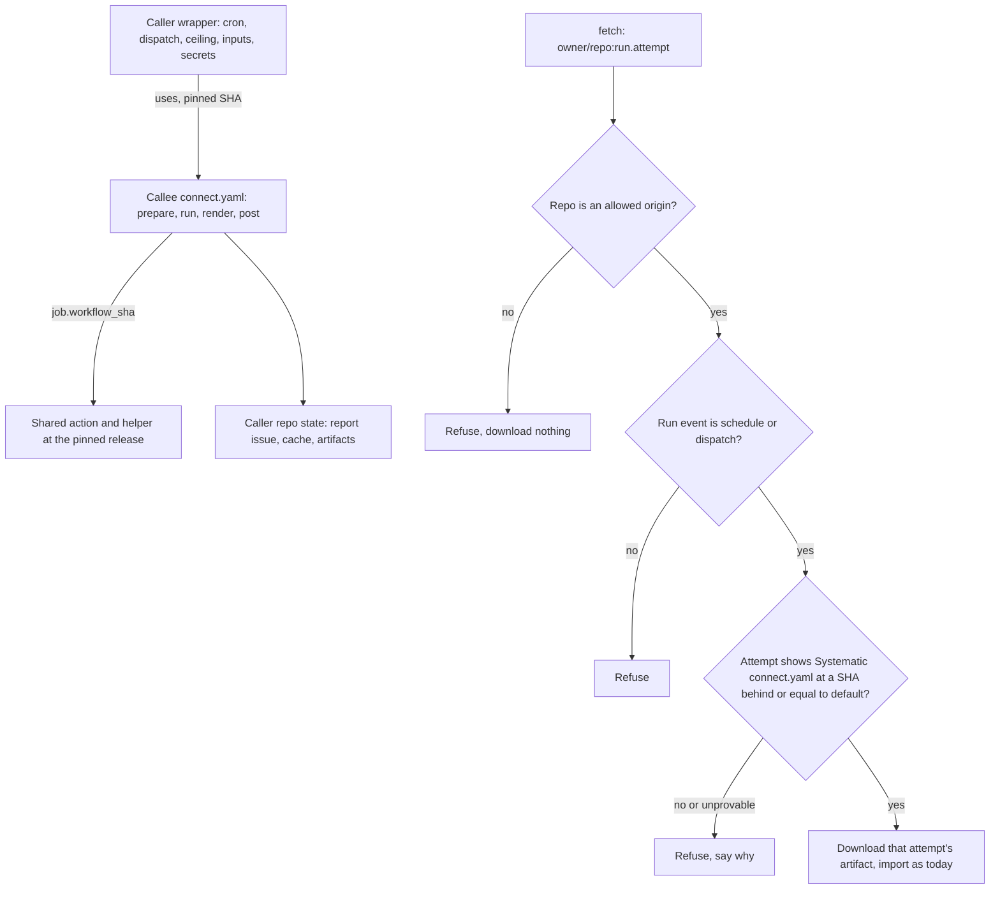
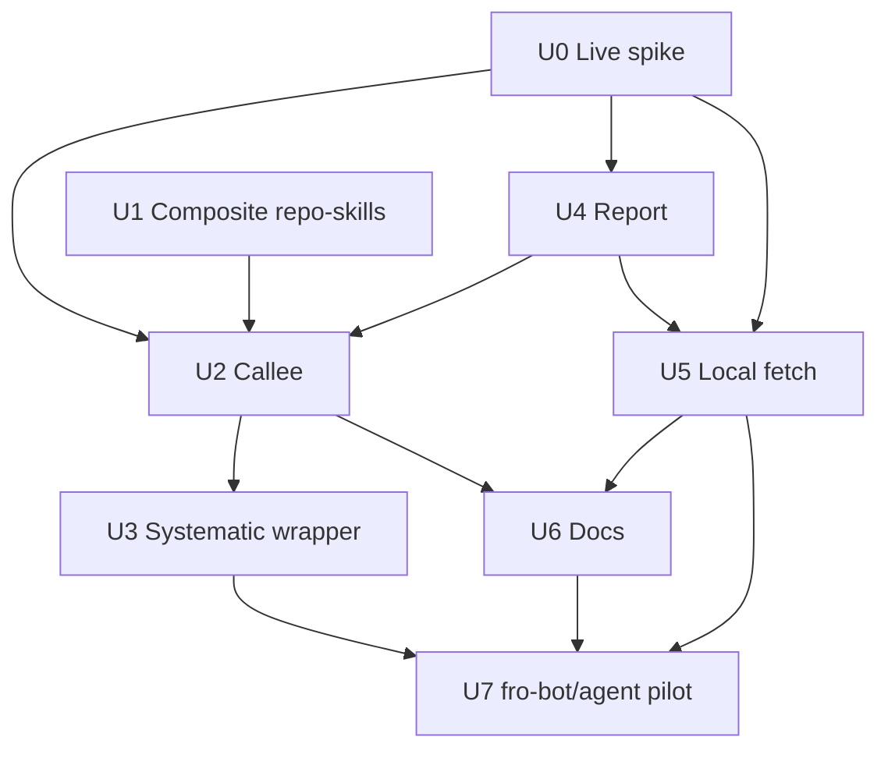

# feat: let other repositories call the scheduled ce:connect workflow

## Overview

The scheduled `ce:connect` workflow (`.github/workflows/connect.yaml`) becomes a `workflow_call`-only reusable workflow. A thin wrapper in each repository owns the cron, the manual dispatch, the token ceiling, the settings and the secrets. The callee owns the four jobs (prepare, run, render, post) and every trust boundary they carry today.

Systematic moves to its own wrapper (`.github/workflows/connect-scheduled.yaml`) in the same change, so the published path is the one it exercises daily. fro-bot/agent becomes the first cross-owner caller once a Systematic release carrying the new renderer and fetch work has been published and bumped into the callee's `SYSTEMATIC_VERSION`. `fetch:` learns a named form, so a candidate from a caller's report is promoted locally, gated on the local allow list and on run-level provenance.

The work runs to eight units because it spans a live probe, a workflow rewrite, the report renderer, the local fetch path, docs and a cross-repo rollout. Depth is Deep. No new `src/lib` module is planned.

---

## Problem Frame

The sweep runs only in Systematic. Every candidate lands in Systematic's report, and other repositories can only copy the workflow (which drifts from the first release) or go without. The workflow also assumes Systematic in two places: it checks out the shared agent action from the repository it runs in, and local `fetch:` accepts runs from `marcusrbrown/systematic` only, while the report's fetch line never names a repository. The origin document carries the full frame and is untracked (see Sources & References).

---

## Requirements Trace

Carried from the origin document; the unit that satisfies each is in parentheses.

**Reusable workflow**
- R1. One whole reusable workflow. Four jobs run in the caller's run; read-only research token, issue-write-only post job, visibility rechecks and the default-branch guard stay. Every job refuses any event except `schedule` or `workflow_dispatch`. (U2)
- R2. The caller supplies project list, parent and researcher models, variant and step timeout as inputs, and `OPENCODE_AUTH_JSON` and `OPENCODE_CONFIG` as named secrets. Prepare validates every input, including the parent model, and fails red on a missing one. (U2)
- R3. The shared agent action and helper come from the pinned Systematic release, never from the caller's repository. (U1, U2)
- R4. Report, ledger cache, artifacts, concurrency and the report author check are scoped to the calling repository. (U0, U2)
- R5. Same-day dispatch and failed-job reruns work as they do in Systematic today. (U0, U2)

**Systematic as a caller**
- R6. Systematic's sweep moves to a thin wrapper; its ledger and report continue across the move. Reordered: this lands before the pilot (KTD1). (U3)

**Promotion across repositories**
- R7. A report's fetch line names the calling repository with the run and attempt. (U4)
- R8. Named `fetch:` needs the repository to be the origin of an allow-listed project, and a run that is that repository's schedule or dispatch whose record shows a call to Systematic's reusable workflow at a commit reachable from Systematic's default branch. Otherwise named fetch stays off. (U5)
- R8a. A bare run number keeps meaning a Systematic run, including direct runs from before the cutover. (U4, U5)
- R9. A refused repository, run or expired artifact imports nothing and names the reason. (U5)

**Pilot and rollout**
- R10. fro-bot/agent runs live before any other repository is wired. (U7)
- R11. Callers pin by full SHA with a version comment; Renovate bumps it and never automerges; settle open rows before a format-changing bump merges. (U6, U7)
- R12. A commented example wrapper and a settings checklist, stating the agent can read the credentials and the report is not secret-screened. (U6)

Acceptance Examples AE1 to AE8 are in the origin; where each is proven:

| AE | Proven in |
|---|---|
| AE1 report opens in the caller, authored by the job token | U7 live; U0 spike for the author and cache scope |
| AE2 missing researcher model fails prepare red | U2 test; U7 live |
| AE3 agent step uses the pinned release's action | U2 test; U7 live log |
| AE4 named word imports only for an allow-listed checkout | U5 tests; U7 live |
| AE5 run that did not call Systematic's workflow, or called a fork, is refused | U5 tests; U7 fork-calling wrapper |
| AE6 failed-render rerun resolves artifact names | U2 test; U0 spike on attempts 1 and 2 |
| AE7 bare word for a pre-cutover direct run still imports | U4 and U5 tests; U3 first-run check |
| AE8 `pull_request_target` caller is refused by every job | U2 test |

---

## Scope Boundaries

- Private repositories as callers or allowed projects. The report stays public, and so does every quoted source.
- No dual mode: `connect.yaml` is `workflow_call` only, with no `vars` fallback and no direct trigger.
- No artifact-to-job binding. Provenance is run-level; allow-listing an origin trusts that repository's workflows, and the docs say so. Import still rechecks candidate bytes and spans against local checkouts.
- No format-change gate, no release-to-package mapping and no provider prevalidation with a paid call.
- No per-caller report marker. Title plus job-token author stays the discovery rule, and the docs name matching bot-authored issues as part of the report's trust domain.
- Render-before-post cache save and cancellation recovery behave as they do today and are not redesigned here.
- Scheduled runs on Pi or Claude Code; syncing a caller's CI ledger with a local ledger.

### Deferred to Separate Tasks

- Wrappers for the other six repositories named in the origin: after the pilot has run.
- A hub that sweeps many repositories and routes candidates to each target's report: future iteration.

---

## Context & Research

### Relevant Code and Patterns

- `.github/workflows/connect.yaml`: four jobs; `SYSTEMATIC_VERSION` env with its Renovate annotation; the `connect-v1-` cache prefix; `connect-run-<run>-<attempt>` artifact names taken from producer outputs; `REPORT_AUTHORS`; the sparse checkout of `.github/actions`; the `vars.FRO_BOT_CONNECT_*` and `vars.FRO_BOT_MODEL` reads; the agent step timeout; the render-report request built from run id and attempt.
- `.github/actions/fro-bot-agent/action.yml`: the shared composite. `repo-skills` is hard-set to `"true"`; under a call that would load the caller's `.agents/skills`. A non-`./` `uses:` in it must be a 40-hex SHA.
- `.github/workflows/update-repo-settings.yaml`: the full-SHA plus version-comment pin style for a reusable workflow.
- `tests/unit/connect-workflow.test.ts`: reads the workflow as data. `jobRuns` throws on an unknown `if` term; `usesInRepository` already handles job-level `uses`; the `on` keys, concurrency, one-`vars`-read-per-variable, secrets-count and sparse-checkout assertions all pin today's shape.
- `src/lib/connect-ci.ts`: `RenderRequest` (no repository field), `fetchWord`, `fetchLines`, the per-candidate Fetch line, `REPORT_MAX_CHARS`, `fitReport`.
- `src/ce-connect-helper.ts`: the `OPS` list and dispatch; `parseImportRequest` shape-checks `provenance.repo` with no network; `describeEnvironment` already resolves the allow list to origins through `readRepoIdentity` in `src/lib/connect-repo-identity.ts`. No read-only op exposes those origins before a download.
- `skills/ce-connect/SKILL.md` and `references/fetch-and-import.md`: the fetch grammar, the fixed repository, the `path`/`event`/`head_sha` run check, the refusal reasons and the import provenance `{repo, runId, commit}`.
- `.github/renovate.json5`: the regex manager keyed to the exact `connect.yaml` path for `SYSTEMATIC_VERSION`.

### Institutional Learnings

- `docs/solutions/best-practices/share-one-composite-agent-step-between-the-headless-and-interactive-workflows-2026-11-13.md`: pass model and credentials explicitly; check the action out into a subdirectory with no persisted credentials and no cone mode; the first live run must show the model override.
- `docs/solutions/integration-issues/fro-bot-agent-action-runtime-differs-from-a-plain-runner-2026-11-13.md`: the action supports schedule and dispatch only, filters the agent's environment, needs both provider inputs; recheck at each action pin.
- `docs/solutions/workflow-issues/bound-the-agent-step-below-the-job-so-a-scheduled-run-still-posts-2026-11-13.md`: step timeout below the job with `continue-on-error`; exact REST login for the author check; artifact names from producer outputs; an explicit attempt is fetched exactly, with no fallback.
- `docs/solutions/security-issues/trusted-step-after-the-agent-needs-its-own-job-2026-11-09.md`: credentialed publication stays in its own job; only validated data crosses jobs. Why the callee stays whole.
- `docs/solutions/integration-issues/report-carrier-ran-ahead-of-the-pinned-renderer-2026-11-20.md`: test a new carrier against the old renderer's output; settle rows before a format-changing pin move. Drives the U4 golden test and the KTD12 operator step.
- `docs/solutions/logic-errors/reopen-counter-reused-after-partial-failure-bind-decisions-to-a-content-revision-2026-11-20.md`: text, revision, run and attempt travel as one bundle; retest failed writes and cache rollback when the fetch link changes.
- `docs/solutions/test-failures/release-workflow-test-pins-action-sha-2026-10-14.md`: assert shape (full SHA, version comment, inputs, secrets), never a specific SHA; keep or replace the Renovate regex manager and exercise a simulated bump.
- The 60,000-character renderer budget sits under the 60,500 verifier cap; near-cap tests must use the longer qualified fetch words.
- `docs/solutions/build-errors/mdx-heading-anchor-crashes-astro-build-2026-05-22.md`: keep guide headings plain so the docs build holds.

### External References

- GitHub reusable-workflow rules, checked in planning: in a callee `github.*` is the caller's; `github.event_name` stays `schedule` or `workflow_dispatch`; step-level `job.workflow_repository`, `job.workflow_sha`, `job.workflow_ref`, `job.workflow_file_path` name the callee, and `github.job_workflow_sha` does not exist; a callee can narrow the token, never raise it; `required: true` on a secret checks only that the name is passed; run `path` is the wrapper's path, and `referenced_workflows` is optional, nullable and not format-guaranteed; Renovate's github-actions manager handles `uses: owner/repo/.github/workflows/x@sha # vX.Y.Z` as a workflow dependency. Behaviours marked live in the Open Questions are unproven until U0.

---

## Prior-Art Survey

The survey searched this repository at the recorded revision. The scheduled workflow, its composite, its helper and its fetch path already own every seam this work needs. Nothing is built from scratch; one new read-only helper op extends the existing dispatch.

```json
{
  "schema_version": 2,
  "verdict": "extend",
  "scope": "systematic repo: .github/workflows/connect.yaml, .github/actions/fro-bot-agent, .github/renovate.json5, src/ce-connect-helper.ts, src/lib/connect-*.ts, skills/ce-connect/**, tests/unit/connect-*, docs guide",
  "freshness": {
    "vcs_reference": "42ff97ed691a14f06837369fe4464cb100d54f81 (worktree HEAD at planning)"
  },
  "budget": {
    "max_search_passes": 3,
    "max_candidate_inspections": 12,
    "exhausted": false
  },
  "candidates": [
    {
      "path_or_symbol": ".github/workflows/connect.yaml",
      "description": "The scheduled four-job workflow (prepare, run, render, post) with guards, cache prefix, artifact names, report author check and vars reads. Becomes workflow_call only.",
      "disposition": "extend"
    },
    {
      "path_or_symbol": ".github/actions/fro-bot-agent/action.yml",
      "description": "Shared composite agent step; hard-sets repo-skills to true. Gains a repo-skills input defaulting to true; fro-bot.yaml stays unchanged.",
      "disposition": "extend"
    },
    {
      "path_or_symbol": ".github/workflows/update-repo-settings.yaml",
      "description": "Existing full-SHA plus version-comment pin of another owner's reusable workflow; the pin style callers copy.",
      "disposition": "reuse"
    },
    {
      "path_or_symbol": ".github/renovate.json5 (SYSTEMATIC_VERSION regex manager)",
      "description": "Bumps the callee's SYSTEMATIC_VERSION by exact file path; stays valid because the callee keeps its path.",
      "disposition": "reuse"
    },
    {
      "path_or_symbol": "src/lib/connect-ci.ts:RenderRequest / fetchWord / fetchLines",
      "description": "Owns the report format and the fetch word. RenderRequest has no repository, so the named word needs one optional field.",
      "disposition": "extend"
    },
    {
      "path_or_symbol": "src/ce-connect-helper.ts:OPS / describeEnvironment / parseImportRequest",
      "description": "Op dispatch and allow-list-to-origin resolution. No read-only op exposes allowed origins before a download, so one op is added; import provenance already carries a repo field.",
      "disposition": "extend"
    },
    {
      "path_or_symbol": "src/lib/connect-repo-identity.ts:readRepoIdentity",
      "description": "Resolves a checkout to its GitHub origin; the one source of origin truth for the new op and for import.",
      "disposition": "reuse"
    },
    {
      "path_or_symbol": "skills/ce-connect/references/fetch-and-import.md",
      "description": "The fetch procedure: fixed repository, run-path check, attempt selection, refusal reasons. Gains the named form and run-level provenance.",
      "disposition": "extend"
    },
    {
      "path_or_symbol": "tests/unit/connect-workflow.test.ts:jobRuns / usesInRepository",
      "description": "Workflow-as-data harness. jobRuns rejects unknown if terms, so it needs the event guard; usesInRepository already handles job-level uses.",
      "disposition": "extend"
    },
    {
      "path_or_symbol": ".github/workflows/fro-bot.yaml",
      "description": "Interactive workflow using the same composite with repo skills on. Must not change behaviour.",
      "disposition": "reuse"
    }
  ]
}
```

---

## Key Technical Decisions

- KTD1. **Systematic moves to its wrapper in the same change, reordering R6.** The origin put the move after the pilot. The move goes first because a callee that also serves direct runs needs a discriminator, and none exists: a called run and a direct run both report `schedule` or `workflow_dispatch`, and direct runs have no caller inputs. Telling them apart would take a `vars` fallback that could hand Systematic's settings to a caller. One path avoids that, keeps the published path the one exercised daily, and lets the callee stay at `connect.yaml`, so its path, the Renovate regex manager and the test paths stay valid. The cost is that Systematic cuts over before the cross-owner proof. U0 pays that down before any merge, and the rollback is reverting the wrapper change with the old cache left untouched.
- KTD2. **The wrapper owns triggers, ceiling and settings; the callee owns the jobs.** The wrapper grants `contents: read` and `issues: write` (a callee only narrows), passes inputs and names both secrets explicitly (`secrets: inherit` is unavailable across owners). The wrapper sets no concurrency.
- KTD3. **Inputs are typed strings validated in prepare.** Required: `projects`, `parent-model`, `researcher-model`. Optional: `variant` and `step-timeout-minutes`. A wrapper that passes an unset repository variable sends an empty string, so prepare first normalizes: an empty `step-timeout-minutes` means 40 and an empty `variant` means none, as today, and the run job's step-timeout expression applies the same default. Prepare then keeps today's checks (model shape, variant shape, a timeout that is a whole number below the job's 50, owner/repo entries, de-duplication) and applies the model rule to the parent model too. `required: true` catches a missing input; prepare catches an empty required one (the project list or either model) and fails red.
- KTD4. **Secrets are checked non-empty in prepare, and the value never enters a step environment.** Prepare compares each secret to the empty string inside an expression, so only a boolean reaches the script. There is no provider call to prevalidate. A well-formed but wrong credential is a runtime provider failure, and the run's existing red `Settle result` step reports it.
- KTD5. **Self-checkout and release identity come from the called commit.** The checkout step uses `job.workflow_repository` at `job.workflow_sha`, both step-level only. `SYSTEMATIC_VERSION` stays a callee env value, so the pinned SHA's own version decides the helper and is immutable; there is no separate mapping. Consequence for ordering: the helper a caller gets is the npm release its pinned commit names, and a release's tag commit names the previous release because Renovate bumps the value afterwards. A caller sees named words and named fetch only if its pinned commit's `SYSTEMATIC_VERSION` already carries U4 and U5 (a U7 prerequisite). Nothing else needs ordering: the render request's new field is read by a parser that destructures only the fields it knows, so an older helper ignores it, and Systematic's own report keeps bare words anyway.
- KTD6. **Guards: an event allow-list and the caller's default branch, added to each job's existing `if`.** Every job runs only for `schedule` or `workflow_dispatch`, and only when `github.ref` is `refs/heads/` plus `github.event.repository.default_branch`. These terms join what each `if` carries today: render and post keep `always()`, the upstream `result` checks, and the accepted and has-body output checks, so they still skip when upstream fails. The wrapper owns the triggers, so a `pull_request_target` caller is refused by every job.
- KTD7. **Repo skills are off for the connect run, which closes only `.agents/skills`.** The composite gains a `repo-skills` input defaulting to `"true"`; `connect.yaml` passes `"false"`, and `fro-bot.yaml` keeps today's behaviour. A caller's `AGENTS.md`, opencode config and plugins may still reach the agent; U0 records which do, and the U6 checklist names them.
- KTD8. **Concurrency lives in the callee, under its own group name.** Cache and concurrency groups are scoped to the caller repository already, and the wrapper sets none, so the two cannot collide. U0 proves `queue: max` works from a callee; U2 holds the fallback.
- KTD9. **The report names the repository only for non-Systematic callers.** Systematic's own reports keep bare fetch words, so open rows, copied words and ticks need no migration. Foreign callers render `fetch:<owner>/<repo>:<run>.<attempt>`. A bare word always means Systematic.
- KTD10. **Named fetch requires the attempt, and proves provenance on that attempt.** The skill selects the exact attempt first, then reads that attempt's `referenced_workflows`. It needs an entry whose repository and path are exactly Systematic's `connect.yaml` and whose SHA is a full 40-hex commit; the compare API against Systematic's default branch must return `behind` or `identical` for it. Absent, null, malformed, unprovable and API-error all fail closed, with a reason distinct from a proven mismatch. The bare path is separate and keeps today's strength: the repository is fixed to Systematic, the event must be `schedule` or `workflow_dispatch`, and the run's top-level `path` (with any `@ref` suffix stripped) must be `.github/workflows/connect.yaml` (direct runs before the cutover) or `.github/workflows/connect-scheduled.yaml` (Systematic's wrapper). It reads no `referenced_workflows`, so Systematic's own fetch never depends on the spike's provenance result.
- KTD11. **Allowed origins come from a new read-only helper op, asked before any download.** It shares `readRepoIdentity` with import, validates the owner/repo shape, matches case-insensitively and GitHub origins only, and treats duplicate origins as import does. A refused repository downloads nothing.
- KTD12. **A format-changing pin bump is a documented operator step, not a gate.** The docs tell the operator to settle open rows before such a bump merges. Nothing detects a format change.
- KTD13. **The live spike comes first and has two binding stop rules.** (a) If self-checkout through `job.workflow_*` cannot be proven, the plan stops and is redesigned: the callee cannot reach its own action, and there is no tick-only fallback. (b) If attempt-level `referenced_workflows` cannot be proven, named fetch stays off and the reusable workflow ships with tick-only reports for foreign callers: U4 omits their fetch line, U5 shrinks to the bare-path wrapper-path acceptance, U6 documents tick-only foreign reports and omits the named-fetch material, and U7 drops the named-fetch steps. Systematic's own bare fetch is unaffected by (b).
- KTD14. **Renovate no-automerge is caller-side.** The github-actions manager already bumps a caller's pin. The `packageRules` example is documented and checked in the pilot. Systematic's wrapper calls `./`, so it has no pin.

---

## Open Questions

### Resolved During Planning

- Wrapper file name: `connect-scheduled.yaml`.
- Dual mode, vars fallback, release mapping, artifact binding, format-change gate: all rejected (Scope Boundaries).
- Does the callee need a per-caller report marker? No (Scope Boundaries).
- Stop-rule gap for Systematic's own fetch: none. The bare path checks the fixed repository, the event and the top-level `path` (`connect.yaml` or `connect-scheduled.yaml`), and needs no `referenced_workflows` (KTD10).
- Does an older helper break on the new `repo` field in the render request? No: `parseRenderRequest` reads only the fields it knows. The callee sends the field from day one.

### Resolved by the spike (U0)

Both stop rules passed, so the full plan proceeds.

- **Self-checkout:** `job.workflow_repository`, `job.workflow_sha` and `job.workflow_file_path` name the callee on a local `./` call and on a cross-owner call. A checkout at `job.workflow_sha` reaches `.github/actions/fro-bot-agent/action.yml` in both.
- **`referenced_workflows` shape:** it is present on `/runs/{id}`, `/attempts/1` and `/attempts/2` for both call types, and identical across attempts. It is a list. Match the entry by `owner/repo/.github/workflows/connect.yaml` before the `@`, never by index. Use its `sha` field (40-hex), not the `@` suffix. The `ref` key appears only on the local call. A tag-pinned cross-owner call was not tested, so the parser must not depend on `ref` or the suffix.
- **Compare direction:** use `compare/<default branch>...<sha>`. Accept `behind` or `identical`. Reject `ahead` or `diverged`. An unknown or malformed SHA returns 404, the same shape as no access, so it is unprovable. No token scope is needed on the public repo.
- **Caller scope:** `vars` resolve from the caller, so a callee must not read them. The cache is scoped to the caller repo and ref, and a prefix restore works. Save and restore must use the same `path`, because the cache version hashes it.
- **Concurrency:** `queue: max` is accepted in a callee. Runs queue, a cancel leaves older pending runs intact, and there is no collision across repos. The wrapper fallback is not needed.
- **Reruns:** a failed-job rerun keeps the callee SHA and the attempt-1 artifact names. The existing producer-output naming already handles this.
- **Org policy:** a fro-bot caller can call a public, SHA-pinned callee in `marcusrbrown/systematic`. Job token logs show the narrowed grant.
- **Repo skills off:** a source read of fro-bot/agent v0.146.0 with OpenCode v2.3.2 shows that `repo-skills: "false"` keeps the caller's `.agents/skills`, `AGENTS.md`, `CLAUDE.md`, `opencode.json` and repo plugins from loading. The first wrapper run's log confirms it live.
- **Not observed:** the report author in a caller, and Issues write under the narrowed ceiling. U7 observes both.

### Deferred to Implementation

- Whether import keys duplicate detection on `provenance.repo`; U5 tests two repositories with equal run ids.
- Exact refusal reason names for a repository off the allow list and for unprovable provenance. Prefer reusing existing names where the meaning matches.
- Compare API limits and failure modes under a token with no extra scope.
- fro-bot's org Actions policy for a public callee in another owner, its secrets and variable names, and that Issues is enabled. The operator checks before U7.
- Exact concurrency group name; the shape is pinned by test, not the string.

---

## High-Level Technical Design

> *This illustrates the intended approach and is directional guidance for review, not implementation specification. The implementing agent should treat it as context, not code to reproduce.*

Who owns what at run time, and what a local named fetch checks before it downloads anything.



Delivery order. U1 to U6 ship as one change. The helper CI installs is the npm release a pinned commit's `SYSTEMATIC_VERSION` names, so for Systematic's own wrapper the 3.35.x helper ignores the new render field and the report keeps bare words. Named words and named fetch take effect only for a caller whose pinned callee commit installs a helper release carrying U4 and U5. A release's tag commit names the previous release, because Renovate bumps the value afterwards.

| Step | Units | Gate to the next step |
|---|---|---|
| 1. Probe | U0 | Marcus approves the probe. Self-checkout proven, or the plan is redesigned; attempt-level provenance proven, or named fetch is cut |
| 2. One change | U1 to U6 | The first Systematic wrapper run passes the continuity checks |
| 3. Release and bump | none | A Systematic release carries U1 to U6, and Renovate's bump of `SYSTEMATIC_VERSION` to it has merged |
| 4. Pilot | U7 | The pilot pins the bump commit or a later commit |

---

## Implementation Units



- [x] U0. **Live spike**

**Goal:** Prove, on real runs, the GitHub behaviours the design leans on, then delete every trace. Gate: needs Marcus's explicit approval before it runs, because it creates temporary workflows, issues and caches in Systematic and fro-bot/agent.

**Requirements:** R3, R4, R5, R8 (settles the unverified assumptions in the origin)

**Dependencies:** None

**Files:**
- Create (throwaway, never merged): a probe callee workflow on a temporary Systematic branch; a push-triggered probe caller on a temporary fro-bot/agent branch (a stub, see the pre-run rule); a probe caller that makes a local `./` call on the same Systematic branch, which carries the U1 composite edit.
- Modify: none in the main tree. The facts go into the HARNESSES CN-7 entry (U6) and the answers into Open Questions.

**Approach:**
- The probe callee prints, at step level: `job.workflow_repository`, `job.workflow_sha`, `job.workflow_ref`, `job.workflow_file_path`; `github.repository`, `github.ref`, `github.event_name`; whether `vars` and `inputs` resolve as expected; and the Actions cache scope by saving under a prefix and restoring from a second run.
- It reads its own run's attempts endpoint and records `referenced_workflows` for attempt 1 and, after a failed-job rerun, attempt 2, for the cross-owner call and the local `./` call; it also records whether artifact names survive a partial rerun.
- It opens a throwaway issue with the job token to record the author login and confirm Issues is enabled and the token ceiling is honoured.
- It carries a `queue: max` concurrency block, run twice back to back and once cancelled, to see queueing and cancellation from a callee.
- Reachability negative: a compare-API call for a SHA that sits only on the temporary branch (expect not-behind) and for a known-ancestor SHA on the default branch (expect `behind` or `identical`).
- Pre-run rule: the probe caller in fro-bot/agent is a stub. It has no agent step, no secrets and makes no paid call; it prints context values and reads the attempts endpoint only.
- Skills-off probe: the probe that calls the callee locally from Systematic runs the agent once with `repo-skills: "false"`. Systematic already has `.agents/skills`, `AGENTS.md`, opencode config and credentials. Record which caller content still loads: `.agents/skills` (expected not), `AGENTS.md`, opencode config, plugins. This is one minimal agent run on Systematic's own credentials, covered by the U0 approval.
- Operator checks before any run: fro-bot's Actions policy allows a public reusable workflow from `marcusrbrown/systematic`; Issues is enabled.
- Cleanup: delete the temporary branches, probe workflows, issues, caches and artifacts. Record only facts.

**Stop rules (KTD13):**
- (a) If self-checkout (`job.workflow_*` giving the callee's repository and SHA) cannot be proven, the plan stops and is redesigned. There is no tick-only fallback, because the callee cannot reach its own action.
- (b) If attempt-level `referenced_workflows` cannot be proven, named fetch stays off. U4 omits the fetch line for foreign callers, U5 keeps only the bare-path change (the wrapper path accepted), U6 documents tick-only foreign reports, and U7 drops the named-fetch steps. Systematic's own bare fetch does not depend on this proof and is unaffected.

**Test scenarios:**
- Test expectation: none -- a live probe. Each observation above is a pass or fail recorded with its run evidence.

**Verification:**
- Every item in Approach has a recorded observed value or an explicit "not observable", including which caller content still loads with repo skills off.
- Nothing from the probe remains in either repository, and no secret value was printed.

- [x] U1. **`repo-skills` input on the composite**

**Goal:** The shared agent composite takes a `repo-skills` input so the connect run can turn repository skills off while every other consumer keeps today's behaviour.

**Requirements:** R3 (the caller's `.agents/skills` never load into the sweep)

**Dependencies:** None

**Files:**
- Modify: `.github/actions/fro-bot-agent/action.yml`
- Test: `tests/unit/connect-workflow.test.ts` and the composite-input assertions beside it (the suite that pins the composite's inputs and forwarded values)

**Approach:**
- Declare an optional string input defaulting to `"true"` and forward it to the underlying action's `repo-skills` where `"true"` is hard-coded today. Keep its description honest: it loads the repository's `.agents/skills` from the default branch on trusted runs.
- `fro-bot.yaml` passes nothing and so keeps `"true"`. The connect callee passes `"false"` (U2).
- The composite lives under `.github/actions`, which the callee checks out at its own SHA, so this change takes effect without an npm release.

**Patterns to follow:**
- The existing input declarations and forwarding lines in the same file; the 40-hex SHA rule for any non-`./` `uses:`.

**Test scenarios:**
- Happy path: the composite declares `repo-skills`, default `"true"`, and forwards it unchanged.
- Integration: `fro-bot.yaml` passes no `repo-skills`, so its effective value is `"true"`; the full set of inputs the composite forwards still matches the existing pinned list plus this one.
- Edge case: no other consumer of the composite in the repository passes a value that would change its behaviour.

**Verification:**
- The composite's input tests pass with the new input in the pinned list.
- `bun run surfaces:affected --run` reports nothing to regenerate for this file, or regenerates and checks what it names.

- [x] U2. **Callee: `connect.yaml` as a reusable workflow**

**Goal:** `connect.yaml` runs only when called, takes every setting as an input or named secret, and keeps its four jobs, trust split and state scoped to the calling repository.

**Requirements:** R1, R2, R3, R4, R5

**Dependencies:** U0, U1, U4 (the render request's new field is sent from day one; an older helper ignores it)

**Files:**
- Modify: `.github/workflows/connect.yaml`
- Test: `tests/unit/connect-workflow.test.ts` (including the `jobRuns` harness), `tests/unit/renovate-workflow.test.ts`, `tests/unit/host-contract-workflow.test.ts` if it reads this workflow

**Approach:**
- Replace the schedule and dispatch triggers with `workflow_call`: the KTD3 inputs and two required secrets, `OPENCODE_AUTH_JSON` and `OPENCODE_CONFIG`. Keep `permissions: {}` at the top and each job's own narrowing; the wrapper supplies the ceiling.
- Replace each `vars.FRO_BOT_CONNECT_*` and `vars.FRO_BOT_MODEL` read with its input: the validation step, the step timeout expression, the model passed to the agent step. An empty `step-timeout-minutes` normalizes to 40 and an empty `variant` to none (KTD3), before validation and in the step-timeout expression. Parent-model validation reuses the researcher-model rule. Error messages name the input. Inputs and secrets reach scripts through `env:`, never through `run:` text.
- Prepare checks both secrets are non-empty (KTD4) and fails red on a missing or empty input before any checkout or write.
- Add the KTD6 terms to every job's existing `if`: the event allow-list and the caller's default branch via `github.event.repository.default_branch`. Render and post keep `always()`, the upstream `result` checks and the accepted and has-body output checks.
- The action checkout step takes `job.workflow_repository` at `job.workflow_sha` into the same subdirectory, with the same sparse, no-cone, no-persist settings. No literal Systematic repository remains in the callee.
- Pass `repo-skills: "false"` to the composite. `SYSTEMATIC_VERSION`, the cache prefix, `REPORT_AUTHORS`, the title rule, the visibility rechecks and artifact naming stay as they are; everything that names a repository uses the caller's `github.repository`.
- Add the workflow-level concurrency block under its own group name with `queue: max` and no cancellation (KTD8). Apply the Open Questions fallback only if U0 shows it fails.
- The render-report request gains the caller repository from `github.repository` (U4's field).
- Extend `jobRuns` to evaluate the combined expression (`always()`, `result` checks, output checks, event allow-list and branch), and rewrite the pinned `on` keys, concurrency, `vars`-read, secrets-count and sparse-checkout assertions to the new shape.

**Execution note:** Test-first. Rewrite the pinned assertions and add the new scenarios, watch them fail, then change the workflow.

**Patterns to follow:**
- The existing job-by-job structure tests in `tests/unit/connect-workflow.test.ts`; the `usesInRepository` helper for the job-level `uses`.
- The simulated-bump approach in `tests/unit/renovate-workflow.test.ts` for the regex manager.

**Test scenarios:**
- Happy path: `on` has exactly `workflow_call`; the declared inputs and the two required secrets match KTD3, with no other secret reference in prepare except the boolean checks.
- Happy path: with `schedule` or `workflow_dispatch` on the default branch, all four jobs run (`jobRuns`).
- Error path (AE8): with `pull_request_target` and `push`, every one of the four jobs is skipped.
- Error path: a run on a non-default ref is skipped by every job.
- Error path: with the upstream `prepare` or `run` result not `success`, or the accepted or has-body output not `'true'`, render and post still skip on an allowed event.
- Happy path: on an allowed event on the default branch, render and post still run under `always()` when their upstream results are `success` and the accepted and has-body outputs are `'true'`.
- Error path (AE2): an empty required input (`projects`, `researcher-model` or `parent-model`) fails red in the validation step before any checkout, and so does a malformed parent model; `step-timeout-minutes` of 50 or `0` fails.
- Edge case: an unset timeout arrives as an empty string and normalizes to 40, so validation passes and the step-timeout expression yields 40.
- Edge case: an unset variant arrives as an empty string and normalizes to none, so validation passes and no variant is forwarded.
- Error path: an empty `OPENCODE_AUTH_JSON` or `OPENCODE_CONFIG` fails prepare, and the failing script text never receives either value.
- Integration (AE3): the checkout step's `repository` is the callee's, its `ref` is the callee's SHA, and `sparse-checkout`, `path`, `persist-credentials`, `clean` are unchanged; the agent step still `uses` the checked-out action with `repo-skills` set to `"false"`.
- Integration (AE6): artifact names still come from producer outputs, and the render and post jobs read them from `needs`, so a render-only rerun resolves them.
- Edge case: no `${{ inputs.` or `${{ secrets.` expression appears inside any `run:` body, matching the existing rule for `vars`.
- Edge case: no `vars.` reference remains; no literal `marcusrbrown/systematic` remains outside comments; the concurrency group is set at workflow level with `queue: max` and no `cancel-in-progress: true`.
- Integration: the Renovate regex manager still matches the `SYSTEMATIC_VERSION` line, and a simulated bump rewrites it.

**Verification:**
- The suite passes with the rewritten assertions and the new scenarios; no assertion was loosened to pass.
- `bun run typecheck:all` and `bun run lint` are clean.
- The workflow's first live proof is U3's first wrapper run, then U7.

- [x] U3. **Systematic's own wrapper and cutover**

**Goal:** Systematic's daily sweep runs through a thin wrapper that calls the local callee, with its ledger, cache and open report continuing across the move.

**Requirements:** R6, R5, R8a (AE7)

**Dependencies:** U2 (the two land as one change); the example-wrapper scenario below reads U6's guide section, which lands in the same change

**Files:**
- Create: `.github/workflows/connect-scheduled.yaml`
- Test: `tests/unit/connect-scheduled-workflow.test.ts`
- Unchanged: `.github/renovate.json5` (the local `./` call has no pin; the regex manager keeps the callee)

**Approach:**
- The wrapper carries the existing cron and `workflow_dispatch`, a permissions ceiling of `contents: read` and `issues: write`, and one job that calls `./.github/workflows/connect.yaml`. It passes the existing repository variables as inputs (`FRO_BOT_CONNECT_PROJECTS`, `FRO_BOT_CONNECT_MODEL`, `FRO_BOT_CONNECT_VARIANT`, `FRO_BOT_CONNECT_STEP_TIMEOUT`, `FRO_BOT_MODEL`) and names both secrets explicitly. An unset variable arrives in the callee as an empty string, which the callee normalizes (KTD3), so the wrapper adds no fallbacks of its own. No concurrency, no `secrets: inherit`.
- The cache prefix, report title and author rule do not change, so the cache (same repository, default-branch ref) and the open report issue carry over.
- Cutover procedure, in the change description only: drain first (no run in flight, none queued); record the newest `connect-v1-` cache key, the open report issue and its manifest line; merge; dispatch once; check the evidence below; if any check fails, revert the change and leave every cache untouched.
- First-run evidence: the prepare log says the cache restored and the sweep progress line continues from the recorded value instead of restarting; the run edits the existing report issue in place and opens no second one; the log shows accepted ticks if any were left; a bare fetch word from a pre-cutover row still imports (AE7); the first wrapper run's top-level `path` is the wrapper's, which the bare path accepts.
- Bare fetch words stay for Systematic (KTD9), so open rows, copied words and ticks need no migration. A report rendered by the new renderer for Systematic is byte-identical to the old one for the same state (U4).

**Patterns to follow:**
- The structure and assertions of `tests/unit/connect-workflow.test.ts`; the pin style is not used here because the call is local.

**Test scenarios:**
- Happy path: the wrapper's triggers are the one cron and `workflow_dispatch`; it has one job whose `uses` is the local callee path; the ceiling is exactly `contents: read` plus `issues: write`.
- Happy path: every callee input is supplied, and each comes from the matching repository variable; both secrets are passed by name.
- Edge case: no `concurrency`, no `secrets: inherit`, no extra jobs or steps.
- Integration: the wrapper's `with` keys equal the callee's declared inputs and its `secrets` keys equal the callee's declared secrets, so a callee change cannot drift unseen.
- Edge case: the regex manager does not match the wrapper file and still matches the callee.
- Edge case: each input in the wrapper is the bare variable reference, with no `||` default.
- Integration: the commented example wrapper in the guide (U6) declares the callee's inputs and secrets by name, has the callee path, a full-SHA-shaped ref (the test recognizes the placeholder) with a version comment, no `concurrency` and no `secrets: inherit`, and a ceiling equal to the wrapper's. The test asserts shape, never a specific SHA.

**Verification:**
- The wrapper suite passes alongside U2's.
- The first live wrapper run meets every first-run check above, recorded in the change description.

- [x] U4. **Report renders the named fetch word for non-Systematic callers**

**Goal:** A foreign caller's report shows `fetch:<owner>/<repo>:<run>.<attempt>`; Systematic's report keeps the bare word, byte for byte.

**Requirements:** R7, R8a (AE7)

**Dependencies:** U0 (stop rule (b) decides whether foreign callers get a fetch line). The callee (U2) sends the new field from day one; an older helper ignores it, so no release ordering applies inside the change.

**Files:**
- Modify: `src/lib/connect-ci.ts`, `src/ce-connect-helper.ts` (request parsing for `render-report`)
- Test: `tests/unit/connect-ci.test.ts`, `tests/unit/ce-connect-helper-ops.test.ts`
- Generated: `skills/ce-connect/scripts/connect.mjs` (regenerate, never hand-edit)

**Approach:**
- `RenderRequest` gains an optional caller repository. It is shape-checked as owner/repo before use, with a fixed refusal reason on a bad value. Absent, or equal to `marcusrbrown/systematic` ignoring case, means bare words.
- `fetchWord` and the per-candidate Fetch line and `fetchLines` use the named form for any other repository. Stored payloads keep run and attempt only: a caller's store holds that caller's rows alone, so the request's repository applies to all of them. The checkbox line, revision suffix and manifest carrier are unchanged.
- Under stop rule (b) (U0), a foreign repository gets no fetch line at all.
- Budget: the named word is longer on every row. The renderer's 60,000-character budget and `fitReport` must still keep the body under `REPORT_MAX_CHARS`, which sits under the workflow's 60,500 verifier cap.

**Execution note:** Test-first. Capture the current Systematic output as a golden fixture before changing the renderer.

**Patterns to follow:**
- The fetch-word assertions in `tests/unit/connect-ci.test.ts` (regexes for the bare form stay valid) and the near-cap tests for `REPORT_MAX_CHARS`.
- The old-renderer carrier test from the pinned-renderer learning.

**Test scenarios:**
- Happy path: repository `fro-bot/agent` renders `fetch:fro-bot/agent:<run>.<attempt>` on the row and in the fetch lines; the same input without a repository renders today's bare word.
- Edge case (AE7): repository given as `MarcusRBrown/Systematic` renders bare words; output equals the golden Systematic report byte for byte.
- Edge case: a malformed repository (empty, spaces, `..`, a third path segment, over-long owner or repo) is refused with the fixed reason and renders nothing.
- Edge case: the longest valid owner and repo with the maximum number of open rows still keeps the body at or under the renderer budget, under `REPORT_MAX_CHARS`, and leaves the room for the one fixed cache-save line; a near-cap body with the longer word hides whole rows and counts them, as today.
- Integration: a body rendered with named words still applies ticks through `applyTicks`: a checkbox line from it resolves against the manifest it names.
- Integration: an old payload store, with runs and attempts only and none with a repository, renders under both the bare and the named form.
- Edge case (stop rule (b) only): a foreign repository renders no fetch line and keeps its checkboxes.
- Edge case: a request with no repository parses and renders as before, and a request with the field parses; the parser still reads only named fields, which is why an older helper ignores the new one.

**Verification:**
- `bun run ce-connect-helper:build` regenerates the bundle, then `bun run surfaces:affected --run` and `bun run surfaces:drift` pass.
- The golden Systematic report test passes unchanged.

- [x] U5. **Local `fetch:` with a named repository**

**Goal:** `/ce:connect fetch:<owner>/<repo>:<run>.<attempt>` imports a candidate from an allow-listed caller's run after proving the run called Systematic's reusable workflow; a bare run number keeps meaning Systematic.

**Requirements:** R8, R8a, R9 (AE4, AE5, AE7)

**Dependencies:** U0 (facts and stop rule for named fetch), U4 (the word's format)

**Files:**
- Modify: `skills/ce-connect/SKILL.md` (argument hint and grammar), `skills/ce-connect/references/fetch-and-import.md` (procedure and reasons), `skills/ce-connect/references/headless-and-outcomes.md` (fetch text), `src/ce-connect-helper.ts` (the new read-only op and its entry in `OPS` and dispatch), `src/lib/connect-repo-identity.ts` and `src/lib/connect-import.ts` only if sharing the origin resolution needs it
- Test: `tests/unit/ce-connect-helper-ops.test.ts`, `tests/unit/connect-skill-contract.test.ts`, the import tests that cover `provenance.repo`
- Generated: `skills/ce-connect/scripts/connect.mjs`, plus whatever `bun run surfaces:affected` names for a touched `SKILL.md` (registry, and schema or config reference if it lists them)
- No new `src/lib` module is planned. If the origin resolution becomes one, register it in the `ARCHITECTURE.md` codemap, in `src/lib/AGENTS.md`, and in the `connect-helper` triggers in `scripts/lib/generated-surfaces.ts`.

**Approach:**
- Grammar: the existing bare forms stay. The named form is `<owner>/<repo>:<run>.<attempt>` with the attempt required (KTD10). The owner/repo part is shape-checked before it reaches any API path; the run and attempt keep the existing numeric rules.
- New read-only helper op (KTD11): given a repository, it returns whether that repository is the origin of an allow-listed project, with the normalized form, and refuses a bad shape. It reads configuration only, writes nothing and takes no lock. The skill calls it first; a refused repository ends the fetch with no download and a fix-it remedy (allow-list a checkout of that repository, then retry). Local paths are not echoed.
- Procedure for a named word, in order: resolve the origin; read the run and check the event is `schedule` or `workflow_dispatch`; select the exact attempt and fail if it does not exist; read that attempt's `referenced_workflows`; require the exact Systematic `connect.yaml` entry with a full SHA; compare the default branch with that SHA and require `behind` or `identical`; only then download the named attempt's artifact and import. Any absent, null, malformed, unprovable or error response stops with the unprovable-provenance reason. A proven mismatch (other workflow, fork, unrelated wrapper) uses the existing not-a-connect-run reason. A wrapper's own path proves nothing.
- Bare words: repository fixed to Systematic as today. The run check keeps today's strength: the event is `schedule` or `workflow_dispatch`, and the top-level `path`, with any `@ref` suffix stripped, is `.github/workflows/connect.yaml` (direct runs before the cutover) or `.github/workflows/connect-scheduled.yaml` (Systematic's wrapper). It reads no `referenced_workflows`; only named words do (KTD10). Bare with no attempt keeps today's newest-available-attempt selection; `.attempt` stays exact with no fallback.
- Import provenance keeps `{repo, runId, commit}`, with `repo` the named repository and `commit` the run's `head_sha`, which is the caller's wrapper commit and not the callee's. The docs say so.
- Under stop rule (b) the named form is not documented as available, and U5 keeps only the bare-path change (the wrapper path accepted).
- Bundle: after the `src/` change, run `bun run ce-connect-helper:build`, then `bun run surfaces:affected --run` and `bun run surfaces:drift`.

**Execution note:** Test-first. Update the contract tests' literal fixed-repository strings and add the named cases before touching the skill text.

**Patterns to follow:**
- The refusal reasons and Step 1 to Step 4 layout of `fetch-and-import.md`.
- `describeEnvironment`'s allow-list resolution and `readRepoIdentity`.
- The literal-string contract tests in `tests/unit/connect-skill-contract.test.ts`, and the new-op tests in `tests/unit/ce-connect-helper-ops.test.ts`.

**Test scenarios:**
- Happy path (AE4): an allow-listed `fro-bot/agent` checkout makes the op answer allowed with the normalized name; the skill reference lists the steps in the order above.
- Happy path: `GitHub.com` and mixed-case owner and repo in the word and in the checkout's origin compare equal.
- Error path (AE4): the repository is off the allow list; the op says so, the reference stops before any `gh run download`, and the remedy is named.
- Error path: a non-GitHub origin, a bad shape (`..`, a third segment, a space, a leading dash, over-long parts) and an empty value are refused by the op.
- Edge case: two allowed checkouts with one origin behave as import treats duplicates, not as a second, different rule.
- Error path (AE5): the run's event is `pull_request`; the run's attempt shows no `referenced_workflows`; the field is null or malformed; the entry names a fork or another workflow path; the SHA is a short or non-hex value; the compare returns `ahead` or `diverged`; the API call errors. Each refuses before download, with the unprovable-provenance reason when the proof is missing and not-a-connect-run when the run is proven another workflow.
- Edge case: a named word without an attempt is refused as malformed; a named word whose attempt has no artifact reports the existing not-found or expired reason and selects no other attempt.
- Integration (AE7): a bare `fetch:<run>` for a direct run whose `path` is `connect.yaml` still imports; a bare word for a wrapper-path run (`connect-scheduled.yaml`, with an `@ref` suffix on `path`) imports; a bare word for a Systematic run of any other workflow path (for example `fro-bot.yaml`) is refused as not-a-connect-run; a wrong event is refused; and the bare path makes no `referenced_workflows` read.
- Integration: importing the same run id from two different repositories does not collide, and provenance in the ledger records the named repository.
- Integration: candidate evidence from a project that is not allow-listed is still refused by the import's own check, after the named fetch passes.

**Verification:**
- The contract tests pin every refusal reason and the step order; the helper-op tests pass.
- The bundle and every touched surface pass `bun run surfaces:drift`.
- `bun scripts/content-integrity.ts` passes.

- [x] U6. **Docs: example wrapper, checklist, architecture, privacy, CN-7**

**Goal:** A reader can wire the next repository by copying a commented wrapper and working a checklist, and the trust limits are stated where an operator will read them.

**Requirements:** R11, R12

**Dependencies:** U2, U4, U5 (U0's facts supply the CN-7 evidence)

**Files:**
- Modify: `docs/src/content/docs/guides/cross-project-connections.mdx` (a "call it from another repository" section: the commented example wrapper, the checklist, the named fetch word, the trust limit, the Renovate rule, the format-change step), `docs/src/content/docs/privacy.mdx` (its sentence that fetch accepts runs from the fixed Systematic repository becomes false), `ARCHITECTURE.md` (codemap entries for `connect-ci.ts` and the helper, the ingress and workflow descriptions), `src/lib/AGENTS.md` (the `connect-ci.ts` row), `HARNESSES.md` (new CN-7)
- Test: none of its own. The example wrapper's shape is checked by the U3 wrapper test.

**Approach:**
- The example wrapper is a fenced YAML block in the guide: schedule, dispatch, a ceiling of `contents: read` and `issues: write`, one `uses` of the callee at a full SHA with a version comment, every input, both secrets by name.
- The checklist covers: the agent can read the credentials; the caller content that still reaches the agent with repo skills off (as U0 recorded it); the report is not secret-screened and is public; the Actions policy allows the public callee; Issues is enabled; the inputs and secrets, each with its default; the caller-side Renovate no-automerge rule; the settle-rows-first step for a format-changing bump; and the trust limits.
- Trust limits: allow-listing an origin trusts its workflows; provenance is run-level with no artifact-to-job binding, and import still rechecks bytes and spans locally; an old callee commit stays trusted for named fetch, so the operator re-pins callers after a callee security fix, and there is no version floor; a bot-authored issue matching the report title sits inside the report's trust domain.
- Under stop rule (b) the guide documents tick-only foreign reports and omits the named fetch word, the named-fetch trust limits and the named-fetch checklist items.
- Renovate: the caller's `packageRules` example (no automerge, scoped to this workflow dependency) and a line that Systematic's own `./` call needs none. Format changes: settle open rows before such a bump merges (KTD12); the docs do not claim Renovate enforces this.
- CN-7 is written once, in the style of CN-6, from U0's facts. U0 already runs the real agent through Systematic's own local call and a cross-owner stub. CN-7 records the pins used and what was observed and not observed, and it ships with the change. Evidence from the first wrapper run and from the pilot is an optional follow-up (U7).
- Keep guide headings plain (the anchor learning).

**Patterns to follow:**
- The scheduled-run and fetch sections of the guide, the CN-6 entry, and the module-table prose in `src/lib/AGENTS.md`.

**Test scenarios:**
- Test expectation: none beyond the example-wrapper scenario in U3 and the content-integrity gate -- the rest is prose.

**Verification:**
- `bun scripts/content-integrity.ts` and the docs build (`bun run docs:build`) pass.
- `bun run surfaces:affected --run` and `bun run surfaces:drift` pass for any touched generated reference.

- [ ] U7. **fro-bot/agent pilot**

**Target repo:** `fro-bot/agent`. This unit's PR lands there, after a Systematic release carries U1 to U6 and Renovate's bump of `SYSTEMATIC_VERSION` to it has merged.

**Goal:** fro-bot/agent runs the reusable workflow live from its own wrapper, and the operator promotes one of its candidates locally; this is the cross-owner proof before any other repository is wired.

**Requirements:** R10, R11, R12 (AE1 to AE5 and AE7; AE6 and AE8 are proven in U0 and U2)

**Dependencies:** U3, U5 and U6 merged; the operator's pre-checks (Actions policy, secrets and variables, Issues enabled) done

**Prerequisite:** the pilot pins a callee commit whose `SYSTEMATIC_VERSION` already carries U4 and U5. A release's tag commit names the previous release, because Renovate bumps the value afterwards, so the pin is the bump commit itself or any later commit. Without it the report would keep bare words and named fetch would not work. Check the value in the candidate commit before pinning.

**Files:**
- Create (in `fro-bot/agent`): a wrapper workflow copied from the guide's example, pinned by full SHA with a version comment; its Renovate configuration change adding the no-automerge rule
- Modify (in Systematic, optional follow-up that does not gate readiness): `HARNESSES.md` CN-7 with the pilot's evidence
- Test: none in code. The live runs below are the verification.

**Approach:**
- Wrapper: its own cron and dispatch, the ceiling, the five settings as inputs from that repository's variables, both secrets by name. Pin the commit named in the Prerequisite above.
- Renovate in the caller: add a `packageRules` entry that disables automerge for this workflow dependency, and check it against any inherited preset that automerges the github-actions manager. Run a simulated update and confirm a full SHA, a version comment and a non-automerged PR.
- Live acceptance, in order:
  1. A dispatch run: the report issue opens in `fro-bot/agent`, authored by the job token; Systematic's report and cache are untouched (AE1). The agent log shows the model override and the shared action from the pinned release (AE3). The log shows repo skills off.
  2. A same-day second dispatch edits the report in place (R5).
  3. A dispatch with the researcher model blanked fails prepare red and posts nothing (AE2).
  4. Local promotion: with the checkout allow-listed, the report's named fetch word imports a candidate; with the checkout removed, the same word is refused and nothing downloads (AE4).
  5. Negative on a temporary branch: a wrapper named like the real one that calls a fork of the callee is refused as not-a-connect-run (AE5). It needs a temporary fork under Marcus's account, removed afterwards, and is the only fork case in the plan.
  6. A pre-cutover Systematic candidate's bare word still imports (AE7).
- Readiness for wiring any other repository: steps 1 to 6 pass and the pilot has posted at least one scheduled report. Rollback: disable the wrapper in the caller; nothing in Systematic needs to change.
- Under stop rule (b): drop step 4 (the named-fetch import) and step 5 (the refusal), record AE4 and AE5 as not applicable, and narrow the readiness gate to steps 1, 2, 3 and 6 plus one scheduled report.
- Optionally record the pilot's observed and not-observed behaviours in CN-7.

**Test scenarios:**
- Test expectation: none -- live acceptance. Each step above is pass or fail with evidence, and a failure in step 1, 4 or 5 stops further wiring (steps 4 and 5 drop under stop rule (b)).

**Verification:**
- Every applicable acceptance example has a recorded outcome.
- The operator promoted one real candidate with the report's fetch word (not under stop rule (b)).
- The temporary branches and workflows are gone, and no secret value appears in any log, issue or note.

---

## System-Wide Impact

- **Interaction graph:** wrapper to callee to composite to the shared action and the npm-installed helper; local `fetch:` to the new op, the run API, the compare API and import.
- **Error propagation:** a bad input or empty secret fails prepare red before any checkout or write. Unprovable provenance refuses a fetch before any download. A failed agent step still reads the record, renders and posts, as today.
- **State lifecycle risks:** Systematic's cache and report must survive the move (U3). Render still saves the cache before post, so a cancellation between them can leave newer state with an older report; that behaviour is unchanged and documented, not fixed here.
- **API surface parity:** `fro-bot.yaml` keeps repo skills on. The bare fetch word keeps working. The render-report request gains one optional field.
- **Integration coverage:** cross-owner secrets, cache and concurrency scope, `referenced_workflows` on reruns and the compare API are provable only live (U0, U7).
- **Unchanged invariants:** four-job trust split; read-only research token; issue-write-only post job; visibility rechecks; ledger, cache prefix and artifact names; the report format for Systematic; import's local recheck of candidate bytes and spans.

---

## Risks & Dependencies

| Risk | Mitigation |
|---|---|
| Spike disproves self-checkout | Stop rule (a): the plan stops and is redesigned; no tick-only fallback |
| Spike disproves attempt-level provenance | Stop rule (b): ship the reusable workflow, foreign reports tick-only, named fetch off. Systematic's own bare fetch is unaffected (path check, KTD10) |
| A pinned commit installs a helper release older than U4 and U5 | The callee sends the new field from day one and an older helper ignores it; the pilot pins a commit whose `SYSTEMATIC_VERSION` carries U4 and U5 (U7 prerequisite) |
| Systematic cuts over before the cross-owner proof | U0 first; first-run continuity checks; revert path leaves caches untouched |
| Caller content reaches the agent beside the credentials | Repo skills off closes only `.agents/skills`; U0 records whether `AGENTS.md`, config and plugins still load, and the checklist names them and says the agent can read the credentials; allow-listing trusts the origin's workflows |
| A fork or lookalike wrapper passes the fetch check | Exact repository and path match, full SHA, compare against Systematic's default branch; fail closed; the fork-calling negative runs in U7 |
| Renovate automerges a pin that receives secrets | Caller-side no-automerge rule, checked by a simulated bump in the pilot |
| A format-changing bump drops open ticks in a caller | Documented operator step to settle rows first; the Systematic report format is unchanged by this plan |
| Concurrency or cache scope behaves differently from the docs | U0 observes both; the `queue: max` fallback is named |
| Third-party Actions policy in fro-bot blocks the call | Operator pre-check before U7; spike records the policy state |

---

## Documentation / Operational Notes

- The cutover and first-run checks (U3) go in the change description for the Systematic wrapper, and nowhere else.
- A Systematic release that changes the report format needs the settle-rows-first step before callers merge the Renovate bump.

---

## Sources & References

- **Origin document:** `docs/brainstorms/2026-11-20-reusable-ce-connect-workflow-requirements.md`. The brainstorm directory is untracked in this repository, so a clone will not contain it; this plan carries the requirements it needs.
- Related code: `.github/workflows/connect.yaml`, `.github/actions/fro-bot-agent/action.yml`, `src/lib/connect-ci.ts`, `src/ce-connect-helper.ts`, `skills/ce-connect/references/fetch-and-import.md`, `scripts/lib/generated-surfaces.ts` (the `connect-helper` surface).
- Related past work: `docs/plans/2026-11-12-001-feat-connect-groups-scheduled-runs-plan.md`, recorded active; it kept the four-job trust split and deferred reuse by other repositories, which this plan delivers. `docs/plans/2026-11-19-001-feat-connect-code-mismatch-candidates-plan.md`, recorded completed; its cross-project fetch constraints (reason, evidence project, span and fingerprint preserved; refusal with a remedy) carry through U5.
- External docs: GitHub Actions documentation on reusing workflows, the `job` context, workflow runs and attempts (`referenced_workflows`), and repository comparison.
