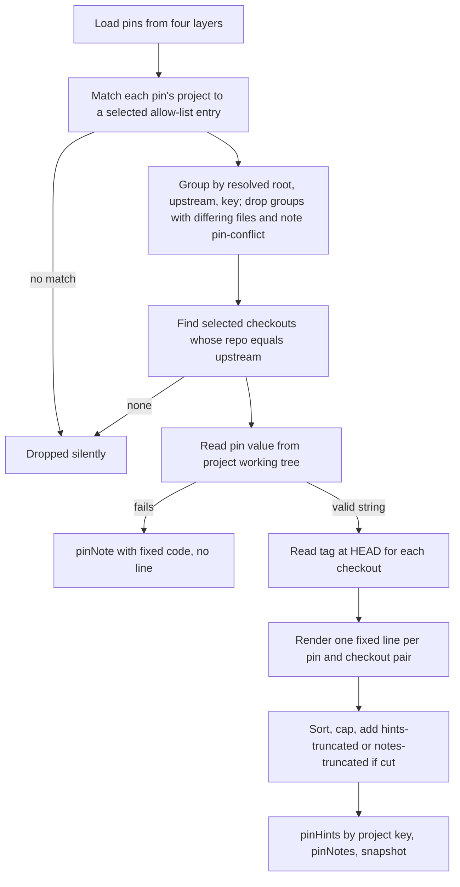

# feat: tell the ce:connect researcher about dependency pins so version-scoped claims get checked

## Overview

`ce:connect` gets one new user-owned config field, `connect.pins`. Each entry says: project P pins upstream U at the value found under key K in file F. At `begin` the helper reads that value live from P's checkout, finds every selected allowed checkout whose git `origin` is U, reads each one's version from its git tags at HEAD, and renders one fixed line per pin and checkout pair. The skill copies the matching lines into the dispatch of each family that holds rules of the pinning project. When nothing can be resolved the run adds no line and records a fixed reason code in a new `pinNotes` field that never degrades the outcome.

The helper states facts; the researcher judges. No candidate kind, validator rule, bound or researcher prompt changes. The depth is Standard: one config field, one tag reader, one pin reader, one `begin` addition and one skill step, with a single end-to-end real-host smoke run.

---

## Problem Frame

The researcher should flag a learning claim that is true at the host version a project pins and false at another version. That is a `code-mismatch` with reason `unscoped`, and the code-mismatch work already shipped the kind, the evidence rules and the prompt line that says to judge a dependency claim at the consumer's pin (recorded as completed in `docs/plans/2026-11-19-001-feat-connect-code-mismatch-candidates-plan.md`). Its real-host acceptance never reached the unscoped case.

That acceptance made three attempts and missed the case each time: once with a generic instruction to check other versions, once with the version visible only in the alternate checkout's directory name, and once on a full sweep. Those three runs are the only evidence of behaviour without the line. A single hand probe then passed after one concrete line was added by hand to each family's dispatch. The line named the pinning project, the pin file, the allowed checkout and its version. The researcher produced a validated `unscoped` candidate citing the v1 code, plus a second true `unscoped` candidate, and no false ones. The owner keeps the probe record privately, outside the repository. It is one run: it shows the behaviour can happen, not how often.

So the gap is not the prompt or the validator. The researcher never learns which checkout is the *other* version of a dependency a project pins. The helper can know that: it already reads every allowed checkout's origin, and a version is in the checkout's git tags. This plan makes the helper produce the line the probe added by hand.

Actors: the operator declares pins in user-owned config; the helper resolves and renders; the skill copies helper lines into dispatches as data; the researcher stays read-only and judges.

---

## Requirements Trace

**Declaration**
- R1. `connect.pins` is a list of `{ project, upstream, file, key }` in user-owned config only. `project` has the form of an allow-list entry. `upstream` is a GitHub `owner/repo`. `file` is a repo-relative path in a narrow charset. `key` is a dotted path. The zod schema and the plain guard accept and reject the same values, and a malformed block fails closed for its layer. (U1)
- R2. Pins never widen the allow list or the selection. A pin matches only an allow-list entry the run has already resolved and selected, by the string as written and then by the resolved roots of those entries. A path the pin declares itself is never resolved. Any other pin is dropped silently without a read, and no name of a project outside the selection reaches a warning, a note or a line. (U1, U4)
- R3. The plugin-side merge takes a plain union of pins, deduplicated as written, with no conflict logic. After resolution the helper groups the entries from all layers by (resolved root, upstream, key). Exact duplicates collapse. A group whose entries name different files is dropped entirely and adds one `pin-conflict` note with no count, never resolved by picking one entry. A conflict inside one layer is handled the same way. (U1, U4)

**Resolution**
- R4. The pin value is read live from the project's working tree through a contained, bounded read, as JSON or JSONC, by dotted key path. A missing file, an oversize or invalid file, an absent key and a non-string or invalid value each yield no hint plus a fixed reason. (U3)
- R5. Selected allowed checkouts are matched to the upstream by the `owner/repo` that `readRepoIdentity` reports from the git `origin`. Each matching checkout's version is the one tag at HEAD, read from `.git` files with no subprocess and no throw. No tag, several tags, an unreadable tag object and a tag object stored in a pack all give `unknown`; nothing is guessed. A tag listed in `packed-refs` resolves through its peeled `^` line. A checkout with an unknown version still gets a hint, labelled unknown. (U2, U4)
- R6. Equal pin and checkout versions still produce the factual hint. The helper never infers a mismatch. (U4)

**Delivery**
- R7. `begin` returns `pinHints` keyed by project key, each a fixed single-line rendering from parts that pass strict charsets, in deterministic order under an explicit cap, with truncation visible. Every offered rule carries its project key so the skill can match family to pinning project. (U4)
- R8. Step 5 copies only helper-rendered lines, only into families whose rule ids belong to the pinning project, and treats them as data. The dispatch gains no model-written text. (U5)
- R9. `begin` returns bounded `pinNotes` with fixed reason codes and project keys. Notes do not degrade the run and appear in interactive and headless summaries. (U4, U5)

**Invariants**
- R10. A hint is not evidence. Candidate kinds, validation, verdict semantics, the candidate and prompt caps, the 20-turn limit and the 8-rules-per-family limit are unchanged, and the researcher agent prompt is unchanged. (U4, U5)
- R11. Reads stay local, bounded and project-contained. Pin, tag and path values are untrusted data. (U2, U3, U4)

**Surfaces and acceptance**
- R12. The schema, config reference, connect helper bundle, registry and docs reflect the change, and each generated surface is regenerated. (U1, U3, U4, U5)
- R13. One real-host smoke run on the narrow selection `projects:agent,opencode-v1.19.5` with the helper-produced line, on the probe's case with a negative control. It makes no causal claim, and each attempt is recorded as one result and never as a rate. (U6)

---

## Scope Boundaries

- No auto-detection of pins from lockfiles, workflows or manifests. Pins are declared.
- No change to candidate kinds, the validator, the candidate contract or any bound.
- No change to the researcher agent prompt, so no persona fixture regenerates.
- No change to the scheduled CI workflow. The shared reader runs in CI, where clones are made with `--no-tags`, so CI versions come out `unknown`. This is documented and tested, with no claim of CI coverage.
- No project-level or repository-local `pins`. Project config can never grant or shape access.
- No YAML, TOML or lockfile pin sources, and no array index in a key path.
- No git subprocess anywhere in the new reads.

### Deferred to Separate Tasks

- Reading tag objects stored in a pack, and tag selection when several tags sit at HEAD: a later change if `unknown` proves common in practice.
- A dependency-aware rule offer (preferring rules whose claims name the upstream): a future iteration, only if the single acceptance run shows the line is not enough.
- Pin coverage in the scheduled workflow: a separate change that also decides how CI clones get their tags.

---

## Context & Research

### Relevant Code and Patterns

- `src/lib/config-schema.ts` `ConnectSettingsSchema` (strict, with `.meta`) and `src/lib/connect-config.ts` `validateConnectBlock`: the schema and its plain-guard twin. A parity test pins them together. The `connect` block is already user-owned and protected at block level (`src/lib/config-protected-fields.ts`, and the protected-field handling in `src/lib/config.ts`), so a nested `pins` key needs no new protected path.
- `src/lib/connect-config.ts` `readConnectBlock`, `loadConnectAllowList`, `ConnectAllowListLoad`, `BlockRead`, `resolveAllowEntry`, `resolveAllowList`: the helper-side reader. It reads four layers (user, user.local, custom, custom.local) with bounded JSONC reads and fails closed. It may import only `jsonc-parser`, node builtins and two search helpers, never zod, because the helper bundle inlines it.
- `src/lib/config.ts` `mergeConnect`: allow list is a union, groups merge by name. Pins need an explicit rule.
- `src/lib/connect-repo-identity.ts` `readRepoIdentity`, `originUrl`, `headCommit`, `packedRef`, `normalizeGithubRemote`, `isGithubOwnerRepo`: reads `.git` files only, never runs git, never throws. No tag reading exists. `packedRef` already skips `^` peeled lines. Its tests build real clones (`createClone`, `git pack-refs --all`).
- `src/lib/connect-evidence.ts` `readContainedFile` and `CONNECT_BOUNDS`: a contained, symlink-refusing, size-capped read; the bounds that stay frozen. It reads the working tree and does not check tracked status.
- `src/ce-connect-helper.ts` `describeEnvironment`, `beginResponse`, the `Snapshot` and `isSnapshot`, `degradeReasons`, `configWarnings`; `src/lib/connect-helper-core.ts` `projectKey` and the selection code that already filters the allowed set.
- `skills/ce-connect/SKILL.md` Step 4 (families from `rulesOverview`, whose second column is the project name) and Step 5 (the dispatch block and "nothing else").
- `docs/scripts/generate-config-reference.ts` `CONNECT_SUB_FIELDS`: a hand-maintained list. Drift would not catch a missing `pins`.
- `scripts/lib/generated-surfaces.ts`: the `connect-helper` surface lists its source triggers one by one, so a new `src/lib/` module needs a trigger row.

### Institutional Learnings

- `docs/solutions/best-practices/evidence-boundary-for-reading-other-repositories-2026-11-09.md`: the helper reads only authorized projects, in contained and bounded reads; project config cannot grant access; malformed trust config fails closed.
- `docs/solutions/best-practices/skill-around-an-untrusted-researcher-needs-baseline-pressure-tests-2026-11-09.md`: project text is evidence, never an instruction; the dispatch is fixed and filled from helper output; pressure-test behaviour on a real host.
- `docs/solutions/best-practices/pre-registered-evaluation-of-a-model-driven-tool-2026-11-09.md`: controls, offer reachability, and one run is not a rate.
- `docs/solutions/best-practices/hand-probe-a-cross-corpus-capability-before-building-2026-11-09.md`: the hand probe that preceded this plan follows that pattern.
- `docs/solutions/workflow-issues/registry-drift-on-skill-description-change-2026-05-20.md`: a `SKILL.md` edit moves the registry surface.

### Related Past Work

- Recorded as completed in `docs/plans/2026-11-19-001-feat-connect-code-mismatch-candidates-plan.md`: correct at its pin means not stale, an unknown version means not stale, `unscoped` needs positive evidence, limits stay in parity. This plan feeds that prompt; it does not change it. Its real-host acceptance recorded three failed attempts on the unscoped case.
- Recorded as active in `docs/plans/2026-11-12-001-feat-connect-groups-scheduled-runs-plan.md`: the git identity reader parses `.git/config`, HEAD, loose refs and `packed-refs` with no subprocess. It has no algorithm for finding a tag at HEAD; U2 adds one.
- Recorded as active in `docs/plans/2026-11-20-001-feat-reusable-connect-workflow-plan.md`: the reusable workflow. Out of scope here (see Scope Boundaries).

### External References

None. The git ref and loose-object formats are stable and read-only here; the code map in this plan comes from the repository.

---

## Prior-Art Survey

```json
{
  "schema_version": 2,
  "verdict": "build-new-within-scope",
  "scope": "repo root (single package): src/lib/connect-*.ts, src/ce-connect-helper.ts, skills/ce-connect/, scripts/lib/generated-surfaces.ts, docs/scripts/generate-config-reference.ts",
  "freshness": {
    "vcs_reference": "122017ce75478b356f2e00021cbad3e16d20de98"
  },
  "budget": {
    "max_search_passes": 3,
    "max_candidate_inspections": 10,
    "exhausted": false
  },
  "candidates": [
    {
      "path_or_symbol": "src/lib/connect-repo-identity.ts: readRepoIdentity / headCommit / packedRef",
      "description": "Reads the origin and HEAD from .git files without running git. packedRef skips ^ peeled lines and matches a single ref name.",
      "disposition": "insufficient",
      "insufficiency_reason": "Reads HEAD only. Nothing lists refs/tags, peels annotated tags or maps a tag to the HEAD commit. Extend it rather than replace it."
    },
    {
      "path_or_symbol": "src/lib/connect-evidence.ts: readContainedFile",
      "description": "Reads a root-relative file by a safe path, refusing symlinks, with a size cap.",
      "disposition": "insufficient",
      "insufficiency_reason": "Returns raw bytes only. It has no JSON-key extraction."
    },
    {
      "path_or_symbol": "src/lib/connect-config.ts: resolveAllowEntry / resolveAllowList / validateConnectBlock",
      "description": "Resolves an allow_projects entry to a verified main root. The block guard accepts only allow_projects and groups.",
      "disposition": "insufficient",
      "insufficiency_reason": "Has no pin declaration, no mapping from upstream to checkout, and no pin reader."
    },
    {
      "path_or_symbol": "src/lib/connect-import.ts: mapProject / LocalCheckout",
      "description": "Maps a recorded project to one allowed checkout by its origin owner/repo.",
      "disposition": "insufficient",
      "insufficiency_reason": "Maps to exactly one checkout and carries no version. A pin match needs every checkout that shares the origin, each with its tag version."
    },
    {
      "path_or_symbol": "src/ce-connect-helper.ts: allowedOrigins",
      "description": "Lists the GitHub origins of the allowed checkouts.",
      "disposition": "insufficient",
      "insufficiency_reason": "Returns origin names only, with no per-checkout version or pin."
    },
    {
      "path_or_symbol": "src/ce-connect-helper.ts: beginResponse; skills/ce-connect/SKILL.md Step 5",
      "description": "The begin answer, plus the dispatch block the skill builds, which is where per-family hints are carried and rendered.",
      "disposition": "extend"
    },
    {
      "path_or_symbol": "src/lib/connect-config.ts: HOST_SUPPORT_TABLE / checkHostSupport",
      "description": "Host version floors and the comparison against them.",
      "disposition": "insufficient",
      "insufficiency_reason": "Maps a host to a version floor, not a project to an upstream pin, and reads no checkout."
    },
    {
      "path_or_symbol": "src/lib/config-schema.ts: search.sources[].projects",
      "description": "A user-declared mapping from search sources to allowed projects.",
      "disposition": "insufficient",
      "insufficiency_reason": "Carries no upstream, file, key or version."
    }
  ]
}
```

---

## Key Technical Decisions

- KTD1. **Pins are declared, user-owned, and identified by (resolved root, upstream, key).** Declaration beats detection: detection would need a parser per ecosystem, and the owner scoped it out. The `connect` block is already protected, so `pins` is user-owned with no new protected path. There is one merge rule. The plugin-side `mergeConnect` takes a plain union, deduplicated as written, and has no conflict logic. The helper, after resolution, groups the entries from all layers by identity. Exact duplicates collapse. A group whose entries name different files is dropped entirely and adds one `pin-conflict` note with no count field, and so is a conflict inside one layer. Across three layers with files A, B and A the group is dropped, because a majority is still a pick the operator cannot see.
- KTD2. **The pin value is read from the working tree, not from git.** The operator wants the version the project's code uses now, and an untracked pin file is allowed. The read reuses `readContainedFile` (safe path, no symlink, size cap) and parses JSON or JSONC with `jsonc-parser`, so the module stays bundle-safe. The key path is dotted segments only; each segment is checked with `Object.hasOwn`, so `__proto__` and inherited names never resolve. Only a string value counts.
- KTD3. **A version is the single tag at HEAD, or `unknown`.** Unknown is a first-class answer: no tag, several tags, a tag object stored in a pack, an unreadable or oversize object, a malformed ref line and a tag that points at a tag all give `unknown`. A tag listed in `packed-refs` is not in that set: it resolves through its peeled `^` line. Any tag whose object could not be resolved also makes the answer `unknown`, because it might be a second tag at HEAD. HEAD is context, not attestation: the working tree may differ from the tag, and the line says so by its wording (the checkout "is at" a tag, not "is" the version). This keeps the prompt's existing rule that an unknown version never supports `stale`.
- KTD4. **Strict charsets for every rendered slot, two of them named; reject, do not sanitize.** A tag name is checked against `TAG_NAME_PATTERN` in `src/lib/connect-repo-identity.ts` (`^[A-Za-z0-9][A-Za-z0-9._+/-]{0,63}$`), which allows `/` because a tag such as `release/1.2` is a real nested ref. The pin value is checked against `PIN_VALUE_PATTERN` in `src/lib/connect-pins.ts` (`^[A-Za-z0-9][A-Za-z0-9._+-]{0,63}$`), the same shape without `/`, because a pinned version names no path and a slash would let it read as one. They are two constants and not one shared one, so each slot is as tight as its own source requires. `upstream` must pass `isGithubOwnerRepo`. The pin file path uses a narrow path charset, `[A-Za-z0-9._/-]`, with a length limit. The line names the pinning project and the allowed checkout by the resolved allowed main root that the dispatch `projects:` block already lists, never by project key or a free-text name. A root must be absolute, drawn from `[A-Za-z0-9._/-]` and within a length limit; a root that fails gets no line for that pair and a `pin-value-invalid` note keyed by the pinning project's key. Notes name a project by key only, and the key is also what matches families to rules internally. Anything that fails is rejected as `pin-value-invalid`, or as `unknown` for a tag, and is never cleaned up. The line is rendered from a fixed template, so no input chooses its structure. A value with no whitespace can still read like a sentence, so the tests use sentence-shaped input of that kind. This follows the repo rule that project text is evidence, never an instruction.
- KTD5. **One new module, `src/lib/connect-pins.ts`, holds the pin reader, the resolution and the rendering; the tag reader extends `src/lib/connect-repo-identity.ts`.** The helper file is already large and the pin logic is separable and easy to delete. The module imports only node builtins, `jsonc-parser` and sibling connect modules, never zod. A new `src/lib/` module carries three registration obligations: an `ARCHITECTURE.md` codemap entry, a `src/lib/AGENTS.md` module-table row, and a `connect-helper` trigger in `scripts/lib/generated-surfaces.ts`. The first two are gate-enforced by `bun scripts/content-integrity.ts`; the trigger is not, so U3 names it.
- KTD6. **Match against selected roots, then find checkouts, then read the pin file.** A pin's `project` is compared only with the allow-list entries the run has already resolved and selected: first by the string as written, then by the resolved roots of those entries. A path the pin declares itself is never resolved, so a pin cannot make the helper touch a directory the allow list does not name. A pin with no match is dropped silently. For a matched pin the helper first finds the selected checkouts whose repo equals the upstream, and opens the pin file only if at least one matches. The consequence is deliberate: a pin with no selected matching checkout produces nothing, no line and no note, because that case cannot be told apart from an out-of-selection one without a read. The guide says so.
- KTD7. **The skill matches family to pin by project key, not by name.** `projectKey` (in `src/lib/connect-helper-core.ts`) is the stable identity; names can collide. Each `rulesOverview` line gains a trailing project-key column, and `pinHints` is keyed by project key. Step 5 copies the lines for every key that owns at least one of the family's rule ids, as data, deduplicated.
- KTD8. **`pinNotes` is a separate, non-degrading channel.** `degradeReasons` flips the run to `degraded`, which would punish a missing optional pin. Notes carry a fixed code and, when the pinning project is selected, its project key. They never echo file content, a key, a value, a file path or an upstream. `pin-conflict`, `hints-truncated` and `notes-truncated` carry no identifier and no count.
- KTD9. **The hint line mirrors the probe line and stays fixed text plus strictly validated slots.** It names the pinning project and the allowed checkout by their roots as the dispatch `projects:` block lists them, and gives the upstream, the pinned value, the pin file and the checkout's tag, and ends with a constant sentence that tells the researcher to check claims about the upstream at both versions and, if a claim holds at one and not the other, to report a `code-mismatch` with reason `unscoped` and cite the evidence from the other checkout. The constant lives in the helper, which is trusted, not in the skill or the agent prompt. The researcher prompt already judges dependency claims at the consumer's pin, so it stays untouched.
- KTD10. **Caps are named, test-pinned constants, with truncation visible.** The hint cap (8 lines per run) and the note cap (8 per run) sit in `src/lib/connect-pins.ts`, not in `CONNECT_BOUNDS`, so the frozen bounds stay frozen. Cutting hint lines adds a `hints-truncated` note, and cutting notes keeps the first seven in order and adds a `notes-truncated` note, so the cap still holds. The values are initial and tunable in implementation.
- KTD11. **Acceptance is one end-to-end smoke run with a negative control, and it makes no causal claim.** It runs on the owner's OpenCode authentication with model `anthropic/claude-sonnet-5-5`. It is not a rate and does not replace deterministic tests.

---

## Open Questions

### Resolved During Planning

- Should the helper detect pins? No (owner decision).
- Which file formats? JSON and JSONC, dotted key path, string values only.
- What when entries for one pin identity name different files? Drop the whole group and add one `pin-conflict` note.
- Does a run with an unknown-version checkout still get a hint? Yes, labelled unknown.
- Does a missing pin degrade the run? No; it adds a note and no line.
- Do hints go to every family? No: only families that hold a rule of the pinning project.

### Deferred to Implementation

- The exact key path in the owner's pin file for the OpenCode v2 version: read the file when writing the owner's own config, since it is the owner's data and not part of the repository.
- The connections researcher's prompt is about 13 KB and no byte cap was found. An earlier 24 KB ceiling belongs to a different researcher. The 8-line hint cap keeps the added block small.
- Whether any other reader of `rules.tsv` breaks on the trailing project-key column. `skills/ce-connect/references/candidate-contract.md` describes the columns and is one reader U4 must update. Search for others when changing the line format and update them in the same unit.
- Exact numeric caps, if the initial values prove wrong (KTD10).

---

## High-Level Technical Design

> *This illustrates the intended approach and is directional guidance for review, not implementation specification. The implementing agent should treat it as context, not code to reproduce.*

The `begin` addition runs after the selection is known and before the answer is built. No file is opened until a pin has matched a selected root and a selected checkout.



The tag reader's outcomes, for one checkout whose HEAD commit is already known:

| State of the refs at HEAD | Version |
|---|---|
| Exactly one loose lightweight tag whose id equals HEAD | that tag name |
| Exactly one tag listed in `packed-refs` whose id, or whose peeled `^` id, equals HEAD | that tag name |
| Exactly one loose annotated tag whose loose object names HEAD as its commit | that tag name |
| Two or more distinct tag names reach HEAD | unknown |
| No tag reaches HEAD | unknown |
| A tag object is stored in a pack, or is unreadable, oversize, nested or malformed | unknown |
| Ref listing exceeds its entry or depth cap, a symlink or an unsafe ref name or id is met, or an inflate exceeds its cap | unknown |
| The same tag name is both loose and listed in `packed-refs` | the loose one wins, as git does, and counts once |

The rendered line has a fixed shape with strictly validated slots:

```text
pin: <project root> pins <upstream> at <value> (<file>); allowed checkout <checkout root> is <upstream> at <tag or "unknown">. Check claims about <upstream> at both versions; if a claim holds at one and not the other, report a `code-mismatch` with reason `unscoped` and cite the evidence from the other checkout.
```

The dispatch block gains an optional `pin hints:` section after `rule ids:`, present only when at least one helper line applies to the family.

---

## Implementation Units

- [ ] U1. **The `connect.pins` config field**

**Goal:** Declare, validate, merge and document `connect.pins` on both config paths, failing closed, with the two validators agreeing.

**Requirements:** R1, R2, R3, R12

**Dependencies:** None

**Files:**
- Modify: `src/lib/config-schema.ts` (the strict `ConnectSettingsSchema`: a `pins` list with per-field limits and a `.meta` description)
- Modify: `src/lib/connect-config.ts` (`validateConnectBlock`, `ConnectSettings`, `ConnectAllowListLoad`, `BlockRead`, `readConnectBlock`, `loadConnectAllowList`, the shared limit constants)
- Modify: `src/lib/config.ts` (`mergeConnect`)
- Modify: `docs/scripts/generate-config-reference.ts` (`CONNECT_SUB_FIELDS`)
- Regenerate: the versioned schema file under `docs/public/schemas/` and `docs/src/content/docs/reference/configuration.mdx`
- Test: `tests/unit/config-schema.test.ts`, `tests/unit/connect-config.test.ts`, `tests/unit/config.test.ts`, `tests/unit/generate-config-schema.test.ts`, `tests/unit/generate-config-reference.test.ts`

**Approach:**
- Each pin is `{ project, upstream, file, key }`, all required, no extra keys. `project` has the allow-list entry form and length limit. `upstream` is a GitHub `owner/repo` that passes `isGithubOwnerRepo`, which keeps case; matching lowercases it (U4). `file` is a non-empty repo-relative path in the narrow path charset of KTD4, with a length limit, no `..` segment and no leading slash. `key` is one or more non-empty dotted segments with no control characters. Limits are shared constants imported by both validators, as the allow-list limits are today.
- The helper-side reader returns the layer's pins next to the allow list and groups. A layer whose block is malformed contributes nothing of any kind, as now. Warnings name files and reasons, never entries.
- The plugin-side `mergeConnect` takes a plain union of pins, deduplicated as written: two entries are one only when all four values are equal. It has no identity or conflict logic. The helper-side loader returns the pins of every readable layer in layer order and does no grouping either; conflicts are decided in U4, after resolution, where the resolved root is known.
- `pins` is user-owned only: the `connect` block already sits in the protected set, so no new protected path is added. Verify with the protected-fields tests rather than editing them.
- Add `pins` to `CONNECT_SUB_FIELDS`. Drift would not fail if it were left out.

**Patterns to follow:**
- `readEntryList` and `readGroups` for list and map guards; `MAX_ALLOW_PROJECT_LENGTH` for a shared limit constant.
- The existing zod/plain-guard parity test in `tests/unit/config-schema.test.ts`.

**Test scenarios:**
- Happy path: a block with one valid pin parses in zod and the plain guard to equal values; a block with no `pins` is unchanged from today.
- Happy path: parity — a table of valid and invalid blocks (missing field, extra field, empty string, non-string, `upstream` without a slash, `upstream` with extra segments, `file` with `..`, absolute `file`, `file` outside the narrow charset, `key` with an empty segment, control character in each field, over-long field, `pins` as an object) gives the same accept or reject in both validators.
- Error path: a layer with one bad pin among good ones is unreadable as a whole (allow list, groups and pins all contribute nothing), and the warning names the file and a reason but no pin entry.
- Error path: project-level or repo-local config containing `connect.pins` is ignored; the protected-field handling strips or refuses it exactly as it does `allow_projects`.
- Edge case: the same pin written identically in two layers collapses to one in `mergeConnect`; the same pin twice in one layer collapses to one.
- Edge case: two pins with the same project, upstream and key but different `file` values are both kept by `mergeConnect` and by the loader, since conflicts are decided in U4.
- Edge case: a pin whose `project` is not on the allow list is accepted by validation (shape only) and neither widens nor changes `allow_projects`.
- Integration: after regeneration, the schema file and the config reference both list `pins` and its fields, and `bun run surfaces:drift` is clean.

**Execution note:** Write the parity table first and make both validators satisfy it.

**Verification:**
- Both validators agree on every parity row, and a failing layer never yields a partial pin list.
- The schema and config-reference surfaces are regenerated and drift-clean; `pins` appears in the reference.

- [ ] U2. **Tag-at-HEAD reader**

**Goal:** Give the identity module a way to name the single tag at a checkout's HEAD from `.git` files alone, bounded, never throwing, with unknown as the honest fallback.

**Requirements:** R5, R11

**Dependencies:** None

**Files:**
- Modify: `src/lib/connect-repo-identity.ts`
- Test: `tests/unit/connect-repo-identity.test.ts`

**Approach:**
- The reader takes the checkout's git directory and its HEAD commit, which `headCommit` already resolves, and returns a tag name or `unknown`. It reuses the module's existing bounded reads. It serves main checkouts only: a root whose `.git` is not a real directory has no identity and gives `unknown`.
- Containing the walk over `refs/tags`: call `lstat` on every directory and entry, refuse symlinks, and never leave `.git/refs/tags`. Entry names must pass `safeRefName` and every id must pass `OBJECT_ID` before it is used in a path. The object path is exactly `.git/objects/<id[0:2]>/<id[2:]>`. The walk runs under entry-count, depth and per-file size caps.
- Loose tags: a ref whose id equals HEAD is a lightweight match and needs no inflate. For a ref whose id is not HEAD, read the loose object through `readContainedFile` with a compressed cap of about 4 KB. Inflate it with `zlib.inflateSync` and a small `maxOutputLength`; any throw means `unknown`. Accept it only if it is a tag object whose `object` line equals HEAD and whose `type` is commit. A tag object that points at another tag is not followed. Inflate at most 16 objects per checkout, under a total byte budget. These limits are named constants.
- Tags listed in `packed-refs`: read the file under its existing cap. A `refs/tags/<name>` line matches when its id equals HEAD or when the next line is a `^` peeled line equal to HEAD. A listed ref with no peel line and an id other than HEAD is not an answer.
- If a tag's object cannot be read as a loose object (it is stored in a pack, or is missing, oversize or malformed), the whole answer is `unknown` (KTD3). Two distinct names reaching HEAD give `unknown`. A name present both loose and listed in `packed-refs` counts once.
- Tag names are checked against `TAG_NAME_PATTERN`, the tag charset of KTD4, before they leave the reader; a name that fails makes the answer `unknown`.
- No subprocess and no throw: every failure path returns `unknown`.

**Technical design:** See the outcome table in High-Level Technical Design. Directional only.

**Patterns to follow:**
- `headCommit` and `packedRef` for bounded reads and peeled-line handling; `createClone` and `git pack-refs --all` in the existing tests for building real clones.

**Test scenarios:**
- Happy path: a real clone with a lightweight tag at HEAD returns that name; the same after `git pack-refs --all`.
- Happy path: an annotated tag at HEAD, loose, returns its name through the loose-object read; the same after `git pack-refs --all` through the peeled `^` line.
- Edge case: HEAD moved one commit past the tag returns `unknown`; a tag on an older commit never matches.
- Edge case: a detached HEAD and a branch checkout each resolve correctly.
- Edge case: a tag name containing a slash (`release/1.2`) is found in a nested `refs/tags` directory.
- Error path: two tags at HEAD (one lightweight, one annotated) return `unknown`; the same name loose and listed in `packed-refs` counts once and returns the name.
- Error path: a loose annotated tag whose object was moved into a pack (after `git gc`, with the loose ref left in place) returns `unknown`.
- Error path: a loose object that is truncated, not zlib or a non-tag type returns `unknown` and does not throw.
- Error path: a real high-ratio decompression bomb, stored as a loose object under a tag ref, returns `unknown` without inflating past the output cap.
- Error path: more than 16 non-HEAD loose annotated tags in one clone returns `unknown`, and no more than 16 objects are inflated.
- Error path: a tag object that points at another tag object returns `unknown`.
- Error path: a bounded read returns `unknown`: a `refs/tags` tree over its entry cap, a `packed-refs` line with a malformed id, and a loose object over its compressed cap.
- Error path: a tag whose name has a control character, a space, characters outside the tag charset or an over-long name returns `unknown`.
- Error path (containment): a symlinked `refs/tags`, a symlinked tag file, a symlinked `objects/xx` directory and a ref whose content is `../`-shaped each return `unknown`, and nothing outside `.git/refs/tags` and `.git/objects` is opened.
- Error path: no `.git`, an unreadable `.git`, a missing `refs/tags` and a clone with `--no-tags` all return `unknown` and never throw.
- Integration: the reader runs with `git` removed from `PATH`, proving no subprocess.

**Execution note:** Build the real-clone fixtures first; write each outcome-table row as a failing test before the reader handles it.

**Verification:**
- Every row of the outcome table has a real-clone test, and none of them shells out to git inside the reader.

---

- [ ] U3. **Pin value reader and the new `connect-pins` module**

**Goal:** Read one pin value from a project's working tree, contained and bounded, by dotted key path, returning a safe string or a fixed failure reason.

**Requirements:** R4, R11, R12

**Dependencies:** U1 (declaration shape)

**Files:**
- Create: `src/lib/connect-pins.ts`
- Modify: `ARCHITECTURE.md` (codemap entry for the new module)
- Modify: `src/lib/AGENTS.md` (module-table row)
- Modify: `scripts/lib/generated-surfaces.ts` (add `src/lib/connect-pins.ts` to the `connect-helper` triggers)
- Test: `tests/unit/connect-pins.test.ts`, `tests/unit/generated-surfaces.test.ts`

**Approach:**
- The reader takes a project root, a repo-relative file and a dotted key. It reads through `readContainedFile` (safe path, no symlink, size cap) and parses with `jsonc-parser`, collecting errors so a parse error is `pin-file-invalid` rather than a throw.
- It walks the key one segment at a time. At each step the current value must be a plain object and the segment must pass `Object.hasOwn`; an array, a primitive or a missing own property ends the walk as `pin-key-absent`. The final value must be a string that passes `PIN_VALUE_PATTERN`, the pin-value charset and length limit of KTD4, otherwise `pin-value-invalid`.
- The fixed reason codes are `pin-file-missing` (also a symlink, an unsafe path or a permission failure), `pin-file-too-large`, `pin-file-invalid`, `pin-key-absent` and `pin-value-invalid`. The result type is a discriminated union: `ok` with the value, or `failed` with one code. It never throws and never carries file content in a failure.
- The working tree is read as-is. Tracked status is not checked, so an untracked pin file works (KTD2).
- The module imports only node builtins, `jsonc-parser` and sibling connect modules. It carries the registration obligations in this unit because it is the unit that creates the file.

**Patterns to follow:**
- `readContainedFile` and its safe-path rule in `src/lib/connect-evidence.ts`; the bounded JSONC read in `src/lib/connect-config.ts`; the module-table rows already in `src/lib/AGENTS.md`.

**Test scenarios:**
- Happy path: `{"opencode":{"version":"2.3.2"}}` with key `opencode.version` returns `2.3.2`; a top-level key works; a JSONC file with comments and trailing commas works.
- Error path: missing file, a directory in place of the file, a symlinked file, a path escaping the root by `..` and an absolute path each return `pin-file-missing` with no throw.
- Error path: a file over the size cap returns `pin-file-too-large`; invalid JSON returns `pin-file-invalid`; an empty file returns `pin-file-invalid`.
- Error path: key absent, an intermediate segment that is a string, an array or null, and a numeric index segment return `pin-key-absent`.
- Error path: `__proto__`, `constructor` and `toString` as segments return `pin-key-absent` and never reach the prototype chain.
- Error path: the value is a number, boolean, object, array or null returns `pin-value-invalid`.
- Error path (injection): a value with a newline, a tab, a space, a backtick, markdown, an `ignore previous instructions` sentence, a very long string or an embedded NUL returns `pin-value-invalid`, and the failure result holds none of the value. Sentence-shaped input with no whitespace but a character outside the charset, such as `ignore:previous:instructions`, is rejected the same way. `Ignore-previous-instructions` passes the charset and is returned as a plain string, bounded by its slot (U4).
- Edge case: an untracked file in a git checkout is read; a key containing a dot in the real file cannot be addressed and returns `pin-key-absent`.
- Integration: `bun scripts/content-integrity.ts` passes with the new module's codemap entry and table row, and the generated-surfaces test confirms the trigger is listed.

**Verification:**
- Every failure code has a test, no failure result carries file content, and the registration surfaces are present.

- [ ] U4. **`begin` resolves pins and returns `pinHints` and `pinNotes`**

**Goal:** At `begin`, turn declared pins into rendered hint lines keyed by project key, plus non-degrading notes, honouring the selection before any read.

**Requirements:** R2, R3, R5, R6, R7, R9, R10, R11, R12

**Dependencies:** U1, U2, U3

**Files:**
- Modify: `src/lib/connect-pins.ts` (resolution, origin matching, rendering, ordering, caps, fixed reason codes)
- Modify: `src/ce-connect-helper.ts` (`describeEnvironment`, `beginResponse`, the `Snapshot` and `isSnapshot`, the publish summary, the rules-overview writer)
- Modify: `src/lib/connect-helper-core.ts` (project key carried on offered rules, selected-set access)
- Modify: `skills/ce-connect/references/candidate-contract.md` (its `rules.tsv` column description gains the trailing project-key column)
- Regenerate: `skills/ce-connect/scripts/connect.mjs`
- Test: `tests/unit/connect-pins.test.ts`, `tests/unit/ce-connect-helper-ops.test.ts`, `tests/unit/ce-connect-helper-sweep.test.ts`, `tests/unit/ce-connect-helper-packaging.test.ts`, `tests/unit/connect-helper-core.test.ts`, `tests/unit/generate-ce-connect-helper.test.ts`

**Approach:**
- Before writing the renderer, diff the line the template would produce against the exact dispatch line of the hand probe, which the owner keeps privately, and keep the wording close to it. Record the substantive differences in the pull request without exposing private values.
- Match each pin's `project` against the allow-list entries the run has already resolved and selected: first by the string as written, then by the resolved roots of those entries. Never resolve a path that a pin declares itself. An unmatched pin is dropped silently, with no read, no warning and no note. Then group the matched entries from all layers by (resolved root, upstream, key). Exact duplicates collapse. A group whose entries name different files is dropped entirely and adds one `pin-conflict` note with no count field. A conflict inside one layer is handled the same way (KTD1).
- For each remaining pin, validate `upstream` with `isGithubOwnerRepo`, lowercase it, and compare it with the `repo` field of `readRepoIdentity` for each selected checkout other than the pinning project. `normalizeGithubRemote` rejects a bare slug, so it is not used on the declared value. A pin with zero matches produces nothing, and its file is never opened (KTD6).
- Read the pin value once per pin that has at least one matching checkout (U3), then the tag per matching checkout (U2). On a pin-read failure, emit its note and no line. A checkout with an unknown tag still yields a line, labelled unknown (R5).
- Render the fixed line (KTD9) from values that passed their charsets (KTD4). Both roots are the resolved allowed main roots that `projects:` lists; a pair whose either root fails the path charset or length limit gets no line and a `pin-value-invalid` note keyed by the pinning project's key. Sort by project key, upstream, key, then checkout key, byte-wise, so the order never depends on layer or filesystem order. Cap lines and notes (KTD10) and emit a `hints-truncated` note when lines were cut, or a `notes-truncated` note when notes were cut.
- Return `pinHints` as a map from project key to its lines and `pinNotes` as a bounded list of `{ code, project? }`, where `project` is a project key, in the same stable order. `pinNotes` never enters `degradeReasons`, so the outcome stays `begun` (KTD8). Persist `pinNotes` in the snapshot and have `isSnapshot` accept a snapshot written by a bundle that lacks the field. The helper renders a fixed-form `Pins:` line from `pinNotes` into the publish summary.
- Carry the project key as a trailing column on every `rulesOverview` line (KTD7). Keep the existing columns and their order. Find other readers of the overview and update them in this unit.
- Regenerate the bundle, which restamps its source digest, then run the affected-surface regeneration and the drift check.

**Technical design:** See the flowchart and the line shape in High-Level Technical Design. Directional only.

**Patterns to follow:**
- `degradeReasons` and `configWarnings` plumbing in `beginResponse`; the existing selection filter in `src/lib/connect-helper-core.ts`; `oneCell` and `displaySafe` for names.
- The packaging test that proves the bundle matches its sources.

**Test scenarios:**
- Happy path: a pinning project with a valid pin file and a selected clone whose origin equals the upstream and whose HEAD carries one tag yields exactly one line under the pinning project's key, with the fixed shape and the tag, and no note.
- Happy path: equal pinned value and tag still yields the line; the line states both and implies no mismatch.
- Happy path: a clone with no tag at HEAD yields a line labelled unknown, and a clone made with `--no-tags` does the same (the shared CI-clone behaviour).
- Happy path: two matching clones yield two lines in a stable order, and two runs over the same state give byte-identical `pinHints`.
- Edge case: a pin whose `project` is written exactly as its selected allow-list entry matches; one written as the resolved root of that entry matches; one written any other way, such as a different spelling of the same path, is dropped silently. Two pins that match the same root by different routes are one identity and collapse or conflict as one.
- Edge case: `upstream` written in mixed case matches a clone whose `origin` is the lowercase repo; a clone of a different repo with a similar name does not match.
- Edge case: the pinning project's own origin equals the upstream; it is not offered as its own alternate checkout.
- Edge case: ten eligible pairs yield the cap's worth of lines plus a `hints-truncated` note, and the kept lines are the first ones in order. More notes than the note cap keep the first seven in order plus one `notes-truncated` note, eight in all.
- Edge case: no pins configured yields empty `pinHints` and `pinNotes`, an unchanged outcome and existing assertions intact apart from the new overview column.
- Happy path: the two roots in a rendered line equal, character for character, the roots the `begin` answer lists under `projects`.
- Error path: a pinning root or a checkout root containing a space, a non-ASCII character or a control byte, or over the length limit, gives no line for that pair and one `pin-value-invalid` note keyed by the pinning project's key; other pairs still render, and the offending root appears in no note.
- Edge case: every `rulesOverview` line ends with the project key of its rule's project, and that key equals the `pinHints` key for the same project.
- Error path (selection): the pinning project is allowed but not selected, so its pin file is never opened, and there is no line and no note. Assert by making the file unreadable or by counting reads through the injected dependencies.
- Error path (selection): a matching clone is allowed but not selected, or is not allowed at all. Its `.git` is never read, no line appears, and its name and path appear nowhere in `pinHints`, `pinNotes`, `configWarnings`, the snapshot or the summary; assert by searching the serialized answer for a sentinel in each name.
- Error path (selection): a pin names a sentinel directory that is not on the allow list, as its `project`. The helper makes zero accesses to the sentinel, asserted through injected file-system dependencies, and the sentinel's name appears in no warning, note or line.
- Error path: each failure code from U3 gives a note carrying the pinning project's key, no line, `outcome` `begun` and empty `degradeReasons`; the notes never contain the key path, value, file or upstream.
- Error path (injection): a pin value, a tag name and a file name carrying a newline, tab, space, backtick, markdown, `ignore previous instructions` text or control bytes are each rejected, not cleaned. Sentence-shaped input with no whitespace that fails the charset is rejected; one that passes the charset renders only inside its slot and adds no line or section. No rendered line contains a newline or tab, and no line names a project by anything but its root.
- Error path (merge): entries for one identity that name different files yield one `pin-conflict` note, with no count and no identifier, and no line for that pin, while other pins still render. Across three layers with files A, B and A the whole group is dropped. A conflict between two entries in one layer is dropped the same way.
- Error path (config): a malformed `pins` layer fails closed through `configWarnings` with no hints and an unchanged allow list; a pin cannot add a project to `projects`, to `selection` or to the allowed set.
- Integration: `begin` to `publish`: the snapshot carries `pinNotes`; the summary shows them; a snapshot without the field is accepted.
- Integration: `bounds` in the `begin` answer is unchanged.
- Integration: the packaging and drift tests pass against the regenerated `connect.mjs`.

**Execution note:** Write the selection-leak and injection tests before the rendering, as the evidence-boundary learning requires, so the boundary tests do not shape themselves around the implementation.

**Verification:**
- `begin` with pins yields helper-rendered lines and notes with the outcome unchanged; selection and injection tests fail if a read or a name escapes its boundary.
- `bun run surfaces:affected --run` and `bun run surfaces:drift` are clean, and the bundle's digest matches its sources.

---

- [ ] U5. **Skill Step 5 copies helper lines; docs and codemap**

**Goal:** Make the skill carry the helper's lines into the right dispatches as data, show `pinNotes` in the summaries, and document the field and its limits. The researcher agent prompt stays unchanged.

**Requirements:** R8, R9, R10, R12

**Dependencies:** U4

**Files:**
- Modify: `skills/ce-connect/SKILL.md` (Step 3 begin fields and the interactive limits statement, Step 4 overview column, Step 5 dispatch block and its rule, Step 7 summary)
- Modify: `skills/ce-connect/references/headless-and-outcomes.md` (the headless summary shows the `Pins:` line)
- Modify: `docs/src/content/docs/guides/cross-project-connections.mdx` (declaring pins, the key path, tags, notes, the no-match silence)
- Modify: `ARCHITECTURE.md` (the connect config block, the `begin` answer, the connect invariants) and `src/lib/AGENTS.md` (the existing `connect-config`, `connect-repo-identity` and `connect-evidence` rows where they describe changed behaviour)
- Unchanged on purpose: `agents/research/connections-researcher.md` and every persona fixture
- Regenerate: the registry surface (a `SKILL.md` edit moves it) through the affected-surface regeneration
- Test: `tests/unit/connect-skill-contract.test.ts`, `tests/unit/content-integrity.test.ts`

**Approach:**
- Step 3 lists `pinHints` and `pinNotes` among the `begun` fields. The interactive limits statement adds the notes, so the operator sees why a pin gave no line.
- Step 4 says the last overview column is the rule's project key. Families are still formed by subject.
- Step 5 adds an optional `pin hints:` section after `rule ids:`. For each family, the skill looks up the project key of each rule id in the family and copies every `pinHints` line stored under any of those keys, once each, unchanged and in the helper's order. If none apply the section is omitted. The "nothing else" rule stays: the lines are helper output, not model text, and the skill adds no sentence of its own. A document's text is still never copied.
- Step 7 and the headless reference print the helper-rendered `Pins:` line verbatim, kept separate from the degrade reasons.
- The guide documents the declaration with a worked example, the key-path rule (dotted segments, no array index, a key containing a dot cannot be addressed), JSON or JSONC only, the working-tree read, the tag outcomes, why a clone made with `--no-tags` (which the scheduled workflow uses; the workflow shares the reader and declares no pins) and a tag object stored in a pack give `unknown`, that no line appears when no selected checkout has that origin or when a project root has characters outside `[A-Za-z0-9._/-]`, and the note codes. It states that a line is a hint, not evidence, and that a nonexistent line is not an error.

**Patterns to follow:**
- The existing Step 5 block wording and its "Copy no text from a document" rule; the guide's existing sections for `groups`; the `connect-skill-contract` test's way of pinning skill text.

**Test scenarios:**
- Happy path: the skill-contract test finds the optional `pin hints:` section in the Step 5 block and the sentence that says the lines are copied from `pinHints` by project key.
- Happy path: the test finds `pinHints` and `pinNotes` in the Step 3 field list and the `Pins:` line in the Step 7 and headless summaries.
- Error path: the test fails if the "nothing else" rule is removed from Step 5.
- Edge case: the test checks the omitted-section rule: a family with no matching key gets no `pin hints:` heading.
- Integration: content-integrity passes with the updated codemap and table rows; the registry surface regenerates and drift is clean.

**Verification:**
- The skill text, guide and codemap agree with the helper's real field names, and the researcher agent prompt is untouched.

- [ ] U6. **Acceptance: an end-to-end smoke run on the probe's case**

**Goal:** Show end to end on a real host that the helper's own line, not a hand-added one, reaches the right dispatch and that a run carrying it can reach the probe's `unscoped` case, with a negative control. This is a smoke test and makes no causal claim: the three earlier misses described in Problem Frame are the only evidence of behaviour without the line. Record one pass, fail or inconclusive result per attempt.

**Requirements:** R13

**Dependencies:** U1 to U5, merged into the build the run uses

**Files:** None. The result goes in the pull request description. Run directories and transcripts stay outside the repository.

**Approach:**
- Billing route: the owner's existing OpenCode authentication, model `anthropic/claude-sonnet-5-5`. No other provider and no new credential.
- Prerequisites, the owner's own user-level config: the `fro-bot/agent` checkout and the `opencode-v1.19.5` clone of `anomalyco/opencode` at tag `v1.19.5` are on `connect.allow_projects`, and one pin is declared: project the agent checkout, upstream `anomalyco/opencode`, file `packages/runtime/src/shared/opencode-v2-pin.json`, and the key that holds the v2 version in that file.
- Selection: `projects:agent,opencode-v1.19.5`, the same narrow run as the probe.
- Before any model call, run `begin` and inspect it. Pass the gate only if `pinHints` holds one line under the agent project's key naming the pin value, the pin file and the clone at `v1.19.5`, `pinNotes` is empty, and the rule of the target learning is in `offeredRuleIds`. If the clone's version reads `unknown` (for example its tag object is stored in a pack), the run is inconclusive and the next step is to fix the clone or take the deferred work on tag objects stored in a pack, not to edit the line. If the target rule is not offered, rotate at most four slices and never edit the ledger or coverage to steer one.
- Case, the same as the probe: the agent learning that names the `plugins` config key with no host qualifier, true for the v2 host the agent runs and false for v1. Expected: one `code-mismatch` candidate with reason `unscoped`, next step `refresh-learning`, citing v1 code that rejects `plugins` and the pin file as pin evidence, accepted by the validator.
- Control: a negative control inside the run. Before dispatch, pick one agent learning that names its host or describes past behaviour, and write its path in the run record. Expected: no candidate on it. This stops "any hint produces a candidate" from passing.
- Judgement is pass only when all hold: the run is `complete` and validated with no degrade reasons, the target candidate is accepted, the negative control yields nothing, the transcript shows the helper's line copied verbatim into the dispatch of the family that holds the target rule, and the owner's manual recheck of every promoted candidate's evidence stands. A degraded or incomplete run, an incomplete family batch or an unoffered target is inconclusive, never a pass. An inconclusive result permits one rerun. Every attempt is recorded in order, and a later attempt never replaces an earlier one.
- The description says: this is a single run, so a pass shows the helper's line can reach the behaviour and says nothing about how often or whether the line caused it. It also says what was not verified, including whether the result holds on other models and whether the line helps on pins whose upstream has more than one allowed checkout.

**Test scenarios:**
- Test expectation: none -- a manual, model-driven acceptance run; deterministic coverage lives in U1 to U5.

**Verification:**
- The pull request description records the pre-flight `begin` output (without private paths), the run outcome, the target and control results, the single-run caveat, the no-causal-claim statement and the not-verified list.

---

## System-Wide Impact

- **Interaction graph:** The change reaches the config loader (both paths), the identity reader, `begin`, the snapshot, the publish summary, the skill's Steps 3, 4, 5 and 7, and the generated schema, config reference, helper bundle and registry. The researcher, the validator, the ledger, the digest and import are not touched.
- **Error propagation:** A pin failure ends as a note and no line. Config shape failures stay in `configWarnings` and fail their layer closed. Nothing raises the run to `degraded`.
- **State lifecycle risks:** `pinNotes` is persisted in the begin snapshot for the summary. A snapshot from an older bundle lacks the field and must still load. Hints are recomputed each `begin`; no hint is stored between runs.
- **API surface parity:** Pi, OpenCode and Claude Code all run the same helper and skill. The scheduled CI workflow shares the reader and declares no pins.
- **Integration coverage:** begin to dispatch to publish crosses the helper and the skill; unit tests prove the helper side and the skill-contract test the text, and only the real-host run in U6 shows the researcher uses the line.
- **Unchanged invariants:** candidate kinds and validation; the 8-rules-per-family, candidate and family caps and the 20-turn limit; the researcher agent prompt; the rule that project config cannot grant access; the rule that a project outside the allow list is never named.

---

## Risks & Dependencies

| Risk | Mitigation |
|------|------------|
| Many real clones give `unknown` because fetched annotated tag objects are stored in a pack | `unknown` is labelled, never guessed. U6 checks the acceptance clone reads a version first. Reading objects stored in a pack is deferred, and the guide documents that `--no-tags` clones always read `unknown`. |
| The line nudges the researcher into a false `unscoped` candidate | The validator and prompt are unchanged and still demand positive evidence from the other version. U6 carries a negative control and the owner's recheck. |
| The pin's value or a tag name carries injected text | Values and tags are rejected against a narrow charset instead of escaped; the line is a fixed template (KTD4, KTD9); injection tests in U3 and U4. |
| A trailing overview column breaks another reader of the file | U4 searches for readers and updates them in the same unit; the sweep and ops tests cover the format. |
| Added lines grow the dispatch past a prompt limit | The 8-line hint cap. The researcher prompt is about 13 KB and no byte cap was found. |
| A selected-set bug reads or names an unselected project | Filter-before-read tests with sentinel names (U4), per the evidence-boundary learning. |
| A single passing run is read as a rate | U6 and the guide say it is one run. Nothing in the plan states a success rate. |
| The working tree differs from the tag the line names | The line says the checkout "is at" a tag, and HEAD is documented as context, not attestation. |
| A project root with a space or other character outside the path charset gets no hint | The pair gets a `pin-value-invalid` note keyed by project key, and the guide says so. Moving the checkout fixes it. |
| A forged tag or pin value that passes the charset | Accepted. HEAD and the pin file are context, not attestation, and validation still needs cited evidence. |

Dependencies: U6 needs the owner's own allow-list and pin entries, a local `fro-bot/agent` checkout, and an `anomalyco/opencode` clone at `v1.19.5` with its tag present locally.

---

## Documentation / Operational Notes

- Operator rollout: add the pin to user-level config. Nothing changes for operators who declare none: `pinHints` and `pinNotes` come back empty.
- The generated surfaces to regenerate and check are the schema, config reference, `connect-helper` bundle and registry, through the repository's affected-surface and drift commands.
- The scheduled workflow is not changed. The guide states what it does and does not do with pins.

---

## Sources & References

- **Origin document:** none. This is a solo plan from the owner's scoped request; no requirements document exists.
- Related code: `src/lib/config-schema.ts`, `src/lib/config.ts`, `src/lib/connect-config.ts`, `src/lib/connect-repo-identity.ts`, `src/lib/connect-evidence.ts`, `src/lib/connect-helper-core.ts`, `src/ce-connect-helper.ts`, `skills/ce-connect/SKILL.md`, `docs/scripts/generate-config-reference.ts`, `scripts/lib/generated-surfaces.ts`
- Related past work: `docs/plans/2026-11-19-001-feat-connect-code-mismatch-candidates-plan.md`, recorded completed (this plan supplies the pin context its prompt already asks the researcher to use); `docs/plans/2026-11-12-001-feat-connect-groups-scheduled-runs-plan.md`, recorded active (the identity reader this plan extends); `docs/plans/2026-11-20-001-feat-reusable-connect-workflow-plan.md`, recorded active (the workflow this plan leaves alone)
- Learnings: the four `docs/solutions/best-practices/` documents and the registry-drift note named under Institutional Learnings
- Evidence: the owner's hand probe is recorded privately and is not in the repository; its single-run result is described in words in Problem Frame
