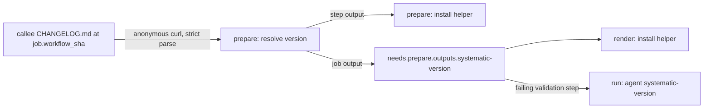

# fix(connect): run the release a callee commit names, read from its own changelog

## Overview

The reusable ce:connect workflow takes its Systematic version from `env.SYSTEMATIC_VERSION`. That value is bumped by Renovate after npm publish. The commit a release tag points at therefore names the previous release.

This plan reads the version from the callee commit's own `CHANGELOG.md` instead. `prepare` resolves it once. Both helper installs and the agent's `systematic-version` consume that one value. The env pin and its Renovate machinery go away.

The change is a `fix(connect)`, so it releases a patch. It reaches callers when that release's tag is published.

## Problem Frame

A caller pins `connect.yaml@<sha> # vX`, where `<sha>` is the commit tag `vX` points at. That commit still installs the helper and agent skills from `X-1`. The comment says `vX`, and caller-side Renovate reads it as `vX`.

Historical examples:

- The v3.38.0 tag commit carries changelog 3.38.0 and pin 3.37.0.
- The v3.38.1 tag commit carries changelog 3.38.1 and pin 3.38.0.

Four recent self-bump PRs (#1474, #1479, #1493, #1511) each landed after the release they bumped to. The release PR cannot carry the bump. Its CHANGELOG-only scope is enforced in the release gate, the publish decision and the publish-fact gathering, and the refresh job writes a one-file tree with an App token that holds no `workflows` permission.

Supported contract after this change: a release tag's commit runs its own release. Any other commit runs the release its changelog names. If an earlier publish was superseded, that release may have been published from a later commit. Callers pin tag commits.

## Requirements Trace

**Behaviour**

- R1. A caller pinned to the tag commit of a release that contains this change runs that release's helper and that release's skills.
- R2. The version is read from `CHANGELOG.md` at the callee's own repository and commit, parsed strictly, with no fallback on any failure.
- R3. One resolved value feeds the prepare install, the render install and the agent input. The run job validates it before the agent starts. Both installs keep their existing exact-version check.

**Removal**

- R4. `env.SYSTEMATIC_VERSION`, its Renovate manager, its `ci` package rule and the pin-tracking tests are removed (U2). The package rule matches only this pin. Every other Renovate manager and the post-upgrade tasks stay.

**Diagnostics**

- R5. When the helper install fails in prepare or render, the log says the publish may be pending or failed and to retry after the GitHub Release exists. Prepare logs the resolved version and the callee SHA.

**Invariants**

- R6. The four-job trust split, the release gate, permissions, the ledger cache key and the report identity do not change.

**Docs and proof**

- R7. Guide and architecture text state current behaviour and the tag-pin contract. External callers are told to advance after the GitHub Release exists. Old pins keep running what they run now.
- R8. A real cross-owner run on the first published release that contains this change proves R1.

## Scope Boundaries

- No change to `release.yaml`, `scripts/release/`, the release gate or `CHANGELOG.md` generation.
- No new permission, secret, caller input or token use. The changelog read is anonymous.
- Between releases, an ordinary main commit reads the last release's heading while its inline workflow may be ahead of the installed helper. This plan fixes release-tag lag, not that seam.
- Fork fetch policy and the installed fetch-client floor are unchanged.
- Callers pinned to older commits are not migrated by this plan.
- Declined: a caller's operator config that lists a competing Systematic plugin. That predates this change, and the caller owns that config.
- Declined: guarding against a changelog edit that selects an older release. Only the approval-gated release PR writes headings on main, any other edit is a reviewed PR, and a fork can already edit the workflow itself.
- The test-pin learning keeps its exact-pin example as a dated record.

### Deferred to Separate Tasks

- Delete the `verify-provenance` probe in `prepare`: after shipped-package tests enforce that capability for every selectable release.
- Live no-provider retry probe on Actions: not worth the ceremony. The existing persisted-outputs fixture and GitHub's documented re-run semantics cover retry.

## Context & Research

### Relevant Code and Patterns

- `.github/workflows/connect.yaml`: the env pin and its annotation, both `Install helper` steps, `Check helper capability`, the render guard in `Render report`, and the agent step's `systematic-version`.
- `.github/actions/fro-bot-agent/action.yml`: the optional `systematic-version` input. An empty value reaches fro-bot/agent, which then uses its own default release.
- `.github/renovate.json5`: the custom regex manager, its `ci` package rule and the unrelated managers that stay.
- `scripts/release/changelog.ts`: `CHANGELOG_SENTINEL` and `parseEntries`. Its heading regex is a prefix match and its scan skips non-version headings. It is a reference for the format, not a reusable strict parser.
- `tests/unit/connect-workflow.test.ts`: `runStep` runs a named workflow step in a temp box with stubbed tools. Its helpers are file-local, and it does not evaluate Actions expressions, so a test passes resolved env values explicitly. Existing install and capability tests use it, and one fixture simulates persisted `needs` outputs on a retry.
- `tests/unit/renovate-workflow.test.ts` and `tests/unit/connect-scheduled-workflow.test.ts`: the pin-tracking block and the wrapper's regex-manager expectation.
- `tests/unit/release-changelog.test.ts`: prior art for changelog fixtures. It exercises the permissive writer-side parser, not a strict consumer.
- `scripts/lib/generated-surfaces.ts`: no surface lists `connect.yaml`, `renovate.json5`, `ARCHITECTURE.md` or the guide as a trigger. No registration or regeneration obligation applies. `bun run surfaces:affected` confirms this.

### Institutional Learnings

- `docs/solutions/integration-issues/pinned-helper-and-installed-client-skew-in-a-reusable-workflow-rollout-2026-11-20.md`: probe capabilities and require a compatible installed client. Its env-pin and Renovate-lag advice is superseded.
- `docs/solutions/integration-issues/report-carrier-ran-ahead-of-the-pinned-renderer-2026-11-20.md`: test the current carrier against old bodies. Its pin-rule advice is superseded.
- `docs/solutions/test-failures/release-workflow-test-pins-action-sha-2026-10-14.md`: tests pin wiring, not literals.
- `docs/solutions/best-practices/called-workflow-github-context-is-the-callers-use-job-workflow-and-inputs-2026-11-20.md`: `job.workflow_repository` and `job.workflow_sha` name the callee in a called workflow.

### External References

- [Reusable workflow re-run behaviour](https://docs.github.com/en/actions/reference/workflows-and-actions/reusing-workflow-configurations#behavior-of-reusable-workflows-when-re-running-jobs): successful jobs keep their outputs on a re-run.
- [REST contents API](https://docs.github.com/en/rest/repos/contents#get-repository-content) and [REST rate limits](https://docs.github.com/en/rest/using-the-rest-api/rate-limits-for-the-rest-api): anonymous reads share 60 requests an hour per IP.

## Prior-Art Survey

```json
{
  "schema_version": 2,
  "verdict": "build-new-within-scope",
  "scope": "repository root, excluding generated and cloned trees",
  "freshness": {
    "vcs_reference": "c45f5c877cf211f2734f694b0862db4e22da4e0b"
  },
  "budget": {
    "max_search_passes": 6,
    "max_candidate_inspections": 12,
    "exhausted": false
  },
  "candidates": [
    {
      "path_or_symbol": "scripts/release/changelog.ts#parseEntries",
      "description": "Reads release entries after the changelog sentinel and extracts a version from each heading.",
      "disposition": "insufficient",
      "insufficiency_reason": "Its heading pattern is a prefix match that accepts a prerelease as its stable base, and its scan skips a non-version heading to reach an older entry. The consumer needs fail-closed first-heading parsing. Prepare has no checkout to import it from."
    },
    {
      "path_or_symbol": ".github/workflows/connect.yaml#env.SYSTEMATIC_VERSION",
      "description": "The callee's own pin for the helper installs and the agent's systematic-version input.",
      "disposition": "insufficient",
      "insufficiency_reason": "It is bumped after npm publish, so the release-tag commit names the previous release. The release PR cannot carry the bump."
    },
    {
      "path_or_symbol": ".github/renovate.json5#customManagers",
      "description": "The regex manager that bumps the annotated pin after each release.",
      "disposition": "insufficient",
      "insufficiency_reason": "It runs after publish by construction, so it cannot make the tag commit self-describing."
    },
    {
      "path_or_symbol": ".github/actions/fro-bot-agent/action.yml#systematic-version",
      "description": "Optional input that forwards an exact version to the pinned agent action.",
      "disposition": "insufficient",
      "insufficiency_reason": "It forwards a value and has no source for one. An empty value selects the agent's own default release silently. It stays as the sink."
    },
    {
      "path_or_symbol": "skills/ce-connect/scripts/connect.mjs",
      "description": "The committed, self-contained helper bundle generated from source.",
      "disposition": "insufficient",
      "insufficiency_reason": "Reading it from the callee commit would replace the helper install only. The agent loads skills solely by npm version, so skill text would still need a version source."
    },
    {
      "path_or_symbol": ".github/workflows/release.yaml",
      "description": "Same-repository REST reads with the job token inside the release flow.",
      "disposition": "insufficient",
      "insufficiency_reason": "The callee is a different owner and the caller's token is not a grant there. Anonymous REST is limited to 60 requests an hour per IP."
    }
  ],
  "excluded_scopes": [
    {
      "scope": ".slim/clonedeps/repos/",
      "reason": "Read-only, gitignored clones of third-party source. Not part of this repository's code."
    },
    {
      "scope": "fro-bot/agent at the pinned action commit",
      "reason": "A consumer in another repository. Its version handling was read to size the contract, and it is not changed here."
    }
  ]
}
```

## Key Technical Decisions

- **Use option C: read the version from the callee commit's own changelog.** The tag commit then names its own release without touching the release PR or its CHANGELOG-only invariant.
  - Rejected A (write the pin into the release PR): three checks enforce the CHANGELOG-only scope, and the release App might need `workflows`.
  - Rejected B (read the committed helper bundle): the agent loads skills only from an npm version.
  - Rejected tagging after the Renovate bump: it breaks tag immutability.
  - Rejected a caller version input: every caller would have to track it.
- **Tag pins are the supported contract.** A changelog names a release, not a commit. If a publish is superseded, a later approved release PR can publish the same version from a later commit, and an earlier SHA then installs that release.
  - Document tag pins as the contract. Do not build an ancestry or tag-association check.
- **`prepare` reads `https://raw.githubusercontent.com/<job.workflow_repository>/<job.workflow_sha>/CHANGELOG.md` with one `curl --fail --max-time 20`.** One anonymous request pinned to a full SHA needs no checkout and no token.
  - Validate the repository as `owner/repo` and the SHA as 40 hex characters before the request.
  - No `-L`, so a redirect is not followed. Nothing adds a token or a branch fallback.
  - A private or inaccessible callee returns 404 and fails closed.
  - A failed read turns the run red and a rerun fixes it, so there is no retry loop, size cap or request-URL seam. Tests stub `curl` the way `runStep` stubs other tools.
  - Rejected the REST contents API: anonymous reads share 60 requests an hour per IP.
  - Rejected sparse checkout: more machinery for one file.
- **Parse strictly and fail on anything else.** The first level-2 heading after the single standalone `<!-- release-entries -->` line must match one of two forms, each with an optional trailing date in parentheses:
  - `## [X.Y.Z](url) (YYYY-MM-DD)`
  - `## X.Y.Z`
  - The version token is a full match and canonical stable: no leading zeros, no prerelease, no build metadata, no `v` prefix.
  - A missing or duplicate marker, or a missing or malformed first heading, fails the run.
  - The parser never scans past the first heading to an older one, so a bad head cannot resolve to a stale release.
  - The parser is inline in the workflow step. It must run before the helper is installed, so it cannot be a helper operation. Node heredoc or bash is an implementation choice.
- **One value, three consumers.** The resolver's step output feeds prepare's install.
  - `needs.prepare.outputs.systematic-version` feeds render's install and the run job's composite `systematic-version`.
  - Both installs keep their existing exact-version check. The resolver has already parsed the value strictly.
  - In run, a normal failing validation step comes before the `continue-on-error` agent step, because an empty value would silently select the agent's default release.
  - Post does not need the value.
- **Remove the env pin and its Renovate machinery.** Delete `env.SYSTEMATIC_VERSION`, its annotation, the custom manager, its `ci` package rule and the pin-tracking tests.
  - The package rule is a custom-regex rule for `@fro.bot/systematic` only, so nothing else loses it.
  - The scheduled-wrapper test changes from expecting one regex manager to zero.
  - Keep every other manager and the `postUpgradeTasks`. Other Renovate PRs still need build and surface regeneration.
- **Hint at a publish window on install failure.** When either helper install fails, print one line before npm's own error: if this commit is a release tag, the publish may be pending or failed, so retry after the GitHub Release exists.
  - No second network call and no classification. Keep `--ignore-scripts` and the helper-file check.
  - No wait or retry for publish. The visible failure is accepted.
- **Publish order sets the caller guidance.** Releases publish in this order: semantic-release pushes the `vX.Y.Z` tag, npm publishes, then the GitHub Release is created. The GitHub Release exists only if the npm publish succeeded.
  - Orders are recorded in `RELEASING.md` ("How a release happens" and the break-glass section) and in the plugin list in `scripts/release/gated-config.ts`, where the npm plugin precedes the GitHub plugin.
  - The window where a tag exists but npm lacks the version is the failure this plan accepts.
  - "Published release" means the GitHub Release exists, which implies npm has the package. Callers advance after that, not when the tag appears.
  - A package on npm with no GitHub Release is a recorded partial state. Callers waiting for the Release do not advance, and Systematic's own scheduled run still works.
- **Keep the `verify-provenance` probe and the render guard.** Neither is a version or ancestry check, and both still catch a helper that cannot name the calling repository.
  - Reword both refusals to tell callers to pin the callee commit of a published release.
  - The probe may be deleted later. See Deferred.
- **One diagnostic, no identity changes.** Prepare logs the resolved version and callee SHA. The ledger cache key and the report identity do not change, so existing ledgers and open reports continue.
- **Rewrite what describes the lag, and banner the dated records.** The guide and `ARCHITECTURE.md` are rewritten.
  - The two integration learnings and the reusable-workflow plan's KTD5 and U7 get a one-line "superseded by this plan" banner.
  - External callers advance after the GitHub Release exists. Old pins keep running what they run now.

## Open Questions

### Resolved During Planning

- Which version does an ordinary main commit run? The heading it inherits, normally the last release. If an unpublished release entry is already on main, descendants inherit that version and fail at install with the hint.
- Can a caller steer the version? A caller chooses a callee SHA. It cannot change the bytes at that SHA through wrapper variables, comment, caller changelog or inputs.
- Does Post need the version? No.

### Deferred to Implementation

- Node heredoc or bash for the inline parser. Pick whichever the `runStep` harness runs more simply.
- Whether the resolver tests stay in `tests/unit/connect-workflow.test.ts` or move to a new file that shares an extracted harness. The harness helpers are file-local today.
- Whether raw reads from an Actions runner behave as measured elsewhere. U4 shows it on a real release.

## High-Level Technical Design

> *This illustrates the intended approach and is directional guidance for review, not implementation specification. The implementing agent should treat it as context, not code to reproduce.*



Failure handling by stage:

| Stage | Failure | Result |
|---|---|---|
| Resolve | bad repository or SHA, `curl` failure (404, timeout, throttle), marker or heading violation | Prepare fails before the install, the cache restore and any agent work. Nothing is posted |
| Prepare install | package or version unavailable | The hint line, then npm's own error |
| Run | empty or non-canonical value | A failing validation step stops the job before the agent runs |
| Render install | same as prepare install | Same hint. Nothing is published or saved |

## Implementation Units

U1 and U2 land in one change. U1 adds a hard-failing resolver that nothing consumes alone, and U2 cannot remove the env pin without the resolver.

- [x] **Unit 1: Resolve the version from the callee changelog**

**Goal:** `prepare` resolves one validated `X.Y.Z` from the callee commit's `CHANGELOG.md` and exposes it as a step output and a job output.

**Requirements:** R2, R3

**Dependencies:** None

**Files:**
- Modify: `.github/workflows/connect.yaml` (resolver step before `Install helper`; `prepare.outputs.systematic-version`)
- Test: `tests/unit/connect-workflow.test.ts`

**Approach:**
- Bind `job.workflow_repository` and `job.workflow_sha` through step `env`, never by interpolating them into the script.
- Validate both, make the single `curl` request from the Key Technical Decisions, then run the strict parse on the body. Emit the version only on success.
- Log the resolved version and callee SHA in one line.
- Inline parser form is deferred. See Open Questions.

**Execution note:** Test-first. Write the scenarios below as failing tests before the step exists.

**Patterns to follow:**
- `runStep` in `tests/unit/connect-workflow.test.ts`, with `curl` stubbed on `PATH`.
- Changelog fixtures in `tests/unit/release-changelog.test.ts`.

**Test scenarios:**
- Happy path: a fixture with a linked heading (`## [3.38.1](…) (date)`) resolves to `3.38.1`.
- Happy path: an unlinked `## 3.38.1` heading resolves to `3.38.1`.
- Error path: a changelog with no marker fails.
- Error path: one parametrised case where the first heading is malformed, with a valid older entry after it. Cover `-rc.1`, `+build`, a leading zero, a `v` prefix and `## Unreleased`. Each fails and none falls through to the older entry.
- Error path: a 404 from `curl` fails the step.
- Error path: a repository value or SHA that is not `owner/repo` or 40 hex characters fails before `curl` runs.
- Integration: the repository's committed `CHANGELOG.md` resolves.

**Verification:**
- Every scenario above passes, and the resolver step precedes `Install helper` in `prepare`.
- A failed resolution leaves the job red before the install.

- [x] **Unit 2: Feed one version to all three consumers, remove the env pin and the Renovate manager**

**Goal:** Wire the resolved value into both helper installs and the agent input, validate it in run, and delete `env.SYSTEMATIC_VERSION` with its Renovate machinery.

**Requirements:** R1, R3, R4, R5, R6

**Dependencies:** Unit 1

**Files:**
- Modify: `.github/workflows/connect.yaml`
- Modify: `.github/renovate.json5`
- Test: `tests/unit/connect-workflow.test.ts`
- Test: `tests/unit/renovate-workflow.test.ts`
- Test: `tests/unit/connect-scheduled-workflow.test.ts`

**Approach:**
- Prepare's install reads the resolver step output through step `env`. Render's install and Run's composite `systematic-version` read `needs.prepare.outputs.systematic-version`.
- Both install steps keep their existing exact-version check, `--ignore-scripts` and helper-file check. On a failed install, each prints the one-line hint before npm's own error.
- Add a failing Run validation step before the `continue-on-error` agent step.
- Reword the probe and render-guard refusals to name the callee commit of a published release, and drop the variable name.
- Delete the env pin and its annotation, the custom regex manager for it and its `ci` package rule.
- Delete the pin-tracking test block. Keep the host-pin tracking block, the host-support-row tests and the fro-bot/agent SHA-pin coverage.
- Leave the ledger key, report identity and Post untouched.

**Execution note:** Test-first. Replace the old one-version assertions with the new wiring assertions before editing the workflow.

**Patterns to follow:**
- The existing install, capability-probe and render-guard tests, which use `runStep` and a stub helper.
- The persisted-`needs` retry fixture.

**Test scenarios:**
- Happy path: prepare's install `env` points at the resolver output. Render's install and the composite's `systematic-version` point at `needs.prepare.outputs.systematic-version`. The string `SYSTEMATIC_VERSION` appears nowhere in the workflow.
- Edge case: Run's validation step rejects an empty or non-canonical value before the agent step.
- Error path: a stubbed failing install prints the hint line before npm's error.
- Integration: extend the existing persisted-`needs` retry fixture with the new output. A retried Run or Render reads the attempt-1 version.
- Integration: the existing probe-refusal and render-guard tests assert the reworded messages, which name no variable.
- Edge case: the scheduled-wrapper test expects zero custom regex managers, where it expected one.

**Verification:**
- The workflow, Renovate and scheduled-wrapper tests, `bun run typecheck:all` and lint pass.
- The existing structure and credential tests pass unchanged, which covers the four jobs and their permissions.
- The Renovate config still parses as JSON5.

- [x] **Unit 3: Rewrite the docs and banner the superseded records**

**Goal:** The guide and `ARCHITECTURE.md` state current behaviour. The superseded learnings and plan sections say so.

**Requirements:** R7

**Dependencies:** Unit 2

**Files:**
- Modify: `docs/src/content/docs/guides/cross-project-connections.mdx`
- Modify: `ARCHITECTURE.md`
- Modify: `docs/solutions/integration-issues/pinned-helper-and-installed-client-skew-in-a-reusable-workflow-rollout-2026-11-20.md`
- Modify: `docs/solutions/integration-issues/report-carrier-ran-ahead-of-the-pinned-renderer-2026-11-20.md`
- Modify: `docs/plans/2026-11-20-001-feat-reusable-connect-workflow-plan.md`

**Approach:**
- Guide: rewrite the tag-lag and manual-bump text. Describe Prepare's anonymous changelog read, that a private callee is unsupported, and that tag pins are the supported contract.
- Guide: say a tag commit runs its own release, and any other commit runs the release its changelog names, which a superseded publish may have published from a later commit.
- Guide: tell callers to advance after the GitHub Release exists, not when the tag appears. State that old pins keep running what they run now.
- `ARCHITECTURE.md`: describe the SHA-pinned changelog read and the single Prepare output, not an env pin.
- Learnings and old plan: add one line, "Superseded by `docs/plans/2026-11-24-001-fix-connect-version-from-callee-changelog-plan.md`", with the scope it covers. On the two learnings it covers the env-pin and Renovate-lag advice. On the old plan it sits at KTD5 and at U7's bump-commit prerequisite. Leave the rest of each file alone.

**Test scenarios:**
Test expectation: none -- documentation only. Checks are in Verification.

**Verification:**
- The docs site builds, markdown lint passes and `bun scripts/content-integrity.ts` passes.
- A search of the files this unit edits finds no text that gives `SYSTEMATIC_VERSION`, the Renovate bump or a post-bump commit as the current rule for choosing a callee pin, apart from the superseded sections the banners mark.
- `bun run surfaces:affected` lists no surface for these files. No generated output changes.

- [ ] **Unit 4: Verify on a real release (manual, needs approval)**

**Goal:** Prove R1 on a real cross-owner run of the first published release that contains this change.

**Requirements:** R8

**Dependencies:** Units 1 to 3 merged, and a release containing them published

**Files:** None in this repository.

**Approach:**
- Confirm the published release contains this change. A `fix(connect)` merge releases a patch, so it ships in the next release.
- fro-bot/agent's caller hard-codes the callee SHA in its `.github/workflows/connect.yaml`, so dispatching it cannot test a new release before its pin moves. The pin-update PR is therefore the first step.
- Every push and PR in fro-bot needs Marcus's approval.
  1. Open the fro-bot/agent pin-update PR to the release tag's exact commit. Marcus merges it.
  2. Dispatch the caller. Both helper installs and the agent's plugin spec must name that release's version, and the report must contain a word starting `fetch:fro-bot/agent:`.
  3. If the logs name a different version, revert the pin.
- This proves the raw-host read and version selection on a runner. It does not prove scheduler retry behaviour, which rests on the U2 fixture and GitHub's documented re-run semantics.

**Test scenarios:**
Test expectation: none -- manual operational check. The scenarios are the log assertions above.

**Verification:**
- The three version mentions match the release's version, and the fetch word is present.
- If the install fails with the publish hint, wait for the GitHub Release and rerun. A persistent failure is a bug in this work.

## System-Wide Impact

- **Interaction graph:** `connect.yaml` prepare, run and render jobs, the composite `.github/actions/fro-bot-agent`, and the pinned fro-bot/agent action. The scheduled wrapper and the Post job are unchanged.
- **Error propagation:** Resolution failures stop at Prepare before the install and before any ledger, cache or issue work. A Run or Render install failure prints the same hint and publishes nothing.
- **State lifecycle risks:** The ledger key, restore prefix and report identity do not use the version. Existing ledgers and open reports continue. A retry reads the attempt-1 output, so a version never recomputes from today's branch.
- **API surface parity:** Every caller that selects a callee SHA gets the new behaviour. External callers on old pins are unaffected until they move.
- **Integration coverage:** Unit tests cannot prove raw-host behaviour on a runner, scheduler behaviour on retry, or npm publish timing. U4 covers the first. Retry rests on the U2 fixture and documented re-run semantics. Publish timing is covered only by the accepted visible failure.
- **Unchanged invariants:** Four jobs (Prepare, Run, Render, Post), the secrets job not running model-written content, only Run checking out a repository, no new permission and no release-gate change.

## Risks & Dependencies

| Risk | Mitigation |
|---|---|
| Between the tag push and the npm publish, a run on the tag commit fails at install, usually for 3 to 5 minutes | Accepted. The hint says to retry after the GitHub Release exists, and the guide tells callers to advance only after it exists |
| A publish is superseded and a later release PR publishes the same version from a later commit | Tag pins are the documented contract. Non-tag SHAs run the release their changelog names. No ancestry check |
| npm has the package but the GitHub Release failed | Callers waiting for the Release do not advance. Systematic's own run works. `RELEASING.md` covers recovery |
| A failed or superseded release leaves main naming an unpublished version for longer than a run | Each scheduled run fails visibly until recovery. `RELEASING.md` covers recovery. No release-gate change |
| The separate Renovate pin PR, and its chance to hold a bad release, is gone | Accepted. The approval on the release PR is now the gate |
| `raw.githubusercontent.com` throttles or is unavailable | The step fails closed and a rerun is the remedy |
| A private callee cannot be read anonymously | Unsupported by design, documented. It fails closed and never falls back |
| The changelog format changes and the strict parser rejects it | A U1 test parses the committed changelog, so the break shows in CI on the release PR |
| Run silently uses the agent's default release on an empty value | U2 adds a failing validation step before the agent step |

## Documentation / Operational Notes

- External callers advance after the GitHub Release exists. The guide says so.
- This is a `fix(connect)` change and releases a patch. It reaches external callers when that release's tag is published, and U4 then moves fro-bot/agent's pin.
- Release recovery follows `RELEASING.md`.

## Sources & References

- **Origin document:** none. No requirements document exists. The scope follows the maintainer's decision to read the version from the callee's changelog.
- Related past work: `docs/plans/2026-10-11-004-feat-gated-release-pr-plan.md`, recorded completed. It set the CHANGELOG-only release PR and head-bound approval that rule out option A.
- Related past work: `docs/plans/2026-11-20-001-feat-reusable-connect-workflow-plan.md`, recorded active. Its KTD5 (callee env pin) and U7 (bump-commit prerequisite) are superseded here. The rest of its cutover stays.
- Related past work: `docs/plans/2026-11-12-001-feat-connect-groups-scheduled-runs-plan.md`, recorded active. It set one exact version for both the skill and the helper, which this plan keeps.
- Related code: `.github/workflows/connect.yaml`, `.github/actions/fro-bot-agent/action.yml`, `.github/renovate.json5`, `scripts/release/changelog.ts`, `scripts/release/gated-config.ts`.
- Related docs: `RELEASING.md` for the publish order and recovery.
- Related PRs: #1474, #1479, #1493, #1511 (self-bump PRs after each release).
- External docs: the contents API, REST rate limits and reusable-workflow re-run pages cited under Context & Research.
