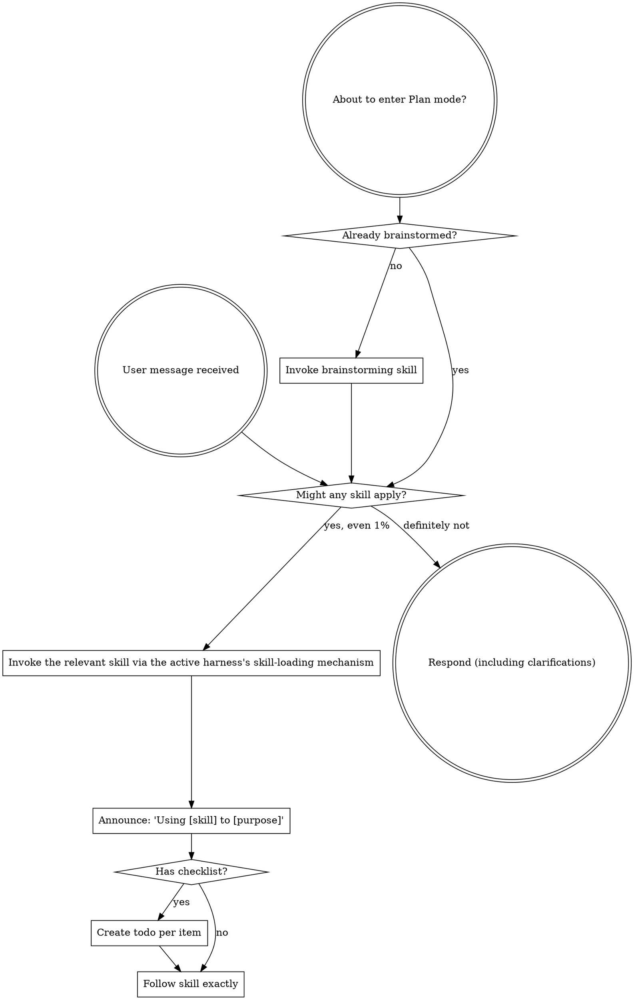

<SUBAGENT-STOP>
If you were dispatched as a subagent to execute a specific task, skip this skill.
</SUBAGENT-STOP>

<EXTREMELY-IMPORTANT>
If you think there is even a 1% chance a skill might apply to what you are doing, you ABSOLUTELY MUST invoke the skill.

IF A SKILL APPLIES TO YOUR TASK, YOU DO NOT HAVE A CHOICE. YOU MUST USE IT.

This is not negotiable. This is not optional. You cannot rationalize your way out of this.
</EXTREMELY-IMPORTANT>

## Instruction Priority

Systematic skills override default system prompt behavior, but **user instructions always take precedence**:

1. **User's explicit instructions** (CLAUDE.md, GEMINI.md, AGENTS.md, direct requests) — highest priority
2. **Systematic skills** — override default system behavior where they conflict
3. **Default system prompt** — lowest priority

If CLAUDE.md, GEMINI.md, or AGENTS.md says "don't use TDD" and a skill says "always use TDD," follow the user's instructions. The user is in control.

## How to Access Skills

# Using Skills

## The Rule

**Invoke relevant or requested skills BEFORE any response or action.** Even a 1% chance a skill might apply means that you should invoke the skill to check. If an invoked skill turns out to be wrong for the situation, you don't need to use it.

## Red Flags

These thoughts mean STOP—you're rationalizing:

| Thought | Reality |
|---------|---------|
| "This is just a simple question" | Questions are tasks. Check for skills. |
| "I need more context first" | Skill check comes BEFORE clarifying questions. |
| "Let me explore the codebase first" | Skills tell you HOW to explore. Check first. |
| "I can check git/files quickly" | Files lack conversation context. Check for skills. |
| "Let me gather information first" | Skills tell you HOW to gather information. |
| "This doesn't need a formal skill" | If a skill exists, use it. |
| "I remember this skill" | Skills evolve. Read current version. |
| "This doesn't count as a task" | Action = task. Check for skills. |
| "The skill is overkill" | Simple things become complex. Use it. |
| "I'll just do this one thing first" | Check BEFORE doing anything. |
| "This feels productive" | Undisciplined action wastes time. Skills prevent this. |
| "I know what that means" | Knowing the concept != using the skill. Invoke it. |

## Skill Priority

When multiple skills could apply, use this order:

1. **Process skills first** (brainstorming, debugging) - these determine HOW to approach the task
2. **Implementation skills second** (frontend-design, mcp-builder) - these guide execution

"Let's build X" -> brainstorming first, then implementation skills.
"Fix this bug" -> debugging first, then domain-specific skills.

## Skill Types

**Rigid** (TDD, debugging): Follow exactly. Don't adapt away discipline. The canonical bundled Rigid skill is `test-driven-development` — load it when implementing any feature or bugfix that requires test-first discipline.

**Flexible** (patterns): Adapt principles to context.

The skill itself tells you which.

## User Instructions

Instructions say WHAT, not HOW. "Add X" or "Fix Y" doesn't mean skip workflows.

## Capability Resolution

The four capabilities are subagent delegation, blocking user interaction, task tracking, and skill loading.

The bootstrap inlines the active harness profile naming the exact mechanisms for this session—consult it.

When a mechanism is unavailable, present numbered options in chat and wait for questions, maintain a visible list for task tracking, and dispatch delegation sequentially or do the work inline.

Check the workflow guard availability once per execution unit. Guard state is per session; a child session starts `inactive`. `inactive` (reason `no-active-epoch`) means no guarded workflow has started in this session. It is not unavailable and not terminal: load a guarded skill to begin, and do not call `systematic_workflow_start` or `systematic_workflow_complete` before one is active. A completion rejected with `readback-timeout` is retryable: call `systematic_workflow_complete` again at most twice, then report it to the user. Probes listed in `unconfirmedReadbacks` on status output (`local`, `pinned`, or an operation name) are unverified until a later status call confirms them. A completion rejected with `snapshot-blocked` or `stale-receipt` is not terminal. For `snapshot-blocked`, read `blockReason` from the rejection or `snapshotBlock.reasonCode` from status, fix that cause in the worktree without deleting or hiding user files unless the user agrees, and call status to confirm the block is gone (when the rejection names `blockTarget: parent-checkout`, fix the parent checkout and retry completion instead). Operations run while blocked leave no receipts: rerun stale or missing operations, checking remote state before redoing a push or PR, then complete. If the same reason remains after one fix, report it to the user, who can disable the guard through `systematic_workflow_control`. A call the guard skipped or sealed after a timeout has already run: check the worktree state, and rerun it only if its effect is missing. After a rejected push, check remote state, fix the cause and retry (a first push needs `git push -u`); if a push may have landed but left no receipt and later pushes are rejected as `resource-mismatch`, report it to the user. If the guard reports `unavailable` or `guard-unavailable`, treat it as terminal for that unit: do not retry `systematic_workflow_start` or `systematic_workflow_complete`. Use the documented unguarded fallback only when authorized, and report the unavailable state once.
